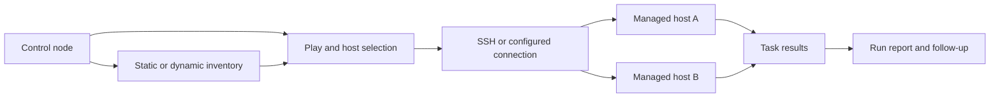
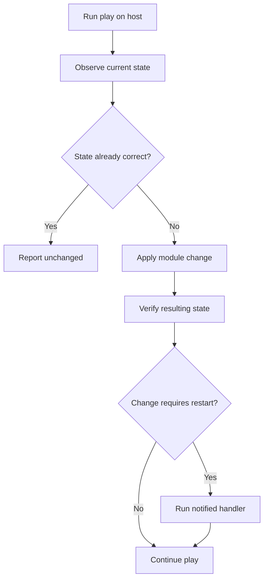
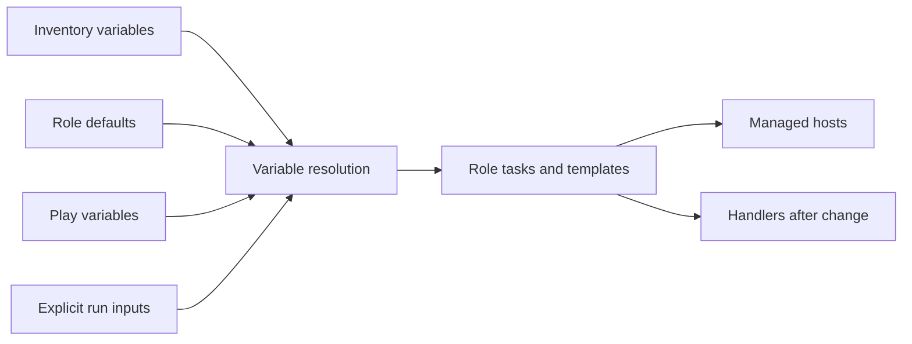
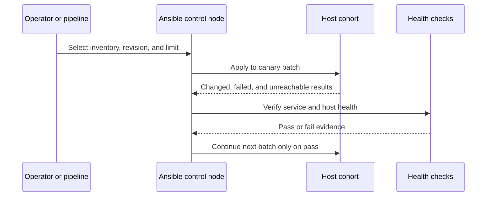
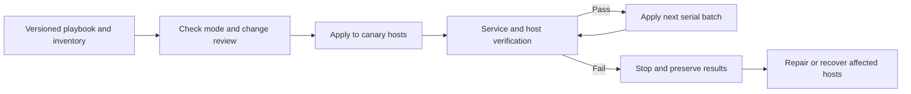

# Ansible

Part: [13 — DevOps](PART_OVERVIEW.md)

Ansible automates host and application configuration through inventories, plays, tasks, and modules. A control node connects to managed hosts, gathers or uses facts, executes tasks, and reports results. Its agentless approach can simplify adoption, but depends on network access, authentication, privilege boundaries, module behavior, and carefully designed idempotence. Part 05 owns operating-system internals; CH08 Terraform and CH09 Pulumi own infrastructure provisioning.

## Inventory and Execution Model

Inventory names hosts and groups and can supply connection variables. It may be static or generated dynamically from a system of record. A play targets a host group and applies ordered tasks. Modules express operations such as package installation, file management, and service state; handlers run after notified changes. Connection plugins commonly use secure shell for Unix-like hosts or other supported transports for different systems.

Inventory groups should reflect stable operational boundaries such as environment, role, or maintenance cohort. Avoid embedding secrets in inventory source. Dynamic inventory improves freshness but creates a dependency on the external inventory service; define caching and outage behavior, and make the selected host set auditable for a production run.

## Idempotence, Tasks, and Handlers

An idempotent task converges a host toward a declared condition and can run again without accumulating unintended change. Prefer modules that manage state over shell commands that perform opaque actions. A shell task may report a change every run, cannot always determine whether the desired condition already holds, and complicates retries. When command execution is unavoidable, define preconditions, change detection, and failure criteria explicitly.

Idempotence is not a property guaranteed by the YAML syntax. A module can have edge cases, and an imperative script can make changes repeatedly. Test repeated runs and verify that the second run reports no unintended changes. Handlers coalesce repeated notifications and usually run at a later point; this prevents repeated service restarts during a play but means failures before handler execution can leave configuration changed and service unrestarted.

## Roles, Variables, and Reuse

Roles package tasks, handlers, defaults, variables, files, templates, and metadata into reusable units. Keep roles focused on a cohesive responsibility and expose a small documented variable interface. Use defaults for safe optional behavior and reserve higher-precedence variables for deliberate overrides. Ansible variable precedence is complex; minimize overlapping definitions and inspect effective values rather than relying on memory.

Pin external roles and collections to reviewed versions. Roles are code dependencies and can execute commands on every targeted host. Review source, provenance, permissions, and update cadence. Avoid downloading unpinned collections at runtime in production automation.

## Safe Rollout, Privilege, and Secrets

Configuration changes can affect many hosts at once. Use serial batches, health checks, and failure thresholds to bound impact. A rolling play can stop before reaching the entire fleet if an early cohort fails. `--limit` narrows execution but should be recorded; a mistaken limit can omit critical hosts. Start with check mode or a canary cohort when the modules support meaningful previews, then inspect diffs before broad execution.

Privilege escalation should be explicit and limited to tasks that require it. Separate connection identity from elevated privilege identity where possible. Ansible Vault can encrypt values at rest in source, but runtime access to the decryption key remains sensitive. Do not print secrets with debug tasks, and restrict logs and fact caches because facts may include sensitive system details.

## Failure Handling and Drift

Unreachable hosts, partial task failure, and controller interruption can leave a fleet in mixed state. Make tasks repeatable, gather per-host results, and rerun only after verifying the previous operation's side effects. Use `block`, `rescue`, and `always` for structured handling, but do not hide a failed host behind a successful play summary. A rescue path should restore a known state or stop with actionable evidence.

Configuration drift occurs when hosts change outside the managed playbooks or when desired inputs differ from what ran. Reconcile by recording the exact playbook revision, inventory snapshot, variables, collection versions, and host results. Schedule audits or check-mode runs where they provide useful evidence. Avoid automatic correction for changes that may represent an approved emergency intervention until ownership is understood.

## Worked Case: Web-Fleet Runtime Upgrade

A team upgrades a runtime across a web fleet. The play installs the pinned package version, renders a configuration template, validates its syntax, and notifies a service handler only when relevant files change. Execution proceeds on a small canary group, then verifies endpoint health before continuing in batches. A failed canary stops the rollout and retains logs, host facts, and the exact inventory selection. The team fixes the issue and reruns the idempotent play on the affected cohort.

## Review Checklist, Exercises, and Summary

Review inventory source and freshness, host selection, connection identity, privilege use, variable precedence, role and collection pins, idempotence, check-mode support, batch size, handlers, secrets, logging, fact retention, and recovery. Confirm that repeated runs converge and that partial failure is visible.

1. Draw how inventory selection flows through a play, task, module, and handler.
2. Convert an imperative package-install shell task into a state-based module task and test its second run.
3. Design a canary and serial-batch rollout for a fleet with two regions.
4. Explain why encrypted source variables still require protection of runtime decryption credentials.
5. Simulate an unreachable host and a failed handler; decide how to determine the actual state before rerunning.

Ansible provides host-level configuration convergence through a control node and modular tasks. Its safety comes from idempotent behavior, explicit inventory and privilege boundaries, controlled rollout batches, pinned dependencies, and truthful failure reporting. Use it for configuration and application operations, not as an unreviewed substitute for infrastructure lifecycle management.
