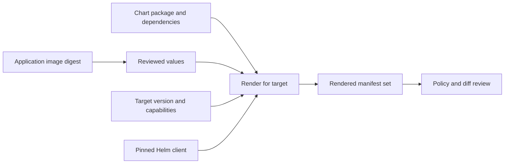
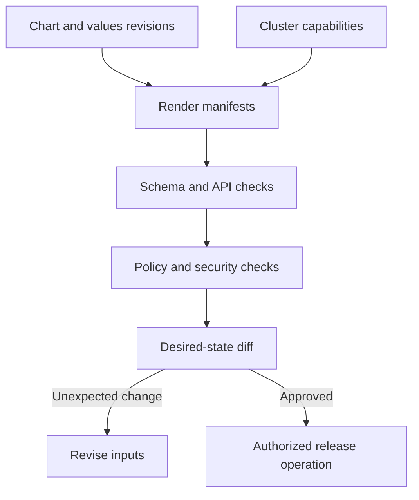
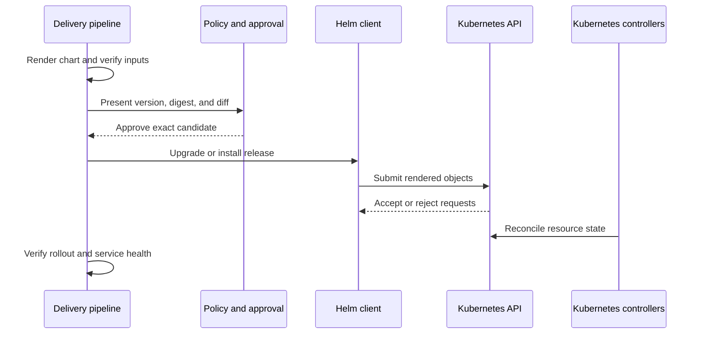
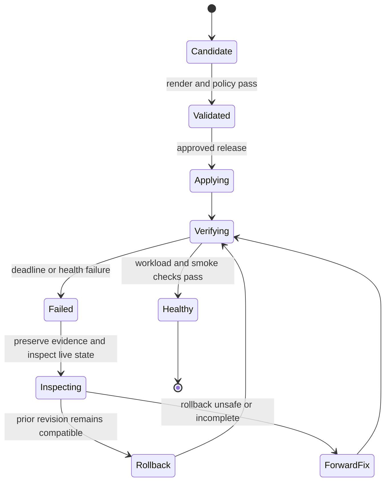

# Helm (Deployment Perspective)

Part: [13 — DevOps](PART_OVERVIEW.md)

This chapter covers how delivery pipelines consume Helm charts, validate rendered manifests, promote chart releases, and preserve resource ownership. It deliberately does not repeat chart authoring, values merging, template behavior, hooks, or Helm release internals; [Part 12 CH11 Helm](../12_Kubernetes/CH11_Helm.md) owns those mechanics. Part 12 CH12 owns Argo CD. CH02 owns artifact promotion and pipeline gates.

## Chart as a Versioned Deployment Input

A Helm chart is a deployment package and one input to the effective workload configuration. The same chart can render different manifests for different values, release identity, namespace, and cluster capabilities. Therefore the chart version alone is not a complete deployment identity. Record the chart version or digest, values source revision, Helm client version, target cluster capabilities, and rendered manifest digest where practical.

Charts may come from source repositories or Open Container Initiative (OCI)-compatible registries. Pin dependencies and avoid mutable package references in production. Verify package origin and integrity under the organization’s artifact policy. Keep application image identity immutable; do not rely solely on a mutable image tag embedded in chart values.

## Render, Validate, and Review

Render charts in CI using the exact values and target capabilities intended for the deployment. Validate syntax, schema, API availability, policy, image digest, resource settings, namespace, and security-sensitive fields. Review the rendered diff against current desired configuration rather than reviewing only the values file; templates and defaults can produce behavior not obvious from a small override.

Treat the rendered output as a release candidate, but recognize that cluster admission, controllers, and runtime conditions can still change the outcome. Store the rendered output and checks with the pipeline run. Avoid logging secret values; chart values and Helm release state can preserve configuration beyond the job lifetime.

## Release Operation and Ownership

Choose one authoritative system to manage a release. A pipeline can invoke Helm directly for a bounded deployment, or a GitOps controller can observe desired chart configuration and reconcile it. Do not let direct Helm commands and a GitOps controller compete for the same release or resource fields. When migrating ownership, establish a cutover: stop writes from the old owner, confirm the new owner’s desired state, and then enable reconciliation.

The command returning successfully means the release operation completed according to Helm's behavior; it does not prove every resource is healthy or the user journey works. Configure deadlines and waits appropriate to the workload, then run service-level verification. Part 12 CH11 explains release revisions, rollback limits, CRD behavior, and hooks in depth.

## Environment Values, Secrets, and Promotion

Keep common chart defaults with the chart and small environment-specific values in a versioned configuration source. Avoid copying a full values file per environment, which causes fixes and defaults to diverge. Validate that production values cannot be changed by an untrusted pull request or pipeline input. Use a secret-delivery integration rather than plaintext values in a public repository, command line, or artifact.

Promote a chart and application artifact by immutable identity, but render and validate for each target environment because API capabilities and configuration differ. Retain rendered output with the candidate. For high-impact production changes, bind approval to the exact chart package, values revision, image digest, rendered result, and target.

```mermaid
flowchart LR
    Package[Chart package and dependencies] --> Dev[Development values and target]
    Dev --> VerifyDev[Render and health verification]
    VerifyDev -->|Promote same package| Stage[Staging values and target]
    Stage --> VerifyStage[Render, approve, and verify]
    VerifyStage -->|Approval| Prod[Production values and target]
    Prod --> Evidence[Release record with digest and health]
```

## Failure, Rollback, and Recovery

A failed upgrade may leave some resources updated and others unchanged. Inspect release status, rendered desired state, live objects, events, and workload health before retrying. Rollback changes Kubernetes resources toward a prior release revision; it does not reverse external data changes, destructive schema migrations, or all hook side effects. Use backward-compatible application and database changes, and rehearse recovery.

Registry retention must preserve chart versions and application digests needed for recovery. Keep release logs, values revision, rendered output, cluster target, operator identity, and health results. Do not rerun an uncertain operation just because the client timed out; query actual release and cluster state first.

## Worked Case and Review Checklist

A service team releases chart version 3.2.1 with application digest `sha256:...`. CI renders development and production values separately, checks policy, and presents the production diff. A release owner approves the exact candidate. The pipeline applies it to staging, verifies readiness and a service-level smoke test, then promotes the same chart and image digests to production with production configuration. A failed probe stops further promotion; operators inspect the release and use a tested recovery plan.

Review chart and dependency immutability, values ownership, target capability assumptions, rendered manifest retention, secret path, policy checks, release authority, cluster credentials, wait conditions, service health, rollback compatibility, and artifact retention. Confirm no second controller writes the same release.

## Questions and Summary

1. Why are chart version and image tag insufficient to identify a complete deployment candidate?
2. Draw the path from chart and values revisions through rendered diff, release operation, controllers, and health check.
3. Design a safe cutover from direct Helm deployment to GitOps ownership.
4. A Helm operation times out after submitting resources. What state should be inspected before retry?
5. Which rollback effects are outside Helm's ability to reverse?

Helm delivery is the controlled promotion of a chart, values, rendered output, and application artifact to a Kubernetes target. Validate the rendered result, keep ownership singular, scope deployment identity, and verify runtime health after the release. Use Part 12 CH11 for Helm's internal mechanics and this chapter for the pipeline contract around them.
