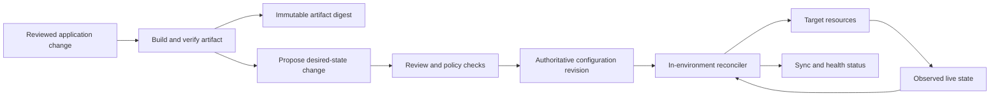
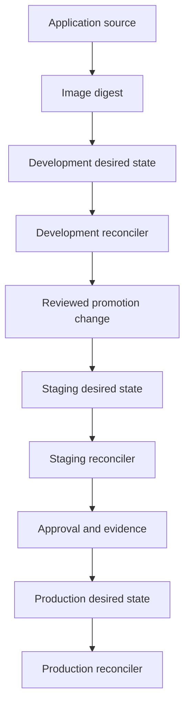
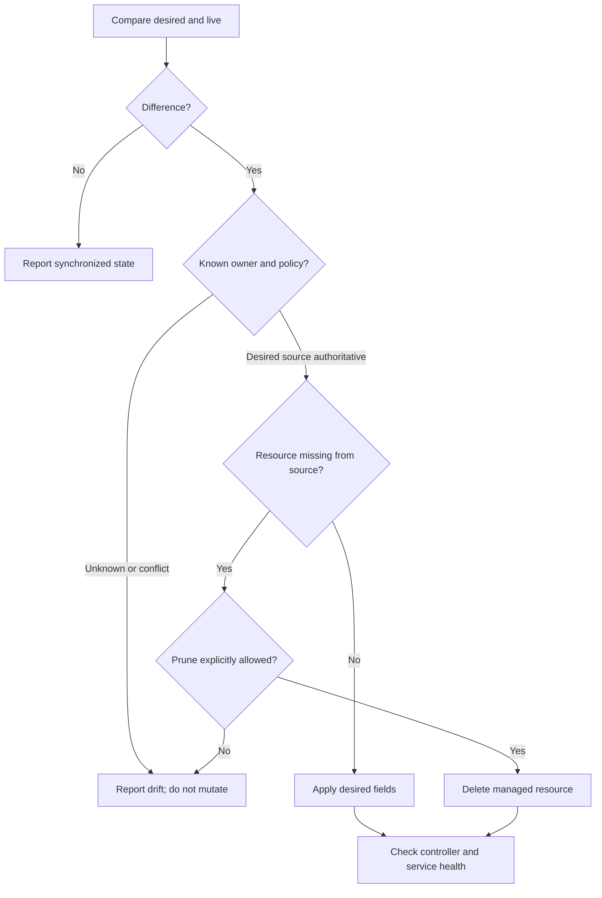
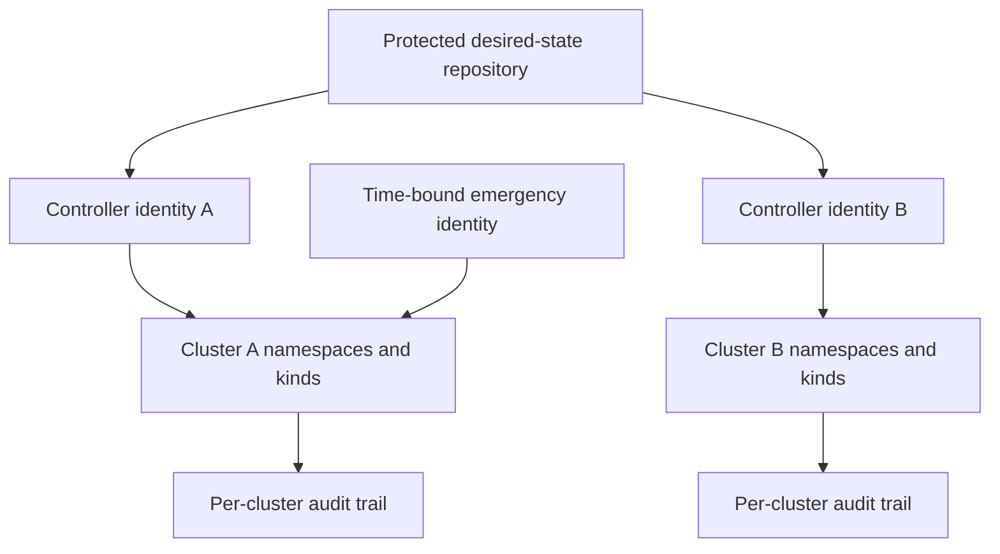
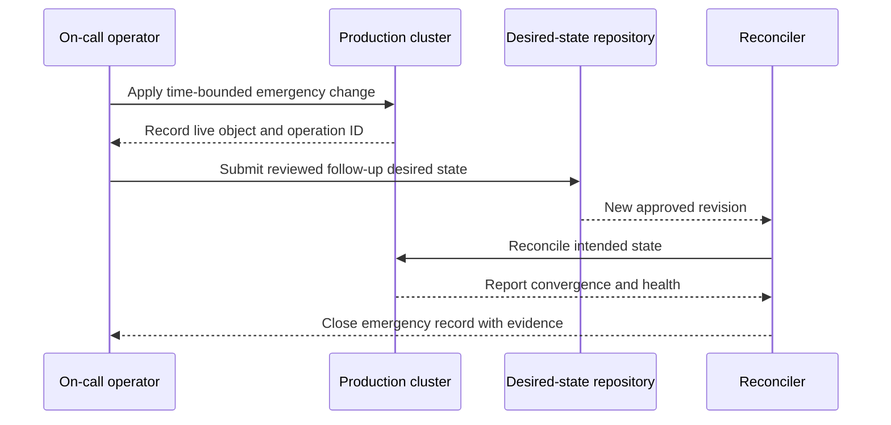

# GitOps

Part: [13 — DevOps](PART_OVERVIEW.md)

GitOps is an operating model in which version-controlled desired state is reconciled by software operating near the target environment. A controller observes source and live state, calculates differences, and applies authorized changes. The model improves reviewability and convergence, but does not make Git a complete runtime database or eliminate emergency access, secrets, or ownership questions. Part 12 CH12 owns Argo CD; this chapter owns general GitOps principles. CH01 owns Git mechanics and CH02 owns pipeline design.

## Pull-Based Reconciliation Model

In a push deployment, a pipeline holds credentials for the target and sends changes. In pull-based GitOps, an in-environment controller reads approved desired state and applies it using its own scoped identity. The pipeline can build and publish artifacts, update a configuration revision, and request review without possessing direct production cluster credentials.

The reconciliation loop compares desired resources rendered from a source revision with observed live objects. It can report drift, apply changes, repair drift, and optionally prune resources absent from desired state. Define which resources the controller owns and which it must ignore. A controller should not fight an operator, an imperative pipeline, or a human writing the same fields.

Git is the source of desired state, not a replacement for live-state observation. External systems, admission policies, controllers, and manual break-glass operations can change the effective system. Preserve controller status and live evidence, and reconcile intentional emergency changes back into source.

## Repository and Environment Structure

Repository topology should make ownership, promotion, and blast radius clear. A monorepo can make coordinated changes atomic and simplify shared policy, while requiring path ownership and efficient change selection. Separate repositories can isolate access and lifecycle, while requiring explicit version coordination. Environment directories or branches can express promotion boundaries; mutable branch movement requires recording the resolved commit used by each controller.

Promote the same immutable artifact through environments; change only reviewed configuration and target-specific settings. Pin chart and remote dependency versions. If a controller tracks a moving branch, its actual commit should be visible in status and deployment evidence. For high-risk production changes, review the rendered output, not just the source diff.

## Drift, Sync, and Pruning Policy

Drift can indicate a defect, an emergency correction, an out-of-band controller, or an incomplete desired-state source. Alert on meaningful drift and classify it before correction. Automatic self-heal is useful for resources whose desired state is authoritative; it can erase a valid emergency change or repeatedly undo another controller if ownership is ambiguous.

Pruning deletes live resources absent from the desired set. It is a destructive lifecycle action, not harmless cleanup. Scope prune permission, require review for sensitive resources, preserve data-bearing resources deliberately, and test deletion behavior in a non-production environment. A deleted manifest can otherwise remove persistent data or shared infrastructure unexpectedly.

## Secrets, Identity, and Trust

The reconciler needs read access to source and write authority in its target. Scope source repositories, namespaces, resource kinds, and cluster permissions. A compromised controller may exercise its full destination identity, so the pull model changes credential placement but does not eliminate privilege risk. Separate controllers or identities where blast radius requires it.

Do not store plaintext secrets in Git. Use encrypted values with managed key policy or external secret references whose runtime access is limited. Keep secret decryption authority away from untrusted pull-request execution. Protect repository write access, require review for production configuration, pin external sources, and audit controller identity. Part 15 owns detailed security controls.

## Bootstrap, Break-Glass, and Recovery

GitOps controllers themselves must be installed and configured somehow. Define bootstrap ownership, initial credentials, repository trust, and recovery if the controller is unavailable. Keep a documented method to restore the controller without relying on the controller being restored.

Break-glass operations should use a distinct identity with time-bounded approval and audit. Record the affected resources, reason, and resulting live state. Once service is stable, reconcile the change into the authoritative repository or explicitly document why it is temporary. Otherwise the next sync can erase it, or the live cluster can remain permanently divergent.

When a controller is unavailable, cluster workloads may continue running while changes stop converging. Communicate that distinction. On recovery, inspect source revision and live state before enabling automated prune or self-heal; queued reconciliation can otherwise trigger a large unexpected change.

## Worked Case and Review Checklist

A team builds a service image and publishes a digest. A pull request updates the development configuration; after review and health verification, a second reviewed change promotes the same digest to staging and then production. The production controller can update only the service's namespace and approved resource kinds. Pruning is disabled for data stores and enabled only for disposable application resources. An on-call direct change is recorded, followed by a configuration pull request to restore convergence.

Review desired-state ownership, repository topology, immutable references, rendered manifests, controller permissions, pruning, self-heal, secret delivery, bootstrap, break-glass process, status visibility, and outage recovery. Ensure every managed object has one authoritative writer and that the controller can be restored independently.

## Questions and Summary

1. Compare pull-based reconciliation with a push pipeline in credential placement, drift detection, and recovery.
2. Draw desired state, live state, sync status, and prune policy for a resource group.
3. Design a safe break-glass procedure that does not leave permanent configuration drift.
4. Decide which resources in a sample system may be pruned automatically and justify exclusions.
5. What evidence should be inspected before enabling self-heal after controller downtime?

GitOps uses versioned desired state and a reconciler to make changes visible and continuously convergent. Its safety depends on clear ownership, scoped identities, immutable inputs, deliberate drift and pruning policy, and a break-glass path that returns changes to source. A controller is a deployment mechanism, not proof that a service is healthy.
