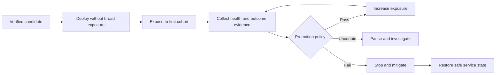
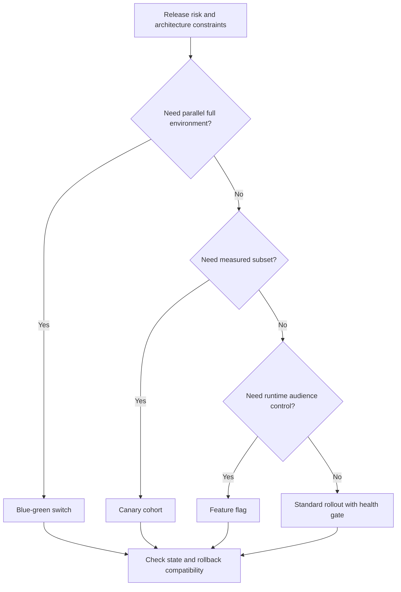
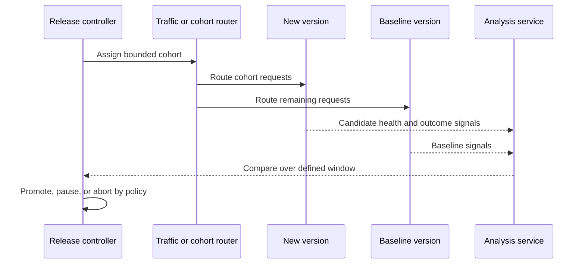
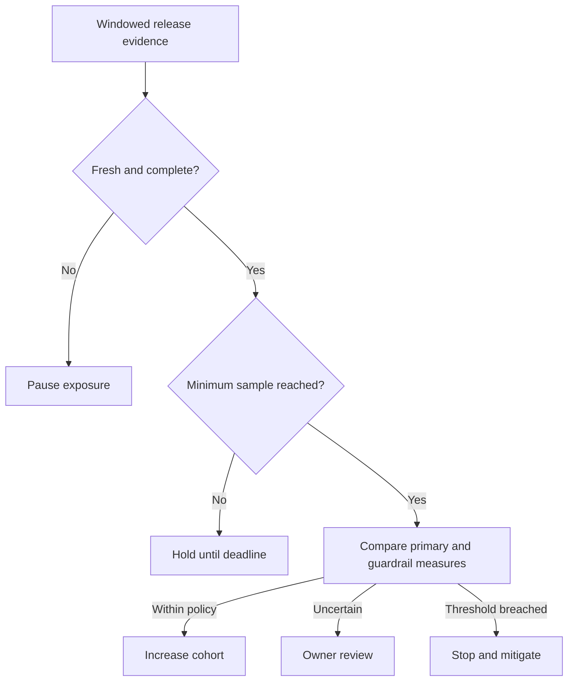
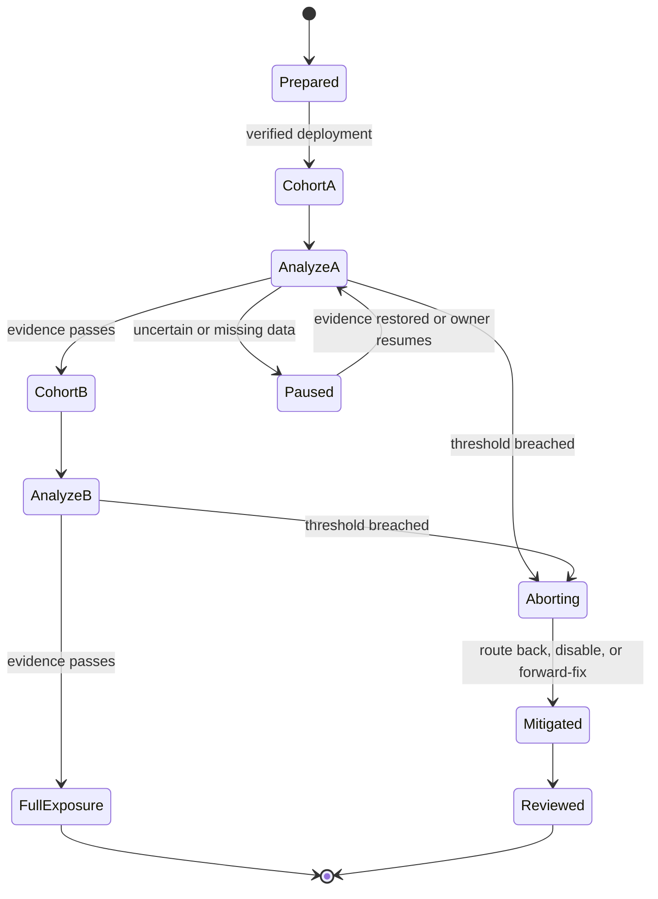

# Progressive Delivery

Part: [13 — DevOps](PART_OVERVIEW.md)

Progressive delivery exposes a release to increasing portions of users, traffic, or capacity and uses evidence to promote, pause, or reverse it. It connects release control to operational health instead of treating deployment completion as success. This chapter owns the governance and evidence model. CH15 Blue-Green and CH16 Canary cover specific strategies; Part 12 owns Kubernetes traffic mechanisms; Part 14 owns telemetry.

## Release Exposure as a Control Loop

A release has at least three distinct states: packaged, deployed, and exposed. Progressive delivery controls the last transition in measured steps. A control plane selects the cohort and stage; a data plane serves requests; an analysis process compares health evidence with a baseline and decides whether to advance. The controller must retain a safe pause or abort path.

The purpose is risk containment and learning, not ceremony. A cohort should be large enough to produce useful evidence but small enough to bound potential impact. Selection can be by percentage of traffic, customer group, region, tenant, or instance pool. Each option has different exposure and bias risks.

## Strategy Selection and Release Boundaries

Blue-green deployment switches between two production-capable environments; canary deployment compares a limited release cohort with a baseline; feature flags control runtime exposure independently of deployment. These techniques can be combined, but they solve different control problems. CH15 owns blue-green design, CH16 owns canary analysis, and CH14 owns flags.

Choose based on state compatibility, traffic-control capabilities, cohort representativeness, deployment duration, environment cost, and restoration path. A database migration or external side effect can make a binary rollback invalid even when traffic can be switched instantly. Define application compatibility before selecting a traffic strategy.

## Health Gates and Analysis Windows

Define success criteria before exposure: service-level indicators, business outcomes, guardrails, and a baseline period. Compare equivalent traffic, account for seasonality and low volume, and set a minimum sample or observation duration. A short analysis window can miss delayed failures; an excessively long one prolongs risk and blocks capacity.

Use both leading signals, such as error rate or saturation, and relevant business outcomes, such as completed transactions. Define thresholds with comparison windows and confidence appropriate to traffic. A single metric can be gamed or fail to represent user harm; pair primary indicators with guardrails. Part 14 owns metric instrumentation and alert semantics.

Traffic cohorts can be biased. Internal users, one region, or a small set of high-volume tenants may not represent the full population. Choose cohorts deliberately and inspect composition. When exposure is too low for statistical confidence, treat the result as an operational smoke test, not a causal quality conclusion.

## Promotion, Abort, and Rollback

Promotion should be monotonic only when evidence supports it. The release controller needs explicit states, deadlines, and an owner when analysis is inconclusive. A failed health gate should stop additional exposure. Mitigation may mean returning traffic, disabling a flag, rolling back a compatible artifact, or deploying a forward fix. Preserve the candidate and evidence for diagnosis.

Rollback objectives should include time to detect, decide, and restore, not just the deployment command duration. Verify that the previous version can coexist with current schema, messages, and external state. If rollback is unsafe, make a forward-fix path explicit and test its operational steps.

## Worked Case and Review Checklist

A payment API release starts with five percent of eligible traffic, excluding internal synthetic traffic from the customer cohort. The controller compares error rate, latency, and payment completion against the previous version over a minimum transaction count and fixed maximum window. Elevated timeout rate pauses the release; a confirmed regression routes traffic to the stable version and records the decision. When the metrics source is unavailable, the controller does not interpret missing evidence as success.

Review the exposure unit, cohort representativeness, baseline, indicators, guardrails, sample size, analysis window, missing-data behavior, abort authority, rollback compatibility, migration state, capacity, and audit record. Confirm that every state has an owner and a deadline.

## Questions and Summary

1. Distinguish deployed, exposed, and promoted release states.
2. Design success and abort criteria for a low-volume service where statistical confidence takes hours.
3. Compare blue-green, canary, and feature-flag control boundaries for a stateful service.
4. What should a release controller do when telemetry is missing or delayed?
5. Draw the sequence from candidate verification through cohort expansion and mitigation.

Progressive delivery makes release exposure a measured control loop. Select cohorts and strategies to fit the risk, define meaningful health gates before deployment, and stop when evidence fails or is absent. The recovery path must account for state compatibility and user impact, not just traffic routing.
