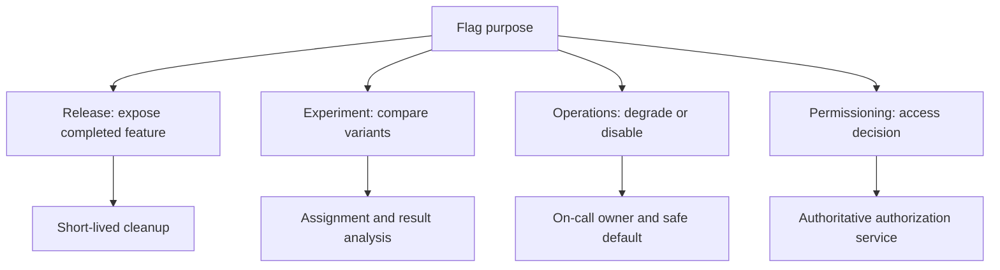
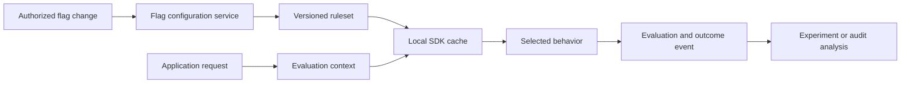
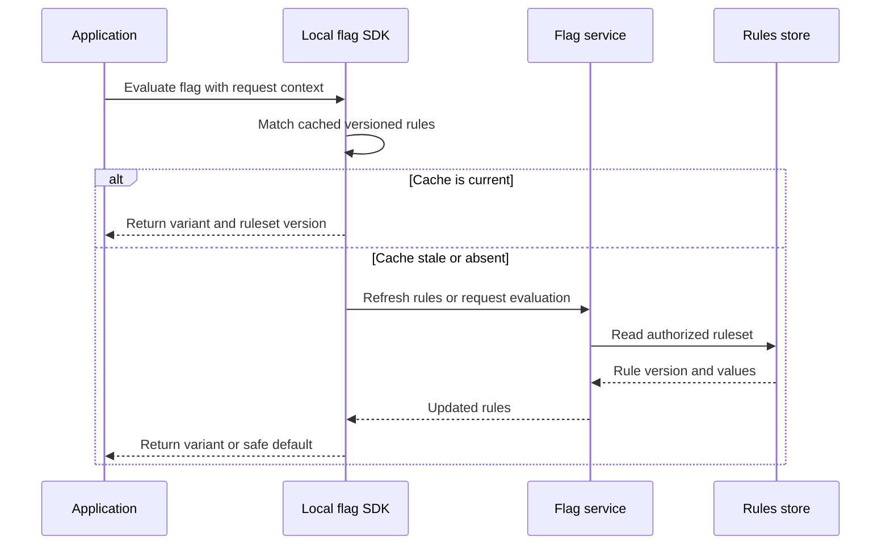
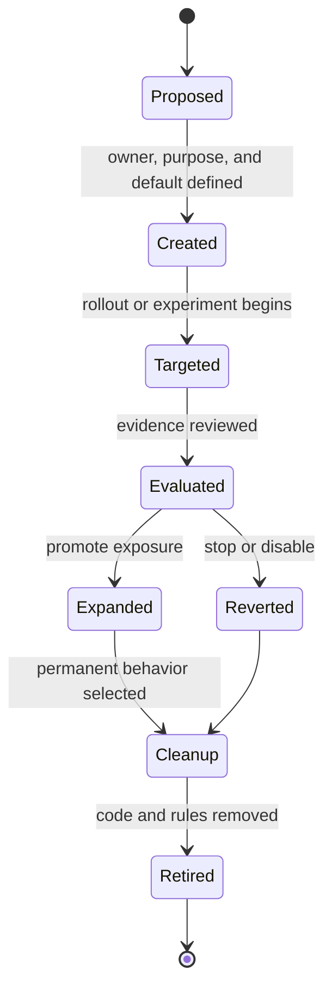
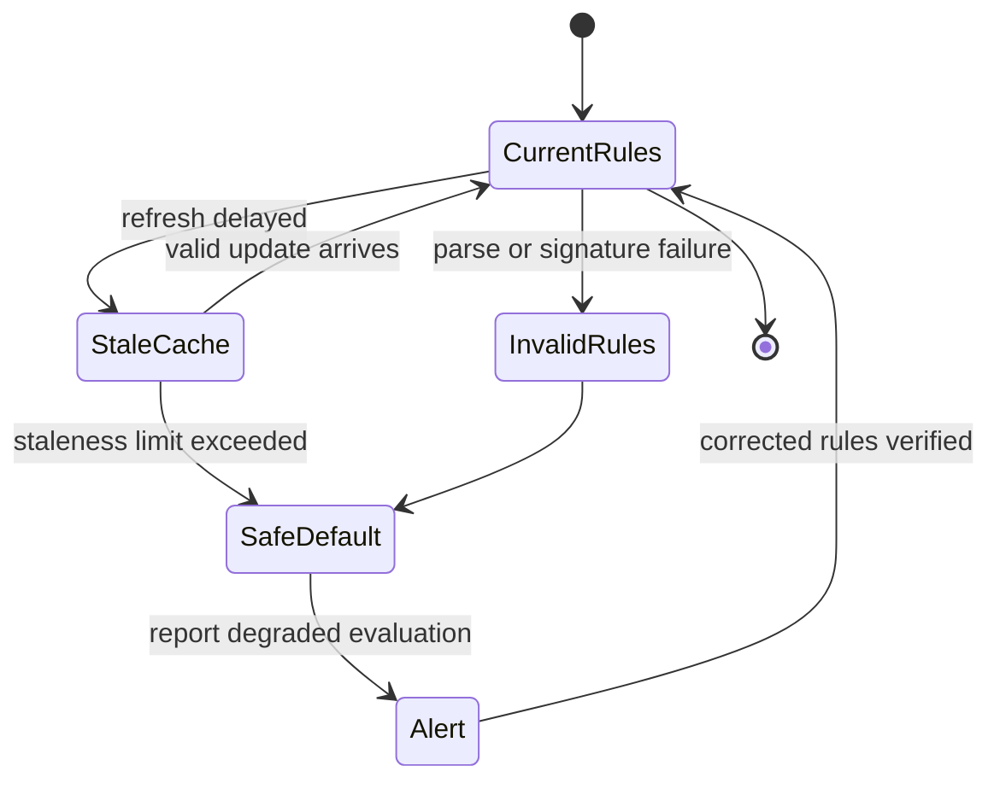

# Feature Flags

Part: [13 — DevOps](PART_OVERVIEW.md)

A feature flag is a runtime decision that selects behavior from configuration rather than requiring a new deployment. Flags can separate deployment from user exposure, support experiments, protect operations, or control entitlements. They also create a configuration and security surface: stale rules, inconsistent evaluation, privacy leakage, and flag debt can make behavior difficult to reason about. CH13 owns progressive release governance; Part 15 owns authorization and security controls.

## Flag Types and Decision Boundaries

Classify a flag by purpose and lifecycle. Release flags hide incomplete work; experiment flags assign cohorts for measurement; operational flags disable expensive or fragile behavior; permissioning flags represent access decisions. Permissioning flags deserve particular caution: a general release-flag system is not automatically a secure authorization service. Enforce sensitive access at a trusted server boundary and audit decisions under the owning security policy.

Prefer the simplest mechanism that meets the need. A configuration value may be enough for a static rollout; a distributed flag service adds targeting, audit, and rapid change but introduces availability, consistency, and operational dependencies. Keep the flag's owner, intended users, default, expiry or review date, and rollback behavior explicit.

## Evaluation Architecture

A service may evaluate flags locally from a periodically refreshed ruleset or make a remote evaluation request. Local evaluation reduces request latency and avoids a network dependency in the hot path, but can use stale rules. Remote evaluation centralizes targeting and audit but adds latency, availability, and data-transfer concerns. Hybrid designs use a local SDK with streamed or polled updates and a safe fallback.

Evaluation context may include user, tenant, region, or request attributes. Minimize collected personal data, define retention, and prevent high-cardinality identifiers from leaking into logs. Keep evaluation deterministic for a given ruleset version and context, especially for experiments; otherwise users can move between variants and invalidate conclusions.

## Targeting, Consistency, and Failure Behavior

Rules may use allowlists, percentages, segments, time windows, or attribute predicates. Resolve precedence explicitly: emergency kill switch, explicit deny, allowlist, cohort assignment, then default is one possible ordering, but the correct policy depends on the flag type. Avoid overlapping rules whose result depends on incidental evaluation order.

Define behavior for service outage, stale cache, malformed rules, and partial refresh. The default should fail safely for the flag's purpose: an operational kill switch may need to disable an optional costly feature, while a release flag may preserve the last known-good value. A permissioning decision must fail according to the authorization policy, not an arbitrary feature-flag default. Alert when rules are stale beyond their acceptable window.

Percentage rollout requires stable assignment. Hash a stable subject identifier with a flag or experiment salt and map it into a fixed bucket range. Do not use request randomness for a persistent cohort. Changing the hash key, salt, or population definition can reshuffle assignments, so version the assignment contract and preserve experiment analysis boundaries.

## Flag Lifecycle and Governance

Every flag has a lifecycle: creation, owner assignment, targeting, evaluation, cleanup, and retirement. Release flags should have an expiry or cleanup issue when created. Experiment flags require a hypothesis, assignment method, metric, guardrails, and stop rule. Operational flags require an on-call owner, documented safe state, and a tested control path.

A flag that remains after its decision creates permanent branching and test combinations. Inventory flags, identify owners, detect stale evaluations, and remove code and remote rules together. Do not simply delete a flag from the service while clients still depend on it. For long-lived operational controls, document why the control is permanent and test both settings.

## Worked Case and Review Checklist

A team deploys a redesigned checkout behind a release flag. The default remains the old flow. A stable hash assigns eligible users to a small cohort; the SDK returns the ruleset version with each evaluation. The team monitors checkout completion, payment errors, and latency. A kill switch can restore the old behavior without a deployment. After evidence supports full exposure, the team removes the old path and flag, then closes the lifecycle record.

Review flag purpose, owner, default, evaluation authority, context privacy, rule precedence, assignment stability, cache freshness, outage behavior, kill switch, audit, expiry, cleanup path, and whether the flag is incorrectly being used as the sole authorization control.

## Questions and Summary

1. Compare local SDK evaluation with remote evaluation in latency, consistency, availability, and privacy.
2. Design deterministic cohort assignment that remains stable across requests.
3. Choose safe defaults for a release flag, operational kill switch, and permissioning decision.
4. Draw the lifecycle from flag proposal through code and rule removal.
5. Find a stale flag in a sample codebase and plan a safe cleanup with both behavior paths tested.

Feature flags decouple deployment from behavior exposure, but they create a distributed configuration system with its own latency, consistency, security, and maintenance risks. Define purpose and defaults, make cohort assignment stable, plan for stale or unavailable rules, and retire temporary flags promptly. Never confuse a rollout switch with authoritative authorization.
