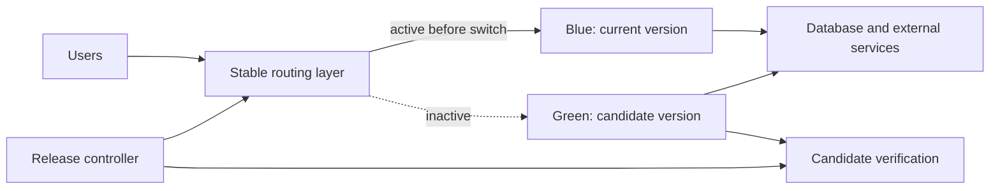
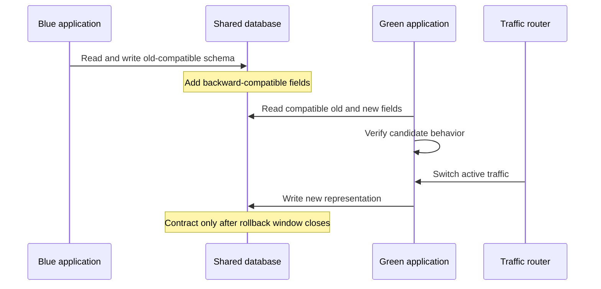
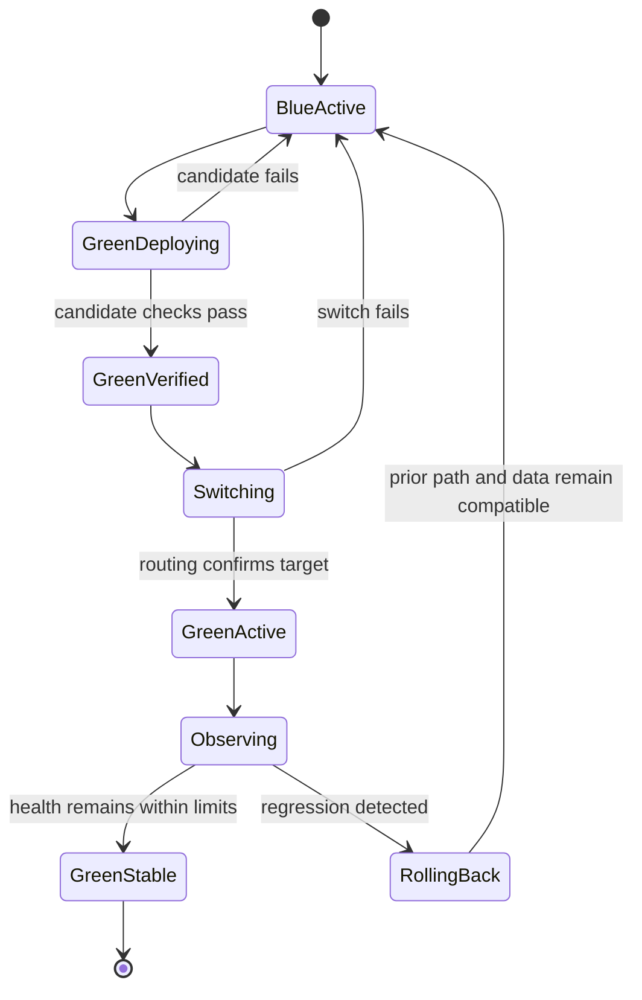
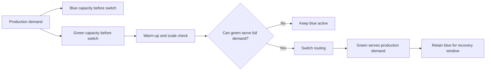
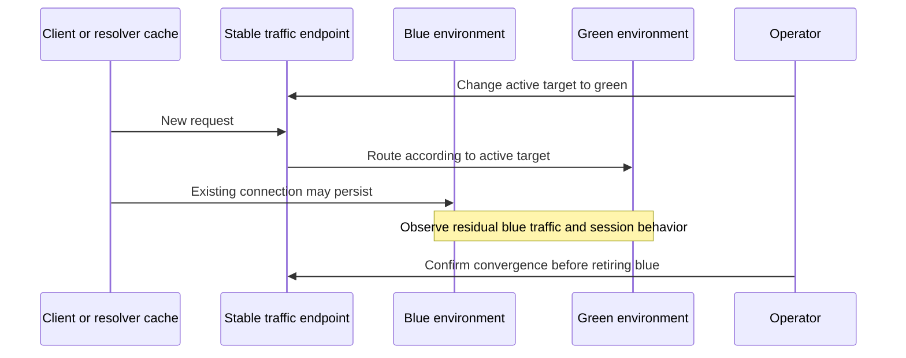

# Blue-Green Deployment

Part: [13 — DevOps](PART_OVERVIEW.md)

Blue-green deployment maintains two production-capable environments. One serves current traffic while the other receives and validates a candidate; a routing change transfers service to the candidate. It can make application rollback fast, but requires compatible state, reliable traffic control, and enough capacity to operate both environments. CH13 owns progressive-delivery governance; CH16 owns canary analysis; Part 09 owns provider traffic services.

## Topology and Traffic Switch

The blue environment is the current stable version and green is the candidate, or vice versa after a release. A stable routing layer directs users to one active environment. Both sides should have known configuration, health checks, and access to required dependencies. “Two environments” may mean two clusters, two service pools, or two application versions behind a router; the design must state which resources are actually duplicated.

Deploy and verify green before switching user traffic. Smoke checks should exercise real application behavior without creating unsafe external side effects. Warm caches, load required data, validate network paths, and confirm capacity before the switch. If green is not ready, blue remains active.

## State Compatibility and Expand-Contract

Blue-green environments often share databases, queues, identity providers, and third-party integrations. During deployment, old and new code may run concurrently or either may be restored. Their data contracts must therefore be compatible. Expand-and-contract changes add backward-compatible schema first, move code and data, and remove old schema only after the previous version is no longer needed.

A database migration, message format change, or external side effect can make the prior version unusable. A routing switch cannot undo data mutations. Define rollback compatibility and a forward-fix option before release. Destructive schema cleanup should occur in a later change after the rollback window and consumer migration are verified.

## Switch, Verification, and Rollback

The traffic switch may be a load-balancer target change, DNS update, service selector change, or service-mesh route update. Each has propagation delay and failure modes. Prefer a control plane with observable acknowledgment and a deterministic way to identify the active target. DNS-based switches can persist in client and resolver caches, so “switch complete” may not mean all clients moved.

Observe the new environment immediately after the switch. Define thresholds and an observation window for error rate, latency, capacity, and business outcomes. If health degrades, switch back only if the old environment remains compatible with all data writes and external effects. Otherwise stop traffic growth and use a forward fix. Keep blue intact until the recovery decision is made; do not repurpose it too early.

## Capacity, Cost, and Operational Constraints

Running two full environments can double compute, storage, license, and network costs. The inactive side may use reduced capacity before deployment, but it must scale and warm quickly enough to accept production load. Shared databases and external dependencies can remain bottlenecks even when compute is duplicated. Load-test the candidate at expected post-switch demand and protect dependencies during simultaneous warm-up.

The capacity decision should include shared dependencies and scale-up delay, not just application replicas. If green cannot serve the full load, increase capacity before the switch or use a gradual-exposure strategy.

Configuration drift between blue and green undermines confidence. Use the same deployment artifact and versioned configuration with explicit environment differences. Record the exact image or package digest, configuration revision, routing state, approval, and verification results. Ensure access controls prevent an operator from switching traffic to an unreviewed target.

## Worked Case and Review Checklist

A service uses two application pools behind a stable router and a shared database. Green receives the new image digest and production configuration. A synthetic transaction verifies authentication, data access, and a reversible write. After health and capacity checks pass, the router switches traffic. Metrics are observed for a defined interval. A timeout increase triggers a switch back to blue because the schema remains backward compatible. The team keeps the release artifact and event record for analysis.

Review the actual duplicate components, shared state, schema compatibility, candidate warm-up, capacity, router acknowledgment, propagation delay, health gates, rollback conditions, blue retention, and cost. Confirm the previous environment remains safe after new-version writes and that rollback is tested rather than assumed.

## Questions and Summary

1. Draw which components are duplicated and which are shared in a blue-green design.
2. Explain why a fast traffic switch does not guarantee safe application rollback.
3. Design an expand-contract database sequence that supports both environments.
4. Compare a router switch with a DNS switch, including propagation and observability.
5. Which health and capacity evidence should be required before and after switching?

Blue-green deployment reduces application cutover time by preparing a second production-capable environment, but shared state and external effects constrain rollback. Verify the inactive environment, switch through an observable control plane, preserve the old environment through the decision window, and treat data compatibility and capacity as first-class design requirements.
