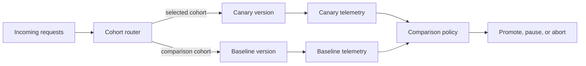
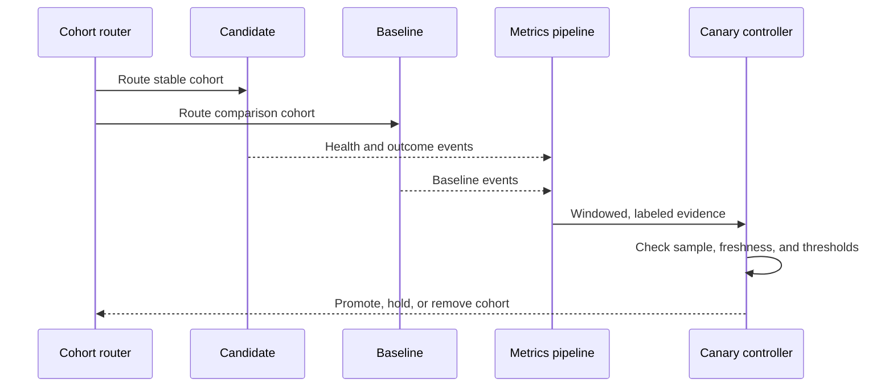
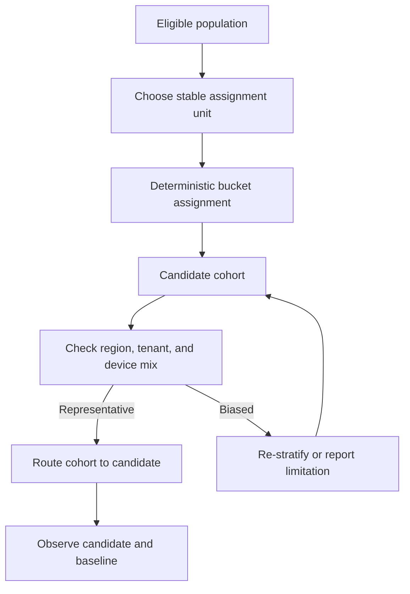
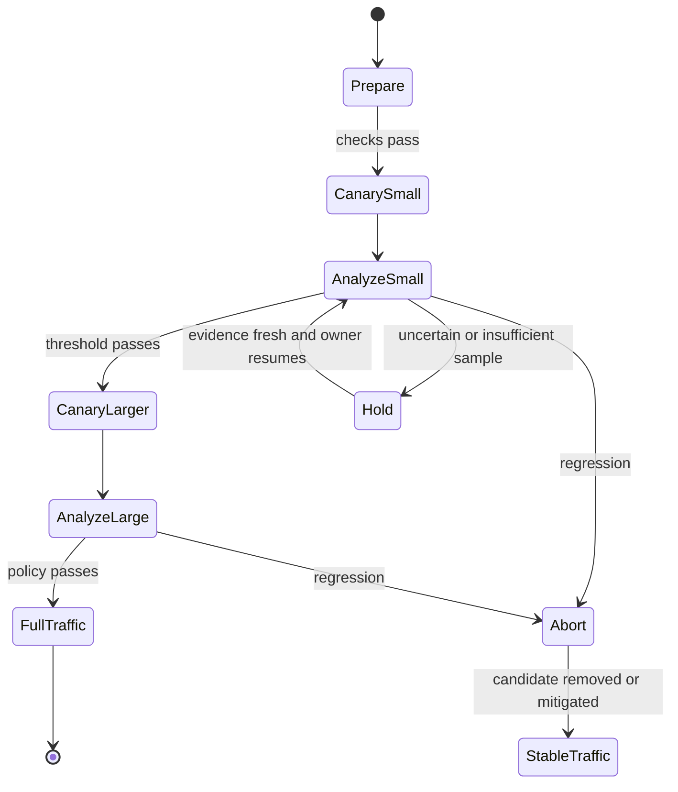
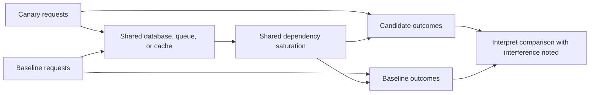

# Canary Deployment

Part: [13 — DevOps](PART_OVERVIEW.md)

Canary deployment routes a bounded cohort to a new version while a baseline continues serving the rest. The release expands only when comparison evidence meets a defined policy; otherwise it pauses or aborts. Canary is a specific progressive-delivery strategy, while CH13 owns the broader release governance and analysis model. Part 12 owns Kubernetes traffic mechanisms; Part 14 owns telemetry.

## Cohort and Routing Architecture

A cohort may be selected by request percentage, user identity, tenant, region, or instance. The routing mechanism must keep assignment stable when the comparison requires repeat exposure and must support an emergency stop. Instance-based canaries are simple but may not receive representative traffic; user-based cohorts improve consistency but require identity-aware routing and privacy controls.

Start with a small but meaningful cohort. If traffic volume is low, the sample may be too small to detect a regression within an acceptable window. If the cohort is very large, the deployment is not meaningfully limiting exposure. State the maximum user or transaction impact the canary is intended to bound.

## Baseline, Metrics, and Analysis

Compare equivalent populations and time windows. A baseline should reflect current behavior under similar traffic, deployment configuration, and external conditions. Use primary service indicators such as error rate and latency together with business outcomes and guardrails. Avoid interpreting a global average that hides a failing region or tenant segment.

Define the analysis window, minimum sample count, acceptable delta, missing-data behavior, and maximum duration before rollout. Use confidence bounds or sequential analysis where the risk justifies it; do not inspect a noisy graph until a favorable result appears. If evidence is insufficient, the result is inconclusive, not successful. Part 14 owns instrumentation and statistical telemetry details.

## Ramp and Failure Handling

Promotion typically increases the cohort in stages. The ramp schedule should allow enough time to observe delayed effects, while keeping the exposed population bounded. A controller should serialize changes, enforce a single active candidate per target, and preserve the ability to pause manually. Do not continue automatically when the telemetry source is stale or the analysis job has failed.

Abort may route traffic to baseline, disable a feature flag, or stop further deployment. It does not undo database changes, messages, or external side effects. Verify version compatibility and migration safety before relying on rollback. Preserve the failed candidate, routing history, and metrics window for incident review.

## Bias, Capacity, and Safety

The canary cohort can be biased by geography, device type, customer tier, or traffic patterns. Detect imbalance and guard against exposing only low-risk users while missing failure among critical workloads. Avoid assigning the same user to different versions across requests unless the application is explicitly designed for that behavior.

Canary and baseline may share databases, caches, queues, and rate limits. The candidate can affect baseline through shared dependencies, so resource contention and data writes can contaminate the comparison. Reserve enough capacity, isolate experiments when needed, and monitor dependency health. A canary release is not a substitute for load testing or compatibility testing.

## Worked Case and Review Checklist

A checkout service routes a stable five-percent user cohort to a candidate. Analysis compares payment completion, error rate, and latency by region and customer type. It requires a minimum transaction count and has a maximum observation window. Missing telemetry pauses promotion. A payment error increase beyond the agreed threshold stops the ramp and routes users back to baseline. Because both versions share a schema, backward compatibility is verified before the experiment starts.

Review cohort definition and stability, baseline, metric ownership, sample sufficiency, thresholds, window, missing-data behavior, shared-state effects, dependency capacity, pause/abort authority, rollback compatibility, and evidence retention. Test router behavior and controller failure before production.

## Questions and Summary

1. Compare percentage-, identity-, and region-based cohorts for consistency and representativeness.
2. Define an inconclusive outcome when traffic is insufficient to meet the analysis threshold.
3. Draw the evidence loop from routing through metric comparison to ramp control.
4. Identify shared dependencies that can make canary and baseline results interfere.
5. Explain why a successful canary does not prove the system can handle peak load.

Canary deployment limits exposure while producing comparative evidence. Its reliability depends on representative cohorts, stable assignment, meaningful baselines, explicit sample and time requirements, and a safe abort path. Missing or inconclusive data must not be treated as approval, and rollback must account for shared state and external effects.
