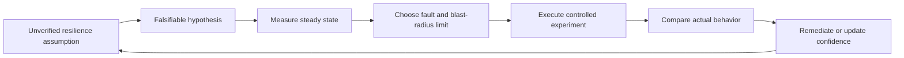
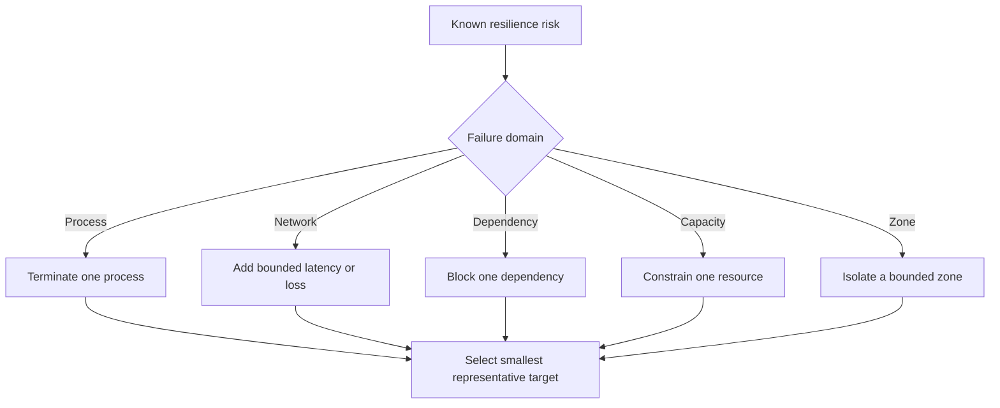
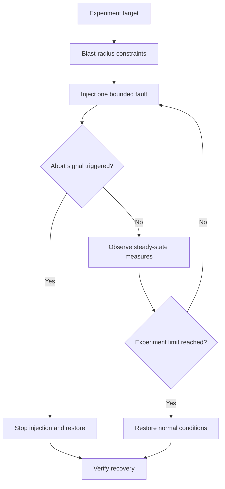
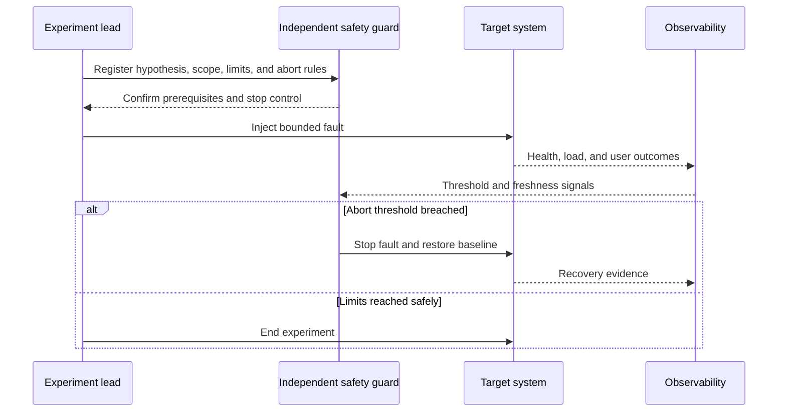
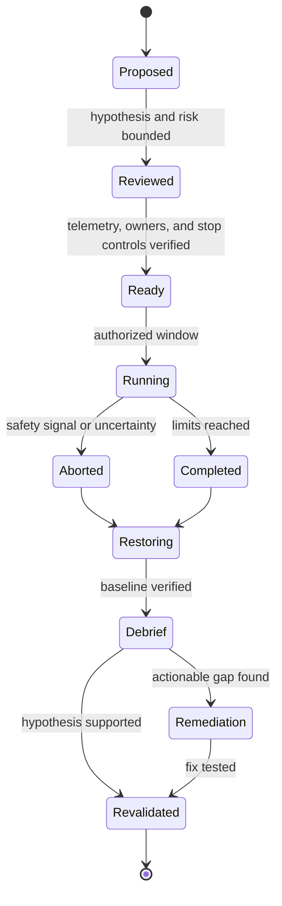

# Chaos Engineering

Part: [13 — DevOps](PART_OVERVIEW.md)

Chaos engineering uses controlled experiments to test whether a system behaves as expected under realistic failures. It begins with a falsifiable hypothesis and a measurable steady state, then introduces a bounded perturbation, observes the result, and converts gaps into remediation. It is not random damage or a substitute for testing. Part 07 owns distributed failure semantics; Part 14 owns observability; this chapter owns the experiment lifecycle and operational controls.

## Hypothesis and Steady State

Start with an operationally meaningful hypothesis: for example, if one availability zone becomes unreachable, request success remains above a target and recovery completes within a bound. Define the steady state using user-visible measures, dependencies, and system capacity. If the baseline is already unstable or unmeasured, a fault experiment cannot distinguish ordinary variation from experiment impact.

Specify the fault, target population, expected response, abort condition, owner, communication plan, and evidence before execution. A useful hypothesis names a stimulus and an outcome: “When a replica is unavailable, the service continues to meet its latency objective for affected requests,” rather than “the system is resilient.”

## Experiment Scope and Fault Selection

Faults can target process termination, dependency latency, network loss, resource exhaustion, zone failure, credential expiry, or queue pressure. Select an experiment from a known risk and increase impact gradually. Test in a representative environment first; production experiments require explicit authorization, safeguards, and on-call readiness. Use game days or manual drills when automated fault injection could exceed safe bounds.

Blast radius may be bounded by tenant, region, percentage of hosts, duration, or rate. Limit the experiment's authority so a targeting error cannot affect the entire fleet. Use independent safety controls where possible: a kill switch outside the experiment process, rate cap, health-based abort, and human stop authority. Test these controls before the experiment.

## Observation, Abort, and Recovery

Observe both the target and nearby dependencies. A process kill may reveal restart behavior but also saturate the remaining fleet; network latency may trigger retries that amplify load; queue backlog may persist after injection stops. Measure user outcomes, saturation, recovery time, error budgets, and unintended effects. Part 14 owns telemetry implementation; experiments must have adequate instrumentation before fault injection begins.

Abort immediately when user impact exceeds the agreed threshold, telemetry becomes unavailable, scope is uncertain, or the recovery mechanism fails. The experiment owner should not be the only person capable of stopping it. After injection, verify the fault is removed and the system returns to steady state; a green dashboard without checking residual state is insufficient.

## Governance and Learning

Production experimentation needs change approval appropriate to impact, stakeholder notification, an accountable incident commander or on-call contact, and a maintenance window when relevant. Coordinate with customer commitments and regulatory restrictions. Document experiment IDs so incidents can distinguish injected faults from unrelated changes.

An experiment that passes increases confidence only in the tested conditions. Record limitations, sample scope, dependency versions, and unexpected behavior. Turn findings into owned remediation with priority and retest criteria. Do not reward experiment count; reward reduced uncertainty and verified resilience improvement. Avoid experiments that merely demonstrate a known failure without learning or a decision.

## Worked Case: Dependency Zone Loss

A team believes its service can tolerate loss of one dependency zone. It defines steady-state success rate and latency by zone, identifies the affected test tenant, and sets a five-minute duration and strict abort threshold. A separate safety guard observes error rate and dependency saturation. The team blocks new experiment traffic if evidence becomes stale.

The fault increases retries and saturates the remaining zone before user success drops. The guard aborts; the team confirms traffic returns to normal and finds that retry budgets were not coordinated across service layers. The finding becomes a remediation task with a test that reproduces the load amplification. A later experiment verifies behavior after the fix. The experiment did not “prove resilience”; it revealed a concrete failure mechanism and tested the improvement.

## Common Mistakes and Review Checklist

- Running a fault without a falsifiable hypothesis or measurable baseline.
- Targeting too much production capacity or using the same process as the only stop mechanism.
- Continuing when metrics are delayed, missing, or cannot distinguish user impact.
- Injecting several faults at once, making cause and effect unclear.
- Treating a successful run as proof beyond the tested scope.
- Stopping injection without verifying system recovery and cleanup.
- Recording findings without owners, priorities, and retest criteria.

Before execution, verify hypothesis, steady state, target selection, blast-radius limit, dependency impact, authorization, communications, on-call coverage, independent stop control, telemetry freshness, restore procedure, and debrief owner. Afterward, verify return to normal and track remediation to a repeatable validation.

## Questions and Summary

1. Write a falsifiable hypothesis for a dependency latency experiment, including measurable success and abort conditions.
2. Draw the experiment and an independent safety guard; explain how the guard stops injection.
3. Design a staged progression from a test environment to a small production cohort.
4. Which signals indicate that an injected fault has ended but system recovery is still incomplete?
5. Turn an observed retry storm into a remediation and retest plan.

Chaos engineering is a disciplined way to test resilience assumptions under bounded failure. Begin with a measurable steady state, inject one controlled fault, keep independent abort and recovery controls, and use the evidence to reduce uncertainty. The outcome is not a pass badge; it is an owned, testable understanding of system behavior.
