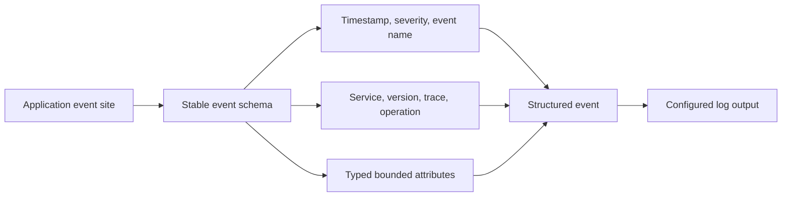
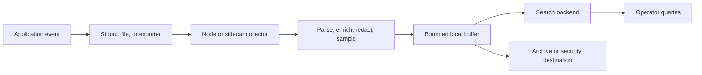
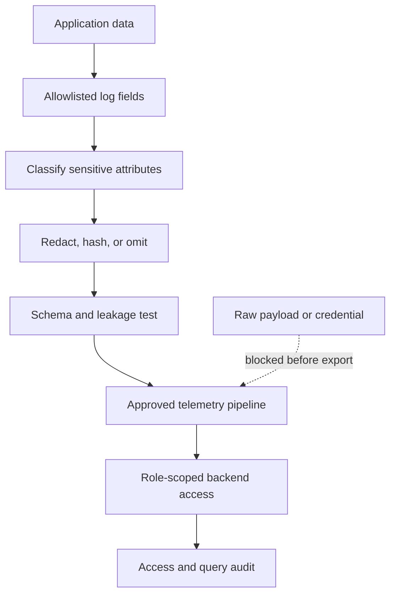
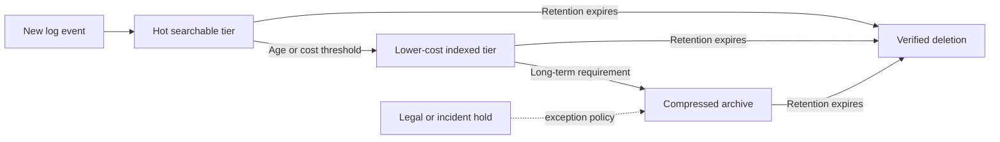
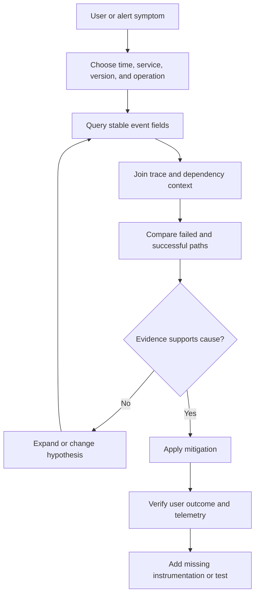

# Logs

Part: [14 — Observability](PART_OVERVIEW.md)

Operational logs are records of events emitted by software and infrastructure to explain what a system did, what it observed, and under which context. Well-designed logs make behavior diagnosable without requiring a debugger to be attached to production. Poorly designed logs become expensive, noisy, hard to correlate, and potentially unsafe stores of personal or secret data.

This chapter owns operational log event design, context, collection, redaction, sampling, retention, access, and query workflows. [CH02 Metrics](CH02_Metrics.md) owns metric semantics; [CH03 Tracing](CH03_Tracing.md) owns distributed trace practice; [CH04 OpenTelemetry](CH04_OpenTelemetry.md) owns instrumentation and Collector details. Part 12 owns Kubernetes-specific log collection, while Part 15 owns security audit records and incident evidence. Operational logs can support an investigation but do not automatically satisfy audit integrity or legal retention requirements.

## What a Log Record Is For

A log record captures a discrete event or diagnostic observation. It should help answer an operational question: which operation failed, what branch did the application take, what dependency response did it receive, or which configuration version was active? A log is most useful when its message is tied to an event name, timestamp, service identity, and enough request context to join it to related evidence.

Logs complement other signals. Metrics aggregate numeric measurements across many events and make trends and thresholds efficient to query. Traces connect timed operations across service boundaries. Logs preserve event-level detail, but their volume and cost make them a poor substitute for every counter or span. A single log entry rarely proves the system's full state; combine it with metrics, traces, deployment records, and domain evidence.

Distinguish operational logs from security audit records. Operational logs support diagnosis and may be sampled or retained for a shorter period. Audit records may require stronger integrity, completeness, access controls, and retention. If a compliance or security process requires an immutable record, route it through the approved audit system rather than relying on an application debug log.

## Structured Events and Schema

Prefer structured records with stable fields over prose-only messages. A practical event can include:

| Field | Purpose |
|---|---|
| `timestamp` | Event time with timezone and sufficient precision |
| `severity` | Operational importance using a documented level mapping |
| `event.name` | Stable event identity suitable for queries and dashboards |
| `service.name` and version | Producer identity and deployed version |
| `environment` and resource identity | Deployment and runtime context |
| `trace_id`, `span_id`, request or operation ID | Correlation with related work, when available |
| `message` | Human-readable summary, not the sole machine-readable structure |
| `attributes` | Bounded, typed event-specific fields |
| `error.type` and stack details | Failure classification and diagnostic context where appropriate |

Keep names stable and values typed. A field that changes meaning across releases breaks saved queries and alerts. Version event schemas deliberately, document compatibility, and avoid duplicate aliases that disagree. Do not encode structured values only inside a message string if users need to filter them.



Severity levels should support decisions, not merely express developer emotion. Define what constitutes debug, informational, warning, error, and fatal behavior for the service. A warning is not necessarily actionable; an error log does not necessarily indicate user impact. Avoid logging the same exception at every layer, which multiplies volume while adding little context. Log once at the boundary that has the most useful handling decision, with lower layers returning structured error context.

## Event Placement and Context

Instrument meaningful state transitions and failure boundaries: request accepted, dependency call failed, retry exhausted, transaction committed, or background job completed. Avoid logging every function entry and exit by default. Excessive event emission increases cost and makes important evidence harder to find. Add logs when an event explains a decision or when another signal cannot provide the needed detail.

Request context should be created at a trusted entry point and propagated across synchronous and asynchronous work. A trace identifier helps join log records to spans; an operation or request identifier can link work even when full tracing is sampled. Do not use user identifiers, raw URLs with secrets, or unbounded input as correlation IDs. For queued work, persist the allowed correlation context in message metadata and restore it when a consumer processes the message.

```mermaid
sequenceDiagram
    participant Edge as Request entry point
    participant A as Service A
    participant Q as Message queue
    participant B as Service B
    Edge->>A: Request with trace context
    A->>A: Emit structured event with trace ID
    A->>Q: Publish message with approved correlation context
    Q->>B: Deliver message and restore context
    B->>B: Emit event with same trace and operation IDs
    Note over Edge,B: Correlation joins events; it does not make them one trace by itself
```

Correlation fields are identifiers, not authorization tokens. Validate them at trust boundaries and prevent clients from injecting arbitrary values that can overwrite trusted context or forge misleading associations. Keep baggage and other propagated fields small, non-sensitive, and governed; data copied into every event can amplify privacy exposure and storage cost.

## Collection and Delivery Pipeline

Applications may write structured events to standard output, a local file, a socket, or a library-managed exporter. A collector or agent enriches, batches, filters, redacts, and forwards events to one or more backends. Keep application code independent of a vendor-specific storage API where portability and backend changes matter. CH04 covers OpenTelemetry Collector architecture and configuration; this chapter focuses on log correctness and lifecycle.



Define delivery expectations. A collector may buffer during a backend outage, but buffers are finite; when full, policy must choose whether to drop, block, or apply backpressure. Blocking an application request on remote log storage can turn telemetry failure into service failure. Prefer bounded asynchronous delivery with explicit drop counters and a documented loss policy. Critical audit records may need a separate durable path with stronger guarantees.

Parsers should tolerate malformed events without silently corrupting fields. Preserve the raw record where policy allows, attach parse status, and route invalid records for diagnosis. Enrichment should add trusted resource metadata, not rewrite application semantics. Track collector health, queue depth, export failures, dropped-record counts, and time synchronization because a healthy application cannot be debugged from a broken telemetry pipeline.

## Privacy, Security, and Access

Logs routinely cross service and organizational boundaries. Do not record passwords, access tokens, private keys, payment data, or full request and response bodies by default. Use an allowlist schema for sensitive paths, redact or tokenize before export, and test redaction with realistic nested and encoded values. Downstream masking is insufficient if the unredacted value already reached a collector, buffer, or debug file.



Hashing is not automatically anonymization: stable hashes can still identify people or enable correlation. Minimize collection first, define a purpose and retention period, and apply access controls to both query interfaces and exported archives. Restrict broad searches that expose multiple tenants or environments. Keep diagnostic access available to responders while limiting routine access to sensitive records.

## Volume, Sampling, and Cardinality

Log volume grows with event frequency, record size, replica count, and request rate. Estimate volume before enabling debug-level logging broadly. Use sampling or rate limits for repetitive low-value events, but preserve rare failures and ensure the sampling policy is visible. Deterministic sampling by trace or operation identifier can keep related records together; independent per-line sampling may retain a downstream error while discarding the initiating context.

Never sample required audit evidence using an operational policy. Apply priority-aware handling so high-severity events, security-relevant events, and selected exemplars receive appropriate treatment. Track sampled and dropped counts so query users know when absence of a log is weak evidence.

Logs are not immune to cardinality cost. High-cardinality fields such as raw user IDs, request paths with identifiers, or arbitrary exception text can make indexes expensive and slow. Keep stable dimensions indexed; store rare details in a less aggressively indexed field or archive. Apply limits and normalization without erasing the context needed to distinguish failure classes.

## Retention, Storage, and Cost

Retention should follow diagnostic value, privacy obligations, audit policy, and cost. Recent high-volume logs may need fast search; older records may move to compressed archive with slower retrieval. Deletion must account for replicas, backups, exports, and legal holds. Operational retention and audit retention may differ and should be managed as separate classes.



Budget by ingestion volume, index expansion, query workload, replication, and retention. A short retention period can impede delayed incident investigation; indefinite retention increases privacy and breach impact. Define owners for retention classes, deletion verification, archive restore, and cost review. Measure query latency and search availability along with ingest rate; cheap storage is not useful if responders cannot retrieve it in time.

## Query-to-Incident Workflow

Start a log investigation with a question and narrow scope: time range, service, version, environment, operation ID, and relevant event names. Search a high-selectivity indexed field first, then inspect related records and correlate with metrics and traces. Compare a failing operation with a successful one to identify the earliest meaningful divergence. A log line near an error is not necessarily its cause.



Queries should avoid fetching broad raw payloads unnecessarily. Restrict access and export, especially when results contain personal or tenant data. Preserve the query, time window, event schema version, and evidence used in a high-impact incident record. If a log is absent, check sampling, collector drops, clock skew, parsing, and retention before concluding that an event did not occur.

## Worked Case: Intermittent Payment Timeout

A payment service reports occasional timeouts while its average request rate and CPU remain normal. Structured events record operation ID, trace ID, payment-provider region, attempt number, timeout category, and service version, but not card data or authorization headers. Investigators filter by operation ID, join the corresponding trace, and compare provider latency with successful operations in the same region. They find one retry path logs at warning severity on every attempt while the final error lacks the provider region.

The team adds the missing bounded context at the final handling boundary, reduces repetitive per-attempt logs, and retains a counter for retry exhaustion. It tests redaction and verifies that sampled events preserve the entire operation's correlation. The result improves diagnosis without recording sensitive payloads or adding a high-cardinality user dimension.

## Common Mistakes and Review Checklist

- Emitting prose-only messages with no stable event name or typed fields.
- Logging secrets or full payloads and assuming downstream masking is sufficient.
- Using raw user, tenant, or request identifiers as unbounded index dimensions.
- Logging every retry at full volume while omitting the final handling decision.
- Blocking user requests on a remote log backend or allowing unbounded buffers.
- Sampling audit records or hiding that operational records were sampled or dropped.
- Treating correlation identifiers as proof of identity or authorization.
- Retaining all records indefinitely without cost, privacy, and deletion ownership.
- Treating a missing log as proof that an event did not happen.

Review event schema and versioning, timestamp quality, service and deployment identity, correlation context, field allowlists, redaction tests, severity policy, sampling and loss accounting, collector buffering, access controls, retention and deletion, query performance, and ownership of the pipeline. Test both normal and failure paths, including a backend outage.

## Questions and Exercises

1. Design a structured event for a failed dependency call. Which attributes are stable, bounded, and safe to retain?
2. Draw the path from application event through redaction and collection to searchable and archival stores.
3. A collector is unavailable for ten minutes. Compare bounded drop, local buffering, and application blocking as delivery policies.
4. How can per-line sampling make a distributed failure harder to diagnose? Propose a correlation-aware policy.
5. Given an incident symptom, build a query plan that checks clock skew, sampling, pipeline drops, and retention before concluding no event occurred.
6. Create a redaction test set containing nested, encoded, and malformed secrets; define the expected export behavior.

## Summary

Logs are event-level evidence. Their value comes from stable structured schemas, useful context, safe correlation, and a reliable path from emission to query. Design for bounded volume and cardinality, redact before export, choose explicit delivery and retention behavior, and make sampling and data loss visible. During incidents, use logs with metrics, traces, and runtime evidence; absence from a log store is not proof of absence from the system.
