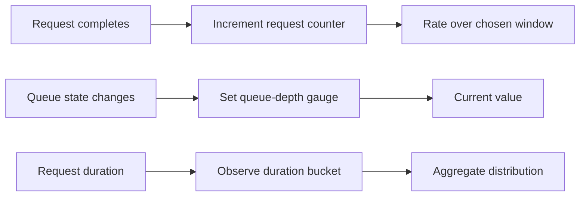
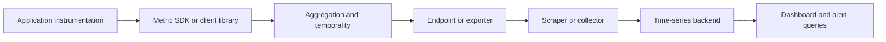
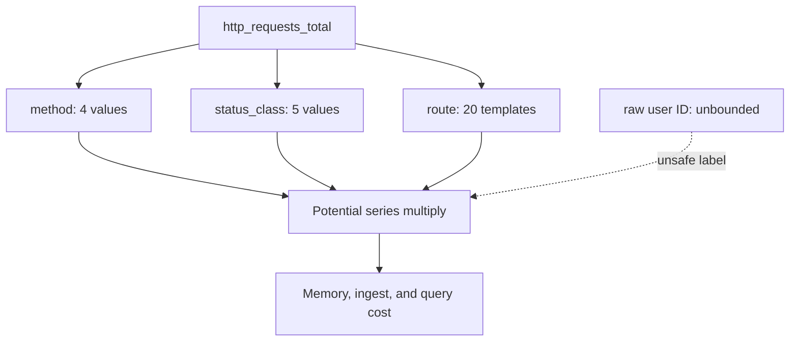
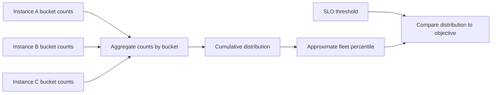
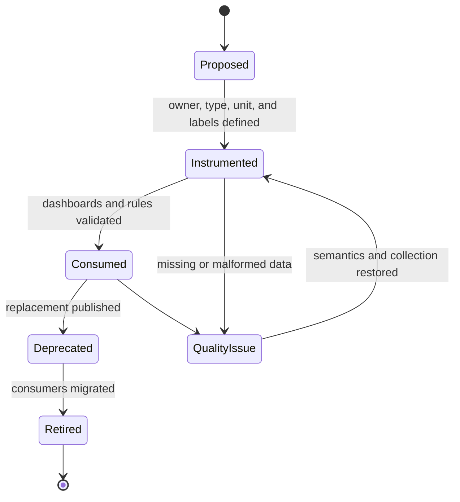

# Metrics

Part: [14 — Observability](PART_OVERVIEW.md)

Metrics are measurements aggregated over time or dimensions. They answer questions such as how many requests failed, how much work is in progress, how long requests take, and whether resource pressure is rising. Metrics are compact and efficient for trends and alerting, but aggregation discards event detail and poor labels can create uncontrolled time-series growth.

This chapter owns metric types, instrumentation, dimensions, aggregation, cardinality, and lifecycle. [CH01 Logs](CH01_Logs.md) owns event-level records; [CH03 Tracing](CH03_Tracing.md) owns request paths; [CH11 Service-Level Objectives](CH11_SLO.md) owns objective policy. [Part 07 NFR](../07_System_Design_and_Distributed_Systems/CH02_Non_Functional_Requirements.md) owns the core service-level indicator vocabulary; this chapter explains instrumenting measurements that can support such indicators.

## Metric Types and Update Semantics

Choose a metric type from the question and the producer's update behavior. A counter accumulates nonnegative events and is interpreted as a rate or increase over a time interval. A gauge represents a changing current value, such as queue depth; it can rise or fall. A histogram records observations into configured buckets and usually tracks count and sum, enabling aggregation across producers. A summary may calculate quantiles locally, but those quantiles generally cannot be combined correctly across instances.

| Type | Update model | Useful questions | Common misuse |
|---|---|---|---|
| Counter | Monotonic accumulation; reset on process restart | How many requests or failures occurred per unit time? | Treating raw cumulative value as a current rate |
| Gauge | Set to current value; can increase or decrease | How many items are queued now? | Applying a rate function to an instantaneous value |
| Histogram | Count observations across boundaries and track aggregate sum/count | What is the latency distribution across instances? | Buckets too coarse for the objective boundary |
| Summary | Observe values and calculate producer-local quantiles | What local quantiles occurred in this process? | Averaging quantiles across replicas |

Metric names and units should be stable and explicit. Use a base unit in the name or metadata, such as seconds rather than an undocumented millisecond value. Define whether a request counter includes rejected, canceled, or health-check traffic. Ambiguous semantics make dashboards look plausible while measuring the wrong population.

## Instrumentation and Collection

Instrument at boundaries that produce reliable measurements: request admission, completion, dependency calls, queue processing, and resource state changes. Avoid high-volume per-item instruments when a bounded aggregate or histogram answers the operational question. Use libraries with consistent naming and thread-safe updates rather than inventing ad hoc global state.

Pull collection lets a backend discover and scrape targets, observe target health, and control collection cadence. Push collection can suit short-lived jobs or restricted networks, but requires explicit delivery, buffering, and duplicate-handling behavior. The choice is architectural: target count, network topology, lifecycle, failure semantics, and ownership matter more than a universal preference.

Ensure labels describing service, version, environment, and region come from trusted resource metadata. Avoid putting request-specific identifiers into metric labels. A metric pipeline should expose its own scrape or export failures, queue pressure, and dropped points so a quiet dashboard is not mistaken for a healthy service.

## Dimensions and Cardinality

A time series is identified by its metric name and complete label set. Each additional label combination creates another series. If a metric has label cardinalities $c_1, c_2, \dots, c_n$, its potential series count is approximately their product, before accounting for observed combinations. A label with unbounded values, such as user ID or full URL, can turn a modest instrument into a storage and query incident.

Use bounded dimensions that correspond to decisions: normalized route templates, status class, dependency name, or deployment version. Put high-cardinality identifiers in logs or traces with access controls. If a dimension is required for diagnosis, consider exemplars that link selected metric observations to trace identifiers without making every identifier a label.

Cardinality controls should be enforced before data reaches the most expensive storage tier. Define label allowlists, reject or normalize unbounded values, and monitor series creation rate. Dropping labels downstream may reduce storage cost but can still overload collectors or ingest systems earlier in the path.

## Histograms, Aggregation, and Latency

Latency percentiles require distribution data. Histogram buckets preserve counts over ranges and can be aggregated across replicas before calculating a quantile. Bucket boundaries should resolve the operational thresholds of interest; if the service-level objective (SLO) boundary is 300 milliseconds, buckets should make behavior near that value distinguishable. Bucket selection trades precision against series count and storage.

Do not average instance-local p95 values and call the result fleet p95. Quantiles are nonlinear; aggregate the underlying histogram buckets or use a suitable distribution sketch with known merge semantics. For low-volume services, a percentile may be unstable, so pair it with event counts and a longer window.

## Metric Lifecycle and Data Quality

Metrics are interfaces consumed by dashboards, alerts, recording rules, and objectives. Rename or remove a metric only with a migration plan: dual-publish temporarily, update consumers, verify coverage, then retire the old series. Document type, unit, label set, population, and owner. Keep a compatibility window long enough for downstream teams to update.

Data quality failures include missing scrapes, duplicate points, clock skew, reset counters, delayed delivery, and changes to instrumentation semantics. Counter-rate queries need reset-aware functions. A missing target is not equivalent to zero traffic. Alerting should distinguish “no observations” from “observed zero failures.” CH10 owns the alert response model; CH05 Prometheus covers product query mechanics.

## Worked Case and Review Checklist

A checkout service needs request volume, failure rate, in-flight work, and latency distribution. It uses a counter labeled by bounded route template and status class, a gauge for active requests, and a histogram in seconds with boundaries near user-relevant latency thresholds. User and order identifiers remain in access-controlled logs and traces. The team verifies that all instances expose compatible bucket boundaries and that scrape loss is visible.

Review type and update semantics, units, event eligibility, label cardinality, histogram boundaries, aggregation correctness, target discovery, missing-data behavior, metric ownership, migration plan, and pipeline self-monitoring. Ask what action each metric enables and who owns its consumers.

## Questions and Summary

1. Select a counter, gauge, or histogram for request failures, queue depth, and latency; justify each choice.
2. Estimate series growth for labels with cardinalities 5, 8, and 30, then identify one unsafe dimension.
3. Explain why instance p95 values cannot be averaged to obtain a fleet p95.
4. Design a safe metric rename while dashboards and alerts still depend on the old name.
5. How should a dashboard distinguish zero errors from missing telemetry?

Metrics compress observations into measurements suitable for trends, comparisons, and alert inputs. Correct use depends on type semantics, event population, stable units, bounded dimensions, and valid aggregation. Treat each metric as a versioned operational interface and monitor the collection path that delivers it.
