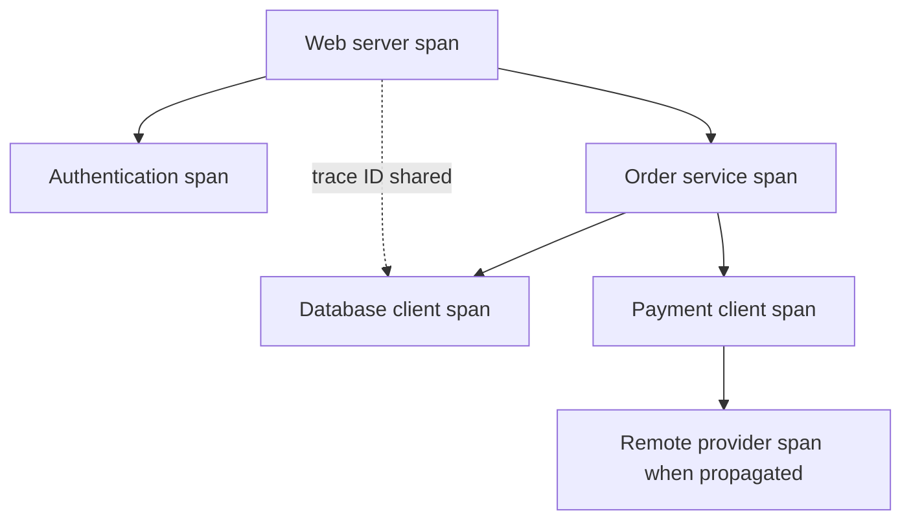
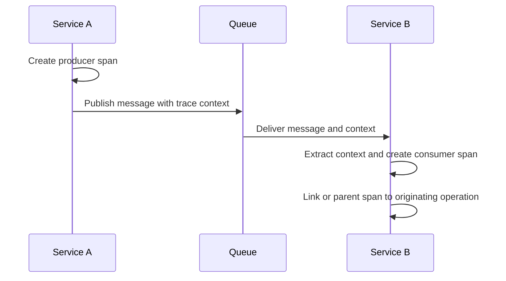
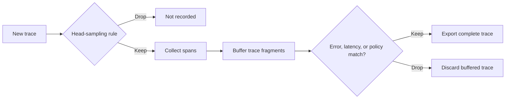
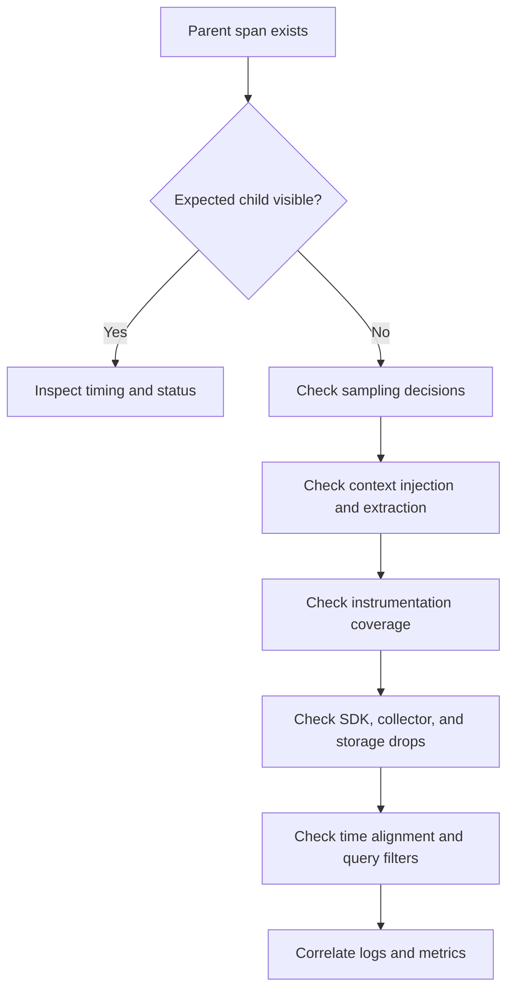

# Tracing

Part: [14 — Observability](PART_OVERVIEW.md)

Distributed tracing records timed operations and their relationships across a request path. A trace groups spans; a span represents work with a start time, duration, attributes, events, status, and optional parent. Tracing helps locate latency and failure across service boundaries, but incomplete instrumentation, sampling, clock skew, and missing context can make a trace misleading.

This chapter owns trace structure, instrumentation, propagation, sampling, baggage, storage implications, and diagnosis. [CH01 Logs](CH01_Logs.md) owns event-level records; [CH02 Metrics](CH02_Metrics.md) owns aggregate measurements; [CH04 OpenTelemetry](CH04_OpenTelemetry.md) owns portable instrumentation APIs and Collector pipelines. Part 05 owns network protocols and Part 07 owns distributed execution semantics.

## Trace and Span Model

A trace is a causally related set of spans identified by a trace identifier. Each span has a span identifier and may reference a parent span. A span should represent a meaningful operation boundary, such as an inbound request, database query, queue publish, or background job. Avoid creating spans for every function call; excessive span count increases cost and obscures the architecture.

Parent-child relationships express work causality, not always strict wall-clock containment. Asynchronous spans may begin after the producer span ends. A linked span can express related work that does not have a direct parent-child lifetime, such as batch processing of messages from several traces.

Span names should be low-cardinality and describe the operation, not its unique resource identifier. Put bounded attributes such as method, normalized route, peer service, and result class on spans. Avoid raw query strings, customer data, credentials, and arbitrary exception payloads.

## Timing and Critical Path

Span duration includes the interval between start and end timestamps. Parent spans often cover child spans plus local work, so adding all span durations double-counts nested time. To locate latency, inspect the critical path and gaps: parallel calls overlap, queue wait may happen between spans, and uninstrumented work can appear as unexplained parent duration.

```mermaid
sequenceDiagram
    participant Client
    participant API as API service
    participant DB as Database
    participant Pay as Payment service
    Client->>API: Request
    API->>DB: Read order
    DB-->>API: 80 ms
    par Parallel dependency calls
        API->>Pay: Authorize payment
        Pay-->>API: 240 ms
    and Local work
        API->>API: Validate and assemble response
    end
    API-->>Client: Response
```

Use span timing to identify where latency accumulates, but validate with metrics and logs. A client span duration can include connection setup, queueing, retries, and remote processing; it is not necessarily server execution time. Clock skew across hosts can distort cross-process timelines. Prefer monotonic clocks within a process and monitor time synchronization.

## Context Propagation Across Boundaries

Trace context travels with the operation through request headers, message metadata, or task context. Hypertext Transfer Protocol (HTTP) propagation formats are standardized, but each framework and queue requires correct extraction and injection. At a trust boundary, validate incoming context. Do not treat arbitrary identifiers as trusted. A trace identifier is for correlation, not authentication.

For asynchronous processing, preserve context in a message envelope and choose whether the consumer span is a child or linked span based on the causal model. Batch consumers may combine messages from multiple traces; a single parent is then inaccurate. Keep baggage small and non-sensitive because it may propagate through many services and be copied into telemetry.

## Sampling and Completeness

Sampling controls trace volume. Head sampling decides early using information available at trace start, such as route or stable trace-ID probability. Tail sampling decides after spans arrive and can retain traces with errors or high latency, but requires buffering and state across collectors. Sampling changes what operators can see; the sampled population and decision must be observable.

Tail sampling can lose spans if a trace is split across collectors or arrives after the decision window. Route by trace identifier when stateful decisions require all spans to meet at one sampler. Head sampling is cheaper and more scalable but cannot select based on an error discovered late. Hybrid policies can reserve a baseline sample while retaining selected high-value traces.

## Privacy, Cost, and Missing Spans

Trace attributes, span events, and baggage can contain sensitive data. Set an attribute allowlist, redact before export, control access, and define retention. Large payload capture is rarely justified. Sampling does not replace data minimization because sampled traces may still expose secrets.

Missing spans can result from unsampled parents, missing instrumentation, propagation loss, exporter failure, collector drops, clock skew, or storage/query limitations. A trace with no downstream span does not prove the downstream service was never called. Check instrumentation coverage and collector health, then corroborate with logs, metrics, and dependency evidence.

## Worked Case and Review Checklist

A checkout request has high tail latency. The root span shows two parallel dependency calls; the payment call dominates the critical path, while the database call completes earlier. A queue handoff lacks propagated context, so the asynchronous fulfillment span appears as a separate trace. The team adds message context propagation and a link for batched consumers, then verifies trace completeness and samples slow traces at the collector.

Review span boundaries, names and attributes, context injection/extraction, async links, sampling policy, collector affinity, privacy controls, retention, clock health, and telemetry-loss signals. Confirm that trace absence is never interpreted as proof that work did not occur.

## Questions and Summary

1. Draw a trace for a request with parallel dependencies and explain which path controls response latency.
2. Choose parent-child versus link semantics for a batch consumer that processes messages from several traces.
3. Compare head and tail sampling for retaining slow or failed requests.
4. List independent causes for a missing downstream span and an evidence source for each.
5. Which span attributes should be removed or normalized before export?

Tracing connects timed work across process boundaries through trace context and span relationships. Its diagnostic value depends on meaningful boundaries, correct propagation, deliberate sampling, privacy controls, and an understanding of incomplete evidence. Use traces to locate behavior, then corroborate conclusions with logs, metrics, and system state.
