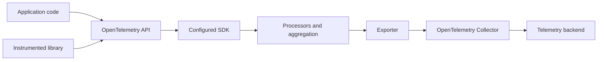
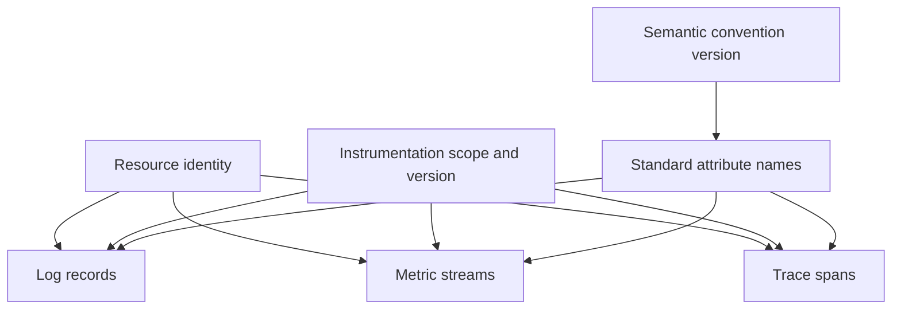
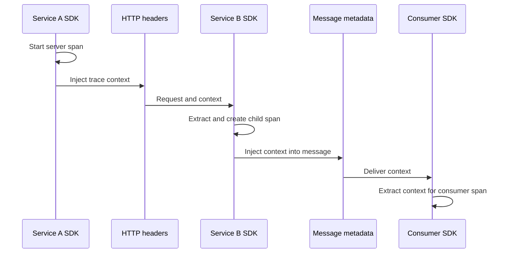
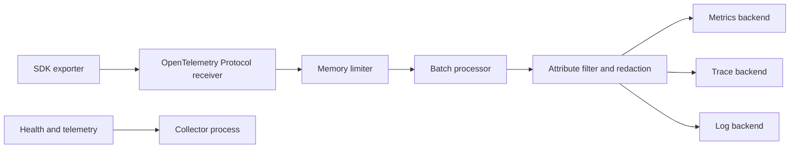
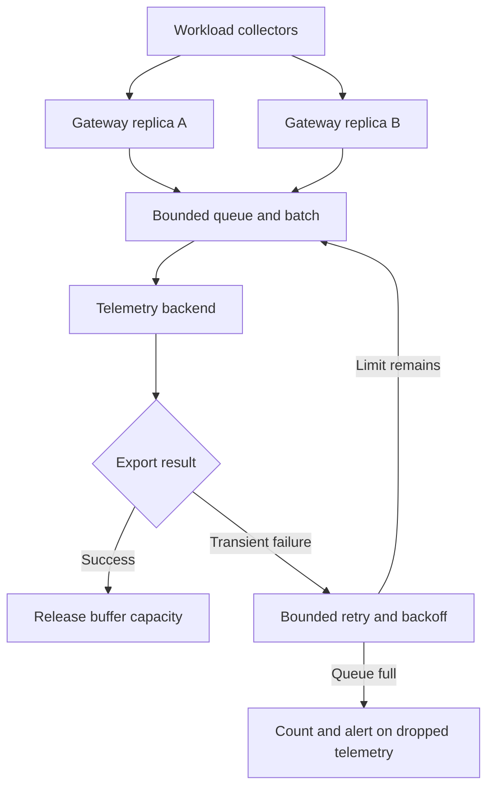

# OpenTelemetry

Part: [14 — Observability](PART_OVERVIEW.md)

OpenTelemetry is a collection of APIs, software development kits (SDKs), semantic conventions, propagators, and Collector components for producing and processing telemetry. It standardizes instrumentation and data handling interfaces; it does not make every backend, query language, or feature interchangeable. CH01-03 own log, metric, and trace meaning. CH05-09 cover selected backends.

## API, SDK, and Instrumentation

The API defines how application code emits telemetry and supports libraries that should not depend directly on a vendor backend. An SDK supplies runtime behavior such as aggregation, sampling, resource detection, processors, and exporters. An application configures the SDK; reusable libraries generally call the API. This separation lets instrumentation remain portable while deployment selects exporters and processing policy.

Use automatic instrumentation for broad coverage where supported, then add manual spans, metrics, or events at domain boundaries. Automatic instrumentation cannot infer business correctness or user outcomes. Avoid duplicate instrumentation that emits two spans for the same operation. Pin compatible SDK and instrumentation versions and test upgrades because semantic conventions and defaults evolve.

## Resources and Semantic Conventions

Resource attributes identify the entity producing telemetry: service name, version, deployment environment, host, container, or cloud region. These attributes should be stable, low-cardinality, and consistently set across signals. Semantic conventions define common names and meanings for attributes such as HTTP method and database system. This makes data more portable across libraries and backends.

Do not use resource attributes for request-specific values. An unstable service name fragments queries, while a user ID as a resource attribute creates privacy and cardinality problems. Record schema/convention versions and plan migrations when names or meanings change. A backend may transform or drop attributes, so validate the exported form end to end.

## Context Propagation

Propagators inject and extract context across process boundaries. The World Wide Web Consortium (W3C) Trace Context format is commonly used for trace identifiers and sampling flags. Instrumentation must propagate across HTTP, remote procedure calls, queues, and asynchronous task frameworks where appropriate. At public or untrusted boundaries, validate and possibly restart context according to policy; baggage can carry sensitive values and should be minimized.

Propagation is not guaranteed just because both services use OpenTelemetry. Verify the framework instrumentation, header allowlists, queue metadata size, and context lifecycle. Avoid duplicating or overwriting valid context when adding manual instrumentation.

## Collector Pipelines and Deployment

The Collector receives telemetry, optionally processes it, and exports it to destinations. Receivers define ingestion protocols; processors transform, batch, filter, redact, or sample; exporters send to backends. Extensions can provide health, authentication, or storage support. Pipeline configuration should make data flow and trust boundaries inspectable.

Collector deployment choices include an agent near workloads, a gateway tier, or a layered combination. Agents reduce application network configuration and can enrich host context; gateways centralize policy and export but need capacity, tenancy, and availability design. Avoid placing secrets or unrestricted network access in shared collectors. Limit receiver exposure and use authentication on untrusted networks.

## Portability, Failure, and Migration

OpenTelemetry reduces coupling to instrumentation APIs, but exporters, resource attributes, sampling decisions, and backend query semantics remain product-dependent. A backend migration may still require dashboard, alert, and retention changes. Test the data consumers, not only that an exporter connects.

Collectors can queue and retry transient failures, but memory and disk buffers are finite. Define overflow policy, backpressure, retry limits, and loss signals. Monitor accepted, refused, dropped, queued, and exported records per signal. If telemetry export blocks application work, a backend outage can become a production outage. Use bounded asynchronous delivery and test collector restarts and destination failures.

## Worked Case and Review Checklist

A service uses SDK instrumentation and exports through a local agent Collector using the OpenTelemetry Protocol (OTLP). The agent adds trusted resource metadata, removes disallowed attributes, batches telemetry, and forwards traces, metrics, and logs to separate backends. A gateway tier applies tenant routing and backend credentials. During a backend outage, bounded queues absorb a short interruption; dropped data is counted and alerted, while request handling remains independent.

Review API/SDK separation, instrumentation scope, resource identity, conventions, propagation, Collector receiver/processors/exporters, authentication, redaction, queue bounds, scaling, self-observability, and backend migration assumptions. Verify each configured pipeline actually receives and exports the intended signals.

## Questions and Summary

1. Explain the roles of API, SDK, instrumentation library, propagator, and Collector.
2. Draw an agent-plus-gateway Collector topology and label its trust boundaries.
3. Which resource attributes should identify a service, and which request values do not belong there?
4. What happens when a Collector queue fills during a backend outage?
5. Which parts of an observability stack remain vendor-specific after adopting OpenTelemetry?

OpenTelemetry separates instrumentation interfaces from much of the export and processing configuration, enabling reuse without guaranteeing backend neutrality. Standardize resource identity and semantic conventions, propagate context deliberately, and treat Collector pipelines as production data infrastructure. Bound buffering, secure receivers, and monitor telemetry loss so observability itself remains observable.
