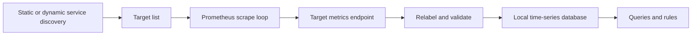
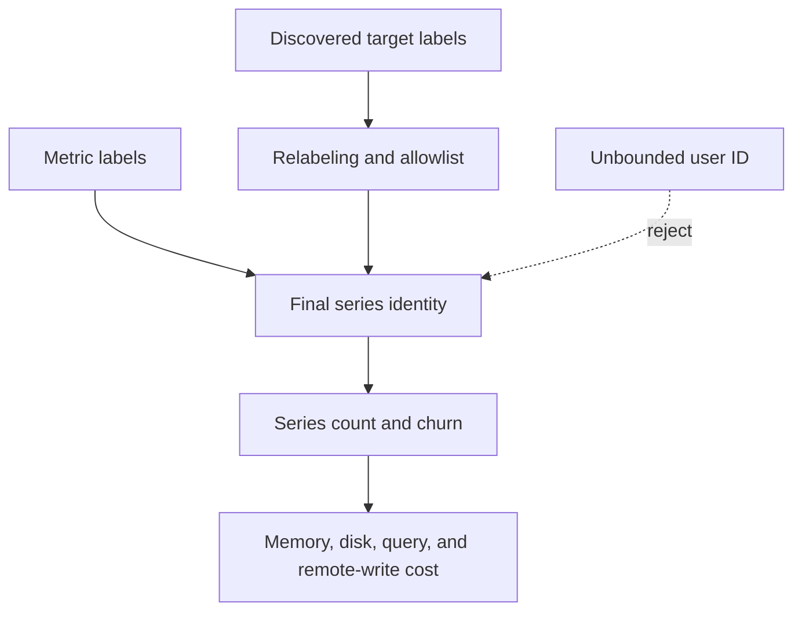
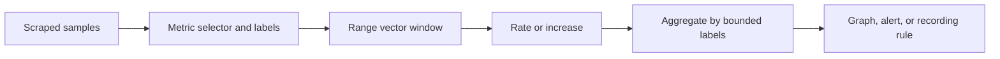
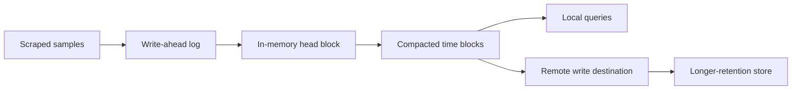
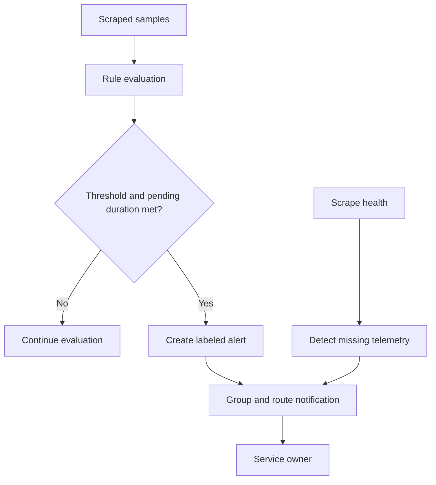

# Prometheus

Part: [14 — Observability](PART_OVERVIEW.md)

Prometheus is a monitoring system built around scraping instrumented targets, storing labeled time series, evaluating queries and rules, and sending alerts to a separate notification layer. Its pull model simplifies target health checks and local operation, but a single server has bounded storage and query capacity. [CH02 Metrics](CH02_Metrics.md) owns metric design; Part 12 owns Kubernetes target discovery and resource metrics.

## Scrape and Discovery Architecture

Prometheus periodically discovers targets and requests their current metric exposition. A scrape produces samples with timestamps and labels. Service discovery can use static targets or dynamic sources; target labels can be relabeled before ingestion. Keep target labels stable and avoid attaching per-request identifiers.

Scrape interval affects freshness, ingest volume, and detection delay. A shorter interval does not automatically improve useful resolution if the application updates slowly or the backend cannot sustain the volume. Scrape timeout must be less than the interval and should reflect endpoint performance. A scrape failure means data is absent; it must not be interpreted as a healthy zero.

## Labels and Cardinality

A series is identified by metric name and its complete label set. Each new label combination creates another series, affecting memory, disk, query planning, and remote-write volume. Use labels for bounded dimensions such as service, region, route template, and result class. Put high-cardinality event data in logs or traces.

Monitor active series and churn, and use limits or relabeling to protect the server. Removing a label changes series identity and can break dashboards and alert rules. Plan label migrations and verify query behavior before applying a broad relabel rule.

## Prometheus Query Language and Recording Rules

Prometheus Query Language (PromQL) selects series and performs range-vector calculations and aggregations. A rate calculation over a counter range handles counter resets and estimates per-second change. Aggregate after deriving per-series rates when resets matter; averaging raw cumulative counters across instances does not produce a request rate.

Recording rules precompute expensive or commonly used expressions at a chosen interval. They trade storage and evaluation work for faster queries. Name rules consistently, document units, and test them against representative data. Alert rules evaluate expressions over time and may include pending periods; notification routing is handled by an alert manager or integration, not by the query expression alone.

## Storage, Retention, and Scaling

Prometheus stores samples in a local time-series database with write-ahead logging and compacted blocks. Local retention and disk capacity must be sized from series count, sample rate, label overhead, and retention target. Disk loss can affect locally stored history; use backups or remote storage according to recovery needs.

Remote write adds network, queue, and destination dependencies. Monitor queue backlog, retries, and dropped samples. Federation can aggregate selected series from multiple servers, but it is not a replacement for a deliberately designed long-term storage system. Horizontal scaling patterns often shard scrape targets or use a compatible remote backend; query federation, deduplication, and high availability depend on the chosen architecture.

## Failure Modes and Operations

Prometheus can fail to scrape targets, reject samples, run out of disk, suffer memory pressure from cardinality, or overload during expensive queries. Monitor Prometheus itself through process health, scrape duration, target status, series count, rule evaluation duration, storage, and remote-write state. A server that is alive but unable to ingest or evaluate rules is not operationally healthy.

Protect the scrape and query endpoints. Restrict network access, authentication, and administrative APIs according to the deployment. Treat relabeling and scrape configuration as production code. Validate configuration and rules before reload, and pin versions during upgrades because flags, features, and storage behavior may evolve.

## Worked Case and Review Checklist

A service exposes request counters and latency histograms with labels for service, region, route template, and result class. Prometheus discovers service instances, scrapes every 30 seconds, records a request-rate rule, and alerts when an availability indicator breaches policy. A remote-write queue sends selected series to long-term storage. The team monitors scrape health and rejects an attempted user-ID label before it creates unbounded series.

Review scrape interval and timeout, discovery source, relabel rules, label budget, rule units, counter reset handling, histogram boundaries, retention, disk, remote-write queue, query cost, access control, and self-monitoring. Confirm missing telemetry and zero values are treated differently.

## Questions and Summary

1. Draw discovery-to-scrape-to-query data flow and identify failure boundaries.
2. Why should counter rate be calculated before aggregation across instances?
3. Estimate the impact of adding an unbounded request identifier as a label.
4. When is remote write preferable to local retention alone, and what new failure modes does it add?
5. How should an alert distinguish no failed requests from no scraped samples?

Prometheus provides a strong pull-based collection and local query model when label cardinality and retention are controlled. Scrape health, series growth, query cost, and remote-write behavior are operational concerns in their own right. Use it with deliberate metric semantics and verify the complete path from target to alert.
