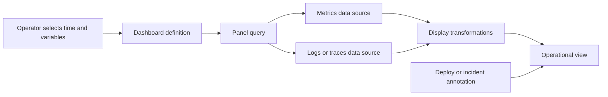
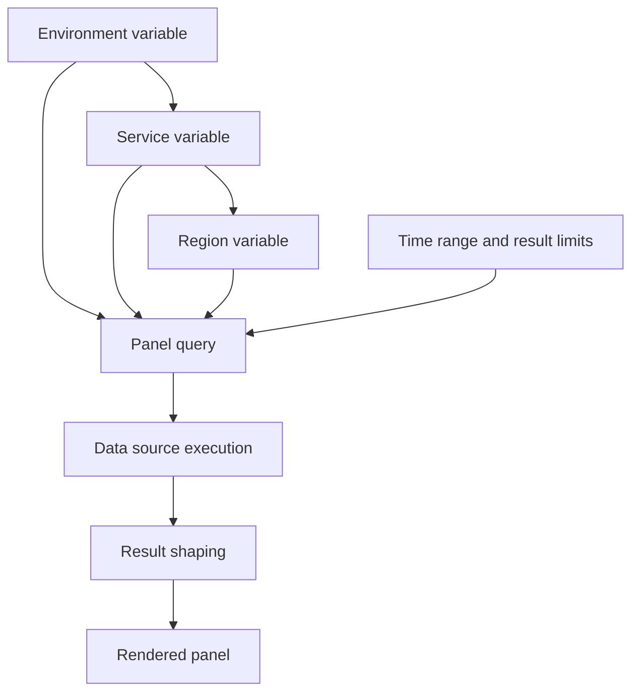
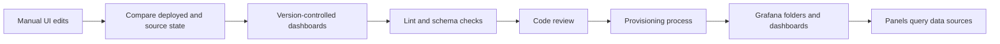
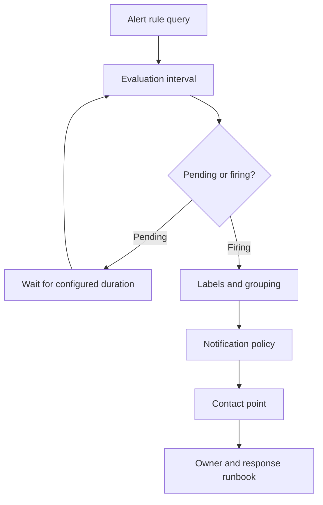

# Grafana

Part: [14 — Observability](PART_OVERVIEW.md)

Grafana is a visualization and alerting platform that queries configured data sources and presents dashboards, explorations, and notifications. It can unify views over multiple systems, but it does not make their schemas or query semantics identical. [CH05 Prometheus](CH05_Prometheus.md) owns Prometheus collection and Prometheus Query Language (PromQL); CH10 owns provider-neutral alert design; CH11-13 own service-level objectives (SLOs) and error-budget practice.

## Dashboard Query Path

A dashboard contains panels, queries, transformations, variables, annotations, and layout. Each panel requests data from a data source using its query model. Transformations may join or reshape results for display, but should not conceal mismatched units or populations.



Design dashboards around operational questions and decisions. Put service health and the next diagnostic path above detailed resource panels. Use explicit units, useful legends, consistent time ranges, and links to logs or traces with correlated variables. Avoid dense dashboards that require operators to understand every panel before seeing the primary symptom.

## Variables, Queries, and Performance

Variables allow one dashboard to select environment, service, region, or other bounded dimension. Query variable values from authoritative sources and constrain multi-value selections. A variable that expands into thousands of series can turn a dashboard into an expensive query generator.



Set sensible dashboard time-range defaults and query limits. Use backend recording rules or pre-aggregations for expensive repeated work rather than relying on a dashboard to recompute large scans. Cache carefully; stale data can mislead responders. Test dashboards with realistic series counts and data-source latency.

## Provisioning, Versioning, and Ownership

Dashboards can be edited in the UI or provisioned from version-controlled definitions. UI edits are useful for exploration but can create drift from source. Choose an authoritative workflow and record changes. Provisioning enables review and repeatability, but its deployment pipeline should validate syntax, data-source references, folder permissions, and version compatibility.



Assign dashboard owners and review cadence. An abandoned dashboard can become a false source of truth. Use annotations for deployments and incidents when they help explain changes, and keep dashboards aligned with current service names, metrics, and alert policy.

## Access, Folders, and Alerting

Dashboards can expose sensitive operational details. Use folders, teams, data-source permissions, and organization boundaries to restrict access. A viewer's dashboard permissions may differ from the credentials Grafana uses to query a backend; scope both. Avoid embedding secrets in dashboard URLs or query variables.

Grafana-managed alert rules evaluate queries and send results to contact points through notification policies. Alerting semantics include evaluation interval, pending period, labels, grouping, and silencing. Product configuration varies by version; CH10 owns actionable alert design, while this chapter owns Grafana's visualization and alert-view architecture.



```mermaid
timeline
    title Dashboard annotations explain service changes
    10:00 : Stable request rate and latency
    10:15 : Deployment annotation appears
    10:18 : Error rate rises for one region
    10:22 : Incident annotation links response record
    10:35 : Recovery verified and annotated
```

Annotations should use consistent timestamps, service labels, and links to the source deployment or incident record. Keep the annotation stream useful by avoiding automatic events that do not help explain a change in the plotted data.

## Worked Case and Review Checklist

A service dashboard presents request success, latency distribution, saturation, and deployment annotations. Variables constrain environment and region to approved values. A panel links to a trace search using service and time range. The dashboard is provisioned from version control, and a folder permission grants the on-call team view access while production data-source credentials remain read-only and scoped.

Review dashboard purpose, query cost, time range, units, labels, variable cardinality, data-source permissions, folder ownership, provisioning drift, annotations, alert routing, and access audit. Confirm the dashboard identifies who acts when a panel or data source is unavailable.

## Questions and Summary

1. Draw the path from dashboard variable selection to data-source execution and panel rendering.
2. What security boundary is separate from a user’s Grafana folder permission?
3. Design a dashboard hierarchy for an executive overview, service health, and deep diagnosis.
4. How can dashboards-as-code drift from UI edits be detected and repaired?
5. Identify a slow dashboard query and choose whether to optimize the query, precompute data, or constrain variables.

Grafana makes telemetry queryable and visible through dashboards and alerts, but visualization is only useful when queries, units, permissions, and ownership are sound. Version dashboards, control variable expansion and query cost, and design views around operator decisions. Keep product alert configuration distinct from provider-neutral alert policy.
