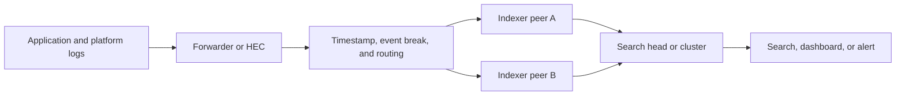
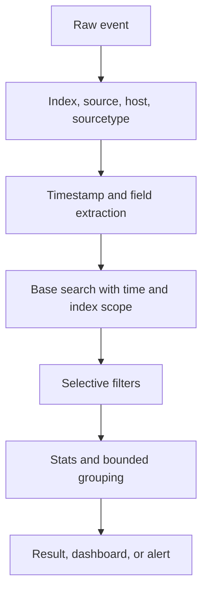
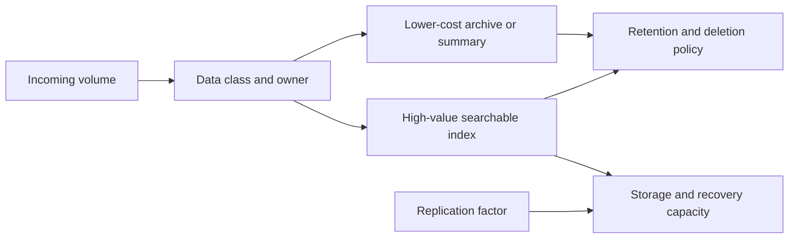
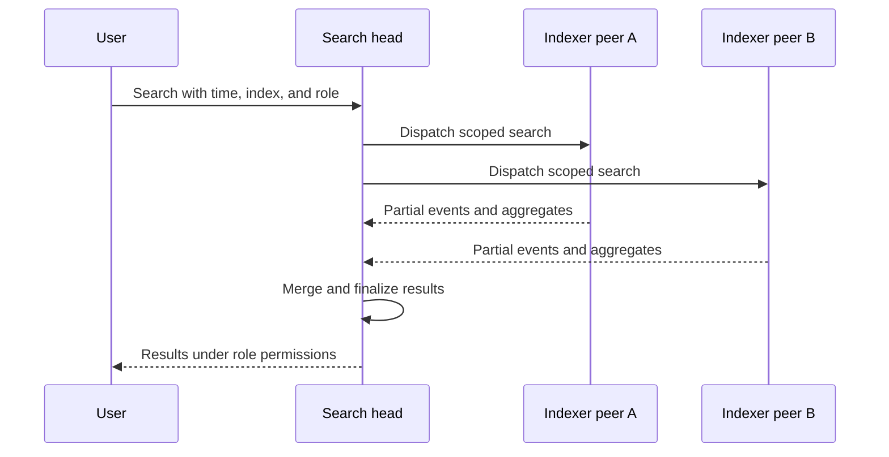

# Splunk

Part: [14 — Observability](PART_OVERVIEW.md)

Splunk ingests machine data, parses and indexes events, and provides search, dashboards, and alerts over retained data. Deployments can separate data collection, indexing, search, and management roles. This chapter focuses on Splunk architecture and operating decisions; [CH01 Logs](CH01_Logs.md) owns log-event design, and Part 09 owns provider-hosted observability products. Product roles and licensing change over time, so verify current deployment guidance.

## Ingestion and Indexing Path

Data can arrive through forwarders, HTTP Event Collector (HEC), syslog, or other supported inputs. Parsing identifies timestamps, event boundaries, source, sourcetype, and index routing. Indexers store searchable data; search heads coordinate searches and dashboards. Management components distribute configuration in larger deployments.

Forwarders buffer during temporary network failure, but buffers are finite. Monitor blocked queues, throughput, parsing errors, and dropped data. Input routing should assign a meaningful index and sourcetype; inconsistent metadata fragments searches and retention. Avoid parsing large raw payloads into unstable schemas without an explicit data contract.

## Event Schema, Search, and Data Models

Splunk events have metadata such as source, sourcetype, host, and index, plus parsed fields. Sourcetype communicates data format and parsing behavior. Normalize event names and field names across services where the same concept appears in multiple producers. Search Processing Language (SPL) supports selection, filtering, aggregation, and transformation; broad time ranges and high-cardinality groupings can be expensive.

Start searches with index, time, and selective terms. Avoid unbounded ad hoc extraction at query time for common fields; move stable extraction to ingestion or a shared data model when the performance and governance trade-off is justified. Search results should preserve the original event where access policy allows and clearly distinguish missing fields from empty values.

## Indexing, Retention, and Cost

Index design should align with ownership, access, retention, and workload. Index-time parsing and routing are harder to change later; search-time extraction is flexible but can increase query cost. Retention and data volume affect storage, licensing, replication, and restore time. Apply data reduction only with an explicit decision about what evidence is no longer available.

Estimate ingest by source and environment before onboarding a high-volume producer. Use sampling, filtering, or summary indexes only when their effect on investigations is understood. Track ingest volume, license use, indexing lag, storage, search concurrency, and hot buckets. Avoid routing all telemetry into a single index with broad permissions and one retention setting.

## Search Head, Indexer, and Tenancy Boundaries

Search heads coordinate query execution across indexers. Indexer clusters can replicate data and provide availability, but require configuration and capacity planning. Search concurrency can starve indexing or other teams if not managed. Use workload management and role limits where available; separate ingestion and search growth concerns.

Multi-tenant boundaries require index and role design, search filters, data-source controls, and protection of shared knowledge objects. A dashboard restriction alone does not prevent direct search access. Audit searches and exports where data sensitivity warrants it, and avoid exposing secrets in events or saved searches.

## Alerts, Recovery, and Operations

A saved search can run on a schedule and trigger an alert when results meet a condition. Schedule, time range, throttling, grouping, and ownership determine whether the alert is timely and actionable. CH10 owns alert semantics and response design; this chapter focuses on the Splunk search and notification path.

Indexer loss, search-head failure, forwarder buffering, clock skew, and parsing change can each degrade evidence differently. Test backup and restore, peer recovery, configuration deployment, and search availability. During an incident, verify index freshness and pipeline health before interpreting a quiet search as absence of events.

## Worked Case and Review Checklist

A payment platform routes application events to an operational index by service and environment, with a separate restricted index for security audit evidence. Forwarders add trusted host metadata and use a bounded buffer. A saved search begins with a short time window and filters by normalized service, event name, and operation identifier. Retention tiers preserve recent operational events for fast investigation and archive older data under approved policy.

Review inputs and forwarder topology, parsing and sourcetypes, index ownership, ingest volume, search cost, replication, retention, role permissions, audit, alert scheduling, and data-pipeline self-monitoring. Confirm that high-volume events can be sampled without losing required audit evidence.

## Questions and Summary

1. Trace an event from a forwarder through parsing, indexer, search head, and alert.
2. Compare index-time and search-time field extraction for a frequently queried field.
3. Design separate index and access policies for operational logs and audit records.
4. Diagnose a quiet search when the upstream service is producing events.
5. Estimate the storage and query effect of onboarding a source that multiplies daily ingest.

Splunk's operational architecture spans ingestion, parsing, indexing, search, alerting, and retention. Data classification and source metadata shape queryability, cost, access, and recovery. Monitor the pipeline as carefully as the applications whose logs it stores, and preserve a clear boundary between diagnostic logs and audit evidence.
