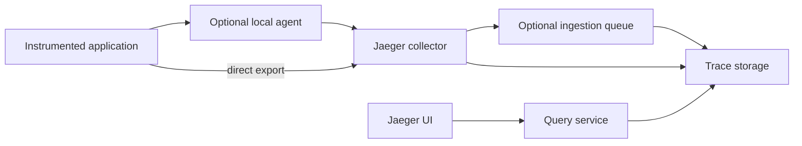
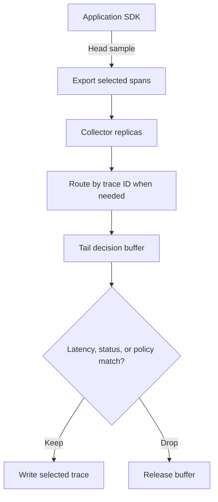
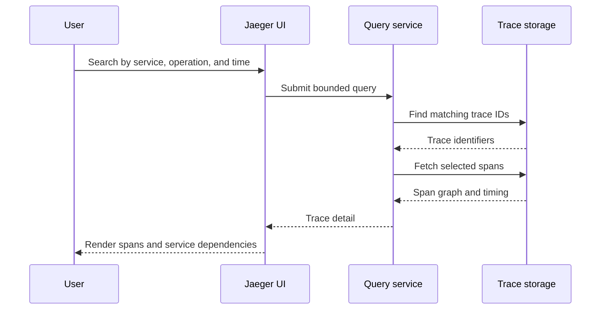
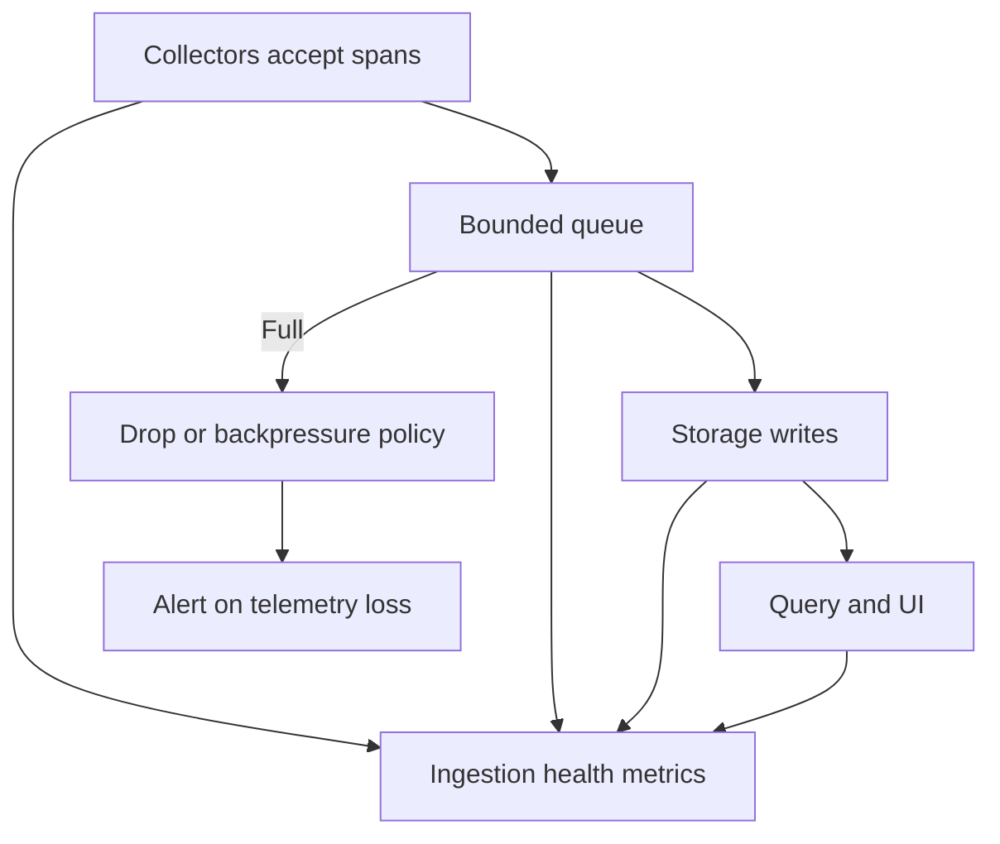
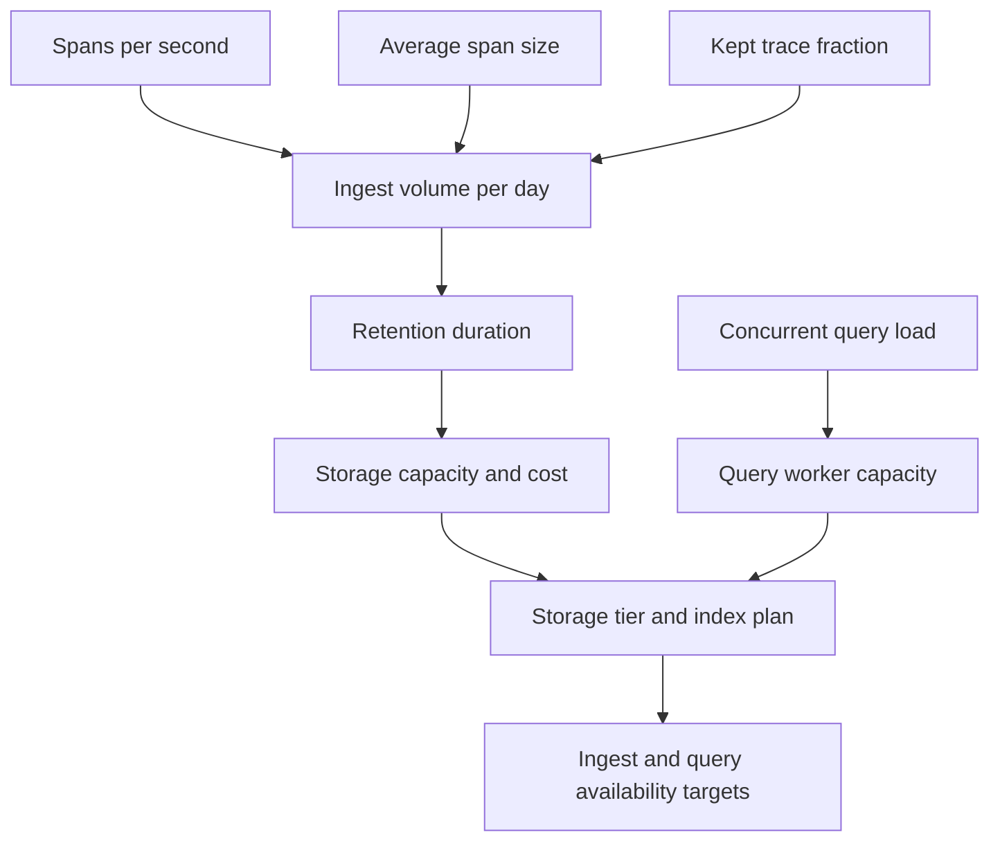

# Jaeger

Part: [14 — Observability](PART_OVERVIEW.md)

Jaeger is a distributed tracing backend and user interface for receiving, storing, and querying trace data. Deployments may use collectors and ingestion queues, storage backends, query services, and a user interface. Topology depends on scale and version. [CH03 Tracing](CH03_Tracing.md) owns trace semantics; [CH04 OpenTelemetry](CH04_OpenTelemetry.md) owns portable instrumentation and Collector standards.

## Components and Data Flow

Applications create spans through instrumentation and export them to an agent, Collector, or compatible protocol endpoint. Collectors validate and batch spans, then write them to storage. Query services retrieve traces and expose them to the UI or APIs. Keep ingestion, storage, and query capacity separate in the design because their scaling patterns differ.

Jaeger supports integration paths with OpenTelemetry. Avoid introducing duplicate agents or collectors that both export the same spans. Pin component versions and protocol configuration; deployment options and supported storage integrations evolve.

## Sampling and Ingestion Capacity

Trace volume depends on request rate, spans per trace, average span size, sampling rate, and retention. Head sampling can happen in software development kits (SDKs) before export; collector policies can further filter or route spans. Tail sampling requires complete traces to be considered together and therefore needs trace-aware routing and buffering.

Tail-sampling memory is driven by trace rate, decision wait, and span size. Set limits and overflow behavior. If fragments of one trace reach different samplers, the decision may be incomplete. Keep a baseline sample so ordinary healthy behavior remains observable even when policy focuses on errors.

## Storage, Retention, and Query

Storage choice affects ingest rate, retention, query latency, backup, and cost. Some deployments use a database optimized for trace lookup; larger systems may use object storage or a dedicated distributed backend. Define retention from diagnostic value and privacy policy. High-cardinality span attributes and long retention can grow storage rapidly.

Control query time range, result count, and concurrency to protect storage. Monitor query latency and failures separately from ingestion. A trace can be ingested successfully yet unavailable to users if indexing, storage, or query components fail.

## Deployment, Scaling, and Failure

Collectors scale with ingest throughput; query workers scale with search concurrency; storage capacity follows retention and span volume. Queueing can decouple ingestion from storage but adds lag and recovery complexity. Monitor accepted spans, refused spans, queue depth, exporter errors, storage writes, query latency, and dropped data.

Protect collector and query endpoints with authentication and network controls. Separate tenants through storage, authorization, and query constraints. Test storage outage, queue recovery, collector restart, and backup restore. Avoid blocking application request threads on the trace backend; instrumentation should fail safely if export is unavailable.

## Worked Case and Review Checklist

A multi-service application sends OpenTelemetry spans to an agent Collector, which exports to Jaeger collectors. A gateway tier routes complete traces to tail samplers; selected traces are stored for a bounded period. Operators can search by service, operation, and time while access controls prevent cross-tenant queries. Dashboards alert on ingestion drops and query latency, not only application errors.

Review instrumentation compatibility, endpoint exposure, sampling location, trace affinity, buffer sizing, storage choice, retention, query limits, access controls, upgrade plan, and self-observability. Confirm the data-loss path remains visible during backend outage.

## Questions and Summary

1. Draw application-to-storage-to-query flow and identify which components scale independently.
2. Estimate tail-sampling buffer requirements from trace rate and decision delay.
3. Diagnose why an exported trace is missing from a query result.
4. Compare direct application export with a local agent and gateway tier.
5. What health signals reveal ingestion loss versus query-path failure?

Jaeger provides trace ingestion, storage, and query capabilities, but reliable operation requires explicit sampling, capacity, retention, access, and failure design. Instrument with portable APIs where appropriate, prevent duplicate export paths, and expose telemetry-pipeline health so missing traces are diagnosable.
