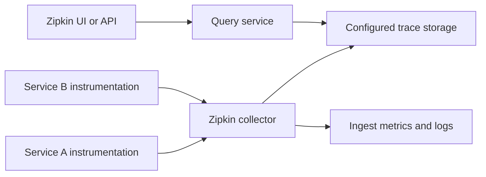
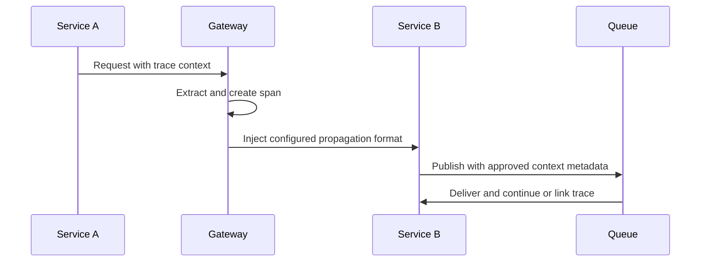
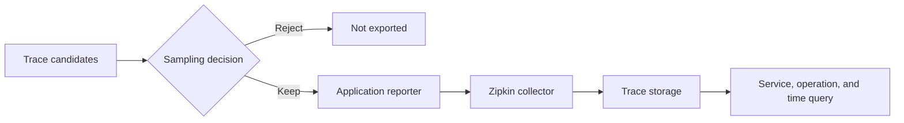
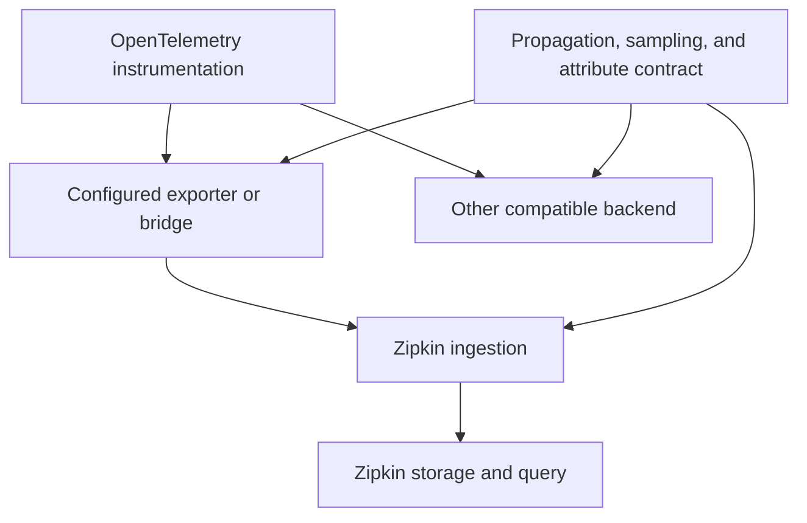
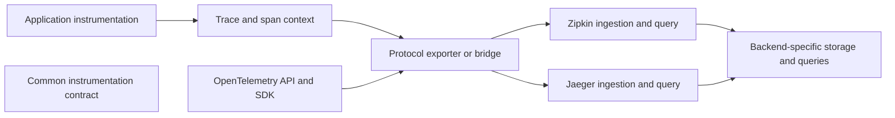

# Zipkin

Part: [14 — Observability](PART_OVERVIEW.md)

Zipkin is a distributed tracing system that collects spans, stores trace data, and supports search and visualization. It can fit teams needing a focused trace backend or compatibility with existing Zipkin instrumentation and propagation. Backend features and deployment modes vary; validate supported storage and protocol versions. [CH03 Tracing](CH03_Tracing.md) owns tracing semantics; CH04 owns OpenTelemetry instrumentation and context propagation.

## Span Collection and Service Topology

Instrumented applications create spans and report them through a supported reporter or OpenTelemetry exporter. Zipkin's collector accepts spans, validates and indexes them, and writes to a configured storage backend. The query API and UI search stored traces. Keep the application, collector, storage, and query roles distinct when estimating capacity and failure behavior.

Avoid running multiple exporters for the same spans unless duplication is intentional. Validate that trace identifiers and parent relationships survive translation between instrumentation libraries and the receiver format.

## Propagation and Span Relationships

Trace propagation carries identifiers and sampling decisions over service calls. Zipkin deployments may encounter B3 propagation alongside World Wide Web Consortium (W3C) Trace Context. Gateways and mixed instrumentation need an explicit propagation policy: extract the formats accepted at a boundary, create a local span, and inject the format required downstream. Avoid generating unrelated trace IDs at each service.

At each untrusted boundary, validate incoming context. Keep baggage minimal. Sampling flags are hints, not authorization. For asynchronous or batch work, preserve causal links without inventing a single parent when several messages are combined.

## Storage, Sampling, and Query

Sampling can occur in the application before spans reach Zipkin. A deterministic probability sampler bounds volume but may miss rare failure traces. A backend cannot recover spans that were never exported. Align sampling policy with traffic volume, diagnostic requirements, and privacy. Monitor sampled, exported, accepted, and dropped counts.

Choose storage based on ingestion scale, query patterns, retention, availability, and operational skill. Search by service, operation, and bounded time window; broad searches increase query cost. Retain trace data only as long as its diagnostic value and privacy policy justify.

## Operations and Migration

Collector throughput, storage writes, query availability, and UI access are separate service objectives. Monitor ingest latency, rejected spans, storage failures, query latency, queue depth if present, and retention growth. Secure collector endpoints and restrict query access when span attributes contain sensitive context.

Migration between Zipkin and another backend requires validating span semantics, propagation, sampling, attributes, storage retention, and saved queries. Protocol compatibility does not guarantee equal query behavior or feature parity. Run dual export only with a bounded duration and duplication-aware cost controls.

## Worked Case and Review Checklist

A service mesh spans several languages and two existing propagation formats. The team standardizes on one context policy at ingress, instruments new services through OpenTelemetry, and exports to Zipkin. Collector health and rejected spans are monitored. A controlled migration test compares trace completeness and queryability before any old reporter is removed.

Review propagation formats, instrumentation ownership, duplicate spans, sample rate, collector capacity, storage and retention, query scope, authentication, tenant access, pipeline health, and migration tests. Verify span links remain meaningful across asynchronous work.

## Questions and Summary

1. Draw span flow through application reporter, Zipkin collector, storage, and query.
2. How can mixed propagation formats break parent-child relationships?
3. What does application-side sampling prevent the backend from observing?
4. Compare Zipkin and Jaeger migration concerns without assuming protocol support means equal features.
5. Design metrics that distinguish ingest loss from query unavailability.

Zipkin provides collection and query for distributed traces, but instrumentation and propagation determine what the backend can show. Bound sampling, ingest, storage, and query costs; secure endpoints; and monitor telemetry delivery. During migration, validate semantic completeness and query behavior rather than relying only on a successful exporter connection.
