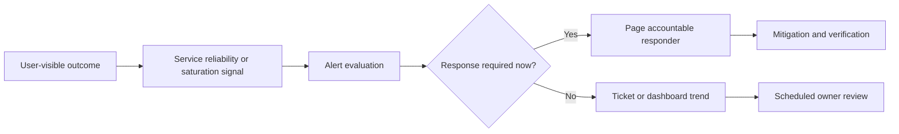
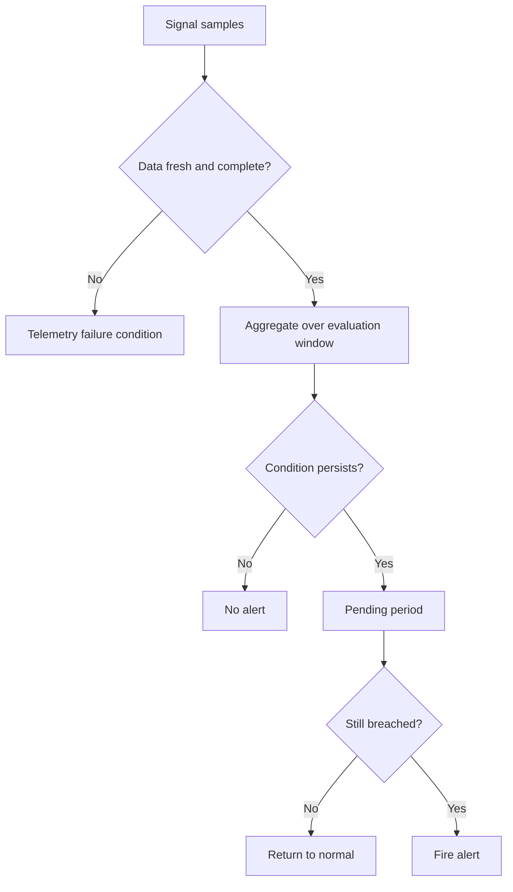
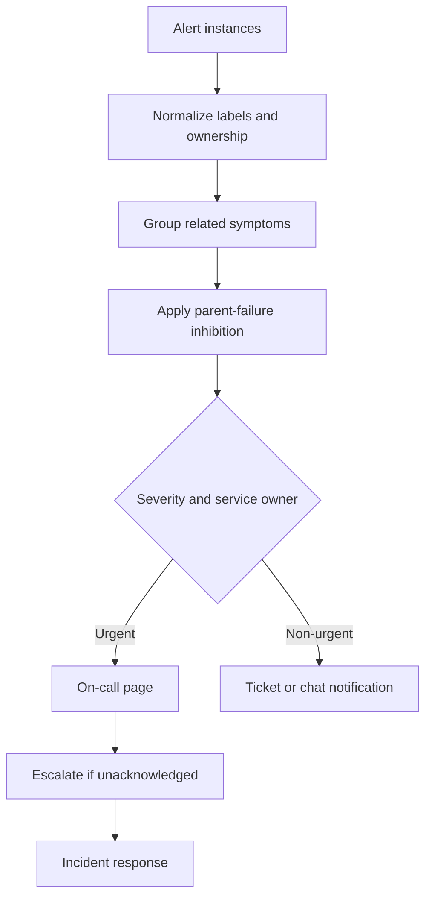
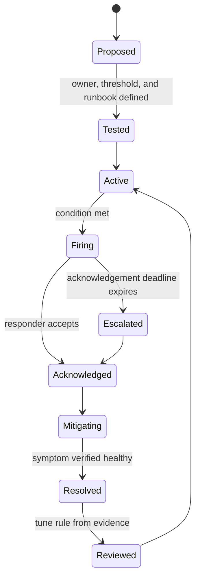
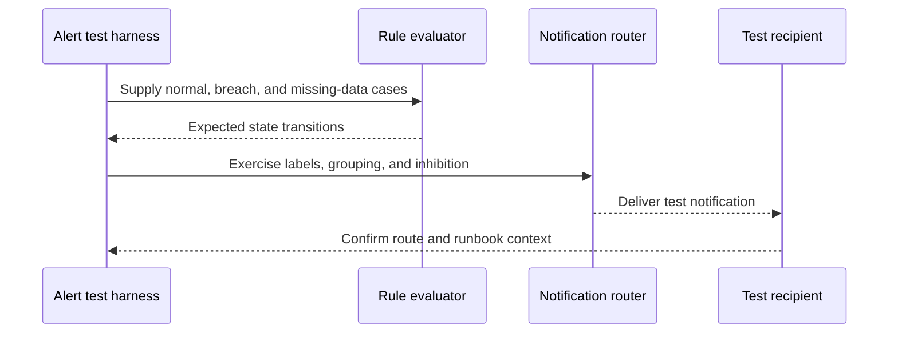

# Alerting

Part: [14 — Observability](PART_OVERVIEW.md)

An alert is an operational signal intended to prompt a response. A useful alert detects a meaningful symptom, reaches an accountable owner, and supplies enough context to choose an action. A threshold expression alone is not an alerting system: evaluation delay, missing data, grouping, routing, escalation, acknowledgement, and closure all affect whether a user-impacting issue is handled.

This chapter owns provider-neutral alert design and response workflow. [CH02 Metrics](CH02_Metrics.md) owns measurement semantics; [CH11 Service-Level Objectives](CH11_SLO.md) owns objective practice; [CH05 Prometheus](CH05_Prometheus.md) and [CH06 Grafana](CH06_Grafana.md) own tool implementation. Part 15 owns security incident response.

## Alert on Symptoms and Decisions

Alert when a condition requires a human or automated intervention within a defined time. Page for urgent user impact or imminent risk; create a ticket or dashboard signal for conditions that can wait. A resource threshold can be a useful early warning, but a page should usually reflect a service symptom such as failed requests, rising latency, stalled work, or loss of a critical dependency.

For paging alerts, answer: what is wrong, who owns it, how urgent it is, what scope is affected, and what first action is safe? If the alert cannot change a decision, it likely belongs in a dashboard, report, or ticket rather than the paging path.

## Conditions, Windows, and Missing Data

An alert rule combines a signal, threshold or objective, evaluation window, and persistence condition. Short windows detect fast failures but are noisy; long windows smooth noise but delay response. Choose windows from user impact tolerance and recovery time, and test them against historical incidents and normal variation.

Define no-data behavior explicitly. Missing samples should not silently become zero or healthy. Distinguish the service symptom from telemetry pipeline failure, and alert on the latter when it prevents reliable evaluation. Use a pending period to suppress brief fluctuations only when waiting is safe.

## Severity, Grouping, and Routing

Severity should encode urgency and expected response, not the source team's anxiety. Routing maps service, environment, and severity to an owner. Group correlated alerts into an incident or notification to avoid paging once per replica or metric dimension. Inhibition can suppress derivative symptoms when a known parent failure already explains them, but must not hide independent impact.

Keep routing labels bounded and stable. Every page needs a current owner, backup escalation, and a documented acknowledgement expectation. Maintenance silences should have an owner, scope, and expiry; broad or indefinite silences can conceal real incidents.

## Alert Lifecycle and Runbooks

The lifecycle includes rule proposal, validation, deployment, firing, acknowledgement, mitigation, resolution, and tuning. Runbooks should state the alert meaning, dashboard or query link, safe diagnostic steps, mitigation options, and verification criteria. A runbook should not assume elevated access or expose secrets in alert payloads.

Closure means the symptom is verified healthy or an explicit owner accepts a known residual risk. A notification delivery receipt is not a resolution. Review false positives, missed incidents, time to acknowledge, time to mitigate, and repeat pages; change the rule or instrumentation with an owner and evidence.

## Testing and Noise Control

Test alert expressions with representative historical data, synthetic samples, or a controlled fault. Verify threshold boundaries, missing-data behavior, label grouping, routing, silence expiry, notification delivery, and runbook links. A rule that parses successfully can still have a unit error, wrong population, or wrong team route.

Track alert volume and actionable fraction, but avoid optimizing for fewer pages alone. Removing noise without checking incident coverage can create silent failures. Every noisy alert needs a decision: fix the signal, change the threshold/window, group it, demote it, or remove it with documented rationale.

## Worked Case and Review Checklist

A checkout service has an availability objective. The team creates a fast-burn page for severe sustained request failure and a slower ticket for elevated latency that remains within the response window. Alert labels identify service and region, grouping suppresses per-instance duplicates, and missing metric data fires a separate telemetry-health alert. The page links to a service dashboard, recent deploys, and a runbook with mitigation and verification steps.

Review symptom relevance, signal semantics, threshold/window, no-data behavior, severity, owner, grouping, inhibition, escalation, silence expiry, runbook, test cases, notification delivery, and rule lifecycle. Confirm that paging wakes an owner capable of acting.

## Questions and Summary

1. Distinguish a page, ticket, and dashboard signal by urgency and required action.
2. Design alert behavior for a metric breach and for missing telemetry.
3. Draw grouping, inhibition, routing, acknowledgement, and escalation for a regional outage.
4. How would historical incidents be used to validate alert windows without overfitting?
5. Which evidence should be required before an alert is marked resolved?

Alerting connects measurements to accountable response. Design for user symptoms, explicit windows and missing-data behavior, clear ownership, noise control, and verified resolution. Test the entire route from signal through notification and runbook action, not just the rule expression.
