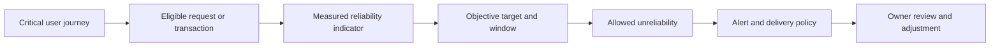
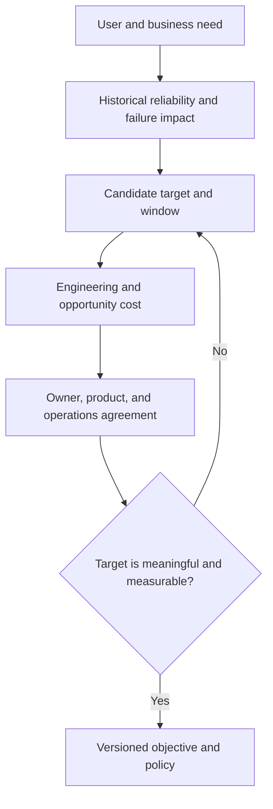
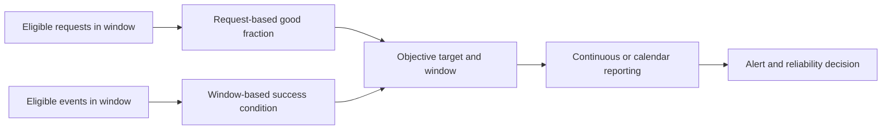
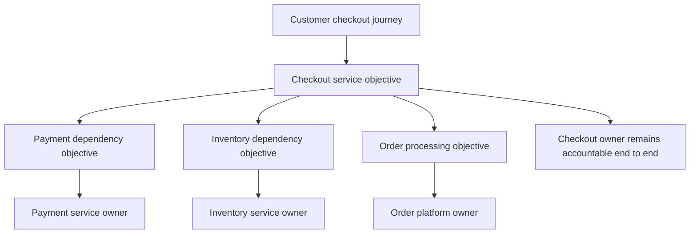
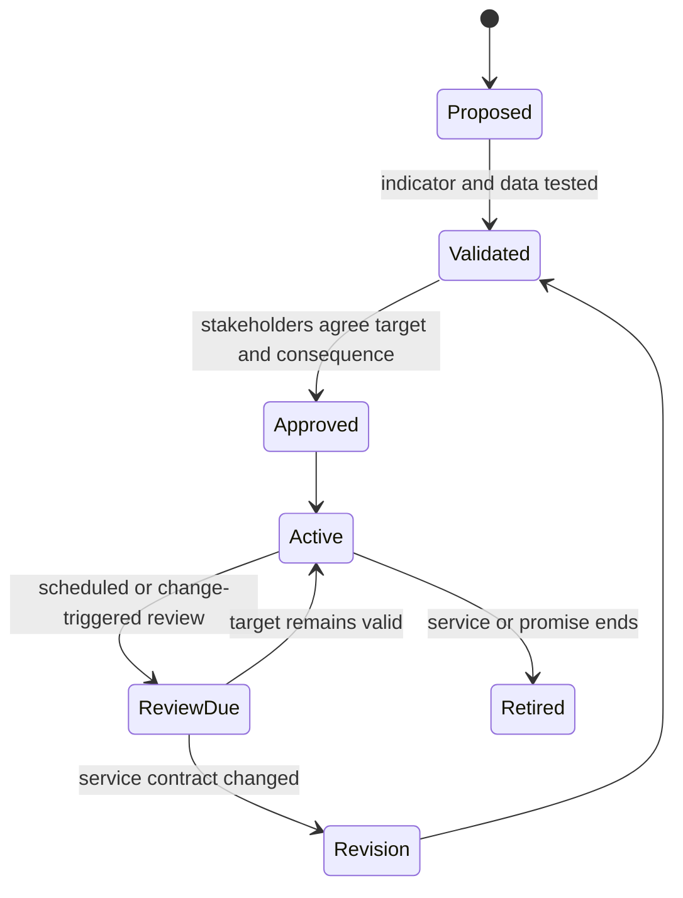

# SLO (Service Level Objective)

Part: [14 — Observability](PART_OVERVIEW.md)

A Service Level Objective (SLO) is a target for a measured aspect of service reliability over a defined period. The foundational Service Level Indicator (SLI), SLO, Service Level Agreement (SLA), availability, and error-budget vocabulary is owned by [Part 07 Non-Functional Requirements](../07_System_Design_and_Distributed_Systems/CH02_Non_Functional_Requirements.md). This chapter recaps that vocabulary and focuses on operational SLO selection, governance, and use with alerting and delivery decisions rather than re-deriving the definitions.

## From User Journey to Objective

Start with a user journey or service promise, not with whichever metric is easiest to graph. Identify the events that represent successful service, the eligible population, the measurement point, and the time window. A front-end availability target may need to reflect completed transactions rather than healthy hosts. A dependency objective should support a service owner's decision and not obscure the end-to-end user outcome.

Write an objective statement with an indicator, target, window, population, and owner. State exclusions explicitly, such as planned administrative traffic or client-canceled requests, and ensure exclusions do not hide real user harm. Use a separate indicator for each materially different promise rather than combining incompatible measures into one score.

## Choosing Targets and Windows

Targets should reflect user expectations, product commitments, failure cost, and the team's ability to improve reliability. Higher targets cost more engineering and operational effort and leave less budget for change. A target copied from a competitor or set to “five nines” without a user and cost rationale is not a strategy.

Windows can be rolling or calendar-aligned. Rolling windows provide continuously updated behavior; calendar windows simplify periodic reporting but can hide a severe short incident inside a long interval. Select a window for the decision cadence. Fast operational alerts can use shorter windows than the objective's reporting window, provided they are calibrated to its risk.

Request-based and window-based objectives answer different questions. A request-based ratio weights each eligible operation; a window-based objective may classify fixed intervals as good or bad. Choose the model that reflects the service promise and state how low traffic, partial windows, and missing data affect it.

An objective hierarchy helps identify dependency expectations, but dependency objectives do not replace the user-facing objective. Each lower-level objective needs an owner and a contract that supports the top-level journey.

## Governance and Ownership

Every objective needs a service owner accountable for the indicator and its data quality. Product and operations partners agree on user impact, target, and consequences. Review objectives periodically and after material service changes, but avoid changing a target merely to make a current dashboard green. Version changes with effective date, rationale, affected population, and downstream alert or error-budget policy.

Avoid conflicting objectives across a service and its dependencies. A dependency target should leave enough reliability for the end-to-end objective and should not shift accountability away from the user-facing owner. Part 09 owns provider SLO products; Part 12 applies SLO signals to Kubernetes; this chapter owns provider-neutral operational use.

## Operational Use and Alerting

An objective supports decisions when its indicator is timely and trusted. Use it to inform alerting, incident severity, capacity work, and release risk. [CH13 Error Budgets](CH13_Error_Budgets.md) owns the operational policy for remaining reliability allowance; [CH10 Alerting](CH10_Alerting.md) owns generic alert lifecycle. Avoid alerting on every small SLO fluctuation; multi-window burn-rate policies can detect fast and sustained risk.

Missing or delayed data must not count as success. Monitor the SLI pipeline and define how to report periods with incomplete observations. If the measurement boundary changes, assess whether old and new data are comparable before aggregating them.

## Worked Case and Review Checklist

A checkout service adopts a request-based availability objective for eligible customer transactions and a latency objective at the user-facing edge. It excludes health checks but includes dependency timeouts and application errors. The team validates the numerator and denominator against sampled logs and request metrics, selects a rolling window aligned to incident response, and documents the cost and change policy with the target. A later API change triggers review because the definition of an eligible transaction changes.

Review user journey, indicator, eligible event population, target rationale, window, exclusions, owner, data quality, alert policy, downstream dependency budget, versioning, and review trigger. Confirm that changes to instrumentation or service behavior cannot silently redefine success.

## Questions and Summary

1. Recap the relationship between SLI, SLO, and SLA; link each to its foundational owner.
2. Write an objective for a user journey and specify eligible and excluded events.
3. Compare rolling and calendar windows for incident response and reporting.
4. How should an SLO change be versioned when the service's event population changes?
5. Which operational decisions should the objective inform, and who owns each one?

An SLO turns a user-relevant reliability promise into a measurable target with an owner, window, and consequence. Part 07 owns the foundational vocabulary; Part 14 makes objectives operational through validated indicators, alerting, review, and error-budget policy. A target without trustworthy measurement and a response contract is only a number.
