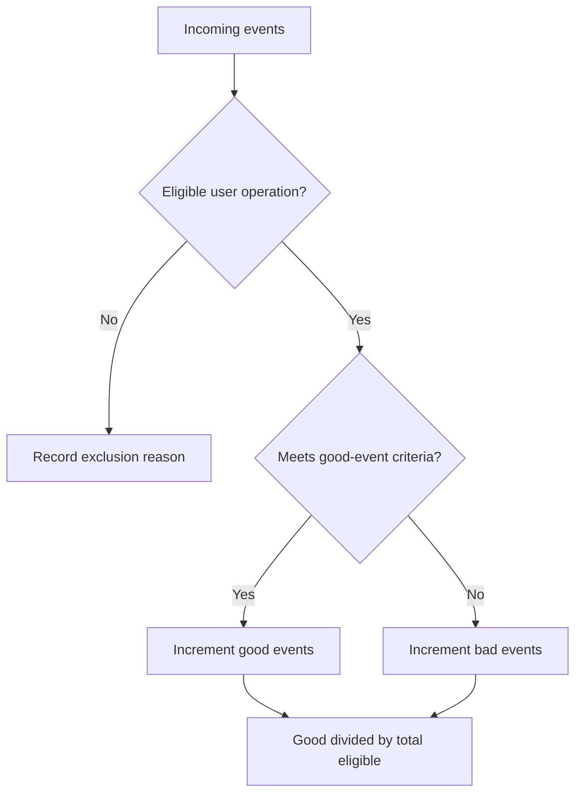
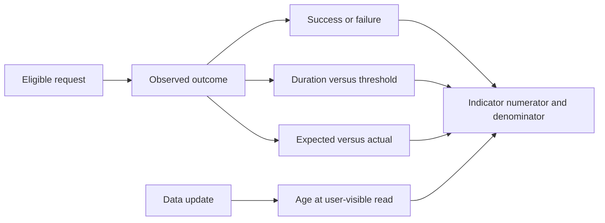
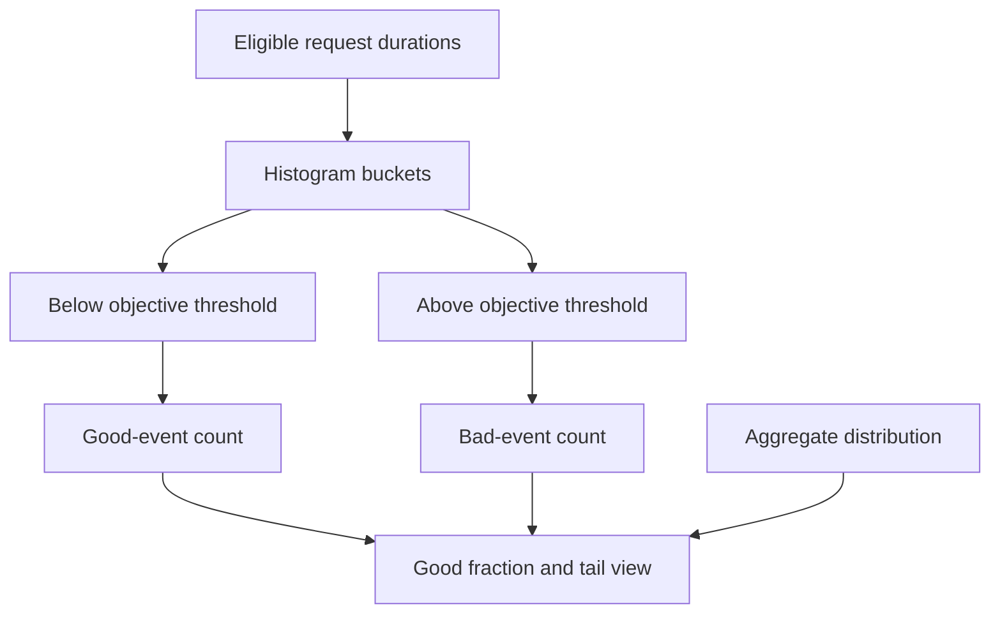
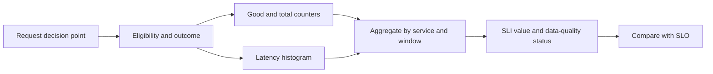
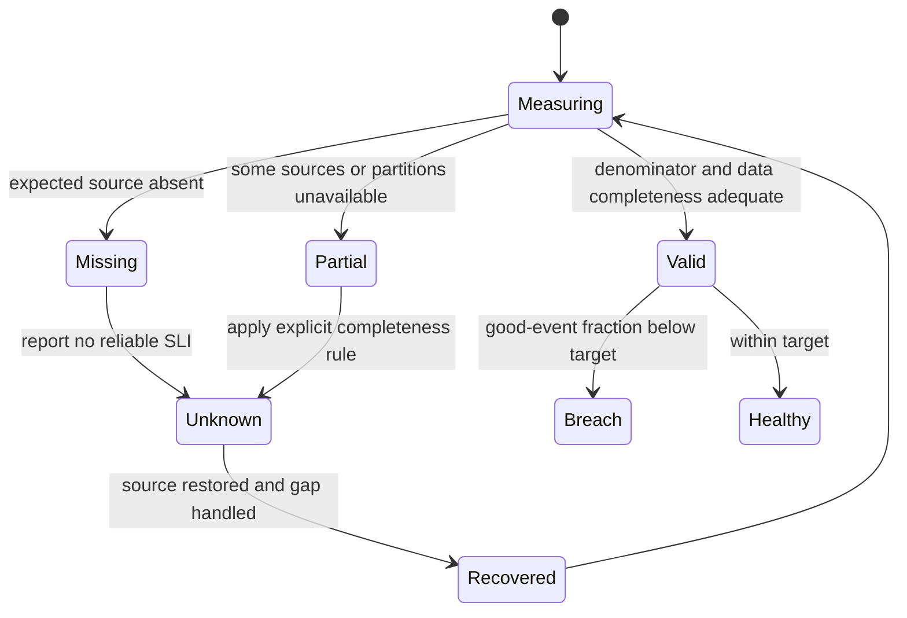

# SLI (Service Level Indicator)

Part: [14 — Observability](PART_OVERVIEW.md)

A Service Level Indicator (SLI) is a measurement of a service behavior used to evaluate reliability. Its value depends on precise event eligibility, numerator, denominator, measurement point, and data completeness. Part 07 owns the foundational SLI/SLO vocabulary; [CH02 Metrics](CH02_Metrics.md) owns metric types; [CH11 SLO](CH11_SLO.md) owns objective selection. This chapter focuses on implementing and validating indicators.

## Define the Event Population

For request-based indicators, define eligibility and the criterion for a good event. A basic ratio uses good eligible events divided by all eligible events. Exclusions must be explicit and defensible: internal health checks may be excluded, while timeouts or dependency failures seen by a user generally remain in the denominator. Retries need a consistent counting unit so one logical operation is not counted differently across clients and servers.

An indicator should have a stable measurement boundary. Client-side success can include network and rendering behavior; server-side success can miss failures after response generation. Choose the point that best represents the promise and use complementary indicators where no single point captures the full journey.

## Availability, Latency, Correctness, and Freshness

Availability often uses successful eligible operations over total eligible operations. Latency indicators count operations within a threshold or measure a distribution; an average can hide tail harm. Correctness indicators compare accepted results with expected outcomes. Freshness indicators measure age or delay for data that users rely on. Select indicators based on the failure modes that materially affect users.

For latency, define whether the indicator is a threshold fraction or a distribution percentile and specify the unit, boundary, and event population. Percentiles need a histogram or event distribution; averages are insufficient to reconstruct tails. For correctness, capture the delayed evidence needed to know whether the operation was actually right, not merely accepted.

A latency indicator should expose both the fraction meeting the objective threshold and enough distribution data to diagnose the tail. Do not substitute an average for a threshold fraction or infer a fleet percentile by averaging instance percentiles.

## Instrumentation and Aggregation

Implement indicators at a boundary where eligible and good events can be counted consistently. Use counters or histograms with bounded labels, and retain enough dimensions to identify a responsible service or region. Do not use a user identifier as a metric label. Logs and traces can provide sampled examples for diagnosis while aggregate metrics feed the indicator.

Aggregation must preserve the meaning of the numerator and denominator. For ratios, aggregate counts first and divide afterward; averaging per-instance ratios can overweight low-volume instances. Decide how to handle late events, duplicate delivery, counter resets, partial outages, and clock skew. A result with incomplete data should be marked unknown or invalid rather than silently treated as good.

## Validation and Missing Data

Validate indicators against known incidents and representative records. Compare a sample of raw events with aggregate counts, verify exclusions, and test boundary cases such as latency exactly on the threshold, canceled requests, retries, and missing response data. Instrumentation tests should fail when required fields disappear or a schema changes unexpectedly.

Monitor event volume, dropped samples, scrape/export success, schema errors, and clock quality alongside the indicator. A perfectly computed ratio from an incomplete source is still wrong. Keep source health and SLI status separate so operators can distinguish service failure from measurement failure.

## Worked Case and Review Checklist

A checkout availability indicator counts customer-initiated purchase attempts. It treats a completed purchase or a valid business rejection as a good response, while timeout, server error, and dependency failure are bad. Health checks and malformed requests are excluded with explicit reasons. A latency indicator measures the proportion of eligible attempts completed below a defined threshold. The team reconciles counter totals with sampled access logs and adds an unknown state when one region's telemetry feed disappears.

Review event eligibility, good/bad classification, numerator, denominator, retries, boundary, units, aggregation, missing data, duplicates, cardinality, validation records, and owner. Confirm that a source outage cannot improve the indicator by reducing its denominator.

## Questions and Summary

1. Define eligible, good, and bad events for a request-based availability indicator.
2. Why should ratios be aggregated from event counts rather than averaged across services?
3. Design a latency indicator that captures tail behavior and boundary semantics.
4. How should a partial telemetry outage affect the indicator and its displayed status?
5. Build a test matrix for retries, cancellation, exact threshold, missing response, and duplicate events.

An SLI is only as trustworthy as its event population and instrumentation. Define the measurement boundary and good-event criteria, aggregate numerator and denominator correctly, test edge cases, and surface missing data as uncertainty. Use the SLI as the measurement input to an SLO, not as an isolated dashboard number.
