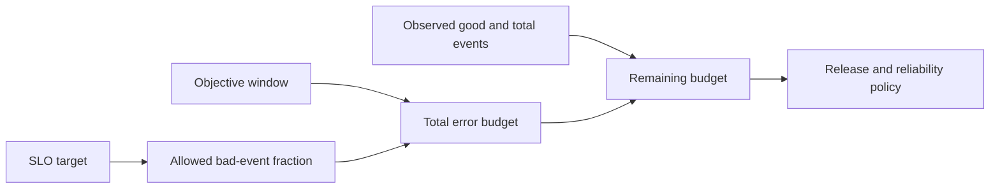
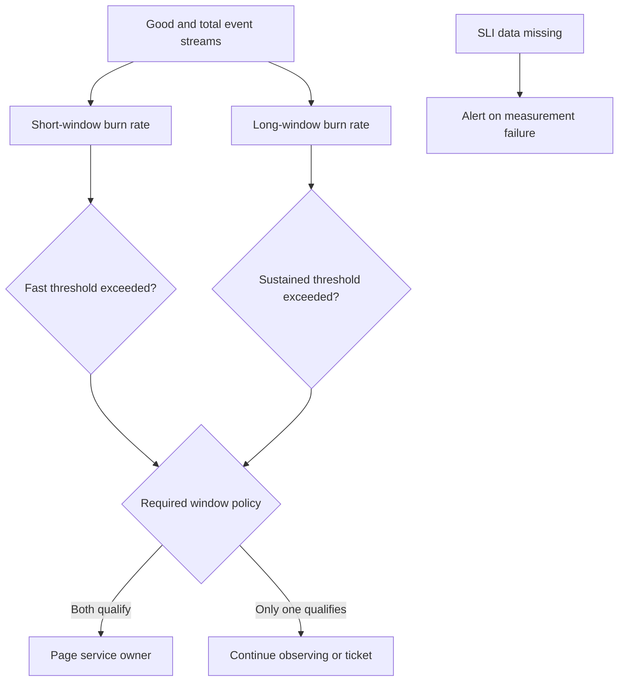
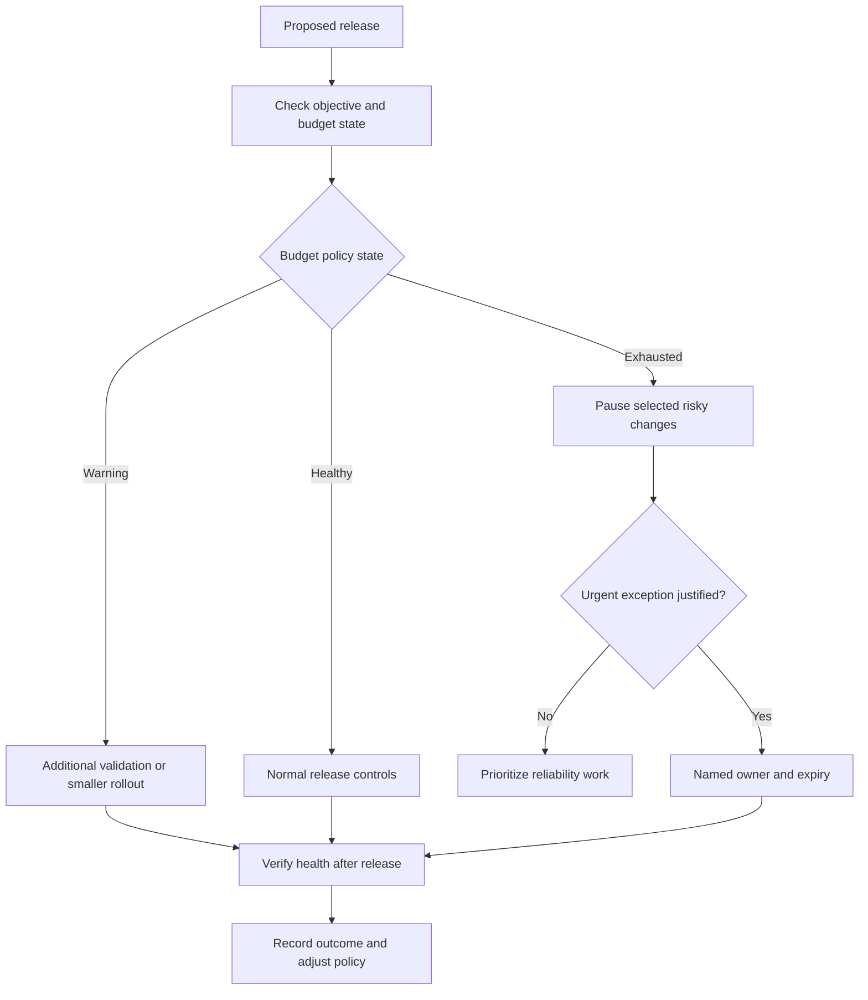
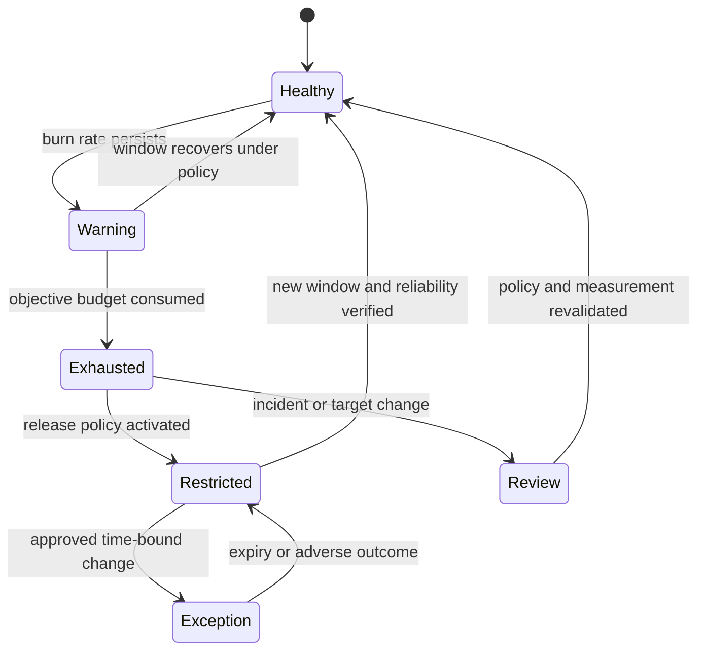
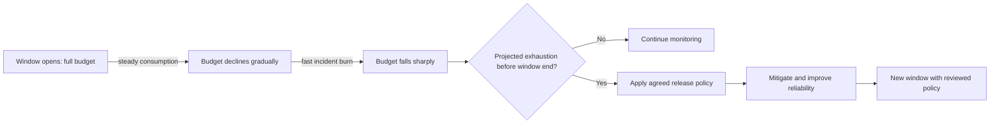

# Error Budgets

Part: [14 — Observability](PART_OVERVIEW.md)

An error budget is the allowed unreliability implied by a service objective over its measurement window. Part 07 owns the foundational Service Level Objective (SLO) and budget derivation; [CH11 Service-Level Objectives](CH11_SLO.md) owns objective governance and [CH12 Service-Level Indicators](CH12_SLI.md) owns indicator implementation. This chapter focuses on operational budget tracking, burn-rate detection, release policy, exceptions, and learning.

## Budget Model and Burn Rate

Given an SLO target, the error budget is the permitted fraction of bad eligible events for that window. For example, a target of 99.9% allows 0.1% bad events under the stated measurement contract. The budget is not a quota to spend carelessly; it is a shared decision signal for balancing reliability work and change risk.

Burn rate compares the observed error rate with the rate that would consume the budget over the objective window. A burn rate above one means budget is being consumed faster than the steady rate for that window. Short windows detect severe incidents quickly; longer windows identify sustained exhaustion risk. Burn-rate calculations depend on a valid SLI and window, not a raw count detached from eligible traffic.

## Multi-Window Detection and Alerts

Use multiple windows to balance detection speed and noise. A fast window catches sharp failures; a slower window confirms persistence and reduces alerts from brief spikes. Thresholds should be chosen from response time and user impact, then tested against historical incidents. Missing or stale SLI data should produce an unknown or telemetry alert, not zero burn.

Do not copy threshold values blindly. A low-traffic service may need a request-volume floor; otherwise one failure can create an unstable rate. A high-volume service may need tighter latency and error analysis. State how low sample counts, resets, and late events affect the calculation.

## Release Policy and Exception Handling

Teams can use remaining budget to inform release decisions. A policy may pause risky changes after sustained budget exhaustion, require stronger evidence, or prioritize reliability work. It should identify the service owner, triggering condition, affected release types, allowed mitigations, and review cadence. Do not make a budget gate a blunt organization-wide stop that ignores severity, service criticality, or safe low-risk changes.

Exceptions need a named approver, rationale, scope, expiry, and rollback or mitigation plan. Budget state should not be used as an individual performance score. It is a service-level coordination mechanism that helps product and engineering stakeholders make explicit trade-offs.

## Resets, Windows, and Policy Governance

Rolling windows update continuously; calendar windows reset at a fixed boundary. A reset can make the displayed remaining budget jump even though reliability did not suddenly improve. Show window boundaries and avoid interpreting resets as recovery. If objectives or event populations change, version the budget policy. Do not combine incomparable periods.

Review budget policy after incidents, objective changes, or changes to traffic and instrumentation. Confirm that the objective remains user-relevant, the SLI is complete, and alert thresholds still provide enough response time. A budget can appear healthy when the denominator is missing; data-quality status must travel with it.

The trajectory is a decision aid, not a forecast guarantee. Display the observation window and indicator completeness beside the remaining-budget value so a reset or telemetry gap cannot look like recovery.

## Worked Case and Review Checklist

A service has a monthly request-based SLO. A regional dependency outage consumes budget rapidly. A multi-window alert pages the service owner when a fast burn is confirmed by a longer window. The team pauses a high-risk migration but allows a small, reversible security fix under normal controls. The incident review identifies retry amplification; the team changes retry policy and adds a test. Budget tracking then measures whether the reliability improvement persists across the rolling window.

Review objective and SLI versions, window and reset behavior, burn-rate calculation, sample floor, missing-data handling, alert routing, release policy scope, exception ownership and expiry, business alignment, and incident learning. Confirm that low-risk changes and urgent mitigations have an explicit path.

## Questions and Summary

1. Given an SLO target, explain how the allowed bad-event fraction relates to the objective window.
2. Why combine short and long burn-rate windows?
3. Design a budget-exhaustion policy that pauses risky changes without blocking urgent remediation.
4. How can missing SLI data falsely make an error budget appear healthy?
5. What evidence and approval are required for an exception during budget exhaustion?

Error budgets translate an objective into an operational signal for reliability and change decisions. Their usefulness depends on valid indicators, explicit windows, burn-rate detection, proportionate policy, and accountable exceptions. Treat budget exhaustion as evidence for coordination and learning. Do not use it as an automatic blame or stop mechanism.
