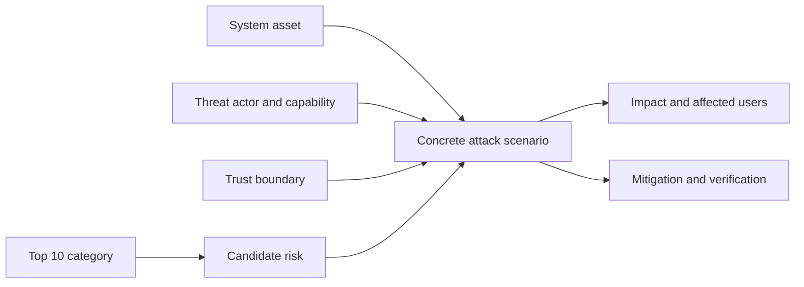
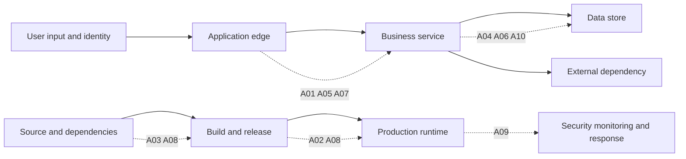
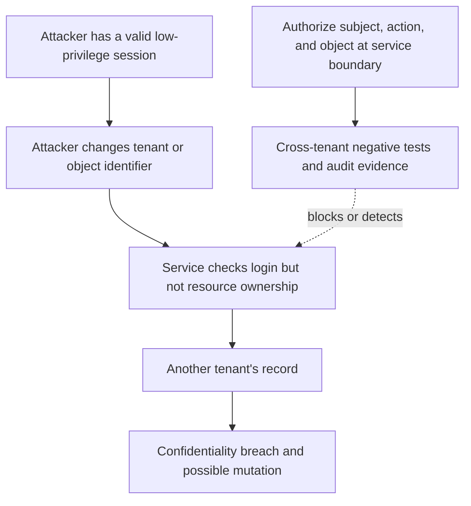
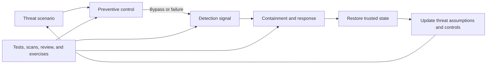
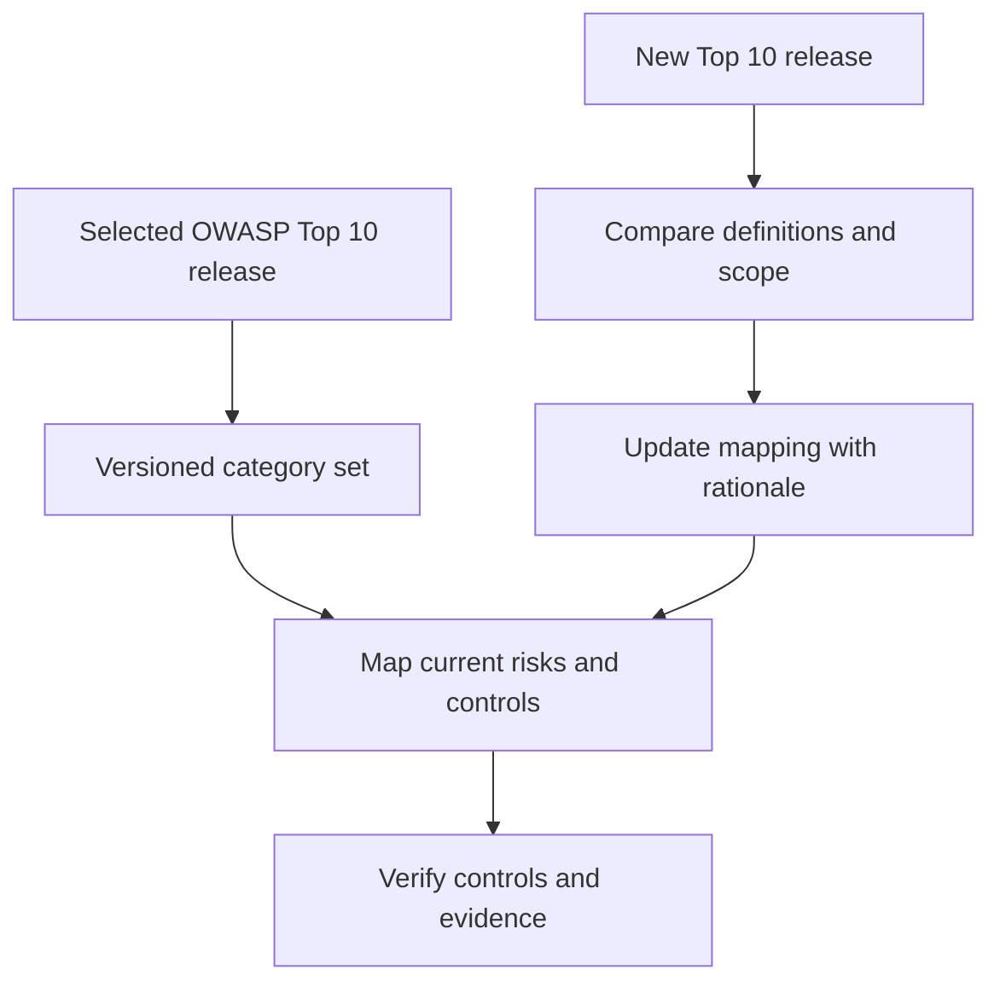

# OWASP Top 10

Part: [15 — Security](PART_OVERVIEW.md)

The Open Worldwide Application Security Project (OWASP) Top 10:2025 is an awareness document for developers and web application security. It summarizes ten broad risk categories to help teams start conversations and discover areas that deserve attention. It is not a complete threat model, a compliance standard, a severity score, or proof that an application is secure when every category is checked.

This chapter uses the current 2025 release to teach how to interpret categories, map them to architecture and attack paths, choose mitigations, and verify control effectiveness. [CH12 Threat Modeling](CH12_Threat_Modeling.md) owns system-specific threat analysis; [CH02 Authentication](CH02_Authentication.md) and [CH03 Authorization](CH03_Authorization.md) own identity and access-control foundations. Part 08 owns API architecture; Part 13 owns delivery workflow implementation.

## Purpose and Limits

Security risk is contextual. A category becomes actionable only when a concrete asset, actor, trust boundary, precondition, impact, control, and verification method are identified. The Top 10 helps prevent teams from overlooking common classes of application failure, but the list cannot tell a team which risk matters most to its workload or whether a control is effective in its design.

Use the Top 10 as a risk-discovery prompt during design reviews, secure development planning, testing, and incident retrospectives. Do not treat category names as mutually exclusive: one attack path can involve broken access control, insecure design, and insufficient logging at once. Do not infer that uncategorized risks are unimportant.

The official release is versioned. This chapter describes the OWASP Top 10:2025 as published at the time of writing. When using another release, name its year and confirm the official category titles; rankings and groupings can change as evidence and project methodology evolve. A category mapping is not automatically backward- or forward-compatible with earlier versions.

## OWASP Top 10:2025 Categories

| Category | Example precondition and impact | Architecture questions and verification |
|---|---|---|
| [A01: Broken Access Control](https://top10.owasp.org/2025/A01_2025-Broken_Access_Control/) | A user can alter an object identifier or invoke an unprotected function and access another user's data or privileged action. | Is authorization enforced at every server-side object and action boundary? Test deny cases across roles, tenants, and object ownership. |
| [A02: Security Misconfiguration](https://top10.owasp.org/2025/A02_2025-Security_Misconfiguration/) | Unsafe defaults, unnecessary services, exposed administration, or inconsistent environment settings create an exploitable path. | Are configuration baselines versioned and reviewed? Scan deployed configuration and test externally reachable surfaces. |
| [A03: Software Supply Chain Failures](https://top10.owasp.org/2025/A03_2025-Software_Supply_Chain_Failures/) | A compromised or vulnerable dependency, build tool, update channel, or artifact enters a trusted release. | Are dependencies and build inputs pinned, reviewed, and traceable to the artifact? Verify provenance and response procedures. |
| [A04: Cryptographic Failures](https://top10.owasp.org/2025/A04_2025-Cryptographic_Failures/) | Sensitive data is exposed through weak algorithms, incorrect use, poor key handling, or missing protection. | What data needs protection, where are keys owned and rotated, and how are cryptographic properties tested? Avoid custom cryptography. |
| [A05: Injection](https://top10.owasp.org/2025/A05_2025-Injection/) | Untrusted input changes the meaning of a query, command, template, or interpreter instruction. | Are code and data separated through parameterization or safe encoding? Test adversarial input at each interpreter boundary. |
| [A06: Insecure Design](https://top10.owasp.org/2025/A06_2025-Insecure_Design/) | A required security property was never designed, such as abuse limits, transaction invariants, or safe recovery. | Were abuse cases and security requirements considered before implementation? Validate control behavior with scenarios and architecture tests. |
| [A07: Authentication Failures](https://top10.owasp.org/2025/A07_2025-Authentication_Failures/) | Weak credential handling, recovery, session lifecycle, or identity verification allows account takeover. | Are enrollment, login, recovery, reauthentication, and revocation designed as one lifecycle? Test hostile and edge-case flows. |
| [A08: Software or Data Integrity Failures](https://top10.owasp.org/2025/A08_2025-Software_or_Data_Integrity_Failures/) | An update, serialized object, pipeline, or data source is trusted without adequate integrity verification. | Are artifacts, updates, and critical data authenticated and validated? Test tampering and rollback paths. |
| [A09: Security Logging and Alerting Failures](https://top10.owasp.org/2025/A09_2025-Security_Logging_and_Alerting_Failures/) | Security-relevant events are absent, untrustworthy, inaccessible, or not connected to response. | Are event sources, integrity, access, retention, alert owners, and response procedures defined? Exercise detection and escalation. |
| [A10: Mishandling of Exceptional Conditions](https://top10.owasp.org/2025/A10_2025-Mishandling_of_Exceptional_Conditions/) | Unexpected input, partial failure, resource exhaustion, or an error path leaves unsafe state or leaks information. | Are failures bounded and fail-safe? Test timeouts, malformed data, resource exhaustion, and partial transactions. |

These categories overlap by design. For example, a dependency update can involve software supply chain exposure, integrity verification, and error handling. Use the category to name a risk family, then describe the actual exploit path and service-specific consequences.

## Map Categories to Trust Boundaries

Review the application by tracing data and authority across boundaries: user to edge, edge to service, service to data store, service to dependency, and source/build system to runtime. A category is useful when it prompts a specific question at one of these transitions.

This mapping is only a navigation aid; it does not imply that a category belongs to one layer. Broken access control can occur at an API gateway, service, database, or object-storage policy. Security misconfiguration can exist in application settings, cloud resources, identity, or build infrastructure. Follow the data and authority path rather than stopping at the component label.

## Build an Attack Path, Not a Checklist

For a candidate risk, state the attacker's capability, preconditions, target asset, action, and impact. Then identify preventive, detective, and recovery controls. A control name such as “input validation” is not enough: specify which input, where it is validated, the allowed contract, how bypasses are tested, and what happens when validation fails.

Separate the existence of a weakness from exploitability and impact. A vulnerable library may be unreachable in a particular workload; a low-ranked category may still be catastrophic if it affects a high-value asset. Capture assumptions and evidence so teams can revisit prioritization when architecture or threat conditions change.

## Controls and Verification Evidence

Choose controls that interrupt the attack path and have an observable verification method. Preventive controls reduce the chance of exploitation; detective controls provide timely evidence; response and recovery controls limit damage and restore a safe state. Defense in depth is useful when layers have independent failure modes, not when several controls repeat the same weak assumption.

Evidence should match the control claim. Code review may verify a parameterized query change; a test can verify authorization behavior; a configuration scan can identify exposed settings; an incident exercise can verify escalation. A passing scanner does not prove the system lacks a risk outside the scanner's coverage. Record residual risk and ownership.

## Use the List Alongside Threat Modeling

The Top 10 organizes awareness categories; [CH12 Threat Modeling](CH12_Threat_Modeling.md) provides system-specific asset, actor, boundary, scenario, and mitigation analysis. Start with the actual architecture and abuse cases, then use the Top 10 to challenge omissions. Do not reverse the process by forcing every application into ten checklist rows and treating unfilled categories as safe.

| Use the Top 10 for | Do not use it as |
|---|---|
| Security awareness and discussion prompts | A complete system threat model |
| A starting taxonomy for risk discovery | A compliance certification or pass/fail score |
| A guide for reviewing common application failure classes | A substitute for architecture-specific abuse cases |
| A pointer to further guidance and verification | A ranking of risk for every individual workload |

Use system context to decide priority: data sensitivity, user impact, exposure, threat capability, blast radius, detectability, and recovery. Two applications with different assets and trust boundaries can appropriately prioritize different categories.

## Versioning and Maintenance

Record the Top 10 release year in assessment reports and internal control mappings. When adopting a new release, compare category definitions and evidence rather than renaming old findings mechanically. Keep historical mapping where audit or trend analysis requires it, and state when a category changes scope or combines prior concerns.

Use the official OWASP release page as the source of category titles and definitions. Do not copy a list into internal standards without a version label and review owner. The OWASP project evolves; teams should revisit mappings when a new release or relevant application architecture change appears.

## Worked Case: Multi-Tenant Document Service

A document service stores customer files and exposes upload, preview, sharing, and deletion APIs. A low-privilege user changes a document identifier and receives another tenant's file. The Top 10 suggests broken access control, but the actual risk model identifies the asset, tenant boundary, authenticated attacker, missing ownership check, and confidentiality impact. The service team moves authorization to the object boundary, adds cross-tenant negative tests, and emits a security event for denied access without logging document contents.

The team separately reviews upload parsing for injection, encryption and key access for cryptographic failures, build dependencies for software supply chain risk, and failure handling for partial upload or storage errors. Each issue gets a concrete scenario, control owner, verification evidence, and residual-risk decision. The Top 10 helped discover prompts; the system-specific analysis determined priorities and actions.

## Review Checklist and Exercises

Review the selected release, category definitions, assets, actors, preconditions, trust boundaries, attack paths, impact, controls, verification evidence, owner, residual risk, and mapping limitations. Confirm that the team did not infer security from a completed checklist.

1. Map each 2025 category to one relevant trust boundary in a system you know; identify categories that do not apply and explain why.
2. Convert “broken access control” into an attack path with asset, actor, precondition, impact, control, and negative test.
3. Select one category and distinguish preventive, detective, and recovery controls for it.
4. Compare an OWASP category checklist with a threat model for a multi-tenant service. What does each reveal that the other may miss?
5. Review an internal security report that omits the OWASP release year. Define how to preserve versioned mappings during an update.

## Summary

The OWASP Top 10:2025 is a versioned awareness taxonomy, not a complete security method. Use it to discover candidate risks, map them to real assets and trust boundaries, and specify attack preconditions, impacts, controls, and verification. Prioritize from the system's context, link to the dedicated security chapters for mechanism depth, and use [CH12 Threat Modeling](CH12_Threat_Modeling.md) for system-specific analysis.
