# OWASP Top 10

Part: [15 — Security](PART_OVERVIEW.md) · Status: Revised (in-depth rewrite)

## 1. Introduction

Every team that ships a web application eventually meets a list of "top" security problems, usually in the form of an audit finding or a scanner report that cites a category name. The Open Worldwide Application Security Project (OWASP) Top 10 is the most widely cited of these lists. It is published by a nonprofit community, revised every few years, and used by developers, testers, auditors, and procurement teams as shared vocabulary. An architect meets it from a different angle than a tester does. The tester asks whether a given application contains a flaw. The architect asks which categories of flaw the design makes easy, which it makes hard, and what evidence would show the difference.

This chapter teaches how to use the OWASP Top 10:2025 as an architect. It does not try to make the reader an exploit developer. It teaches how a category turns into a concrete attack path, why some categories are mostly design problems and others are mostly implementation or operations problems, and how to pick controls that interrupt an attack path at a point where they can be verified.

After working through this chapter, you should be able to:

- Explain what the Top 10 is, how it is built, and what it cannot tell you about a particular system.
- Decompose a category into asset, actor, trust boundary, precondition, action, impact, control, and verification evidence.
- Trace one request through a typical web architecture and say which categories apply at each boundary.
- Explain why broken access control comes from missing checks at specific enforcement points, and design deny-by-default, object-level authorization that can be tested.
- Describe the misconfiguration lifecycle from default settings to configuration drift, and choose controls that detect and prevent it across environments.
- Keep category mappings versioned so that reports remain comparable across releases.

### 1.1 Scope and ownership boundaries

This chapter owns the use of the Top 10 as a risk-discovery taxonomy and the architect's method for turning a category into controls and evidence. It teaches the first two categories, broken access control and security misconfiguration, in depth, and the remaining categories in the sections that follow. Neighboring chapters own the mechanisms underneath.

| Topic | Owner | What this chapter does |
|---|---|---|
| System-specific threat analysis, data-flow diagrams, Spoofing, Tampering, Repudiation, Information disclosure, Denial of service, Elevation of privilege (STRIDE) | [Threat Modeling](CH12_Threat_Modeling.md) | Uses the Top 10 to challenge omissions; does not teach the method |
| The threat-model document as an architecture artifact | [Threat Models](../21_Architecture_Documentation/CH09_Threat_Models.md) | Does not define the document format |
| Identity proof, credentials, sessions | [Authentication](CH02_Authentication.md) | Recaps only where a category depends on it |
| Authorization models and policy evaluation | [Authorization](CH03_Authorization.md), [RBAC](CH04_RBAC.md), [ABAC](CH05_ABAC.md) | Applies them to application enforcement points |
| API contract and gateway design | [API Security](../08_API_Architecture/CH09_API_Security.md) | Mentions API-specific forms of a category |
| OAuth, OpenID Connect (OIDC), JSON Web Token (JWT) wire protocols | [OAuth](CH06_OAuth.md), [OIDC](CH07_OIDC.md), [JWT](../05_Networking_and_OS/CH21_JWT.md) | Does not re-teach token validation |
| Secrets, encryption, public key infrastructure | [Secrets Management](CH09_Secrets_Management.md), [Encryption](CH10_Encryption.md), [PKI](CH11_PKI.md) | Recaps the failure class only |
| Secure development lifecycle and release evidence | [Secure SDLC](CH13_Secure_SDLC.md) | Names the evidence a control needs |
| Delivery pipeline implementation | Part 13 (DevOps) | Defines the properties a pipeline should check |

Facts about the list itself, such as category titles and rankings, were checked against the official [OWASP Top 10:2025](https://top10.owasp.org/2025/) pages at the time of writing. Verify them against the current release before copying them into a standard.

## 2. What the Top 10 is and what a risk is

### 2.1 What the document is

The OWASP Top 10 is an awareness document. Its own introduction describes it as a starting point for developers and security practitioners, and the project publishes separate, much longer material for verification and testing, such as the Application Security Verification Standard (ASVS) and the Web Security Testing Guide, both referenced from the official category pages. Each Top 10 category page lists a score table with fields such as the number of mapped Common Weakness Enumeration (CWE) entries, incidence rates, average weighted exploit and impact scores, total occurrences, and total Common Vulnerabilities and Exposures (CVE) records. The categories are therefore groupings of many specific weakness types, not single bugs. For example, the 2025 page for broken access control lists dozens of mapped CWE entries, from path traversal to missing authorization to server-side request forgery.

Three consequences follow for an architect.

1. A category name is too coarse to fix. "Broken access control" covers a missing role check on an admin page, a guessable object identifier, a permissive cross-origin policy, and a request-forgery flaw. Each has a different control and a different test.
2. A ranking reflects data from many organizations and a community survey, so it describes the population of applications that contributed data, not your system. An application with no public Internet exposure and no multi-tenancy has a different top five than the list suggests.
3. The list changes between releases. Categories are renamed, merged, split, and reordered. A finding labelled with a category but no release year cannot be compared with one from three years earlier.

### 2.2 Risk as a chain, not a label

A risk is a chain with identifiable links. An **asset** has value to someone. An **actor** with some capability wants to harm it or use it. A **trust boundary** is a place where data or authority passes from a context with one level of trust to a context with another, such as the Internet to a load balancer or an application to its database. A **weakness** is a defect or missing control at that boundary. A **precondition** is what the actor needs first, such as a valid low-privilege account. The **action** exploits the weakness, and the **impact** is what the owner loses. **Controls** sit at one or more links, and **verification evidence** shows that each control works.

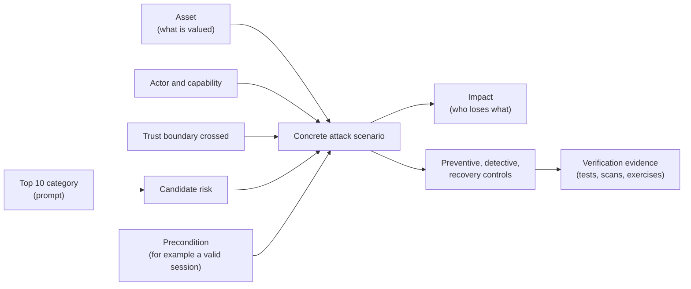

The diagram shows where the Top 10 sits in the reasoning. It supplies only the first box, a prompt that suggests a candidate risk. Everything that makes the risk actionable comes from the system: its assets, its actors, its boundaries, its preconditions, and the controls and evidence that exist or are missing. Reading the diagram right to left is also useful in a review. Start from an impact the business cares about, ask which scenario produces it, and then ask which category names the weakness. That order prevents the common failure of listing ten categories and writing "not applicable" beside those the team has not thought about.

### 2.3 Why categories overlap

One attack path often touches several categories. A tenant-isolation failure in an API is broken access control. If the same flaw exists because nobody listed "a tenant must never read another tenant's record" as a requirement, it is also insecure design. If the failed reads were never logged, it is also a logging and alerting failure. The categories are lenses, not partitions. Use them to name the risk family, then describe the exploit path precisely, because the path, not the label, determines the fix.

### 2.4 What the Top 10 does not provide

| The list gives you | The list does not give you |
|---|---|
| A shared vocabulary for common failure families | A complete set of threats for your system |
| Prompts that challenge omissions in a design review | A severity score or a priority order for your workload |
| Pointers to detailed prevention and testing guidance | Proof of security when every category is "checked" |
| A reasonable starting scope for training and test plans | A compliance certification or a pass/fail threshold |

Priority comes from context: asset value, exposure, actor capability, blast radius, detectability, and recovery cost. [Threat Modeling](CH12_Threat_Modeling.md) provides the system-specific analysis. The threat-model document itself is covered in [Threat Models](../21_Architecture_Documentation/CH09_Threat_Models.md). The Top 10 is the checklist an experienced reviewer holds in mind to avoid forgetting a family, not the analysis.

## 3. The OWASP Top 10:2025 categories

The table lists the ten 2025 category titles, each linked to the official page, with a typical precondition and impact and the architecture question that a reviewer should ask. Treat the second and third columns as teaching summaries written for this handbook, not as the official definitions.

| Category | Example precondition and impact | Architecture questions and verification |
|---|---|---|
| [A01: Broken Access Control](https://top10.owasp.org/2025/A01_2025-Broken_Access_Control/) | A user can alter an object identifier or invoke an unprotected function and access another user's data or privileged action. | Is authorization enforced at every server-side object and action boundary? Test deny cases across roles, tenants, and object ownership. |
| [A02: Security Misconfiguration](https://top10.owasp.org/2025/A02_2025-Security_Misconfiguration/) | Unsafe defaults, unnecessary services, exposed administration, or inconsistent environment settings create an exploitable path. | Are configuration baselines versioned and reviewed? Scan deployed configuration and test externally reachable surfaces. |
| [A03: Software Supply Chain Failures](https://top10.owasp.org/2025/A03_2025-Software_Supply_Chain_Failures/) | A compromised or vulnerable dependency, build tool, update channel, or artifact enters a trusted release. | Are dependencies and build inputs pinned, reviewed, and traceable to the artifact? Verify provenance and response procedures. |
| [A04: Cryptographic Failures](https://top10.owasp.org/2025/A04_2025-Cryptographic_Failures/) | Sensitive data is exposed through weak algorithms, incorrect use, poor key handling, or missing protection. | What data needs protection, where are keys owned and rotated, and how are cryptographic properties tested? Avoid custom cryptography. |
| [A05: Injection](https://top10.owasp.org/2025/A05_2025-Injection/) | Untrusted input changes the meaning of a query, command, template, or interpreter instruction. | Are code and data separated through parameterization or safe encoding? Test adversarial input at each interpreter boundary. |
| [A06: Insecure Design](https://top10.owasp.org/2025/A06_2025-Insecure_Design/) | A required security property was never designed, such as abuse limits, transaction invariants, or safe recovery. | Were abuse cases and security requirements considered before implementation? Validate control behavior with scenarios and architecture tests. |
| [A07: Authentication Failures](https://top10.owasp.org/2025/A07_2025-Authentication_Failures/) | Weak credential handling, recovery, session lifecycle, or identity verification allows account takeover. | Are enrollment, login, recovery, reauthentication, and revocation designed as one lifecycle? Test hostile and edge-case flows. |
| [A08: Software or Data Integrity Failures](https://top10.owasp.org/2025/A08_2025-Software_or_Data_Integrity_Failures/) | An update, serialized object, pipeline, or data source is trusted without adequate integrity verification. | Are artifacts, updates, and critical data authenticated and validated? Test tampering and rollback paths. |
| [A09: Security Logging and Alerting Failures](https://top10.owasp.org/2025/A09_2025-Security_Logging_and_Alerting_Failures/) | Security-relevant events are absent, untrustworthy, inaccessible, or not connected to response. | Are event sources, integrity, access, retention, alert owners, and response procedures defined? Exercise detection and escalation. |
| [A10: Mishandling of Exceptional Conditions](https://top10.owasp.org/2025/A10_2025-Mishandling_of_Exceptional_Conditions/) | Unexpected input, partial failure, resource exhaustion, or an error path leaves unsafe state or leaks information. | Are failures bounded and fail-safe? Test timeouts, malformed data, resource exhaustion, and partial transactions. |

These categories overlap by design, as section 2 explained. For example, a dependency update can involve software supply chain exposure, integrity verification, and error handling. Use the category to name a risk family, then describe the actual exploit path and service-specific consequences.

A second way to read the list is by where the fix usually lives. This grouping is a handbook heuristic, not part of the OWASP document.

| Where the fix usually lives | Categories | Typical owner |
|---|---|---|
| Design decisions made before code | Insecure Design, parts of Broken Access Control and Authentication Failures | Architects and product owners |
| Implementation in application code | Injection, Broken Access Control, Mishandling of Exceptional Conditions | Application developers |
| Configuration and platform operation | Security Misconfiguration, Cryptographic Failures (key and protocol settings) | Platform and operations teams |
| Build, release, and dependency pipeline | Software Supply Chain Failures, Software or Data Integrity Failures | Build and release engineers |
| Detection and response | Security Logging and Alerting Failures | Security operations and service owners |

The grouping explains why a security program cannot be delegated to a single team. An architect's job is to make sure each group has an owner and that controls in different groups do not depend on the same unverified assumption.

## 4. Mapping categories to trust boundaries

### 4.1 Follow one request

Reviewing a design category by category invites false confidence. Reviewing it boundary by boundary produces concrete questions. Take a typical browser-to-database request and list every place where data or authority crosses from one context to another.

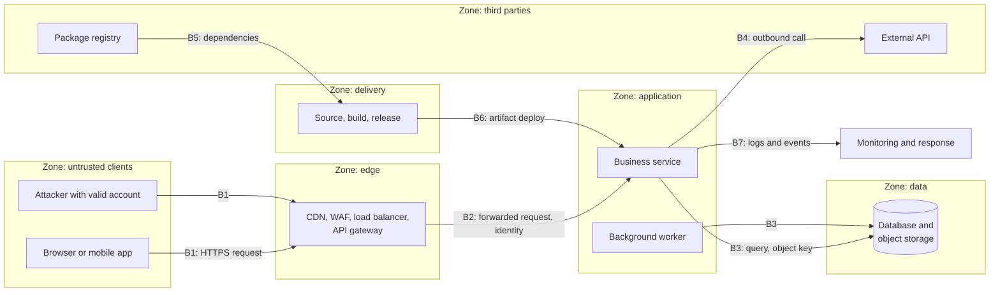

Each labelled arrow is a boundary worth a question. The mapping below is a navigation aid, and a category can appear at several boundaries.

| Boundary | What crosses | Categories to consider | Question to ask |
|---|---|---|---|
| B1: client to edge | Untrusted input, credentials, session cookies | Authentication Failures, Injection, Broken Access Control | What does the edge enforce, and what does it leave to the service? |
| B2: edge to service | Forwarded request plus identity claims | Broken Access Control, Security Misconfiguration | Can a client reach the service directly and skip the edge? Does the service trust a header that any client could set? |
| B3: service to data | Queries, object keys, tenant identifiers | Injection, Broken Access Control, Cryptographic Failures | Does the data layer enforce anything, or does it trust the service completely? |
| B4: service to external call | Request URLs, credentials, responses | Broken Access Control (server-side request forgery), Mishandling of Exceptional Conditions | Who chooses the destination, and what happens when the call fails or stalls? |
| B5: dependency intake | Third-party code and update metadata | Software Supply Chain Failures | What is pinned, verified, and traceable? |
| B6: artifact to runtime | The deployed image or package | Software or Data Integrity Failures, Security Misconfiguration | Is what runs the same thing that was built and reviewed? |
| B7: runtime to response | Security events | Security Logging and Alerting Failures | Would someone notice this boundary being abused? |

### 4.2 Reading the map

The most useful finding from this exercise is usually a boundary where nothing is enforced because every party assumes another does it. The edge assumes the service checks ownership. The service assumes the gateway removed spoofed identity headers. The database assumes the service filters by tenant. If all three assumptions are false, the attacker needs only a valid session. Write the assumptions down for each boundary, name who enforces each one, and keep a test that fails if the enforcer disappears.

Boundary position does not fix a category to a layer. Broken access control can occur at a gateway, a service, a database row policy, or an object-storage policy. Misconfiguration can exist in application settings, cloud resources, identity, or build infrastructure. Follow the data and the authority, not the component label.

## 5. From weakness to attack path

### 5.1 The attack-path statement

For each candidate risk, write one sentence of the form: an actor with capability C, holding precondition P, performs action A against asset S across boundary B, causing impact I, unless control K stops it and evidence V shows that it does. A control name such as "input validation" is not a control statement. A control statement names the input, the place where it is checked, the allowed contract, the failure behavior, and the test that tries to bypass it.

The diagram expands the multi-tenant example used throughout this chapter into a tree. Branches show how different preconditions lead to the same impact, and the leaves show where a control interrupts the path.

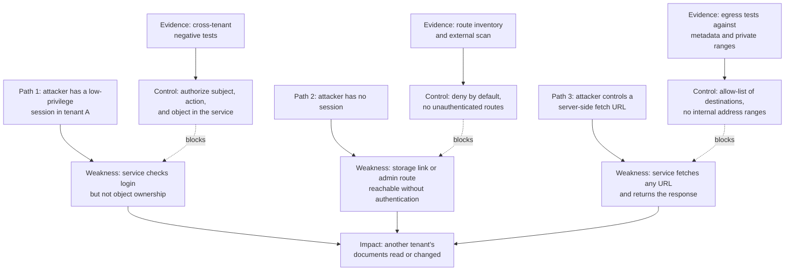

Three different categories or CWE families converge on one impact. A team that fixes only the object-ownership check (Path 1) and records the risk as closed still has two open routes to the same loss. This is the reason to start from the impact and enumerate paths, then use the Top 10 to ask whether a family of paths was missed.

### 5.2 Weakness, exploitability, and impact are separate

A vulnerable library in a dependency report is a weakness. Whether it is exploitable depends on whether the vulnerable code is reachable, whether the attacker can supply the triggering input, and whether another control blocks it. Impact depends on what the compromised component can reach. Treat these as three questions, answer each with evidence, and record the answers so that the decision can be revisited when the architecture changes.

An illustrative prioritization shows why the order matters. The numbers below are invented for teaching and are not measurements.

| Finding | Likelihood (1-5) | Impact (1-5) | Score = L x I | Reason |
|---|---|---|---|---|
| Missing ownership check on document download | 4 | 5 | 20 | Any registered user can try it, and the data is customer content |
| Verbose error page on an internal admin tool | 2 | 2 | 4 | Reachable only from a managed network, little data exposed |
| Unpatched library, vulnerable function not called | 1 | 4 | 4 | Not reachable today, impact would be high if a code change reached it |
| Public storage container holding build logs | 3 | 3 | 9 | Open to anyone with the name, logs may include internal hostnames |

The arithmetic is only a sorting aid: $4 \times 5 = 20$, $2 \times 2 = 4$, $1 \times 4 = 4$, $3 \times 3 = 9$. A multiplicative score hides the case where impact is catastrophic and likelihood is low, so treat any impact of 5 as needing a named decision owner regardless of score. The third row also needs a trigger: if a code change starts calling the vulnerable function, the likelihood changes and the finding must be re-scored.

## 6. A01 Broken Access Control

### 6.1 The governing model

Access control answers one question for every request: may this subject perform this action on this object in this context? The OWASP category page describes access control as enforcing policy so that users cannot act outside their intended permissions, and it reports that the category kept the first position in the 2025 list ([A01:2025](https://top10.owasp.org/2025/A01_2025-Broken_Access_Control/)). The category is broken when any of the four inputs is not checked, is checked in the wrong place, or is checked against data the attacker controls.

Authentication and authorization fail in different ways. [Authentication](CH02_Authentication.md) establishes who the caller is. [Authorization](CH03_Authorization.md) decides what that caller may do. Most access-control failures happen to callers who are fully authenticated, which is why a valid login proves nothing about the check that follows.

Three properties define a sound enforcement design:

- **Server-side.** The check runs in code the attacker cannot modify. Hiding a button in a browser or mobile client is a usability feature, not a control.
- **Complete.** Every route, method, message handler, background job, and data access path passes through a check. An unchecked path is the vulnerability.
- **Object-aware.** The check uses the specific object, not only the user's role. "Customers may read documents" is a role rule. "Customer 17 may read document 9054 because it belongs to customer 17's tenant" is an object rule.

### 6.2 The exploit mechanism: a changed identifier

The most common form is simple. The client sends an object identifier. The service looks up the object and returns it after confirming only that the caller is logged in.

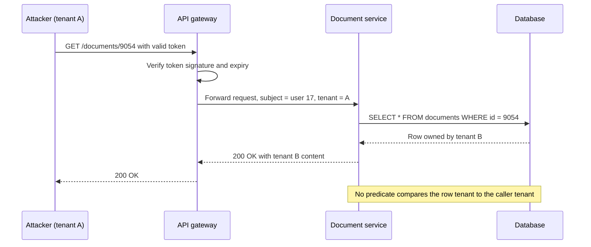

The gateway did its job: it proved the token was valid. The service did not perform the object check, so the database returned a row that belongs to a different tenant. The attacker needs only to change the number. If identifiers are sequential, enumeration is trivial. If they are random Universally Unique Identifiers (UUID), the attack is slower but still works whenever an identifier leaks through a shared link, a log, a referrer header, or an email. Unpredictable identifiers reduce discoverability and do not replace the check, because an identifier is a name, not a credential.

The corrected request path adds the missing predicate and treats absence the same as denial:

```sql
-- The tenant comes from the verified token, never from the request body or URL.
SELECT id, title, storage_key
FROM documents
WHERE id = :document_id
  AND tenant_id = :caller_tenant_id;
```

When the query returns no row, the service responds with the same status it uses for a nonexistent document. Distinct responses for "exists but forbidden" and "does not exist" let an attacker enumerate valid identifiers. Whether to return 404 or 403 is a design decision. Returning 404 hides existence and is common for tenant isolation. Returning 403 helps legitimate clients diagnose permission problems and suits resources whose existence is not secret.

### 6.3 Variants and where each one lives

The mapped CWE list for the category is long, but the failures group into a few mechanisms. The table lists the ones an architect meets most.

| Variant | Mechanism | Where the missing control lives |
|---|---|---|
| Insecure direct object reference, called Broken Object Level Authorization (BOLA) in the OWASP API Security project | Client supplies an object key and the service does not compare it to the caller | Service or data layer |
| Missing function-level authorization | An administrative route or method is reachable by an ordinary user, often because only the menu was hidden | Router, controller, or policy layer |
| Forced browsing | An unlinked URL, such as a backup file or admin page, is reachable by guessing | Deployment, routing, web server configuration |
| Metadata tampering | A cookie, hidden field, or token claim that grants privilege is replayed or altered, or a JWT is accepted without full validation | Token validation and session design |
| Permissive cross-origin policy | A Cross-Origin Resource Sharing (CORS) rule allows an untrusted origin to read authenticated responses | Gateway and service configuration |
| Cross-Site Request Forgery (CSRF) | A browser sends a state-changing request with ambient credentials chosen by an attacker's page | Session cookie attributes and anti-forgery tokens |
| Server-Side Request Forgery (SSRF) | The server fetches a destination chosen by the caller and reaches internal resources the caller could not reach directly | Outbound request handling and network egress |
| Privilege escalation through mutable fields | The caller sets a field such as `role` or `owner_id` in a request body and the service binds it blindly | Input binding and domain model |

The 2025 category page names CSRF and SSRF among its notable mapped weaknesses, so a review that treats "access control" as only a role check will miss two families. SSRF belongs here because the attacker's own network position would not reach the target. The server's position does, so the server is the confused deputy: an agent that holds authority and applies it on behalf of a less privileged caller. Cloud metadata endpoints are a standard target. Part 09 covers how each provider protects its Instance Metadata Service (IMDS) in [Compute](../09_Cloud_Computing/CH04_Compute.md); the application-side control is to restrict where the server will connect.

### 6.4 Designing enforcement that stays correct

The official prevention guidance for the category emphasizes enforcement in trusted server-side code, deny by default except for public resources, implementing access control once and reusing it, modelling record ownership, logging failures, and rate limiting ([A01:2025](https://top10.owasp.org/2025/A01_2025-Broken_Access_Control/)). Each of these ideas has an architectural consequence.

**Separate decision from enforcement.** A policy decision point (PDP) evaluates a request against policy and returns allow or deny. A policy enforcement point (PEP) is the code that asks the PDP and acts on the answer. In a small application both can be one function. In a larger system a gateway can be a PEP for coarse rules such as "this route requires authentication", while each service is a PEP for object rules because only the service knows which tenant owns which record. Putting all enforcement at the gateway fails when any internal client, queue consumer, or scheduled job calls a service directly.

**Make deny the default result.** The evaluation order below is the shape of a safe check. Anything not explicitly allowed is denied, and an error in the check itself is also a denial.

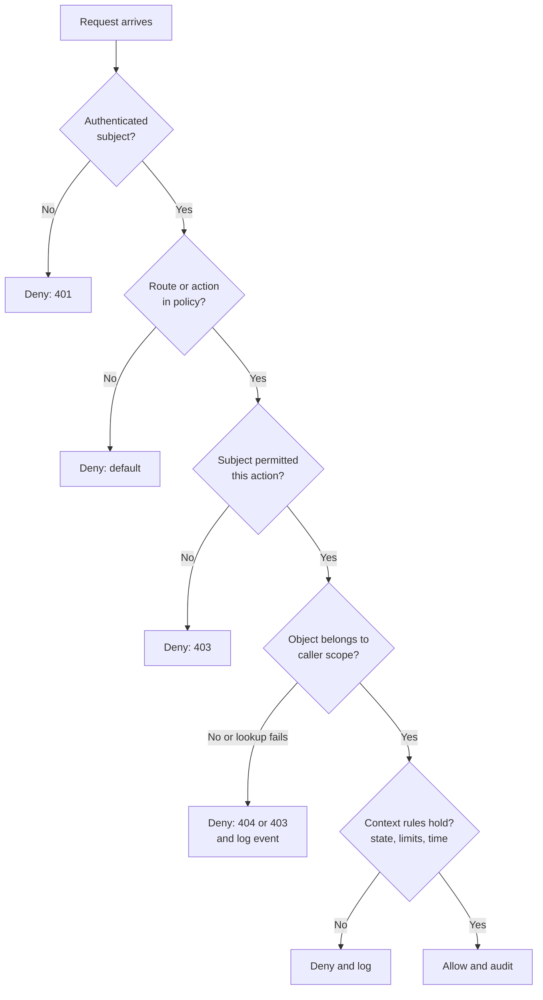

Each diamond is an independent failure mode. The route check catches a new endpoint that nobody added to policy. The role check handles function-level rules. The object check handles the identifier problem. The context check handles business rules, such as "a refund may not exceed the original charge" or "an approved invoice may not be edited", which the category page describes as business limit requirements that domain models should enforce. The last arrow is as important as the first: allowed requests produce an audit record so that a later review can reconstruct who did what.

**Centralize the check, keep it small.** A single function or middleware that every handler must pass through is easier to test than a check copied into each handler. The sketch below shows the object rule in application code. It is illustrative, not a framework recommendation.

```python
def get_document(subject, document_id, repo, audit):
    doc = repo.find(document_id, tenant_id=subject.tenant_id)  # scoped lookup
    if doc is None:
        audit.record("deny", subject.id, "document.read", document_id)
        raise NotFound()
    if not subject.can("document.read", resource=doc):  # role and object rule
        audit.record("deny", subject.id, "document.read", document_id)
        raise NotFound()
    audit.record("allow", subject.id, "document.read", document_id)
    return doc
```

**Add a second enforcement layer with independent failure modes.** The database can enforce tenant isolation as well. PostgreSQL row-level security (RLS) attaches a predicate to a table, and the database adds it to every query:

```sql
ALTER TABLE documents ENABLE ROW LEVEL SECURITY;
ALTER TABLE documents FORCE ROW LEVEL SECURITY;

CREATE POLICY tenant_isolation ON documents
  USING (tenant_id = current_setting('app.tenant_id')::uuid);
```

The application sets `app.tenant_id` at the start of each request from the verified token. If a developer forgets the predicate in one query, the database still filters. Table owners and superusers bypass row-level security unless it is forced and the role is not a superuser, so the application should connect as an unprivileged role. Verify the behavior against your database version in the PostgreSQL documentation. The layer is only independent if the tenant value is set from trusted data. If a bug lets the request body choose `app.tenant_id`, the layer shares the weak assumption of the first.

**Know the limits of token-based authorization.** A self-contained token such as a JWT carries claims that a service trusts until expiry. If a user's role is removed, services that read the role from the token continue to honor it until the token expires. With a 15-minute access token lifetime, the worst-case window is 15 minutes after the role change. With a 60-minute lifetime it is up to 60 minutes. The category guidance recommends short-lived stateless tokens and refresh tokens with revocation. Choose the lifetime from the cost of a stale permission, not from convenience. Token validation itself is covered in [OIDC](CH07_OIDC.md) and [JWT](../05_Networking_and_OS/CH21_JWT.md).

### 6.5 Worked scenario: testing the document service

The multi-tenant document service from the earlier sections has 62 endpoints, three roles (viewer, editor, tenant administrator), and two test tenants. The numbers here are illustrative.

The team builds an access-control test matrix. For every endpoint they generate three negative cases: an unauthenticated call, a call by a role below the required role, and a call by a user in the other tenant acting on the first tenant's object. The negative cases number $62 \times 3 = 186$. They add a positive case per role per endpoint where the policy allows it, giving, say, 190 more. Of the 62 endpoints, 14 take an object identifier in the path or body, so the cross-tenant case applies to $14 \times 2 = 28$ combinations when both directions between tenants are tested.

Running the 186 negative tests the first time fails 9. Two are the original identifier bug on download and preview. Four are administrative routes that check authentication but not role. Three are bulk endpoints that accept a list of identifiers and check only the first. The bulk case is a typical edge: a check written for a single object does not extend automatically to a collection, so each element must be authorized, or the query must be scoped by tenant as above.

The team adds three detective controls. Each denial writes an audit event with subject, action, object identifier, and outcome, and never document content. An alert fires when one subject accumulates more than 20 denials in five minutes, an illustrative threshold to tune from baseline data. A weekly report lists routes with no policy entry. The success criterion for the scenario is measurable: 100% of endpoints appear in the policy inventory, all 186 negative tests pass in the build, and a simulated enumeration of 1,000 identifiers by a tenant-A account produces zero successful reads and an alert within five minutes.

### 6.6 Failure modes and edge cases

- **Inconsistent enforcement across protocols.** The REST route is protected but the same operation is exposed through a GraphQL field, a batch endpoint, a webhook, or an export job that bypasses the controller layer.
- **Time-of-check to time-of-use.** The service authorizes an object, then the object's owner changes before the action completes. Re-check inside the transaction that performs the change.
- **Mass assignment.** A handler binds the whole request body to a model and the attacker adds `"role": "admin"`. Bind an explicit allow-list of fields.
- **Authorization at the edge only.** An internal caller, a misrouted request, or a path that bypasses the gateway reaches the service with no check. Treat the network as hostile inside the boundary as well. [Zero Trust](CH08_Zero_Trust.md) develops this idea.
- **Trusting client-supplied identity.** A service reads `X-User-Id` from a header that the gateway is expected to overwrite. If any path reaches the service without the gateway, the header is attacker-controlled.
- **Denials that look like allows to logging.** The service returns an error but writes nothing, so abuse is invisible. The logging category addresses this gap.

## 7. A02 Security Misconfiguration

### 7.1 The governing model

Modern software is assembled from highly configurable parts: web servers, frameworks, databases, message brokers, container runtimes, cloud services, identity providers, and pipelines. Each exposes settings. A system is misconfigured when a setting, or the absence of a setting, creates an exploitable path. The [official page for A02:2025](https://top10.owasp.org/2025/A02_2025-Security_Misconfiguration/) reports that the category moved up to fifth place and says that every application tested had some form of it. The page ties the rise to the shift toward configurable software and cloud services.

Misconfiguration differs from the other categories in where the defect lives. Injection and broken access control are defects in code that a developer can change. A misconfiguration is a defect in a value, and the same code can be safe in one environment and exposed in another. That makes it a problem of repeatability and verification as much as of knowledge. Most teams know that a database should not listen on the public Internet. The failure is that one environment, one account, or one forgotten test stack does not follow the rule.

### 7.2 Where misconfiguration enters

The common entry points fall into a short list. The list below follows the official description, extended with cloud examples.

- **Unsafe defaults.** Default accounts and passwords left enabled, sample applications shipped to production, debug endpoints enabled, directory listing on, and permissive cross-origin settings.
- **Unnecessary surface.** Open ports, unused services, test frameworks, and unneeded privileges that give an attacker more to probe.
- **Excessive error detail.** Stack traces, framework versions, and internal hostnames returned to callers, which reveal component versions and make known flaws easier to target.
- **Missing hardening.** Security headers absent, transport protection not enforced, and newer security features left disabled after an upgrade, often because backward compatibility was prioritized.
- **Cloud permission settings.** A storage bucket or container open to the Internet, a database with a public address, an overly broad security group, an identity policy with wildcards, or a snapshot shared with all accounts.
- **Parser and feature settings.** An Extensible Markup Language (XML) parser that resolves external entities, which the official page lists through a mapped XML External Entity (XXE) weakness, and deserializers that accept arbitrary types.
- **Embedded secrets.** Static keys in configuration files or pipelines, instead of federation and short-lived credentials, which the page recommends.

### 7.3 The configuration lifecycle and drift

Configuration is not set once. It changes through deployments, incident fixes, console edits, and upgrades. The state machine below follows one setting through its life and shows where drift enters.

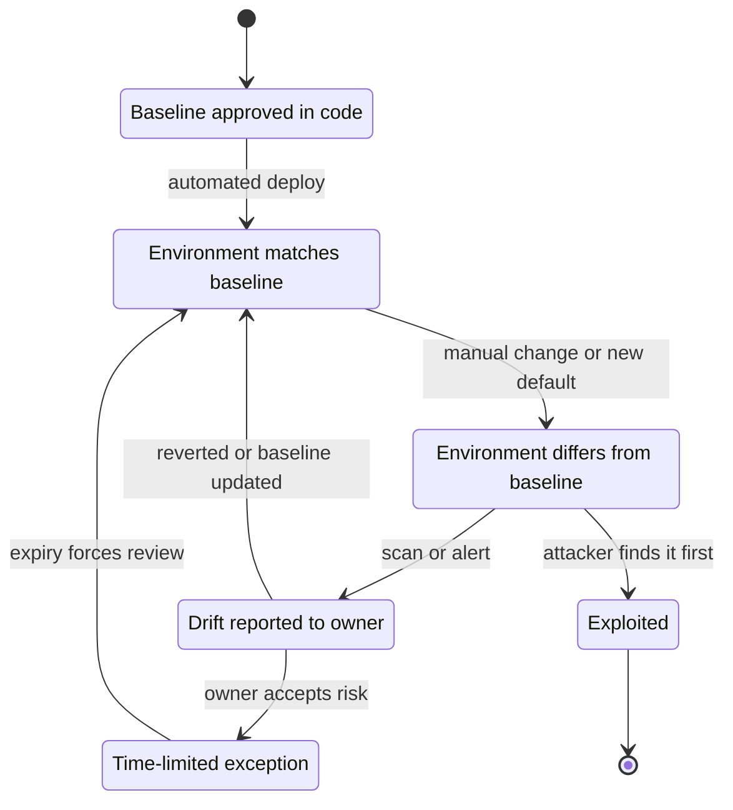

Two transitions carry most of the design weight. The move from Deployed to Drifted happens whenever a person edits a live resource, or when a provider or library upgrade changes a default. The race from Drifted is between detection and exploitation. External scanners, including those run by attackers, check public address space continuously, so the window between drift and discovery for an Internet-exposed resource can be short. Detection that runs weekly protects only against slow attackers. For exposed surfaces, prefer prevention that makes the drifted state impossible, such as an organization-level policy that blocks public access, over detection that reports it after the fact.

Prevention and detection play different roles:

| Control type | Example | Strength | Weakness |
|---|---|---|---|
| Preventive guardrail | Organization policy that denies public storage access | Cannot be bypassed by an individual edit | Needs a reviewed exception path, and can block legitimate use |
| Declarative baseline | Infrastructure defined in version-controlled code and applied by a pipeline | Reviewable, repeatable, same across environments | Console changes can still diverge |
| Drift detection | Periodic comparison of live state with the baseline | Finds manual changes | Reports after exposure has begun |
| Configuration scanning | Benchmark checks against hardening guides such as the Center for Internet Security (CIS) Benchmarks | Broad coverage of known settings | Reports only what the scanner knows |
| External attack-surface test | Probing from outside the network | Shows what an attacker sees | Misses authenticated and internal paths |

Use the first two as the primary design and the last three as verification. An architect should expect each environment to be built from the same baseline, with different credentials and data. The official guidance says development, quality assurance, and production should be configured identically with different credentials, and that automated verification of settings is preferable, with manual review at least annually where verification cannot be automated.

### 7.4 Making the mechanism concrete: public storage

A cloud object store is the standard example because one setting decides who can read the data. Each provider layers several controls, and a bucket is exposed when any one of the layers allows anonymous reads and no higher layer blocks it.

- Amazon Web Services (AWS): Amazon Simple Storage Service (S3) combines bucket and object access control lists, bucket policies, and an account-level and bucket-level Block Public Access setting that overrides the others.
- Microsoft Azure: a storage account has a property that allows or forbids anonymous access to blob containers, and each container has its own access level. If the account property forbids it, container settings cannot make data public.
- Google Cloud: Cloud Storage supports uniform bucket-level access and a public access prevention setting, and an organization policy can enforce it across projects.

Treat these as the mechanism, not a list to memorize, and read the current documentation for exact property names. A bucket-level control that blocks public access in AWS looks like this:

```bash
aws s3api put-public-access-block \
  --bucket example-customer-exports \
  --public-access-block-configuration \
  BlockPublicAcls=true,IgnorePublicAcls=true,BlockPublicPolicy=true,RestrictPublicBuckets=true
```

This command protects one bucket. It is a fix, not a design. The design is a guardrail applied at the account or organization level so that a new bucket cannot be created in the exposed state, with a documented exception for the rare bucket that must be public, such as a static website, and an owner and expiry for each exception. Part 09 covers how guardrails and organization policies are rolled out in [Landing Zones](../09_Cloud_Computing/CH15_Landing_Zones.md).

### 7.5 Error handling and response headers

Two application-level settings are cheap to fix and often missed. The first is error detail. A production error response should return a short message and a correlation identifier, and write the stack trace to the log:

```http
HTTP/1.1 500 Internal Server Error
Content-Type: application/json

{"error": "internal_error", "correlation_id": "6f1c0b2e"}
```

The correlation identifier lets support staff find the trace without exposing component versions or file paths. A central error handler, rather than per-route handling, makes the behavior uniform.

The second is response headers that tell browsers how to behave. The official guidance mentions sending security directives to clients. A minimal set for an HTTPS site:

```http
Strict-Transport-Security: max-age=31536000; includeSubDomains
Content-Security-Policy: default-src 'self'
X-Content-Type-Options: nosniff
Cache-Control: no-store
```

Headers reduce the effect of other flaws, such as cross-site scripting, and do not replace fixing them. The `Content-Security-Policy` shown is a strict starting point that will break pages loading external scripts, so roll it out in report-only mode first, then enforce. The `Cache-Control: no-store` value suits pages with private data and is wrong for public static assets, which shows that a header set is a decision per response type and not a global paste.

### 7.6 Worked scenario: drift across environments

An organization runs 12 services across three environments (development, staging, production) in 9 cloud accounts. The numbers are illustrative.

An inventory lists 14 security-relevant settings per service: public exposure, transport protocol minimum, debug mode, default accounts, error detail, headers, storage access, administrative interface exposure, and similar. That is $12 \times 3 \times 14 = 504$ setting instances to keep correct. Checking them by hand once a year, as the minimum the official guidance gives when verification is not automated, means an exposed setting could stay open for most of a year. Even a quarterly manual review leaves up to 90 days.

The team moves in three steps. First, they express the baseline as reviewed infrastructure code and deploy through a pipeline, so all three environments derive from the same source. Second, they add organization-level preventive guardrails for the five settings with Internet-exposure impact, which cuts the number of settings that rely on detection from 14 to 9 per service: $12 \times 3 \times 9 = 324$. Third, they run a daily drift scan against the remaining settings, so the worst-case undetected window for those drops from about 90 days to 1 day.

The first full scan finds 31 deviations. Of these, 4 are exposed administrative consoles on a staging stack that mirrors production data, 17 are debug flags left on, 6 are verbose error pages, and 4 are default accounts on test databases. The team treats the exposed consoles with production data as the highest priority, closes them the same day, and records the other 27 with owners and due dates. Their success criteria are measurable: zero guardrail violations, drift older than 24 hours reaching zero, and all exceptions carrying an owner and an expiry.

### 7.7 Failure modes and edge cases

- **Staging mirrors production data but not production controls.** Attackers choose the weakest environment. Treat any environment holding real data as production for security.
- **Console hotfixes during an incident.** The fix is applied by hand under pressure and never returned to code, so the next deployment silently reverts it or the drift persists.
- **Defaults change under you.** A provider or library upgrade changes a default. Pin versions, read release notes, and rerun baseline checks after upgrades.
- **Overbroad exceptions.** A guardrail exception granted to one team is applied to a whole organizational unit. Scope exceptions to the specific resource and give them an expiry.
- **Scanner coverage mistaken for assurance.** A scanner checks known settings. Custom services, unusual ports, and application-level settings need separate tests.
- **Secrets in configuration.** A configuration file with static credentials is itself a misconfiguration. Follow [Secrets Management](CH09_Secrets_Management.md) for storage and rotation.

## 8. A03 Software Supply Chain Failures and A08 Software or Data Integrity Failures

### 8.1 Two categories, one question

A03 covers weaknesses in how software is built, obtained, and updated: dependencies, build tools, registries, and distribution channels. A08 covers code or data that is trusted without verifying that it is the intended, unmodified item: an update fetched over an unauthenticated channel, a serialized object from an untrusted source, a pipeline step that runs whatever it downloads. Both come down to one question. When the runtime executes or consumes something, what evidence shows that it is the artifact the team reviewed? The official pages are [A03:2025](https://top10.owasp.org/2025/A03_2025-Software_Supply_Chain_Failures/) and [A08:2025](https://top10.owasp.org/2025/A08_2025-Software_or_Data_Integrity_Failures/). This chapter owns the recognition and the control principle. Mechanisms such as provenance attestations, signing, and build isolation belong to [Supply Chain Security](CH15_Supply_Chain_Security.md), the inventory format to [SBOM](CH16_SBOM.md) (Software Bill of Materials), and container image controls to [Container Security](CH14_Container_Security.md).

### 8.2 The chain and its trust points

A shipped service is the end of a chain whose every link accepts input from someone else.

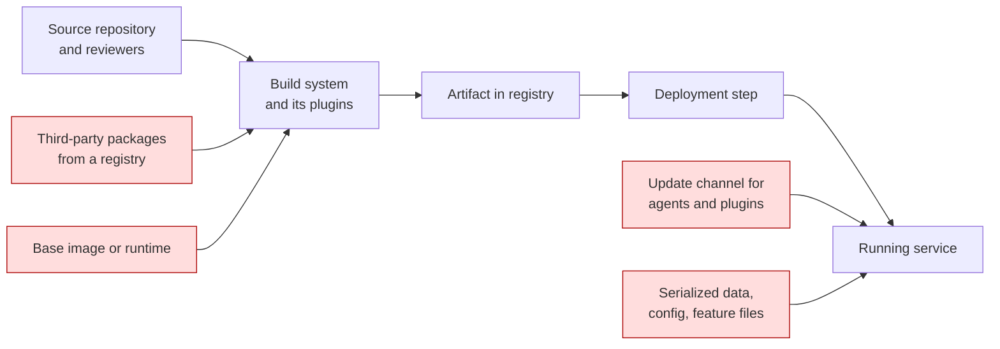

The shaded nodes are inputs the team does not author. An attacker who controls any one of them runs code with the privileges of the build or the service, without touching the team's source. Typical routes are a malicious or hijacked package version, a name that resembles an internal package name and is resolved from a public registry (dependency confusion), a compromised maintainer account, a build plugin that executes at build time, and a mutable tag such as `latest` that points to different content on different days. The build system deserves as much protection as production, because it usually holds signing keys and deployment credentials, and a compromised build can produce a malicious artifact that passes every downstream check.

### 8.3 Controls at each link

| Link | Control | What it prevents or proves |
|---|---|---|
| Dependency intake | Lockfile with exact versions and content hashes, one internal registry as the only source | Silent version change, resolution from an unintended registry |
| Dependency selection | Review of new dependencies, reduction of count, update cadence with review | Unmaintained or unneeded code in the trusted set |
| Base images | Pin by digest, rebuild on a schedule | A tag that moves under you |
| Build | Isolated, ephemeral build environment, least-privilege build credentials, no network beyond the internal registry where feasible | A compromised step reaching secrets or other projects |
| Pipeline definition | Branch protection and review of pipeline files, third-party actions pinned to a full commit identifier | A changed pipeline step exfiltrating credentials |
| Artifact | Signature and provenance generated by the build, verified at deploy | A different or modified artifact being deployed |
| Deployment | Admission check that rejects unsigned or unexpected artifacts | Bypassing the pipeline with a manual push |
| Response | SBOM stored per release, ability to answer "where do we run package X" | Slow response when a dependency flaw is announced |

Two short examples show what pinning means in practice. A Python requirements file with hashes makes the installer reject any file whose hash differs:

```text
# requirements.txt, generated by a lock tool, installed with --require-hashes
requests==2.32.3 \
    --hash=sha256:<hash-of-the-released-file>
```

A container reference by digest names content, not a label:

```yaml
image: registry.example.com/billing-api@sha256:<digest-of-the-reviewed-image>
```

The version and the digest placeholders are deliberately left as examples. Generate the values from your own build.

### 8.4 Integrity of data and updates

A08 includes cases outside the build. Deserializing an object from an untrusted source can let an attacker choose which types are instantiated, and in some runtimes this reaches code execution. Prefer data-only formats with a strict schema, such as JSON validated against a schema, and refuse type information supplied by the sender. A software update channel that does not verify a signature lets anyone who can intercept or redirect the download supply code. A cached or shared object, such as a feature-flag file or a configuration bundle read from a storage bucket, needs the same question: who can write it, and does the reader verify who did? When the answer is "anyone with write access to the bucket", the bucket permission is the integrity control, and its misconfiguration is an A02 issue that becomes an A08 impact.

Integrity checks have a limit worth naming. A hash proves that the content is the same as the one you recorded, not that it is safe. If the recorded hash came from a compromised publisher, the check passes. Signatures prove who vouched for an artifact only as far as the signing identity and key are protected and the verifier checks the right identity. [Supply Chain Security](CH15_Supply_Chain_Security.md) covers identity binding.

### 8.5 Worked scenario: a vulnerable package announcement

The numbers here are illustrative. A widely used parsing library announces a remotely exploitable flaw. The organization runs 140 services. Without an inventory, an engineer must search 140 repositories, and if the search takes about 30 minutes per repository, finding the exposure alone costs $140 \times 30 = 4{,}200$ minutes, which is 70 hours of effort. With a per-release SBOM in a queryable store, one query lists affected releases in minutes. The query returns 9 services. Of these, 3 call the vulnerable function, which the team learns from the dependency-reachability data or by code review of the 9, and 6 only include the library transitively and never reach the code. The team patches the 3 reachable services first, schedules the other 6 in the normal cycle, and records the reachability decision with a re-evaluation trigger. The inventory did not fix anything. It converted an open-ended search into a bounded list, which is the property to measure: time from announcement to a verified list of affected deployments.

### 8.6 Failure modes and edge cases

- **Transitive dependencies nobody chose.** A direct dependency pulls dozens of others. Review the resolved tree, not only the manifest.
- **Pinned but never updated.** Pinning stops silent change and also stops security fixes. Pair pinning with a scheduled, reviewed update process.
- **Verification only at build.** A signature checked in the pipeline but not at deployment lets a manual push bypass it.
- **Overtrusted internal registry.** An internal mirror that proxies a public registry without scoping can still resolve a public package that shadows an internal name. Reserve internal namespaces.
- **Build credentials with deploy rights across environments.** A single compromise reaches production. Scope credentials per environment and per job.

## 9. A04 Cryptographic Failures

### 9.1 What the category covers

The category covers data exposed because protection was missing, wrong, or badly managed: sensitive data sent or stored in clear text, weak or obsolete algorithms, incorrect modes, predictable randomness, hard-coded or poorly handled keys, and certificate validation that was turned off for convenience ([A04:2025](https://top10.owasp.org/2025/A04_2025-Cryptographic_Failures/)). The algorithms are rarely the weak point. Mistakes cluster around decisions that are architectural: what is protected, with whose key, where the key lives, and who can use it. [Encryption](CH10_Encryption.md) teaches the primitives, [PKI](CH11_PKI.md) certificates and trust chains, and [Secrets Management](CH09_Secrets_Management.md) key and secret custody. This section covers the review method.

### 9.2 Start from data classification, then protect each state

Ask three questions per data class. Where does it travel, where does it rest, and who can read it in plaintext at each hop? A table makes gaps visible.

| State | Question | Typical decision |
|---|---|---|
| In transit between client and edge | Is Transport Layer Security (TLS) mandatory with certificate validation on? | Enforce TLS, redirect or refuse plain HTTP, send the `Strict-Transport-Security` header shown earlier |
| In transit between services | Is the internal network trusted? | Encrypt where the threat model includes a compromised host or shared network, and authenticate peers |
| At rest in a database or object store | Who holds the key, and can the storage administrator also read the data? | Provider-managed encryption by default, customer-managed key where separation of duties requires it |
| In backups, exports, and logs | Do copies keep the same protection? | Apply the same classification to copies, and keep sensitive fields out of logs |
| In memory and in use | Does exposure during processing matter? | Usually accepted, sometimes narrowed with confidential-computing options |

Do not store data you do not need. Data that was never collected cannot leak, and tokenization or truncation reduces what an attacker gains from a breach.

### 9.3 Key custody is the real decision

Encryption moves the secret from the data to the key. The architecture question becomes who can ask the key service to decrypt, and what record exists when they do. The providers offer comparable managed services with different vocabulary: AWS Key Management Service (KMS), Azure Key Vault and its Managed Hardware Security Module (HSM) offering, and Google Cloud Key Management Service (Cloud KMS). In each, key use is governed by an identity policy and logged. Envelope encryption is the common pattern: a data key encrypts the data, and a key-encryption key held in the key service encrypts the data key. The application sends the wrapped data key to the key service to be unwrapped, so the key service sees only small requests and the master key never leaves it.

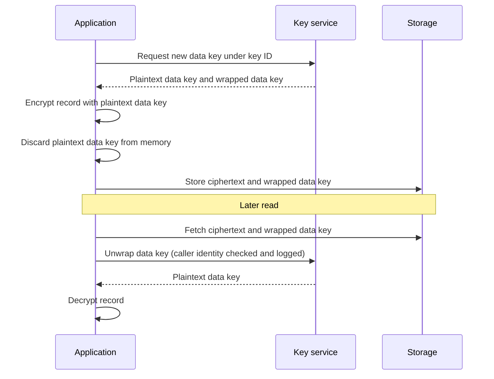

The diagram shows where the control is. The storage layer never holds a usable key, so a stolen database snapshot is ciphertext. The key service decides each unwrap against the caller's identity, so revoking that identity's permission stops decryption even though the stored data is unchanged. The failure to look for is an application role that can unwrap keys for every tenant with no restriction, which turns the key service into a formality. Use separate keys per tenant or per data class where the compromise of one should not expose the others, and weigh the cost against key count and rotation effort. Provider limits on key counts and request rates exist and change, so check current quotas when designing per-tenant keys.

### 9.4 Common failures and the review checks

- **Home-made cryptography or protocol design.** Use vetted libraries and standard constructions. A review should reject any custom scheme without an expert reviewer.
- **Password storage.** Passwords need a slow, salted, purpose-built password hashing function, not a general hash. [Authentication](CH02_Authentication.md) covers the choice.
- **Disabled certificate validation.** A flag such as "skip verify" added to make a test pass and shipped to production defeats TLS against an active attacker. Search the code and configuration for it.
- **Predictable randomness.** Tokens, reset codes, and identifiers must come from a cryptographically secure generator, not a general-purpose random function.
- **Reused nonces or initialization vectors.** Some modes fail completely when a value repeats. Prefer libraries that manage this, or authenticated-encryption APIs that make misuse hard.
- **Keys in source, images, or environment dumps.** Fetch keys at runtime from the key service or secret store using workload identity.
- **No rotation or recovery plan.** Know how long it takes to replace a key, and what happens to data encrypted under the old one.
- **Algorithm agility ignored.** Record which algorithm and key version protected each record, so a future change is a migration and not a rediscovery.

Verification evidence includes a scan for outdated protocol versions on exposed endpoints, a test that the application refuses an invalid certificate, a review of key policies, and a rehearsal of key rotation in a non-production environment.

## 10. A05 Injection

### 10.1 The mechanism

Injection happens when untrusted input is placed in a string that an interpreter parses, and the input changes the structure of the instruction. Interpreters include the Structured Query Language (SQL) engine, NoSQL query parsers, operating system shells, Lightweight Directory Access Protocol (LDAP) filters, template engines, expression languages, and object-relational mapping (ORM) query fragments. Cross-site scripting is the same pattern with a browser as the interpreter, and the official page includes it among the mapped weaknesses ([A05:2025](https://top10.owasp.org/2025/A05_2025-Injection/)). The root cause is a data channel and a code channel that share one string.

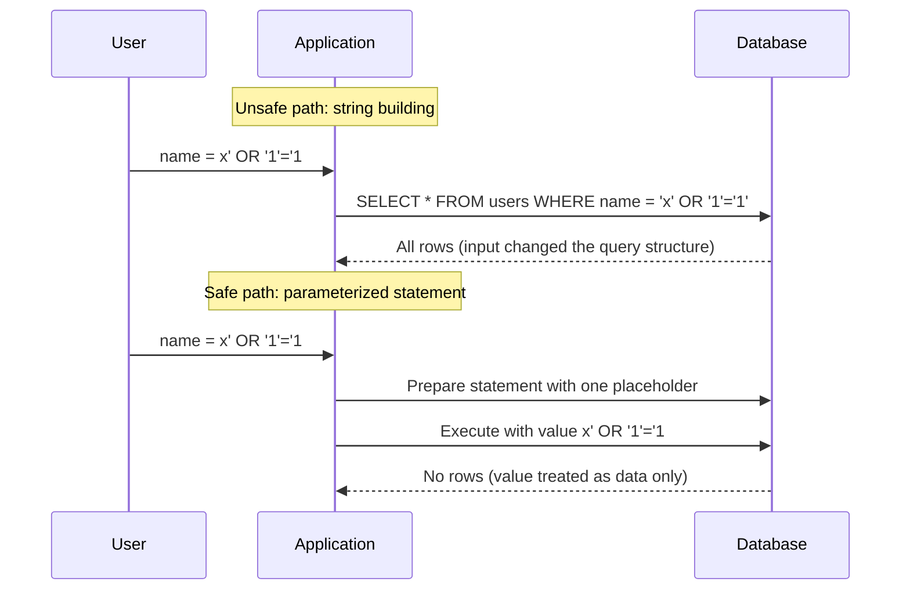

In the unsafe path the quote character in the input closed the string literal that the developer intended, and the rest became part of the instruction. In the safe path the statement structure is fixed before any user value arrives, so no input can alter it.

### 10.2 Controls in order of strength

1. **Remove the interpreter.** If a built-in library call exists, use it instead of a shell. Calling an image library function beats running a command-line tool with a filename.
2. **Parameterize.** Use prepared statements or the query builder's bound parameters. This is the primary control for SQL.
3. **Constrain structure that cannot be a parameter.** Table names, column names, and sort directions cannot be bound as values. Map the input to an allow-list of known identifiers and use the mapped value.
4. **Encode for the output context.** For browser output, use the template engine's contextual escaping, which differs for HTML body, attribute, script, and URL contexts.
5. **Validate input against a contract.** Type, length, range, and format checks reduce the attack surface and catch errors early. Validation is a secondary control, because many valid inputs contain dangerous characters. A surname with an apostrophe is legitimate.
6. **Run with least privilege.** The database account used by the application should not own the schema or be able to read unrelated tables, which limits what a successful injection reaches.

The parameterized form, and the allow-list for a structural element:

```python
ALLOWED_SORT = {"created": "created_at", "title": "title"}

def list_documents(conn, tenant_id, term, sort_key):
    column = ALLOWED_SORT.get(sort_key, "created_at")  # structure from allow-list
    sql = f"SELECT id, title FROM documents WHERE tenant_id = %s AND title ILIKE %s ORDER BY {column}"
    return conn.execute(sql, (tenant_id, f"%{term}%"))  # values bound, not concatenated
```

The f-string in this example inserts only a value taken from a fixed dictionary. Reviewers should flag any f-string or concatenation that includes an unmapped request value. Static analysis rules for "string built from request data reaching a query call" can enforce the review automatically.

### 10.3 Where architects should look

Injection survives in places a code scan does not reach: stored procedures that concatenate inside the database, report and export tools that take a free-text filter, search features that pass user text to a query language, message-queue consumers that build commands from message fields, log forwarders that treat log lines as structured input, and templates that render user-supplied template text. Every service that forwards a user value to another service's query interface is an interpreter boundary. Put the parameterization or allow-list at the last point before the interpreter, because upstream validation is easily bypassed by a path that skips it.

### 10.4 Edge cases

- **Second-order injection.** Input stored safely is later read and concatenated into a query by a different component. Parameterize every query, including those built from data the system itself stored.
- **Limits of a web application firewall.** A filter at the edge can reduce noisy attacks, but encoded or unusual payloads can pass it, and the vulnerable code remains. Treat it as a compensating control with an expiry date.
- **ORM does not equal safe.** Most object-relational mappers parameterize their generated queries, while their raw-query and string-fragment features can reintroduce the problem.
- **Prompt and template injection.** Systems that pass user text into a template engine or a language-model prompt carry the same code and data mixing. Apply the same questions: what interprets this text, and what authority does that interpreter hold? [AI Safety, Security, Privacy, and Governance Architecture](../17_AI_Architecture/CH12_AI_Safety_Security_Privacy_and_Governance_Architecture.md) covers the model-specific forms.

## 11. A06 Insecure Design

### 11.1 Design flaws versus implementation bugs

A perfect implementation of a flawed design is still flawed. The official page separates insecure design from insecure implementation: a missing control that was never specified cannot be found by testing the code against its specification, because the specification is silent ([A06:2025](https://top10.owasp.org/2025/A06_2025-Insecure_Design/)). A password-recovery flow that asks for easily researched personal answers works exactly as designed and is still weak. A checkout that lets a client set the price field has no coding error if the specification never said the server owns the price.

The signal that a finding is a design problem is that the fix needs a new requirement, not a corrected line. That is also why this category belongs to architects. The cheapest point to add a control is before the interfaces and data model are fixed.

### 11.2 Finding design flaws: abuse cases and invariants

Two practices find most of them. The first is abuse cases. For every user story, write the story a hostile or careless actor would run against it: "As a registered user I want to reset my password" gains "as an attacker I want to trigger resets for other people's accounts at volume" and "as an attacker I want to learn which email addresses are registered". Each abuse case yields a requirement, such as uniform responses, per-account and per-source rate limits, and short-lived single-use reset tokens. [Threat Modeling](CH12_Threat_Modeling.md) provides a systematic way to generate these.

The second is invariants. State the facts that must always hold, and name the component that enforces each:

| Invariant | Enforced by | Failure if absent |
|---|---|---|
| The server computes price, discount, and total | Order service domain logic | Client-chosen price |
| A refund never exceeds the amount captured minus prior refunds | Payment service, inside the transaction | Repeated or oversized refunds |
| A tenant's data is reachable only with that tenant's scope | Service and database policy | Cross-tenant read |
| A one-time token works once and expires | Token store with atomic consume | Replay |
| Approval requires someone other than the requester | Workflow engine | Single-person fraud |

An invariant with no named enforcer is a wish. An invariant enforced only in a user interface is not enforced.

### 11.3 Resource limits are a design property

A service with no limit on a costly action is open to abuse that needs no vulnerability. Use per-identity and per-source limits on authentication attempts, resets, search, export, bulk operations, and any call that triggers paid or slow work. [Rate Limiting](../08_API_Architecture/CH11_Rate_Limiting.md) covers algorithms. The design question here is what the limit must protect and per what key.

An illustrative sizing shows the arithmetic. A login endpoint sees about 200 legitimate attempts per minute at peak. An attacker with a list of leaked credentials wants to test 1,000,000 pairs. With a per-account limit of 5 failed attempts per 15 minutes and no per-source limit, a credential-stuffing run that uses each pair once is not slowed at all, because each account sees only one attempt. A per-source limit of 30 attempts per minute caps one address at $30 \times 60 \times 24 = 43{,}200$ attempts per day, so 1,000,000 pairs take about $1{,}000{,}000 / 43{,}200 \approx 23$ days from one address, and the attacker then needs roughly 23 addresses to finish in a day. A distributed attacker defeats address limits cheaply, so the limit buys time and noise, and the control that changes the economics is a second factor or breach-password screening, covered in [Authentication](CH02_Authentication.md). The calculation shows why one limit rarely suffices and which attacker the limit actually stops.

### 11.4 Secure design patterns

- **Reference architectures and paved roads.** A vetted template for service authentication, logging, and data access means each team does not redesign them.
- **Segregation by tenant and tier.** Separate data stores, accounts, or key scopes where the cost of a leak justifies the cost of separation.
- **Plausibility and business-logic checks.** Reject impossible states, such as a quantity of -1 or a shipping date before the order date.
- **Fail safely.** When a dependency such as the authorization service is unavailable, the default is deny for protected actions. A later section on exceptional conditions develops this.
- **Test the design.** Write tests that attempt the abuse case, and review the design with someone who did not write it. [Secure SDLC](CH13_Secure_SDLC.md) places these activities in the lifecycle.

## 12. A07 Authentication Failures

### 12.1 Scope in this chapter

[Authentication](CH02_Authentication.md) owns credential lifecycle, multi-factor authentication (MFA), sessions, and recovery. [OAuth](CH06_OAuth.md) and [OIDC](CH07_OIDC.md) own the federated protocols. This section recaps the category for a Top 10 review and gives the questions to ask. The official page is [A07:2025](https://top10.owasp.org/2025/A07_2025-Authentication_Failures/).

### 12.2 The failure classes

Authentication fails when an attacker can become someone else, or keep being someone else after they should not. The recurring classes are:

- **Credential stuffing and password guessing** against accounts with no attempt limits or no second factor.
- **Weak or default credentials**, including shipped administrator accounts.
- **Weak recovery.** Reset by easily researched questions, reset links that do not expire, or a recovery channel less protected than the login.
- **Session mismanagement.** Identifiers exposed in URLs, not rotated after login, not invalidated at logout or password change, or accepted for far longer than the risk justifies.
- **Missing or bypassable second factor**, such as a fallback that skips MFA for convenience.
- **Weak storage.** Passwords stored in plaintext or with fast general-purpose hashes.
- **Token validation gaps.** A signature accepted without checking issuer, audience, algorithm, or expiry. [JWT](../05_Networking_and_OS/CH21_JWT.md) covers the checks.

### 12.3 A design view: the lifecycle as one system

Enrollment, login, step-up, recovery, and revocation are one lifecycle, and an attacker uses the weakest stage. If login needs a phishing-resistant factor and recovery needs only an email link, recovery is the real login. When reviewing, draw the paths that end with an authenticated session and compare their strength. Name the lowest and ask whether the data behind it justifies it. For high-impact actions such as changing the recovery email or payee, require reauthentication, and notify the account owner on a channel the attacker may not control.

### 12.4 Detection and verification

Evidence includes tests for lockout and throttling behavior, a check that session identifiers change at login and that logout invalidates them server-side, a review of recovery flows against the weakest-path rule, and monitoring for patterns such as many failures across many accounts from related sources. Authentication events belong in the audit stream described below.

## 13. A09 Security Logging and Alerting Failures

### 13.1 Logging as a control with a purpose

Security logging exists so that someone can notice abuse, reconstruct what happened, and prove it. The category covers events that are not recorded, records that cannot be trusted, logs nobody can reach, and alerts that reach nobody ([A09:2025](https://top10.owasp.org/2025/A09_2025-Security_Logging_and_Alerting_Failures/)). The 2025 title includes alerting, which makes the point that a log nobody reads detects nothing. General log pipelines are covered in [Logs](../14_Observability/CH01_Logs.md) and alert design in [Alerting](../14_Observability/CH10_Alerting.md). This section covers what a security design must require of them.

### 13.2 What to record

Record events that show a boundary being tested or a privilege being used: authentication successes and failures, authorization denials, privilege and role changes, access to sensitive objects, administrative actions, configuration changes, key-service use, input-validation failures that repeat, and deployment events. Each record needs time, subject, action, object, outcome, source, and a correlation identifier that ties it to the request trace.

Equally important is what not to record. Passwords, tokens, session identifiers, full payment data, and document contents should not appear in logs. A log that holds secrets becomes a high-value target and a copy of the data with weaker protection. Mask or omit at the point of writing, and add a test that scans a sample of output for known secret patterns. Also neutralize line breaks and control characters in logged user input, so that an attacker cannot forge entries.

### 13.3 The path from event to response

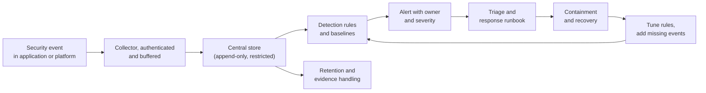

Each arrow is a place where detection quietly fails. The event may not be emitted. The collector may drop it under load. The store may allow the attacker's own account to edit or delete records, which is why logs should be written to a separate account or project with write-only access for the source and tightly limited read and delete rights. A rule may exist with no owner. An alert may fire into a channel nobody watches. The review question for each arrow is a test: generate a known event, such as a burst of denied requests, and confirm that an alert reaches a named person within the stated time. This end-to-end test is the evidence for the category. A dashboard screenshot is not.

### 13.4 Provider audit sources

Each major provider records control-plane activity in a service with a different name and different defaults, so confirm what is on by default and what must be enabled: AWS CloudTrail, Azure Activity Log with resource diagnostic settings, and Google Cloud Audit Logs, where administrative activity is generally recorded by default while data-access logging often needs enabling for specific services. Verify against current documentation. Data-plane events, such as who read an object, are usually the ones that are off by default and cost more, so decide per data class whether the evidence is worth the volume.

### 13.5 Worked scenario: sizing and alert threshold

The numbers are illustrative. An application handles 2,000,000 authenticated requests per day. The team logs each authorization denial, and from a week of baseline data, denials average 120 per day with a daily maximum of 300. A rule that alerts at 20 denials from one subject in five minutes would rarely fire for legitimate users, because the whole population averages $120 / 1440 \approx 0.08$ denials per minute, or about 0.4 per five minutes. A single subject with 20 in five minutes is therefore about 50 times the population average rate for the same window ($20 / 0.4 = 50$). The rule is cheap to evaluate and easy to explain. Its weakness is slow enumeration, such as one denial every six minutes across a month. For that case, add a daily per-subject count and a weekly review of the top ten denial sources. Retention matters too: if the team needs 90 days of denial events for investigation at, say, 200 bytes per record and 300 records per day, the storage need is $300 \times 90 \times 200 = 5{,}400{,}000$ bytes, about 5.4 megabytes, so denial events are cheap to keep, and the cost question applies to high-volume data-plane access logs instead.

### 13.6 Failure modes

- **Alert fatigue.** Too many low-value alerts cause real ones to be ignored. Track the share of alerts that led to action and retire the rest.
- **Clock and identity gaps.** Events that cannot be ordered or attributed, because clocks drift or services log a shared service account in place of the end user, resist investigation.
- **Retention shorter than detection time.** If intrusions are found months later, logs kept for 30 days are gone. Align retention to the realistic time to detect and to legal requirements.
- **Logging as a side channel.** Verbose debug logs in production expose data. Control log levels by environment and by change approval.

## 14. A10 Mishandling of Exceptional Conditions

### 14.1 The category

Software spends part of its life outside the happy path: malformed input, a timeout, a full disk, an exhausted connection pool, a dependency that returns garbage, a transaction that stops halfway. The category covers programs that fail to prevent, detect, or respond to these conditions in a way that keeps them safe, and the failures show as information leaks, corrupted state, denial of service, and bypassed controls ([A10:2025](https://top10.owasp.org/2025/A10_2025-Mishandling_of_Exceptional_Conditions/)). The design principle is that an error path is part of the security boundary and needs the same specification and testing as the success path.

### 14.2 Fail open and fail closed

When a security check cannot complete, the system must choose. If the authorization service times out, one option allows the request to avoid an outage (fail open), and the other denies it (fail closed). For protected actions the default is closed. The choice is not always the same: a fire-door controller fails open for human safety, and a payment authorization fails closed. Record the decision per control, with the reason.

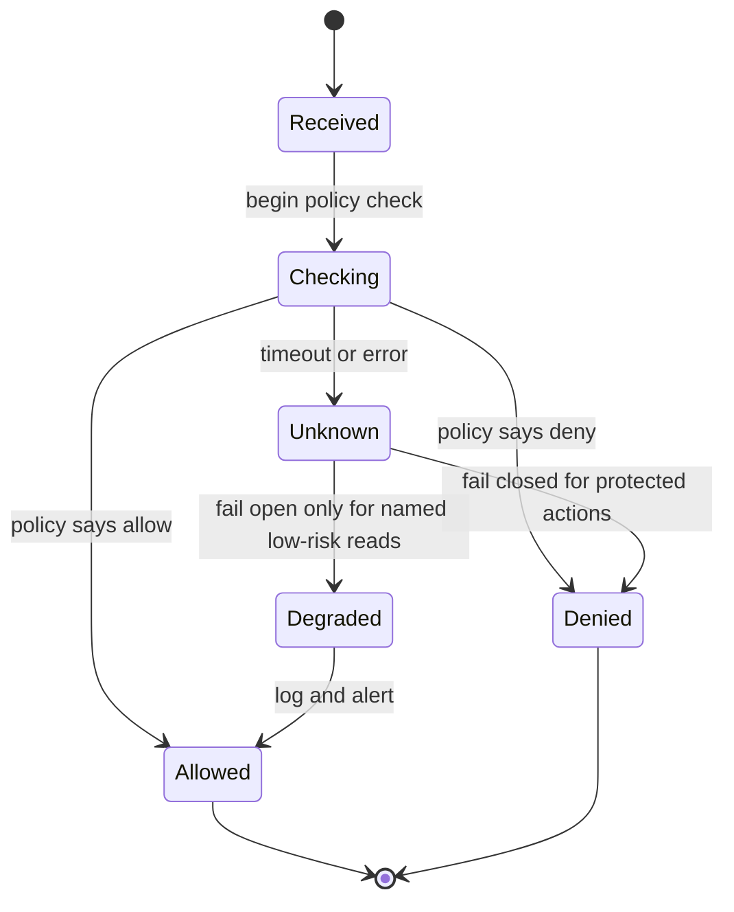

The Unknown state is the point of the diagram. Many designs have only Allowed and Denied, and the code in the gap behaves as whatever the default exception handler does. In some frameworks an unhandled exception in a filter lets the request continue. Make Unknown explicit, route it to Denied by default, and allow Degraded only for a short, reviewed list of low-risk actions, with an alert so the exception is noticed.

### 14.3 Partial failure and state

A multi-step operation that fails midway leaves state that an attacker can exploit. A transfer that debits one account and fails before crediting another, a file upload that stores the file and fails to record its owner, or a refund that pays out and fails to mark the order refunded, each creates a window. Use transactions where one store is involved. For operations spanning services, design compensating actions and idempotency keys so a retry does not double-apply, and make the failed state visible to reconciliation. [Saga Pattern](../07_System_Design_and_Distributed_Systems/CH13_Saga_Pattern.md) covers coordination patterns.

### 14.4 Error content and resource exhaustion

Error messages should give the caller enough to correct the request and nothing that discloses internals, as shown in the correlation-identifier response earlier. Beyond content, bound every resource an input can consume: request body size, number of parts, nesting depth for parsers, regular-expression evaluation time, decompression ratio, and time spent per request. A parser that allocates memory in proportion to a claimed length lets a small request cause a large allocation. Set timeouts on every outbound call, add retries with a limit and backoff, and protect with circuit breakers so that one slow dependency does not exhaust threads for the whole service.

A short illustration of bounding input in a handler:

```python
MAX_BODY = 1_000_000  # bytes, a deliberate service limit

def read_body(stream, declared_length):
    if declared_length is None or declared_length > MAX_BODY:
        raise PayloadTooLarge()  # reject before reading
    data = stream.read(MAX_BODY + 1)
    if len(data) > MAX_BODY:  # declared length may lie
        raise PayloadTooLarge()
    return data
```

### 14.5 Testing the unhappy path

Evidence comes from tests that cause failure on purpose: send malformed and oversized input, kill a dependency during a request, return slow responses, fill storage in a test environment, and interrupt a multi-step operation, then assert the safe outcome. Fault injection in a staging environment, run under controlled conditions, fits here, and [Chaos Engineering](../13_DevOps/CH17_Chaos_Engineering.md) covers the practice.

## 15. Controls and Verification Evidence

Choose controls that interrupt the attack path and have an observable verification method. Preventive controls reduce the chance of exploitation; detective controls provide timely evidence; response and recovery controls limit damage and restore a safe state. Defense in depth is useful when layers have independent failure modes, not when several controls repeat the same weak assumption.

### 15.1 Control and evidence by category

The table pairs each category with a control that interrupts the path and the evidence that would show the control working. It is a starting register to adapt, not a complete list.

| Category | Preventive control | Detective signal | Evidence that it works |
|---|---|---|---|
| A01 Broken Access Control | Deny-by-default policy, object-scoped queries, row-level security | Denial events, per-subject anomaly alert | Cross-tenant negative tests in the build, route inventory |
| A02 Security Misconfiguration | Guardrails, versioned baseline | Drift scan, external surface scan | Zero guardrail violations, exception register with expiries |
| A03 Software Supply Chain Failures | Lockfiles with hashes, isolated builds, signed artifacts | Dependency advisories matched to SBOM | Deploy-time signature rejection test, time to list affected releases |
| A04 Cryptographic Failures | Managed keys, TLS enforced, vetted libraries | Key-service audit log, protocol scan | Invalid-certificate refusal test, rotation rehearsal |
| A05 Injection | Parameterization, allow-lists, least-privilege database role | Query error spikes, edge filter hits | Static analysis rule, adversarial input tests per interpreter |
| A06 Insecure Design | Abuse cases, invariants with named enforcers | Business-rule violation counters | Abuse-case tests, design review record |
| A07 Authentication Failures | Second factor, throttling, rotated sessions | Failure patterns across accounts | Lockout and session-invalidation tests |
| A08 Software or Data Integrity Failures | Verify signatures and schemas before use | Verification failures | Tamper and rollback tests |
| A09 Security Logging and Alerting Failures | Required event list, protected central store | Absence-of-events checks, heartbeat alerts | End-to-end detection exercise |
| A10 Mishandling of Exceptional Conditions | Explicit fail-closed paths, resource bounds | Error-rate and timeout alerts | Fault-injection and malformed-input tests |

### 15.2 Layers need independent failure modes

The diagram below shows the sequence a control moves through. Layering helps only when a bypass of one layer does not also defeat the next. Row-level security that reads its tenant from the same unvalidated request field as the application shares the weakness and adds nothing. A signature check performed by the same compromised pipeline that produced the artifact adds nothing either. When listing layers for a risk, write beside each layer the assumption it relies on, and combine layers only where the assumptions differ.

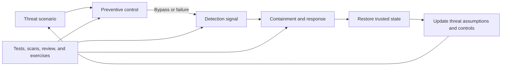

The loop returns to the threat scenario because every incident and every near miss is evidence about assumptions. If an exercise shows that a denial alert took four hours to reach an owner, the threat scenario "slow enumeration goes unnoticed" is now a recorded, weighed risk, and the control register gains an action.
Evidence should match the control claim. Code review may verify a parameterized query change; a test can verify authorization behavior; a configuration scan can identify exposed settings; an incident exercise can verify escalation. A passing scanner does not prove the system lacks a risk outside the scanner's coverage. Record residual risk and ownership.

## 16. Use the List Alongside Threat Modeling

The Top 10 organizes awareness categories; [CH12 Threat Modeling](CH12_Threat_Modeling.md) provides system-specific asset, actor, boundary, scenario, and mitigation analysis. Start with the actual architecture and abuse cases, then use the Top 10 to challenge omissions. Do not reverse the process by forcing every application into ten checklist rows and treating unfilled categories as safe.

| Use the Top 10 for | Do not use it as |
|---|---|
| Security awareness and discussion prompts | A complete system threat model |
| A starting taxonomy for risk discovery | A compliance certification or pass/fail score |
| A guide for reviewing common application failure classes | A substitute for architecture-specific abuse cases |
| A pointer to further guidance and verification | A ranking of risk for every individual workload |

Use system context to decide priority: data sensitivity, user impact, exposure, threat capability, blast radius, detectability, and recovery. Two applications with different assets and trust boundaries can appropriately prioritize different categories.

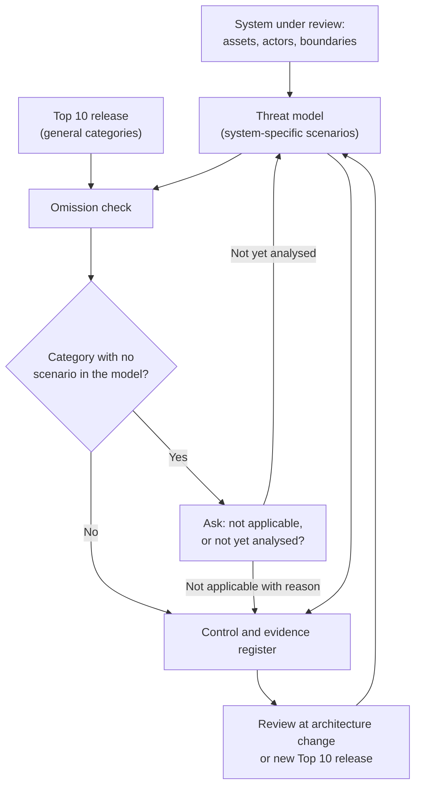

The diagram places the Top 10 as an input to a check, with the threat model supplying the content. The dangerous branch is the one where a gap is filled with "not applicable" and no reason. A recorded reason, such as "no deserialization of external data exists in this service", can be tested and revisited when the design changes. A bare "N/A" cannot. Conversely, a threat model can have blind spots the list exposes, such as a team that modelled data flows but never considered the build pipeline. Each tool covers the other's typical omission, and neither replaces the evidence in the register.

## 17. Versioning and Maintenance

Every finding, control, and report that cites a category should carry the release year, for example "A01:2025". A bare "A01" is ambiguous, because the same identifier can denote a different category in another release. Findings keep their original label. The control register gains a second column for the current label, so a reader can see both the historical citation and today's mapping.

When a new release is published, compare definitions rather than renaming mechanically. A category can be renamed, split, merged, or re-scoped, and the mapping then needs a rationale, not a find-and-replace. Record three things per category: the mapping decision (same, split, merged, new, retired), the reason, and the evidence that still applies. Assign one owner to the mapping and review it on each new release and on each major architecture change.

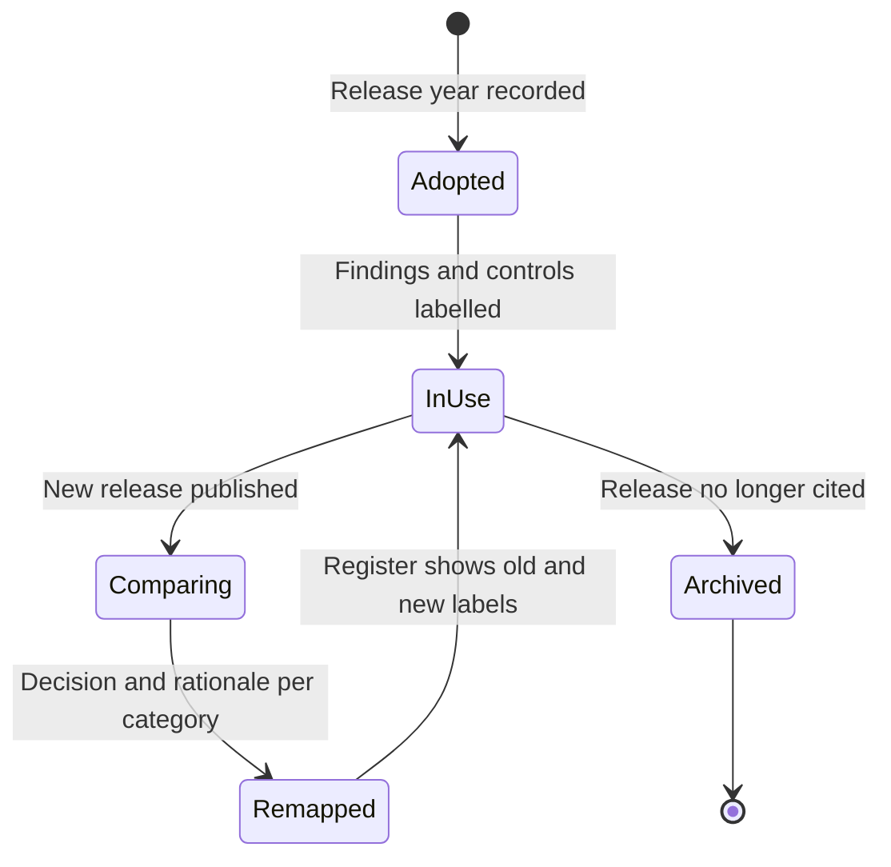

The diagram shows that a release is a state, not a permanent property of a program. The Comparing step is where trend reports can break, because counts per category are not comparable across a split or merge. State that limit in any trend chart, and keep the old labels so audits of earlier periods still resolve. Use the official OWASP release page as the source for titles and definitions, and store a version label and review owner next to any copy in an internal standard.

## 18. Failure and Quality-Attribute Scenarios

A quality scenario states a stimulus, the response the system should produce, and a measure that decides pass or fail. The scenarios below apply to the document service. All numbers are illustrative and should be replaced with values from your own baselines.

| # | Stimulus | Expected response | Measurable success criterion |
|---|---|---|---|
| S1 | A tenant-A account requests 1,000 document identifiers belonging to tenant B at 10 requests per second | Every request is denied with the same response as a missing document, and a denial alert reaches the on-call owner | 0 successful reads; alert raised within 5 minutes of the first denial |
| S2 | An administrator removes a user's editor role | New requests lose the permission without a redeploy | Stale permission lasts at most the access-token lifetime, 15 minutes |
| S3 | An engineer applies a public-read policy to a storage bucket in production | The guardrail rejects the change, or the drift scan flags it | Change rejected at apply time; if it slips through, detected within 15 minutes |
| S4 | A dependency flaw is announced for a package used in some releases | The team lists affected releases and starts remediation | Affected releases listed within 10 minutes; fix decision recorded the same day |
| S5 | The authorization policy store is unreachable during a request | The service denies the request and records the failure | 0 allowed requests during the outage; error responses within the 2-second timeout |
| S6 | The log forwarder stops shipping events | An absence-of-events alert fires | Alert within 10 minutes; gap in coverage recorded |

S1 arithmetic: 1,000 identifiers at 10 requests per second take $1000 / 10 = 100$ seconds. With the earlier threshold of 20 denials in five minutes, the 20th denial occurs after $20 / 10 = 2$ seconds, so the alert condition is met long before the run finishes. The 5-minute criterion therefore measures alert delivery, not detection logic.

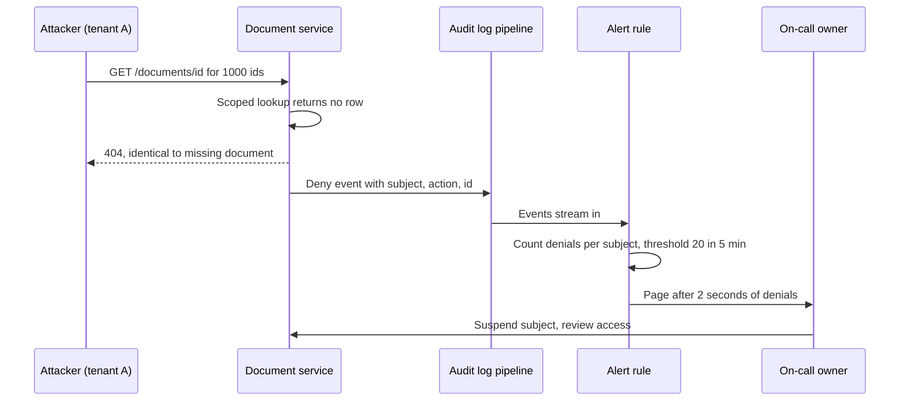

The sequence ties one stimulus to a preventive response (identical 404), a detective path (audit stream and rule), and a human step. The weak link is usually the last arrow. A rule that fires into an unowned channel meets the technical criterion and fails the purpose, so the exercise should end with a named person acknowledging the page. S5 deserves separate attention, because fail-open behavior in the policy client is an A10 defect that only a fault-injection test will show.

## 19. Worked Case: Multi-Tenant Document Service

The scenario is illustrative. Northfield Documents is a hypothetical software-as-a-service company whose document service stores customer files and exposes upload, preview, sharing, and deletion through an API gateway. A low-privilege user changes a document identifier and receives another tenant's file, the defect shown in section 6.2. The Top 10 names the category, but the risk model supplies the specifics: the asset is customer files, the boundary is the tenant, the actor is an authenticated user, the missing control is an ownership check, and the impact is confidentiality loss.

### 19.1 Decisions and rejected alternatives

| Decision | Rejected alternative | Reason for the choice |
|---|---|---|
| Scope every lookup by the tenant from the verified token, with row-level security as a second layer | Enforce tenancy only at the gateway | Queue consumers and scheduled jobs call the service directly and bypass the gateway |
| Keep random identifiers and also check ownership | Rely on random identifiers alone | A leaked link or log line discloses the identifier; an identifier is a name, not a credential |
| Return 404 for both missing and foreign documents | Return 403 for foreign documents | 403 confirms existence and helps enumeration |
| Fetch preview sources only from an allow-listed storage endpoint, with egress blocked elsewhere | A deny-list of internal addresses | A deny-list misses new internal ranges and redirects; an allow-list fails closed |
| Verify artifact signatures at deploy time | Scan images after deployment only | A post-deploy scan reports a bad artifact after it is already running |
| Fail closed when the policy store is unreachable | Serve cached allow decisions during an outage | Cached allows outlive role removal and hide the outage |

### 19.2 Resulting architecture

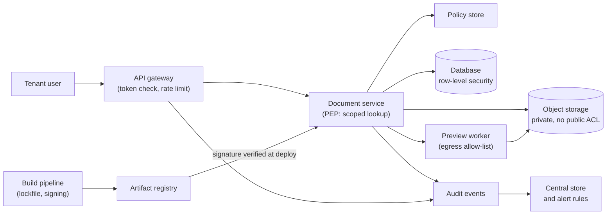

The diagram places an independent control at each boundary a request or artifact crosses. A token check at the gateway does not substitute for the scoped lookup in the service, and the database layer does not trust the gateway's judgment. The weakest edges are the ones that carry trust by assumption: the tenant value passed from service to database, and the pipeline-to-registry link. Each has an owner and a test listed in the next subsection.

### 19.3 Validation evidence

- All 62 endpoints appear in the policy inventory, and the 186 negative tests from section 6.5 pass in the build ($62 \times 3 = 186$).
- A cross-tenant test runs against the database with the application filter deliberately removed, to prove the row-level policy blocks the read on its own.
- The S1 enumeration drill ran at 10 requests per second for 100 seconds: 1,000 attempts, 0 reads, and a page acknowledged by a named owner.
- A deployment of an unsigned image is rejected in the staging pipeline.
- A forced outage of the policy store produces denials and no allows.
- The residual risks are recorded with owners: slow enumeration below the alert threshold, and a compromised build pipeline that signs a malicious artifact.

The team separately reviews upload parsing for injection, key access for cryptographic failures, and partial upload handling for exceptional conditions. Each gets a scenario, owner, evidence, and residual-risk decision. The Top 10 supplied the prompts, and the system-specific analysis set the priorities.

## 20. Common Mistakes

| Mistake | Cause | Consequence |
|---|---|---|
| Treating the Top 10 as a compliance checklist | The list is short and easy to tick off | Risks outside the ten rows go unexamined, and a passed checklist is read as safety |
| Enforcing authorization only at the gateway | Central enforcement looks simpler | Internal callers, jobs, and consumers bypass it, and object rules are missing |
| Relying on unguessable identifiers | Random identifiers feel like secrets | A leaked identifier gives full access |
| Hiding functions in the user interface | Menus are easy to change | The route stays reachable by direct request |
| Marking a category "not applicable" without a reason | Time pressure in reviews | The assumption is never retested when the design changes |
| Scanning after deployment only | Scanners are available and familiar | Defects reach production first, and the scanner covers only what it can see |
| Layering controls that share one assumption | Several tools appear to add depth | One bypass defeats every layer |
| Alerts with no owner or no absence check | The rule was built but never exercised | Attacks and logging outages continue unnoticed |
| Failing open on a dependency error | Availability is prioritized without a decision | An outage becomes an authorization bypass |
| Quoting category labels without the release year | Labels are copied from old reports | Trends and mappings become incomparable |

## 21. Design-Review Checklist

Ask these questions in an architecture review. A "no" is a finding or a recorded risk decision.

- Is the Top 10 release year recorded, with a named owner for the mapping?
- Does each category have either a scenario in the threat model or a stated reason it does not apply?
- Is every route, job, and consumer covered by a deny-by-default policy, and is the policy inventory complete?
- Does each service enforce object-level rules itself, with tenant or owner taken from verified data?
- Does a second layer, such as row-level security, fail independently of the first?
- Are production configurations created from a versioned baseline, with drift detection and expiring exceptions?
- Are dependencies pinned with hashes, builds isolated, and artifacts signed and verified at deploy?
- Is key custody assigned, with a rotation rehearsal on record?
- Does every interpreter boundary use parameterization or allow-lists?
- Do abuse cases and resource limits exist for costly actions?
- Are security events defined, protected, alerted on, and tested end to end, including the absence case?
- Does every dependency failure have an explicit fail-closed or fail-open decision?
- Is each control paired with evidence, an owner, and a recorded residual risk?

## 22. Exercises

Each exercise lists an answer outline for self-checking.
1. Map each 2025 category to one trust boundary in a system you know and identify categories that do not apply.
   *Outline:* use the request path from section 4.1; each "not applicable" needs a testable reason, such as "no external data is deserialized".
2. Convert "broken access control" into an attack path with asset, actor, precondition, impact, control, and negative test.
   *Outline:* follow section 5.1; the negative test is a cross-tenant request that must return the missing-document response.
3. Select one category and separate its preventive, detective, and recovery controls.
   *Outline:* for A02, a guardrail prevents, a drift scan detects, and rebuilding from the baseline recovers.
4. Compare a category checklist with a threat model for a multi-tenant service.
   *Outline:* the checklist reveals omitted classes such as the build pipeline; the model reveals business-specific abuse, such as sharing a document across tenants.
5. An internal report omits the release year. Define how to preserve versioned mappings during an update.
   *Outline:* add the year to every label, keep old labels, map old to new with a rationale, and caveat trend charts across splits or merges.
6. Write a quality scenario for a role removal with a 60-minute access-token lifetime.
   *Outline:* stale permission can last 60 minutes; if the business needs 5 minutes, shorten the token or add revocation checks, and state the cost.
7. A team layers a web application firewall, a gateway check, and an application filter that all read the tenant from the request body. Evaluate the layering.
   *Outline:* the three layers share one assumption, so one forged value defeats all; take the tenant from the verified token and add an independent database layer.
8. A scanner reports zero findings for the document service. List what the result cannot show.
   *Outline:* business-rule flaws, missing policy entries for new routes, pipeline compromise, alert delivery, and fail-open behavior need tests, reviews, and drills.

## 23. Summary

The OWASP Top 10:2025 is a versioned awareness taxonomy, not a complete security method. Mapped to the outcomes in the Introduction:

- **What the list is and is not:** sections 2 and 16. It supports risk discovery and does not replace a system threat model or act as a compliance score.
- **Decomposing a category:** sections 5 and 15. Each category becomes asset, actor, boundary, precondition, action, impact, control, and evidence.
- **Tracing a request:** section 4. Categories attach to the trust boundaries a request crosses.
- **Access control:** section 6 and scenario S1. Deny by default, check objects on the server, add an independent second layer, and test with negative cases.
- **Misconfiguration lifecycle:** section 7 and scenario S3. Baselines, guardrails, drift detection, and expiring exceptions.
- **Versioned mappings:** section 17. Label every citation with the release year and record mapping rationale.

The remaining categories, sections 8 to 14, follow the same pattern, and the case study in section 19 shows them applied to one service. Link to the dedicated security chapters for mechanism depth, and use [CH12 Threat Modeling](CH12_Threat_Modeling.md) for system-specific analysis.
