# Authentication

Part: [15 — Security](PART_OVERVIEW.md) · Status: Revised (in-depth rewrite)

## 1. Introduction

Authentication answers one question: how much confidence does the system have that the party on the other end of this request controls the identity it claims? It does not answer what that party may do. A user who has just completed a flawless multi-factor login has proven something about who they are and nothing about which invoices, buckets, or clusters they may touch. Mixing the two questions is the most common design error in this area, and it shows up in code as `if user.is_logged_in: allow()`.

After this chapter you should be able to:

- Describe the parts of an authentication system (claimant, authenticator, verifier, relying party) and say which of them an attacker targets at each stage of the credential lifecycle.
- Explain why two factors do not always give twice the protection, and choose between passwords, one-time codes, push approvals, and device-bound cryptographic authenticators for a given population of users.
- Design password storage and verification so that a database leak does not become a credential leak, and put numbers on the attacker's cost.
- Reason about phishing, credential stuffing, and real-time relay attacks as attacks on specific steps of a protocol, not as generic "bad passwords".
- Specify session, recovery, and revocation behavior as part of the authentication design, because attackers go around the front door when it is strong.

Ownership boundaries matter in this part of the handbook:

- This chapter owns identity proof, factors, assurance, credential storage, phishing resistance, sessions, recovery, and revocation.
- [OAuth](CH06_OAuth.md) and [OpenID Connect (OIDC)](CH07_OIDC.md) in this part own the delegated-authorization and federated-login flows. The wire-level protocol mechanics sit in [Part 05 OAuth](../05_Networking_and_OS/CH19_OAuth.md), [Part 05 OIDC](../05_Networking_and_OS/CH20_OIDC.md), and [Part 05 JSON Web Token (JWT)](../05_Networking_and_OS/CH21_JWT.md).
- [Authorization](CH03_Authorization.md) owns permission decisions made after authentication succeeds.
- Transport Layer Security (TLS) and certificate operations belong to [Part 05 Certificates](../05_Networking_and_OS/CH15_Certificates.md).
- Provider identity products belong to [Part 09 IAM](../09_Cloud_Computing/CH09_IAM.md). This chapter names provider behavior only where it changes the design.
- The threat-model document is owned by [Part 21 Threat Models](../21_Architecture_Documentation/CH09_Threat_Models.md). This chapter supplies the security methods that such a document records for the login surface.

The chapter keeps vendor-neutral mechanisms first and names products only where they differ materially. Numbers in worked scenarios are illustrative. Recommended parameter values for password hashing and credential policy change over time, so each is marked for verification against its current source.

## 2. The Authentication Model

### 2.1 Roles and vocabulary

Authentication systems use a small set of roles. Using them precisely keeps design conversations from collapsing into "the login".

- **Subject**: the person, workload, or device the system keeps a record about. The system's record is the identity.
- **Claimant**: the party presently asking to be treated as that subject.
- **Authenticator**: the thing the claimant holds or knows that is bound to the subject. Examples are a memorized secret, a cryptographic private key in a phone or hardware token, or a shared secret in a one-time-code app.
- **Verifier**: the component that checks evidence from the authenticator against what was recorded at enrollment.
- **Relying party (RP)**: the application that consumes the verifier's result. In a small system the verifier and relying party are the same code. In a federated system they are different organizations (see the federation section later in this chapter).
- **Session or token**: the artifact the system issues after a successful check so that the claimant does not repeat the proof on every request.

The United States National Institute of Standards and Technology (NIST) publishes the Digital Identity Guidelines, Special Publication (SP) 800-63, with volume 63B covering authentication and authenticator management. It is a useful vocabulary source and defines assurance levels; check the current revision at [pages.nist.gov/800-63-4](https://pages.nist.gov/800-63-4/) before citing level definitions.

Three activities are often blurred and should be kept separate:

1. **Identity proofing**: establishing that a real-world person is who they say before an account is created. For consumer apps this is often skipped. For regulated or workforce systems it may involve documents or an employer's human-resources record.
2. **Authentication**: verifying, at each login, that the claimant controls an authenticator bound to the subject.
3. **Session management**: deciding how long that single verification is trusted and for what.

Weakness in any one undermines the rest. A phishing-resistant authenticator enrolled for an attacker (because proofing was a bare email check) authenticates the attacker perfectly.

### 2.2 Enrollment and login as protocol steps

The two halves of the lifecycle are enrollment, which binds an authenticator to a subject, and verification, which checks possession of it later. Enrollment is the more dangerous half because the system must decide who to trust before it has any evidence.

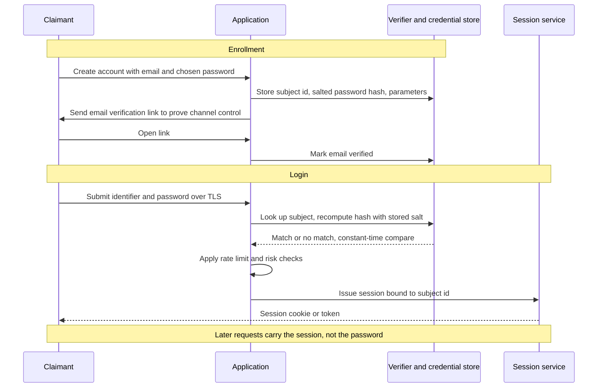

What the diagram shows and what it implies:

- The verifier stores a derived value, not the password. A stolen credential table should cost the attacker computation per guess (covered in the password section).
- Email verification proves control of a channel, not identity of a person. If the system treats the email address as the identity key, anyone who later takes over that mailbox, or registers the same address on a different provider that skips verification, inherits the account. Key accounts on an internal immutable subject identifier and treat email as a mutable attribute.
- After the session is issued the password is out of the picture. From then on the session artifact is the credential an attacker wants, which is why the session section later in this chapter carries as much weight as the login form.
- Rate limiting and risk checks sit between the verifier result and session issuance. They must apply to failures and successes alike, because credential stuffing is defined by many successes against many accounts, not by many failures against one.

### 2.3 Identity keys and account linking

Use a system-generated, never-reused subject identifier as the primary key. In federated identity, the stable key is the pair (issuer, subject) asserted by the identity provider, not the email claim. A real failure pattern follows from the alternative: a relying party that links an inbound federated identity to an existing local account by matching email lets anyone who can get an identity provider to assert that email, including one that does not verify email ownership, take over that local account. Require an explicit linking step that authenticates the existing local account first, then records the (issuer, subject) pair.

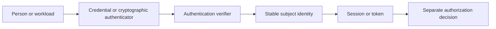

Read the chain left to right as a pipeline of narrowing trust. Everything before the session answers who; the final arrow hands a verified subject identifier, and nothing else, to the policy engine. Any attribute the authorization layer needs, such as roles or tenant, should be looked up from an authoritative store or carried in a token that is signed and bounded in lifetime, never accepted from the claimant's own request fields.

### 2.4 Authentication assurance: confidence is a property of the whole path

Assurance describes how much weight the relying party may put on the result. It depends on four things together: how strong the enrolled authenticator is, how well it resists theft and replay in use, how identity was proofed, and how recovery works. NIST 800-63 groups these into authenticator assurance levels; an application does not need to adopt the labels, but it should decide its own tiers explicitly. A common internal scheme:

| Tier | Typical use | Minimum evidence |
|---|---|---|
| Low | Reading public-but-personalized content | Session from any verified login |
| Standard | Normal account use | Password plus second factor, or a passkey |
| High | Payments, changing recovery options, admin consoles | Phishing-resistant authenticator, fresh within a short window |

The "fresh within a window" part matters. Authentication strength is evaluated at a moment. A session from three days ago, started with a strong factor, does not prove the person at the keyboard now is the same one. Sensitive actions should require recent authentication, called step-up, covered in the factors section next.

## 3. Factors, Authenticators, and Phishing Resistance

### 3.1 What a factor is

Authentication factors are categories of evidence: something known (knowledge), something held (possession), and something that is part of the person (inherence, such as a fingerprint or face). The point of combining categories is independence. If a single compromise can yield both pieces of evidence, the second adds nothing. Two passwords are one factor twice. A password and a code sent to an email account protected by the same password are close to one factor. A password stored in a phone's autofill and a code from an authenticator app on the same phone are weaker than they look, because losing the unlocked phone loses both.

Biometrics need care. A fingerprint or face match is normally a local gate that unlocks a private key held in secure hardware. The remote service never sees the biometric. Designs that upload a biometric template to a server and treat it as a reusable secret have an unrecoverable failure mode: a person cannot rotate their face.

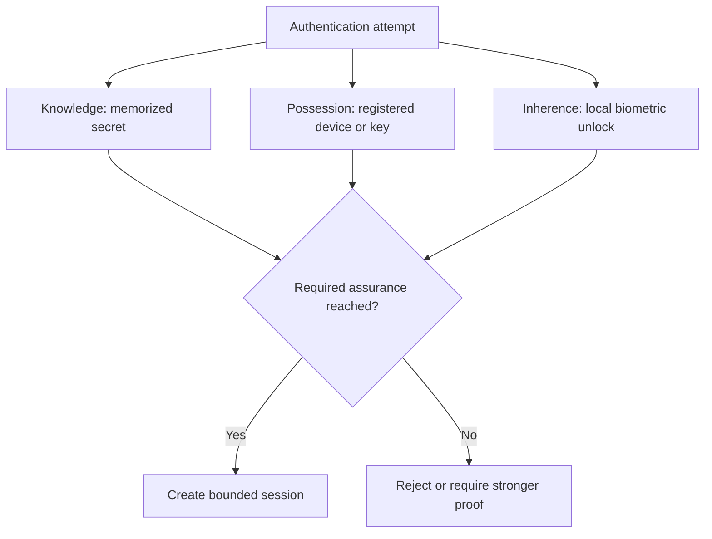

The diagram shows the policy decision as the join point: factors are inputs, and the required assurance is the output the application cares about. Design the policy in terms of required assurance for an action, not in terms of a fixed list of factors, so that replacing a factor (for example, retiring Short Message Service (SMS) codes) changes configuration rather than code.

### 3.2 The authenticator families compared

Authenticators differ in what an attacker needs to defeat them, and that determines where each belongs.

| Authenticator | What the verifier checks | Main attack | Phishable in real time? |
|---|---|---|---|
| Password | Hash of a memorized secret | Guessing, reuse, stuffing, phishing | Yes |
| SMS or voice one-time code | Code delivered over the phone network | SIM swap, interception, phishing | Yes |
| Time-based one-time password (TOTP) | Code derived from a shared secret and the clock | Phishing, shared-secret theft from the server | Yes |
| Push approval | User taps approve on a registered device | Prompt fatigue, approval of attacker's session | Yes, unless number-matched, and still weaker than origin-bound methods |
| Device-bound public-key credential (WebAuthn passkey, hardware key) | Signature over a server challenge, bound to the site origin | Device theft plus local unlock, malware on the endpoint, weak recovery | No, by design |

TOTP deserves mechanism-level detail because it is common. TOTP (specified in Request for Comments (RFC) 6238, built on the HMAC-based one-time password algorithm in RFC 4226) computes a Hash-based Message Authentication Code (HMAC) over a counter equal to the current Unix time divided by a step length, commonly 30 seconds, then truncates the result to a short decimal number, commonly six digits. Both sides hold the same secret, so the server must keep it recoverable, unlike a password hash. A database leak therefore leaks the second factor for every enrolled user. Servers usually accept the previous and next time step to tolerate clock drift.

Illustrative guessing arithmetic for a six-digit code with a plus or minus one step window: three codes are valid at any moment out of $10^6$ possibilities, so one random guess succeeds with probability $3 / 10^6 = 3 \times 10^{-6}$. With a lockout after 5 failures the attacker's chance per lock cycle is about $5 \times 3 \times 10^{-6} = 1.5 \times 10^{-5}$. Guessing is therefore not the realistic attack. Relaying is: the attacker asks the victim for the code on a fake page and submits it within the 30 second window.

### 3.3 Phishing resistance and why origin binding matters

A phishing attack succeeds when the victim hands authentication evidence to a page controlled by the attacker, who forwards it to the real site within the evidence's lifetime. This is called an adversary-in-the-middle or real-time relay attack. It defeats passwords, SMS codes, TOTP, and plain push, because the evidence has no knowledge of where it is being sent.

WebAuthn (a World Wide Web Consortium (W3C) specification, [w3.org/TR/webauthn-3](https://www.w3.org/TR/webauthn-3/); check the current level) closes the gap with three properties:

- The authenticator creates a separate key pair for each relying party. The relying party identifier (RP ID, normally the registrable domain) is part of what the authenticator signs over, and the browser supplies the origin it is actually on.
- Each login begins with a fresh random challenge from the server, so a signed response cannot be replayed later.
- The private key never leaves the authenticator.

If the victim is on `login-example.test` instead of `login.example.com`, the browser reports the wrong origin, the authenticator has no credential for that RP ID, and the server would reject the response anyway. There is nothing for the victim to type or approve incorrectly.

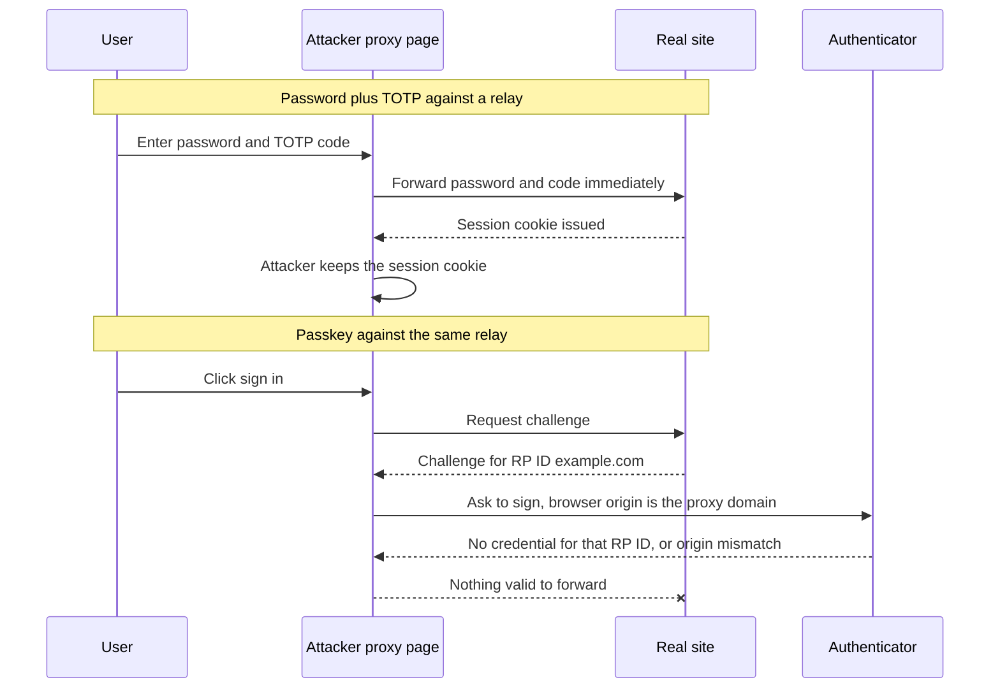

The top half shows why a "second factor" that is a typed code gives little protection against an interactive attacker: every piece of evidence is relayable. The bottom half shows the structural difference. Phishing resistance comes from the browser and authenticator enforcing the destination, so it does not depend on user attention. The residual risks move to other places: endpoint malware that steals the session after login, theft of an unlocked device, and weak account recovery that lets an attacker skip the strong authenticator entirely.

Platform specifics matter for deployment choices. Passkeys can be device-bound (a security key or a single device) or synced across a user's devices by a platform provider. Synced passkeys are far easier to recover and adopt, and their security then depends on the platform account's own recovery. Device-bound keys give stronger assurance and a harder recovery problem. Many organizations use device-bound hardware keys for administrators and synced passkeys for general users.

### 3.4 Step-up and risk-based decisions

Step-up authentication asks for stronger or fresher proof when the requested action is more sensitive than what the current session proved. Risk-based decisions add signals such as new device, impossible travel, or known-bad network reputation. Signals should add friction, never remove it: a good risk score must not turn a required second factor into an optional one.

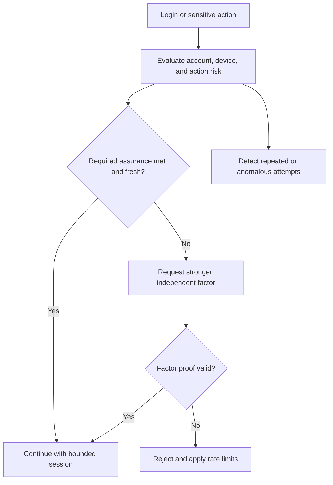

Two implementation points. First, record the time and method of the last strong authentication in the session, and compare against a per-action maximum age, for example "changing a payout account requires a passkey assertion within the last 5 minutes" (the value is a policy choice, not a standard). Second, enforce step-up on the server for each sensitive endpoint. If only the user interface asks for it, a direct call to the API skips it.

### 3.5 Push approval fatigue and number matching

A plain push prompt ("Approve sign-in?") fails when an attacker who already knows the password sends many prompts until the user taps approve to make them stop, or approves one believing it is their own. Mitigations are to show the application name, location, and a number the user must type from the login screen into the approving device, and to rate-limit prompts per account. These raise the cost without giving origin binding, so push remains phishable by a relay. Treat it as acceptable for standard tier and not for the high tier.

## 4. Passwords: Storage, Verification, and Attack Economics

### 4.1 Why passwords persist and what attackers do with them

Passwords remain the base layer because they need no enrollment hardware and every user understands them. Attackers work against them in four distinct ways, and each calls for a different control:

| Attack | Attacker has | Typical control |
|---|---|---|
| Online guessing | The login endpoint | Rate limits, lockout or delay, common-password blocklist |
| Credential stuffing | Username and password pairs leaked from other sites | Breached-password screening, rate limits by source and by account, second factor, bot detection |
| Offline cracking | A copy of your password hash table | Slow, memory-hard hashing with per-user salt |
| Phishing | The victim's attention | Phishing-resistant authenticator |

Stuffing works because people reuse passwords, and the attacker's list is already correct for some fraction of accounts. Because each attempt uses a plausible credential, per-account lockout alone does not stop it: the attacker tries one or two passwords per account across millions of accounts. Defenses have to count by source network, device signals, and aggregate failure ratio across the service.

### 4.2 How a password verifier stores a secret

The rule is to store only a value that costs the attacker computation to invert, and never a value that can be turned back into the password. The three terms are:

- **Salt**: a random value, unique per credential and stored beside the hash. It forces the attacker to attack each credential separately and defeats precomputed tables.
- **Work factor**: a tunable cost that makes each hash evaluation slow, in time and, for modern functions, memory.
- **Pepper**: an optional secret held outside the database, for example in a Hardware Security Module (HSM) or key service, mixed in so a database-only leak is insufficient. It adds a key-management duty and is a supplement, not a substitute for a good hash.

General-purpose fast hashes such as SHA-256 are designed to be fast. A graphics processor can evaluate billions per second, which makes them poor password hashes even when salted. Use a purpose-built password hashing function. The Open Worldwide Application Security Project (OWASP) Password Storage Cheat Sheet ([cheatsheetseries.owasp.org](https://cheatsheetseries.owasp.org/cheatsheets/Password_Storage_Cheat_Sheet.html)) lists Argon2id as the first choice, with scrypt, bcrypt, and PBKDF2 (Password-Based Key Derivation Function 2) as alternatives when Argon2id is unavailable or when Federal Information Processing Standards (FIPS) compliance requires PBKDF2. It publishes minimum parameter sets; check the current page, because recommended values move with hardware.

A stored record should carry the algorithm and parameters with the hash so they can be raised later. The widely used encoded form looks like this (illustrative values, not a recommendation):

```text
$argon2id$v=19$m=19456,t=2,p=1$<base64 salt>$<base64 hash>
```

The fields are the algorithm, version, memory in kibibytes, time passes, parallelism, salt, and hash.

Verification steps:

1. Look up the account by identifier. If absent, still perform a dummy hash so timing does not reveal which accounts exist.
2. Recompute the hash from the submitted password with the stored salt and parameters.
3. Compare with a constant-time comparison.
4. If the hash succeeds and the stored parameters are weaker than current policy, rehash with the new parameters and store the result (upgrade on login).
5. Return the same generic failure message for unknown account and wrong password.

Choosing the work factor is a capacity decision. The target is to make each verification take a noticeable fraction of a second on your production hardware, since the same cost applies to every legitimate login and to every attacker guess. Memory-hardness matters because it limits how many guesses an attacker can run in parallel on graphics hardware, where memory per core is scarce.

### 4.3 Worked scenario: what a database leak costs the attacker

All numbers are illustrative. Assume an attacker has stolen a table of 1 million password records and wants every account protected by a short, random, 8-character password drawn from 62 characters (upper case, lower case, digits).

Search space: $62^8 \approx 2.18 \times 10^{14}$ candidates.

Case A, fast unsalted hash, assumed $10^{10}$ guesses per second on attacker hardware:
$2.18 \times 10^{14} / 10^{10} = 2.18 \times 10^{4}$ seconds, about 6 hours, to exhaust the space for every account at once, because with no salt one pass attacks all records.

Case B, salted memory-hard hash, assumed $10^{4}$ guesses per second per attacker machine for a single target:
$2.18 \times 10^{14} / 10^{4} = 2.18 \times 10^{10}$ seconds, about $2.18 \times 10^{10} / (3.156 \times 10^{7}) \approx 690$ years to exhaust one account on that machine. With unique salts the attacker pays this per account, not once. Buying 1,000 machines cuts one account to about 8 months.

Real users do not choose uniformly random passwords. Attackers try common passwords, leaked passwords, and mutations first, so the first seconds of a cracking run recover a large share of the weakest accounts in both cases. The arithmetic therefore says what the hash buys you: it protects the strong and medium passwords and buys time for the weak ones. That is why breached-password screening at set time and a second factor at login remain necessary alongside good hashing.

### 4.4 Password policy that tracks current guidance

NIST SP 800-63B (see the revision linked in the model section) is the common reference. Its guidance, which you should confirm in the current revision, favors:

- Length over composition rules. Required mixes of symbols tend to produce predictable substitutions.
- Screening new passwords against lists of known-compromised and common passwords.
- Permitting long passphrases and all printable characters, and allowing paste so password managers work.
- Not forcing periodic changes without evidence of compromise, because forced rotation produces `Summer2024!` followed by `Autumn2024!`.
- No security questions as a knowledge-based recovery method.

Set an upper length limit only to bound hashing cost, and set it high enough (tens of characters at least; verify the current recommendation) not to truncate passphrases. If you use bcrypt, note that it processes a limited number of input bytes, so pre-hashing or choosing another function is a design decision to make explicitly.

### 4.5 Credential lifecycle

Credential security covers enrollment, use, change, reset, rotation, and revocation. The states below make the transitions explicit so each one can be given an owner and a test.

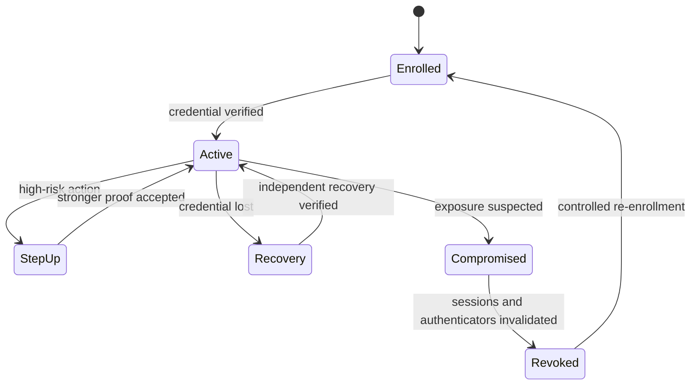

Each arrow is an attack surface or a failure mode. The transitions into `Recovery` and out of `Revoked` are where attackers aim when the primary login is strong, so they must demand evidence at least as strong as the credential they replace. The transition into `Compromised` needs a detection source, such as a breached-password feed, a user report, or an anomalous-session signal, or the state will never be entered in practice. The step into `Revoked` must reach every derived artifact: sessions, refresh tokens, API keys, and remembered-device records, all covered in later sections of this chapter.

Reset tokens, the main mechanism for the `Recovery` transition by email, should be random with enough entropy to be unguessable (at least 128 bits is a common choice), single-use, short-lived, stored only as a hash on the server, bound to the account and purpose, and kept out of referrer headers and logs. A successful reset should invalidate existing sessions and notify the account's previous contact channels.

## 5. Federation: Moving the Verifier to Another Organization

### 5.1 What federation changes

Federation splits the verifier from the relying party. An identity provider (IdP) authenticates the claimant and sends the relying party a signed statement about the outcome. The relying party never sees the password or the second factor. Four things follow from that split:

- The relying party's login security becomes the IdP's login security. If the IdP accepts SMS codes for the account, the relying party inherits that.
- The relying party must decide which IdPs it trusts and which attributes of each it will believe.
- Authentication strength is now a claim inside a signed document, and the relying party must read it rather than assume it.
- Logout, revocation, and account deletion cross an organizational boundary and become best-effort unless designed otherwise.

The protocol mechanics are owned elsewhere. [Part 05 OIDC](../05_Networking_and_OS/CH20_OIDC.md) and [Part 05 OAuth](../05_Networking_and_OS/CH19_OAuth.md) cover the wire flows, and [OIDC in this part](CH07_OIDC.md) covers the authentication layer built on OAuth. In short, OpenID Connect adds an identity token (a signed JSON Web Token) to the OAuth authorization code flow, and Security Assertion Markup Language (SAML) 2.0 carries a signed XML assertion through the browser to the relying party. This section covers the trust decisions the relying party must make around those flows.

### 5.2 The trust relationship and what the relying party validates

Trust is established out of band before any user logs in, and each login then checks the response against that configuration.

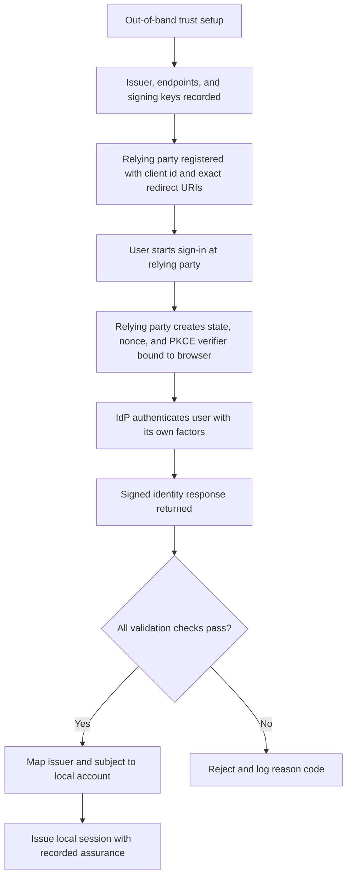

The diagram separates configuration time from login time. Everything the relying party needs to judge the response (issuer identifier, signing keys, allowed redirect addresses) is fixed beforehand. At login time the checks are mechanical:

| Check | What it prevents |
|---|---|
| Signature verifies against a key obtained from the configured issuer | Forged responses |
| Algorithm is on an allow-list the relying party chose, not the one named in the token header | Algorithm-substitution attacks, including the `none` algorithm |
| `iss` equals the configured issuer exactly | Responses from a different tenant or provider that signs with its own key |
| `aud` contains this application's client identifier | A token issued to another application being replayed here |
| `exp` and `nbf` are valid, allowing small clock skew | Replay of old responses |
| `nonce` matches the value stored with this browser's login attempt | Injection of a response captured from a different login |
| `state` matches and the redirect target is on an exact-match list | Login CSRF (Cross-Site Request Forgery) and open-redirect abuse |
| `acr` and `amr` claims (authentication context and methods) meet the tier required | Accepting a weak IdP login for a high-tier action |

Two points deserve emphasis. First, validate on the server, with a library that implements the specification, and fetch signing keys from the issuer's published key endpoint, caching them and refreshing when an unknown key identifier appears. Do not take the key from the token itself. Second, never accept an identity response only because it was received over TLS. TLS protects the channel to the IdP or the browser, and the checks above protect against content that was legitimately delivered but is not for this relying party.

A minimal validation sketch in Python-like pseudocode shows the order and the failure behavior:

```python
claims = verify_jwt(
    id_token,
    keys=jwks_cache.for_issuer(ISSUER),      # keys fetched from the configured issuer
    algorithms=["RS256"],                    # allow-list chosen by the relying party
    issuer=ISSUER,
    audience=CLIENT_ID,
    leeway_seconds=60,
)
if claims["nonce"] != session_store.pop_nonce(browser_id):
    raise AuthError("nonce mismatch")
if not tier_satisfied(claims.get("acr"), claims.get("amr"), required_tier):
    raise StepUpRequired(required_tier)
subject_key = (claims["iss"], claims["sub"])   # stable key, not the email claim
```

Here `JWKS` stands for JSON Web Key Set, the document of public keys an issuer publishes. The nonce is consumed once with `pop_nonce`, so a replayed response fails.

### 5.3 Attacker perspective on federated login

Each federation design decision maps to a specific attack.

- **Account takeover through email matching.** Covered earlier: link on the (issuer, subject) pair. If a multi-tenant IdP lets a tenant administrator set any email address, matching on email lets a hostile tenant claim any account in your system.
- **Mix-up between providers.** A relying party that supports several IdPs and does not record which one a login attempt started with can be tricked into sending a code to the wrong one. Record the expected issuer in the pre-login state and compare it with `iss` on return.
- **Authorization code interception.** Proof Key for Code Exchange (PKCE) binds the code to the client that asked for it. Public clients must use it, and confidential clients benefit from it as well.
- **Open redirect and loose redirect matching.** Prefix or wildcard matching of redirect addresses lets an attacker steer a code or token to a host they control. Use exact string match.
- **Signature wrapping and unsigned elements in SAML.** SAML assertions are XML, and a parser that verifies one element and consumes another can be fooled. Use a maintained library, require the signature to cover the assertion you read, and check `Audience`, `Recipient`, `NotOnOrAfter`, and `InResponseTo`.
- **Malicious or compromised IdP.** A relying party that trusts many IdPs trusts the weakest. Limit which IdPs may assert which domains or tenants.

### 5.4 Provider specifics that change the design

The managed identity products differ in what they call the pieces and in how workforce and workload federation are separated. The details move, so verify against current documentation.

| Concern | AWS | Microsoft Azure | Google Cloud |
|---|---|---|---|
| Workforce sign-in to the cloud | IAM Identity Center federates with an external IdP over SAML or OIDC | Microsoft Entra ID is itself the IdP, with Conditional Access policies | Cloud Identity or Workforce Identity Federation with an external IdP |
| Customer-facing application login | Amazon Cognito user pools | Microsoft Entra External ID | Identity Platform (Firebase Authentication based) |
| Workload without long-lived keys | IAM role assumed with a web identity token | Workload identity federation on Entra app registrations | Workload Identity Federation |

The pattern worth noticing is the last row. An external workload (a build job, a Kubernetes service account) presents a short-lived signed token from its own issuer, and the cloud exchanges it for short-lived cloud credentials. This replaces stored access keys with a trust relationship, and the relationship needs the same validation discipline as the table above: pin the issuer, the audience, and the subject pattern (for example, only one repository and branch). A trust policy that accepts any subject from a shared public issuer lets any tenant of that issuer assume the role. Cloud authorization policy evaluation sits in [Part 09 IAM](../09_Cloud_Computing/CH09_IAM.md).

### 5.5 Provisioning and account lifecycle across the boundary

Authentication alone does not tell the relying party that an employee left. Two mechanisms close that gap. Just-in-time creation makes an account the first time a valid assertion arrives, which is easy but leaves an account in place after the person is removed at the IdP. A provisioning protocol such as System for Cross-domain Identity Management (SCIM) lets the IdP create, update, and deactivate accounts in the relying party directly. For workforce applications, prefer SCIM or an equivalent so that deactivation at the source reaches the application within a bounded time, and set the local session lifetime so that even without a deprovisioning message the exposure ends on its own.

## 6. Sessions and Tokens After Authentication

### 6.1 The session as a bearer credential

After login the session artifact stands in for the claimant. Whoever presents it is treated as the subject, so it is a bearer credential and must be protected like a password with a shorter life. Most real account takeovers against strong login flows target this artifact, through cross-site scripting, malware that reads browser storage, proxy phishing that captures the cookie, or logs that record tokens.

Two designs are common:

| Property | Server-side session (opaque identifier) | Self-contained token (signed, such as a JWT) |
|---|---|---|
| What the client holds | A random identifier that points to server state | Signed claims the server can verify without a lookup |
| Revocation | Delete the record, effective immediately | Not possible before expiry unless a deny list or short lifetime is added |
| Per-request cost | A store lookup | A signature verification |
| Information exposure | None, state stays on the server | Claims are readable by anyone holding the token |
| Typical use | Browser applications on one domain | Service-to-service calls and short-lived access tokens |

Choose the opaque server-side session for browser sessions unless there is a reason not to, because revocation and idle timeout come for free. Use self-contained tokens where lookup cost or cross-service verification matters, and keep their lifetime short so revocation lag stays small. The identifier of an opaque session must come from a cryptographically secure random generator with at least 128 bits of entropy (a common guideline in the OWASP Session Management Cheat Sheet; verify the current figure), and the store should hold only a hash of it if database read access is a concern.

### 6.2 Cookie attributes and what each one stops

A browser session cookie is set with a response header such as:

```http
Set-Cookie: __Host-sid=Zk3...opaque...; Path=/; Secure; HttpOnly; SameSite=Lax; Max-Age=28800
```

The attribute semantics are owned by [Part 05 HTTP](../05_Networking_and_OS/CH01_HTTP.md). The security effect of each is:

- `Secure` keeps the cookie off plaintext connections.
- `HttpOnly` hides it from page scripts, so a cross-site scripting (XSS) bug cannot read it directly. The script can still make authenticated requests from the victim's browser, so this reduces theft, not abuse.
- `SameSite=Lax` or `Strict` stops the browser from sending the cookie on most cross-site requests, which is the main browser-side defense against CSRF. Keep a CSRF token for state-changing requests anyway where the application allows cross-site embedding or older browsers matter.
- The `__Host-` prefix makes the browser accept the cookie only with `Secure`, `Path=/`, and no `Domain` attribute, which stops a sibling subdomain from overwriting it.

Mobile and single-page clients cannot always use cookies. A browser-based application that keeps long-lived tokens in script-readable storage exposes them to any XSS. A common arrangement is to have a small server component hold the tokens and give the browser only a first-party session cookie, so no token reaches script.

### 6.3 Lifetimes, rotation, and fixation

Every session needs both an idle timeout (no activity for a period) and an absolute lifetime (a maximum age regardless of activity). Without the absolute limit, a stolen cookie that is kept active lives forever. Pick values from the risk tier: a banking console may use minutes idle and hours absolute, a low-risk content site may use days. Those are policy choices with no standard value.

Two rotation rules prevent specific attacks:

1. **Issue a new identifier on every privilege change**, especially at login. If the application keeps the pre-login identifier, an attacker who planted it in the victim's browser (session fixation) shares the authenticated session after the victim signs in.
2. **Rotate refresh tokens on use** and detect reuse. If an old refresh token is presented after its successor was issued, either the legitimate client or an attacker holds a copy, and the safe response is to revoke the whole token family and force a new login.

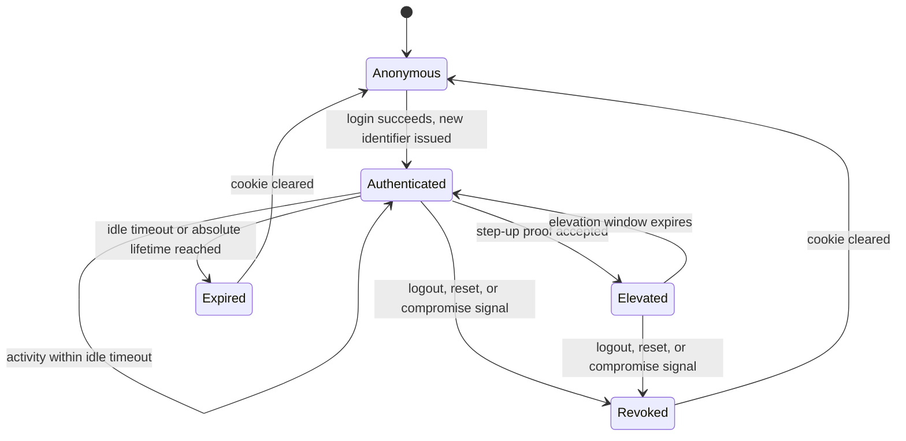

The diagram shows that a session has exits other than the user clicking logout. Each exit needs a trigger and an implementation: the idle and absolute timers live in the session store, and the revocation exits need a way to find all sessions for a subject, which means the store must index sessions by subject identifier. An implementation that can look up a session only by its own identifier cannot answer "sign this user out everywhere", which is the first request in any incident.

### 6.4 Worked scenario: sizing the revocation window

All numbers are illustrative. A service issues JWT access tokens valid for 15 minutes and refresh tokens valid for 30 days, rotating on use. Security wants to know how long a stolen access token remains usable after the user's account is disabled.

- Worst case with no deny list: the token was issued one second before the disable, so it remains valid for $15 \times 60 - 1 = 899$ seconds, almost 15 minutes.
- Average case: if disables arrive at a random point in a token's life, the expected remaining validity is half the lifetime, $15 / 2 = 7.5$ minutes.
- The refresh token adds no exposure after revocation, because the refresh endpoint checks the account state and the token family on every exchange.

Options to shrink the window and their costs, for a service handling 2,000 requests per second:

| Option | Revocation lag | Added load |
|---|---|---|
| Keep 15-minute tokens, no check | Up to 15 min | None |
| Shorten to 5-minute tokens | Up to 5 min | Refresh traffic roughly triples for active users |
| Add a deny-list lookup on each request | Seconds, depending on propagation | 2,000 lookups per second against a small in-memory set |
| Use opaque sessions with a store lookup | Immediate | 2,000 lookups per second against the session store |

A deny list holds only revoked identifiers until their natural expiry, so it stays small: if 50 sessions per hour are revoked and each entry is kept 15 minutes, the list holds about $50 \times 0.25 = 12.5$ entries on average. That is why a deny list is cheap compared with a full session store, and why the choice depends on whether the service needs the stateless property for other reasons. Some providers push revocation events to resource servers so tokens are rejected before expiry, for example Microsoft's Continuous Access Evaluation for supporting clients and services. Verify current scope and client support before relying on it.

### 6.5 Single sign-on and logout across applications

With single sign-on (SSO), one authentication at the IdP gives each relying party its own local session. Logging out of one application ends only that local session unless the IdP session is also ended. The IdP session may then silently sign the user back in. Back-channel logout, where the IdP calls each relying party's endpoint with a signed logout token, is more reliable than front-channel logout through hidden browser frames, which browsers increasingly block. Neither reaches an application that is offline or a token already handed to another service, so design the access-token lifetime and the local session lifetime as the real upper bound on residual access. See [Part 05 OIDC](../05_Networking_and_OS/CH20_OIDC.md) for the protocol details.

## 7. Account Recovery

### 7.1 Recovery is a second login path

Recovery exists because authenticators get lost. Every recovery path is therefore an alternative way to authenticate, and the account is only as strong as the weakest path that ends in a working login. An organization that requires a passkey for sign-in and lets support reset it after a phone call has a support-desk authenticator. Attackers know this and choose the cheapest path: they call the help desk, request a reset to a new email address, exploit a mailbox they already control, or port the victim's phone number to receive SMS codes.

The design rule is that recovery must demand evidence at least as strong as the tier of the account, or the account must be treated at the lower tier. Typical recovery inputs and their weaknesses:

| Recovery input | Strength | Main weakness |
|---|---|---|
| Email link to the registered address | Moderate | Mailbox takeover moves the whole account |
| SMS code | Low to moderate | SIM swap, number reassignment |
| Security questions | Very low | Answers are guessable or discoverable |
| Pre-issued recovery codes | Moderate to high | Users store them insecurely or lose them |
| A second registered authenticator | High | Users enroll only one |
| Another signed-in device approving | High | Needs an existing session |
| Manager or administrator approval with identity check | High if audited | Social engineering of the approver |
| Remote identity proofing with documents | Variable | Deepfake and forged-document risk, privacy cost |

### 7.2 A recovery path that does not downgrade the account

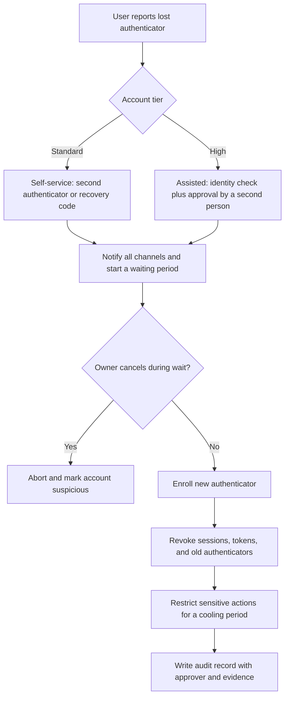

The waiting period is the control that most often separates a failed takeover from a successful one, because it gives the real owner time to object through a channel the attacker does not control. The cooling period after recovery restricts irreversible actions (changing payout details, adding new recovery methods, disabling alerts) for a set time, so a successful attacker cannot immediately cash out. The lengths are policy decisions and should reflect the loss the account can suffer in that time.

For assisted recovery, remove the information the help desk could be tricked into acting on. Agents should be able to start a verification flow, not to read or change authenticator data or email fields directly, and every action should create an audit record that names the approver. Support-assisted resets belong in the threat model as a named attack path.

### 7.3 Recovery codes and backup authenticators

Recovery codes are random single-use secrets issued at enrollment. Make each long enough to resist guessing (for example 10 or more characters from a 32-symbol alphabet, which gives $32^{10} = 2^{50}$ possibilities, so with a limit of 10 attempts per day the guessing chance is negligible, though the figures here are illustrative), store only hashes, invalidate each on use, and invalidate the whole set when a new set is generated. Encourage a second hardware authenticator stored separately, since that is a strong path that needs no support involvement. Passkeys synced by a platform provider move the recovery problem to the platform account, which should be named in the design as an accepted dependency.

### 7.4 Employee departure and workload identities

Recovery and revocation also cover people leaving and machines being retired. For workforce identity, disabling the person at the IdP should end all application access within a bounded time, and a periodic reconciliation should find accounts that exist locally with no active owner at the source. For workloads, every credential needs a named owner and an expiry, and the owner must be able to see which services use it before rotating it. A credential with no owner is a credential nobody will revoke.

## 8. Revocation

### 8.1 What has to be revoked

A credential event (password reset, suspected theft, employee exit) leaves many derived artifacts alive unless each is handled. List them per identity:

- Browser sessions and remembered-device markers that skip the second factor.
- Refresh tokens and their token families.
- Access tokens already issued, valid until expiry unless a check exists.
- API keys and personal access tokens created by the user.
- Authenticators: passkeys, TOTP secrets, and recovery codes.
- Federated sessions at the IdP and delegated consents granted to third-party applications.
- Cached authorization decisions and group memberships in downstream services.

The response is only complete when it reaches all of them. The usual failure is that a password reset ends the web session but leaves a 30-day refresh token, or an API key, working.

### 8.2 Propagation and its limits

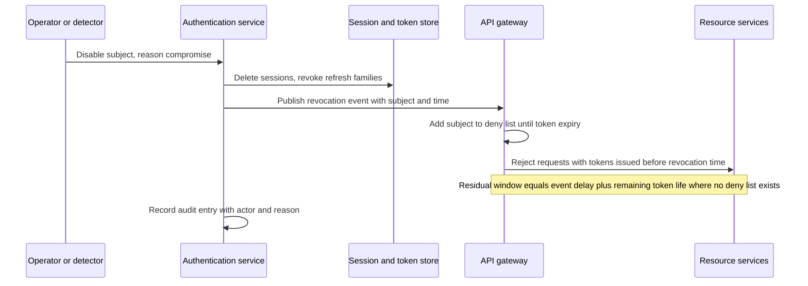

The diagram makes the residual window explicit. Anything that validates tokens offline (a service that checks only signature and expiry) learns of revocation only through the event path or through token expiry. Two techniques help. One is to store a per-subject "tokens valid after" timestamp and reject tokens issued earlier, which needs a lookup per request or a pushed cache. The other is to keep access tokens short and put the revocation decision at the refresh step. Pick based on how costly one more minute of access is for the data behind the service.

A "disable account" call needs to be fast and tested. Run a recurring exercise that disables a test identity and measures the time until each service stops accepting its credentials. That measured number is the revocation latency, and it should be an objective with an owner, as with any other recovery objective.

### 8.3 Rotation of shared secrets and keys

Revoking user credentials is the easy case. Signing keys, client secrets, and verifier pepper values need rotation plans before an incident. For signing keys, publish the new public key before signing with it, keep the old one verifiable until all tokens signed with it have expired, then remove it. Rotating a signing key with no overlap logs everyone out, and keeping the old key forever leaves a compromised key trusted. Storage and rotation mechanics for the secrets themselves are in [Secrets Management](CH09_Secrets_Management.md).

## 9. Operating the Authentication System

### 9.1 What to measure

Authentication telemetry should answer questions an incident team will ask: who is attacking, which accounts are affected, and did anything succeed. Useful series, each with a baseline so changes stand out:

- Login success and failure rates by source network, client type, and tenant, plus the ratio of distinct accounts to attempts. A flat failure count with a rising number of distinct accounts is the signature of credential stuffing.
- Second-factor challenges issued, passed, and abandoned, and push prompts per account per hour (a spike suggests approval fatigue).
- Recovery requests, completed recoveries, and cancellations by the owner during the wait.
- New authenticator enrollments and removals, especially followed quickly by a sensitive action.
- Session creations from a new device or network shortly after a recovery or password reset.
- Revocation latency measured in the exercise above, and the count of live sessions per subject.
- Federation validation failures grouped by reason code (signature, audience, nonce, expiry), since a burst of one reason points to misconfiguration or probing.

### 9.2 What to log and what never to log

Log identifiers, outcomes, reason codes, source address, client details, and the assurance level reached. Never log passwords, full session or access tokens, recovery codes, one-time codes, or biometric data. Log only a short, non-reversible fingerprint of a token when correlation is needed. Failed logins are a particular hazard: users sometimes paste a password into the username field, so logs of unknown-user values can contain real passwords. Treat the username field in failure logs as sensitive, or truncate and hash it.

Send authentication events to the central security monitoring pipeline (for example a Security Information and Event Management (SIEM) platform) with consistent field names so detection rules work across applications. Alert on patterns, not single events: impossible travel across successful logins, many accounts failing from one network, a recovery followed by a payout change, and an administrator authenticated without the required assurance.

### 9.3 Availability and the outage design

Authentication is on the critical path of every request that needs a session. Decide in advance how the application behaves when the IdP or the session store is unavailable:

- Existing sessions keep working until their own expiry. A session lifetime longer than the typical IdP outage but short enough for the account's risk tier is the balance to look for.
- New logins fail closed. A fallback local password path with weaker assurance is a standing vulnerability and an attacker target. If an emergency administrator account is needed, store its credential offline with dual control, alert on any use, and rotate after use.
- Cached IdP signing keys let validation continue while the key endpoint is unreachable, but cap how long a cache may be stale so key rotation still takes effect.

### 9.4 Testing

Automate tests for the authentication behaviors that matter: an expired, wrong-audience, and wrong-issuer identity token are each rejected; a reused nonce is rejected; a session identifier changes at login; a reset invalidates other sessions; a revoked refresh token cannot be exchanged; a user cannot downgrade from a passkey to a weaker factor without the recovery path; and the rate limiter counts both failures and successes. These tests are cheap compared with discovering the gap in production, and they document the design for the next engineer.

## 10. Provider and Standards Comparison

Standards define what a credential or assertion means. Providers decide which of those meanings they enforce for you and which they leave to your configuration. The comparison below is about guarantees, scopes, and responsibilities. Product names and feature coverage change often, so each cell describes a mechanism and the reader should confirm the current capability in the provider documentation before depending on it.

### 10.1 Standards: what each one guarantees

| Standard | What it guarantees | What it does not guarantee |
|---|---|---|
| NIST SP 800-63B | A vocabulary and assurance levels for authenticators and their lifecycle | That any specific product implements a level correctly |
| WebAuthn (W3C) | Per-site key pairs, a fresh server challenge, and origin included in the signed data | That the device is not compromised, or that recovery is strong |
| OpenID Connect | A signed statement of who authenticated, for which client, at what time | That the IdP used strong factors, unless `acr` and `amr` are checked and trusted |
| SAML 2.0 | A signed XML assertion about the subject delivered to a service provider | Safe parsing in the consumer, or timely logout |
| TOTP (RFC 6238) | A code derived from a shared secret and the clock | Phishing resistance, or secrecy of the seed on the server |
| SCIM | A standard way to create, update, and deactivate accounts across domains | That the target application applies a deactivation immediately |

The right column is where design reviews should spend their time. Each guarantee covers a narrow property, and an incident usually happens in the gap beside it.

### 10.2 Providers: scopes and shared responsibility

| Concern | AWS | Microsoft Entra ID | Google Cloud |
|---|---|---|---|
| Who authenticates workforce users | An external IdP, or IAM Identity Center's own directory. The customer chooses and runs the factors | Entra ID is the verifier. Factor policy is set per tenant through Conditional Access and authentication strength settings | Cloud Identity or Google Workspace is the verifier, or an external IdP through Workforce Identity Federation |
| Where the customer's responsibility begins | Factor policy at the IdP, permission sets, session duration of issued credentials | Policy design, break-glass accounts, recovery and registration policy, device compliance signals | Account and 2-Step Verification policy, organization policy, recovery settings |
| Customer-facing login service | Amazon Cognito user pools: the provider stores and verifies credentials, the customer sets the policy and flows | Microsoft Entra External ID: same split | Identity Platform: same split |
| Workload credentials | Short-lived credentials from role assumption, trusted by an issuer and subject pattern the customer writes | Federated credentials and managed identities, trusted by an issuer and subject the customer configures | Workload Identity Federation and service account attachment, trusted by a provider mapping the customer writes |
| Session and token lifetime | Customer-chosen within provider limits | Customer-chosen, with token revocation signals for supporting clients | Customer-chosen within provider limits |
| What the provider guarantees | Platform availability, secure storage of directory data, token signing key protection | The same, plus tenant isolation of identity data | The same |
| What the provider does not guarantee | That your policy blocks phishing, that your recovery is strong, that your trust policy is narrow | The same | The same |

The common pattern in the last two rows is the useful part. Every provider secures its own signing keys and directory, and none of them can decide on your behalf which factors your administrators must use, how your help desk verifies a caller, or which external subjects may assume a role. Those are configuration decisions the customer owns, and they are the usual source of real compromises.

Provider terms also hide differences. A "managed identity" in one cloud and a "service account" in another are not interchangeable: the scope of the credential, how it is rotated, and which trust policy governs it differ. When a design spans providers, write the trust relationship in neutral terms (issuer, audience, subject pattern, lifetime) and then map each to the provider setting. Provider authorization and policy syntax stay in [Part 09 IAM](../09_Cloud_Computing/CH09_IAM.md).

## 11. Failure and Quality-Attribute Scenarios

Each scenario states a stimulus, the expected response, and a measurable success criterion. All thresholds are illustrative starting points. Set the real values from the loss each account tier can suffer and from measured baselines.

### 11.1 Scenario A: credential-stuffing burst

**Stimulus.** A login endpoint that normally sees 40 attempts per second receives 4,000 attempts per second for 20 minutes. The attempts come from about 6,000 source addresses, each trying 1 or 2 accounts, with valid-looking user agents.

**Expected response.** The system detects the shift by the ratio of distinct accounts to attempts, adds friction by source reputation and device signals, requires a second factor for any login that passes the password check from an unrecognized device, and does not lock real owners out.

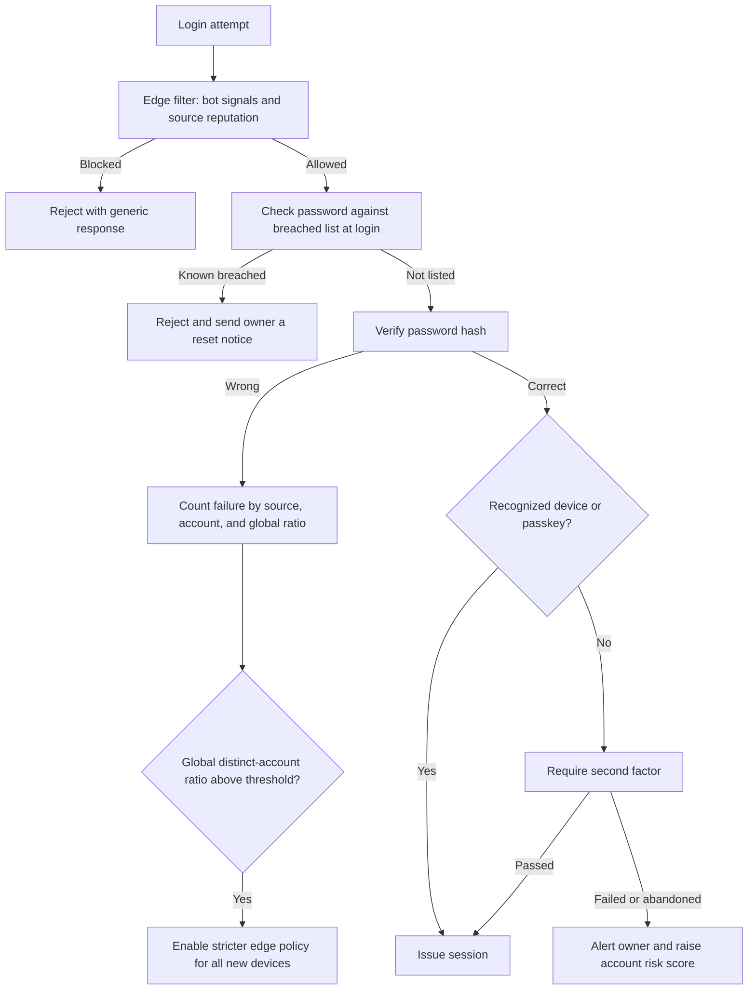

Implications of the diagram. The layers fail independently: a bot that passes the edge filter still meets the breached-password check, and a correct stolen password still meets the second factor. The surge decision is global, because per-account lockout does not see an attacker who tries one password on each of millions of accounts. The tighter policy applies only to unrecognized devices, so legitimate users on known devices keep logging in during the attack. The cost is more second-factor prompts for travelers and new-device users, which the support team should expect.

**Success criteria.**

| Measure | Target |
|---|---|
| Time from burst start to the stricter policy being active | At most 5 minutes |
| Sessions created without a second factor from unrecognized devices | 0 |
| Legitimate logins from recognized devices that fail during the burst | Under 1 percent of baseline volume |
| Accounts whose owners are notified after a correct password from an unrecognized device | 100 percent |

Arithmetic check for the load. At 4,000 attempts per second for 20 minutes the total is $4000 \times 1200 = 4.8 \times 10^6$ attempts. If the attacker's list is correct for 0.5 percent of accounts tried (an assumed rate), the password check passes for $4.8 \times 10^6 \times 0.005 = 24{,}000$ attempts. The second factor is the control that decides whether those 24,000 become sessions. The password hashing cost also matters: at an assumed 50 milliseconds per verification, 4,000 attempts per second needs $4000 \times 0.05 = 200$ core-seconds per second, so about 200 cores fully busy. Rejecting at the edge before the hash is a capacity control as much as a security control.

### 11.2 Scenario B: identity-provider outage

**Stimulus.** The external IdP becomes unreachable for 90 minutes. The relying party's sessions have an absolute lifetime of 8 hours and an idle timeout of 30 minutes.

**Expected response.** Existing sessions continue within their limits, new logins fail closed with a clear message, signing keys already cached continue to validate tokens within a stated cache bound, and no fallback password path appears.

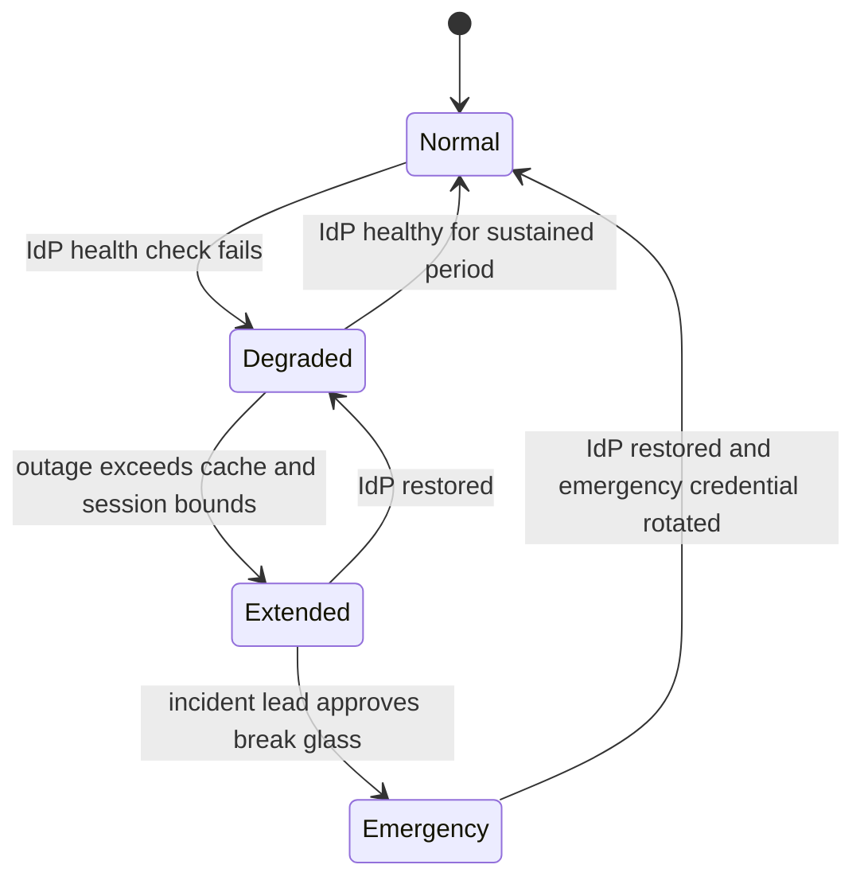

Implications of the diagram. `Degraded` keeps the service useful for people already signed in and does not create any new way in. `Extended` is the state where cached keys age out or sessions expire, and the service must decide in advance who can authorize `Emergency`. The emergency path is entered by a named approver, is monitored, and ends with credential rotation, so it cannot turn into a permanent second login.

**Success criteria.**

| Measure | Target |
|---|---|
| Signed-in users who keep working through the 90-minute outage | At least the share whose sessions are still within idle and absolute limits |
| New logins accepted through any non-IdP path | 0, except approved break-glass use |
| Time to detect IdP failure and enter `Degraded` | Under 2 minutes |
| Break-glass uses with an audit record and post-use rotation | 100 percent |

Arithmetic check. With a 30-minute idle timeout, a user who is inactive for more than 30 minutes during the outage is signed out and cannot sign back in. A user who is active throughout keeps access for the full 90 minutes, which is within the 8-hour absolute limit. If the team wants inactive users to survive a 90-minute outage, the idle timeout would have to be at least 90 minutes, and that weakens protection against unattended devices, so the decision is a trade-off the owner must record.

### 11.3 Scenario C: lost authenticator recovery

**Stimulus.** An employee in the high tier reports a lost hardware key and has no backup authenticator. At the same moment, someone calls the help desk claiming to be that employee and asks for an immediate reset.

**Expected response.** The assisted recovery flow from the recovery section starts. A second person approves after an identity check, all channels receive a notice, the waiting period runs, the real owner can cancel, and after enrollment every old session and authenticator is revoked.

**Success criteria.**

| Measure | Target |
|---|---|
| Recoveries completed without an approver other than the agent | 0 |
| Time between recovery request and notice to all registered channels | Under 1 minute |
| Sensitive actions permitted during the cooling period | None of the listed irreversible actions |
| Revocation latency for sessions after enrollment of the new authenticator | Under 60 seconds in the exercise |

The scenario also gives a business measure: the expected time without access for a genuine owner. If the waiting period is 24 hours, a genuine employee loses up to a day, so the organization should issue backup authenticators at enrollment and treat the absence of a backup as a risk acceptance, not as an oversight.

## 12. Worked End-to-End Case Study

This case study is illustrative. The organization, the figures, and the test results are invented to show the reasoning and are not measurements from a real system.

### 12.1 The organization and its constraints

Example Freight Co is a hypothetical logistics firm with 2,400 employees, 150 of whom hold privileged roles (cloud administrators, finance approvers, and the help-desk leads). It runs a customer portal with 180,000 registered accounts that book shipments and change payout bank details. The security team has two engineers. The goals are phishing resistance for the 150 privileged users, a credential-stuffing defense for the portal, recovery that does not undermine either, and revocation that completes within 2 minutes.

### 12.2 Design

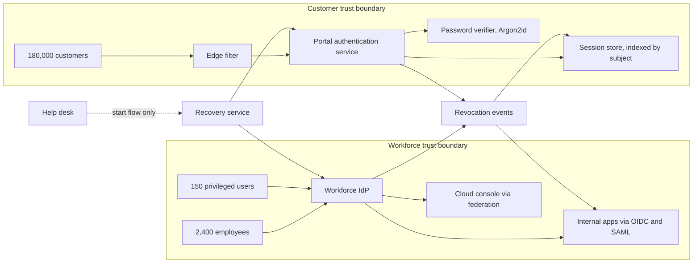

Implications of the diagram. There are two trust boundaries with two verifiers, because the populations have different threats and different recovery economics. The help desk can start a recovery flow but cannot change authenticator or email data, which removes the social-engineering shortcut. Both verifiers publish to one revocation event path, so a single "disable subject" action reaches applications and the portal session store.

Decisions:

| Area | Decision | Reason |
|---|---|---|
| Privileged authenticators | Two device-bound hardware keys per person, one kept offsite | Phishing resistance, and a backup that needs no help-desk involvement |
| General workforce | Synced passkeys, with number-matched push as a temporary fallback | Easier recovery and adoption, lower assurance accepted for the standard tier |
| Portal passwords | Argon2id with per-user salt and parameters stored with the hash, breached-password screening at set time and at login | Offline cracking cost and stuffing defense |
| Portal second factor | Required for unrecognized devices and for payout changes, with passkeys offered | Friction goes where risk is, without a prompt on every login |
| Portal sessions | Opaque server-side sessions, 30-minute idle, 12-hour absolute, new identifier at login, step-up within 5 minutes for payout changes | Immediate revocation and fixation protection |
| Workforce tokens | 10-minute access tokens, refresh rotation with reuse detection, deny list at the gateway | Bounded revocation lag |
| Federation trust | Link on (issuer, subject), exact redirect matching, algorithm allow-list, `acr` and `amr` required for the high tier | Blocks email takeover and weak-factor logins to admin consoles |
| Recovery | Standard tier: second authenticator or recovery codes plus a 1-hour wait. High tier: identity check, second approver, 8-hour wait, 24-hour cooling period on irreversible actions | Recovery no weaker than the account tier |

### 12.3 Rejected alternatives

| Alternative | Why it was rejected |
|---|---|
| One-time codes by SMS for all users | Phishable by relay and exposed to SIM swap, which fails the stated privileged-user goal |
| Hardware keys for all 2,400 employees | Cost and recovery load exceed the benefit for the standard tier. Arithmetic below |
| Self-contained tokens as portal sessions | Revocation lag of a full token lifetime was unacceptable for payout-changing sessions |
| Forced 90-day password rotation | Produces predictable changes and more help-desk resets, with no evidence of compromise to justify it |
| Letting help-desk agents reset email and authenticators directly | Creates a single target for social engineering |
| Email matching to link federated identities | Lets an IdP tenant that asserts any address take over accounts |

Cost arithmetic for the hardware-key decision (illustrative unit price of 50 currency units per key). Privileged users: $150 \times 2 = 300$ keys, so $300 \times 50 = 15{,}000$. All employees: $2400 \times 2 = 4{,}800$ keys, so $4800 \times 50 = 240{,}000$. The all-employee option costs $240000 / 15000 = 16$ times as much before counting lost-key replacement and enrollment support. Assuming 4 percent of key holders lose a key per year, the 150 privileged users produce 6 recoveries a year and all 2,400 produce 96, about 0.4 per working day at 250 working days ($96 / 250 \approx 0.38$). The extra load is manageable only if backups exist, and 2,400 people with a second key are 4,500 more keys to track than the 300 in the privileged design.

### 12.4 Capacity and revocation arithmetic

Password verification. Peak legitimate portal logins are 60 per second (assumed). Argon2id at an assumed 80 milliseconds per verification needs $60 \times 0.08 = 4.8$ cores at peak. The edge filter limits any attack to 300 password checks per second reaching the verifier, so the worst case is $300 \times 0.08 = 24$ cores. A pool of 32 cores covers both with margin, and traffic above the edge limit is rejected before hashing.

Session store sizing. If 20 percent of the 180,000 accounts are active in a day, and each active account holds an average of 1.5 sessions, there are $180000 \times 0.2 \times 1.5 = 54{,}000$ sessions. At an assumed 200 bytes per record, the store holds $54000 \times 200 = 10{,}800{,}000$ bytes, about 11 megabytes. The "sign out everywhere" index adds little. Memory is not the constraint, and the design needs no stateless shortcut.

Workforce revocation. Access tokens last 10 minutes, so with no deny list the worst-case lag is $10 \times 60 = 600$ seconds. The gateway deny list holds entries for 10 minutes. If 30 subjects are disabled per hour at most, it holds $30 \times (10/60) = 5$ entries on average. The 2-minute goal (120 seconds) therefore needs the deny list and an event delay under 120 seconds, not a shorter token.

### 12.5 Validation evidence

The team ran the following checks before launch. Results are illustrative.

| Check | Method | Illustrative result |
|---|---|---|
| Wrong issuer, audience, nonce, and expired token rejected | Automated negative tests in the pipeline | 4 of 4 rejected |
| Session identifier changes at login | Automated test comparing identifiers | Pass |
| Revocation latency | Disable a test identity, poll five services every 5 seconds | Longest time to rejection 47 seconds |
| Stuffing exercise | Replay 100,000 synthetic attempts at 2,000 per second from 500 addresses | Stricter policy active in 3 minutes, 0 sessions without second factor |
| Help-desk bypass | Red-team call asking for an immediate email change | Request refused, owner notified |
| Recovery | Lost-key drill for 3 high-tier users | All completed after the wait, old sessions dead in under 60 seconds |
| IdP outage | Block the IdP for 90 minutes in staging | Signed-in sessions continued, new logins failed closed, no fallback path |

The evidence maps to the scenarios in the previous section. The 47-second revocation result meets the 2-minute goal with margin, and the team schedules the same exercise quarterly so the number is tracked as an objective with an owner. Residual risks the team accepts and records: endpoint malware stealing a live session, synced-passkey recovery depending on the platform account, and the standard tier's use of push as a fallback.

## 13. Common Mistakes and Anti-Patterns

| Mistake | Cause | Consequence |
|---|---|---|
| Treating "logged in" as "allowed" | Authentication and authorization collapsed into one check | Any authenticated user can reach any record whose identifier they can guess |
| Keying accounts on the email address | Email is convenient and appears in every assertion | Mailbox takeover or a permissive IdP tenant yields account takeover |
| Adding a second factor that is a typed code and calling the account phishing-resistant | The factor count is mistaken for assurance | A real-time relay captures the password, the code, and the session |
| Fast unsalted or lightly salted hashes for passwords | General-purpose hash functions are familiar | A database leak is cracked in hours, and one pass attacks all accounts |
| Per-account lockout as the only stuffing defense | Designed for single-target guessing | Attackers use one or two tries per account and never trigger it, while real owners can be locked out by an attacker |
| Strong login with a weak recovery path | Recovery built later by a different team | The attacker takes the cheapest path and the strong authenticator is irrelevant |
| Help-desk staff able to edit email or authenticators | Support efficiency prioritized over control | Social engineering of one person defeats the whole account |
| Validating only the token signature | Library defaults accepted without review | A token for another audience or issuer is accepted |
| Accepting the algorithm named in the token header | The header is trusted as configuration | Algorithm substitution or `none` bypasses verification |
| No absolute session lifetime | Idle timeout seems sufficient | A stolen cookie that is kept active never expires |
| Reusing the pre-login session identifier | Session code written before the login feature | Session fixation gives the attacker the authenticated session |
| Long-lived tokens in script-readable storage | Convenience for single-page clients | One XSS bug exposes tokens usable from anywhere |
| Logging tokens, one-time codes, or raw failed usernames | Debug logging left on | Logs become a credential store that more people can read than the credential database |
| Password reset that leaves other sessions alive | The reset updates the verifier only | The attacker who triggered the compromise keeps access after the owner resets |
| Revocation never measured | Assumed to be immediate | The first real test is an incident, and some derived credential is still valid |
| A standing local fallback login for IdP outages | Availability pressure | A weaker permanent path that attackers target |
| Permanent break-glass credentials with no alerting | Emergency account created once and forgotten | Unnoticed use, and a high-privilege credential nobody rotates |
| Forced periodic password changes without evidence of compromise | Habit and older policy templates | Predictable incremental passwords and more resets |

Three patterns recur across the rows. The first is a strong mechanism with an unexamined side door: recovery, support tooling, and fallback logins. The second is a missing negative test: no one checked what the system does with a token that is almost right. The third is an assumption that was never measured, with revocation latency as the clearest example. Each is cheaper to fix in review than during an incident.

## 14. Design-Review Checklist

Use the list in a review meeting. Each item should be answerable with evidence, such as a configuration, a test, or an exercise result, and not with an opinion.

**Identity and enrollment**

- [ ] Accounts are keyed on an internal immutable subject identifier, and for federated users on the (issuer, subject) pair.
- [ ] Linking a federated identity to an existing local account requires authenticating the local account first.
- [ ] Enrollment of each authenticator type is protected by an authenticated session or an equivalent proof.
- [ ] Authentication tiers are defined, with the minimum evidence and the freshness window for each.

**Factors and phishing resistance**

- [ ] The high tier uses an origin-bound authenticator, and the design says which users are covered.
- [ ] Push approvals use number matching and per-account rate limits, and are not used for the high tier.
- [ ] Risk signals only add friction and never remove a required factor.
- [ ] Step-up is enforced on the server for every sensitive endpoint.

**Credential storage**

- [ ] Passwords use a memory-hard function with a per-user salt, and parameters are stored with each hash and checked against current guidance.
- [ ] Hashes are upgraded on login when parameters are below policy.
- [ ] Unknown accounts and wrong passwords give the same response and similar timing.
- [ ] Shared secrets (TOTP seeds, pepper values) are held with a key-management duty and an owner.

**Federation**

- [ ] The relying party validates signature, algorithm allow-list, issuer, audience, expiry, nonce, state, and redirect target.
- [ ] Signing keys come from the configured issuer and are cached with a bounded age.
- [ ] Each IdP is limited to the domains or tenants it may assert.
- [ ] Provisioning and deprovisioning reach the application within a stated time.

**Sessions and tokens**

- [ ] Browser sessions have an idle timeout and an absolute lifetime appropriate to the tier.
- [ ] A new session identifier is issued at login and at any privilege change.
- [ ] Cookies use the protective attributes and tokens are not kept in script-readable storage.
- [ ] Refresh tokens rotate and reuse revokes the family.
- [ ] Sessions can be found by subject so "sign out everywhere" works.

**Recovery and revocation**

- [ ] Every recovery path demands evidence at least as strong as the account tier.
- [ ] Recovery includes notification on all channels, a waiting period, and a cooling period for irreversible actions.
- [ ] Support tooling cannot read or edit authenticator data directly, and every assisted action names an approver.
- [ ] Revocation reaches sessions, refresh tokens, issued access tokens, API keys, authenticators, and delegated consents.
- [ ] Revocation latency is measured on a schedule, with an objective and an owner.

**Operations**

- [ ] Telemetry covers success and failure by source, distinct-account ratio, recovery events, and enrollment changes.
- [ ] Logs exclude secrets, tokens, codes, and raw failed usernames.
- [ ] Behavior during IdP and session-store outage is documented, tested, and fails closed for new logins.
- [ ] Negative tests for tokens, nonces, session fixation, and reset behavior run in the pipeline.

## 15. Exercises

Each exercise has a brief answer outline. The outlines list the points a good answer covers, not a single correct design.

1. **Separate the four questions.** A reviewer finds `if user.is_logged_in: return invoice`. Explain what is missing and name the four activities involved.
   *Outline:* identity (the subject record), authentication (proof at login), session creation (how long the proof is trusted), and authorization (a per-resource decision using subject, action, resource, and context). The code performs the second and third and skips the fourth, so any signed-in user can read any invoice they can name.

2. **Choose authenticators.** A company has 40 administrators, 3,000 staff, and a public portal with 500,000 customers. Select authenticators for each group and justify.
   *Outline:* device-bound hardware keys for administrators, synced passkeys or password plus a number-matched second factor for staff, and passwords with screening plus a risk-triggered second factor and optional passkeys for customers. Justify with the phishing-relay argument, recovery cost, and population size. State the accepted residual risk.

3. **Compute the cracking cost.** A leaked table holds 200,000 salted memory-hard hashes. An attacker can run 5,000 guesses per second per machine against one account. How long does one random 10-character password from 62 symbols take on average with 100 machines?
   *Outline:* $62^{10} \approx 8.39 \times 10^{17}$ candidates. On average half must be tried, $4.19 \times 10^{17}$. The rate is $5000 \times 100 = 5 \times 10^{5}$ guesses per second, so $4.19 \times 10^{17} / 5 \times 10^{5} \approx 8.4 \times 10^{11}$ seconds, roughly 26,000 years. Note that real users choose weaker passwords, so screening and a second factor still matter.

4. **Validate an identity token.** List the checks a relying party performs before creating a local session and the attack each blocks.
   *Outline:* signature against issuer keys, algorithm allow-list, `iss`, `aud`, `exp` and `nbf`, `nonce`, `state` and exact redirect, and `acr` and `amr` for the tier. Map each to forgery, algorithm substitution, cross-tenant replay, token reuse across applications, replay, response injection, login CSRF and open redirect, and weak-factor acceptance.

5. **Design recovery for a privileged employee with no authenticators left.** The employee has lost the primary and backup keys while traveling.
   *Outline:* assisted flow, identity verification by someone who knows the person, approval by a second person, notice to all channels, a waiting period during which the owner can cancel, enrollment of new keys, revocation of old sessions and authenticators, and a cooling period on irreversible actions. Record the audit trail and the time cost to the owner.

6. **Size the revocation window.** Access tokens last 20 minutes, 50 subjects are revoked per hour in a sample period, and a gateway deny list keeps entries until token expiry. Give the worst-case lag with no deny list and the average deny-list size.
   *Outline:* worst case is just under $20 \times 60 = 1200$ seconds. Average deny-list size is $50 \times (20/60) \approx 16.7$ entries. The remaining lag is the event propagation delay, which must be measured, and the refresh step must check account state.

7. **Respond to a stuffing burst.** Traffic rises from 30 to 3,000 attempts per second with many sources and one or two accounts per source. Describe detection, response, and success measures.
   *Outline:* detect through the ratio of distinct accounts to attempts and the global failure ratio. Respond with edge filtering, breached-password checks, a second factor for unrecognized devices, and tighter policy for new devices only. Measure time to policy activation, sessions created without a second factor, and the impact on legitimate users. Include the hash-capacity calculation and rejecting before hashing.

8. **Review a federation setup.** A relying party links federated users by email and accepts any algorithm named in the token header. List the failures and fixes.
   *Outline:* email linking allows takeover through a permissive tenant, so link on (issuer, subject) after authenticating the local account. The header-chosen algorithm allows substitution, so use a fixed allow-list. Add audience, issuer, nonce, and exact redirect checks, and write negative tests for each.

## 16. Summary

Authentication is a lifecycle, not a single factor check. Trust depends on enrollment, authenticator strength, federation validation, session protection, recovery, and rapid revocation. Keep identity proof separate from permission decisions and make every recovery and exception path at least as deliberate as normal login.

The chapter's outcomes map to its sections as follows.

| Outcome from the Introduction | Where it was taught | Main takeaway |
|---|---|---|
| Describe the parts of an authentication system and what an attacker targets at each stage | Sections 2 and 4.5 | Claimant, authenticator, verifier, relying party, and session each have a distinct attack surface, and enrollment and recovery are the riskiest transitions |
| Choose between passwords, one-time codes, push approvals, and device-bound authenticators | Section 3 and the provider comparison in Section 10 | Independence of factors and origin binding decide assurance, not the count of factors |
| Design password storage so a leak is not a credential leak, with numbers | Section 4 | Salted, memory-hard hashing turns a leak into per-account computation, and screening and a second factor cover the weak passwords |
| Reason about phishing, stuffing, and relay as attacks on protocol steps | Sections 3.3, 4.1, 5.3, and scenario A in Section 11 | Each attack hits a specific step, so each needs a specific control |
| Specify sessions, recovery, and revocation as part of the design | Sections 6 to 9, scenarios B and C, and the case study in Section 12 | Attackers use the side doors, so those paths carry the same evidence requirements as login |

Section 13 lists the mistakes that most often undo these outcomes, and Section 14 turns the chapter into a review checklist. The next chapters build on the verified subject produced here: [Authorization](CH03_Authorization.md) decides what that subject may do, [OAuth](CH06_OAuth.md) and [OpenID Connect](CH07_OIDC.md) define the delegated and federated flows, and [Secrets Management](CH09_Secrets_Management.md) covers storing the secrets that authentication depends on.
