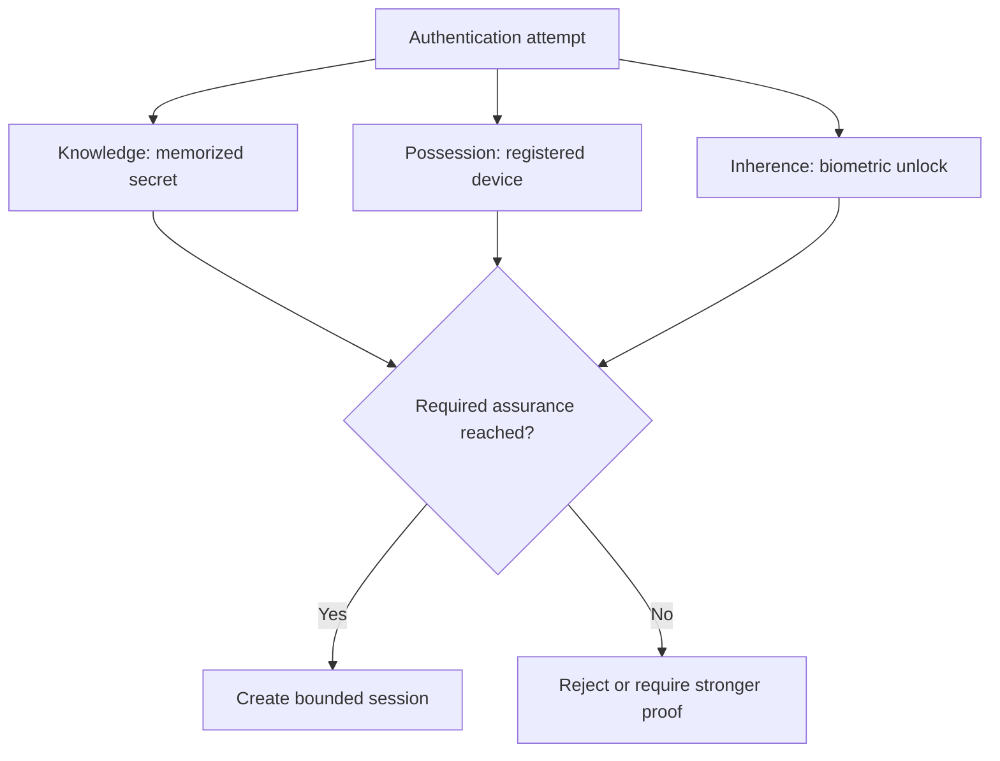
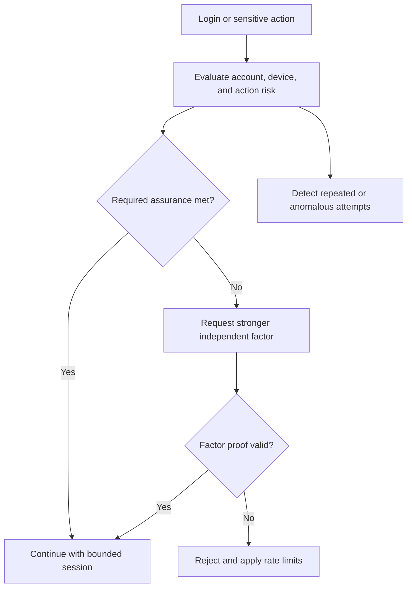
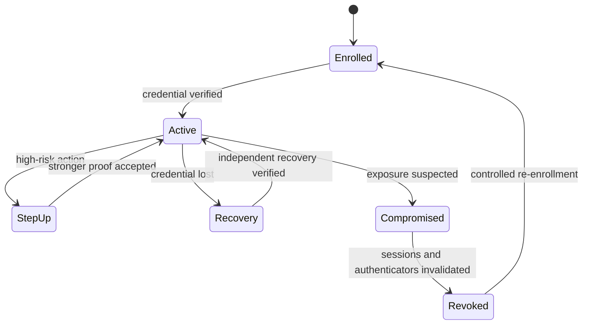
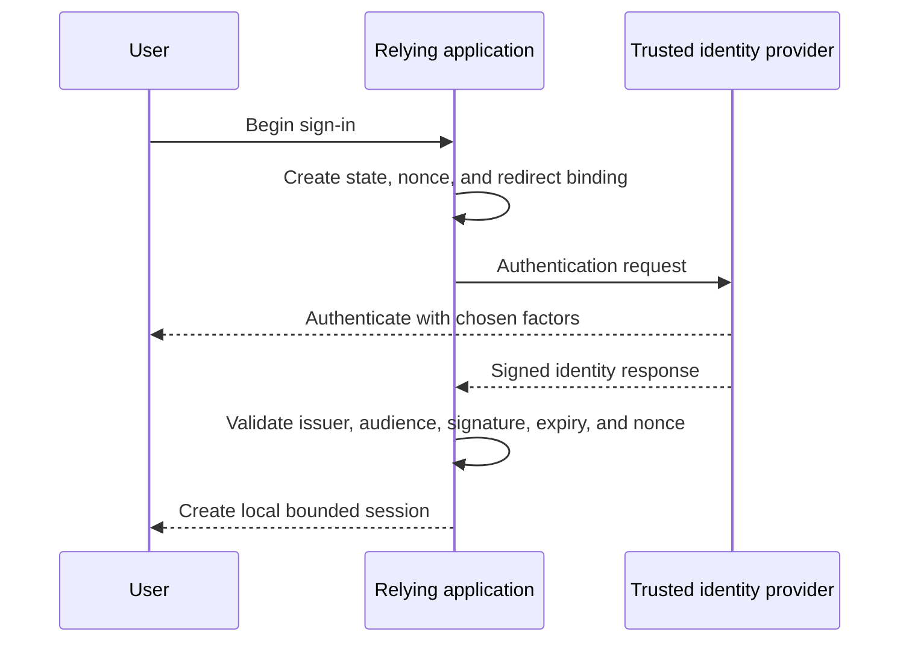

# Authentication

Part: [15 — Security](PART_OVERVIEW.md)

Authentication establishes confidence about a claimant's identity or control of an authenticator. It is not authorization: a successful login does not decide which objects or actions the identity may access. This chapter covers identity proof, credentials, multi-factor methods, sessions, recovery, and revocation. Part 05 owns OAuth, OpenID Connect, TLS, and certificate protocol mechanics; Part 09 owns provider identity products.

## Identity, Claimant, and Authenticator

An identity is a system's representation of a person, workload, or device. A claimant presents evidence through an authenticator, such as a memorized secret, cryptographic key, device possession, or biometric characteristic. The verifier checks that evidence and creates an authenticated session or token. Authentication confidence depends on enrollment, authenticator protection, recovery, and revocation, not only on the login screen.

Use unique, stable identifiers internally and keep them distinct from mutable attributes such as email address or display name. Federation should map a trusted issuer and subject identifier into a local identity with explicit account-linking rules. Never link accounts solely because two identities share an unverified email string.

## Factors and Assurance

Authentication factors are commonly grouped as knowledge, possession, and inherence. Two passwords are not two independent factors. Multi-factor authentication (MFA) combines independent evidence, but assurance varies: a phishable one-time code is weaker against real-time phishing than a device-bound cryptographic authenticator.

Choose factors based on threat, recovery, and usability. Prefer phishing-resistant methods for privileged and high-impact accounts where feasible. Biometrics generally unlock a local authenticator; they should not be treated as a reusable secret sent to a remote service. Risk-based step-up authentication can add friction for unusual or consequential actions, but must not silently weaken the base login path.

## Credential Lifecycle and Passwords

Credential security starts at enrollment and continues through use, reset, rotation, revocation, and account recovery. Use breached-password screening, rate limits, secure transport, and password hashing designed for credential storage. Store salted password hashes using a suitable password hashing function and cost parameters; do not encrypt passwords reversibly or use a fast general-purpose hash alone.

Avoid arbitrary frequent password rotation without evidence of compromise; it encourages predictable variants. Rotate after suspected exposure, use unique credentials, and support password managers. Reset tokens should be random, single-use, short-lived, bound to the account and purpose, and protected from referrer or log leakage.

## Federation and Session Boundaries

Federation delegates identity proof to an external identity provider. The relying application must validate issuer, audience, signature, expiration, nonce or state where applicable, and identity mapping. [Part 05 CH20 OIDC](../05_Networking_and_OS/CH20_OIDC.md) owns the OpenID Connect wire flow; this chapter focuses on trust configuration, local account mapping, and session lifecycle.

Sessions should be unpredictable, protected in transport and storage, bounded by idle and absolute lifetimes, and invalidated on logout, credential reset, and compromise. Cookies used for browser sessions should apply appropriate `Secure`, `HttpOnly`, and `SameSite` attributes. For API clients, token storage and refresh behavior must match the client type; avoid exposing long-lived secrets to untrusted code.

## Recovery, Revocation, and Operations

Account recovery is part of the authentication boundary and is often weaker than normal login. Require independent proof, notify the user, invalidate prior sessions when appropriate, and make support-assisted recovery auditable. Provide a process for lost devices, inaccessible recovery channels, employee departure, and suspected account takeover.

Revocation should cover authenticators, sessions, refresh tokens, API credentials, and federated trust. Short-lived tokens reduce the revocation window but do not eliminate it. Keep a rapid disable path for compromised identities and ensure service owners can determine which workloads depend on a credential before rotation.

Monitor failed and successful authentication rates, recovery requests, MFA challenges, unusual session issuance, and revocation latency. Avoid logging passwords, full tokens, recovery codes, or biometric data. Security telemetry should contain identifiers and outcomes sufficient for response without becoming a secret store.

## Worked Case and Review Checklist

A workforce application uses a federated identity provider for standard login and phishing-resistant MFA for privileged access. The application maps issuer plus immutable subject to a local account, creates a short-lived session, and separately evaluates permissions for each resource. A lost device triggers recovery through an independent verified channel, notification, and revocation of affected sessions. Support staff cannot bypass identity proof by changing an email field.

Review enrollment, factors, verifier protection, federation trust, identity mapping, session lifetime, secure cookie or token handling, recovery, revocation, telemetry, and user notification. Test account linking, duplicate identities, lost authenticators, compromised accounts, and identity-provider outage.

## Questions and Summary

1. Distinguish identity, authentication, session creation, and authorization.
2. Compare a phishable one-time code with a device-bound cryptographic authenticator.
3. Design recovery for a privileged employee who loses both primary and backup authenticators.
4. What claims must a relying application validate before creating a local session?
5. Draw credential enrollment, normal login, compromise, revocation, and re-enrollment.

Authentication is a lifecycle, not a single factor check. Trust depends on enrollment, authenticator strength, federation validation, session protection, recovery, and rapid revocation. Keep identity proof separate from permission decisions and make every recovery and exception path at least as deliberate as normal login.
