# Authorization

Part: [15 — Security](PART_OVERVIEW.md) · Status: Revised (in-depth rewrite)

## 1. Introduction

Authorization answers one question, repeatedly and for every operation: may this caller perform this action on this resource right now? Authentication, covered in [Authentication](CH02_Authentication.md), establishes who the caller claims to be and how well that claim was checked. It says nothing about what the caller may do. A system that authenticates carefully and authorizes loosely still lets any valid user read any other user's data. The most common serious web application flaw class, broken access control, is mostly a failure of the second question and not the first.

For an engineer moving into architecture the difficulty is not writing an `if` statement. It is deciding where decisions live, what inputs they use, how several policies combine into one answer, what happens when the decision service is down, and how anyone can later prove why a request was allowed. Those are structural choices. Once a few hundred endpoints and a dozen services depend on them, they are expensive to change.

After working through this chapter you should be able to:

- Express any access decision as a request with subject, action, resource, and context, and identify which of those inputs your system actually has at the point of decision.
- Place the policy decision point and policy enforcement point for a system, compare embedded, sidecar, and centralized topologies, and budget the latency of each with arithmetic.
- Predict the outcome of several overlapping policies using default deny, explicit deny, and a named combining algorithm.
- Explain the difference between coarse permission checks and object-level checks, and say which layer of a system can perform which.

### 1.1 Scope and ownership boundaries

This chapter owns provider-neutral authorization concepts: the request model, decision and enforcement architecture, policy evaluation and combination, least privilege, delegation, review, and failure behavior. Neighboring chapters own the items below. This chapter recaps them briefly and links to them.

| Topic | Owner | What this chapter does |
|---|---|---|
| Role-based access control (RBAC) model and role lifecycle | [RBAC](CH04_RBAC.md) | Uses roles as one input to a decision; does not teach role design |
| Attribute-based access control (ABAC) model and attribute governance | [ABAC](CH05_ABAC.md) | Uses attributes as context; does not teach attribute provenance |
| Delegated authorization protocol steps | [OAuth](CH06_OAuth.md) | Treats a token scope as one input to a decision |
| Continuous verification across users, devices, and workloads | [Zero Trust](CH08_Zero_Trust.md) | Supplies the decision mechanics Zero Trust relies on |
| API object, function, and property authorization patterns | [API Security](../08_API_Architecture/CH09_API_Security.md) | Gives the general model; the API chapter applies it to endpoints |
| Cloud provider policy syntax and evaluation products | [Cloud Identity and Access Management](../09_Cloud_Computing/CH09_IAM.md) | Names provider behavior only where it clarifies a general rule |
| The threat-model document artifact | [Threat Models](../21_Architecture_Documentation/CH09_Threat_Models.md) | Defines authorization methods; the artifact belongs to Part 21 |
| Kubernetes RBAC implementation | Part 12 | Out of scope |

Provider facts drift. Where this chapter names a product behavior, it describes the mechanism and says where to verify the current detail.

## 2. The authorization request model

### 2.1 Four inputs

Every access decision, whatever the technology, can be written as a function of four inputs.

- **Subject.** The authenticated party making the request. This may be a person, a service, a batch job, or a person on whose behalf a service acts. The subject is a verified identity plus whatever the authentication step attached to it: group memberships, roles, a tenant identifier, token scopes, how strongly the user authenticated.
- **Action.** The operation requested, such as `read`, `approve`, `delete`, or `export`. Good action vocabularies are small and business-meaningful. `invoice:approve` tells a reviewer more than `POST /v2/invoices/{id}/state`.
- **Resource.** The specific thing acted on: one document, one account, one queue. A decision about "documents" in general is a decision about a type, not a resource, and cannot answer whether this user may see this document.
- **Context.** Everything else the decision may legitimately read: the current time, the network the request came from, the state of the resource (draft, published, locked), the device posture, the strength of authentication, a risk score, and whether the caller is acting on behalf of someone else.

The output is a decision: permit or deny, optionally with obligations (for example, "permit, but mask the account number field") and a reason that can be logged.

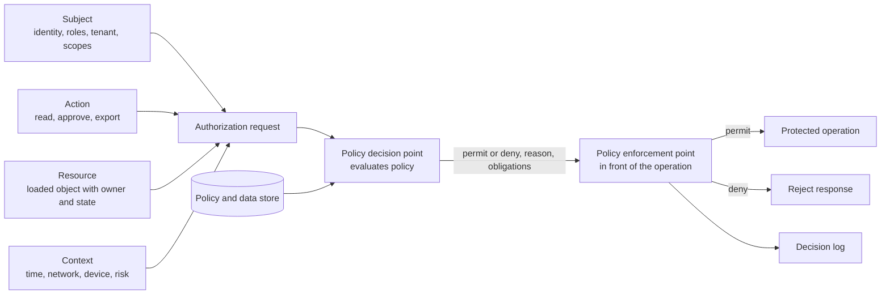

The diagram separates two jobs that code often mixes. The policy decision point (PDP) computes an answer from inputs and policy. The policy enforcement point (PEP) is the code that stands in front of the operation, gathers inputs, asks the PDP, and obeys the answer. This split comes from the eXtensible Access Control Markup Language (XACML) architecture, and it is useful even if you never use XACML. It gives you one place to test policy logic and a different place to prove that every path to the operation actually asks. A policy that is correct but not consulted on a path protects nothing. That is why most real failures are enforcement gaps rather than wrong rules.

### 2.2 Where each input comes from

Architects often assume all four inputs are available everywhere. They are not, and the gaps determine which layer can make which decision.

| Input | Typical source | Who has it |
|---|---|---|
| Subject | Validated token or session | Gateway and every service that validates the token |
| Action | Route and method, message type | Gateway for coarse actions, service for business actions |
| Resource | Database row or object store entry | Only the service that owns the data |
| Context | Request metadata, device and risk services, resource state | Mixed: network facts at the edge, state facts in the owner |

The resource column is the one that matters most. A gateway sees `GET /documents/8841` and a valid token. It does not know that document 8841 belongs to tenant `acme` and the caller belongs to tenant `globex`. Only the service that loads the row can compare them. This is why a gateway can reject unauthenticated or obviously out-of-scope calls but cannot be the only check. The section on enforcement layers returns to this.

### 2.3 Worked example: one request, four inputs

A user of a multi-tenant document service sends this request:

```http
GET /documents/8841 HTTP/1.1
Host: docs.example.com
Authorization: Bearer eyJhbGciOi...
```

After token validation the service holds the subject: user `u-204`, tenant `globex`, role `editor`, scope `documents.read`. It maps the route to action `document:read`. It loads document 8841 from the database and finds owner tenant `acme`, state `published`, and a sharing list that contains no `globex` entries. Context is the request's source address and the time.

A policy written as "editors may read documents" would permit this request if it looked only at subject and action. A policy that also reads the resource denies it, because the tenant attribute of the subject does not match the tenant attribute of the resource and no sharing grant exists. The difference is that the second policy had the resource as an input. A service that checks authorization before loading the resource is structurally unable to write that second policy.

The service should then return `404 Not Found` rather than `403 Forbidden` for another tenant's document if the existence of the document is itself sensitive. Both responses refuse the request. The 403 additionally tells an attacker that identifier 8841 exists, which lets them enumerate identifiers across tenants. Whether to disclose existence is a policy decision and should be recorded as one.

### 2.4 Why authorization is separate from authentication

Authentication proves a claim at one moment, typically at login or token issuance. Authorization is evaluated on every operation, because permissions change after login: a role is removed, an account is suspended, a document is shared or unshared, a risk score rises. A token that was correct when issued can describe stale permissions an hour later.

This has two design consequences. First, put stable facts in tokens (who the caller is, which tenant) and volatile facts in the decision (what they may do now). A token that carries a long list of permissions fixes those permissions for its lifetime. Second, if you do put authorization data in a token, you have accepted a revocation delay equal to the token lifetime, and you must decide whether that delay is acceptable for the actions the token unlocks. The later section on delegation and revocation returns to this trade-off.

## 3. Decision and enforcement architecture

### 3.1 Three PDP topologies

The PDP can sit in three places relative to the code that enforces its answer. Each puts policy evaluation on a different side of a process or network boundary, and the choice sets latency, consistency, and failure behavior.

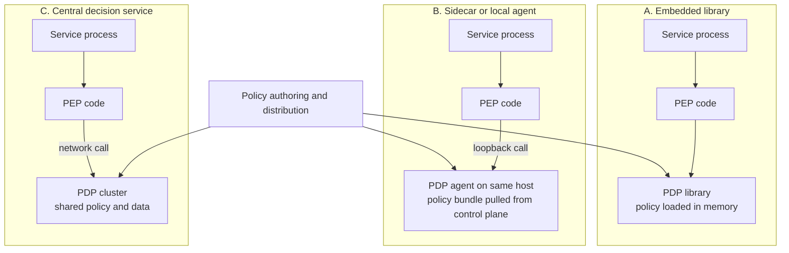

Embedded evaluation has the lowest latency, because a decision is a function call, and it keeps working when the network is down. Its costs are that every service language needs a library, policy updates require reloading each process, and a stale process keeps enforcing old policy until it reloads. A sidecar or local agent keeps one policy engine implementation regardless of service language and still avoids a cross-host call. Open Policy Agent (OPA) is commonly run this way: the service posts a JavaScript Object Notation (JSON) `input` document to a local endpoint and receives a `result`. A central service gives one place to change and audit policy and can hold shared data such as relationship graphs, but every decision now depends on the network and on the service's availability.

| Criterion | Embedded | Sidecar or local agent | Central service |
|---|---|---|---|
| Decision latency | Microseconds to well under a millisecond, in process | Typically around a millisecond over loopback | Network round trip plus evaluation |
| Behavior if control plane is unreachable | Uses last loaded policy | Uses last loaded bundle | Decisions fail unless a fallback exists |
| Policy propagation delay | Reload or redeploy per process | Bundle poll or push interval | Immediate on update |
| Language coupling | One library per language | None | None |
| Data held for decisions | Whatever the process can load | Bundle size limited by host memory | Large shared graphs possible |
| Operational burden | Library upgrades across services | Agent lifecycle on every host | A highly available decision tier |

None of the three is correct in general. Choose by asking which failure you can tolerate. If a stale permit for a few minutes after revocation is unacceptable and the decision data is large and relationship-based, a central service with its own consistency model fits. If the service must keep serving when the control plane is down and decisions are mostly rules over attributes it already holds, embedded or sidecar fits. Many systems combine them: a local agent for rule evaluation and a central relationship store queried for the few decisions that need it.

### 3.2 Latency budget: why the topology matters

The arithmetic below is illustrative. The latency figures are assumptions for the example and not measurements of any product; measure your own.

A list endpoint returns up to 50 documents and must check read access on each. Assume a central PDP with a 3 ms network round trip and 1 ms of evaluation, so 4 ms per call at the median.

- Naive per-object calls in sequence: 50 × 4 ms = 200 ms added to the request.
- Per-object calls issued 10 at a time in parallel: 5 batches × 4 ms = 20 ms, at the cost of 50 PDP calls per request.
- One batch call carrying all 50 resources: 3 ms network + 50 × 0.2 ms evaluation = 13 ms, assuming 0.2 ms to evaluate each item.
- Embedded evaluation at 0.05 ms per object: 50 × 0.05 ms = 2.5 ms, with no network.

At 400 requests per second to this endpoint, the naive design issues 400 × 50 = 20,000 decision calls per second, which is a capacity problem for the decision tier before it is a latency problem. The batch design issues 400. The lesson is that the shape of the decision API matters as much as the topology: an interface that can only answer one question at a time forces the slow pattern onto every caller. A better pattern for lists is often to push the policy into the query itself, for example by translating tenant and sharing rules into a `WHERE` clause, so unauthorized rows are never loaded. The risk is that the query filter becomes a second copy of the policy, and any rule it omits, such as a sharing grant or a state check, silently diverges from the PDP.

### 3.3 The decision protocol

The sequence below shows one decision from the PEP's side, including the parts teams often leave out: resource loading before the decision, the decision log, and the denial path.

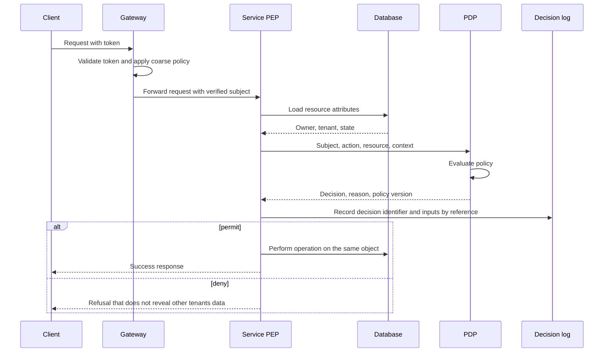

Three details deserve attention. The service loads the resource before it asks, because policy that depends on owner or state cannot be evaluated without it. The operation acts on the object that was checked: if the code checks document 8841 and then re-fetches by a client-supplied identifier, a concurrent change or a second parameter can substitute a different object between check and use. The decision log stores identifiers and the policy version, and does not copy document contents or secrets into the log. A log that holds sensitive payloads becomes a second data store to protect.

### 3.4 Enforcement layers: what the gateway can and cannot do

A gateway sits at the edge and sees every request, so teams are tempted to enforce all authorization there. It can enforce a useful subset: the token is valid, the audience matches, the scope covers the route, the caller is not on a block list, the rate limit holds. Those are checks that need no resource data.

It cannot enforce object-level rules, because it does not hold the resource. Object-level checks therefore belong in the service that owns the data. The two layers are complementary, and a missing check in the lower layer is the usual source of the broken object-level authorization class described in [API Security](../08_API_Architecture/CH09_API_Security.md).

Every route into the resource needs the same enforcement, not only the main API. A background export job that reads the same table, a websocket subscription, an administrative console, and an internal service-to-service call are all paths. If the main API checks tenant ownership and the export job does not, the export job is the vulnerability. A practical test is to enumerate every caller of the data access layer and confirm each one passes through a PEP, or inherits the check by calling a layer that does. Placing the check as close to the data as practical, for example in a repository or data-access component that requires a verified subject argument, makes it harder to bypass by adding a new endpoint.

Client-side checks such as hiding a button, disabling a menu item, or an Angular route guard improve usability but give no security. The client is under the control of the caller, and any request the user interface would not send can still be sent by hand.

## 4. Policy evaluation semantics

### 4.1 Default deny, explicit deny, and combining algorithms

A request usually matches more than one rule: a role grants access, a resource owner added a sharing entry, a compliance rule forbids export during a legal hold. The evaluator needs a defined way to turn several partial answers into one. Three conventions cover most systems.

1. **Default deny.** If no rule applies, the answer is deny. This is the safe baseline, because a forgotten case fails closed. Systems with default permit turn every omission into an exposure.
2. **Explicit deny wins.** A rule that says deny overrides any number of permits. This lets a central team state a prohibition once, for example "no export of records under legal hold", without auditing every grant.
3. **A combining algorithm for the rest.** XACML names four: deny-overrides, permit-overrides, first-applicable, and only-one-applicable. Deny-overrides is the common secure choice. Permit-overrides is risky because one stray permit defeats every prohibition. First-applicable makes the result depend on rule order, which is easy to get wrong during edits and hard to review.

The Cedar policy language, used by AWS Verified Permissions, builds the first two into the language: evaluation defaults to deny, and a matching `forbid` policy overrides any `permit`. A small example shows both.

```text
permit (
  principal in Group::"editors",
  action == Action::"read",
  resource
) when { resource.tenant == principal.tenant };

forbid (
  principal,
  action == Action::"delete",
  resource
) when { resource.state == "legal_hold" };
```

An editor in tenant `acme` reading an `acme` document is permitted by the first policy. The same editor deleting a document in `legal_hold` gets deny from the second even if some other policy permitted delete. An editor reading a `globex` document matches no permit and is denied by default. Read the file against Cedar's own documentation before copying syntax, since the language evolves.

### 4.2 Grants, ceilings, and denies

Policy rules fall into three roles, and confusing them is the main cause of surprising results.

- **Grants** add permissions. Their effective result is the union of all applicable grants: a user who is an editor and also a member of a project group holds the permissions of both.
- **Ceilings** add nothing and limit what grants can reach. Their effect is an intersection: an action must be inside every ceiling and also covered by a grant. Organization guardrails and permissions boundaries in cloud IAM (Identity and Access Management) work this way. The provider mechanics are in [Cloud Identity and Access Management](../09_Cloud_Computing/CH09_IAM.md).
- **Explicit denies** subtract, regardless of grants.

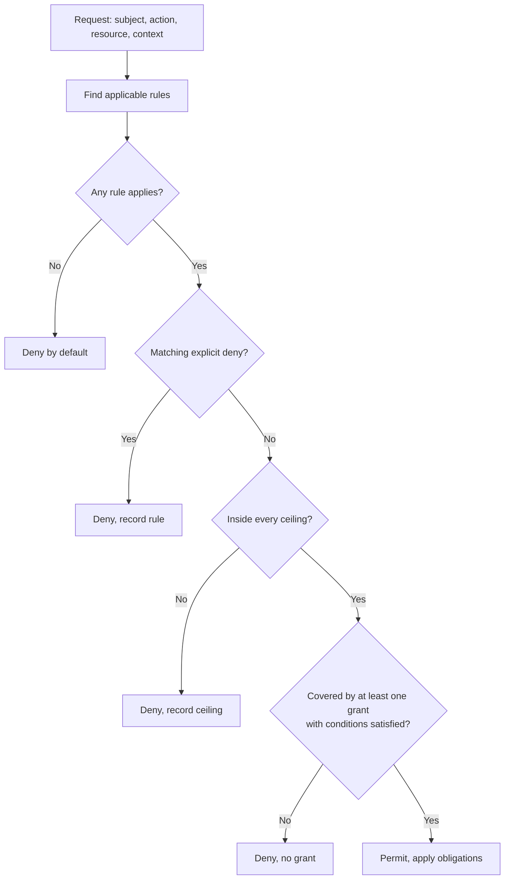

This evaluation order matters because it tells you where to look when a request is unexpectedly allowed or refused. An unexpected allow means a grant is broader than intended, or a ceiling or deny that should have applied did not match. An unexpected refusal means a deny or a ceiling matched, or the grant is missing a condition input. Policy tooling should report which rule decided the outcome, since "denied" with no reason sends engineers to guess.

### 4.3 Worked example: effective permissions as set arithmetic

The example is illustrative and uses invented action names. A contractor, Dana, holds permissions through two groups.

- Group `doc-editors` grants {`read`, `write`, `delete`}.
- Group `report-users` grants {`read`, `export`}.
- A tenant-wide ceiling limits all non-administrators to {`read`, `write`, `export`}, because deletion is reserved for administrators.
- A deny rule forbids `export` to anyone whose account type is `contractor`.

Step 1, union of grants: {read, write, delete} ∪ {read, export} = {read, write, delete, export}.

Step 2, intersect with the ceiling: {read, write, delete, export} ∩ {read, write, export} = {read, write, export}. Deletion is removed even though a group granted it.

Step 3, subtract the explicit deny: {read, write, export} − {export} = {read, write}.

Dana's effective permissions are `read` and `write`. Reasoning in this order shows why removing Dana from `report-users` would change nothing she can do (export is denied anyway) while removing the contractor deny would restore export. It also shows an audit hazard: reading only the group grants overstates her access by two actions. An access review that lists group membership without applying ceilings and denies produces wrong answers in both directions, and tools that compute effective permissions are worth having for that reason.

Conditions add a second dimension. Each grant may carry conditions on context, such as "only from managed devices" or "only while the resource state is `draft`". A grant whose condition cannot be evaluated because an attribute is missing should count as not satisfied. Treating a missing attribute as true is a common bug that turns a conditional grant into an unconditional one.

### 4.4 Evaluation failure modes

- **Unreachable or erroring PDP.** The PEP must map an error to deny for sensitive actions. Code that catches an exception and continues is fail-open by accident.
- **Policy conflicts hidden by order.** First-applicable evaluation lets an early broad permit hide a later specific deny. Prefer deny-overrides, and test with a case that should be refused.
- **Wildcards.** A grant on `documents:*` over `*` resources includes actions added in later releases. Enumerate actions for sensitive grants.
- **Stale inputs.** A decision made with a cached group list or an old policy version reflects the past. Record the policy version in the decision log so a reviewer can tell which rules decided.
- **Confused deputy.** A service with broad authority performs an action for a caller without checking that the caller may request it. The service's own permissions are not the caller's. The later section on delegation covers carrying the original caller through.

## 5. Least privilege and privilege escalation

### 5.1 What least privilege means in practice

Least privilege is the rule that a subject holds only the actions, on only the resources, for only the time its task needs. Stated that way it is easy to agree with and hard to measure, so it helps to name three dimensions and ask about each.

- **Breadth of action.** Does the grant name the specific actions needed, or a family such as `storage:*`? A wildcard also covers actions added after the grant was written.
- **Breadth of resource.** Does the grant name one bucket, one project, one tenant, or every resource of a type?
- **Duration.** Is the grant permanent, or does it expire when the task ends?

A grant can be narrow on two dimensions and broad on the third. A deployment role limited to one service but held permanently by twenty people is broader in practice than a wider role held by two people for an hour. Reviews that check only the action list miss this.

Least privilege is also constrained by operations. If the narrowest possible policy is so fragile that every deployment fails until someone adds a permission, teams respond by granting administrator rights "temporarily" and never removing them. A workable approach starts from observed use. Run the workload with a deliberately broad role in a non-production environment, collect the access log of calls actually made, generate a draft policy from it, and then review the draft by hand. Cloud providers offer tooling that does the log-to-policy step, for example access analyzers and role recommenders. Treat the output as a draft. It reflects only the code paths exercised during the observation window, so a rarely used failure-handling path may be missing.

### 5.2 Privilege escalation: the attacker's view

An attacker who obtains a low-privilege identity rarely needs a vulnerability in the target service. The attacker looks for a permission that lets the identity grant itself or borrow more. These are escalation paths, and they hide in permissions that look administrative-adjacent but harmless.

| Escalation primitive | What it allows | Where it appears |
|---|---|---|
| Edit a policy attached to oneself or to a group one belongs to | Writes own permissions | Amazon Web Services (AWS) IAM actions that create policy versions or attach policies |
| Create or edit a role assignment | Grants any role at that scope or below | Azure role assignment write permission; Google Cloud `setIamPolicy` on a resource |
| Pass or act as a more powerful service identity | Runs code with the other identity's authority | AWS `iam:PassRole` combined with a compute-creation permission; Google Cloud `iam.serviceAccounts.actAs` |
| Modify code that a privileged identity executes | Runs attacker code with privileged credentials | Writing to a deployment pipeline, a function, an automation runbook, or an image a privileged job pulls |
| Read secrets held by a privileged identity | Obtains its credentials | Secret stores, configuration files, instance metadata |

The third and fourth rows are the ones architects overlook. If identity A may create a virtual machine and attach role R to it, then A holds R's permissions indirectly, because A can run any command on that machine. The effective power of A is the union of everything A can reach through such chains, not the list of actions in A's own policy. The same reasoning applies to a continuous-integration pipeline. A developer who can change the pipeline definition holds the authority of the pipeline's deployment identity, whatever the developer's own role says.

For this reason the review question for any grant is two questions: what can this identity do directly, and which other identities can it cause to act? Permissions that write policy, assign roles, attach identities to compute, or modify privileged automation deserve the same scrutiny as administrator rights. Provider syntax for guarding them, such as permissions boundaries that cap what a created role may hold, sits in [Cloud Identity and Access Management](../09_Cloud_Computing/CH09_IAM.md).

### 5.3 Reducing standing privilege

The strongest control against escalation is to hold fewer privileges for less time. Three mechanisms combine.

1. **Just-in-time (JIT) elevation.** The administrative role is not held by default. A person requests it for a stated reason and period, an approver or an automatic rule grants it, and it lapses. Azure Privileged Identity Management is a provider implementation of this pattern, and the other providers offer comparable features or can be built from time-bound role assignments. Verify current capabilities in provider documentation.
2. **Break-glass accounts.** A small number of emergency identities exist for the case where the normal path, such as the identity provider, is unavailable. They are held in sealed storage, monitored for any use, and tested on a schedule. They are an exception with an alarm attached. They are not a convenience path.
3. **Short-lived credentials.** A credential that expires in minutes limits what theft yields. The authentication side of this is in [Authentication](CH02_Authentication.md).

The cost of just-in-time elevation is friction during incidents. Measure it: if the approval step adds 10 minutes to every production fix and incidents occur twice a week, an on-call engineer loses 20 minutes a week, and a pre-approved emergency path for a named on-call role is probably the right trade. If elevation is so painful that people stop using it and share a permanent administrator account, the control has made things worse.

## 6. Inheritance, scope, and hierarchy

### 6.1 How permissions flow down a hierarchy

Resources are organized in trees: an organization contains folders or management groups, which contain accounts, subscriptions, or projects, which contain resource groups and individual resources. A grant at one node normally applies to everything below it. This is convenient, since one assignment covers a hundred projects, and it is also the source of the most common accidental over-grant.

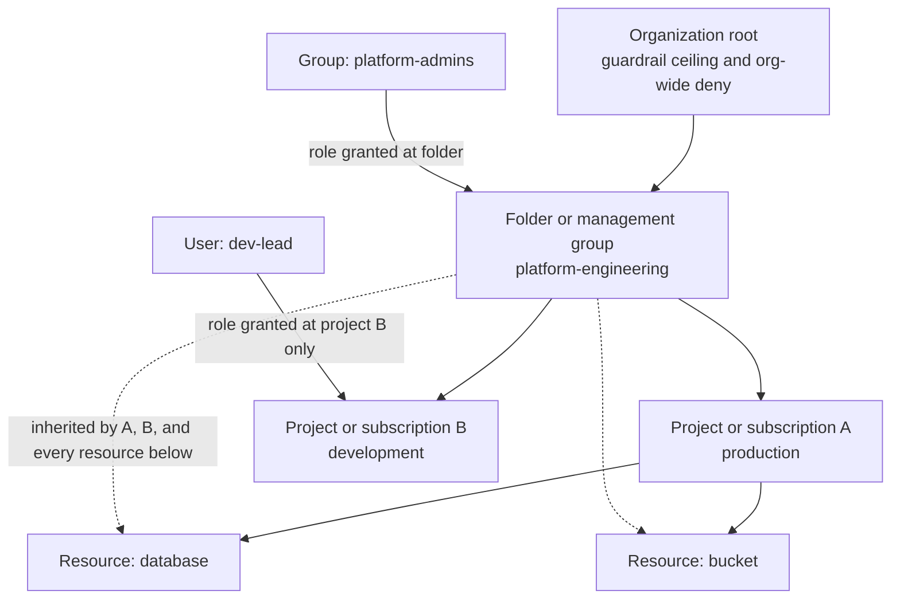

The diagram shows two grants. The group grant at the folder reaches every project and resource beneath it, including production. The user grant at project B reaches only that subtree. The implication for design is that the placement of a grant matters as much as its content. A role that is acceptable on a development project may be unacceptable at the folder that also contains production. When in doubt, grant at the lowest node that covers the need and accept more assignments in return for a smaller blast radius.

### 6.2 Provider behavior that differs

The general model holds on all three providers, but the details change what you can express. The summary below describes mechanisms at the time of writing; confirm current behavior in the official documentation for each.

| Aspect | AWS | Azure | Google Cloud |
|---|---|---|---|
| Hierarchy | Organization, organizational units, accounts | Management groups, subscriptions, resource groups, resources | Organization, folders, projects, resources |
| Do identity grants inherit down? | No. Identity policies attach to a principal in an account. Organizations apply ceilings, not grants, down the tree | Yes. Role assignments inherit to child scopes | Yes. Allow policies inherit to child resources |
| Ceiling mechanism | Service control policies (SCPs) and permissions boundaries limit what grants can reach | Policy assignments govern resource configuration; role limits come from the role definition and any deny assignments | Organization policy constraints govern configuration; deny policies and principal access boundaries restrict principals |
| Explicit deny | An explicit deny in any applicable policy overrides allows | Deny assignments exist, and at the time of writing they are created by Azure services such as managed applications, not directly by most customers | Deny policies are evaluated before allow policies |

Two consequences follow. In AWS, the hierarchy limits and does not grant, so the question "who can do X in account 123" requires combining the account's identity policies with the ceilings above it. In Azure and Google Cloud, a single role assignment at a high node grants everywhere below it, so the question "who can do X on this database" requires walking up the tree to collect every inherited assignment. Tools that show effective access exist on each provider for this reason, and the question belongs in every access review.

Resource-based policies add another path. A bucket policy or a key policy can name principals directly. Within one AWS account such a policy and the principal's identity policy can each independently permit an action, so the union applies. Across accounts both sides must allow. The practical risk is a resource policy that names a wide principal, for example every principal in an organization, and is therefore invisible when reviewing only the identity policies.

### 6.3 Inheritance and tenancy inside an application

Applications build their own hierarchies: tenant, workspace, folder, document. Inheritance rules inside the application need the same explicit definition as in a cloud. Decide three things and write them down. Does a grant on a folder reach documents added later? Does moving a document change who can see it, and does the move need the mover to hold permission on both parents? Can a child resource break inheritance and be shared more narrowly or more widely than its parent? The movement case causes real defects: a document moved from a restricted folder to an open folder becomes visible to the audience of the open folder unless the move operation checks for this. Treat "move" as both a delete from the source scope and a create in the destination scope, and authorize both.

## 7. Separation of duties and effective permission analysis

### 7.1 Separation of duties

Separation of duties (SoD) is the rule that no single actor can complete a sensitive process alone, because a single actor can then commit and conceal fraud or error. The standard example is payment: one person creates a payee, a different person approves the first payment to that payee, and the system rejects approval by the creator. Authorization enforces it in two ways.

- **Static separation.** Two permissions are declared mutually exclusive, and no identity may hold both. The check runs when roles are assigned. It is easy to audit but blunt: a small team may not have enough people to cover every role pair.
- **Dynamic separation.** An identity may hold both permissions, but not on the same instance. The check runs at decision time and reads the resource's history. "Approver must differ from creator" is a dynamic rule, and it needs the resource's creator as an input to the decision.

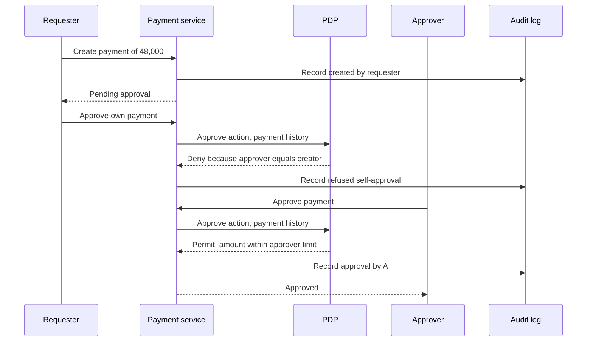

The sequence shows that separation is a property of the decision input. A role named `approver` cannot enforce it, because the role says nothing about who created this payment. The PDP needs the creator identity on the resource and, for thresholds, the amount. Two further rules usually accompany it: an approval limit per approver (for example up to a stated amount), and a rule that the approver of a change may not be the person who later alters the approved record. Without the second rule, an approved payment can be edited after approval.

Dynamic rules fail in a few predictable ways. Two colluding people defeat any two-person rule, so SoD lowers risk and does not remove it; detective controls and audit still matter. A shared account breaks the identity assumption entirely. And a service account that performs both steps on behalf of different users can bypass the rule unless it passes through the original actor, which the section on delegation covers.

### 7.2 Effective permission analysis

Earlier in this chapter a worked example computed effective permissions by hand: union of grants, intersection with ceilings, subtraction of denies. At production scale this computation must be automated, because the inputs span groups, inherited assignments, resource policies, ceilings, and conditions. The aim of effective permission analysis is to answer two questions in both directions.

- **Forward.** What can identity X do, on which resources, and by which grant path?
- **Reverse.** Who can perform action A on resource R, including through inheritance and indirect paths such as acting as another identity?

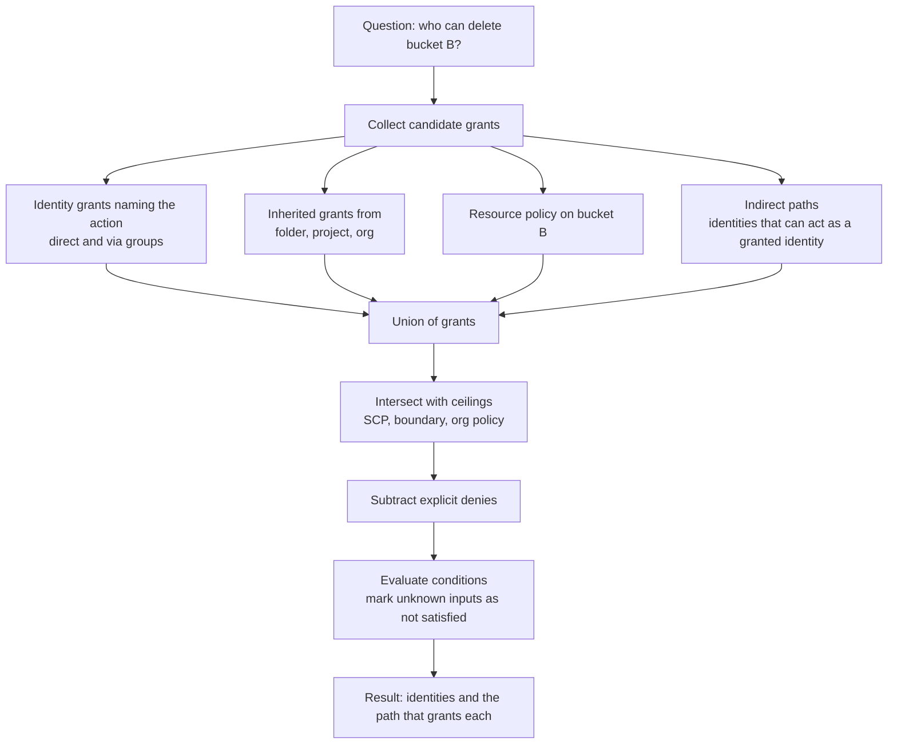

The output should name the path, not just the identity, because the remedy differs: a wrongly broad group, an over-high inheritance, a wide resource policy, and an indirect acting path each need a different fix. Reverse analysis is the one that finds exposure, for instance a storage resource readable by every authenticated user or by an external account. Provider tools provide parts of this, such as access analyzers that reason about resource policies, and policy simulators that test a given principal and action. They do not all cover indirect paths, so assume gaps and test the paths you care most about by attempting the operation in a test account.

Run the analysis continuously and not only before audits. A grant that was correct in January can be unsafe in March after a resource moves or a group gains a member. Alert on the change that created the exposure, not on the exposure alone, so the owner learns what to undo.

## 8. Caching authorization decisions

### 8.1 Why cache, and what a cached answer is

Section 3 showed that a decision can cost a network call or more, and a busy service may make thousands of decisions per second. Caching reuses an earlier answer. A cached decision is a claim that the inputs have not changed in a way that matters since it was computed. Every cache design is therefore a decision about how long that claim may be wrong and how the system learns that it is.

Cache one of three things, in increasing order of risk.

1. **Inputs.** Cache the subject's group list or the resource's owner and rebuild the decision each time. The decision logic stays current, and only the data may be stale.
2. **Policy.** Cache the compiled policy or bundle. This is what sidecars and embedded engines do, and staleness equals the bundle refresh interval.
3. **Decisions.** Cache the final permit or deny for a tuple of inputs. This is the fastest and the easiest to get wrong, because one missing input in the key returns the answer meant for someone else.

### 8.2 Cache keys and the cross-user leak

A decision cache key must contain every input that can change the answer. At minimum that is the subject identifier, the action, the resource identifier, and the policy version. Add tenant if resource identifiers are not globally unique, and add any context value the policy reads, such as device posture class or authentication strength.

The classic defect is a key built from the resource and action alone, or from a role and not a user. Suppose the key is `read:doc-8841`. User A, who may read it, populates the cache with permit. User B, who may not, sends the same request and receives the cached permit. The defect is invisible in tests that use one user. A test suite for any decision cache needs at least two subjects with different rights hitting the same resource in sequence, and it should check the denied one second.

Keying on a role has a milder form of the same issue: two users with the same role but different tenants share an entry. If a policy reads an attribute, the attribute or a stable class of it must appear in the key.

Cache denies with more care than permits, and with a shorter lifetime. A cached deny that outlives a grant frustrates a user and is easy to detect. A cached permit that outlives a revocation is the exposure.

### 8.3 Lifetime, invalidation, and the revocation window

Two mechanisms limit staleness, and they are used together.

- **Time to live (TTL).** An entry expires after a fixed interval. This bounds the worst case without any signal from the source of truth.
- **Event-driven invalidation.** The system that changes a permission publishes an event, such as role removed, resource transferred, account disabled, or policy published, and caches drop affected entries. This shortens the typical case but can be lost, so it never replaces the TTL.

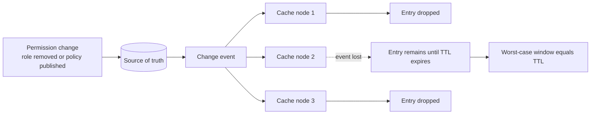

The diagram shows why the TTL must be chosen as the worst-case exposure, not as a performance setting. If one node misses the event, the revoked permission survives for the full TTL on that node. The TTL is the number you would tell an incident responder when they ask how long after removal access could continue.

### 8.4 Worked example: choosing a TTL

The numbers are illustrative. A service handles 600 requests per second, and 95 percent of them repeat a subject, action, and resource tuple seen within the last minute. A decision call to the central PDP takes 4 ms and the PDP tier is sized for 200 calls per second.

- Without a cache: 600 decisions per second against a tier sized for 200. The tier is oversubscribed by 600 / 200 = 3 times.
- With a decision cache and a hit rate of 95 percent: misses are 600 × 0.05 = 30 per second, which is 15 percent of the tier's capacity.
- Average added latency per request: 0.95 × about 0 ms (an in-memory lookup, assume 0.05 ms) + 0.05 × 4 ms = 0.0475 + 0.2 = about 0.25 ms, against 4 ms without the cache.

The cache is clearly needed. The TTL then trades hit rate against exposure. With a 5-second TTL the hit rate might fall, because a tuple repeated every 20 seconds would always miss. With a 5-minute TTL the hit rate rises but a revocation can persist for up to 300 seconds on a node that missed the event. Match the TTL to the action. For low-impact reads, 60 seconds may be acceptable. For payment approval or credential changes, do not cache decisions at all and evaluate against authoritative state every time, because the call is rare enough that the 4 ms is negligible. A per-action TTL, including zero, is the usual outcome.

### 8.5 Tokens are caches too

A bearer token that embeds roles or scopes is a cache of the authorization state at issue time, held by the client, and it cannot be invalidated by the server's event bus. A one-hour token that carries a role means that for up to an hour after the role is removed, any service that trusts the token's claim alone will still permit. Options are to shorten the token lifetime, to carry only stable identity and look up volatile permissions at decision time, or to check a revocation signal for sensitive actions. The protocol side of token revocation and introspection is covered in [OAuth](CH06_OAuth.md). Here the point is that the revocation window of the whole system is the largest of every cache in the path: token lifetime, gateway cache, service cache, and policy bundle interval. List them all when you state how fast a permission removal takes effect.

## 9. Delegation and the confused deputy

### 9.1 Why delegation is needed

Services call other services on behalf of users. A reporting service reads orders for the user who requested a report. A mobile backend calls a profile service. A third-party application acts for a user against an API. In each case the downstream service must decide using two facts: who is the caller, and whose authority is being exercised. If it sees only the immediate caller, it faces a bad choice. Either it trusts the caller completely, which gives the calling service the combined power of all its users, or it refuses to serve it, which breaks the feature.

The failure that results from the first choice is the confused deputy. A deputy is a service with legitimate authority of its own. It is confused when an attacker or an ordinary user induces it to apply that authority to a request the user had no right to make. A report service holds read access to all orders so it can build reports. A user supplies another customer's identifier. The service reads the data with its own broad credential and returns it. The downstream order store saw a valid, authorized caller and answered correctly according to the information it had. The defect is that the deputy never asked whether the end user may see that customer.

### 9.2 Three patterns for carrying the caller

| Pattern | How the downstream decision is made | Strength | Weakness |
|---|---|---|---|
| Service identity only | Downstream authorizes the calling service and trusts it to have checked the user | Simple, no user token handling | Confused deputy risk; downstream cannot audit the user |
| Forward the user token | Downstream validates the user's own token and authorizes the user | Preserves user identity and limits | Token travels widely; audience and scope of the original token may be too broad; replay if intercepted |
| Exchange for a narrower token | Caller presents the user token to an authorization server and receives a new token scoped to the downstream audience, recording the acting service | Narrow audience, shorter lifetime, both identities visible | Needs an issuer that supports exchange; extra call and failure point |

The third pattern follows the OAuth (Open Authorization) 2.0 Token Exchange specification, [RFC 8693](https://www.rfc-editor.org/rfc/rfc8693), which defines a way to trade one token for another with a different audience and scope and an `act` claim identifying the acting party. Microsoft identity platform offers an on-behalf-of flow with a similar goal. The protocol details belong to [OAuth](CH06_OAuth.md). The authorization principle that applies regardless of protocol is that the downstream decision should use the intersection of the user's rights and the service's rights for this operation. An exchanged token should not exceed either.

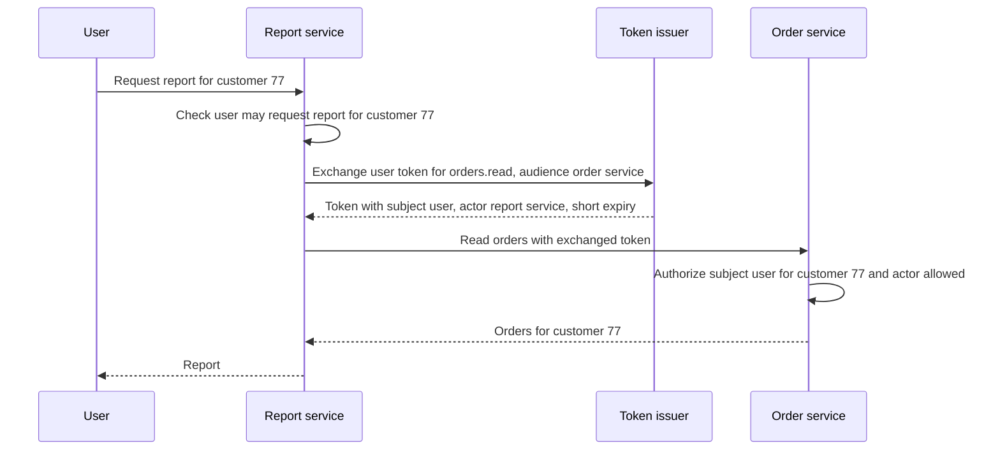

Two checks appear in the sequence and both are needed. The report service performs its own check before it calls anyone, because it is the first enforcement point. The order service checks again against the exchanged token, because it must not rely on the caller having been correct. The audit entry at the order service can then record both the subject and the actor, so a later review can tell that user U read customer 77 through the report service.

### 9.3 Provider mechanisms for acting as another identity

Providers expose delegation as role or service-account impersonation. The mechanism is the same: an identity with permission to impersonate obtains temporary credentials for another identity, and the second identity's permissions apply for the session.

- **AWS.** A principal calls Security Token Service (STS) `AssumeRole` and receives temporary credentials for the target role. The role's trust policy names who may assume it. A session policy passed at assumption time can further narrow the permissions for that session. For third parties assuming a role in your account, an external identifier in the trust policy defends against the confused deputy at the vendor: it makes the vendor present a value that only your account's setup knows. Check AWS documentation for current condition keys.
- **Azure.** Managed identities give a workload an identity without stored secrets. The on-behalf-of flow lets a middle-tier API exchange an incoming user token for a downstream token.
- **Google Cloud.** Service account impersonation lets a principal with the right permission mint short-lived credentials for a service account, so there is no long-lived key to leak. The permission to impersonate, as noted earlier, is itself an escalation primitive and should be granted narrowly.

In every provider, treat the right to impersonate as equal to holding the impersonated identity's permissions. Write the trust relationship as narrowly as the permissions it unlocks, and log each assumption with the caller identity so a session in a log can be traced back to a person or workload.

### 9.4 Delegation design rules

- Make the original subject, the acting party, the audience, the permitted actions, and the expiry explicit in whatever artifact carries the delegation.
- Issue the narrowest capability that serves the task. A report job needs read access to one customer's orders, not administrator rights over the order store.
- Do not forward a credential whose audience was another service. A token minted for service X and replayed at service Y by a compromised intermediary lets the intermediary act as the user. Audience checks at every service stop this, and they are a PEP duty.
- Bound delegation depth. If A delegates to B and B to C, a chain of four or five hops makes the origin hard to audit and widens the set of parties that can misuse it. Record the whole chain or refuse to extend beyond a stated depth.
- Prevent a delegate from re-delegating more than it received. Authority may narrow along a chain and must never widen.

## 10. Revocation and access review

### 10.1 The life of a grant

A grant is not a static fact. It is created for a reason, used, renewed or left to lapse, and eventually removed. Modeling the lifecycle shows where revocation has to be observed, and which states have no owner in most organizations.

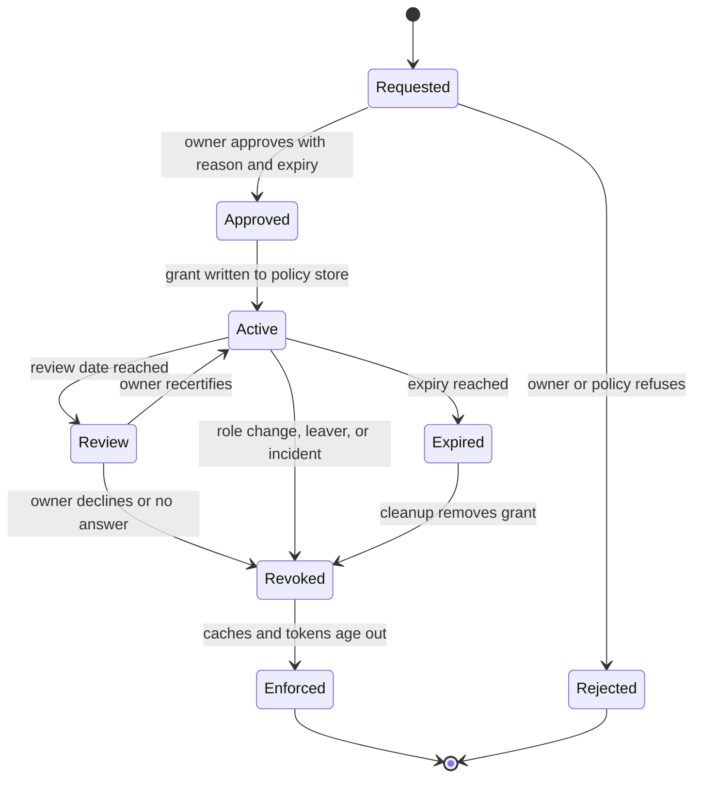

Two states matter most. `Revoked` means the policy store no longer holds the grant, but access may continue until `Enforced`, which is the moment the last cache, token, session, and bundle that mentioned it has expired. The interval between them is the revocation window from the caching section, and it is the number to measure. The second is `Review`, where the answer "no answer" must lead to removal. If silence renews a grant, reviews measure nothing.

### 10.2 Access review

Access review (also called recertification) is the periodic check that existing grants are still justified. It addresses the drift that accumulates through role changes, project ends, and one-off exceptions. A review that works has these properties.

- **The reviewer knows the answer.** A manager reviewing 300 entitlement names they do not understand will approve everything. Present entitlements in business terms, show last-used dates, and send each item to the resource owner or the user's manager, whichever can judge it.
- **Effective access is shown.** Reviewers need the output of the effective permission analysis, not the group names alone. Showing "member of `data-readers`" hides that the group has access to a production customer table.
- **Unused access is the default removal.** A grant not used in a stated period, such as 90 days, is flagged for removal. Last-used information is available on the major providers for many services; coverage varies, so verify per service.
- **Risk sets frequency.** Privileged and external-party access is reviewed more often than ordinary read access.
- **Removal is verified.** The review ends when a re-run of the analysis confirms the access is gone, not when a ticket is closed.

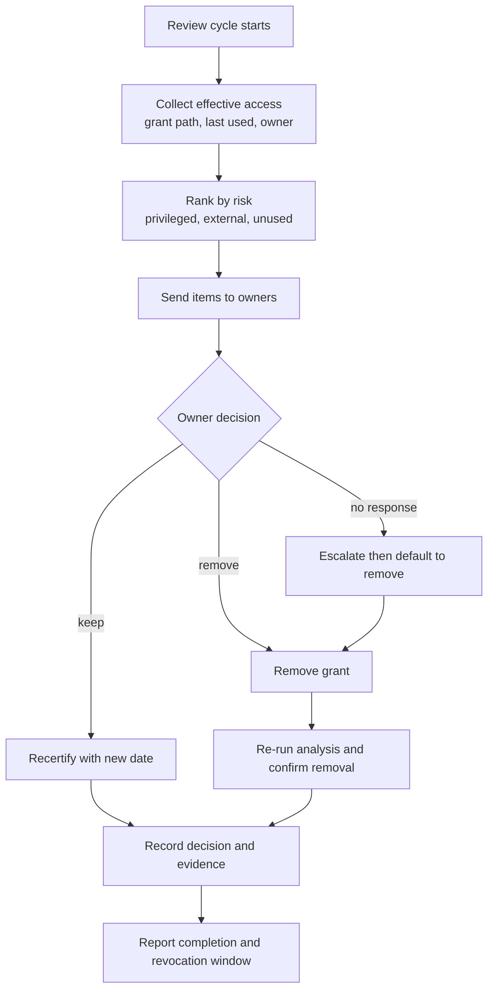

The flow places verification and the default on silence as explicit steps. Those are the two steps most often dropped when review is run as a spreadsheet exercise, and they are why such reviews approve nearly everything.

### 10.3 Worked example: size of the review problem

The figures are illustrative. A company has 400 employees, and an average of 35 distinct effective entitlements per person across cloud accounts and applications. That is 400 × 35 = 14,000 items. If a reviewer can responsibly assess 60 items an hour, a full review takes 14,000 / 60, about 233 reviewer hours. Spread across 40 managers this is about 5.8 hours each per cycle, which is feasible once a year and unrealistic quarterly.

Risk ranking changes the arithmetic. Suppose 12 percent of items are privileged or external, which is 14,000 × 0.12 = 1,680 items, reviewed quarterly: 1,680 / 60 = 28 hours per cycle across all reviewers. The remaining 12,320 items are reviewed yearly with unused entitlements pre-removed. If 30 percent were unused for 90 days and are removed automatically, the yearly set shrinks to 12,320 × 0.7 = 8,624 items, about 144 hours. The point of the calculation is that review effort is a capacity that has to be budgeted, and automation of unused-access removal and risk ranking is what makes frequent review of the dangerous subset possible.

### 10.4 Revocation triggers

Do not wait for the review cycle for events that should remove access at once.

- **Leaver and role change.** Tie removal to the human resources event, and remove group memberships and direct grants, not only the primary account.
- **Resource transfer.** When a resource changes owner or tenant, clear sharing grants made by the old owner unless they are explicitly migrated.
- **Compromise.** Disable the identity, revoke sessions and refresh tokens, rotate any credentials it could read, and review what it assumed or impersonated. The delegation records from the previous section tell you which other identities to examine.
- **Policy change.** A newly published deny should reach every enforcement point within a stated time. Measure that time by publishing a test deny and observing how long until it is enforced everywhere.

Audit evidence closes the loop. Every decision log entry should be able to answer which subject, which action, which resource, what decision, which policy version, and which actor if delegated. Without the policy version, a reviewer cannot tell whether a permit was correct under the rules in force at the time.

## 11. Failure behavior of the decision path

### 11.1 Fail closed, fail open, and degraded modes

A PDP can be unreachable, slow, or returning errors, and the PEP must have a defined response. The three options differ in what they preserve.

- **Fail closed.** Deny when no decision is available. Control is preserved and availability is lost. This is the default for operations whose misuse is costly: moving money, changing credentials, deleting data, exporting records, and changing permissions.
- **Fail open.** Permit when no decision is available. Availability is preserved and control disappears, silently, at the moment an attacker is most likely to induce the failure. Fail open is rarely defensible, and where it is used it needs a stated reason, a time limit, and an alert.
- **Degraded.** Use a bounded, explicit fallback: the last known policy for a limited time, or a reduced set of permitted actions such as read-only. This is the usual answer for services that must stay up.

The choice is per operation and should be written down as a table the team has agreed, rather than being decided by whichever exception handler runs first. For instance, a customer-facing document viewer might continue serving reads from a cached policy for up to 10 minutes during a PDP outage, while refusing all share, delete, and export actions until the PDP returns. The cached policy limit bounds the window of incorrect permits at the same 10 minutes as a revocation window.

### 11.2 Testing the failure path

Failure behavior that is not tested is the behavior of whatever code path happens to run. Test three things:

1. **Dependency failure.** Block the PDP in a test environment and call a sensitive endpoint. Confirm a refusal, a log entry, and an alert.
2. **Timeout.** Set the PDP to respond slower than the PEP timeout. A common defect is that the timeout throws an exception that a generic handler converts to a success response.
3. **Malformed policy.** Publish a policy with a syntax error to a test environment. Confirm the engine keeps the previous valid policy or denies, and does not load an empty policy that permits by default. This is the failure with the widest effect, because it is applied to every decision, so policy changes deserve the same staged rollout and rollback as code.

Authorization failures should also be distinguishable in monitoring from authorization denials. A spike in errors from the decision path indicates an outage. A spike in denials indicates either an attack, a bad policy release, or a changed client, and each needs a different responder.

## 12. Policy models and provider comparison

### 12.1 Policy model families

The request model of section 2 is neutral about how rules are written. Four families cover most systems, and one system often uses more than one.

- **Access control lists (ACLs).** Each resource carries a list of subjects and the actions each may take. Decisions are local and easy to explain. Reverse questions, such as "what can this user reach", require scanning every resource.
- **Role-based access control (RBAC).** Subjects hold roles, and roles hold permissions. Roles compress many grants into a few names. The model is covered in [RBAC](CH04_RBAC.md).
- **Attribute-based access control (ABAC).** Rules compare attributes of subject, resource, and context. It expresses tenant matching and state checks without enumerating grants. The model is covered in [ABAC](CH05_ABAC.md).
- **Relationship-based access control (ReBAC).** Access follows a graph of relations such as owner, member of, parent folder of. Sharing and nested hierarchies fit naturally, and the decision data is a graph that must be stored and kept consistent.

The choice depends on where the answer lives. If the answer is a stable property of the job, roles fit. If it depends on the data row, attributes or relations are needed. The worked example in section 2.3 already needed an attribute rule (tenant equality) on top of a role.

### 12.2 Provider and engine comparison

The table compares mechanisms, not product quality. It reflects the general design of each system at the time of writing; limits, defaults, and newer features change, so verify current behavior in each official documentation set before relying on a row.

| Dimension | AWS IAM | Amazon Verified Permissions (Cedar) | Azure RBAC with conditions | Google Cloud IAM | Open Policy Agent (OPA) |
|---|---|---|---|---|---|
| What it protects | AWS API calls to AWS resources | Your own application's actions and resources | Azure resource management and some data actions | Google Cloud API calls to Google Cloud resources | Anything that can send it a query: services, gateways, admission control |
| Who owns enforcement | AWS service front ends enforce | Your application code calls the service and obeys the result | Azure services enforce | Google Cloud services enforce | You. OPA only returns a decision, so the caller is the PEP |
| Default result | Deny unless allowed | Deny unless a permit matches | No access without a role assignment | No access without an allow binding | Whatever your rules define; an undefined result must be mapped to deny by the caller |
| Explicit deny | Yes, overrides allows | Yes, `forbid` overrides `permit` | Deny assignments exist but are mostly created by Azure services | Deny policies, evaluated before allow policies | Only if you write it and your combining logic honors it |
| Grant location | Identity policies, resource policies, session policies | Policy store with policies and templates | Role assignments at a scope, inherited down | Allow policies on a resource, inherited down | Rules and data loaded into the engine |
| Ceilings | Service control policies and permissions boundaries | Not a feature of the language; model with `forbid` | Policy governs configuration; role definitions set the action set | Organization policy, deny policies, principal access boundaries | Written by you as rules |
| Attribute conditions | Condition keys in policy | `when` and `unless` clauses on entity attributes | Role assignment conditions over attributes such as resource tags where supported | IAM Conditions using Common Expression Language | Full expressions in the Rego language over the input document |
| Decision data | Principal, request context, resource tags | Entities and attributes you supply or store | Principal, assignment, resource attributes | Principal, resource, request attributes | Whatever the caller sends plus loaded data |
| Evaluation location | Inside the provider | Managed service called over the network | Inside the provider | Inside the provider | Library, sidecar, or service, your choice |
| Propagation after a change | Eventual, bounded by provider behavior | Per service documentation | Eventual, role assignment changes can take time to apply | Eventual, per documentation | Bundle refresh interval you configure |

Three rows deserve reading together. First, the cloud IAM systems enforce for you but only for their own resources, so they cannot decide whether user `u-204` may see document 8841 in your application. Second, Cedar and OPA decide for your application but enforce nothing: a missed call site is an open path. Third, propagation delay is a property of each system, so the revocation window of section 8.5 must include whichever of these sit in the path.

### 12.3 Choosing between engines for application authorization

Use the cloud provider IAM for what it is built for, access to cloud resources, and avoid mapping end users onto cloud identities. For application-level decisions, choose a policy engine by three questions.

1. **Does the policy need to be reviewable by non-developers?** A small declarative language with a fixed evaluation order, as in Cedar, is easier to analyze and to test exhaustively. A general-purpose language such as Rego allows richer rules and also more ways to write a rule nobody can follow.
2. **Where must the decision run?** A managed service removes operating the decision tier and adds a network dependency. OPA run as a library or sidecar removes the network dependency and adds a distribution pipeline for policy bundles.
3. **Is the decision data relational?** Sharing graphs with nested folders suit a store built for relationship queries. Attribute rules over data the service already loaded do not.

None of these choices changes the PEP duty from section 3: every path to the resource still has to ask.

## 13. Failure and quality-attribute scenarios

Each scenario states a stimulus, the expected response, and a success criterion that can be measured in a test or an exercise. The numeric targets are illustrative; set your own from the business impact of each operation.

| Scenario | Stimulus | Expected response | Success criterion |
|---|---|---|---|
| Policy engine outage | The central PDP becomes unreachable for 15 minutes | Reads continue from the last loaded policy for a bounded time. Share, delete, export, and permission changes are refused. Alert fires | Zero permits for refused actions during the outage in a replayed request log. Alert within 2 minutes. Reads served for up to the 10 minute limit, then refused |
| Stale cached decision after revocation | A user's role is removed at time t0 while the decision is cached on 3 nodes and 1 node misses the invalidation event | Two nodes drop the entry at once. The third drops it when the TTL expires | No permit from any node later than t0 plus TTL. With a 30 second TTL, the last permit is no later than t0 + 30 s |
| Malformed policy release | A policy with a syntax error is published | The engine rejects it, keeps the previous valid version, and reports the failed release | Decision log shows the previous policy version still in use. No decision evaluated against an empty policy. Release marked failed in the pipeline |
| Cross-user cache leak | User B requests a resource that user A, with different rights, just read | B is denied | Automated two-subject test passes on every release. 0 of 100 alternating requests return A's result to B |
| Compromised service identity | An attacker holds the credentials of the report service | Access is limited to what the exchanged-token intersection allows. The credential is revoked | Attacker reads only customers named in live user tokens. After revocation, no successful call from the credential beyond the longest token lifetime, 300 s in the case study below |
| Policy change latency | A new deny rule is published | Every enforcement point applies it within the stated window | A test deny is observed at all enforcement points within the window, for example 120 s |
| Delegation chain too deep | A request arrives with a delegation chain of 6 hops against a limit of 3 | Request refused with a logged reason | 100 percent of over-limit chains refused in a test set |

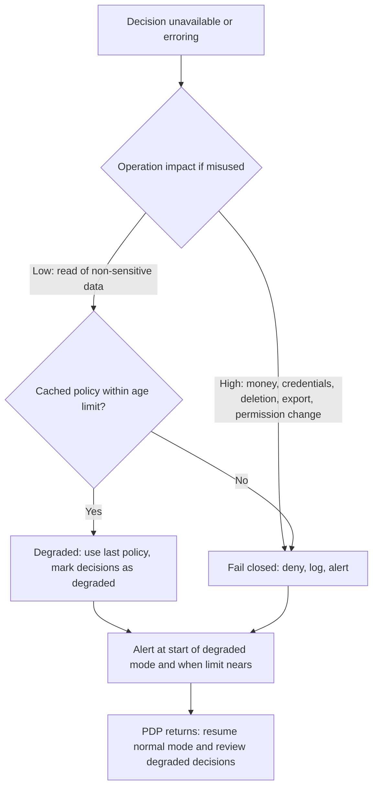

The tree makes the failure mode a property of the operation and not of the exception handler. Two implications follow. The age limit is the same quantity as the exposure window for revocation during the outage, so it needs the same approval as a revocation target. And the step that reviews degraded decisions afterwards is part of the design: decisions made during degraded mode were evaluated against old policy, and if the old policy contained a permit that has since been revoked, someone has to look.

Failure testing should also confirm that observability is intact. A decision path that fails closed without an alert looks, from the outside, like a bug in the application. A decision log that stops recording when the PDP is down removes the evidence needed to judge what happened. Test that both keep working.

## 14. Worked case study: authorization for a multi-tenant invoicing platform

This case is hypothetical and illustrative. The organization, its volumes, and its targets are invented to show the reasoning, and no figure describes a real system.

### 14.1 Context and requirements

Ledgerline is an invented business-to-business invoicing platform. It serves 120 customer tenants through 9 services. Peak traffic is 1,500 API requests per second, and the team estimates 3 authorization decisions per request on average, since most requests load one object and check a few related rules. The requirements agreed with the business are these.

- A user must never read or change another tenant's data.
- Invoice approval requires a different person from the creator, with a per-approver amount limit.
- After a user loses a role, access must stop within 60 seconds for ordinary reads and immediately for approvals.
- A published deny rule must reach every enforcement point within 120 seconds.
- Authorization may add at most 15 ms at the 95th percentile to a request.

### 14.2 Decisions and rejected alternatives

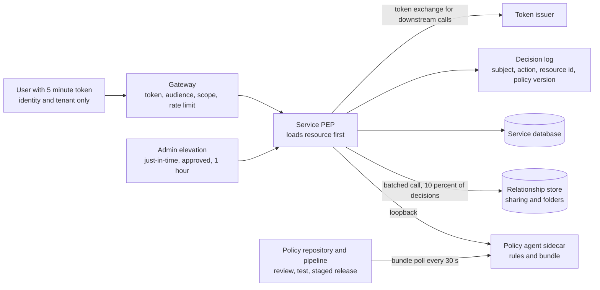

**Where decisions run.** Rules over attributes the service already holds (tenant match, invoice state, approver limit, separation of duties) run in a sidecar agent on each host. Sharing grants, such as a customer inviting an outside accountant to one folder, live in a relationship store and are queried only when the rules need them. A fully central decision service was rejected because a 15 minute outage of it would stop all approvals and reads, while the sidecar keeps serving on the last bundle. A fully embedded library was rejected because the 9 services are written in 3 languages, which would mean maintaining 3 policy engine integrations.

**Tokens.** Tokens live 5 minutes and carry identity and tenant only. Roles are resolved at decision time from a directory cache. Embedding roles in tokens was rejected because it would tie the role-removal window to the token lifetime of 300 seconds, five times the 60 second requirement.

**Combining rule.** Deny overrides, default deny, with ceilings expressed as `forbid` rules, for example "no export while a legal hold exists". First-applicable evaluation was rejected because rule order would decide outcomes and engineers editing policy could not predict the result.

**Delegation.** Downstream calls use exchanged tokens with audience, actor, and a 5 minute expiry, limited to a chain depth of 3. Passing the service identity alone was rejected because the report service would hold read access to all 120 tenants and be a confused deputy.

**Privilege.** Production administrator rights are just-in-time for 1 hour with a named approver, and two sealed break-glass accounts exist for identity provider outages.

### 14.3 Arithmetic behind the design

Decision volume: 1,500 requests per second × 3 decisions = 4,500 decisions per second. A single sidecar per host spreads this across hosts. With 6 hosts, each sees 4,500 / 6 = 750 per second, comfortable for local evaluation.

Relationship store load: 10 percent of decisions need it, so 4,500 × 0.10 = 450 queries per second before caching. With a 90 percent cache hit rate and a 30 second TTL on sharing lookups, misses are 450 × 0.10 = 45 per second. If one store node handles 100 queries per second (an assumed capacity to be measured), two nodes give 2 × 100 = 200 per second, which is 4.4 times the load of 45 and leaves headroom for a node failure with 100 per second still above 45.

Latency budget: three sequential sidecar calls at an assumed 1 ms each cost 3 ms. A relationship store call at an assumed 4 ms on a cache miss adds up to 4 ms, but only 10 percent of decisions need it and 10 percent of those miss, so it affects about 1 percent of decisions. Worst case on a miss is 3 + 4 = 7 ms, inside the 15 ms budget with 8 ms to spare. Batching the sidecar calls would cut the 3 ms further, and is left as an optimization.

Revocation windows: role removal reaches the directory cache within its 30 second TTL, so ordinary reads stop within 30 seconds, inside the 60 second target. Approvals skip the cache and read authoritative state, so the window is 0 s plus replication delay. A new deny rule reaches an agent within one 30 second poll plus an activation allowance assumed at 5 seconds, so 30 + 5 = 35 seconds, inside the 120 second target. The compromised-credential window is the 5 minute token, 300 seconds, which the team accepts for ordinary reads and does not accept for approvals, so approvals additionally check a revocation signal.

Review effort: 40 staff with 30 effective entitlements each is 1,200 items. At 60 items per hour that is 1,200 / 60 = 20 reviewer hours per cycle, feasible quarterly. Customer-tenant administrator grants, estimated at 120 tenants × 4 administrators = 480 items, are reviewed by the tenant owners themselves.

### 14.4 Validation evidence

The team would archive the following before release and on a schedule.

- A two-subject cache test showing user B denied immediately after user A is permitted on the same invoice.
- A request replay during a simulated sidecar bundle failure showing the last valid policy retained.
- A test deny published at time t0 with timestamps from every agent, showing the maximum observed delay against the 120 second target.
- A role-removal test measuring the time to the last permitted read against the 60 second target.
- A separation-of-duties test where the creator attempts approval and the decision log records the refusal with the policy version.
- A reverse effective-permission analysis listing every identity able to approve invoices over the highest limit, compared against the approved list.
- A pipeline run in which a policy with a syntax error is rejected and the previous version stays active.

Failing any of these blocks release. The evidence is stored with the policy version so an auditor can tie a decision in the log to the tests that covered the rules in force at the time.

## 15. Common mistakes

Each item gives the cause and the consequence.

1. **Checking permission on the type and not the object.** Cause: the check runs before the resource is loaded, or only the gateway checks. Consequence: any authenticated user can read any identifier they can guess, the broken object-level authorization pattern.
2. **Trusting hidden user interface elements.** Cause: the button is hidden for non-administrators and the endpoint is unchecked. Consequence: anyone who sends the request by hand performs the action.
3. **Fail-open error handling.** Cause: a catch block around the decision call continues on error. Consequence: an attacker who can slow or break the decision path gains access during the failure.
4. **A decision cache key missing an input.** Cause: key built from resource and action only, or from role without tenant. Consequence: one user receives another user's cached permit, and single-user tests never show it.
5. **Cache lifetime chosen for speed.** Cause: TTL tuned to hit rate with no revocation target. Consequence: removed permissions persist for minutes, and nobody can state the number during an incident.
6. **Reviewing group names and not effective access.** Cause: review tools list memberships without ceilings, denies, inheritance, or impersonation paths. Consequence: reviewers approve access they cannot see, and real exposure goes uncorrected.
7. **Granting at too high a node.** Cause: assigning a role at a folder for convenience. Consequence: development roles reach production through inheritance.
8. **Wildcard grants for sensitive resources.** Cause: `service:*` written to save effort. Consequence: new actions added by the provider are granted automatically, including destructive ones.
9. **Service identity as the only downstream check.** Cause: downstream trusts the caller to have checked the user. Consequence: confused deputy, where a broad service credential serves requests the user could not make.
10. **Policy changes released like configuration.** Cause: no test, staging, or rollback for policy. Consequence: one bad edit changes every decision, and a malformed file may load as an empty policy.
11. **Silence renews access in reviews.** Cause: reviews that default to keep. Consequence: nearly every grant is recertified and the review measures nothing.
12. **Logging payloads in the decision log.** Cause: copying the whole request for debugging. Consequence: the log becomes a second sensitive data store with weaker protection.

## 16. Design-review checklist

Use this list when reviewing a system's authorization design. A "no" answer is a finding.

**Model and placement**

- [ ] Every decision is expressible as subject, action, resource, and context, and each input is available where the decision is made.
- [ ] Object-level checks run in the service that owns the data, after the resource is loaded.
- [ ] Every path to the data (API, jobs, streams, consoles, internal calls) passes through a PEP or inherits one.
- [ ] The operation acts on the object that was checked.

**Policy semantics**

- [ ] Default deny, explicit deny precedence, and the combining algorithm are documented.
- [ ] Missing attributes make a condition unsatisfied, not satisfied.
- [ ] Effective permissions, including ceilings, denies, and inheritance, can be computed forward and in reverse.
- [ ] Sensitive grants name actions and resources and avoid wildcards.

**Privilege and delegation**

- [ ] Permissions that write policy, assign roles, attach identities to compute, or change privileged automation are treated as administrative.
- [ ] Administrative access is just-in-time, and break-glass use raises an alert.
- [ ] Downstream calls carry the original subject and the acting party, with narrowed scope, audience, expiry, and a depth limit.
- [ ] Sensitive operations enforce separation of duties using resource history as a decision input.

**Caching, revocation, and failure**

- [ ] Cache keys contain every input that changes the answer, and a two-subject test exists.
- [ ] Each cache and token has a documented lifetime, and the total revocation window is stated.
- [ ] Failure behavior is defined per operation, tested, and alerting.
- [ ] Policy releases are tested, staged, and reversible, and a malformed policy cannot load as empty.

**Review and audit**

- [ ] Access reviews show effective access and last use, and silence leads to removal.
- [ ] The decision log records subject, action, resource identifier, decision, policy version, and actor, and holds no payloads.
- [ ] Negative tests cover cross-tenant access, self-approval, expired grants, and the failure path.

## 17. Exercises

Each exercise has a brief answer outline.

1. **Draw a request through authentication, policy evaluation, enforcement, and audit.** Outline: token validation at the gateway, coarse policy, forward to the service, resource load, PEP call to PDP with four inputs, decision with reason and policy version, operation on the checked object, decision log entry. Compare with the diagram in section 3.3.
2. **Why is authorization in the client or gateway alone insufficient for object-level access?** Outline: the client is controlled by the caller; the gateway lacks resource attributes such as owner tenant. Only the data owner can compare them. Give the tenant `acme` and `globex` example.
3. **Compute effective permissions.** A user holds grants {read, write, approve} and {read, export}, a ceiling {read, write, export}, and a deny on `write` for contractors. The user is a contractor. Outline: union {read, write, approve, export}; intersect with ceiling {read, write, export}; subtract write to give {read, export}.
4. **Define a safe cache key and invalidation plan for decisions.** Outline: key with subject, action, resource, tenant, policy version, and context values the policy reads. TTL per action, event invalidation as a shortener only, no caching for approvals, and a two-subject test.
5. **Compare fail-open and fail-closed for a read-only report and a payment approval.** Outline: report may degrade on a bounded cached policy with an alert; approval fails closed. State the exposure window and who approves it.
6. **Design a delegated permission narrower than the caller's full authority.** Outline: token exchange with audience of the downstream service, scope limited to one customer, short expiry, actor claim, depth limit, and intersection of user and service rights. Name the confused deputy it prevents.
7. **Find the escalation path.** A pipeline identity may update a function whose execution role can assign roles. A developer may edit the pipeline definition. Outline: developer to pipeline to function to role assignment, so the developer's effective power includes role assignment. Fix by restricting pipeline edits, narrowing the execution role, and adding a boundary.
8. **Choose a TTL.** A service makes 800 decisions per second, 90 percent repeats, and a decision tier handles 200 per second. Outline: without cache 800 / 200 = 4 times oversubscribed; with the cache misses are 800 × 0.10 = 80 per second, 40 percent of capacity. Then set TTLs per action against a revocation target.

## 18. Summary

Authorization is a resource-bound decision evaluated for a subject, action, and context. The chapter's outcomes map to its sections as follows.

| Outcome from the Introduction | Where it is taught | Core takeaway |
|---|---|---|
| Express decisions as subject, action, resource, and context | Sections 2 and 12 | Know which inputs exist at the point of decision. A check without the resource cannot enforce tenant boundaries |
| Place the PDP and PEP, compare topologies, budget latency | Sections 3, 8, and 14 | Embedded, sidecar, and central designs trade latency, consistency, and outage behavior. Batch decisions and show the arithmetic |
| Predict outcomes under default deny, explicit deny, and combining algorithms | Sections 4, 6, 7, and 12 | Union grants, intersect ceilings, subtract denies, and prefer deny-overrides |
| Separate coarse checks from object-level checks | Sections 3 and 15 | The gateway checks what needs no resource data. The data owner checks the rest, on every path |

Beyond the four outcomes, the chapter adds operating rules. Keep grants narrow in action, resource, and time. Treat tokens and caches as statements about the past with stated lifetimes. Carry the original caller through delegation. Review effective access and let silence remove grants. Define failure behavior per operation and test it. Authentication, network location, and user-interface visibility are not substitutes for per-operation authorization.
