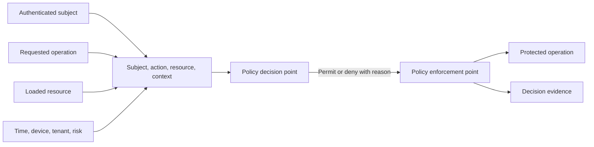
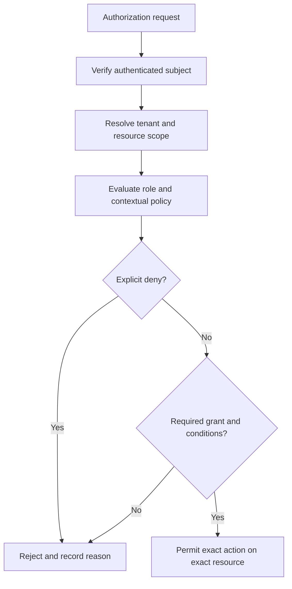
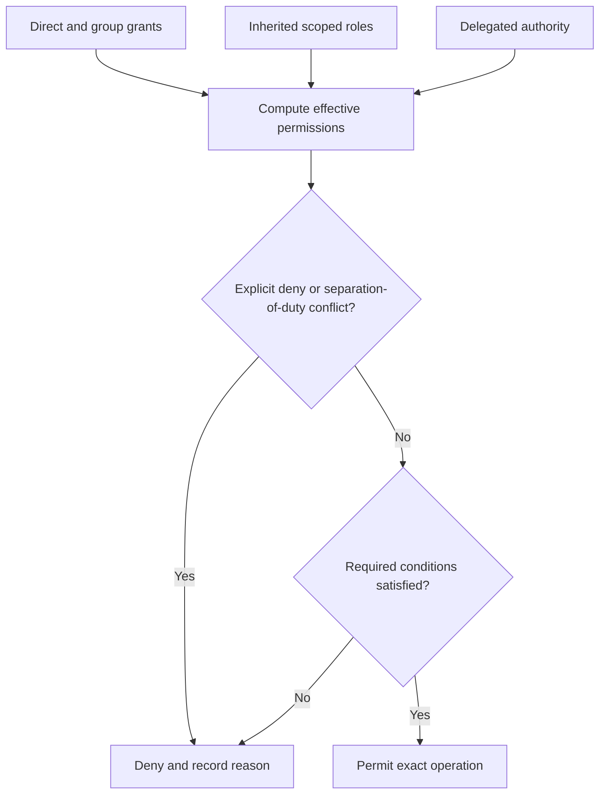
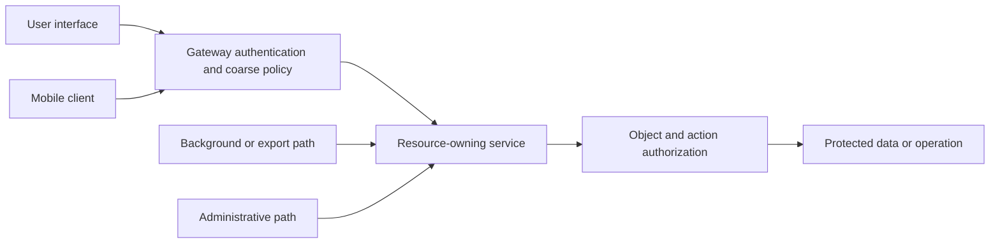
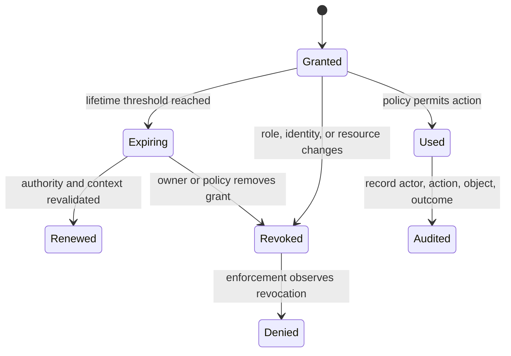

# Authorization

Part: [15 — Security](PART_OVERVIEW.md)

Authorization decides whether a subject may perform an action on a resource under current policy and context. Authentication establishes a claimant identity; authorization evaluates each relevant operation. A secure system must enforce the decision at the boundary where the resource or action is controlled, not rely only on a user interface or network location.

This chapter owns provider-neutral authorization concepts, policy evaluation, least privilege, delegation, review, and failure behavior. [CH04 RBAC](CH04_RBAC.md) and [CH05 ABAC](CH05_ABAC.md) own concrete policy models. Part 08 CH09 owns API-specific object and function authorization; Part 09 owns cloud policy syntax; Part 12 owns Kubernetes RBAC implementation.

## Request and Policy Decision Model

An authorization request can be modeled as subject, action, resource, and context. A policy decision point (PDP) evaluates rules; a policy enforcement point (PEP) applies the result. The PDP may be embedded in a service or centralized, but the PEP must protect the operation and fail according to a documented security policy.

Load the resource before checking ownership when policy depends on resource attributes, and bind the checked object to the operation to prevent time-of-check/time-of-use substitution. Deny by default for protected actions. A policy engine's “permit” should not be interpreted as proof that the resource identifier, tenant, or business state is correct.

## Policy Composition and Least Privilege

Policies combine identity permissions, resource ownership, scope, conditions, and explicit exceptions. Define precedence for allow and deny, inherited rules, and delegation. Broad wildcard grants are difficult to audit and can create privilege escalation paths. Separate administrative duties where one actor should not both request and approve a sensitive operation.

Least privilege means granting only the actions and resources necessary for a defined role and period. Privileged access should be discoverable, reviewable, and revocable. Use just-in-time elevation for exceptional administrative actions where practical. Set an expiry and maintain an audit trail.

## Enforcement Boundaries and Caching

Authorize at every path that can reach the resource: direct API, background job, bulk export, websocket action, administrative endpoint, and internal service call. A gateway can perform coarse policy checks, but a service that owns the resource often needs object-level authorization because only it has the required context. Client-side visibility controls improve usability but are not security enforcement.

Authorization caching can reduce latency but risks stale permissions. Include subject, action, resource, and relevant policy version in the cache key. Invalidate on role removal, resource transfer, account compromise, or policy change. For high-impact actions, re-evaluate against authoritative state rather than trusting a long-lived cached permit.

## Delegation, Revocation, and Failure Modes

Delegation allows one subject or service to act with constrained authority on behalf of another. Make the original actor, delegated scope, audience, and expiration explicit. Do not forward a broad administrator credential when a narrower delegated capability can be issued. Ensure downstream services can distinguish the caller from the represented user.

If the policy service is unavailable, fail closed for sensitive operations unless a carefully justified, time-bounded cached policy is safe. Fail-open behavior can preserve availability while silently removing control. Choose and test behavior per operation; read-only low-risk operations may have different availability requirements than money movement or credential changes.

## Worked Case and Review Checklist

A multi-tenant document service receives a request to download a document by identifier. The gateway authenticates the user and routes the request. The document service loads the document and evaluates the user's tenant, ownership or sharing grant, requested action, and document state. It denies access if any required policy is absent, logs a decision identifier without logging document contents, and returns a response that does not disclose whether another tenant's document exists.

Review subject, action, resource, context, PDP/PEP placement, default deny, explicit deny precedence, tenant boundary, cache lifetime and invalidation, delegation, privileged access, failure mode, audit, and negative tests. Verify every alternate access path enforces equivalent policy.

## Questions and Summary

1. Draw a request through authentication, policy evaluation, enforcement, and audit.
2. Why is authorization in the client or gateway alone insufficient for object-level access?
3. Define a safe cache key and invalidation plan for authorization decisions.
4. Compare fail-open and fail-closed behavior for read-only and high-impact operations.
5. Design a delegated permission that is narrower than the caller's full authority.

Authorization is a resource-bound decision evaluated for a subject, action, and context. Enforce it where the protected operation is controlled, default to deny, keep grants narrow, and make revocation and exceptions observable. Authentication, network location, and user-interface visibility are not substitutes for per-operation authorization.
