# RBAC (Role-Based Access Control)

Part: [15 — Security](PART_OVERVIEW.md) · Status: Revised (in-depth rewrite)

## 1. Introduction

Every system that has more than a handful of users has to answer the same question thousands of times a day: may this person do this thing to that object? The simplest answer is a list per object of who may do what. That list works for ten users and ten objects. At two hundred users and a few thousand objects it cannot be reviewed by a human, and nobody can say what a given employee can reach without reading every list.

Role-Based Access Control (RBAC) adds one level of indirection. Permissions are attached to roles, which are named bundles that match a job function or operational duty. Subjects (people, groups, and software identities) are attached to roles. The system then answers "what can Alice do" by following links from Alice to roles to permissions, and it answers "who can approve payments" by following the links in the other direction. The indirection is the whole value of the model. It turns thousands of per-object decisions into a much smaller set of role decisions that an owner can read, review, and defend.

The indirection also creates the typical failure modes. Roles accumulate permissions because adding one is easier than splitting one. Subjects accumulate roles because removing one risks breaking a workflow. Scope is forgotten, so a role meant for one project applies to a whole organization. Inheritance hides the path by which access arrives. Administrative roles can grant roles, which means they can grant themselves anything. This chapter teaches the model, the way an access check actually evaluates it, how scope and inheritance combine, and how to design a role set that stays reviewable as the organization grows.

After working through this chapter, you should be able to:

- Define the core RBAC entities (subjects, roles, permissions, assignments, scopes, sessions) and explain what each one is for.
- Trace an access check from an authenticated request to an allow or deny decision, including where group membership is resolved and where caching can delay a change.
- Compute effective access as the union of every path to a permission, and find the paths that a per-role review misses.
- Explain additive scope inheritance, role hierarchies, and static and dynamic separation-of-duty constraints, and say what each one can and cannot enforce.
- Choose between a new role, a scoped binding, and an attribute condition, and show with arithmetic why role explosion happens.

### 1.1 Scope and ownership boundaries

This chapter owns role-centric access control: the entity model, assignment, scope, hierarchy, role design, administrative roles, and the lifecycle and audit of role assignments. It recaps neighbouring material briefly and links to the owner.

| Topic | Owner | Relationship to this chapter |
|---|---|---|
| Policy decision and enforcement points, allow and deny precedence, least privilege as a principle | [Authorization](CH03_Authorization.md) | This chapter applies those ideas to role-based policy |
| Attribute-based policy, contextual conditions | [ABAC](CH05_ABAC.md) | Named as the alternative when roles alone cannot express a rule |
| Verifying who the subject is | [Authentication](CH02_Authentication.md) | This chapter starts after the subject is authenticated |
| Cloud provider policy syntax and evaluation algorithms | [Cloud Identity and Access Management](../09_Cloud_Computing/CH09_IAM.md) | Provider specifics appear here only where they illustrate the model |
| Kubernetes `Role`, `ClusterRole`, and bindings | [Kubernetes Security](../12_Kubernetes/CH13_Security.md) | Mentioned as an example of namespaced roles |
| Application object and tenant authorization | Part 08 [API Security](../08_API_Architecture/CH09_API_Security.md) | A role never replaces per-object checks in the application |

Provider facts drift. Where a product limit or default is mentioned, the text says to verify it in current documentation rather than quoting a number.

## 2. The RBAC Model

### 2.1 Entities and relations

The reference model for RBAC was published by researchers at the National Institute of Standards and Technology (NIST) and standardized as ANSI/INCITS 359 (verify the current edition before citing it). It defines a small set of entities and two many-to-many relations. The vocabulary below follows that model, with the practical additions that real systems need.

- **Subject.** An authenticated identity that makes requests: a person, a group of people, or a non-human identity such as a service account.
- **Permission.** A pair of an action and a resource scope, for example "read" on "invoices in business unit 7". A permission has no meaning until a role carries it.
- **Role.** A named set of permissions that matches a job function or duty, for example "invoice reader".
- **Assignment** (also called a binding). A statement that a subject holds a role, usually within a scope.
- **Scope.** The part of the resource space where an assignment applies: an organization, project, tenant, namespace, or single resource.
- **Session.** In the formal model, the set of roles a subject has activated for one login. Many products do not expose activation and treat every assigned role as always active. The distinction matters for separation of duties and for elevation, covered in later sections.

The two relations are subject-to-role and role-to-permission. Both are many-to-many. A person can hold several roles, and a role can be held by many people. A permission can appear in several roles. Neither relation names a resource directly, which is why a new document does not require a change to the policy: the scope on the assignment already covers it.

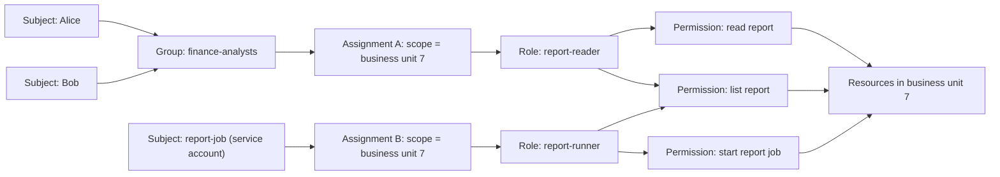

The diagram shows three properties that matter for design. First, groups sit between people and assignments, so that joining a team changes one membership rather than many assignments. Second, a permission can be reachable through more than one role (`list report` appears in both), which means removing one role does not necessarily remove the capability. Third, the scope belongs to the assignment, not to the role, so the same role definition can be reused in many places. A system that puts scope inside the role name ("report-reader-bu7") has moved scope into the role catalog, and that is the first step toward role explosion.

### 2.2 What RBAC decides and what it does not

RBAC answers a coarse question: which kinds of action may this subject perform on which region of the resource space. It does not know that invoice 4411 belongs to a customer the subject should not see, that the subject is logging in from an unmanaged device, or that the amount exceeds an approval limit. Those rules depend on attributes of the object or the request and belong to [ABAC](CH05_ABAC.md) or to application code. The practical rule is to let roles carry the stable, coarse part of authority and keep contextual rules out of the role catalog.

RBAC is also not a substitute for authentication. A role assigned to an account that has a weak or stolen credential is exercised by whoever holds the credential. [Authentication](CH02_Authentication.md) owns that problem. What RBAC contributes is a bound on the damage: a compromised credential holds exactly the roles assigned, so the blast radius is the union of those roles' permissions at their scopes.

### 2.3 The three levels of the standard model

The NIST model describes cumulative levels, and the names are useful when comparing products.

1. **Core RBAC.** Subjects, roles, permissions, assignments, and sessions, with the two relations above.
2. **Hierarchical RBAC.** Adds a partial order on roles so that a senior role inherits the permissions of a junior one. Many products implement this as scope inheritance rather than as role-to-role inheritance, which is a different thing. Section 4 separates the two.
3. **Constrained RBAC.** Adds separation-of-duty constraints: static constraints that forbid a subject from holding conflicting roles, and dynamic constraints that forbid activating them in the same session.

Most production systems implement core RBAC well, hierarchy partially, and constraints rarely. That gap is where separation-of-duty failures appear, and the chapter returns to it.

## 3. How an Access Check Evaluates Roles

### 3.1 The request path

The model in Section 2 is static. A running system evaluates it on every request, and the details of that evaluation decide how fast a change takes effect. The path has the same shape in most products, whether the decision is made in a cloud provider's control plane, in an application framework, or in a Kubernetes API server.

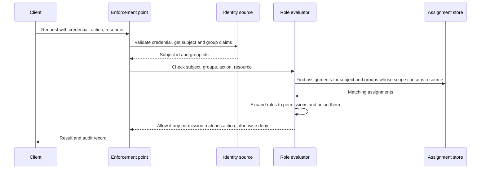

Four steps carry most of the risk.

1. **Credential validation and group resolution.** The subject identifier comes from the authenticated credential. Group membership may be embedded in the credential at issue time (for example as a claim in a token) or looked up on each request. An embedded claim is fast but stale: if Alice is removed from a group at 10:00 and her token was issued at 09:30 with a one-hour lifetime, she keeps the group's roles until 10:30 unless the enforcement point checks revocation. A lookup on each request closes that window and adds latency and a dependency on the identity source.
2. **Assignment matching.** The evaluator selects assignments held by the subject or by any of its groups whose scope contains the target resource. Scope containment is a prefix or ancestor test on the resource path. A broken containment test, such as matching `/projects/a` against `/projects/ab`, is a classic authorization defect, and tests should include sibling names that share a prefix.
3. **Expansion and union.** Each matching role is expanded to its permissions, and all of them are pooled. There is no order and no weighting. Adding a role can only widen access, never narrow it, unless the product also supports explicit deny rules, which most pure RBAC systems do not.
4. **Match and decide.** The requested action is compared with the pooled permissions, including wildcard handling. The default is deny when nothing matches.

### 3.2 Why union semantics matter

The additive rule makes RBAC easy to reason about locally: to grant something, add a role. It also makes the system hard to restrict. If a subject holds a broad role at an organization scope, no narrow role at a project scope can take the access back. Teams that discover this tend to add deny assignments, which some products support, but deny rules reintroduce precedence questions that [Authorization](CH03_Authorization.md) covers. A design that depends on deny to stay safe has usually granted too much at too high a scope.

### 3.3 Caching and revocation windows

A change to an assignment is a write to the assignment store. The enforcement point sees it when the cache in front of the store expires, or when a push invalidation arrives. State the revocation window as a number for each layer: the credential lifetime if claims are embedded, the group-membership cache time-to-live, and the assignment cache time-to-live. The worst-case delay is the sum along the path where each layer is cached independently, not the maximum. Providers publish propagation behavior for their own systems; look it up for the product in use rather than assuming it is immediate.

### 3.4 A neutral binding record

The following record is a provider-neutral sketch of the data an assignment store needs. Real products use their own formats, covered in the cloud and platform chapters.

```yaml
role:
  name: report-reader
  permissions:
    - report.read
    - report.list
assignment:
  id: a-1042
  subject: group:finance-analysts
  role: report-reader
  scope: /orgs/acme/business-units/7
  granted_by: user:carol
  granted_at: "2026-03-02T09:14:00Z"
  expires_at: null
  ticket: CHG-5521
```

The fields beyond subject, role, and scope are what make the record reviewable. `granted_by` and `ticket` give an auditor the reason, and `expires_at` is empty only for stable duties. An assignment with no owner and no expiry cannot be reviewed meaningfully.

## 4. Scope, Inheritance, and Effective Access

### 4.1 Scope as the second dimension

A role says what kind of action is allowed. A scope says where. Without scope, every role is global, and the role catalog must encode location in the role itself. With scope, one `report-reader` definition serves every business unit and the assignment carries the location.

Scopes usually form a tree, because resources do. An organization contains business units, which contain projects, which contain resources. An assignment at a node applies to every descendant. This is **scope inheritance**, and it is additive: the permissions granted at a node are added to whatever is granted lower down.

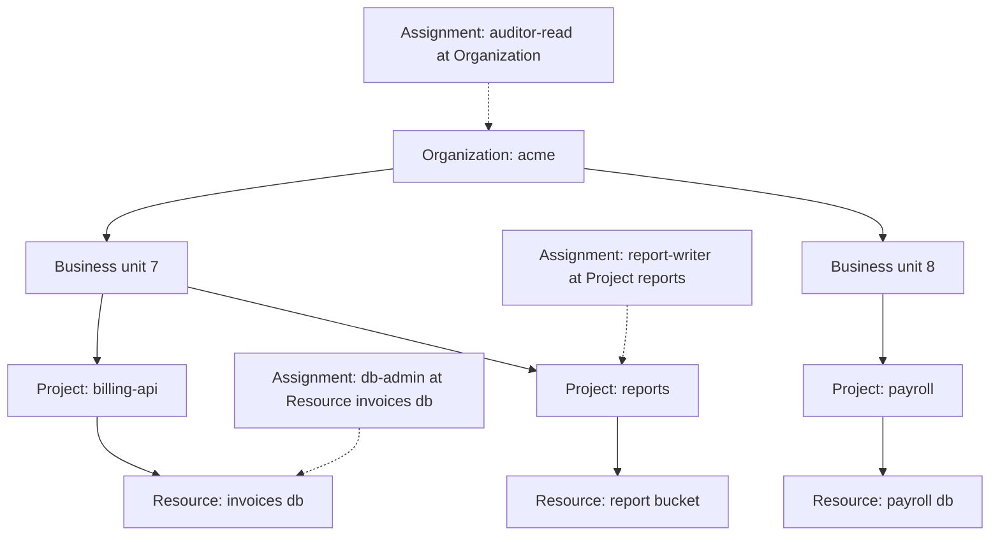

The three dotted assignments apply to different subtrees. `auditor-read` at the organization reaches all three resources. `report-writer` reaches only the report bucket. `db-admin` reaches one database. The implication for review is that the question "who can touch the payroll database" has to be answered by walking up the tree from the resource and collecting assignments at every ancestor, not by looking at assignments on the database alone. A resource-level view that shows only direct assignments will understate access.

Products differ in how they scope. In Azure, role assignments are made at a management group, subscription, resource group, or resource, and flow down. In Google Cloud, Identity and Access Management (IAM) bindings made on an organization, folder, or project apply to the resources below. In Amazon Web Services (AWS), permission policies are attached to identities and there is no single resource-tree inheritance of role assignments; resource scoping is done through the resource element of policies, and organization-wide limits use separate guardrail features. In Kubernetes a `Role` and its `RoleBinding` live in one namespace, a `ClusterRole` carries cluster-wide or reusable rules, and a `RoleBinding` may reference a `ClusterRole` to grant its rules inside only one namespace. These are the facts to rely on at the model level; [Cloud Identity and Access Management](../09_Cloud_Computing/CH09_IAM.md) and [Kubernetes Security](../12_Kubernetes/CH13_Security.md) own the details.

### 4.2 Scope inheritance versus role hierarchy

Two different mechanisms are both called inheritance, and mixing them causes review errors.

- **Scope inheritance** moves a grant down the resource tree. The role stays the same; the reach grows.
- **Role hierarchy** moves permissions between roles. If `senior-analyst` is defined as inheriting `analyst`, every permission added to `analyst` later appears in `senior-analyst` automatically, with no change to any assignment.

Role hierarchy is convenient and dangerous in the same way. A permission added to a junior role silently widens every senior role above it. If the system supports hierarchy, require a review of all ancestors when a permission is added to a base role. Many teams avoid hierarchy and compose roles through assignments, so that each role is a flat list that can be read on one page.

### 4.3 Computing effective access

Effective access is the union over every path from the subject to a permission. The paths are: direct assignments to the subject, assignments to each group the subject is in (including nested groups if the identity source supports them), and each of those at every ancestor scope of the resource.

A worked example with illustrative values. Dana is in two groups. The resource is the report bucket in Project `reports` under Business unit 7.

| Path | Assignment | Scope | Role permissions |
|---|---|---|---|
| Direct | `report-runner` | Project `reports` | `report.list`, `job.start` |
| Group `finance-analysts` | `report-reader` | Business unit 7 | `report.read`, `report.list` |
| Group `vendor-onboarding` | `payee-creator` | Organization | `payee.create` |
| Group `payment-approvers` | `payment-approver` | Business unit 7 | `payment.approve` |

The effective permission set for Dana on resources under Project `reports` is the union:

$$
P_{\text{Dana}} = \{\text{report.list},\ \text{job.start}\} \cup \{\text{report.read},\ \text{report.list}\} \cup \{\text{payee.create}\} \cup \{\text{payment.approve}\} = 5 \text{ distinct permissions}
$$

The union has five distinct permissions because `report.list` appears twice. Each role looks harmless alone. Together, `payee.create` and `payment.approve` let one person create a payee and approve a payment to that payee, which is the pattern a separation-of-duties rule exists to stop. A role-by-role review cannot find this, because no single role contains both. Only a subject-level computation across all paths does. The `payee-creator` assignment at organization scope adds a second problem: it applies to business units Dana has no reason to touch.

The remedy has two parts. Run the union computation as a regular job that lists, for each subject, the effective permissions and flags conflicting pairs. Define the conflicting pairs as data, because the next section shows how to turn them into enforceable constraints.

## 5. Separation of Duty and Constraints

### 5.1 The two constraint types

Separation of duty (SoD) requires that no single subject completes a sensitive process alone, for example by both creating a payee and approving the payment. The constrained level of the NIST model defines two enforcement forms.

- **Static separation of duty (SSD).** A subject may not be assigned two conflicting roles at all. The check runs at assignment time. It is simple and strict, and it needs a defined conflict set, such as `{payee-creator, payment-approver}`.
- **Dynamic separation of duty (DSD).** A subject may hold both roles but may not activate both in one session. The check runs at activation time. It permits a person to cover both duties on different occasions, for example a small team where one person must sometimes do each, without allowing both at once.

DSD requires the system to have a notion of session-scoped role activation. Most cloud and application frameworks do not, so DSD is usually approximated by elevation on request: the sensitive role is not held by default and is activated for a bounded time with approval. The section on privileged access later in this chapter covers elevation in detail.

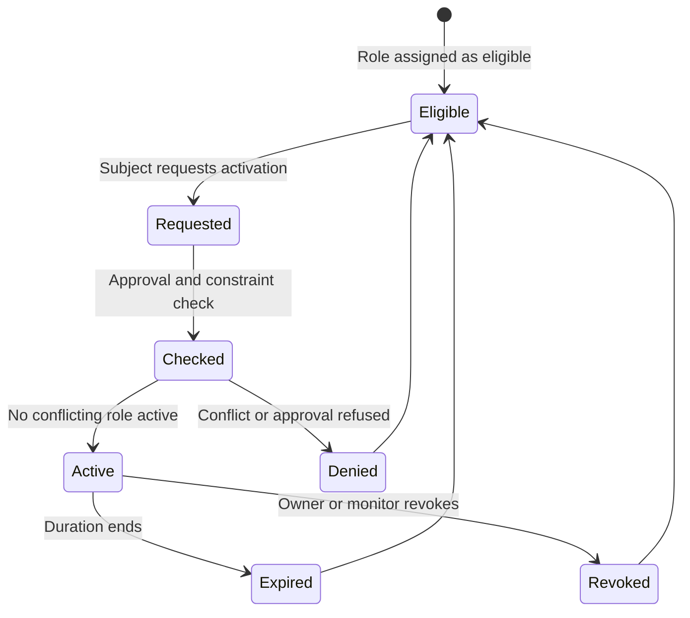

The state machine shows that the constraint check belongs in the transition from `Requested` to `Active`, not in the role definition. The implication is that SoD cannot be proven from the role catalog alone. It depends on the process that moves a subject into the active state, so the audit trail must record each transition with the identity of the approver.

### 5.2 Where SSD and DSD fail

Constraints are only as good as the conflict set. A pair that nobody lists is a pair that is not enforced. Build the conflict set from business process analysis, not from role names: for each sensitive process, list the steps that must be performed by different people, and map each step to the permission that performs it. The permissions are the stable thing. Role names change.

Constraints also fail through side doors. A subject who cannot hold both roles may still obtain the second capability through a shared service account whose credential they can read, through membership in a group that the constraint checker does not inspect, or through the administrative right to edit assignments. The last case is the most serious: a subject who can grant roles can remove the constraint's effect by granting the conflicting role to a colleague they control. Administrative roles therefore need their own constraints, and the ability to grant a role should be separated from the ability to hold it.

### 5.3 A worked check

Take 24 subjects in a finance team and the conflict set `{payee.create, payment.approve}`. An exhaustive check enumerates every subject's effective permission set (Section 4.3) and tests the pair. With an assumed average of 6 assignments per subject and 3 permissions per role, each subject has at most 6 × 3 = 18 permissions to examine, so the whole team is 24 × 18 = 432 permission tests, trivially cheap. The expensive part is not computation. It is keeping the permission inventory current when roles change, which is why the check belongs in an automated job and in the assignment workflow, not in a yearly spreadsheet. These numbers are illustrative.

## 6. Role Design and Role Explosion

### 6.1 Designing roles from duties

Roles should follow duties, not people. A role that exists because "Erin needs what Erin has" is a copy of one person's accumulated access, and it will carry every historical accident. Two approaches produce better roles, and they are best used together.

- **Top-down.** Start from business processes. List the tasks in each process, map each task to the permissions that perform it, and group permissions that are always needed together. The result matches how the organization describes work, and it exposes SoD conflicts early because each process step is explicit.
- **Bottom-up (role mining).** Collect existing assignments and look for permission sets that many subjects share. This finds the roles people already use, and it also reveals unused grants: permissions held but never exercised in the audit log. Mining reproduces existing excess if it is not paired with a top-down review, so treat its output as a candidate list.

A cohesive role passes three tests. A new member of the duty needs nearly all its permissions on day one. A reviewer can state its purpose in one sentence. Removing one permission would stop a real task, not merely reduce convenience.

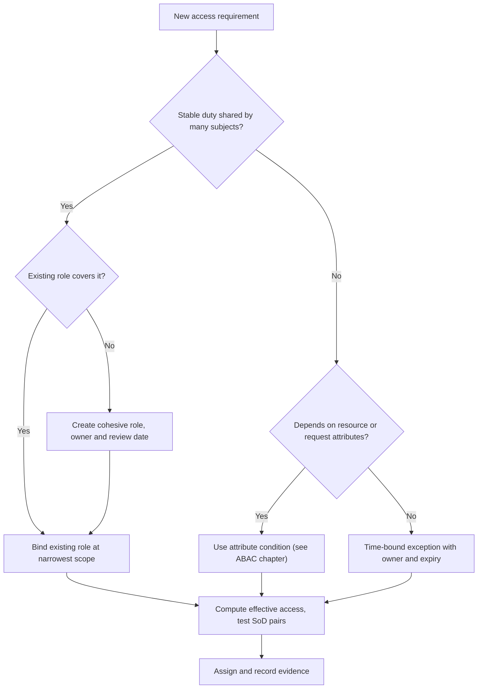

The decision tree puts the question of stability first. A requirement that applies to one person for two weeks is an exception, and it should expire. A requirement that depends on an attribute such as region or data classification is a condition. Only a stable duty justifies a role. The implication is that most requests do not result in a new role, which is the main defence against catalog growth.

### 6.2 How role explosion happens

Role explosion is the growth of the role catalog out of proportion to the number of distinct duties. The usual cause is encoding scope or attributes into role names. Consider an organization with illustrative dimensions:

- 4 business units
- 3 regions
- 5 duties (reader, analyst, approver, operator, administrator)

If each combination becomes its own role (`bu7-emea-approver`), the catalog has

$$
4 \times 3 \times 5 = 60 \text{ roles}.
$$

If the organization adds a fourth region, the count becomes $4 \times 4 \times 5 = 80$, so one new region adds 20 role definitions to create, document, and review. If instead scope carries the business unit and the region is an attribute condition, the catalog holds 5 roles regardless of how many business units or regions exist. Business unit becomes an assignment scope. The assignment rows still exist (up to 4 × 5 = 20 combinations of unit and duty), but they are data rows with an owner, not role definitions with semantics to maintain.

The distinction is the cost of review. A reviewer who must read 60 role definitions to decide whether `bu7-emea-approver` and `bu7-apac-approver` differ only by name will tend to approve all of them. A reviewer who reads 5 role definitions and inspects a table of scope assignments can answer the real questions: is this scope appropriate, and is this person still in the duty.

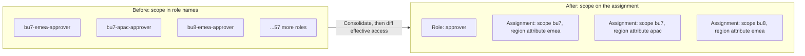

The diagram shows consolidation as a transformation, not a rewrite. Before retiring the 60 roles, compute each subject's effective permission set before and after. Any difference is either an unintended widening to fix or an unused grant that can be dropped. Measure unused grants from the audit log before removal, because dropping a permission that a quarterly process still needs causes an outage that teaches the organization to avoid cleanup.

### 6.3 Role explosion signals and limits

Signs that a catalog is drifting: roles whose names contain a place, a team, or a project; roles with a single member; pairs of roles whose permission sets differ by one entry; and a growing list of exceptions. Some products also impose a limit on the number of custom roles or assignments per scope. Look up those limits for the product in use at the time of design, since they differ between providers and change over time.

Consolidation has a ceiling. If a rule depends on many attributes of the object or request, such as amount, data classification, and customer tier, no practical number of roles expresses it, and the right answer is an attribute policy layered on top of a small role set. [ABAC](CH05_ABAC.md) covers when and how to make that change.

## 7. Administrative Roles and Escalation Paths

### 7.1 Roles that change the authorization system

Most roles let a subject act on business resources. A small class of roles lets a subject act on the authorization system itself. These administrative roles can grant or remove assignments, edit role definitions, change group membership, create credentials for other identities, impersonate other identities, or alter guardrails and audit settings. Any of these is a route to more authority than the subject was given, so the roles that hold them are the highest-value targets in the model.

**Privilege escalation** is any sequence of permitted actions that leaves a subject with more effective permissions than the assignment records show. The sequence usually looks legitimate at each step, because each step is an allowed API call. This is why a review of role names does not find escalation. It has to be found by asking, for each permission that touches the authorization system, what the holder can reach through it.

### 7.2 The usual escalation paths

Six paths account for most administrative escalation in role-based systems.

1. **Self-grant.** The subject can write assignments at a scope that includes itself and adds a stronger role.
2. **Edit the role.** The subject can change a role definition that it already holds, adding permissions. No assignment changes, so assignment-based review sees nothing.
3. **Edit a group.** The subject can add itself to a group that already holds powerful assignments. The assignment store is untouched, and the change appears only in the identity source.
4. **Mint a credential.** The subject can create a key, token, or secret for a more powerful non-human identity, and then act as it.
5. **Borrow an identity.** The subject can attach or pass a powerful identity to a compute resource that it controls, run code there, and inherit that identity's access.
6. **Weaken the guardrail.** The subject can remove a deny rule, a boundary, or an audit export, so that later actions are allowed or unseen.

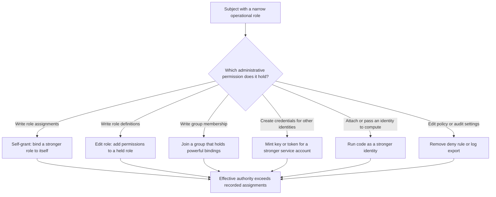

The diagram works as an audit checklist. For each branch, list the identities in the environment that hold the permission on the left, and ask whether the destination is acceptable for each of them. The implication is that "who can administer access" is a wider set than "who holds the administrator role". It includes everyone who holds any of the six permission classes at a scope that reaches a powerful target.

The providers expose these paths under different names. In Azure the permission to write role assignments (`Microsoft.Authorization/roleAssignments/write`) is what the Owner and User Access Administrator built-in roles carry, so holding it is the self-grant path. In Google Cloud, setting an IAM policy on a project or folder is the equivalent, and impersonating a service account (the `iam.serviceAccounts.actAs` permission, and token-creation permissions on a service account) is the borrow-an-identity path. In AWS the `iam:PassRole` permission, combined with the ability to create a compute resource that runs under the passed role, is the same path, and permissions that create new policy versions or attach policies are the edit-the-role path. Verify the exact permission names in current provider documentation before writing detection rules, because providers add permissions over time.

Kubernetes shows the same idea in a form the API server partly prevents. A subject who may create a `RoleBinding` normally cannot bind a role that has permissions it does not itself hold, unless it has been given the `bind` verb on that role, and a subject cannot add permissions to a role beyond its own unless it has the `escalate` verb on roles. Treat `bind` and `escalate` as administrative permissions. [Kubernetes Security](../12_Kubernetes/CH13_Security.md) owns the mechanics.

### 7.3 Drawing the boundary

Controls that limit escalation fall into four groups, and a sound design uses more than one.

- **Separate the powers.** Split the right to define roles, the right to assign them, and the right to hold them across different identities. The person who writes the `approver` role does not assign it, and neither of them approves payments. This is separation of duty applied to the access system.
- **Bound delegation.** Give delegated administrators a ceiling. Azure supports conditions on role assignments that restrict which roles a delegate may assign and to which principal types (verify current capabilities). AWS permission boundaries cap the permissions an identity can ever have, even if a policy attached later is broad, and organization-level Service Control Policies (SCPs) cap what any account in an organizational unit can do. Google Cloud offers IAM deny policies and predefined roles with narrow administrative scope for the same purpose.
- **Use separate administrative identities.** An administrator who reads email and browses the web with the same identity that can write assignments exposes the administrative role to phishing. Use a dedicated identity, with stronger authentication, for administrative actions only, and give it no mailbox and no daily-work roles.
- **Protect the guardrails from the guarded.** The identities that can edit deny rules, boundaries, and audit exports should not be the ones that those rules constrain. Keep them in a separate scope, with changes made through reviewed code and not by hand.

A boundary is only real if it is tested. Once a quarter, run an escalation test: from each class of operational identity, attempt each of the six paths in a non-production copy of the environment and record which ones succeed. A successful path is a finding, not a pass.

## 8. Privileged Access and Elevation

### 8.1 Standing access versus eligible access

A privileged role held permanently is **standing privilege**. It is available to anyone who obtains the credential, at any hour, whether or not the owner needs it. **Eligible access** reverses the default: the subject is entitled to activate the role, but holds nothing until it does. Activation is the moment where the system can ask for a reason, a ticket, a second approver, and a fresh strong authentication, and where it records start and end times.

Elevation of this kind is the practical form of dynamic separation of duty from Section 5.1. It also cuts exposure, which can be put in numbers. Take 12 administrators, each with a standing role for a 30-day month. Exposure is the number of hours at which a stolen credential would have administrative power:

$$
12 \times 24 \times 30 = 8{,}640 \text{ administrator-hours per month}
$$

Suppose, as an illustration, that each administrator needs the role about 4 times a month, for 2 hours each time. Exposure under elevation is

$$
12 \times 4 \times 2 = 96 \text{ administrator-hours per month}
$$

That is $96 / 8{,}640 \approx 1.1\%$ of the standing figure, a reduction of about 98.9%. The numbers are illustrative, and the real figure depends on how often elevation is needed. The effect still holds: exposure drops in proportion to the ratio of needed hours to total hours. The price is friction at activation, and that price is what makes teams ask for standing access back. Keep the activation path fast for routine work, with approval reserved for the most dangerous roles.

### 8.2 The elevation flow

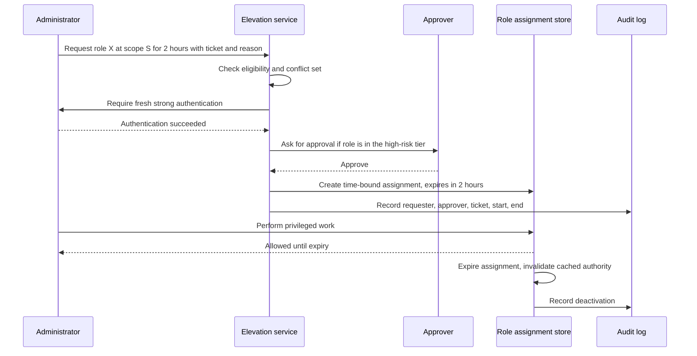

The flow puts four decisions at the activation point: eligibility, conflict, authentication, and approval. Two properties need checking in any product. First, expiry should delete or disable the assignment on the server side and not rely on the user to end the session. Second, expiry should reach caches and issued tokens within the revocation window from Section 3.3. A two-hour role that leaves a three-hour token alive is a three-hour role.

Provider products implement this pattern. Microsoft Entra Privileged Identity Management (PIM) offers eligible and time-bound assignments for Microsoft Entra roles and Azure resource roles, with approval and justification options. Google Cloud has Privileged Access Manager for time-bound, approval-gated grants. In AWS, the common approach is to assign permission sets through AWS IAM Identity Center with short session durations, or to put a request-and-approval workflow in front of role assumption. Product names and availability change, so verify them for the version in use.

### 8.3 What elevation does not fix

Elevation shortens exposure and creates evidence. It does not remove the escalation paths from Section 7.2, because an administrator who is active can still use them for the whole window. It also does not help if the approver rubber-stamps requests. Measure approval quality by the share of requests that are denied or sent back for more detail, and by how long the approver took. An approval rate of 100% with a median approval time of ten seconds is a sign that approval is not working.

Finally, elevation does not cover non-human identities well. A service account that holds an administrative role has no person to approve for it. Replace standing administrative roles on service accounts with narrower roles scoped to the one task, and require that anything that changes the authorization system goes through a reviewed pipeline whose own permissions are limited and logged.

## 9. Break-Glass Access

### 9.1 Why a bypass is required

Elevation depends on systems that can fail: the identity provider, the multi-factor authentication (MFA) service, the approval tool, and the network path to them. If the identity provider is down and the elevation service uses it for sign-in, nobody can activate the role that would repair the identity provider. **Break-glass access** is a small number of pre-arranged accounts or roles that work without those dependencies, so that a person can still restore the system. The name comes from the fire-alarm glass: the control is meant to be used rarely, visibly, and only in an emergency.

The design must resolve a conflict. The account must be strong enough to repair anything, so it is highly privileged. It must also be usable when the normal controls are unavailable, so it avoids them. The compensating controls are therefore physical and procedural, plus very loud detection.

### 9.2 Design rules

- **Few accounts, no daily use.** Two or three accounts, cloud-only (not federated to the identity provider that may be down), with names that do not reveal them. Nobody uses them for normal work.
- **Separate credential custody.** Long random passwords or hardware security keys, stored so that two people are needed to retrieve them, for example split between two sealed envelopes in different safes or between two vault custodians.
- **Exempt from the controls that depend on the failing system, and from nothing else.** Azure guidance for emergency access accounts is to exclude them from Conditional Access policies that could lock them out, and to protect them with a phishing-resistant method that does not depend on the failing path (verify current Microsoft guidance). Document each exemption and its reason.
- **Alert on any use.** Every sign-in or role assumption raises a high-priority alert to people who are not the account holders. An account that is used without a matching incident ticket is treated as a compromise.
- **Rotate after use.** Change the credentials as soon as the incident closes, because the person who used them has seen them.
- **Test on a schedule.** Prove that the accounts still work, that the alert fires, and that the retrieval procedure takes the time the runbook claims.

An example detection for an AWS role named `BreakGlassAdmin` (account number is a placeholder) is an Amazon EventBridge rule on the CloudTrail event that records the role being assumed:

```json
{
  "source": ["aws.sts"],
  "detail-type": ["AWS API Call via CloudTrail"],
  "detail": {
    "eventName": ["AssumeRole"],
    "requestParameters": {
      "roleArn": ["arn:aws:iam::123456789012:role/BreakGlassAdmin"]
    }
  }
}
```

Route the rule to a paging target outside the account that holds the role, so that the alert cannot be silenced by the role. Check where in your configuration the sign-in events for federated roles are recorded, since region and event source can differ; the pattern above is a sketch to adapt.

### 9.3 The root and super-administrator accounts

Each provider has an identity above the role model. The AWS account root user, the Google Workspace or Cloud Identity super administrator, and the Microsoft Entra global administrator role can change anything. Treat them as break-glass identities by default: strong, unshared authentication, no access keys on the AWS root user, and no routine use. Some tasks can only be done by the root user in AWS; look up the current list before relying on a general-purpose administrator role for them.

### 9.4 Worked check on test cadence

Suppose a break-glass credential has been rotated and is stored in two safes. Failure sources are practical: a safe combination changes, a hardware key battery fails, a custodian leaves. If the chance that at least one such failure has occurred in any quarter is an assumed 10%, and the organization tests every quarter, the chance that an emergency finds a broken credential is bounded by the 10% from the most recent quarter. If tests are yearly, four quarters of silent decay compound to

$$
1 - (1 - 0.10)^4 = 1 - 0.6561 \approx 34\%
$$

at the worst point just before the next test. The 10% is an assumption for illustration. The point is that the untested interval, not the strength of the credential, sets the chance of discovering a failure during the incident.

## 10. Role Mining and Access Recertification

### 10.1 Role mining with numbers

Role mining derives candidate roles from existing access. Start with a matrix of subjects and the permissions they exercise, taken from the audit log, not from what they were granted. Group subjects with similar sets, and propose a role for each cohesive group.

The common similarity measure is the Jaccard index between two permission sets, the size of the overlap divided by the size of the union. Take two sets from an illustrative finance team. Set A, held by report analysts, has 20 permissions. Set B, held by senior analysts, has 18. They share 15.

$$
|A \cup B| = 20 + 18 - 15 = 23, \qquad J(A,B) = \frac{15}{23} \approx 0.65
$$

A value of 0.65 suggests a shared base role of the 15 common permissions, with an add-on role for the 5 permissions only A holds and the 3 only B holds. Merging A and B into one role would give every member 23 permissions, which grants 5 permissions to the B group and 3 to the A group that they do not use. Whether to merge depends on how costly an extra role is against the cost of excess grants, and the answer is clearer for permissions that are dangerous than for those that are harmless.

Mining has three well-known limits. It reproduces existing excess when run on grants. It misses duties that nobody exercised in the sampled period, such as quarter-end close. And it is silent on separation of duty, since two frequently co-held permissions look like a good bundle. Use the output as candidates and review each one against the process view from Section 6.1.

### 10.2 Recertification

**Access recertification** (also called an access review) is the periodic process in which an owner confirms that each assignment is still needed. It is the main control against accumulation, and a poorly designed one becomes a form that everyone approves. Good reviews show the reviewer the evidence needed to decide: the role in plain words, the scope, when the subject last used the permission, and who else holds the same assignment.

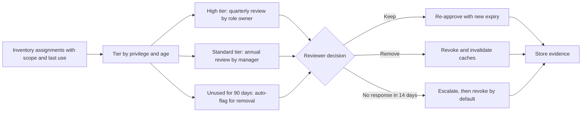

The diagram shows two design choices. The first is tiering: spending review time where the risk is. The second is the default on silence. If an unanswered review keeps access, reviewers learn that ignoring it is safe. Revoke by default for the high tier after escalation, and accept that this will sometimes cause a short outage that the process must be able to repair quickly.

The workload arithmetic shows why tiering matters. Take 3,000 assignments, of which 300 are in the high tier. Reviewing everything every quarter is $3{,}000 \times 4 = 12{,}000$ decisions per year. Reviewing the 300 high-tier assignments quarterly and the other 2,700 annually gives

$$
300 \times 4 + 2{,}700 \times 1 = 1{,}200 + 2{,}700 = 3{,}900 \text{ decisions per year}
$$

At an assumed 2 minutes per decision with the evidence shown, that is $3{,}900 \times 2 = 7{,}800$ minutes, or 130 hours, against $12{,}000 \times 2 = 24{,}000$ minutes, or 400 hours, for the all-quarterly option. If last-used data shows that an assumed 22% of assignments were unused for 90 days, the first step removes about $3{,}000 \times 0.22 = 660$ candidates before any human reads them, leaving 2,340 to review. All figures are illustrative.

### 10.3 What to measure

Three measures show whether recertification works. The **revocation rate**, the share of reviewed assignments removed, should be above zero in every cycle. A rate of 0% across thousands of assignments means the reviewers are not looking. The **time to complete**, since reviews that run past their deadline are skipped by the busiest and most senior people. The **post-review drift**, the number of new unreviewed assignments added since the last cycle, which shows whether the lifecycle controls in the next section are holding.

## 11. Provider RBAC Compared

The model is the same across providers, and the mechanics differ in ways that change the design. The table is a summary for architecture decisions, not a policy reference. [Cloud Identity and Access Management](../09_Cloud_Computing/CH09_IAM.md) owns policy syntax and evaluation algorithms, and [Kubernetes Security](../12_Kubernetes/CH13_Security.md) owns cluster RBAC mechanics.

| Aspect | AWS | Azure | Google Cloud | Kubernetes |
|---|---|---|---|---|
| Unit of permission | Actions in identity and resource policies | Actions and data actions in role definitions | Permissions bundled in roles | Verbs on resources in `Role` and `ClusterRole` |
| Assignment | Policy attached to a user, group, or role; roles are assumed | Role assignment at a scope | IAM binding of members to a role on a resource | `RoleBinding` or `ClusterRoleBinding` |
| Scope tree | Account and organization structure, plus resource elements in policies | Management group, subscription, resource group, resource | Organization, folder, project, resource | Cluster and namespace |
| Default | Deny unless allowed | Deny unless a role assignment allows | Deny unless a binding allows | Deny unless a binding allows |
| Restrictive controls | Explicit deny, permission boundaries, SCPs | Deny assignments (system-managed), role assignment conditions | IAM deny policies, conditions | None; permissions are additive only |
| Time-bound elevation | Short sessions, workflow in front of role assumption | Microsoft Entra PIM | Privileged Access Manager | Not built in; external tooling |
| Custom roles | Customer managed policies | Custom role definitions | Custom roles | `Role` and `ClusterRole` objects |

Three differences affect design most. AWS grants through policies attached to identities and does not model a role as an assignable bundle at a scope in the way Azure and Google Cloud do, so the equivalent of an assignment table has to be built from policy attachments and permission sets. Azure and Google Cloud both inherit assignments down a resource tree, so review must walk ancestors (Section 4.1). Kubernetes has no deny, so restriction has to come from not granting.

The Azure CLI, Google Cloud CLI, and Kubernetes forms of the same request, "give the finance-analysts group read access to the reports workload", show the shape of each model. Identifiers are placeholders.

```bash
az role assignment create \
  --assignee-object-id "<group-object-id>" --assignee-principal-type Group \
  --role "Reader" \
  --scope "/subscriptions/<subscription-id>/resourceGroups/rg-reports"

gcloud projects add-iam-policy-binding reports-prod \
  --member="group:finance-analysts@example.com" \
  --role="roles/viewer"
```

```yaml
apiVersion: rbac.authorization.k8s.io/v1
kind: RoleBinding
metadata:
  name: finance-analysts-view
  namespace: reports
subjects:
  - kind: Group
    name: finance-analysts
    apiGroup: rbac.authorization.k8s.io
roleRef:
  kind: ClusterRole
  name: view
  apiGroup: rbac.authorization.k8s.io
```

The Kubernetes example binds a reusable `ClusterRole` inside a single namespace, which is the scoped-binding pattern from Section 6. The Azure and Google Cloud examples show scope as a command argument. In every case the assignment, not the role, carries the location.

## 12. Joiner, Mover, and Leaver Lifecycle

### 12.1 Assignments as lifecycle data

Role assignments change when people change. The **joiner, mover, leaver** model names the three events that drive almost all changes. A joiner needs the baseline access for the duty. A mover needs the new duty's access and must lose the old duty's access. A leaver needs everything removed, including non-human credentials the person created. The authoritative source for these events is the system of record for workforce data, and the access system consumes its events.

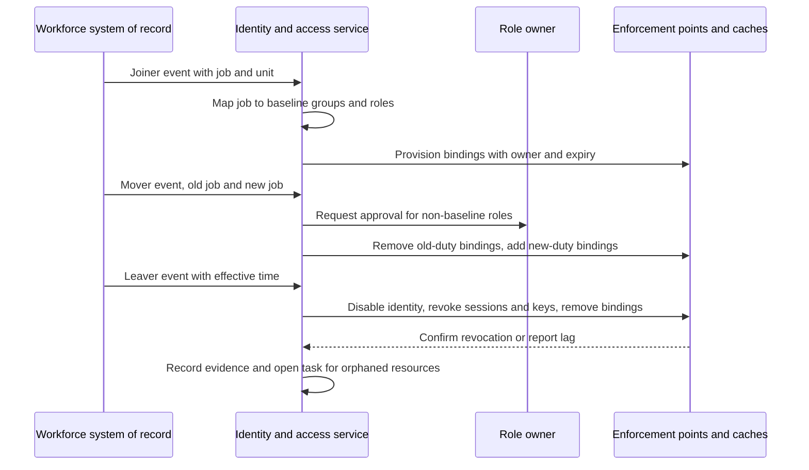

The sequence puts the mover step where most organizations are weakest. A joiner process is usually automated because the new person complains when it is missing. A leaver process has attention because of audit. A mover has neither: the person is happy with extra access and nobody complains, so access from every earlier role stays. The picture shows the mover step doing two things in one transaction, adding the new access and removing the old, and the old access is removed unless the owner of that role re-approves it.

### 12.2 Accumulation arithmetic

The cost of ignoring movers can be calculated. Assume a person receives 10 assignments on joining and changes duty three times, and each new duty adds 8 assignments of which 6 belong only to that duty. If old-duty access is never removed, the person holds

$$
10 + 3 \times 8 = 34 \text{ assignments}
$$

whereas a correct mover process leaves about $10 + 8 = 18$ assignments if the baseline stays and the old duty-specific ones are removed (a simplification, since the count after removal depends on how many are baseline). The difference of 16 are leftover grants. Across 400 people with a similar history, that is $400 \times 16 = 6{,}400$ unnecessary assignments, each a possible path in a compromise and each a decision in the next recertification. These counts are illustrative, and they show why removal at move time is cheaper than review after the fact.

### 12.3 Revocation and its evidence

A leaver event must reach three places: the identity source, the assignment store, and every cache and token already issued. State the end-to-end revocation window for each class of access and test it. The worst case is the sum of independently cached layers (Section 3.3). For example, with an assumed 60-minute token lifetime, a 5-minute group cache, and a 10-minute assignment cache, the worst-case delay for a revocation that is not pushed is $60 + 5 + 10 = 75$ minutes. If the policy says high-risk access must end within 15 minutes, the design must shorten the token, add revocation checks for high-risk roles, or push invalidation.

Test by doing it. Disable a test account that is part of an active session, then measure the time until the first denied request at each enforcement point. Keep the result as evidence, along with the list of non-human credentials the person owned and their new owners. Credentials that outlive their owner, such as an access key in a pipeline, are the most common leftover.

Periodic reviews still matter after a good lifecycle process. They catch what events cannot: access that was granted by hand outside the process, roles whose meaning has changed, and groups with members that nobody can explain. Use the measures from Section 10.3 to see whether the lifecycle process and the reviews agree.

## 13. Failure and Quality-Attribute Scenarios

### 13.1 Writing scenarios that can be tested

A quality-attribute scenario for access control has a stimulus (an event that stresses the model), an expected response (what the design does), and a success criterion that a test or a report can measure. The thresholds below are illustrative targets for a mid-sized organization. Replace them with figures from your own risk appetite, and keep the form.

| Scenario | Stimulus | Expected response | Measurable success criterion |
|---|---|---|---|
| Compromised administrator account | An attacker holds the credential of one operations administrator | Role and scope boundaries confine the attacker. Elevation is not active, so no administrative role is usable. Alerts fire on any attempt at the escalation paths in Section 7.2 | Effective permissions of the identity touch one business unit only. Zero of the six escalation paths succeed in the quarterly test. First alert within 5 minutes. All sessions revoked within 15 minutes |
| Role explosion after a reorganization | Two business units merge and a fifth region opens | The change is made by re-scoping assignments and editing attribute values. No role definition is cloned | Role catalog size is unchanged. The change is applied and verified within 2 working days. Effective-access diff shows only the intended differences |
| Orphaned privileged assignments | A contractor with an administrative role leaves, and a pipeline service account loses its owner | The lifecycle job disables the identity, removes assignments, and reassigns or retires credentials owned by the leaver | Zero privileged assignments held by disabled or ownerless identities at the daily check. Detection within 24 hours. Removal within 1 working day |
| Conflicting duty by group nesting | A group holding `payee.create` is nested inside a group holding `payment.approve` rights | The nightly effective-access job flags the pair and the assignment workflow blocks the change | Conflict detected before the change takes effect, or within 24 hours if it was made out of band. Open conflicts at month end: zero without a signed exception |
| Stale access after removal | A person is removed from a privileged group during an incident | Access ends inside the stated revocation window | High-risk access ends within 15 minutes. All other access ends within 75 minutes, which is the worst-case sum in Section 12.3 |

### 13.2 Compromised administrator contained by role boundaries

The compromised-administrator scenario is the one that justifies most of the design. Work through it with the model in hand.

The attacker has the credential of Priya, an operations administrator for business unit 7. Priya holds `ops-admin` scoped to business unit 7 and, as an eligible role, `access-admin` that she activates for a few hours a month. The attacker logs in.

1. The attacker sees the standing assignment only. `access-admin` is eligible, not active, so the paths that need it (self-grant, edit role, edit group) are unavailable until activation. Activation requires fresh strong authentication and, for this role, an approver. The attacker cannot satisfy either.
2. With `ops-admin` at business unit 7 the attacker can act on that unit's resources. The scope tree from Section 4.1 stops the reach there: business unit 8 and the organization scope are not in any assignment.
3. The attacker tries to mint a credential for a stronger service account. The permission to create credentials for other identities is not in `ops-admin`, and the permission boundary on administrators denies it. The attempt is logged.
4. The detection rule on denied authorization-system calls from an administrator identity raises an alert. The on-call responder disables the identity and revokes issued tokens.

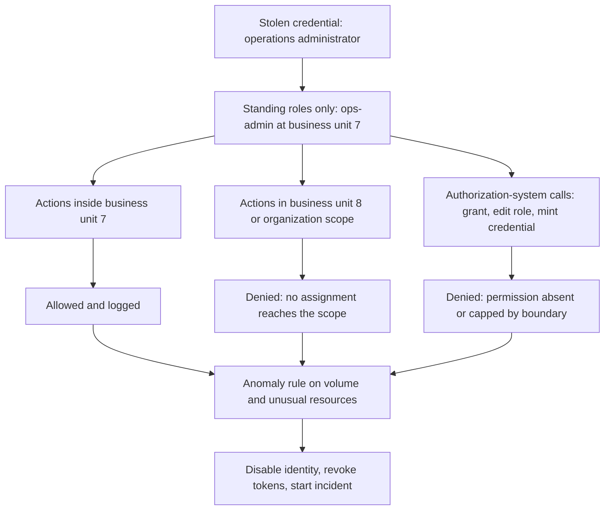

The diagram shows that containment comes from three separate layers: scope, absence of administrative permission, and a boundary that caps what delegated administrators can obtain. Detection is a fourth layer that works on the denials. The implication for design is that the blast radius of a stolen credential can be computed in advance as the union of its standing roles at their scopes (Section 4.3). If that union is larger than the organization is willing to lose, the fix is to shrink the standing roles, not to buy more detection.

### 13.3 Role explosion after a reorganization

Take the illustrative catalog from Section 6.2 in its exploded form: 4 business units, 3 regions, and 5 duties, giving 60 roles. A reorganization merges business units 7 and 8 into one unit and opens a fourth region.

With scope in role names, the merged unit needs roles for its 4 regions and 5 duties, so $1 \times 4 \times 5 = 20$ new definitions, and the 2 old units each held $3 \times 5 = 15$ roles, 30 in total, which must be retired after their members are moved. That is 20 creations, 30 retirements, and a migration of every member between them. With scope on the assignment, the work is to re-scope the existing assignments for units 7 and 8 to the merged node and to add one region attribute value. The catalog stays at 5 roles. The success criterion is the unchanged catalog size and a clean effective-access diff. Any subject whose effective permissions changed beyond the merge is a defect to investigate before the change is accepted.

### 13.4 Orphaned privileged assignments

An orphan is an assignment whose subject can no longer be accountable for it. Three kinds are common: a human who has left and whose identity was not disabled everywhere, a service account whose owner moved teams, and a group with no remaining owner that still carries an administrative binding.

The detection is a join between the assignment store and the workforce record. Privileged assignments are listed with subject, owner, last use, and expiry, and the following are flagged: subject disabled, subject not found, owner missing, last use older than 90 days, and no expiry on a role in the high tier. Run the join daily. A weekly run lets an orphan live for up to 7 days, and a monthly run up to 30, which is the interval that decides how long the exposure lasts, in the same way as the test interval in Section 9.4.

The remedy is a default: privileged assignments carry an expiry, and an ownerless credential is disabled after a grace period. The consequence of the default is that something will occasionally stop working, and the process must offer a fast path to reinstate an assignment with a named owner. A rule with no fast path for the legitimate case is abandoned within a quarter.

## 14. Auditing Role Assignments

### 14.1 What the audit record must answer

Audit is the evidence side of the lifecycle. It has to answer four questions about any assignment without searching email: who holds it, who granted it and why, what it allowed during the period of interest, and when and why it ended. The record in Section 3.4 supplies the first two. The access log supplies the third. The elevation flow in Section 8.2 supplies the fourth for temporary roles.

Events to record at the assignment store: assignment created, changed, and removed; role definition changed; group membership changed; elevation requested, approved, activated, and expired; and every denied call to an authorization-system permission. Each record carries the acting identity, the target, the scope, the time, the ticket or reason, and the result.

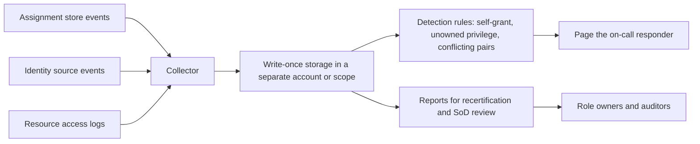

The diagram places storage in a separate scope from the identities it records. The implication is that an attacker who gains administrative rights cannot edit the history of what they did, which is the sixth escalation path (weaken the guardrail) applied to the evidence. Retention should be set from the longer of the regulatory and the investigation need for your sector, and stated in the design, not assumed. Check that the retention and the data-access rules for the audit store are themselves covered by recertification, since the people who read audit data can learn who holds which access.

### 14.2 Audit questions worth automating

Four queries cover most review needs: every assignment of a high-tier role and its age; every subject whose effective set contains a conflicting pair (Section 5.3); every role whose definition changed in the period, with the author and approver; and every use of a break-glass identity matched to an incident ticket (Section 9.2). Run these on a schedule and keep the output as evidence, so that an audit asks for a file rather than starting an investigation.

## 15. Worked Case: Consolidating Roles at a Mid-Sized Insurer

This case is hypothetical and illustrative. The organization, the figures, and the findings are invented to show the reasoning, and no real company is represented. The arithmetic is shown so that it can be redone with real inputs.

### 15.1 Starting point

Harbor Mutual (an illustrative name) is a regional insurer with 1,800 employees, 6 business units, and 4 regions. Its claims and payments platform has grown for ten years. The access inventory shows:

- 410 roles in the catalog.
- 14,200 role assignments to people and service accounts.
- Role names that encode business unit and region, for example `bu3-north-claims-approver`.
- 38 people with standing administrative roles on the platform.
- No scheduled check for conflicting duties, and an annual review where every manager approves all of their team's assignments in one click.

The audit finding that started the project was a payee-and-payment conflict. The leadership question was whether the catalog could be made reviewable without stopping claims processing.

### 15.2 Decisions

**Decision 1: one role per duty, scope on the assignment.** Role mining across the audit log grouped the 410 roles by the permissions they were exercised for. 336 of them were combinations of 14 duties across 6 business units and 4 regions, since $14 \times 6 \times 4 = 336$. The other 74 were one-off roles for individuals or projects. The target is 14 duty roles, each bound at a business unit scope, with region as an attribute condition evaluated by the application ([ABAC](CH05_ABAC.md)).

**Decision 2: a small, separate administrative tier.** The 74 one-offs were examined individually. 22 were administrative in effect, because they contained permissions in the six classes of Section 7.2. Those were merged into 6 administrative roles, split by power: define roles, assign roles, manage groups, manage service credentials, approve payments for support cases, and edit audit settings. No person may hold two of the first three. The final catalog is $14 + 6 = 20$ roles, a reduction of $(410 - 20)/410 \approx 95.1\%$. The remaining 52 one-offs were replaced by time-bound exceptions or absorbed into duty roles.

**Decision 3: eligible administrative access.** The 38 administrators move from standing to eligible access. Standing exposure is $38 \times 24 \times 30 = 27{,}360$ administrator-hours per month. Using the observed activity of about 3 activations a month at 2 hours each, elevated exposure is $38 \times 3 \times 2 = 228$ hours, which is $228 / 27{,}360 \approx 0.83\%$ of the standing figure.

**Decision 4: a tiered recertification.** Of the 14,200 assignments, 22% (3,124) had no use in the previous 90 days, leaving 11,076. After consolidation, standard-tier access is held by baseline groups and reviewed as one bundle per person per year, which is 1,800 decisions. The high tier has 576 assignments reviewed quarterly, which is $576 \times 4 = 2{,}304$ decisions. The total is $1{,}800 + 2{,}304 = 4{,}104$ decisions a year. At an assumed 2 minutes per decision that is $4{,}104 \times 2 = 8{,}208$ minutes, or about 137 hours. The old process was one annual pass over 14,200 assignments, or $14{,}200 \times 2 = 28{,}400$ minutes, about 473 hours, and the reviews were not evidence-based.

**Decision 5: revocation windows stated and tested.** The high-risk policy requires access to end within 15 minutes of removal. The design sets a 10-minute token lifetime for administrative sessions, a 2-minute group cache, and a 2-minute assignment cache, so the worst case is $10 + 2 + 2 = 14$ minutes. Lower-risk access keeps a 60-minute token, a 5-minute group cache, and a 10-minute assignment cache, for a worst case of 75 minutes.

### 15.3 Rejected alternatives

| Alternative | Reason rejected |
|---|---|
| Keep the 410 roles and add a review tool | The review tool would show the same 410 names. Reviewers could not tell `bu3-north-claims-approver` from its neighbours, and the catalog would keep growing with each reorganization |
| One role per person from mining output | Reproduces existing excess and has no cohesion test. It would have turned 14,200 assignments into 1,800 roles that nobody could explain |
| Express region as a role dimension | Adds 4 values to every duty and business unit pair, and each new region would add $14 \times 6 = 84$ definitions. Region is a property of the data, so an attribute condition fits it |
| Remove standing administrator access with no emergency path | An outage of the identity provider would leave nobody able to repair it. A pair of break-glass accounts under Section 9 was added instead |
| Hard deny rules for conflicting duties only | The product in use offers no deny at the assignment layer. Constraints had to be enforced by the assignment workflow and by the nightly effective-access job |

### 15.4 Migration sequence

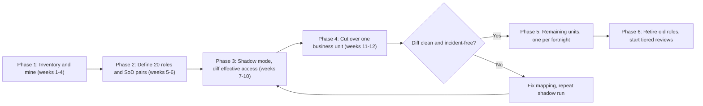

The sequence keeps the old roles in place until the new bindings have been compared against them. In shadow mode, the effective-access job computes both sets for every subject. A subject who would lose a permission they used in the last 90 days is reviewed before cutover. A subject who would gain access is a defect in the mapping. The gate after the first business unit gives a reversible step: the old roles still exist, so a bad mapping is repaired by switching bindings back rather than by rebuilding the catalog.

### 15.5 Validation evidence

The project closed when the following evidence existed, and each item can be reproduced from stored output.

- **Conflict scan.** Before: 57 subjects whose effective set held both `payee.create` and `payment.approve`, found by the first run of the effective-access job. After: 0, with 3 exceptions held in a signed exception register that expires in 90 days.
- **Effective-access diff.** All 1,800 subjects compared. 1,742 matched exactly after removing unused grants. 58 had differences, each resolved as a mapping fix (41) or an accepted removal (17), since $41 + 17 = 58$.
- **Escalation test.** Six paths from Section 7.2 against 4 classes of operational identity gives $6 \times 4 = 24$ attempts in the non-production copy. Zero succeeded. The one that first succeeded during the pilot, a self-grant through a group-management permission, was removed before the test counted.
- **Revocation test.** Ten test accounts removed from privileged groups during active sessions. The longest time to first denial was 13 minutes against a 15-minute criterion.
- **Elevation records.** In the first full month, 111 activations against an expected 114, since $38 \times 3 = 114$. Approvers rejected or sent back 9, which is 8.1% of 111. All activations had tickets.
- **Break-glass test.** Both accounts signed in during the quarterly test, the alert reached the on-call responder in under 5 minutes, and the credentials were rotated afterwards.

### 15.6 What the case does not show

The case does not claim that the 95.1% reduction is typical. It depended on a catalog that was mostly one pattern repeated. A catalog with truly distinct roles would shrink less. The estimates of 2 minutes per review decision and 3 activations per month are assumptions, and a pilot should replace them with measured values before the workload and exposure figures are used in a business case.

## 16. Common Mistakes and Anti-Patterns

| Mistake | Typical cause | Consequence |
|---|---|---|
| Scope in role names | Roles created to match a request quickly, without a scope model | Catalog grows as $\text{units} \times \text{regions} \times \text{duties}$ and reviewers stop reading definitions |
| Reviewing roles one by one only | Review tooling lists roles, not subjects | Conflicting duties across roles go unseen, as in the payee and payment pair in Section 4.3 |
| Resource view shows direct assignments only | Tool built per resource | Access inherited from ancestors is missed, and the real reach is understated |
| Administrator roles used for daily work | Convenience, and fear of delays at activation | A phished daily identity holds the power to change the access system |
| Role that can edit its own definition | Permission to write roles granted along with permission to use them | Escalation with no change to assignments, so assignment-based review is blind to it |
| Review that approves by default | Reviewers shown names and not use or scope, no consequence for silence | Revocation rate near 0% and accumulated access that nobody remembers granting |
| Mover process missing | Joiner and leaver have owners, movers do not | Access accumulates with each change of duty, as in the 34 versus 18 arithmetic in Section 12.2 |
| Long-lived tokens carrying group claims | Optimization to avoid identity source lookups | A removal takes effect after the token lifetime, which defeats the stated revocation window |
| Break-glass accounts never tested | The credential is stored and forgotten | The first real test is the incident, with a failure chance that rises with the untested interval |
| Service accounts with administrative roles | A pipeline needed one permission and received a broad role | No person to approve elevation, and a credential that stays valid after its owner leaves |
| Roles used instead of object checks | A role is treated as enough for tenant isolation | One tenant reads another's data, because a role covers a kind of action and not a particular object |
| Mining output accepted unchanged | Mining is quick and its output looks objective | Existing excess becomes the new baseline, and quarter-end duties missing from the sample are dropped |

Two of these deserve a longer note. The first is roles used instead of object checks. A role says that a subject may read invoices in a business unit. It does not say that the subject may read invoice 4411, which may belong to a customer that business unit may not see. The application must still check ownership or tenant on each object ([API Security](../08_API_Architecture/CH09_API_Security.md)). The second is deny rules used to patch an over-broad grant. Each deny added to a broad role is a note that the original grant was too high. Fix the grant, because denies multiply review cost and can conflict with later additions.

## 17. Design-Review Checklist

Use the checklist at design review and again at each recertification cycle. Each item should have a named evidence source.

**Model and scope**

- [ ] Roles are defined by duty, and each has a one-sentence purpose and a named owner.
- [ ] Scope is on the assignment, not in the role name, and the scope tree is documented.
- [ ] Role hierarchy is either absent or listed, with a rule that a change to a base role triggers review of every ancestor.
- [ ] A catalog size and growth figure is reported, with a trigger for investigation.

**Effective access**

- [ ] An effective-access report exists per subject, with all paths including groups and ancestor scopes.
- [ ] Conflicting permission pairs are defined as data and checked at assignment time and nightly.
- [ ] Exceptions are in a register with an owner and an expiry.

**Administration**

- [ ] The right to define roles, assign them, and hold them is split across identities.
- [ ] The six escalation paths are tested at least quarterly and results kept.
- [ ] Delegated administrators have a ceiling through boundaries or conditions.
- [ ] Administrators use separate identities for administrative work.

**Privileged access**

- [ ] High-tier roles are eligible and time-bound, with approval for the most dangerous ones.
- [ ] Expiry removes access on the server side and within the revocation window.
- [ ] Break-glass accounts exist, are alerted on, are rotated after use, and are tested on a schedule.

**Lifecycle and evidence**

- [ ] Joiner, mover, and leaver events come from the workforce system of record.
- [ ] The mover process removes old-duty access unless the owner re-approves it.
- [ ] The revocation window is stated per layer, summed, and tested.
- [ ] Recertification is tiered, shows last use, and revokes by default on silence for the high tier.
- [ ] Audit records are in a separate scope, cover role changes and denied administrative calls, and have a stated retention.
- [ ] Negative tests exist for access that must be denied, including sibling-prefix resource names and cross-tenant objects.

## 18. Exercises

1. **Effective access.** A subject is in groups `a` and `b`. Group `a` holds role `R1` (permissions `x`, `y`) at business unit 3. Group `b` holds `R2` (permissions `y`, `z`) at the organization. The subject also has a direct assignment of `R3` (permission `w`) on one project in business unit 5. List the effective permissions on a resource in business unit 3 and on one in business unit 5.

   *Outline:* On business unit 3: `x`, `y` from `R1`, plus `y`, `z` from `R2` at the organization, giving `{x, y, z}`. On business unit 5 resources outside the project: `{y, z}` only. On the project in business unit 5: `{w, y, z}`. The point is that scope matters per resource and that the organization-level assignment reaches everywhere.

2. **Role explosion.** An organization has 7 business units, 5 regions, and 6 duties. Compute the catalog size with scope in role names, and with scope on the assignment and region as an attribute. What does adding one region cost in each design?

   *Outline:* $7 \times 5 \times 6 = 210$ roles against 6 roles. A new region adds $7 \times 6 = 42$ definitions in the first design and 0 in the second, where it adds an attribute value. Mention the assignment rows ($7 \times 6 = 42$ at most) as data to review.

3. **Self-modifying role.** A support role includes the permission to update role definitions "so that support can fix typos in descriptions". Explain the escalation and propose controls.

   *Outline:* A holder can add permissions to the role they hold, with no assignment change. Remove role-write from operational roles, put definition changes behind a reviewed pipeline, and alert on changes to role definitions by any identity that holds the role.

4. **Revocation window.** Tokens last 45 minutes, group claims are cached for 10 minutes, and assignments for 5. Policy requires 20 minutes for high-risk access. Compute the worst case and propose two changes.

   *Outline:* $45 + 10 + 5 = 60$ minutes. Shorten tokens for high-risk roles to 5 minutes (giving $5 + 10 + 5 = 20$ minutes, which just meets the limit) or lower group cache to 2 minutes, and add push invalidation or per-request revocation checks for the high tier.

5. **Elevation exposure.** Fifteen administrators each need a role for about 6 hours a month. Compare standing and eligible exposure over a 30-day month.

   *Outline:* Standing $15 \times 720 = 10{,}800$ hours. Eligible $15 \times 6 = 90$ hours, which is $90 / 10{,}800 \approx 0.83\%$. Discuss activation friction and the approval-quality measures from Section 8.3.

6. **Recertification workload.** 5,000 assignments, 400 in the high tier. High tier is reviewed quarterly and the rest annually, at 2 minutes a decision. Compare against an annual review of everything.

   *Outline:* Tiered: $400 \times 4 + 4{,}600 = 6{,}200$ decisions, $6{,}200 \times 2 = 12{,}400$ minutes, about 207 hours. Annual all: $5{,}000$ decisions, 10,000 minutes, about 167 hours. The tiered option costs more in hours and buys four looks a year at the dangerous assignments. Discuss pruning by last use to pay for it, and why the cheaper option fails on risk.

7. **Break-glass design.** Your identity provider is also the sign-in source for the elevation tool. Design the emergency path and list what you would test.

   *Outline:* Two cloud-only accounts outside federation, split credential custody, exempted from the controls that depend on the failing system and from no others, alert on any use, rotation after use, and a scheduled test of sign-in, alert delivery, and retrieval time.

8. **Role or condition.** Claims approvers may approve up to a limit that depends on their grade, and only for claims in their region. Choose among roles, scopes, and attribute conditions for each part.

   *Outline:* The duty `claims-approver` is a role. Business unit is a scope on the assignment. Region and the limit by grade depend on attributes of the claim and the person, so they are conditions evaluated by the application or an attribute policy ([ABAC](CH05_ABAC.md)). A role per grade and region would multiply the catalog.

## 19. Summary

RBAC puts one level of indirection between subjects and permissions, and the quality of a design shows in how well that indirection stays reviewable. The chapter's outcomes map to its sections as follows.

| Outcome from the Introduction | Where it was taught | The short version |
|---|---|---|
| Define the core entities | Section 2 | Subjects, roles, permissions, assignments, scopes, and sessions. Scope belongs on the assignment |
| Trace an access check | Section 3 | Resolve subject and groups, match assignments by scope, union permissions, deny by default. Caches set the revocation window as a sum |
| Compute effective access | Sections 4 and 5 | Union over direct, group, and ancestor paths. Conflicts across roles appear only at subject level |
| Explain inheritance, hierarchy, and constraints | Sections 4 and 5 | Scope inheritance is additive and role hierarchy widens silently. SSD blocks at assignment and DSD at activation, and each needs a conflict set |
| Choose role, scope, or condition, and show role explosion | Sections 6, 10, and 15 | Stable duties become roles, location becomes scope, contextual rules become conditions. Scope in names grows multiplicatively |

The later sections applied the model to operations. Administrative roles are the highest-value targets, and the six escalation paths show why (Section 7). Elevation and break-glass access limit exposure and keep repair possible (Sections 8 and 9). Mining and tiered recertification keep the catalog and the assignments reviewable (Section 10). Lifecycle events keep assignments current, and revocation windows need to be stated and tested (Section 12). Scenarios turn these ideas into measurable criteria (Section 13), audit evidence makes them provable (Section 14), and the case in Section 15 shows the whole approach on one hypothetical organization.

Carry three habits from the chapter. Compute effective access per subject, not per role. Treat every permission that touches the authorization system as part of the administrative tier. Put a number on every window, whether it is a revocation delay, an exposure period, or a review interval, and test it. When the dynamic attributes of a request carry the rule, move to [ABAC](CH05_ABAC.md) rather than letting the role catalog grow.
