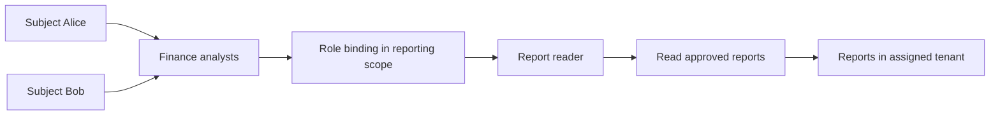
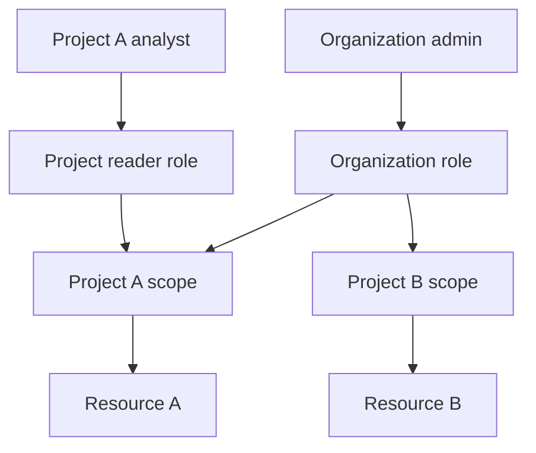
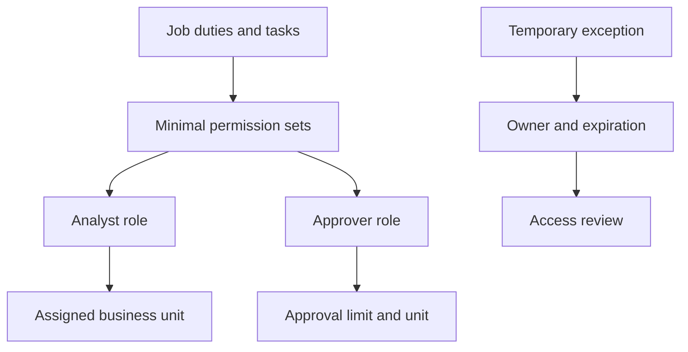
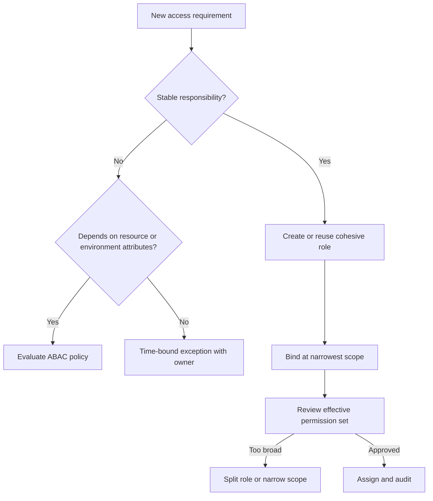
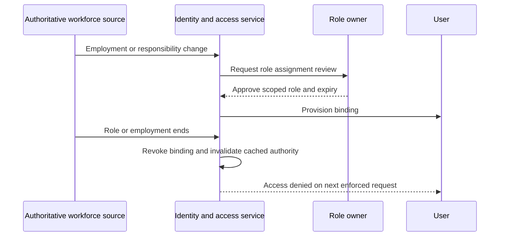

# RBAC (Role-Based Access Control)

Part: [15 — Security](PART_OVERVIEW.md)

Role-Based Access Control (RBAC) assigns permissions to roles and assigns subjects to those roles. It simplifies administration when responsibilities form stable groups, but poorly scoped roles lead to privilege inheritance, role explosion, and access that persists after job changes. Part 09 owns provider-specific identity and access syntax; Part 12 owns Kubernetes RBAC mechanics.

## Users, Roles, Permissions, and Scope

An RBAC model includes subjects, roles, permissions, and assignments. A permission pairs an action with a resource scope. A role groups permissions for a job function or operational duty. A binding assigns a subject or group to a role within a scope. Keep role names meaningful and scopes as narrow as practical.

Avoid conflating user groups with permissions. Groups organize subjects; roles define authority; bindings establish where authority applies. If a role can administer other role bindings, it may indirectly grant itself broader access and should be treated as privileged.

## Scope, Hierarchy, and Effective Access

Roles can be scoped to an organization, project, tenant, namespace, or resource. Inheritance simplifies administration but makes effective permission harder to see. Document whether child scopes inherit parent roles, whether deny rules exist, and how exceptions override inherited grants. Users need a way to inspect why a decision was permitted.

Evaluate effective access through all bindings, groups, inherited roles, and direct grants. Review both intended access and unintended paths. A user with several individually narrow roles can accumulate broad permissions; analysis must consider the union, not each role in isolation.

## Role Design and Role Explosion

Start with job responsibilities and separation-of-duty needs, then create roles with cohesive permissions. Too few roles produce broad grants; too many roles create complexity and stale assignments. Use scope and reusable permission sets to limit duplication. Avoid encoding every user attribute into a new role when ABAC is better suited to dynamic context; CH05 owns attribute-based policy.

When role count grows, inspect why: scope differences may be modeled as bindings, temporary needs may use elevation, and contextual rules may require ABAC. Consolidation must not accidentally broaden permissions. Measure unused grants and stale assignments before removing them.

## Privileged Access and Lifecycle

Privileged roles require stronger controls: separate administrative identities, time-limited elevation, approval for sensitive actions, and audit. Joiner/mover/leaver workflows should grant, change, and revoke role bindings based on an authoritative source. A role removal should propagate to sessions and caches within a defined revocation window.

Periodic access reviews should present effective permissions, resource scope, last-used evidence, and owner. Require removal or re-approval; passive attestation without context is weak. Test revocation through active sessions and service caches, not just the role database.

## Worked Case and Review Checklist

A finance application has analyst, approver, and administrator roles. Analysts can read reports in assigned business units; approvers can approve transactions up to a documented limit but cannot create payees; administrators manage the service but cannot approve their own financial actions. Temporary support elevation expires automatically and is audited.

Review role purpose, permission cohesion, scope, inheritance, effective access, conflicting duties, privileged elevation, lifecycle source, expiry, access review, revocation delay, and role count growth. Verify negative access cases and separation of duties in tests.

## Questions and Summary

1. Draw a subject-to-role-to-permission graph with scope and inheritance.
2. How can several narrow roles combine into excessive effective authority?
3. Choose between a new role, scoped binding, and ABAC condition for a regional restriction.
4. Design a joiner/mover/leaver process with a measurable revocation window.
5. Identify and mitigate a role that can modify its own permissions.

RBAC is effective when duties are stable, roles are cohesive, and scope is explicit. It becomes risky when inheritance and role accumulation obscure effective access. Govern assignments as lifecycle data, review privileged roles, test revocation, and use ABAC when dynamic attributes are a better fit than an ever-growing role catalog.
