# ABAC (Attribute-Based Access Control)

Part: [15 — Security](PART_OVERVIEW.md) · Status: Revised (in-depth rewrite)

## 1. Introduction

Attribute-Based Access Control (ABAC) decides whether a request is allowed by evaluating policy rules against attributes: facts about the subject making the request, the resource being touched, the action requested, and the environment in which the request happens. A rule such as "a clinician may read a record when the record's `department` equals the clinician's `department` and the device is managed" names no role and no individual. It names relationships between attributes, so one rule covers every clinician, every record, and every device.

After this chapter you should be able to:

- Explain the ABAC reference model (policy enforcement, decision, information, and administration points) and trace a request through it.
- Classify attributes by category and source, and state what makes an attribute trustworthy enough to appear in a security rule.
- Read and write policy rules, explain how combining algorithms resolve conflicts, and describe what a missing attribute does to a decision.
- Describe how the major cloud providers expose ABAC and where each one stops.
- Calculate how long a changed attribute takes to take effect, and design the refresh path so that number meets a revocation requirement.
- Decide between role-based and attribute-based models for a given requirement, including hybrids.

### 1.1 Ownership boundaries

This chapter owns the attribute-based model, attribute governance, policy evaluation behavior, and the failure behavior of attribute-driven decisions. Neighbouring chapters own related material, which is recapped here only as far as needed:

- [Authorization](CH03_Authorization.md) owns the general request-to-policy model, least privilege, and separation of duties.
- [RBAC](CH04_RBAC.md) owns role-centric policy, role lifecycle, and role explosion as a topic in its own right.
- [Authentication](CH02_Authentication.md) and [OpenID Connect](CH07_OIDC.md) own how a subject's identity and claims are established and carried in tokens.
- [Zero Trust](CH08_Zero_Trust.md) owns the architecture that makes continuous, context-aware decisions a design principle.
- Part 09 (Cloud Computing) owns provider-specific policy syntax and limits. This chapter shows only small sketches to make the mechanism concrete.
- Part 21 owns the threat-model document artifact. This chapter uses attacker perspective to analyze attribute-based decisions but does not define the document format.

## 2. From Roles to Attributes

### 2.1 The problem attributes solve

A role bundles permissions for a job function. That works while the question "may this person do this?" depends on one dimension: what the person's job is. Real requirements add more dimensions. A support engineer may read customer records only for customers in the region they cover, only during an assigned shift, only for tickets assigned to them, and only from a managed device. Expressed as roles, each combination of dimension values needs its own role.

An illustrative calculation. An organization has 6 departments, 4 regions, and 3 data classification levels (public, internal, restricted). To express "members of department D may read data of classification C in region R" with roles, it needs one role per combination:

$$6 \times 4 \times 3 = 72 \text{ roles}$$

Hiring into a seventh department adds $4 \times 3 = 12$ roles, each with its own owner, review, and assignment. With ABAC the same requirement is one rule comparing `subject.department == resource.department`, `subject.region == resource.region`, and `subject.clearance >= resource.classification`. The seventh department adds zero rules; it adds a value to an attribute that already exists. The rule count stays flat while the number of attribute values grows.

The cost moves rather than disappears. The roles version needs 72 reviewed objects. The ABAC version needs every subject and every resource to carry correct `department`, `region`, and `classification` attributes, and it needs the rule to be right. A wrong rule or a missing attribute can grant or deny access to every resource at once. Sections below treat that cost directly.

### 2.2 Choosing between roles and attributes

The decision depends on what varies per request and how stable it is. Roles express responsibility: stable, human-readable, and easy to review ("who is a billing administrator?"). Attributes express context and relationships: they vary per subject, resource, or request and are often supplied by systems rather than people.

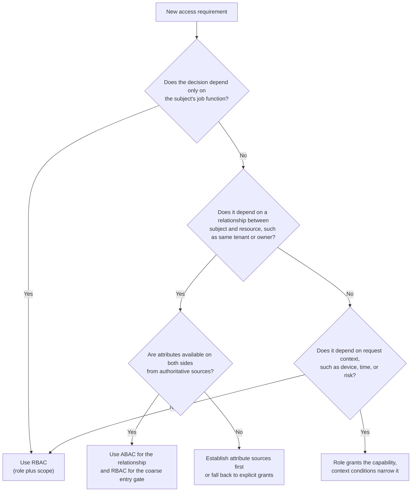

Most production systems end at the hybrid branches. A role answers "is this person ever allowed to perform this kind of action?" and attributes answer "is this particular request, on this particular resource, in this particular context, within that allowance?". Pure ABAC is rare because someone still needs to decide who may administer policies, and that is a role-shaped question. Pure RBAC is rare in multi-tenant systems because "same tenant" cannot be expressed sensibly as a role without one role per tenant.

The decision tree has two implications. First, the existence of attributes is a precondition, not a given. If no authoritative source supplies resource classification, the ABAC rule that references it is only as good as whoever tags resources by hand. Second, an ABAC rule often gates a smaller set of cases than first imagined, because the role layer already removed most subjects before attributes are evaluated. That is a performance benefit as well as a clarity one.

## 3. The ABAC Reference Model

### 3.1 Four functional points

The vocabulary of ABAC comes from two sources: the National Institute of Standards and Technology (NIST) Special Publication 800-162, "Guide to Attribute Based Access Control (ABAC) Definition and Considerations", and the OASIS eXtensible Access Control Markup Language (XACML) standard, whose architecture most policy engines still mirror. They describe functions, not products, and one process may play several.

- The Policy Enforcement Point (PEP) sits in the request path of the protected operation. It intercepts the request, asks for a decision, and enforces the answer. It makes no policy judgments of its own.
- The Policy Decision Point (PDP) evaluates policy against the request's attributes and returns a decision.
- The Policy Information Point (PIP) supplies attributes that the request did not carry: a database lookup, a directory query, a call to a device-management service.
- The Policy Administration Point (PAP) is where policies are authored, versioned, reviewed, and published to decision points.

The separation matters because each point fails differently and is attacked differently. A compromised PEP can ignore decisions. A compromised PIP can lie about attributes without touching policy. A compromised PAP can rewrite the rules. A design that conflates them cannot say which control protects which risk.

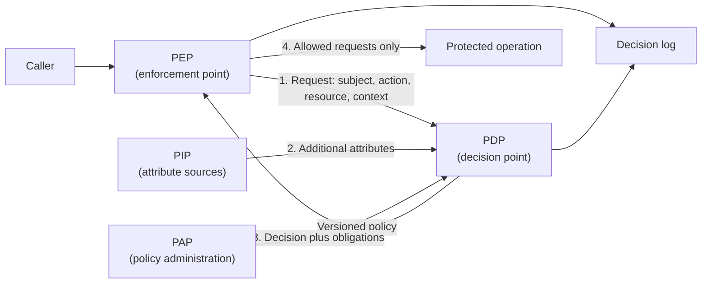

The diagram shows the control flow for one request. The PEP builds a request with the attributes it already has (the authenticated subject, the action, the resource identifier). The PDP fetches the remaining attributes through the PIP, evaluates policy, and returns a decision. Two implications follow. The PEP must sit where it cannot be bypassed: if a service has a second entry point such as a batch job or an internal endpoint with no PEP, the model protects nothing on that path. And the decision log is the only way to reconstruct why a request was allowed, so both PEP and PDP write to it with the policy version in use.

### 3.2 Decision values and obligations

A XACML-style decision is one of four values:

| Decision | Meaning | Typical PEP behavior |
| --- | --- | --- |
| Permit | A rule applies and allows the request | Execute the operation |
| Deny | A rule applies and refuses the request | Reject |
| NotApplicable | No rule matched the request | Reject under default deny |
| Indeterminate | Evaluation could not finish, for example a required attribute was missing or a function errored | Apply the action's failure policy, normally reject |

The distinction between Deny, NotApplicable, and Indeterminate is useful operationally. A rising rate of NotApplicable suggests a policy gap or a new kind of request. A rising rate of Indeterminate suggests a broken attribute source. Collapsing all three into "denied" hides which team needs to act. Section "Performance and Failure Behavior" returns to failure policy later in the chapter.

A decision may also carry obligations: actions the PEP must perform with the decision, such as "log this access to the audit stream", "redact the `salary` field", or "require a fresh step-up authentication". If the PEP cannot honour an obligation it must treat the decision as a Deny; a Permit with an ignored obligation is a silent downgrade of the policy.

### 3.3 Where the points live

Placement is a design decision with consequences for latency and freshness.

| Placement | How it works | Strength | Weakness |
| --- | --- | --- | --- |
| Embedded library | PDP and PEP in the same process, policy loaded from files or a bundle | No network hop, works during outages | Policy updates must be distributed, version skew across instances |
| Sidecar | PDP runs beside each service instance, PEP calls it over loopback | Language independent, local latency | One more process to patch and monitor |
| Central service | PEP calls a shared PDP over the network | One place to update and audit policy | Adds a network dependency and latency to every call |
| Gateway enforcement | PEP at an API gateway, coarse decisions only | One enforcement point for many services | Cannot see resource attributes that only the service knows |

Gateways are good for coarse attributes (subject, route, device posture) but poor for fine-grained resource rules, because the gateway usually does not know the owner or classification of record 8841. Fine-grained decisions need enforcement inside or beside the service that owns the data. [Authorization](CH03_Authorization.md) discusses where authorization checks belong in an architecture; this chapter takes the position that coarse checks can be centralized while resource-relationship checks stay close to the data.

## 4. Attributes: Categories, Sources, and Trust

### 4.1 The four categories

Attributes are grouped by what they describe. XACML names the categories subject, resource, action, and environment, and NIST uses the same split.

| Category | Describes | Examples | Usual source |
| --- | --- | --- | --- |
| Subject | Who or what is acting | `department`, `employment_status`, `clearance`, `groups`, `tenant_id` | Identity provider, human resources system, directory |
| Resource | What is being acted on | `owner`, `classification`, `tenant_id`, `project`, `region` | Resource metadata, data catalog, tags, the database row itself |
| Action | What is being attempted | `read`, `write`, `delete`, `export`, `approve` | The request, defined by the API |
| Environment | The circumstances | `device_compliant`, `network_zone`, `time`, `risk_score`, `mfa_age_seconds` | Device management, network, risk engine, system clock |

The categories matter when asking whom an attribute can be trusted from. The caller controls some of what appears in a request and not the rest. A caller can choose the action and the resource identifier. A caller must never be able to choose the value of their own `clearance`, the `classification` of a resource, or the `device_compliant` flag. A common design error is to accept any of these as a request parameter or an unsigned header because it is convenient, which turns the policy into a self-service form.

### 4.2 Provenance, integrity, and freshness

A policy rule is only as strong as its weakest attribute. Each attribute that appears in a rule needs answers to five questions, which an attribute catalog should record:

1. Owner. Which team is accountable for correctness?
2. Authoritative source. Which system is the system of record, and are copies derived from it?
3. Who can write it. Can the subject, a manager, an administrator, or only an automated pipeline set the value? An attribute the subject can edit cannot constrain the subject.
4. Freshness. How old may the value be when used, and how does it change propagate?
5. Failure behavior. If the value is missing, stale, or unreadable, what does the rule do?

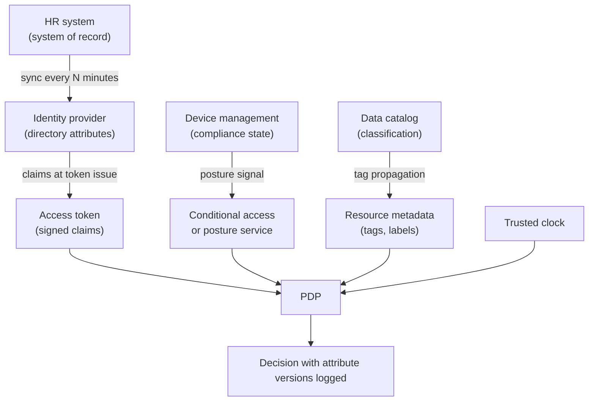

The diagram traces provenance paths. Each arrow is a point where an attribute can become stale, get overwritten, or be forged. The HR sync interval, the token lifetime, and the tag propagation delay all add to the time between a real-world change and an enforced one. Section "Attribute Change and Revocation" turns that into arithmetic.

### 4.3 Signed claims versus fetched attributes

An attribute reaches the PDP in one of two ways, and the choice shapes both security and latency.

Claims in a token. The identity provider embeds subject attributes in a signed token, such as a JSON Web Token (JWT) issued through OpenID Connect (OIDC). The PDP verifies the signature and reads the claims without any lookup. The value is as old as the token: if a user moves department at 10:00 and the token was issued at 09:30 with a one-hour lifetime, enforcement sees the old department until 10:30. Tokens are best for attributes that change rarely and where a bounded delay is acceptable.

Fetched at decision time. The PIP queries the authoritative source on each decision or through a short cache. This is fresher and supports attributes that change per request (current device posture, current risk score), but it adds latency and makes the decision depend on the source's availability.

A practical split is to put stable subject attributes (employee identifier, tenant) in the token and fetch volatile ones (device posture, resource classification, ticket assignment) at decision time. Tokens must carry only attributes the issuer is willing to vouch for, and the PDP must verify signature, issuer, audience, and expiry before trusting any claim; [OpenID Connect](CH07_OIDC.md) covers that verification.

### 4.4 Attacks on attributes

From the attacker's perspective, ABAC replaces "get the right role" with "get the right attribute values", and several attack paths follow:

- Attribute self-assertion. The attacker edits a profile field, request header, or resource tag that the policy trusts. Defense: only trusted pipelines write security-relevant attributes, and writes are audited.
- Tag manipulation. In cloud ABAC, where access depends on resource tags, a principal allowed to change tags can grant themselves access by retagging. Defense: restrict who can set the tag keys used in policies, and treat tag-write permission as equivalent to the access the tags control.
- Stale-value exploitation. The attacker keeps using a token or cached decision after the underlying attribute changed. Defense: bound lifetimes and use revocation signals for high-risk attributes.
- Attribute confusion. Two sources use the same attribute name with different meanings, such as `region` as a sales territory in one system and a data residency region in another. A rule joins them silently. Defense: namespaced attribute names and a catalog that defines meaning.
- Injection through attribute values. A value containing delimiters or wildcards is interpolated into a policy condition or a query. Defense: treat attribute values as data, never concatenate them into policy text.
- Missing-attribute bypass. A rule written as "deny when `classification == restricted`" is silently skipped for a resource with no `classification`. Defense: write rules so absence fails safely, as the next section shows.

## 5. Policy Expressions and Evaluation

### 5.1 Anatomy of a rule

A policy rule has four parts. A target says which requests the rule is about, so the engine can skip it cheaply. A condition is a boolean expression over attributes. An effect is Permit or Deny. Optional obligations travel with the effect. Policies group rules, and a combining algorithm says how to merge the effects when several rules apply.

The following is a provider-neutral sketch in YAML. It is illustrative, not the syntax of any product.

```yaml
policy: documents-read
combining: deny-overrides
rules:
  - id: tenant-isolation
    effect: deny
    target: { action: read, resource.type: document }
    condition: subject.tenant_id != resource.tenant_id
  - id: restricted-needs-managed-device
    effect: deny
    target: { action: read, resource.type: document }
    condition: resource.classification == "restricted" and subject.device_compliant != true
  - id: same-department-read
    effect: permit
    target: { action: read, resource.type: document }
    condition: subject.department == resource.department and subject.clearance_level >= resource.classification_level
```

Reading it as an engine would: for a `read` of a document, evaluate all three rules. If any deny rule's condition is true, the result is Deny. Otherwise, if the permit rule's condition is true, the result is Permit. Otherwise no rule applies and default deny produces the final refusal.

The two deny rules encode invariants that must hold regardless of what any permit rule says. Tenant isolation is the clearest case: one deny rule guarantees that no later, more generous rule can leak data across tenants.

### 5.2 Combining algorithms

When more than one rule applies, the combining algorithm resolves them. XACML defines several; the ones to know are these.

| Algorithm | Resolution | Use when |
| --- | --- | --- |
| Deny-overrides | Any Deny wins over any Permit | Safety invariants such as tenant isolation; the usual default for authorization |
| Permit-overrides | Any Permit wins over any Deny | Rare; risky because an additional permissive rule silently overrides a prohibition |
| First-applicable | The first rule whose target matches decides | Ordered rule lists; rule order becomes security-critical |
| Only-one-applicable | Exactly one policy may apply, more than one is Indeterminate | Forces policy authors to keep scopes disjoint |

Deny-overrides is preferred in most cases because policy changes are monotonic in a safe direction: adding a permit rule can only widen access for requests that no deny rule covers, and invariants stay in force. First-applicable is easier to read as a list but makes the order a hidden dependency; a reordering commit can change who gets access without altering any rule text.

### 5.3 Evaluation order and the missing-attribute case

An engine evaluates in a fixed order: find applicable policies from targets, evaluate conditions (fetching attributes as needed), combine effects, and apply default deny. The handling of missing data is the part that most often causes incidents.

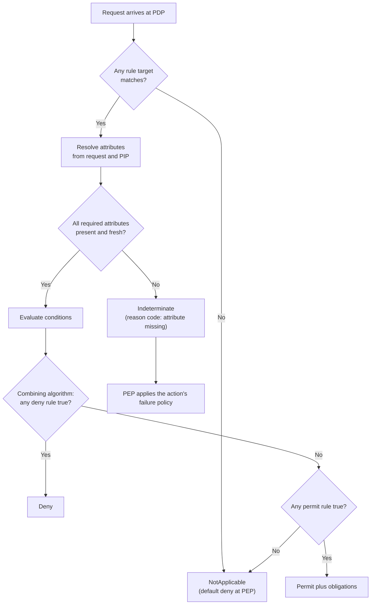

The diagram makes the decision values from the reference model concrete. The branch to watch is the availability check. Many engines evaluate a condition such as `subject.device_compliant != true` with an absent attribute as an error, as false, or as an unknown value, depending on the language. If the engine treats an error inside a deny rule as "rule does not apply", a missing posture attribute quietly removes a prohibition. The safer pattern is to make rules fail toward refusal:

- Write permit conditions positively (`device_compliant == true`) so absence yields no permit.
- For deny invariants, check presence explicitly (`not exists(resource.classification)` leads to Deny or Indeterminate), so an untagged resource cannot slip through.
- Configure the engine so that evaluation errors produce Indeterminate, and make the PEP refuse on Indeterminate for sensitive actions.

Test this with a deliberately untagged resource and a deliberately missing posture value. If the result is Permit, a rule is written unsafely.

### 5.4 Worked evaluation

An illustrative request: user `u-731` in `department=oncology`, `tenant_id=t-9`, `clearance_level=2`, `device_compliant=true`, reads document `d-204` with `tenant_id=t-9`, `department=oncology`, `classification=restricted`, `classification_level=3`.

1. Target matching selects all three rules.
2. `tenant-isolation`: `t-9 != t-9` is false, no deny.
3. `restricted-needs-managed-device`: classification is restricted and `device_compliant` is true, so the condition `device_compliant != true` is false, no deny.
4. `same-department-read`: departments match, but `2 >= 3` is false, so the permit condition is false.
5. No Deny, no Permit: NotApplicable, and default deny refuses.

The explanation recorded for the operator should name the failed comparison (`clearance_level 2 < classification_level 3`) without writing the document's sensitive attributes into a widely readable log. If the user's clearance is raised to 3 by the authoritative source, the same request would Permit with no policy change. This is the practical benefit: access follows the data about people and resources, not edits to rules.

## 6. ABAC in the Major Cloud Platforms

Cloud providers implement a restricted form of ABAC inside their authorization engines. The restriction is the point: the provider's engine can only see attributes the provider holds (principal tags, resource tags, request context), and only on services that integrate with it. Part 09 owns the provider syntax and current limits; this section covers the mechanism and where each stops.

### 6.1 AWS: tags and condition keys

In AWS Identity and Access Management (IAM), attributes are tags on principals and resources, plus request context keys. A policy compares them using condition keys such as `aws:PrincipalTag/<key>` and `aws:ResourceTag/<key>`, and policy variables substitute the principal's value into the condition. A sketch:

```json
{
  "Version": "2012-10-17",
  "Statement": [{
    "Effect": "Allow",
    "Action": ["s3:GetObject"],
    "Resource": "arn:aws:s3:::example-data/*",
    "Condition": {
      "StringEquals": {
        "aws:ResourceTag/project": "${aws:PrincipalTag/project}"
      }
    }
  }]
}
```

One policy now serves every project: a principal tagged `project=alpha` can read objects tagged `project=alpha`. Principal tags can come from the IAM role or user, or be passed as session tags when a role is assumed through federation, so identity-provider attributes can become authorization attributes. AWS evaluation applies an explicit Deny over any Allow, and default deny otherwise, which matches the deny-overrides model above. Two points need checking in current AWS documentation: which services support resource-tag-based authorization for which actions, since support is per service and per action, and the limits on tag keys and session tags. The AWS documentation on attribute-based access control is the place to confirm both.

The attack path from the previous section applies directly: a principal allowed to call tag-modification actions on a resource can change `project` and gain access. Policies must therefore restrict who may set the tags that other policies trust, typically by denying tag changes on those keys except to a provisioning role.

### 6.2 Azure: role assignment conditions and custom security attributes

Azure combines roles and attributes in one construct. Azure role-based access control assigns a role at a scope, and Azure attribute-based access control adds a condition to the role assignment that narrows when the assignment applies, for example only for blobs whose index tag matches an attribute of the caller. The caller's attributes can be Microsoft Entra ID custom security attributes, which are key-value pairs defined by an administrator on users and applications and managed by a separate, privileged set of roles. The role grants the capability and the condition filters it, which is the hybrid shape recommended earlier. At the time of writing, role assignment conditions support a limited set of Azure services and actions; verify the current list and the condition syntax in the Azure documentation before depending on a service.

### 6.3 Google Cloud: IAM Conditions and tags

Google Cloud Identity and Access Management binds a principal to a role on a resource, and an IAM condition makes the binding conditional with an expression written in Common Expression Language (CEL). A condition can reference request time, resource name and type, and, where supported, resource tags. For example, a binding may be limited to a time window or to resources under a name prefix. Google Cloud also offers policies that restrict which resources a principal can use at all, independent of the roles it holds. As with the other providers, conditions are only available for certain resource types and roles; check the current documentation before relying on one.

### 6.4 What the cloud engines do not give you

Provider ABAC governs access to provider resources. It does not govern access inside your own application's data: which customer record a support agent may open, or which invoice a manager may approve. For that, you need either an application-level PDP (an embedded library, a sidecar, or a central service) or fine-grained checks in the application's own code. A common mistake is to assume cloud tag-based access control substitutes for application authorization. It controls who can reach the storage bucket; it does not decide which rows a request handler returns from it.

| Aspect | AWS | Azure | Google Cloud |
| --- | --- | --- | --- |
| Attribute carrier | Principal and resource tags, session tags, request context keys | Custom security attributes, resource attributes such as blob index tags | Resource tags, request attributes, resource names |
| Attribute mechanism | IAM policy conditions | Role assignment conditions | IAM Conditions (CEL) |
| Combination model | Explicit deny overrides allow, default deny | Role plus condition, deny assignments exist separately | Allow bindings with conditions, separate deny policies exist |
| Coverage | Per service and per action; verify | Limited set of services at the time of writing; verify | Per resource type and role; verify |
| Main risk | Tag-write permission equals access | Control of attribute definitions and condition authoring | Over-broad bindings, unsupported resource types |

## 7. Attribute Change and Revocation

### 7.1 Staleness stacks along the path

When an attribute changes in the real world (a person changes department, a device falls out of compliance, a document is reclassified), enforcement only changes after the change has crossed every stage between the source and the PEP. Each stage has its own refresh interval, and in the worst case the intervals add.

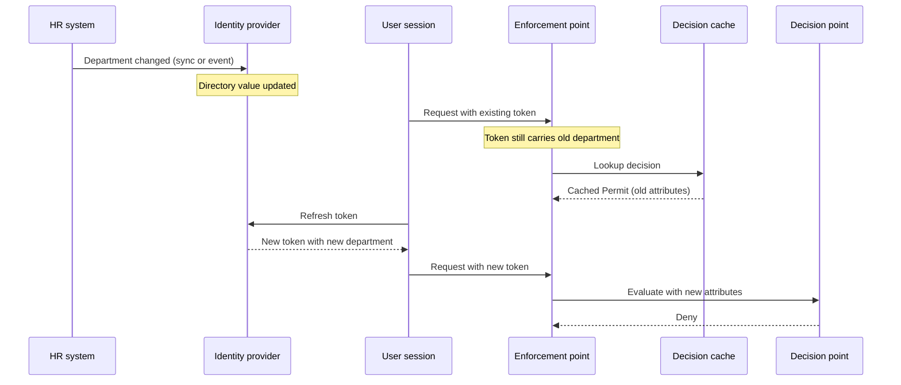

The sequence shows three places the old value survives after the source has changed: the directory before the sync runs, the token until it expires or is refreshed, and the decision cache until its entry expires. Access is revoked only once all three have caught up.

### 7.2 Worked calculation

An illustrative scenario. A hospital policy gives access to restricted records by `department`. The revocation requirement for restricted data is that a department change must take effect within 15 minutes. The current design is:

- HR to identity provider sync every 15 minutes (worst case 15 minutes before the change is visible).
- Access token lifetime 60 minutes, carrying `department` as a claim.
- Decision cache entry lifetime 5 minutes.

Worst-case delay is the sum:

$$15 + 60 + 5 = 80 \text{ minutes}$$

That is more than five times the requirement. Three changes can be considered:

| Option | Calculation | Worst case | Cost |
| --- | --- | --- | --- |
| Shorten token to 10 minutes | $15 + 10 + 5$ | 30 minutes | 6 times as many token issuances |
| Fetch `department` from the directory at decision time | $15 + 0 + 5$ | 20 minutes | Directory load per decision, new availability dependency |
| Event-driven change push (about 1 minute), 10-minute token, 1-minute cache for restricted resources | $1 + 10 + 1$ | 12 minutes | Event pipeline to operate, more cache misses |

The third option meets the 15-minute requirement. Its token cost for 10,000 active users: at a 60-minute lifetime each user needs about 1 issuance per hour, so 10,000 per hour. At 10 minutes, each user needs 6, so 60,000 per hour, which is $60{,}000 / 3{,}600 \approx 16.7$ issuances per second on average. Peaks around login times will be higher, and that figure should be checked against the identity provider's capacity and published quotas, which differ by product and plan.

The numbers are illustrative, but the method is general: list every stage between the source and the enforcement point, find each stage's maximum staleness, and sum them. If the sum exceeds the requirement, cut the largest term first. For urgent revocations such as a compromised device, a push signal that invalidates sessions and caches is more reliable than shortening every interval. Continuous-evaluation protocols exist in some identity products for this purpose; confirm what your identity provider supports.

### 7.3 Attribute changes that widen access

Revocation is the defensive concern, but delays also affect grants. A newly assigned department is not effective until the same stages complete. That is usually acceptable, but a long-lived attribute override created "temporarily" by an administrator needs an expiry. An attribute with no expiry that grants access has become a standing entitlement under another name, and the access reviews described in [RBAC](CH04_RBAC.md) must include these.

## 8. Policy Complexity and Explainability

### 8.1 Where the complexity goes

The earlier arithmetic showed ABAC replacing 72 roles with one rule. The complexity has not vanished. It has moved into expressions, where it is harder to see than a list of role names. A role can be reviewed by reading its permission list. An expression has to be executed, mentally or mechanically, against combinations of attribute values, and the number of combinations grows quickly.

Three patterns make policies hard to reason about:

- Nested exceptions. A permit rule grows clauses such as `and not (subject.contractor and resource.project == "p-12")` as each incident or request adds a special case. After a dozen of these nobody can say what the rule permits without running it.
- Implicit precedence. With first-applicable combining, or with engines that apply rules in file order, the meaning of a rule depends on rules above it. Moving a rule changes access without changing any rule text.
- Duplicated conditions. The same tenant check is pasted into forty rules. When the tenant model changes, thirty-nine are updated and one is forgotten, and that one is the leak.

The countermeasures are structural. Separate invariants from grants: a small set of deny rules (tenant isolation, legal hold, minimum authentication strength) that apply to everything, written once, and a larger set of permit rules that each describe one business reason for access. Give every rule an identifier and an owner, because an unowned rule cannot be retired. Keep each rule to one concern, so that "same department" and "managed device" are separate conditions with separate failure explanations rather than one long conjunction. Prefer deny-overrides, as described earlier, so that adding a permit rule cannot weaken an invariant.

A rough size signal helps. If a single rule has more than about five conditions, or a policy set needs a diagram to be understood, treat that as a prompt to split it. There is no standard threshold, so choose one for your team and enforce it in review.

### 8.2 Policy as code

Policies are code in every practical sense: they change behavior, they have bugs, and a bad change reaches production fast. Store them in version control, require review by a policy owner and a security reviewer for changes to invariants, and publish them as versioned bundles that the decision point loads atomically. A decision log entry that names the bundle version lets an investigator replay the decision later with the exact rules that were in force.

Engines differ in how much structure they impose. Open Policy Agent (OPA) uses a general-purpose policy language where the author chooses the structure. Cedar, the language used by AWS Verified Permissions, builds default deny and forbid-overrides-permit into the language and can analyze policies for properties such as whether one policy set permits more than another. A language with fixed combining semantics removes one class of authoring mistakes. A general language gives more flexibility and more ways to make mistakes. Check each project's current documentation for the analysis features it offers before choosing on that basis.

### 8.3 Explaining a decision

An authorization system that cannot explain itself is hard to operate. Support staff need to tell a user why access was refused, auditors need to see why it was granted, and policy authors need to see which rule produced a surprising result. The explanation is a product of the evaluation, so design it in rather than reconstructing it afterward.

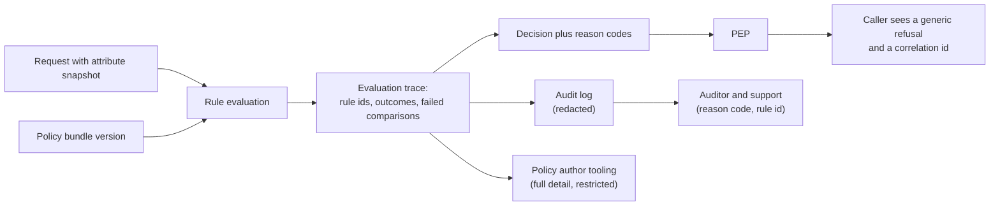

The diagram separates three audiences with different needs. The caller receives a generic refusal and a correlation identifier, because a detailed message ("you lack clearance 3") tells an attacker which attribute to target. Support and auditors receive the rule identifier and a reason code from a fixed vocabulary such as `DENY_TENANT_MISMATCH`, `NOT_APPLICABLE`, or `INDETERMINATE_ATTRIBUTE_MISSING`. Policy authors get the full trace in a restricted tool, including the attribute values that were compared, because they need them to debug.

A decision record might look like this:

```json
{
  "decision_id": "7f3c0e",
  "time": "2026-11-05T09:14:22Z",
  "policy_bundle": "docs-policy@2026-11-03.4",
  "action": "read",
  "resource": "document/d-204",
  "decision": "NotApplicable",
  "reason_codes": ["PERMIT_CONDITION_FALSE"],
  "rules_evaluated": ["tenant-isolation", "restricted-needs-managed-device", "same-department-read"],
  "failed_comparison": "same-department-read: clearance_level < classification_level",
  "attribute_versions": { "subject": "tok:iat=1762333200", "device": "posture:v118" }
}
```

The record carries the comparison that failed and the version of each attribute source, but not the sensitive attribute values themselves. Those can be fetched by an authorized investigator from the versioned sources if needed. This keeps the log useful without turning it into a second copy of the most sensitive data. Two operational points follow. Sampling decision logs for permits is acceptable for volume reasons, but denies and Indeterminate results should be kept in full, since they carry the signal about policy gaps and broken sources. And log retention for decision records should be set with the data owner, because the log reveals who accessed what.

## 9. Policy Testing and Simulation

### 9.1 What can go wrong in a change

A policy change can fail in four ways, and each needs a different test. The rule may be wrong (a typo in an attribute name makes a condition never true). The rule may be right but interact badly with another rule (a new permit that a missing deny should have blocked). The attribute data may not match the assumptions of the rule (the rule expects `classification` as a string and one source supplies a number). Or the rule may be correct and the real traffic contains cases nobody imagined. Unit tests address the first, scenario matrices the second and third, and shadow evaluation the fourth.

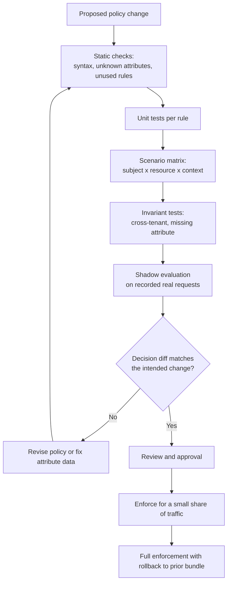

The pipeline is ordered by cost and by how early a mistake can be found. Static checks and unit tests run in seconds on every commit. Shadow evaluation needs recorded production requests and takes longer, so it runs before approval. The canary stage limits damage from anything that still slipped through, and the rollback path matters as much as the rollout: a bundle versioning scheme that cannot be reverted in minutes is a risk in itself.

### 9.2 Unit tests and the scenario matrix

Unit tests give each rule a set of requests with the expected decision. Write them as data, not code, so that policy owners who are not programmers can read them:

```yaml
tests:
  - name: same dept, enough clearance, managed device
    subject: { tenant_id: t-9, department: oncology, clearance_level: 3, device_compliant: true }
    resource: { tenant_id: t-9, department: oncology, classification: restricted, classification_level: 3 }
    action: read
    expect: permit
  - name: cross tenant is denied whatever else is true
    subject: { tenant_id: t-1, department: oncology, clearance_level: 9, device_compliant: true }
    resource: { tenant_id: t-9, department: oncology, classification: restricted, classification_level: 3 }
    action: read
    expect: deny
  - name: untagged resource must not permit
    subject: { tenant_id: t-9, department: oncology, clearance_level: 3, device_compliant: true }
    resource: { tenant_id: t-9, department: oncology }
    action: read
    expect: not_permit
```

The third test uses `not_permit`, which accepts Deny, NotApplicable, or Indeterminate. Asserting the exact refusal value is brittle, while asserting that no Permit occurs captures the safety property.

A scenario matrix extends this by generating combinations. For each attribute that appears in a rule, choose representative values: a matching value, a non-matching value, a boundary value, and a missing value. The number of combinations is the product of the choices, which shows why the matrix has to be generated and not written by hand. For the example policy with 5 attributes read from the subject and 5 from the resource, each with 4 representative values:

$$4^{10} = 1{,}048{,}576 \text{ combinations}$$

That is too many to review by eye and small enough to run in seconds on a local engine. Run them all, then check properties over the results instead of reading each one: no Permit when `tenant_id` differs, no Permit when any attribute is missing, and no Permit for an action outside the rule's target. A property check turns a million cases into three assertions, and a counterexample is a concrete failing request.

Cover the cases that cause real incidents:

- Missing and null attributes, and attributes of the wrong type.
- Boundary values, such as `clearance_level == classification_level` for a `>=` comparison.
- Empty collections and single-element collections when a rule tests membership.
- Case and whitespace differences in string attributes (`"Oncology"` versus `"oncology "`), which show up when two sources feed one attribute.
- Time conditions at the edges of a window and across a daylight-saving change.
- Conflicting rules, where one permit and one deny both apply, to confirm the combining algorithm behaves as documented.

### 9.3 Shadow evaluation and decision diffing

Tests encode what the authors thought of. Real traffic includes the rest. Shadow evaluation runs the candidate policy beside the current one on live or recorded requests, returns the current decision to the caller, and records both. The comparison is a decision diff: every request where the two policies disagree, grouped by rule and by who is affected.

The useful question is whether the diff matches the intent of the change, not whether it is empty. A change meant to let contractors read a project folder should produce new Permits for contractors on that project and nothing else. Any Permit-to-Deny flip for employees, or Deny-to-Permit flip outside the project, is a defect or an attribute data problem. A summary such as "412 requests changed: 409 contractor Deny to Permit on project p-12, 3 employee Deny to Permit on project p-14" points directly at the three to investigate.

Limits of shadow evaluation to keep in mind:

- It needs the same attributes the live path uses, so it must call the same attribute sources, which doubles load on them unless attribute values are recorded with the request.
- Recorded requests miss traffic that does not occur in the sample, such as month-end batch jobs or incident-response access. Sample across a full business cycle where possible.
- Attribute values at replay time may differ from values at request time. Record the attribute snapshot with the request to replay accurately.
- Logged requests may contain personal data. Apply the same retention and access rules as the decision log.

### 9.4 Simulation for access analysis

Simulation asks a different question: given the current policy and current attributes, who can do what? That is the effective permission analysis that access reviews need. With roles, the answer is a join of assignments and role contents. With ABAC, the answer depends on attribute values and has to be computed by evaluating the policy over the population.

Two forms are common. A forward query enumerates the resources a given subject can read by evaluating the policy for each resource, which suits a periodic review of a privileged person. A reverse query lists the subjects who can read a given resource, which suits a data owner asking "who can see this?". Both are expensive on large populations, so run them as scheduled jobs against a snapshot of attributes and policy and keep the results as review evidence. Where an engine supports static analysis of policy, such as the comparisons Cedar documents between policy sets, use it to confirm that a refactoring did not change what the policy permits. Verify what a specific engine and version can prove before relying on it as review evidence.

Cloud providers offer related tools for their own engines, such as policy simulators and access analyzers that evaluate IAM policies against sample requests or report resources shared outside an account. Their coverage is limited to provider resources and to the conditions each tool supports, so treat them as one input, not as a complete answer. Part 09 covers the provider tooling.

## 10. Performance, Caching, and Latency Arithmetic

### 10.1 Where decision time goes

A decision has a cost in three parts: the network hop to the decision point (zero for an embedded engine), the time to gather attributes that the request did not carry, and the evaluation itself. Rule evaluation over in-memory attributes is usually fast. Attribute fetches dominate whenever they cross a network, and they multiply when a rule needs several. Measure each part in your own system, because published engine benchmarks use their own rule sets and data.

An illustrative budget. A service handles a request in a 40 ms target at the 99th percentile (p99), and authorization may take at most 10 ms of that. Assume these illustrative per-call costs:

| Step | Typical latency (illustrative) | Count per decision |
| --- | --- | --- |
| Local engine evaluation | 0.2 ms | 1 |
| Call to central decision service in the same zone | 2 ms | 1 |
| Directory lookup for subject attribute | 6 ms | 1 |
| Device posture lookup | 4 ms | 1 |
| Resource classification lookup (database read) | 3 ms | 1 |

With a central decision service and every attribute fetched on every call, the sequential cost is:

$$2 + 6 + 4 + 3 + 0.2 = 15.2 \text{ ms}$$

That exceeds the 10 ms budget before any queueing or tail effects. Fetching the three attributes in parallel changes the attribute cost from a sum to a maximum:

$$2 + \max(6, 4, 3) + 0.2 = 8.2 \text{ ms}$$

which fits, with thin margin. A better design puts the stable subject attribute in the token (cost 0), keeps the evaluation local (cost 0.2, no hop), and fetches only posture and classification in parallel:

$$0.2 + \max(4, 3) = 4.2 \text{ ms}$$

The arithmetic shows the levers in order of effect: remove network hops, remove fetches by carrying stable attributes in signed claims, parallelize what remains, then cache. Caching comes last because it is the lever that interacts with security.

### 10.2 Caching and what goes in the key

Two things can be cached, and they differ in risk.

Attribute caching stores fetched values for a time-to-live (TTL), the period after which an entry must be refetched. It is safe in the sense that the policy is still evaluated on every request, so a policy change takes effect immediately, but attribute changes lag by up to the TTL. This is the cost already counted in the revocation calculation earlier.

Decision caching stores the final Permit or Deny. It saves evaluation and all attribute fetches, but it hides both attribute changes and policy changes until the entry expires. The key must contain every input that can change the outcome: subject identity, action, resource identity, the environment attributes the policy reads, and the policy bundle version. Leave one out and one request's decision is served to another. A common defect is a key of `(user, action, resource)` for a policy that also reads device posture, so a Permit from a managed laptop is served to the same user's unmanaged phone.

A worked hit-rate calculation, with illustrative numbers. A service makes 2,000 decisions per second. A decision cache with a 60-second TTL and a key of user, action, resource, posture state, and policy version sees a 90 percent hit rate. A miss costs the 4.2 ms path above and a hit costs 0.05 ms:

$$0.9 \times 0.05 + 0.1 \times 4.2 = 0.045 + 0.42 = 0.465 \text{ ms average}$$

The load on the posture and classification sources falls from 2,000 to $2{,}000 \times 0.1 = 200$ lookups per second each. That is a tenfold reduction, which matters if a source is a shared directory. The price is that a posture change can take up to 60 seconds to reach a cached decision. Average latency improves by roughly a factor of 9, but p99 is set by misses, so it stays near 4.2 ms. If the requirement is p99, cache hit rate does not help the metric that matters, and the saving is in source load, not latency.

Cache rules of thumb:

- Set TTL by the action's revocation requirement, not by what makes the dashboard look best. Reads of low-risk data may accept minutes. Approvals and exports may accept none.
- Never cache Indeterminate results for longer than a few seconds, or a brief source outage becomes a long one.
- Cache denies more briefly than permits, or add a way to invalidate, because a cached deny after the user was granted access produces a support ticket and an exception.
- Invalidate on events where possible: a policy bundle version change drops all decision entries, and a revocation signal drops entries for the affected subject.

### 10.3 Failure behavior per action

Authorization has an availability problem that most services overlook. When the decision point or an attribute source is unavailable, the service must choose between refusing (fail closed) and allowing (fail open). Failing open turns an outage into an access-control bypass, and an attacker who can degrade a dependency gains access. Failing closed turns an outage of a dependency into an outage of every feature that depends on it. The choice belongs in the policy for each action, set with the data owner.

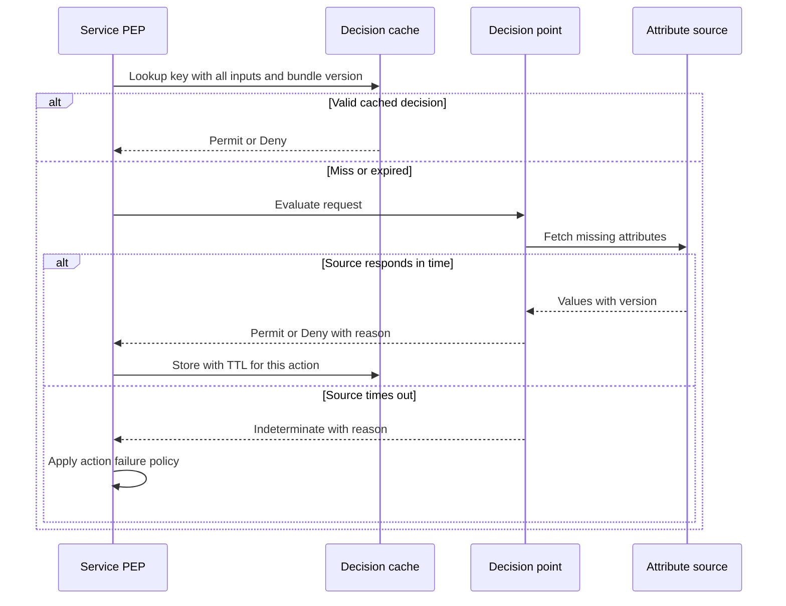

The diagram shows two places where failure enters: the decision point may be unreachable, and the attribute source may time out. Both end in the PEP applying a per-action failure policy. Timeouts need explicit values shorter than the request budget; otherwise a slow source consumes the whole request time before any policy is applied. A circuit breaker around each source prevents a failing source from adding its full timeout to every request.

A reasonable per-action table looks like this:

| Action class | On Indeterminate | Stale cache allowed | Reason |
| --- | --- | --- | --- |
| Delete, export, approve, change policy | Deny | No | High impact and hard to undo |
| Write to own tenant data | Deny, retry advised | No | Integrity matters more than availability |
| Read internal, low-sensitivity data | Serve from cache for a bounded period | Yes, up to a stated limit | Availability matters, risk accepted by owner |
| Read restricted data | Deny | No | Stale access to restricted data is the risk the policy exists to prevent |

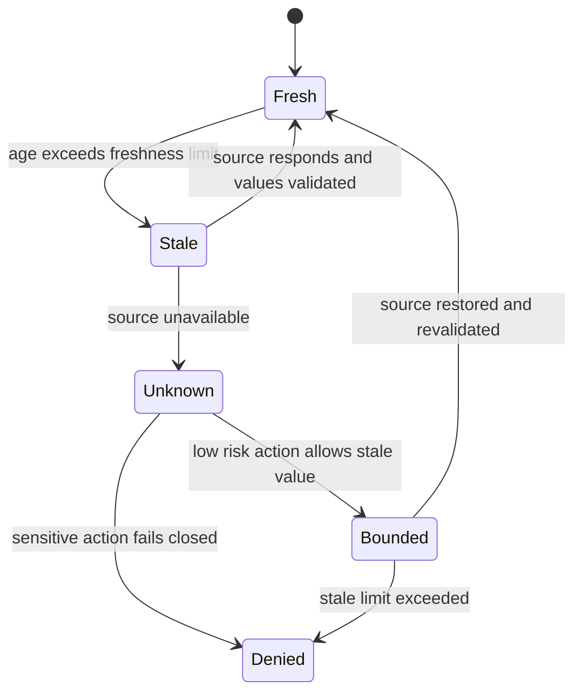

The state machine describes one attribute value in the decision path. A value is Fresh within its limit, Stale beyond it, and Unknown when the source cannot confirm it. Sensitive actions leave Unknown through Denied. Low-risk actions pass through a Bounded state that permits a stale value for a limited time and then forces a Denied outcome. The bound is the important element: an unbounded "use the last known value" rule keeps granting access to a user who left during the outage.

Monitor policy-service and attribute-source failures separately from ordinary denies, as noted earlier. A spike in Indeterminate rate with a flat Deny rate means a source is failing, and the right responder is the source's owner, not the policy author.

## 11. Attribute Delivery Patterns and Their Trade-offs

### 11.1 Four ways to get an attribute to the decision

The latency and revocation arithmetic above compares individual choices. In practice a system picks a delivery pattern per attribute, and there are four.

| Pattern | How the value arrives | Freshness bound | Latency added | Availability dependency |
| --- | --- | --- | --- | --- |
| Signed claim in token | Issued with the token, verified locally | Token lifetime | None | Identity provider at issue time only |
| Fetch at decision time | PIP calls the source per decision | Source consistency | One network call | Source on every decision |
| Cached fetch | PIP caches with a TTL | TTL plus source lag | Call on miss only | Source on misses |
| Pushed data | Source publishes changes to the decision point's local store | Propagation delay of the push | None at decision time | Push pipeline, not the source |

Pushed data deserves attention because it combines low latency with bounded staleness. The decision point holds a local copy of the attributes it needs, such as the set of non-compliant device identifiers, and the source sends updates as they happen. Decisions read local memory. The cost is operating the pipeline and accepting that the local copy is a derived store: it must be rebuilt from the source after loss, it can drift if an event is dropped, and it needs a periodic full reconciliation.

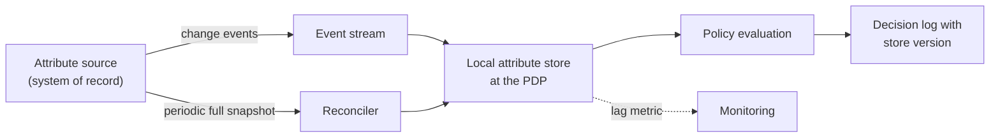

The diagram shows two input paths into the local store. Events keep it close to current, and the periodic snapshot repairs anything events missed. The lag metric is the important operational element: it measures how old the newest applied change is, and the freshness bound used in the revocation arithmetic is only valid while lag stays under alert. If the lag metric breaches its limit, the attribute enters the Stale state described earlier and the action's failure policy applies.

### 11.2 Choosing per attribute

Match the pattern to how often the attribute changes and how costly a stale value is.

- Identity attributes that rarely change (`employee_id`, `tenant_id`): token claims. A day-old value is acceptable and the cost is zero.
- Attributes tied to a job or assignment (`department`, `project_membership`): token claims with a short lifetime or pushed data, depending on the revocation requirement for the data they guard.
- Attributes of the request context (`device_compliant`, `risk_score`): fetched or pushed, never in a long-lived token. A token issued before the device failed its check would keep asserting compliance.
- Resource attributes (`classification`, `owner`, `legal_hold`): stored with the resource or in a catalog, read at decision time or replicated. These belong to the data owner and change by workflow, so ties to a ticket or approval help the audit trail.

A common mistake is to choose one pattern for everything. Putting all attributes into tokens makes tokens large and long-lived and removes revocation. Fetching all attributes per decision makes every service depend on a handful of sources. Mixed delivery is the normal result of applying the table honestly.

### 11.3 Consistency across attributes

Rules often read two attributes that come from different sources, so a decision can see one updated and the other not. Suppose a transferred employee's `department` is updated from `oncology` to `cardiology` in the token path while the project membership list is still pushed from the old system. For a window, the subject looks like a cardiology member of an oncology project. A rule that permits on either condition may permit more than intended, and a rule that requires both may refuse legitimately.

Three responses are available. Accept the window if the rule's consequences during inconsistency are small. Design rules so that each decision depends on one source where possible, for example by having the source compute a derived attribute such as `can_access_project_p12` and publish it. Or have the decision log record the version of each source, so an investigator can tell whether a surprising decision came from skew. The first is cheap, the second reduces the problem at its root, and the third is needed in any case.

## 12. Choosing Between RBAC, ABAC, and Relationship-Based Access Control

### 12.1 Three models, three questions

Role-based access control (RBAC) answers "what is this principal's job?". Attribute-based access control answers "do the properties of this request satisfy a rule?". Relationship-based access control (ReBAC) answers "is there a path in a graph of relationships between this subject and this resource?". ReBAC models access as facts such as "user A is an editor of folder F" and "document D is inside folder F", and derives access by following relations: an editor of a folder may edit the documents inside it. Google's Zanzibar paper describes a global system built on this idea, and several open-source and commercial authorization services follow its model. Check each project's current documentation for supported consistency guarantees and features.

The three differ in what they store and what they evaluate.

| Aspect | RBAC | ABAC | ReBAC |
| --- | --- | --- | --- |
| Stored data | Role assignments, role contents | Attributes on subjects, resources, context | Relationship tuples between objects |
| Rule form | Role has permission | Boolean condition over attributes | Relation derived through a schema |
| Best for | Stable job functions | Context and property-based rules | Sharing, ownership, nesting, hierarchy |
| Review question | Who holds this role? | What does this rule permit? | Who has a path to this object? |
| Typical failure | Role explosion | Wrong or stale attributes, opaque rules | Deep or cyclic graphs, relationship sprawl |
| Per-resource cost of exceptions | One assignment per grant | One attribute value or rule | One tuple |
| Revocation | Remove assignment | Change attribute | Delete tuple |
| Explaining a grant | Show role | Show rule trace | Show relationship path |

### 12.2 Decision guide

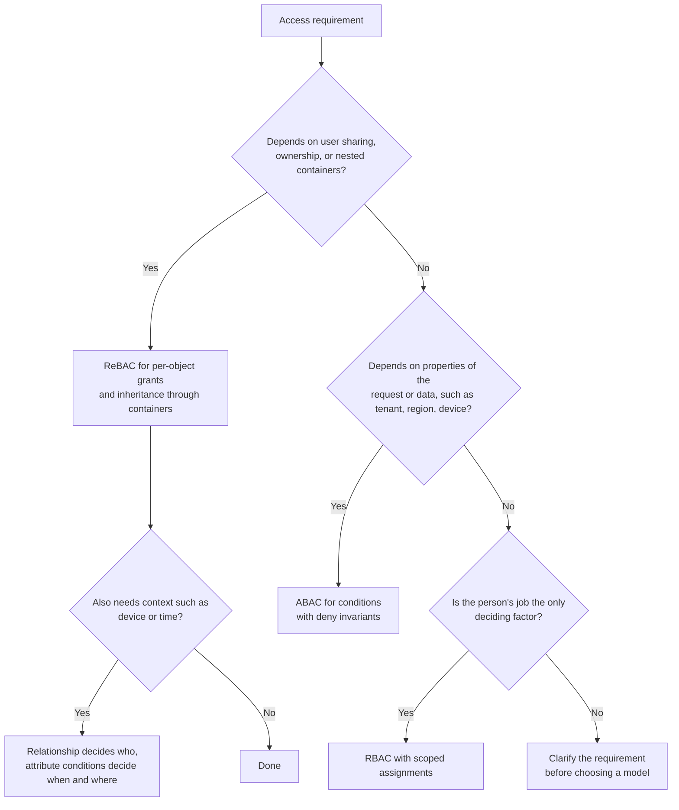

The guide starts from the requirement and not from a preferred technology. Document sharing, folder inheritance, and "the owner of this ticket" are relationship questions, and forcing them into roles produces per-object roles, while forcing them into attributes produces a `shared_with` list attribute on every resource that is a relationship store without the tooling. Tenant isolation, residency, device posture, and time windows are property questions and sit naturally in ABAC. Job-function gating remains RBAC.

The combined branch is common. A ReBAC check establishes that a user is an editor of a folder, and an ABAC condition then requires a compliant device and the same tenant. The relationship answers who, the attributes answer under what circumstances. Systems that combine models should define which layer owns each decision and which wins on conflict. Deny-overrides across layers, with ABAC invariants as the denying layer, is the usual choice and keeps one place where an isolation rule can be audited.

### 12.3 Worked comparison

An illustrative scenario. A document platform has 200 tenants, 5,000 users, and 2 million documents. Requirements: documents are readable by their tenant's users in the owning department, any document can be shared with named individuals, and restricted documents require a managed device.

- Pure RBAC: department-level reads need one role per tenant and department. With 200 tenants and 6 departments, that is $200 \times 6 = 1{,}200$ roles. Named sharing needs a role per shared document group or one assignment per document, which at even 1 percent of documents shared ($2{,}000{,}000 \times 0.01 = 20{,}000$) means 20,000 per-object grants held in a role system not designed for them.
- Pure ABAC: department and tenant rules need zero new rules per tenant. Named sharing needs a `shared_with` attribute listing user identifiers on the document, and device posture is one condition. Reviewing who can see document D means evaluating the rule and reading the attribute. The list attribute grows with sharing and is a relationship store in disguise.
- Mixed: ABAC rules for tenant, department, and device. A ReBAC tuple store for the 20,000 named shares, queried only for documents that the ABAC department rule did not already permit. Roles only for administration.

The mixed design has the smallest stored policy, one rule set plus 20,000 tuples. It costs three components, the attribute pipeline, the tuple store, and the role system, and each has its own failure modes and owners. For a smaller platform without named sharing, ABAC plus a few roles is the simpler answer. The right choice depends on the requirements, and extra models are justified only when a requirement cannot be expressed cleanly in the models already present.

### 12.4 Signals that the model is wrong

- Roles whose names contain attribute values (`oncology-restricted-eu-reader`) indicate attributes encoded in role names.
- Rules with long lists of identifiers written into conditions indicate relationships encoded as attributes.
- Attribute values such as `shared_with` that are rewritten by users indicate a relationship store without a schema or audit.
- A growing number of exceptions in one model suggests a requirement that another model expresses directly.
- A role administrator who is also the attribute editor holds two ways to grant access to the same thing, which deserves a separation-of-duties review as described in [Authorization](CH03_Authorization.md).

Move gradually. Replace role families with a rule and an attribute one family at a time, run both in shadow, and retire the roles when the decision diff is empty.

## 13. Delegation and Attribute Administration

### 13.1 Who may change what

An ABAC deployment has two administrative surfaces. One is policy: who may author, approve, and publish rules. The other is attributes: who may write the values that rules read. The second is the easier one to neglect, because attribute writes look like ordinary data maintenance. A manager who can edit an employee's `department` field in the directory holds, in effect, a grant button for every rule that reads `department`.

Delegation means handing part of that administrative power to someone closer to the work, such as a department head who sets `project_membership` for their own team. Delegation is useful because a central security team cannot know who belongs on which project. It is dangerous when the delegated power has no boundary, because the delegate can then write attributes that widen their own access or that of a colleague.

Three boundaries keep delegation safe:

- Scope. The delegate may write only specific attributes and only for subjects or resources inside their own organizational unit. A department head may set `project_membership` for people in that department, and may not set `clearance_level` for anyone.
- Self-edit prohibition. No one may write a security-relevant attribute on their own subject record. This is the separation-of-duties rule from [Authorization](CH03_Authorization.md) applied to attributes.
- Bounded duration. Delegated grants carry an expiry. An attribute set "for the audit" that never expires is a standing entitlement, as noted in the section on attribute change.

### 13.2 Delegation of decision authority versus delegation of attributes

Two different things are called delegation, and mixing them causes design errors.

Administrative delegation, covered above, lets a person change attribute values or policy within a boundary. Authority delegation lets one subject act on behalf of another at request time: an assistant reading a manager's calendar, or a service calling another service with the user's authority. In the second case the decision must consider both parties. The subject attributes are those of the actor, and the delegated authority is a further attribute (`acting_for`, with the grantor and the granted scope). A sound rule requires that the grantor holds the permission, that the grant covers the action, and that the grant has not expired. The rule must also deny a chain longer than the policy intends, because each additional hop is another place where scope can widen.

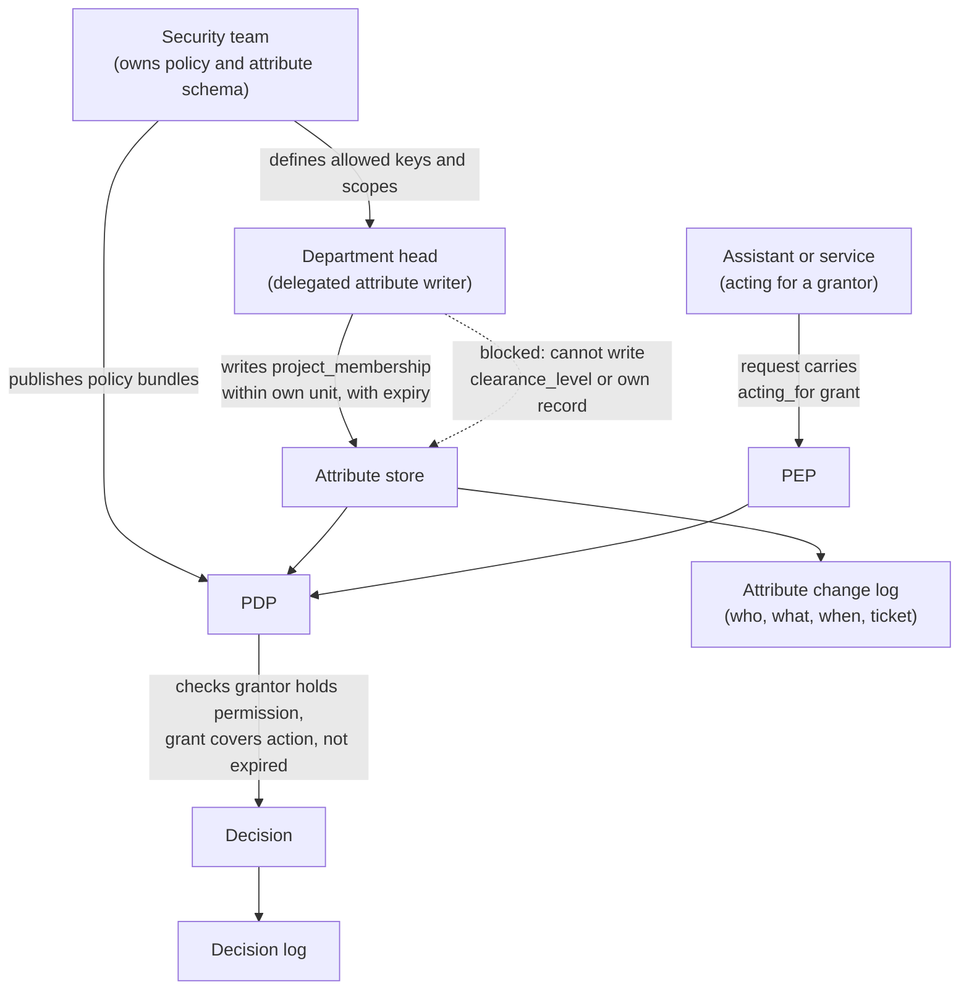

The diagram separates two flows that share one decision point. The left side is administration: the security team fixes which keys exist and who may write them, and delegates narrow write rights to unit owners, with the blocked path drawn explicitly because the prohibition is itself a control that needs a test. The right side is run-time authority: the request carries a grant, and the decision point verifies it against the grantor, not just against the actor. The implication for design is that the attribute change log and the decision log must be joinable, so an investigator can walk from a surprising Permit back to the attribute write, the writer, and the ticket that justified it.

### 13.3 Controls on the administrative path

Because attribute writers change access without touching policy, apply the controls usually reserved for policy authors:

- Treat the write permission on each security-relevant attribute as a privileged entitlement, reviewed in the same cycle as role assignments in [RBAC](CH04_RBAC.md).
- Require a ticket or approval reference on writes to attributes that gate restricted data, and record it in the change log.
- Alert on writes that raise a subject's own effective access, on bulk writes, and on writes outside business hours for high-impact attributes.
- Keep a break-glass path for emergencies with a short expiry, mandatory justification, and a post-event review. The decision log should mark break-glass decisions so they can be reviewed in full.

Policy authorship follows the same pattern. The person who writes a permit rule should not be the only approver, and changes to deny invariants need a second reviewer from security. Delegating policy authorship to product teams is reasonable for permit rules scoped to their own resource types, provided the invariants sit in a layer they cannot edit and deny-overrides is in force.

## 14. Failure and Quality-Attribute Scenarios

Each scenario states a stimulus, the expected response, and a success criterion that can be measured in a test or an exercise. Numbers are illustrative targets for a hypothetical system and should be replaced by the organization's own requirements.

### 14.1 Attribute source outage

- Stimulus: the device-management service becomes unreachable for 10 minutes while 1,500 requests per second arrive.
- Expected response: the circuit breaker opens after repeated timeouts. Requests for restricted data receive Indeterminate and are refused. Requests for low-sensitivity reads use the last known posture value for up to 15 minutes, then are refused. The alert for Indeterminate rate fires and routes to the owner of the source.
- Success criterion: zero Permits for restricted data during the outage, verified from the decision log. Alert raised within 2 minutes of the first timeout. No request waits longer than its attribute timeout (here 50 ms) for a source that is known to be down. After the source returns, decisions use fresh values within one TTL.

The arithmetic for the stale bound: at 1,500 requests per second, a 10-minute outage covers $1{,}500 \times 600 = 900{,}000$ requests. If 80 percent are low-sensitivity reads, $0.8 \times 900{,}000 = 720{,}000$ are served on stale values, all within the 15-minute bound, and the remaining 180,000 are refused or served from cache under the restricted rule. The stated bound, not the request count, is what the owner approves.

### 14.2 Wrong attribute value granting access

- Stimulus: a data-entry error sets a user's `clearance_level` to 3 instead of 1, and the user begins reading restricted documents.
- Expected response: the grant is allowed by policy because the attribute is the authority. Detection comes from two controls: a reconciliation job that compares `clearance_level` against the system of record every 15 minutes, and an access anomaly rule that flags first-time reads of restricted data by a user below the usual level. On detection the attribute is corrected, tokens are invalidated through the revocation signal, and the reads made in the window are listed from the decision log for review.
- Success criterion: exposure window no longer than detection interval plus propagation, here $15 + 7 = 22$ minutes in the worst case. Every restricted read in the window is identifiable by user and document. The correction produces an attribute change record linked to a ticket.

This scenario shows a limit of ABAC: policy tests cannot find a wrong value, because the rule was correct. The control is data quality and reconciliation, which is why the attribute catalog assigns each attribute an owner.

### 14.3 Policy-change regression

- Stimulus: a new bundle contains a permit rule with a mistyped attribute name (`resource.deparment`), so the intended permit never fires and previously permitted reads start to be refused.
- Expected response: static checks flag the unknown attribute before merge. If the typo reaches shadow evaluation, the decision diff shows Permit-to-Deny flips for a whole department and blocks approval. If it still reaches production, the canary stage shows the Deny rate rising above its alarm threshold and the bundle is rolled back automatically.
- Success criterion: affected decisions bounded by canary share and rollback time. With a 5 percent canary at 1,500 decisions per second and a 5-minute detection and rollback time, the affected volume is at most $1{,}500 \times 0.05 \times 300 = 22{,}500$ decisions. Rollback restores the prior bundle in under 5 minutes, confirmed by the bundle version in the decision log.

The mirror case, a typo that makes a deny invariant never fire, fails silently as extra Permits instead of visible Denies. The invariant tests for cross-tenant and missing-attribute requests exist for exactly this reason and must run on every change.

### 14.4 Stale decision cache after revocation

- Stimulus: a user's device is marked non-compliant at 10:00:00. The user holds a cached Permit for restricted data.
- Expected response: the posture change publishes a revocation signal that drops cached entries for that subject. If the signal is lost, the cache TTL bounds the exposure.
- Success criterion: no Permit for restricted data after 10:00:10 with the signal working (10 seconds is the illustrative propagation target), and no Permit after 10:01:00 if it is lost, because a cache entry of 60 seconds TTL created no later than 10:00:00 has expired by then. Both are tested by injecting the change and replaying requests.

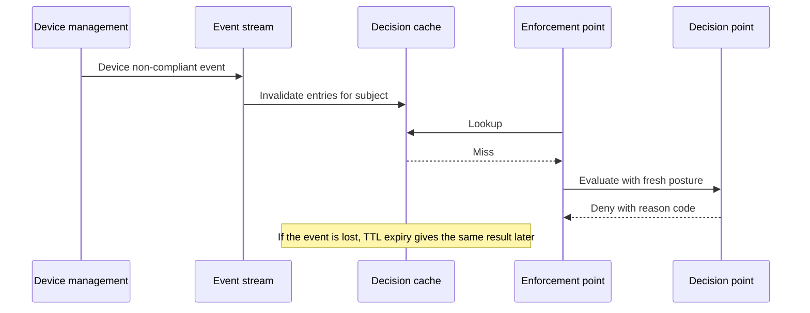

The diagram shows the preferred path and the fallback together. The event makes revocation fast, and the TTL makes it bounded. Designs that rely on only one of the two have a failure that the other would have covered. The test for this scenario drops the event deliberately and checks that the TTL path still meets its larger bound.

### 14.5 Scenario summary

| Scenario | Stimulus | Measure | Illustrative target |
| --- | --- | --- | --- |
| Source outage | Posture service down 10 minutes | Restricted Permits during outage | 0 |
| Wrong value | Clearance entered as 3 instead of 1 | Exposure window | At most 22 minutes |
| Policy regression | Mistyped attribute in bundle | Affected decisions | At most 22,500 |
| Stale cache | Device becomes non-compliant | Time to refusal | At most 10 seconds with the event, 60 seconds without it |

## 15. Worked Case Study: Clinical Records Access

The organization below is hypothetical and the numbers are illustrative. The case applies the chapter's reasoning end to end.

### 15.1 Context and requirements

A regional health provider runs 12 clinics. It employs 8,000 staff in 5 departments and uses contractors in some departments. Records have three classification levels: general, sensitive, and restricted. About 3,000 staff are active at peak. The records service handles up to 1,500 authorization decisions per second at peak and about 400 per second on average.

Requirements agreed with the data owner and security:

1. A staff member reads a record only if the record's clinic and department match theirs, their clearance covers the record's classification, and the record belongs to the same tenant organization.
2. Restricted records also require a managed, compliant device.
3. A department or clearance change must stop access to restricted records within 10 minutes, and to other records within 60 minutes.
4. Authorization must add no more than 8 ms at p99.
5. Every decision must be explainable from logs without storing record contents.

### 15.2 Decision 1: model

The roles-only design needs one role per clinic, department, and classification level:

$$12 \times 5 \times 3 = 180 \text{ roles}$$

Opening a 13th clinic adds $5 \times 3 = 15$ roles, each with an owner and a review. The ABAC design uses 3 deny invariants (tenant isolation, restricted needs compliant device, missing classification) and 4 permit rules (staff same clinic and department, contractor on assigned project, on-call cross-clinic read, emergency break-glass), a total of 7 rules. A 13th clinic adds a value to the `clinic` attribute and no rules.

Rejected alternative: roles only. It meets the requirements but at 180 roles with a growth rate of 15 per clinic, and it cannot express the device or tenant conditions. Rejected alternative: ABAC with no roles. The security team still needs a role to administer policy, so a small administrative role set remains. The chosen design is ABAC for records access with roles for administration and for the coarse entry gate, the hybrid shape from section 2.

### 15.3 Decision 2: attribute sources and delivery

| Attribute | Source | Delivery | Owner |
| --- | --- | --- | --- |
| `tenant_id`, `employee_id` | Identity provider | Token claim | Identity team |
| `clinic`, `department`, `clearance_level` | HR system through directory | Token claim, short lifetime, plus revocation event | HR operations |
| `device_compliant` | Device management | Pushed to local store at the PDP | Endpoint team |
| `classification`, `clinic`, `department` of record | Records database and data catalog | Read at decision time, cached | Data owner |
| `acting_for` | Delegation service | Request-carried grant, verified | Security team |

Rejected alternative: all attributes in the token. A device that falls out of compliance would keep asserting compliance until the token expired. Rejected alternative: fetch every attribute per decision. Every records request would then depend on four sources being up.

### 15.4 Decision 3: topology

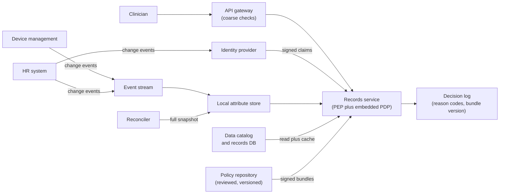

The topology places enforcement inside the records service, because the record's clinic, department, and classification are known there and not at the gateway. The gateway checks only token validity and route-level role. The decision point is embedded, so a failure of the event stream degrades freshness (handled by the failure policy) and does not stop the service. Policy bundles arrive signed and are loaded atomically, with the bundle version attached to each decision. The implication is that the three things an operator must watch are bundle version spread across instances, event-stream lag, and reconciler success, and each has an alert.

Rejected alternative: a central decision service. It would add a network hop and a shared dependency for all records traffic. With the illustrative costs from the performance section, the embedded design costs

$$0.2 + \max(0, 3) = 3.2 \text{ ms}$$

(posture is local memory, classification is a 3 ms database read), against

$$2 + \max(4, 3) + 0.2 = 6.2 \text{ ms}$$

for a central service that fetches posture and classification in parallel. Both fit the 8 ms budget, so latency alone does not decide it. The deciding factor is availability: the central service becomes a dependency of every read. Embedded bundles carry a cost too, version skew across instances, which is managed by logging the bundle version on every decision and alerting on spread.

### 15.5 Decision 4: revocation timing

| Option | Calculation | Worst case | Meets 10 minutes for restricted? |
| --- | --- | --- | --- |
| Baseline: 15-minute HR sync, 60-minute token, 5-minute cache | $15 + 60 + 5$ | 80 minutes | No |
| Shorter token only | $15 + 10 + 5$ | 30 minutes | No |
| Event-driven push, 5-minute token, 1-minute cache for restricted | $1 + 5 + 1$ | 7 minutes | Yes |

For non-restricted data, the 60-minute requirement is met by a 15-minute sync, a 30-minute token, and a 5-minute cache, which is $15 + 30 + 5 = 50$ minutes. Restricted records use the shorter token path. The cost of the 5-minute token for restricted access is token volume: 3,000 active users at 12 issuances per hour gives $3{,}000 \times 12 = 36{,}000$ per hour, or $36{,}000 / 3{,}600 = 10$ per second on average. That figure goes to the identity provider team to check against capacity before launch.

Cache load: with a 90 percent hit rate, classification reads drop from 1,500 to $1{,}500 \times 0.1 = 150$ per second at peak, which the records database absorbs.

### 15.6 Decision 5: failure behavior

Restricted reads fail closed on Indeterminate. Other reads may use a stale posture value for up to 15 minutes, then fail closed. Delete, export, and policy-change actions fail closed without stale values. Missing `classification` on a record yields a Deny and a data-quality event to the data owner, so untagged records cannot be read until tagged.

### 15.7 Validation evidence

Evidence collected before enforcement, all illustrative:

- Unit and invariant tests: 240 rule-level tests pass. The cross-tenant and missing-attribute properties hold over a generated matrix.
- Shadow evaluation: 14 days of recorded requests sampled at 1 percent. Average rate is 400 per second, so the full volume is $400 \times 86{,}400 \times 14 = 483{,}840{,}000$ requests and the sample is $483{,}840{,}000 \times 0.01 = 4{,}838{,}400$.
- Decision diff against the previous role-based system: 212 requests changed, which is $212 / 4{,}838{,}400 \approx 0.0044$ percent. Of these, 209 were intended (contractors on the cardiology project moving from Deny to Permit). 3 were unintended, caused by a `clinic` value with different capitalization in one source. The fix was attribute normalization in the pipeline, not a policy change, and a normalization test was added to the matrix.
- Outage drill: posture source blocked for 10 minutes. No restricted Permits in the decision log. Alert fired in under 2 minutes.
- Revocation drill: a test user's department changed at time zero. Access ended at 6 minutes 20 seconds, within the 7-minute worst case and the 10-minute requirement.
- Rollback drill: a deliberately faulty bundle restored the prior bundle in under 5 minutes.

### 15.8 What the case does not solve

Wrong values remain possible. The reconciler catches differences against the HR system, but an HR error propagates correctly. Break-glass access depends on review discipline. The design also leaves the question of access to backups and analytic copies of the records, which sit outside the PEP and need their own controls, covered under [Authorization](CH03_Authorization.md) and the data chapters elsewhere in the handbook.

## 16. Common Mistakes

Each entry gives the mistake, its usual cause, and its consequence.

| Mistake | Cause | Consequence |
| --- | --- | --- |
| Trusting a caller-supplied attribute | Convenience: the client already sends `tenant` or `role` in a header or body | Any caller grants itself access by changing a field |
| Rules that skip when an attribute is missing | Deny conditions written as comparisons that evaluate to false or error on absence | Untagged resources bypass prohibitions, and the gap is invisible until an audit |
| Cache key missing an input | Key built from user, action, and resource while the rule also reads posture or time | One request's Permit is served to a different context, such as an unmanaged device |
| Fail open on source errors | Availability pressure with no per-action policy | An attacker who degrades a source gains access |
| Unowned attributes | Attributes added by whoever needed them, with no catalog | Nobody fixes wrong values, and two sources give the same name different meanings |
| Writable security attributes | Profile fields editable by the user or by broad administrator groups | Self-service privilege escalation through data edits |
| Ordered rules with first-applicable | Rule lists read easily, so order becomes the logic | A harmless-looking reorder changes access without any rule text changing |
| One long conjunction per rule | Special cases appended over time | Nobody can say what the rule permits, and failure explanations name no single cause |
| Tests for rules only | Unit tests pass, so the change is judged safe | Interactions, data-type mismatches, and real traffic cases reach production |
| Unbounded stale-value fallback | Outage handling written as "use the last known value" | Access continues for users who left or lost a device during the outage |
| Detailed refusal messages to callers | Debugging convenience | The caller learns which attribute to forge or target |
| Logging sensitive attribute values | Wanting full explanations | The decision log becomes a second copy of the most sensitive data |
| Using ABAC for relationships | A `shared_with` list attribute on every resource | A relationship store with no schema, audit trail, or tooling |
| Assuming cloud tag-based access covers the application | Provider policies feel like ABAC | Application rows are exposed even though the storage bucket is protected |
| Expiry-less attribute overrides | "Temporary" exceptions with no end date | Standing entitlements that reviews do not see |

Two of these deserve more explanation because they look harmless in review.

The missing-attribute skip is hard to see because the rule reads correctly. "Deny when `classification == restricted` and the device is not compliant" is a good invariant, but if a resource has no `classification`, the first clause is not true, and the resource is treated as unrestricted. The fix is not a cleverer rule but an explicit presence check and a test that submits an untagged resource.

The cache key omission is hard to see because decision caching speeds up the system and passes functional tests. Tests that always send the same posture value never expose it. A test that alternates posture values for the same user, action, and resource, and asserts that decisions change, does.

## 17. Design-Review Checklist

Use these questions in a design review of an attribute-based authorization design. A "no" or "unknown" is a finding.

Attributes

- Does every attribute used in a rule appear in a catalog with an owner, authoritative source, writer, freshness bound, and failure behavior?
- Is every security-relevant attribute written only by an automated pipeline or a delegated writer within a stated scope?
- Can any caller-supplied value (header, body, query, unsigned claim) influence a subject, resource, or environment attribute?
- Do two sources use the same attribute name with different meanings?
- Is each attribute delivered by a pattern that matches its rate of change and revocation requirement?

Policy

- Are invariants (tenant isolation, minimum authentication strength, legal hold) separate from grants, owned by security, and written once?
- Is the combining algorithm stated, and is deny-overrides used for invariants?
- Does a missing, null, or wrongly typed attribute produce Deny or Indeterminate for every rule?
- Does every rule have an identifier, an owner, and a single concern?
- Is there a stated size or complexity threshold that triggers splitting a rule?

Decisions and failure

- Does the PEP sit on every path to the data, including batch jobs and internal endpoints?
- Is there a failure policy for each action class, with a bounded stale-value window where stale values are allowed?
- Do the decision cache keys contain every input that can change the outcome, including the bundle version?
- Are timeouts shorter than the request budget, with circuit breakers around each source?
- Is the worst-case revocation delay calculated stage by stage and compared with the requirement for each data class?

Testing and operation

- Do tests cover missing attributes, boundary values, type mismatches, conflicting rules, and cross-tenant requests?
- Is there a generated scenario matrix with property checks, and shadow evaluation with decision diffing before enforcement?
- Can a bundle be rolled back in minutes, and has it been drilled?
- Does the decision log record bundle version, reason codes, and attribute source versions without sensitive values?
- Are Indeterminate rate, NotApplicable rate, event-stream lag, and bundle version spread monitored with alerts routed to the right owners?

Administration

- Is write access to security-relevant attributes reviewed like a privileged entitlement?
- Is self-edit of security attributes prevented, and are delegated grants time-bound?
- Is there a break-glass path with expiry, justification, and mandatory review?
- Are the access analysis queries (who can read this, what can this person read) run on a schedule, with results kept as review evidence?

NEXTSECTION

## 18. Exercises

Each exercise has a brief answer outline.

1. Draw how subject, resource, action, and environment attributes reach a policy decision for a document read. Mark which attributes the caller can influence.
   - Outline: PEP builds the request with subject, action, and resource identifier. PDP fetches the rest through the PIP. Caller controls only action and resource identifier. Subject clearance, resource classification, and device posture come from authoritative sources.

2. A required `classification` attribute is stale or unavailable for a restricted document. State the decision and the monitoring signal.
   - Outline: Indeterminate, refused for restricted data under the action's failure policy. Indeterminate rate rises while Deny rate stays flat, routing to the source owner. A bounded stale window applies only to low-sensitivity reads.

3. Compare an embedded decision point with a remote decision service for freshness, latency, and availability.
   - Outline: embedded has no network hop and keeps working when the service is down, but needs bundle distribution and has version skew. Remote gives one update point and one audit location, at the cost of a hop and a shared dependency. Freshness of attributes depends on delivery, not on placement.

4. Design tests for conflicting rules and for missing device posture.
   - Outline: a permit and a deny that both apply, asserting deny-overrides. Missing, null, and wrongly typed posture, asserting `not_permit`. Boundary values. A generated matrix with property checks, plus shadow evaluation.

5. When would a new RBAC role be clearer than an ABAC expression?
   - Outline: when the requirement depends only on job function, is stable, and is reviewed by reading a permission list. Also for policy administration, which is role-shaped.

6. A department changes the HR sync to every 30 minutes, keeps a 20-minute token, and a 5-minute cache. The requirement is 25 minutes. Does it comply, and what is the cheapest fix?
   - Outline: $30 + 20 + 5 = 55$ minutes, which fails. Cut the largest term first: an event push of about 1 minute gives $1 + 20 + 5 = 26$, still over by 1 minute, so also shorten the token to 15 minutes for $1 + 15 + 5 = 21$.

7. Decision caching reduces average latency by a factor of 9 in a system, yet p99 stays flat. Explain.
   - Outline: p99 is set by misses, which still pay the full path. With a 90 percent hit rate the slowest 10 percent are misses, so the 99th percentile sits in the miss population. The benefit is source load, not tail latency.

8. A platform needs per-document sharing with named users in addition to tenant and department rules. Propose a model and name the risk of the simplest alternative.
   - Outline: ABAC for tenant, department, and device, with a relationship store for named shares, consulted only when the attribute rule does not permit. The simplest alternative, a `shared_with` list attribute, becomes an unaudited relationship store.

## 19. Summary

ABAC decides access by evaluating rules over subject, resource, action, and environment attributes. The summary below maps back to the outcomes in the Introduction.

- Reference model. A request passes through the PEP, which asks the PDP for a decision. The PDP gathers attributes from the PIP and evaluates policy published through the PAP. Decisions are Permit, Deny, NotApplicable, or Indeterminate, and obligations must be honoured or the decision becomes a Deny (sections 3 and 5).
- Attributes and trust. Attributes fall into four categories and are trustworthy only with a named owner, an authoritative source, a restricted writer, a freshness bound, and a failure behavior. Callers must never supply attributes that constrain themselves (section 4 and the delegation controls in section 13).
- Rules and conflicts. Rules combine through an explicit algorithm, with deny-overrides for invariants. Missing attributes must fail toward refusal, and tests must prove it (sections 5, 8, and 9).
- Cloud providers. AWS, Azure, and Google Cloud expose a restricted form of ABAC for provider resources. Each has coverage limits to verify, and none replaces application-level authorization (section 6).
- Revocation time. The delay for an attribute change is the sum of every stage between the source and the enforcement point. The refresh path is designed by cutting the largest term until the sum meets the requirement, as the case study does with a 7-minute worst case against a 10-minute target (sections 7, 11, and 15).
- Model choice. Use RBAC for stable job functions, ABAC for property and context rules, and ReBAC for sharing and nesting, combined with deny-overrides and clear ownership when a requirement needs more than one (sections 2 and 12).

Operations carry as much weight as rule syntax: explainable decisions, tested and reversible policy changes, per-action failure behavior, scenario targets that can be measured (section 14), and a review checklist applied before launch (section 17). Use RBAC for stable responsibility groupings and ABAC for context that changes the decision.
