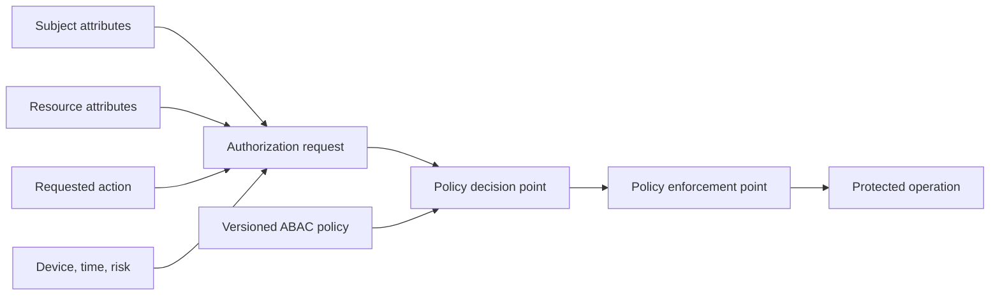
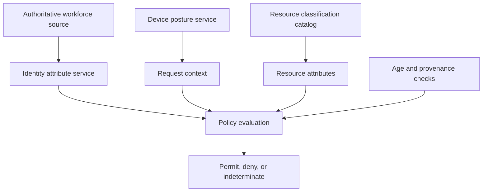
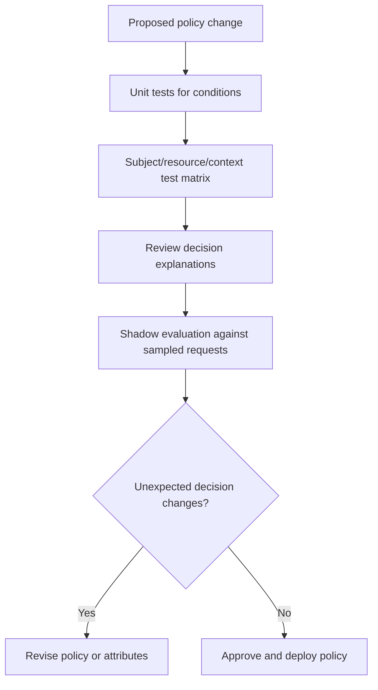
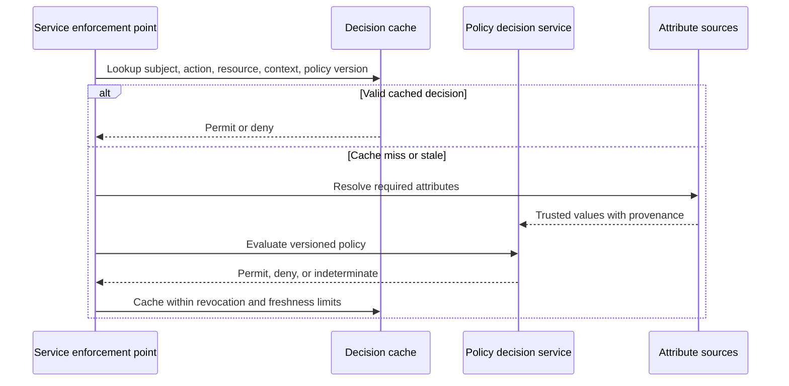
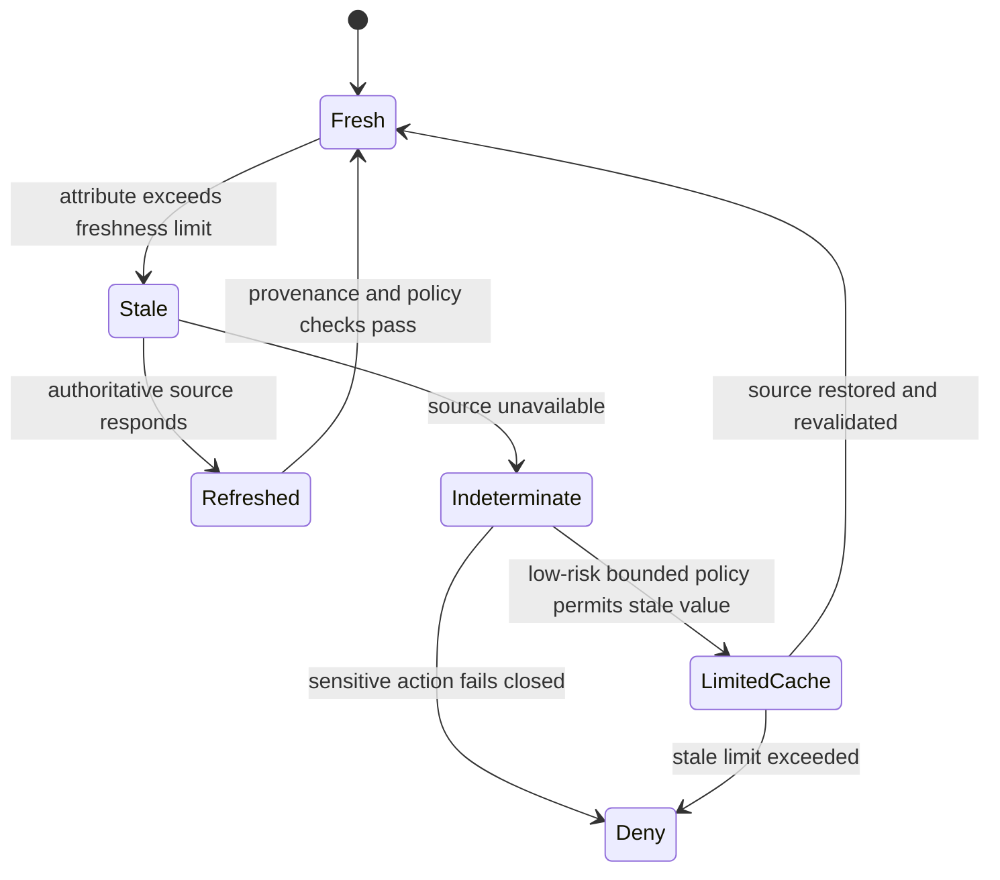

# ABAC (Attribute-Based Access Control)

Part: [15 — Security](PART_OVERVIEW.md)

Attribute-Based Access Control (ABAC) evaluates access using attributes of the subject, resource, action, and environment. It supports context-sensitive decisions without creating a role for every combination, but depends on trustworthy attributes and understandable policies. CH04 RBAC owns role-centric access; Part 09 owns provider-specific ABAC policy languages.

## Attribute Model and Policy Evaluation

An ABAC decision evaluates a request against policies using attributes such as subject department, resource classification, action, device posture, time, or network risk. The policy decision point evaluates the rules; a policy enforcement point applies permit or deny at the protected operation. Each attribute needs a source, owner, freshness expectation, and failure behavior.

Policies should be explicit and testable. State whether missing attributes deny access, trigger lookup, or permit a narrow fallback. For sensitive actions, a missing device posture or resource classification should not silently become a permissive default. Provide decision explanations suitable for operators without exposing sensitive policy internals to users.

## Attribute Provenance and Quality

Attribute quality is part of the security boundary. A department attribute may come from human resources; device posture may come from endpoint management; resource sensitivity may come from a data catalog. If an attribute is stale, user-editable, or ambiguously mapped, a correct policy expression can still produce an unsafe result.

Record attribute provenance and freshness. Define cache lifetimes and invalidation when users change role, devices become noncompliant, or resources are reclassified. A policy should return an explicit indeterminate result when required data is unavailable; the enforcement point then applies the action's fail-safe policy.

## Policy Complexity, Explainability, and Testing

ABAC reduces role proliferation but can move complexity into expressions. Nested exceptions, implicit precedence, and duplicated conditions become difficult to reason about. Modularize policies around stable business rules, use a consistent deny/permit combination algorithm, and keep a policy owner. Avoid policy expressions that mix unrelated concerns such as tenant isolation, time-of-day, and device posture in an opaque rule.

Test positive and negative cases, missing attributes, boundary values, conflicting rules, and stale data. Use shadow evaluation before enforcement where practical to estimate impact. Log policy version, decision, and non-sensitive reason codes; avoid copying sensitive attributes into logs.

## Performance and Failure Behavior

Policy evaluation may be local, centralized, or split between local enforcement and a remote decision service. Local evaluation can reduce latency but needs policy distribution and freshness controls. A remote decision point centralizes policy and audit but adds availability and network dependency. Cache only when the cache key includes all decision-relevant inputs and revocation requirements permit the delay.

Define outage behavior per action. High-impact writes should generally fail closed when policy cannot be evaluated. A low-risk read may use a short-lived cached decision if the data owner accepts the stale-access risk. Report policy-service and attribute-source failures separately from ordinary denies.

## Worked Case and Review Checklist

A document service permits access when the user belongs to the document's tenant, has a matching business purpose, and uses a compliant device. The tenant attribute comes from the authenticated identity, document classification from the data catalog, and device posture from endpoint management. If classification is missing, access is denied and a data-quality event is sent to the owner. A shadow policy run checks expected decisions before a new rule becomes enforcing.

Review attribute source and owner, integrity, freshness, policy combination algorithm, missing-data behavior, explanations, test matrix, shadow evaluation, cache key and TTL, fail-open/closed behavior, audit, and exception lifecycle. Confirm that identity and resource boundaries cannot be overridden by caller-supplied context.

## Questions and Summary

1. Draw how subject, resource, action, and environment attributes reach a policy decision.
2. What happens when a required classification attribute is stale or unavailable?
3. Compare local policy evaluation with a remote decision service for freshness, latency, and availability.
4. Design tests for conflicting rules and missing device posture.
5. When would a new RBAC role be clearer than an ABAC expression?

ABAC enables contextual access decisions when attributes are trustworthy and policies remain understandable. Attribute provenance, freshness, policy testing, explainability, and failure behavior matter as much as the rule syntax. Use RBAC for stable responsibility groupings and ABAC for context that genuinely changes the decision.
