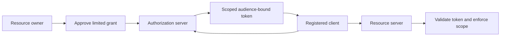
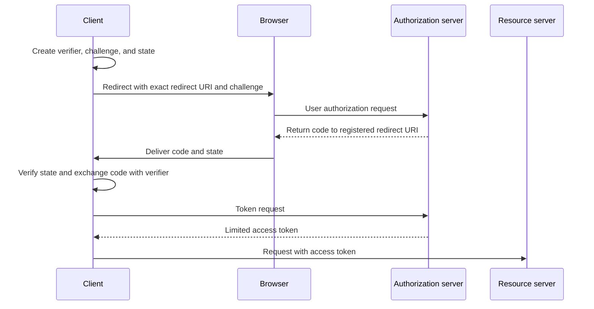
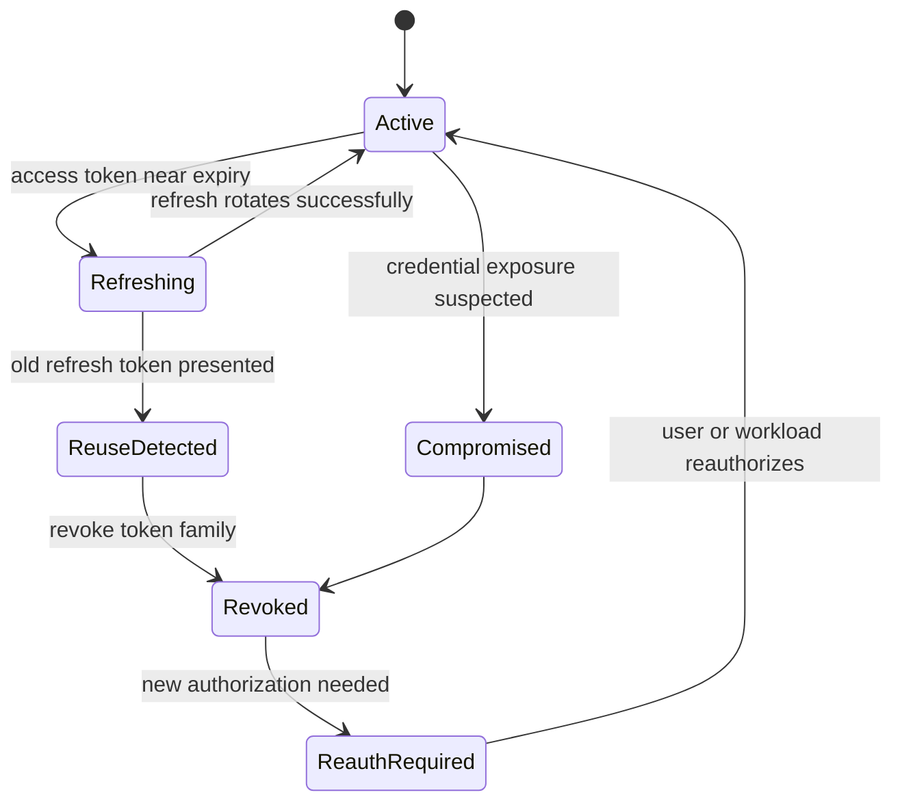
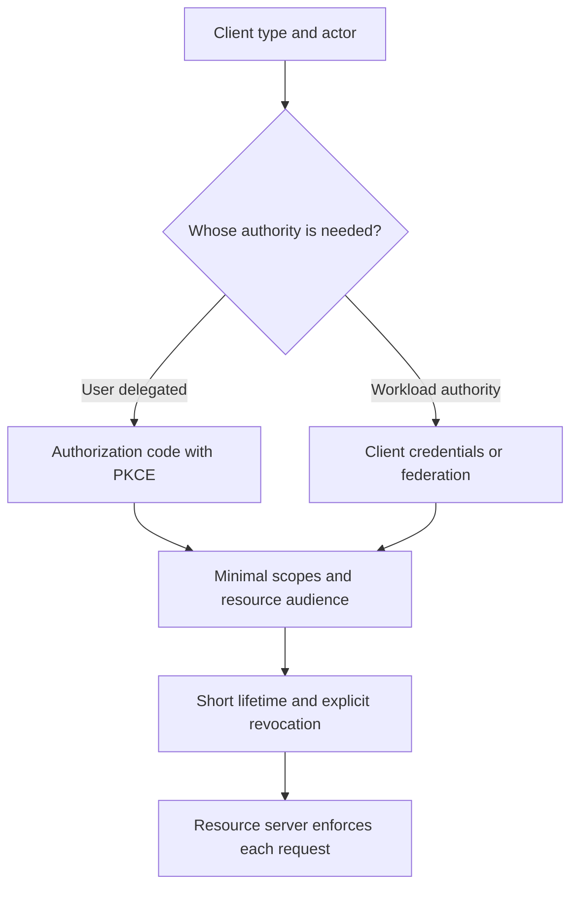
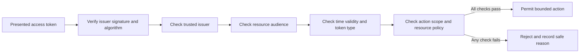

# OAuth

Part: [15 — Security](PART_OVERVIEW.md)

OAuth is a delegated authorization framework that lets a client obtain limited authority to access a resource on behalf of a user or itself. It is not an authentication protocol. [Part 05 CH19 OAuth](../05_Networking_and_OS/CH19_OAuth.md) owns wire-level roles and flow mechanics; this chapter focuses on security decisions around client type, scopes, redirect trust, token custody, and operational response. [CH07 OIDC](CH07_OIDC.md) adds an identity layer for login.

## Delegated Authority and Client Boundaries

An authorization grant should express a narrow resource and action set, an intended audience, an expiry, and a client binding appropriate to its capability. A public client cannot securely hold a shared client secret; use authorization code with Proof Key for Code Exchange (PKCE) for interactive public clients. A confidential backend can authenticate itself with a protected credential or federated identity. Do not select flows based only on implementation convenience.

Treat access tokens as bearer credentials unless the token is explicitly sender-constrained. Possession may be sufficient to use a bearer token. Keep tokens out of URLs, logs, browser storage with broad script access, analytics, and crash reports. Scope and audience should limit the damage of theft.

## Authorization Code, Redirect, and Consent Security

For interactive authorization, bind the authorization response to the initiating client transaction using state and, where the identity layer requires it, nonce. PKCE binds an authorization code exchange to the client-held verifier, protecting against code interception. Redirect URIs should be registered exactly and checked strictly; wildcard or open redirects can send codes or tokens to attacker-controlled locations.

Consent screens should identify the client and requested authority in terms a user can understand. Avoid broad scopes that silently grant unrelated access. Reassess scopes when APIs evolve; a token claim is only useful if resource servers enforce it consistently.

## Token Audience, Storage, and Refresh

Validate the token type and intended audience at each resource server. A token issued for one API should not be accepted by another. Define expiry and clock-skew handling, signing-key rotation, introspection or local verification, and revocation behavior. [Part 05 CH19](../05_Networking_and_OS/CH19_OAuth.md) owns full token and endpoint mechanics; this chapter emphasizes deployment policy and failure consequences.

Refresh tokens are high-value long-lived credentials. Store them only in a protected client or server context, rotate them on use where supported, detect reuse, and revoke token families after suspected compromise. Browser-facing architectures should avoid exposing reusable credentials to untrusted scripts; a backend-for-frontend can keep tokens server-side but introduces its own session and CSRF controls.

Keep tokens out of logs and diagnostic dumps. If tokens must be cached, bind cache keys to client, audience, scope, and subject, and define invalidation. Short token lifetime limits exposure but does not replace compromise response.

## Service-to-Service Authority and Operations

Client credentials grant authority to a workload, not a user. Use a distinct client identity per workload and environment, narrow audience and scopes, and short-lived credentials when possible. Avoid sharing one broad client credential across services; compromise then propagates across the estate. Prefer workload federation over long-lived secrets where supported.

Monitor authorization failures, suspicious scope use, redirect mismatch, refresh reuse, token issuance spikes, and key or issuer changes. Do not log token values. Establish revocation ownership and an emergency path for disabling a client or signing key without taking unrelated services offline.

## Worked Case and Review Checklist

A browser application obtains a limited token for a document API using authorization code with PKCE. Redirect URIs are exact; state binds the response to the login attempt; the API validates issuer, signature, audience, expiry, and scope. A backend integration uses a separate workload identity with a narrow scope. Refresh-token reuse triggers family revocation and an incident signal. The application stores no bearer token in a URL or telemetry event.

Review client classification, grants, redirect registration, state and PKCE, consent, token audience, scopes, expiry, storage, refresh rotation, revocation, workload identity, resource-server enforcement, and telemetry redaction. Confirm authentication claims are not inferred from an access token unless the identity protocol defines and validates them.

## Questions and Summary

1. Why is OAuth authorization not sufficient evidence of a user's identity?
2. Compare public and confidential clients and choose a grant for each.
3. Trace how state and PKCE protect an interactive authorization response.
4. Design refresh-token reuse response and identify which sessions or clients are revoked.
5. Which token properties must each resource server validate independently?

OAuth security depends on constrained delegated authority, correct client classification, exact redirects, protected tokens, and resource-server enforcement. Part 05 owns protocol mechanics; this chapter emphasizes security configuration, lifecycle, and incident response. Pair OAuth with OIDC when the application needs standardized user authentication.
