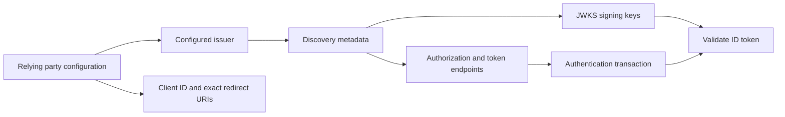
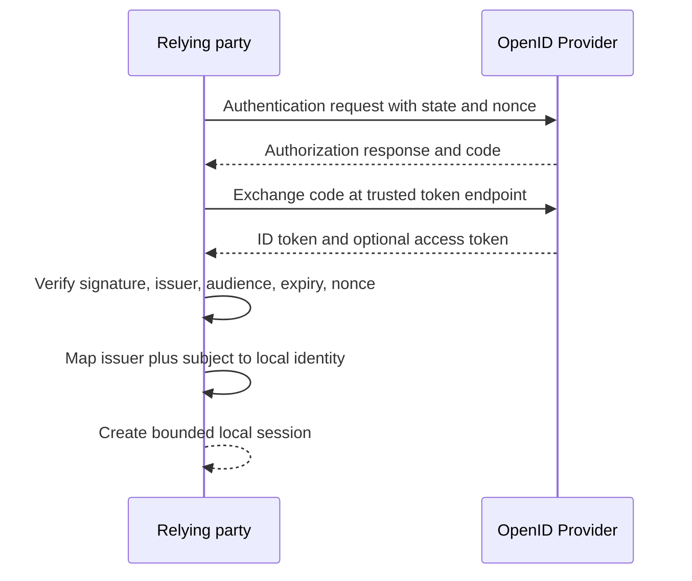
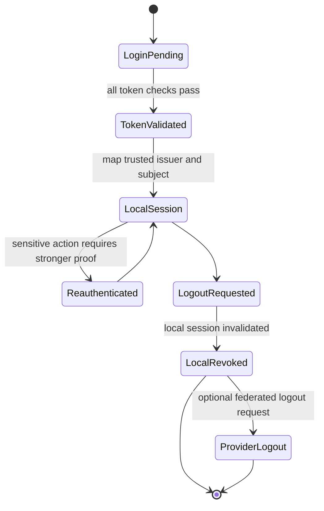
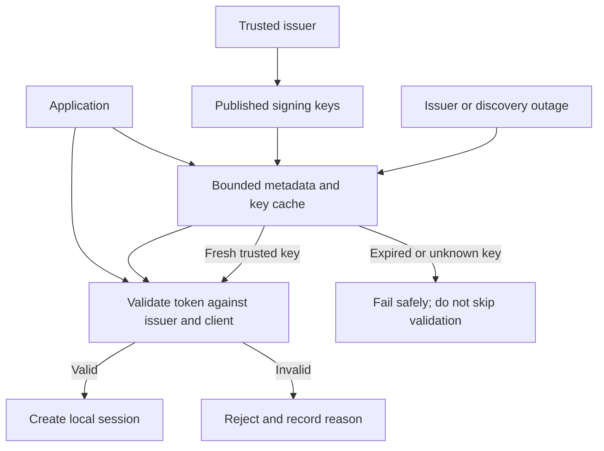
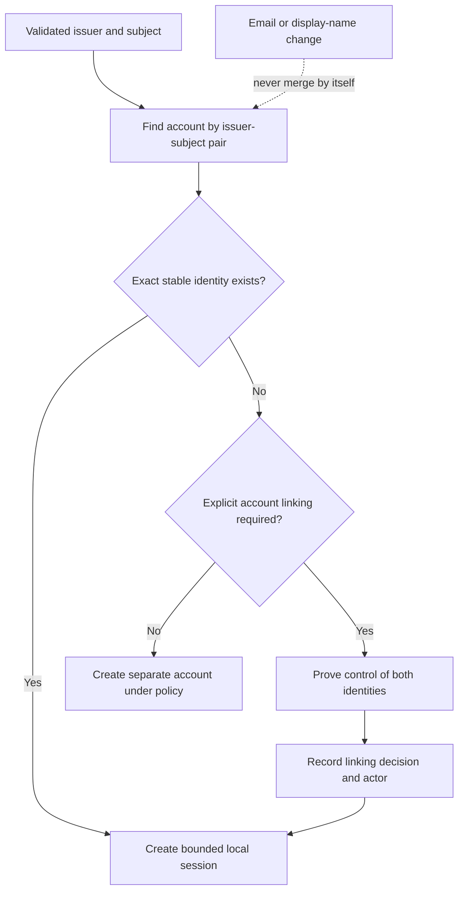

# OIDC (OpenID Connect)

Part: [15 — Security](PART_OVERVIEW.md)

OpenID Connect (OIDC) adds an identity layer on top of OAuth 2.0. It lets a client verify an authentication event and obtain claims about a subject. [Part 05 CH20 OIDC](../05_Networking_and_OS/CH20_OIDC.md) owns the protocol wire flow; [CH06 OAuth](CH06_OAuth.md) owns delegated authorization. This chapter focuses on trust configuration, validation, local identity mapping, sessions, and common integration failures.

## Identity Provider Trust and Discovery

A relying party (RP) establishes trust in an issuer using configured issuer identity, approved endpoints, signing keys, client registration, and permitted redirect URIs. Discovery can simplify configuration, but metadata must be retrieved from the expected issuer over a trusted connection and validated against policy. Do not accept arbitrary issuer URLs from user input or tenant configuration without governance.

Maintain an allowlist of trusted issuers and define how metadata and key changes are handled. Key rotation should allow legitimate overlap without accepting arbitrary keys. Pinning one static key indefinitely can break rotation; trusting every discovered key without issuer validation can accept attacker-controlled identity data.

## ID Token Validation and Identity Mapping

An ID token is an identity assertion for the client, not an API access token. Validate signature with a key from the trusted issuer, issuer equality, audience and authorized-party rules, expiry and issued-at times, nonce, and any required authentication context. Reject unexpected algorithms, malformed claims, and tokens intended for a different client. Full claim semantics and protocol details remain in Part 05 CH20.

Use the issuer and subject pair as the stable external identity key. Email, username, and display name can change or be reassigned; do not use them alone for account linking. If users link multiple identity providers, require proof of control over both accounts and audit the operation.

## Sessions, Logout, and Claims

After token validation, the application usually creates its own session. Define session lifetime, renewal, reauthentication for sensitive actions, logout behavior, and invalidation after account compromise. Logging out at one application may not terminate the identity provider's single sign-on session or every other relying party session; communicate and implement the actual boundary.

Request only claims needed for the application. Minimize personal data, validate claim types and sizes, and do not treat profile claims as authorization unless a separate policy explicitly grants that authority. For high-impact actions, use current authorization state rather than stale claims embedded in a long-lived session.

## Federation, Account Linking, and Failure

Federated login introduces dependencies on provider availability, DNS, signing-key publication, metadata, and clock synchronization. Define behavior for issuer outage and signing-key rotation. Existing sessions may continue under policy while new logins fail; this trade-off should be explicit. Do not disable validation to restore availability.

Log authentication outcomes and safe reason codes. Exclude raw tokens and sensitive claims. Monitor failed validation rates, key refresh failures, unexpected issuers, and account-linking events. Revoke local sessions and refresh tokens when the external identity is compromised or no longer trusted.

## Worked Case and Review Checklist

A business application trusts one corporate issuer and uses authorization code with a registered redirect. It validates state and nonce, fetches signing keys only from the configured issuer, checks audience and expiry, then maps issuer plus subject to a local account. An email change updates a profile attribute but does not silently merge accounts. Local logout invalidates the application session; federated logout is separately documented as best effort.

Review issuer allowlist, discovery transport, redirect URIs, state and nonce, signature algorithms, issuer/audience/expiry validation, key rotation, stable identity mapping, account linking, claim minimization, local session lifecycle, logout semantics, and outage behavior. Test malicious issuer, wrong audience, expired token, nonce mismatch, and unknown key.

## Questions and Summary

1. Distinguish an ID token from an access token and identify each intended consumer.
2. Explain why issuer plus subject is a safer external identity key than email.
3. Design key rotation behavior that supports legitimate overlap without trusting unknown issuers.
4. What does logout invalidate locally, and what remains controlled by the identity provider?
5. Which validations must not be bypassed during provider outage?

OIDC standardizes identity assertions but leaves the relying party responsible for establishing issuer trust, validating tokens, mapping identities, and protecting local sessions. Use Part 05 for protocol mechanics; use this chapter to design secure trust and lifecycle around that flow. Authentication success still does not grant application permissions.
