# OIDC (OpenID Connect)

Part: [15 — Security](PART_OVERVIEW.md) · Status: Revised (in-depth rewrite)

## 1. Introduction

OpenID Connect (OIDC) is a thin identity layer on top of OAuth 2.0 (Open Authorization). It lets an application, called the relying party (RP), learn that a particular user authenticated at a trusted provider, when they did so, and a small set of facts about them, without ever handling the user's password. Nearly every "Sign in with ..." button, every corporate single sign-on (SSO) portal built on a modern identity provider, and most cloud console federation use it. Because the relying party must make several independent checks before it believes an assertion, and because every skipped check corresponds to a known attack, OIDC integrations fail in a small number of repeatable ways. This chapter teaches those checks and the design choices around them.

After this chapter you will be able to:

- State precisely what OIDC adds to OAuth and why an access token is not proof of login.
- Trace a login from the authentication request to the local session, and say which parameter defeats which attack.
- Validate an ID token in the correct order and explain what each check prevents.
- Configure issuer trust and discovery so that key rotation works and attacker-chosen metadata is never accepted.
- Reason about the multi-tenant issuer problem, the mix-up attack, and cache behavior during provider outages.

Ownership is split across the handbook as follows:

| Topic | Owner |
|---|---|
| Wire-level OIDC flows, claim definitions, UserInfo and discovery document fields | [Part 05 CH20 OIDC](../05_Networking_and_OS/CH20_OIDC.md) |
| JSON Web Token (JWT) structure and signature mechanics | [Part 05 CH21 JWT](../05_Networking_and_OS/CH21_JWT.md) |
| Delegated authorization, client classification, redirect trust, scopes, token custody | [CH06 OAuth](CH06_OAuth.md) |
| Authenticating the user: passwords, multi-factor, sessions as a general topic | [CH02 Authentication](CH02_Authentication.md) |
| SAML (Security Assertion Markup Language) federation | [Part 05 CH22 SAML](../05_Networking_and_OS/CH22_SAML.md) |
| Trust configuration, validation order, identity mapping, sessions and logout, federation failure handling | This chapter |

Part 05 explains how the protocol is spelled on the wire. This chapter explains which decisions a relying party must make and which mistakes an attacker is hoping for. Where a mechanism must be restated to reason about an attack, it is restated only as far as needed.

A recap of two earlier ideas keeps the rest readable. [CH06 OAuth](CH06_OAuth.md) established that an access token is a statement from an authorization server to a resource server, relayed by a client that treats it as opaque, and that the authorization code flow with Proof Key for Code Exchange (PKCE) is the default for interactive clients. [CH02 Authentication](CH02_Authentication.md) established what counts as evidence that a person is who they claim to be. OIDC combines the two: the provider performs authentication, and the relying party receives a signed statement about the outcome.

## 2. The Identity Layer Model

### 2.1 What OIDC adds to OAuth

OAuth answers "may this client perform this action against that resource on behalf of this subject?" It says nothing about who the subject is, whether they just authenticated, or how. A client that receives an access token learns only that some user, at some point, consented. Treating that token as proof of login is the "OAuth for login" error: an access token issued to a different client, or obtained by a malicious application that a user once signed in to, can be replayed to a naive relying party that accepts it as identity.

OIDC Core 1.0 fixes this with three additions to the unmodified OAuth flow:

1. The ID token, a signed JWT (JSON Web Token) addressed to the relying party, stating who authenticated, at which issuer, when, and for which client.
2. The reserved scope value `openid`. A request without it is plain OAuth, and the provider returns no ID token.
3. Standard endpoints and metadata: a discovery document, a published set of signing keys, and a UserInfo endpoint that returns claims about the subject for a valid access token.

The roles are renamed but map directly onto OAuth. The OpenID Provider (OP) is the authorization server that also authenticates users. The relying party (RP) is the OAuth client. The ID token is meant for the RP. The access token, if one is issued, is still meant for a resource server, and the RP should not inspect or depend on its internal format.

| Artifact | Addressed to | Audience (`aud`) | RP may do | RP must not do |
|---|---|---|---|---|
| ID token | The relying party | The RP's `client_id` | Verify, read claims, create a local session | Send it to an API as a credential |
| Access token | A resource server | The API identifier, depending on provider | Present it to the API | Treat it as proof of login |
| Refresh token | The OP token endpoint | Not applicable | Redeem it for new tokens | Expose it to scripts or logs |

### 2.2 Where trust is placed

The relying party trusts exactly one thing at login: that the signing keys of the issuer it was configured to accept sign only genuine authentication results for it. Everything else in the protocol is a way to bind a particular response to a particular request, client, and moment.

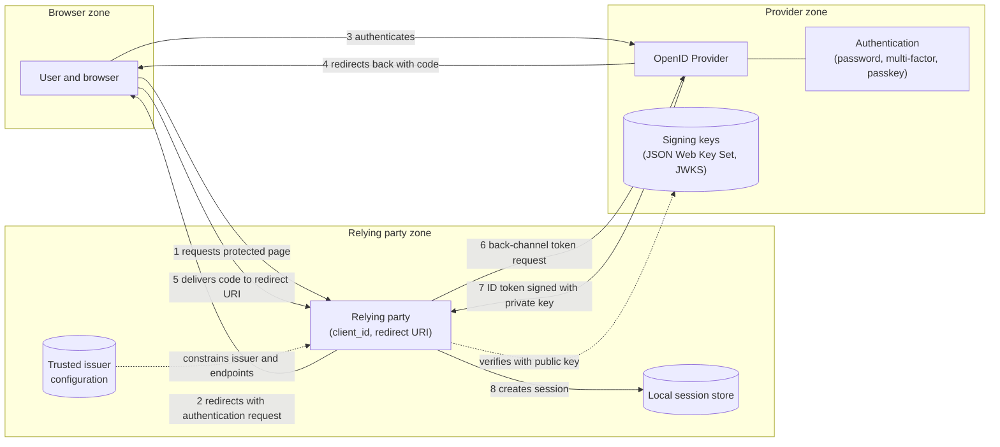

The diagram separates what travels through the browser (the request and the code, both observable and replayable by anything in the browser) from what travels directly between the relying party and the provider (the code exchange and the ID token). Anything on the browser side is attacker-influenced, so the design binds each browser-side value to something the browser cannot forge: the `state` and PKCE verifier are bound to the RP's own session, and the signature on the ID token is bound to the provider's key. The dashed edge from the signing keys to the relying party is where most integration failures live, covered under issuer trust and key rotation below.

Authentication evidence itself, such as how many factors the provider required, is the provider's business and is reported only through claims. The relying party can ask for a level of assurance and check that the claims reflect it, but it cannot observe the ceremony.

## 3. The Login Transaction

### 3.1 Authorization code flow, step by step

The authorization code flow is the recommended way to log users in, for server-side web applications, native apps, and browser applications alike. The implicit and hybrid flows that return an ID token directly through the browser exist in the specification, but they expose tokens to the browser history and to scripts and are not used for new designs. [CH06 OAuth](CH06_OAuth.md) explains why the code flow with PKCE replaced them.

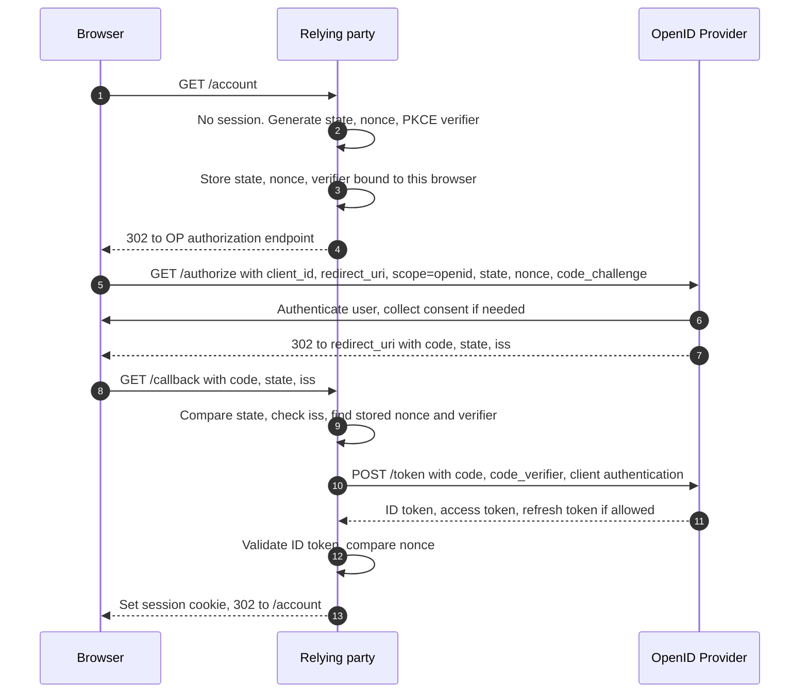

The first step is a redirect, not a call: the RP never contacts the provider until the browser carries the user there. Three random values are created before the redirect and kept by the RP, bound to the user's browser (for example in a short-lived, signed, Hypertext Transfer Protocol (HTTP) `HttpOnly` cookie or a server-side record keyed by such a cookie). The callback is the point where they are checked. If the RP cannot find a stored transaction for the returning browser, the callback is rejected, and this single rule defeats login cross-site request forgery.

### 3.2 What each parameter defends against

The authentication request carries several parameters that look similar and defend against different attacks.

| Parameter | Created by | Checked where | Attack stopped |
|---|---|---|---|
| `state` | RP, random, per request | On the callback, against the browser-bound transaction | Login CSRF (cross-site request forgery): an attacker's code delivered to a victim's browser, logging the victim in as the attacker |
| `nonce` | RP, random, per request | Inside the ID token, against the stored value | Replay of a captured ID token into a different login transaction |
| `code_challenge` and `code_verifier` | RP, verifier random, challenge derived | OP checks at the token endpoint | Interception or injection of the authorization code |
| `redirect_uri` | RP, must match registration exactly | OP before redirecting | Code or token delivery to an attacker-controlled address |
| `iss` response parameter | OP, in the callback | RP, against the issuer it started the transaction with | Mix-up attack, described below |

The PKCE challenge is derived with SHA-256: `code_challenge = BASE64URL(SHA256(code_verifier))`, sent with `code_challenge_method=S256`. The verifier stays at the RP and is revealed only on the back channel, so someone who steals the code from the browser cannot redeem it.

State and nonce are often confused because both are random and both are echoed. The difference is the channel they protect. `state` protects the browser redirect and is compared before any token is requested. `nonce` protects the token and is compared after the token is validated. A code flow with PKCE already makes ID token injection hard, but OIDC Core still lets the RP require `nonce`, and checking it costs one string comparison, so keep it.

A concrete authentication request, with line breaks added for reading:

```http
GET /authorize?response_type=code
  &client_id=s6BhdRkqt3
  &redirect_uri=https%3A%2F%2Fapp.example.com%2Fcallback
  &scope=openid%20profile%20email
  &state=af0ifjsldkj
  &nonce=n-0S6_WzA2Mj
  &code_challenge=E9Melhoa2OwvFrEMTJguCHaoeK1t8URWbuGJSstw-cM
  &code_challenge_method=S256 HTTP/1.1
Host: idp.example.com
```

The token response contains the three tokens. The values are shortened; the ID token is a JWT whose claims are examined next.

```json
{
  "token_type": "Bearer",
  "expires_in": 3600,
  "access_token": "eyJhbGciOi...",
  "id_token": "eyJhbGciOi...",
  "refresh_token": "8xLOxBtZp8"
}
```

### 3.3 The mix-up attack and the iss parameter

When an RP supports more than one provider, an attacker who operates or has compromised one of them can try to confuse the RP about which provider produced a response. The attacker tricks a user into starting login with the malicious provider, then answers with a redirect that makes the RP send the code, and perhaps its client credentials, to the honest provider's token endpoint or the reverse. The defense in [RFC 9207](https://www.rfc-editor.org/rfc/rfc9207) is an `iss` parameter in the authorization response. The RP records which issuer it sent the user to, and on the callback requires that the `iss` value equals that issuer before it contacts any token endpoint. Using a distinct redirect URI per provider gives similar protection and needs no provider support. A single-provider RP is not exposed to this attack but loses nothing by checking.

### 3.4 Failure modes on the callback

Every callback branch needs a defined outcome, because the ones that look like user errors are often attacks.

| Observation | Likely cause | Correct handling |
|---|---|---|
| No stored transaction for this browser | Expired login, replay, or login CSRF | Reject, restart login, log a safe reason code |
| `state` mismatch | Forged or crossed callback | Reject without contacting the OP |
| `error=access_denied` | User declined or policy denied | Show a neutral message, no retry loop |
| Code redeemed twice | Replay | The OP should reject and may revoke tokens from the first redemption; the RP rejects |
| Token endpoint timeout | OP outage | Fail the login; never fall back to unverified identity |

A short-lived transaction record helps all rows. Ten minutes is a common ceiling, and the exact value is a design choice: long enough for a user to complete multi-factor prompts, short enough that abandoned transactions cannot be replayed later.

## 4. The ID Token and Its Validation

### 4.1 Anatomy of an ID token

An ID token is a JWT: three Base64URL segments for header, payload, and signature, joined by dots. [Part 05 CH21 JWT](../05_Networking_and_OS/CH21_JWT.md) covers the format. The decoded header and payload of a typical token look like this (illustrative values):

```json
{
  "header": { "alg": "RS256", "kid": "2026-10-key-a", "typ": "JWT" },
  "payload": {
    "iss": "https://idp.example.com",
    "sub": "248289761001",
    "aud": "s6BhdRkqt3",
    "exp": 1793863200,
    "iat": 1793859600,
    "auth_time": 1793859590,
    "nonce": "n-0S6_WzA2Mj",
    "acr": "urn:example:mfa",
    "amr": ["pwd", "otp"],
    "at_hash": "77QmUPtjPfzWtF2AnpK9RQ"
  }
}
```

The claims the relying party depends on, and what each one means for security:

| Claim | Meaning | Check |
|---|---|---|
| `iss` | Issuer identifier, a URL with no query or fragment | Exact string equality with the configured issuer |
| `sub` | Subject identifier, unique within the issuer, never reassigned | Used with `iss` as the identity key |
| `aud` | Audience, which must contain the RP's `client_id` | Must include this client; reject otherwise |
| `azp` | Authorized party, present when there are several audiences | If present, must equal this client |
| `exp` | Expiry time | Reject if now is past `exp`, allowing small clock skew |
| `iat` | Issued-at time | Reject implausible values, such as far in the future |
| `nonce` | Value echoed from the request | Equal to the stored value for this transaction |
| `auth_time` | When the user actually authenticated | Compare against `max_age` or a freshness rule |
| `acr`, `amr` | Authentication context and methods | Check only if the application requires a level |
| `at_hash` | Left half of a hash of the access token | Optional binding of the access token to this ID token |

Two cautions follow from the table. First, `sub` is unique only inside one issuer, so the stable identifier is the pair `(iss, sub)`; the identity-mapping design is covered later in the chapter. Second, `exp` and `iat` describe the token, not the user's session. A token that expires after an hour does not mean the user's local session should last an hour, nor that it must end then. Session lifetime is a local decision.

### 4.2 The validation procedure

Validation has an order, and the order matters because later steps trust earlier ones. The reasoning is that nothing inside a token can be believed until the signature is verified with a key the RP chose to trust, and the key is chosen by the configured issuer, not by the token.

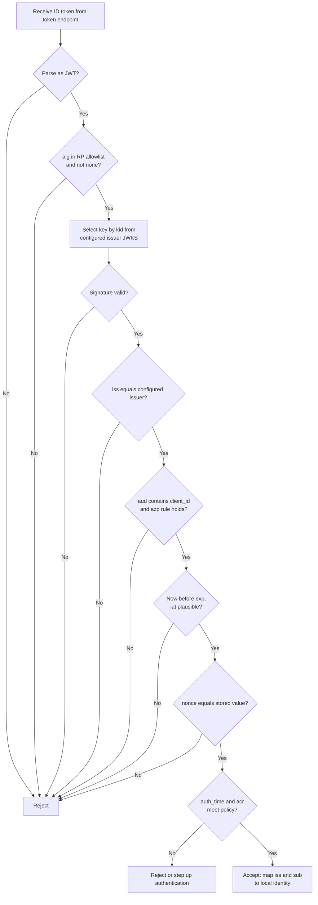

The tree reads as a gate sequence. Any failure ends in rejection, with a safe reason code logged and no partial acceptance. When the token was received directly from the token endpoint over a verified Transport Layer Security (TLS) connection, OIDC Core allows the RP to rely on that channel instead of checking the signature, but verifying the signature costs little and keeps the code correct if the token ever arrives by another path, so verify anyway.

### 4.3 What each skipped check allows

Each check exists because someone exploited its absence. Reading the list as attacker options shows why a "mostly validated" token is a vulnerability.

| Skipped check | Attacker move | Result |
|---|---|---|
| Signature | Forge a token with chosen `sub` | Login as any user |
| Algorithm allowlist | Send `alg: none`, or switch an RSA (Rivest-Shamir-Adleman) token to HMAC (Hash-based Message Authentication Code) using the public key as the secret | Forged token accepted |
| `iss` | Present a token from any provider the attacker controls, signed with that provider's own key | Login as any user the attacker names |
| `aud` | Replay a token legitimately issued to a different client of the same provider | Cross-application login: a user of a low-trust app becomes a user of a high-trust app |
| `exp` | Replay a token stolen from logs or backups | Indefinite replay |
| `nonce` | Inject a captured token into a new transaction | Login as the victim |

The algorithm confusion row deserves detail. If the verifier picks the algorithm from the token header and the key from a general-purpose key store, an attacker can set `alg` to `HS256` and sign with the issuer's public key bytes, which are public. A verifier that treats that key as an HMAC secret accepts the forgery. The fix is to fix the algorithm per issuer in configuration, usually from the discovery field that lists supported signing algorithms, and to reject any token whose header disagrees. Use a maintained JWT library, set the expected algorithm, issuer, and audience as required parameters, and do not write the comparison code by hand.

The audience row is the confused-deputy form of the OAuth-for-login error. Two applications that trust the same provider both receive valid, correctly signed ID tokens. Only the `aud` check separates them.

### 4.4 Time, skew, and freshness

Validation uses the RP's clock, which may differ from the provider's. Allow a small skew, commonly a minute or two, and synchronise clocks with Network Time Protocol (NTP). A large skew allowance weakens `exp`, so do not widen it to hide an unsynchronised server. Illustrative arithmetic: with `exp` set 3,600 seconds after `iat` and an allowed skew of 120 seconds, a token the provider considers expired is still accepted for up to 120 seconds, so the effective acceptance window is at most 3,600 + 120 = 3,720 seconds. For a login-only token that is consumed immediately after the code exchange, the RP can enforce a stricter local rule such as "`iat` no more than 300 seconds in the past", since a token that old at the moment of receipt did not come from a fresh exchange.

`auth_time` addresses a different problem. When a user has a long SSO session at the provider, a new login at the RP may silently reuse it, so the authentication could be many hours old. For sensitive operations the RP sends `max_age` in the request, or `prompt=login` to force reauthentication, and then checks that `auth_time` is no older than allowed. A provider that cannot meet the request returns an error rather than silently ignoring it, and the RP must treat an ID token that violates its own requirement as a failure. Requesting a particular authentication context through `acr_values` works the same way: the RP verifies the returned `acr`, because the request is only a preference unless the provider enforces it.

## 5. Issuer Trust, Discovery, and Signing Keys

### 5.1 What the relying party must be configured with

A relying party establishes trust in an issuer through configuration made by an administrator, not by anything received at login time. The minimum is the exact issuer identifier, the client identifier and credential, and the exact redirect URIs. Endpoints and keys can be learned through discovery, but only from the configured issuer.

Discovery works by appending `/.well-known/openid-configuration` to the issuer URL. The returned JavaScript Object Notation (JSON) document lists `issuer`, `authorization_endpoint`, `token_endpoint`, `jwks_uri`, supported algorithms and scopes, and more. [Part 05 CH20 OIDC](../05_Networking_and_OS/CH20_OIDC.md) describes the fields. The security rule is simple: the `issuer` value inside the document must equal the URL the RP used to fetch it. If it does not, the RP is being redirected to someone else's configuration and must stop.

```bash
# Fetch metadata and confirm the issuer matches the configured value
curl -s https://idp.example.com/.well-known/openid-configuration \
  | jq '{issuer, jwks_uri, token_endpoint, id_token_signing_alg_values_supported}'
```

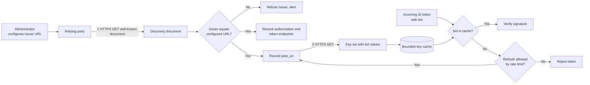

The diagram shows two fetches, both anchored to the administrator-chosen issuer, and one decision at token time. The relying party never follows a `jwks_uri` taken from a token header (the JWT `jku` and `x5u` headers allow this) because that would let the token choose its own verification key. Ignore those headers and use only the key set published by the configured issuer.

### 5.2 Key rotation and the cache

Providers rotate signing keys, and compromised keys are replaced quickly. The relying party must follow without trusting unknown keys indefinitely. The workable design has four parts:

1. Cache the key set, honouring the HTTP `Cache-Control` headers from the `jwks_uri` response, with a local maximum.
2. Select the verification key by `kid` from the cached set.
3. On an unknown `kid`, refresh once, subject to a minimum interval between refreshes.
4. If the key is still unknown after refresh, reject the token.

The rate limit in step three guards the provider and the RP against an attack in which an adversary sends tokens with random `kid` values to force a fetch on every request. Illustrative arithmetic: an unauthenticated login endpoint receiving 200 tokens per second with random `kid` values, with no limit, would trigger up to 200 outbound key-set fetches per second, which turns the RP into a traffic source against the provider and exhausts its own connections. With a minimum interval of 300 seconds the same flood causes at most 1 fetch per 300 seconds, about 0.0033 per second, a reduction of about 60,000 times. A legitimate rotation is still picked up within one interval.

Providers that publish a new key before they start signing with it make this safe: during the overlap the new key is already in every cache. Verify this behavior in the provider's documentation, because the overlap length is a provider decision and not a protocol guarantee. A provider that signs with a new key immediately will fail every RP whose cache has not refreshed, and the unknown-`kid` refresh is the mitigation.

Pinning a single static key indefinitely breaks the first rotation and tends to be "fixed" by disabling signature checks. Trusting any key in any response from any URL accepts attacker data. The bounded cache with refresh-on-miss sits between the two failure modes.

### 5.3 Multi-tenant issuers

Some providers serve many organizations from one set of endpoints. In Microsoft Entra ID, a multitenant application can use a common metadata path, and the issuer inside tokens then contains the signing-in organization's tenant identifier. The metadata document from the common path carries a templated issuer, so an exact string comparison against it cannot be used directly. The RP instead substitutes the token's `tid` claim into the template and compares the result, and it separately decides which tenants it accepts. Skipping the second step is a documented class of misconfiguration: a multitenant app that accepts any valid tenant lets any organization's user sign in. [Microsoft Entra documentation on multitenant applications and issuer validation](https://learn.microsoft.com/en-us/entra/identity-platform/) describes the current rules; verify against it, as endpoint and claim details change.

The general rule applies to every provider: validating that a token is genuine is not the same as deciding that its issuer is allowed. Keep an allowlist of issuers, or of tenants within a multi-tenant issuer, and treat additions as a reviewed change. Never take an issuer URL from user input, a request header, or tenant-supplied configuration without governance, because a malicious issuer will pass every cryptographic check with its own keys.

### 5.4 Provider specifics at a glance

The protocol is the same across providers, but identifiers and defaults differ. These identifiers are the stable shapes at the time of writing; verify them in provider documentation before relying on them.

| Provider | Issuer shape | Notes |
|---|---|---|
| Google | `https://accounts.google.com` | Single global issuer for Google accounts; Google Cloud workload identity is a separate topic, see [Part 09 CH09 IAM](../09_Cloud_Computing/CH09_IAM.md) |
| Microsoft Entra ID | `https://login.microsoftonline.com/{tenant-id}/v2.0` for the v2.0 endpoint | Tenant identifier in the path; multitenant templating as above |
| Amazon Cognito user pool | `https://cognito-idp.{region}.amazonaws.com/{user-pool-id}` | One issuer per user pool; also verify the `token_use` claim to tell ID and access tokens apart |
| Self-hosted (for example Keycloak) | Deployment URL plus realm path | Issuer changes if the public URL changes behind a proxy; confirm that the advertised issuer matches |

The Cognito `token_use` row illustrates a general edge case: when one provider issues both ID and access tokens as JWTs signed by the same key, a verifier that checks only signature and issuer will accept either. Check `aud` or `token_use` so an access token cannot be presented as an ID token, and the reverse.

### 5.5 Worked scenario: an unexpected issuer

An internal portal is configured to trust one corporate issuer. A developer adds "bring your own identity provider" support so customers can connect their own provider, and stores the issuer URL in the customer's tenant settings. A malicious customer enters the URL of a server they control, which serves a valid discovery document and signs tokens correctly with its own key. Every validation step passes against that issuer, and the token claims `sub` equal to a value that matches a user in another tenant. The result is an account takeover without breaking any cryptography.

The defect is that issuer trust was scoped to the application rather than to the tenant. The fix is to bind the identity key to the tenant and issuer, so that `(tenant, iss, sub)` is the lookup key, a token from one tenant's issuer can only resolve to accounts in that tenant, and new issuer URLs require verification, for instance proof of control of the domain, before activation. Testing this case, a token from an unregistered issuer with a perfectly valid signature, belongs in the integration test suite alongside wrong audience and expired token.
## 6. Identity Mapping and Account Linking

A validated ID token proves that an issuer made a statement. The relying party still has to decide which local account that statement refers to, and that decision is where many real account takeovers happen. The token validation steps in the previous sections are necessary and, by themselves, say nothing about whether the right person ends up in the right account.

### 6.1 The identity key: issuer plus subject

The OIDC specification defines `sub` as a locally unique, never reassigned identifier for the end user within the issuer. The same specification makes no such promise about any other claim. The only identifier a relying party can treat as stable is therefore the pair `(iss, sub)`, and the local store should be shaped around it.

| Candidate key | Why it fails |
|---|---|
| `email` | Mutable by the user or administrator, reassignable when an employee leaves and a new hire receives the same address, and in some providers not verified or not controlled by the user |
| `preferred_username` or `name` | Display attributes, free to change, not unique by contract |
| `sub` alone | Unique only inside one issuer. Two issuers can both emit `sub: "1001"` for different people |
| `(iss, sub)` | Stable, unique, and scoped to the party that vouches for it |

Some providers issue pairwise subject identifiers, where the same person receives a different `sub` in each client (the specification calls this `subject_type: pairwise`). That is a privacy feature: two applications cannot correlate users by comparing `sub`. It also means `sub` cannot be used to join data between applications or to match a user to a directory record. Check the provider documentation for whether `sub` is global or per client, because the answer decides whether a separate stable directory identifier is needed.

A local schema that follows from this keeps accounts and external identities in different tables, so one account can have several external identities and an identity can never silently point at two accounts:

```sql
CREATE TABLE external_identity (
  issuer        text        NOT NULL,
  subject       text        NOT NULL,
  user_id       uuid        NOT NULL REFERENCES app_user (id),
  created_at    timestamptz NOT NULL DEFAULT now(),
  last_login_at timestamptz,
  PRIMARY KEY (issuer, subject)
);
CREATE INDEX external_identity_user ON external_identity (user_id);
```

The primary key makes the lookup the only way to resolve a login. Email, name, and picture live in the account table as attributes that are refreshed on login and never used to find the account.

### 6.2 From validated claims to a local identity

After validation the relying party runs a small decision procedure. Making it explicit, and making each branch an auditable event, is what separates a deliberate design from an accumulation of special cases.

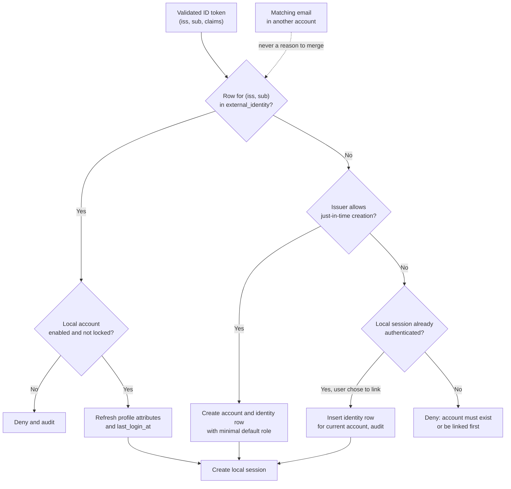

The only path that attaches a new external identity to an existing account starts from a local session that is already authenticated. The dashed edge is the rule the diagram exists to show: a matching email address, however convincing, does not create a link. A first login from an unknown `(iss, sub)` either creates a new account, if the issuer is configured for that, or is refused. Each of the four outcomes (known, created, linked, denied) is a distinct audit event, which lets monitoring spot, for example, a sudden spike in creations from one issuer.

### 6.3 Account linking and why email merging is an attack

Linking by email looks helpful: a user registered with a password, later clicks "Sign in with Provider", and the application merges the two because the addresses match. Two variants of this are exploitable.

In the first, the provider does not guarantee the address. An attacker creates an account at a permissive provider, sets the email to the victim's address (some providers allow an unverified email), and signs in to the application. The application sees a matching address and attaches the attacker's `(iss, sub)` to the victim's account. The `email_verified` claim narrows this, but it is a claim made by the issuer, and issuers differ in what verification means and whether the address is ever re-verified after a change. Treat it as an input to a risk decision and never as proof of ownership of the local account.

In the second, the attacker acts first. They register a local account using the victim's email before the victim ever signs up, and set a password. When the victim later signs in through a provider and the application merges by email, the attacker's password still opens the now-linked account. This pattern is often called pre-hijacking. The defense is the same: no automatic merge, and a rule that an unverified local account cannot absorb an external identity.

The safe procedure for a deliberate link is:

1. The user authenticates to the existing account with its current credentials, including its second factor.
2. From that session the user starts a login at the second provider, with `prompt=login` so that the provider authenticates them now.
3. The callback validates the token and inserts `(iss, sub)` for the current account, and nothing else.
4. The application records who linked what and when, and notifies the account's contact address.

Unlinking needs a guard too: refuse to remove the last remaining credential, or the user is locked out and support will be tempted to restore access by email alone, which is the weakness being defended.

### 6.4 Just-in-time provisioning and the lifecycle gap

Just-in-time (JIT) provisioning means the first successful login creates the local account from token claims. It removes a synchronization job and a class of "user exists at provider but not here" support tickets. It has three costs that must be planned for.

First, creation is driven by the provider's claims, so default privileges must be minimal and must not be taken from claims such as `groups` without an explicit mapping the application owner controls. A JIT rule that grants "admin" when a `roles` claim contains the string is trust in the provider's data model, which may be configured by someone other than the application's owner.

Second, JIT creates but never deletes. An employee who leaves is disabled at the provider and cannot log in again, but the local account, data, and any long-lived refresh token or API key remain. System for Cross-domain Identity Management (SCIM) is the usual standard for pushing create, update, and deactivate events to an application, and it is what closes this gap. Without it the application has no signal until the person tries to log in.

Third, the exposure window is set by local token and session lifetimes, not by the provider. Illustrative arithmetic: a company with 5,000 staff and 8 percent annual leavers has 5,000 × 0.08 = 400 departures per year, about 33 per month. If each local session allows silent renewal for up to 30 days, a departure at the provider can leave up to 30 days of residual access in the application, so the application sees up to 33 accounts per month that are disabled upstream and still working locally. Shorter renewal limits, SCIM deactivation, or periodic revalidation against the provider reduce that number; none of them is free, and the choice is a risk decision for the application owner.

## 7. Sessions at the Relying Party

### 7.1 Three clocks, one decision

OIDC ends at the ID token. What the user experiences as "being logged in" is a session the relying party creates itself, usually an opaque identifier in a cookie that points to a server-side record. Three independent lifetimes are in play, and confusing them is the root of most session bugs.

| Clock | Owner | Typical purpose | Effect on the RP |
|---|---|---|---|
| ID token `exp` | Provider | Bounds how long the token may be accepted as a fresh assertion | Checked once at login, then irrelevant to the session |
| Provider SSO session | Provider | Lets the user move between applications without retyping credentials | Determines whether a silent re-authentication succeeds |
| Local session | Relying party | Authorizes requests to this application | Entirely the RP's decision |

The consequence is that the RP must choose its own session rules and may not inherit them. A one-hour ID token does not mean a one-hour session, and a provider session that lasts days does not mean the application should trust the browser for days. Choose three numbers deliberately: an idle timeout (no activity), an absolute timeout (hard ceiling since login), and a reauthentication age for sensitive actions.

Session handling at login follows the same rules as any other authenticated session, covered in [CH02 Authentication](CH02_Authentication.md). Two points are specific to OIDC. First, issue a new session identifier after the callback succeeds, so an identifier planted before login (session fixation) is worthless. Second, store `iss`, `sub`, `auth_time`, and the provider's session identifier `sid` (if the ID token carries one) in the session record. `sid` is what later lets a logout message find the right local session.

### 7.2 Lifetimes, renewal, and step-up

A session moves through a small set of states, and the transitions are where policy lives.

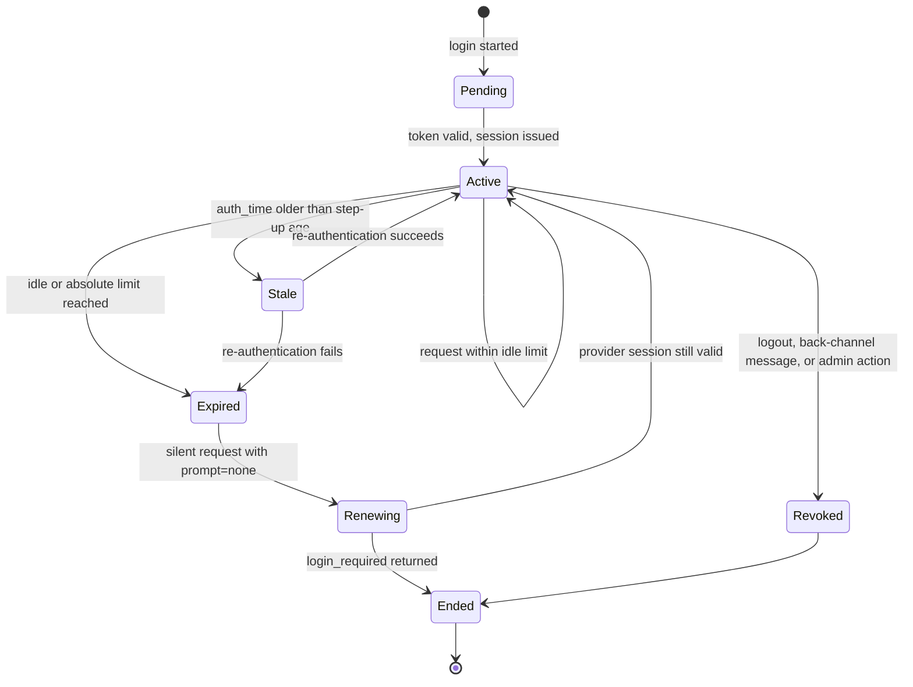

The diagram shows that renewal is a new authentication request, not an extension of the old token. When the idle limit passes, the RP can send an authorization request with `prompt=none`. If the provider's SSO session is alive, it returns a code without showing a page, and the RP issues a fresh local session. If it is not, the provider returns the error `login_required` and the RP sends the user through a normal login. This puts the provider in control of whether the person is still allowed in, at the price of one redirect per renewal. Step-up works the same way with `prompt=login` or `max_age`, followed by a check of `auth_time` and `acr` as described earlier.

Illustrative arithmetic. Take an idle timeout of 30 minutes and an absolute timeout of 8 hours (480 minutes). A user active from 09:00 keeps the session alive by activity until 17:00, when the absolute limit forces a renewal. With the idle rule alone, a laptop left open and polled by a background page every 10 minutes would never expire, which is why the absolute limit exists. If instead the application relied on silent renewal every 30 minutes, an 8-hour day would trigger 480 / 30 = 16 renewal redirects per user, and for 2,000 concurrent users that is 2,000 × 16 = 32,000 provider requests per day from this application alone. Choose the absolute limit and renewal interval with that provider load, and the provider's rate limits, in mind. Look up the actual limits in the provider documentation.

Revocation after compromise is the case that decides whether a server-side session store was the right choice. A signed cookie that carries all session state cannot be revoked before it expires without a deny list, which is a server-side store by another name. Keep the record on the server, key it by an unguessable identifier, and index it by `(iss, sub)` and by `sid` so that "end all sessions for this user" and "end the session the provider named" are both one query.

## 8. Logout

### 8.1 Three layers, three different meanings

"Log out" can mean ending the local session, ending the provider's SSO session, or ending the sessions of every other application that trusts the same provider. These are separate and the protocol gives each its own mechanism. An application that only clears its own cookie has done the first. The user clicking "Sign in" again is then silently logged back in by the live provider session, which users often read as a broken logout button.

OIDC defines three logout mechanisms in separate specifications. At the time of writing they are RP-Initiated Logout, Front-Channel Logout, and Back-Channel Logout; check the OpenID Foundation site for their current status. A provider advertises support through discovery fields such as `end_session_endpoint`, `frontchannel_logout_supported`, and `backchannel_logout_supported`. Read these before designing, because not every provider implements all three.

### 8.2 RP-initiated logout

In RP-initiated logout the application ends its own session and then sends the browser to the provider's `end_session_endpoint` so the provider ends the SSO session too. The request normally carries:

- `id_token_hint`: a previously issued ID token, which tells the provider which session and client are meant. The RP therefore needs to keep the token (or enough to rebuild the request) for the session's life.
- `post_logout_redirect_uri`: where to send the browser afterwards. It must be registered in advance and matched exactly, for the same reason as the login redirect: an open post-logout redirect is a phishing hop.
- `state`: echoed back, so the RP can recognise its own return.

```http
GET /connect/endsession?id_token_hint=eyJhbGciOi...
  &post_logout_redirect_uri=https%3A%2F%2Fapp.example.com%2Fsigned-out
  &state=7c1d9e HTTP/1.1
Host: idp.example.com
```

Order matters. Revoke the local session first, then redirect. If the RP redirects first and the user closes the tab at the provider, the local session survives. The provider may ask the user to confirm, because a logout request sent by a third-party page is a nuisance attack (any site can embed an image that points at the logout URL). Providers differ on whether the confirmation page appears; do not build flows that depend on silent logout working.

### 8.3 Front-channel and back-channel logout

RP-initiated logout reaches only the application the user clicked in. To reach the others, the provider must notify every relying party that holds a session for this SSO session. The two mechanisms differ in where the notification travels.

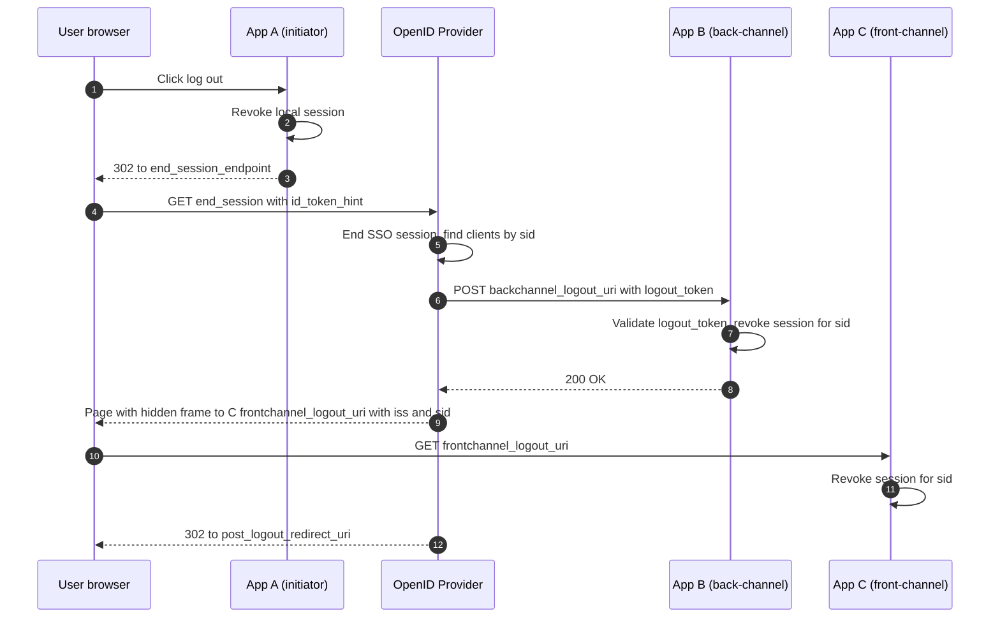

Back-channel logout is a direct server-to-server call. The provider sends a `logout_token`, a signed JWT, to the `backchannel_logout_uri` the RP registered. The RP validates it like an ID token (signature, `iss`, `aud` equal to its `client_id`, `iat`), and additionally checks that the `events` claim contains the back-channel logout event member, that `sub` or `sid` is present, and that there is no `nonce`. The absence of `nonce` is deliberate: it keeps a logout token from being accepted as an ID token. Replay protection comes from the `jti` claim, which the RP should record for a short window. After validation the RP revokes every local session whose stored `sid` (or `(iss, sub)`) matches, which is why the session record needs those fields.

Front-channel logout instead renders a hidden frame in the browser that requests the RP's `frontchannel_logout_uri`, passing `iss` and `sid`. It needs no inbound network path to the RP, but it depends on the browser: the frame is a cross-site request, and browsers that restrict third-party cookies may send the RP no session cookie, so the RP cannot identify the session from the cookie and must rely on `sid`. It also fails if the user closes the tab before the frames load.

| Property | RP-initiated | Front-channel | Back-channel |
|---|---|---|---|
| Who starts it | Application, user-driven | Provider, through the browser | Provider, server to server |
| Reaches other applications | No | Yes, if the browser completes it | Yes, regardless of the browser |
| Needs a reachable RP endpoint | No | No | Yes, from the provider |
| Failure when RP is down | Not applicable | Silent miss | Provider may retry, depending on the product |
| Main weakness | Only the initiating app | Browser restrictions, closed tabs | Needs session lookup by `sid` |

### 8.4 Why logout is best effort

No mechanism guarantees that every session ends. An RP that was unreachable misses a back-channel message, a closed tab misses the frames, and a provider that does not implement the specifications offers none of them. Design with the assumption that some sessions will outlive the logout. Three measures bound the damage: a short idle timeout, an absolute timeout, and a check of the user's state at the provider before sensitive actions (for example by forcing re-authentication through `max_age`). Document the boundary in user-facing terms, such as "signing out here ends this application's session and your corporate sign-in session, and other applications may remain signed in until their own timeout".

A related failure is the stuck-session loop: the RP revokes its session, but the provider SSO session is alive, so the very next request silently re-authenticates. For a shared computer this is the case that matters, so for public terminals use `prompt=login` and always call the provider's end-session endpoint.

## 9. Claims, Scopes, and the UserInfo Endpoint

### 9.1 Scopes request, claims describe

A scope is a request for a bundle of claims, and a claim is a statement about the subject. OIDC defines the scope `openid` plus four standard bundles. At the time of writing the bundles are `profile` (name, picture, locale and similar), `email` (`email`, `email_verified`), `address`, and `phone`; confirm the exact member lists in OIDC Core. Providers add their own scopes and claims, such as group or role claims, which are not portable.

Two rules keep this tidy. First, request the smallest set the application uses today. Each extra claim is personal data the application must protect, retain, and explain, and each one widens what a log leak exposes. Second, a granted scope is not a guarantee that a claim is present. The user may decline, the provider may omit it, or the directory may have no value. Code that assumes `email` exists will fail for service accounts and for some social accounts.

### 9.2 ID token or UserInfo

Claims can arrive in two places: inside the ID token, and from the UserInfo endpoint, which the RP calls with the access token. Where a claim lands is a provider setting and depends on the response type and scopes, so check the provider documentation.

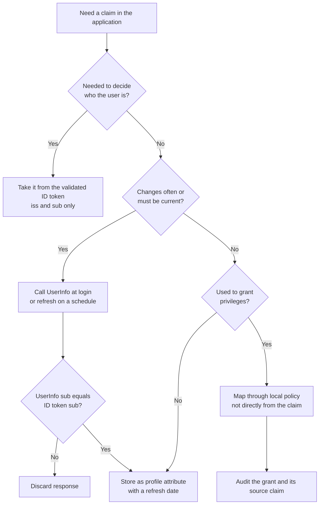

The tree separates identity (which needs the signed token), freshness (which may need a call), and privilege (which needs local policy). The sub comparison in the middle is a requirement of the specification: the `sub` in the UserInfo response must equal the `sub` in the ID token, because UserInfo is called with an access token that, if substituted, would return a different person's data. A mismatch means the response is discarded and treated as a security event.

A minimal UserInfo call with that check:

```python
import requests

def fetch_userinfo(userinfo_url: str, access_token: str, id_sub: str) -> dict:
    r = requests.get(
        userinfo_url,
        headers={"Authorization": f"Bearer {access_token}"},
        timeout=5,
    )
    r.raise_for_status()
    info = r.json()
    if info.get("sub") != id_sub:
        raise ValueError("userinfo subject differs from ID token subject")
    return info
```

The access token used here is for the provider's UserInfo resource. The RP must not forward it to other APIs unless that is the arrangement it registered for, which is the token custody rule from [CH06 OAuth](CH06_OAuth.md).

### 9.3 Claims as inputs, never as authority

Claims are the provider's statements, evaluated by the relying party. A claim such as `groups` or `roles` is useful as input to an authorization decision, but three problems recur.

- **Staleness.** The values are frozen at login. If a user is removed from a group at 10:00 and their session started at 09:00 with an 8-hour limit, the application may act on the old group for up to 7 hours. For high-impact operations, ask the source of truth at the time of the action, or require a recent `auth_time`.
- **Size.** A user in many groups can make the token large. Some providers respond with an indicator that the list was omitted, and the RP then has to look the groups up through a separate call. Entra ID does this for its group claim when the number of groups exceeds a threshold; at the time of writing, verify the behavior and threshold in current documentation. Code must handle "claim absent, lookup required" as a distinct case from "user has no groups", since confusing them either locks users out or, worse, defaults them into a wider role.
- **Namespace.** Whoever controls the provider's directory controls the claim. A role named `admin` in a tenant that a customer administers may mean something quite different from your `admin`. Map external values to local roles through an explicit table, ignore unmapped values, and keep the table under the application owner's change control.

Authentication succeeded does not mean the user is authorized, which is the subject of the later authorization material in the handbook. Treat any claim that grants access as a policy input whose source is recorded.

## 10. Multi-Tenant and Business-to-Business Federation

### 10.1 Who brings the identity provider

In a workforce application there is one trusted issuer, chosen by the organisation. A software-as-a-service (SaaS) product that serves other businesses faces a different situation: each customer wants to sign in with their own provider. The design question is where the federation happens.

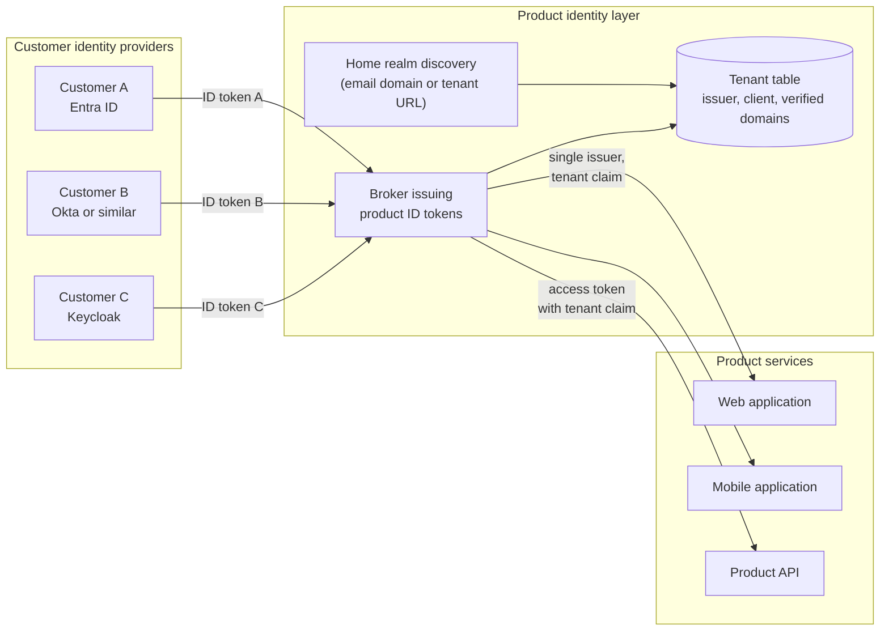

There are two common shapes. In the direct model, the application is itself a relying party of every customer provider, and keeps a per-tenant issuer table. In the broker model, a product-owned identity layer (a hosted identity service, or a self-run one such as Keycloak) federates with the customers' providers and presents a single issuer to the application. The broker model concentrates the validation logic, issuer allowlist, and claim mapping in one place, at the cost of operating that place. The direct model has fewer moving parts and a larger attack surface in the application, since every new customer's provider adds a trust relationship the application code must handle correctly.

Either way the key becomes `(tenant, iss, sub)`. Without the tenant part, the unexpected-issuer scenario from the issuer-trust section recurs: a customer's provider that emits the `sub` of another tenant's user resolves to the wrong account.

### 10.2 Home realm discovery and domain ownership

The product has to decide which provider to send a user to before it knows who they are. Home realm discovery (HRD) answers this from a tenant-specific URL (`acme.product.example`), from the email domain the user types, or from a picker. The email-domain approach carries a trap: a customer may enter any domain, including one they do not own, and capture the sign-in flow of that domain's real employees. Activate a tenant's domain mapping only after verifying control, for example through a Domain Name System (DNS) TXT record that the customer publishes with a token the product supplies. The same verification gates which email addresses a tenant's provider may assert; a tenant administrator may create users for any address they like in their own directory, so email from a tenant's provider is only meaningful within that tenant.

### 10.3 Per-tenant policy and operational load

Each tenant brings its own settings: whether the product allows JIT creation, which claim maps to a role, which authentication context is required, and who can administer the connection. Treat these as data with an audit trail and an owner, and restrict who may change the issuer URL, because that field is the trust anchor.

Illustrative arithmetic for the direct model. With 400 tenants, each with its own issuer and key set, a one-hour cache maximum means about 400 key-set fetches per hour in steady state, 400 / 3,600 ≈ 0.11 per second, which is trivial. The cost to watch is failure, not load: if each fetch has a 5-second timeout and logins block on it, one customer's slow provider can hold login threads. Fetch keys out of band on a schedule, keep the last good copy for the grace period, and apply a per-issuer timeout and circuit breaker so one tenant's outage never affects the others.

Guest and cross-tenant users (a consultant who signs in to a customer's tenant with their own employer's identity) are a special case. The product sees an external identity whose `iss` is the consultant's home provider, and the tenant must explicitly admit it; the default for such an identity is no access.

## 11. Provider Comparison

Providers implement the same protocol with different identity models, and the differences affect the mapping code more than the login code. The table lists mechanisms to look for, not guarantees. Verify each cell against current provider documentation.

| Aspect | Microsoft Entra ID | Amazon Cognito user pools | Google Identity | Keycloak (self-hosted) |
|---|---|---|---|---|
| Issuer scope | Per tenant in the path of the issuer URL | One issuer per user pool | One global issuer for Google accounts | One issuer per realm, derived from the public URL |
| `sub` stability | Pairwise per application, so a separate stable object identifier claim (`oid`) is used to correlate across applications | The pool's user identifier | Stable per user | Stable per user in the realm |
| Domain restriction | Tenant identifier claim (`tid`) | Per-pool policy | `hd` claim for Workspace domains, a hint that must be checked, not a filter | Realm and identity-provider settings |
| Group or role data | App roles and group claim, with an overage case | `cognito:groups` claim | Not part of the ID token | Realm and client roles as claims, configurable mappers |
| Federation with other providers | External identity and guest models | Federates into the pool; the pool issues its own tokens | Not a broker | Identity brokering to other OIDC and SAML providers |
| Logout mechanisms | Front-channel and RP-initiated | RP-initiated | RP-initiated limited | All three supported, with configuration |
| Operated by | Microsoft | AWS | Google | You |

Reading the table as a decision aid:

- Use the provider the users already belong to when the application serves one organisation. For Entra ID, that includes taking `tid` and an issuer allowlist seriously.
- Amazon Cognito suits applications that want a managed user directory of their own, with optional federation in. Its tokens mean "the pool vouches for this person", so `sub` is the pool's identifier and not the upstream provider's, and the RP must record the pool as the issuer.
- Google works well as a consumer sign-in option and as an input to an account-linking flow. Because Google accounts are not tenant-scoped, a workforce application needs the `hd` claim and a verified-domain rule to restrict access, and `hd` should be used together with `email_verified`, not alone.
- Self-hosting a provider such as Keycloak buys control over the full feature set, including all logout mechanisms and brokering, and costs patching, availability, key management, and incident response. The decision belongs with the same team that owns those duties.

Provider choice does not change what the relying party validates. Every provider needs the same checks, and the differences listed above live in claim mapping, logout behavior, and tenant scoping.

## 12. Migrating from SAML to OIDC

### 12.1 Concept mapping

An application moving from SAML (Security Assertion Markup Language) to OIDC changes the transport and format, and must preserve the identity link. The concepts line up, with a few that do not.

| SAML concept | OIDC counterpart | Migration note |
|---|---|---|
| Assertion in a signed response | ID token (JWT) | XML signature becomes JSON Web Signature; library and key handling change |
| Issuer element | `iss` | Exact match in both cases |
| `NameID` | `sub` | Formats differ; this is the central migration risk |
| Audience restriction | `aud` | Entity identifier becomes `client_id` |
| `Recipient` and `Destination` | Registered `redirect_uri` | Exact matching in both |
| `InResponseTo` | `state` and `nonce` | OIDC binds the response to the request through the RP's stored transaction |
| `AttributeStatement` | Claims in ID token or UserInfo | Attribute names change; map explicitly |
| `SessionIndex` | `sid` | Used for logout correlation |
| Single Logout | RP-initiated, front-channel, back-channel | Different failure behavior |
| Metadata exchange | Discovery and JWKS | Keys are fetched by URL instead of pasted in |

The `NameID` to `sub` row deserves attention. A SAML provider may have sent `NameID` as an email address, a persistent opaque identifier, or a transient one that changes per login. The local database was built around that choice. If it holds the email as the key, the move to `(iss, sub)` is also the moment to correct the key, and nothing in the new `sub` will equal the old `NameID`.

### 12.2 A cutover that can be reversed

Because the identity key changes, the migration is a data migration disguised as a protocol change. The safe pattern runs both paths and relinks users one at a time, with the old path remaining until the last user has moved.

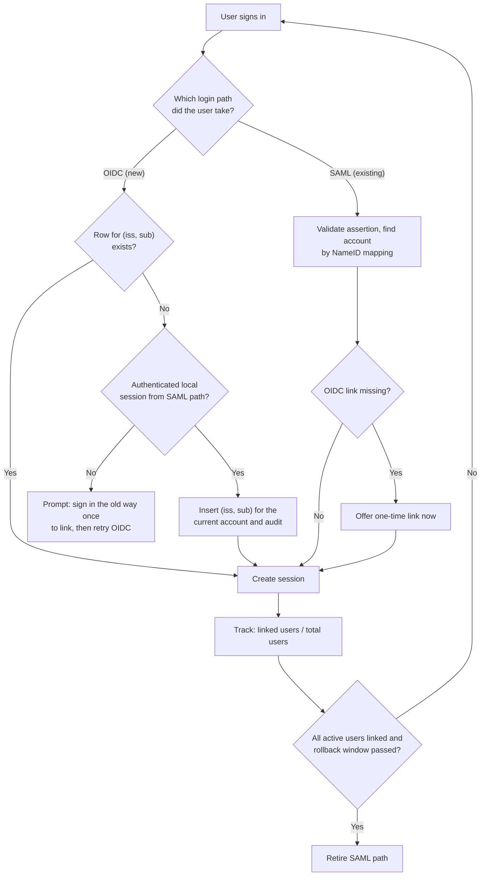

The diagram makes two points. The link is made from an authenticated session, never from matching email or `NameID` text against OIDC claims, so the link rule from the identity-mapping section is preserved. And the SAML path stays live until a measurable condition is met, so a faulty claim mapping in the new path can be rolled back by sending users to the old one.

Illustrative arithmetic. An application with 12,000 active users sets a target of 98 percent linked before retiring the SAML path, so 12,000 × 0.98 = 11,760 users must have a link row. If 1,500 users sign in per day and every sign-in offers the one-time link, a user population that signs in weekly would be about 85 percent linked after a week and the stragglers would take longer. Users who never return stay unlinked and need an administrative path, for example an invitation flow issued after identity verification by the account owner's organisation. The retirement criterion should name that remainder (here up to 12,000 - 11,760 = 240 users) and say who handles them.

Other mechanical points to check before cutover:

- Register OIDC redirect URIs and post-logout URIs exactly; SAML assertion consumer service URLs do not carry over.
- Replace SAML attribute-to-role mappings with claim-to-role tables and test with a user who has no groups and one with many.
- Decide the logout model from the logout section, since SAML single logout and OIDC back-channel logout fail differently.
- Confirm clock skew, key rotation, and cache rules from the issuer-trust section for the new keys.
- Keep the SAML metadata and signing certificates valid until the retirement criterion is met, because an expired certificate would end the rollback option.

## 13. Provider Outage, Failure Handling, and Monitoring

Sections 4 and 5 describe the checks a relying party makes when everything works. This section covers what the relying party does when the provider, the network path, a cache, or a clock does not behave. The governing principle is that failure may reduce availability, but it may never reduce verification. A relying party that accepts an unverified identity because the provider is slow has traded an outage for a breach.

### 13.1 What an outage actually breaks

A provider outage is not one event. Each part of the relying party depends on the provider at a different moment, so the effect depends on which phase the user is in.

| Phase | Provider dependency | Behavior during an outage | Correct design |
|---|---|---|---|
| New login | Authorization endpoint, token endpoint | Fails. The user cannot authenticate | Fail closed with a clear message. No local fallback that skips validation |
| Existing local session | None per request | Continues until its own idle or absolute limit | Keep sessions local, so work in progress survives |
| Token signature check | Cached key set | Continues while the cached keys are inside their grace period | Bounded cache with a documented maximum age |
| Unknown `kid` | Key set endpoint | Refresh fails, so tokens signed with a new key are rejected | Reject and alert. Never accept an unknown key |
| Silent renewal | Authorization endpoint with `prompt=none` | Fails | Treat as an ordinary login failure, not as a reason to extend the session |
| UserInfo call | UserInfo endpoint | Fails | Use the last stored attributes, marked stale, for non-sensitive display only |
| Back-channel logout | Provider calls the RP | Not delivered until the provider recovers | Rely on idle and absolute timeouts for the gap |
| Step-up for a sensitive action | Authorization endpoint | Fails | Deny the sensitive action. Do not downgrade the requirement |

The second row is the most valuable property of the design in section 7. Because the relying party issues its own session, a provider outage ends the ability to start new sessions but does not end existing ones.

Two shortcuts are tempting and wrong. A local password path switched on during an outage makes the weakest credential store the real login, and attackers can trigger it by making the provider look unavailable. Extending sessions during the outage silently lengthens the exposure window set in section 7. A narrow break-glass path is acceptable: a handful of named administrator accounts with phishing-resistant credentials, audited separately, used only to operate the application.

### 13.2 Key-cache failures

The key cache from section 5.2 is the main place where an outage becomes a security decision. It has a small number of states, and each one needs a defined behavior.

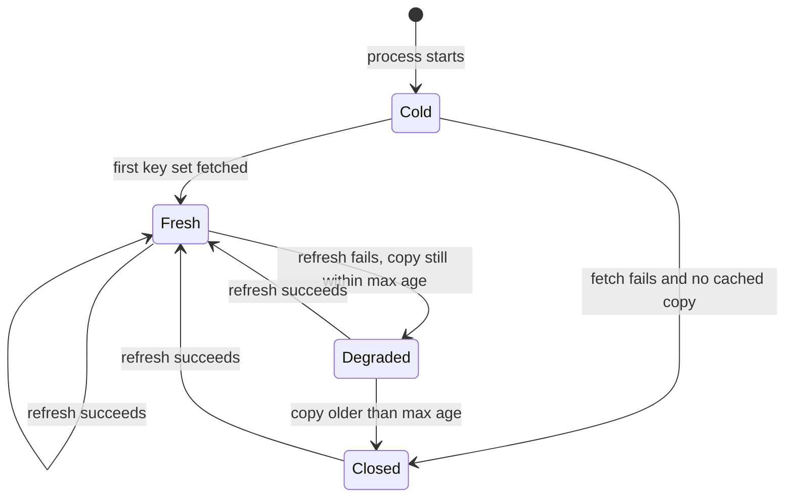

In the `Fresh` state, known `kid` values verify and an unknown `kid` triggers one rate-limited refresh. In `Degraded`, known `kid` values still verify against the last good copy, an unknown `kid` is rejected, and an alert fires because rotation could be in progress. In `Closed`, every token is rejected and the application stops accepting new logins. `Cold` matters at startup: a fleet that restarts during a provider outage has no copy at all, so a deployment during an outage can convert a degraded service into a closed one.

Several operational choices follow from the state machine.

- Persist the last good key set to local disk, or to a shared store, so a restart does not begin in `Cold`. The persisted copy is subject to the same maximum age.
- Set the maximum age deliberately. A short value (hours) limits how long a revoked key stays trusted. A long value (days) survives longer outages but lengthens the time a compromised key is accepted if the provider cannot be reached to learn of its removal. The right value is a risk decision, and it should be written down next to the provider's own rotation schedule.
- Fetch keys out of band, on a timer with jitter, instead of inside the login request. A login that waits on a key fetch inherits the provider's latency and turns a slow provider into exhausted request threads.
- Apply a short timeout and a circuit breaker to the fetch, so repeated failures stop being retried and the state moves to `Degraded` cleanly.

A compromised signing key reverses the trade-off. If the provider removes a key because it leaked, a relying party in `Degraded` keeps trusting that key until its copy ages out. The maximum age is therefore a security parameter as well as an availability one, and it should be shortened during a declared incident.

### 13.3 Clock skew

Token checks compare timestamps from two clocks. When the relying party's clock runs ahead, tokens look expired, `iat` looks like it lies in the past, and logins fail intermittently on certain hosts. When it runs behind, tokens look as if they were issued in the future and are rejected, and expired tokens survive longer than intended. The pattern to recognise is failure on one instance or one virtual machine image and success elsewhere.

The correct response is to fix time synchronisation. Widening the allowed skew hides the fault and weakens `exp`, as section 4.4 showed. Keep the allowance small and identical across the fleet, monitor each host's offset, and log `exp`, `iat`, and local time on a time rejection so it can be told apart from a signature failure. Illustrative arithmetic: with a 120-second allowance and a clock drifting 2 seconds per day, the first rejection appears after about 60 days and looks sudden. An alert at 30 seconds of offset gives about 15 days to find the dead time source.

### 13.4 Discovery-document failure

The discovery document from section 5.1 can fail in four ways, and each has a different correct response.

| Failure | Cause | Response |
|---|---|---|
| Endpoint unreachable or times out | Provider outage or network fault | Keep the last good configuration, retry with backoff, alert after a threshold |
| `issuer` in the document differs from the configured URL | Misconfiguration, a proxy rewriting the public URL, or hostile redirection | Refuse the document and keep the previous one. Alert as a security event |
| Document is valid but endpoints change | Provider migration | Accept the new endpoints only if they stay under the issuer's expected host rules, and log the change |
| Document is malformed or missing a required field | Provider bug or truncation | Refuse and keep the previous one |

The rule underneath is to treat discovery as configuration that changes rarely and is fetched in the background. Do not fetch it on the login path, do not replace a working configuration with a failed fetch, and compare each new document with the last accepted one so a change in `token_endpoint` or `jwks_uri` appears in a log. A relying party that can be redirected to a different `jwks_uri` through a failed or poisoned discovery response has lost its trust anchor, and the issuer-equality check is what prevents that.

### 13.5 Redirect URI mismatches

The authorization server compares the `redirect_uri` in the request with the registered values by exact string match. Failures here are common after deployments, and the provider responds with an error page on its own domain, without redirecting the user back. The relying party therefore sees no callback and no error: the user simply lands on the provider's error screen.

Usual causes are an unregistered environment, a changed scheme, host, port, path, or trailing slash (each is a different string), and a proxy that rewrites the host so the application builds a different `redirect_uri`.

Treat the registered list as deployed configuration, with the same review as code, since it is a trust boundary. [CH06 OAuth](CH06_OAuth.md) explains why exact matching is the safe rule. Build the `redirect_uri` from configuration, never from the incoming `Host` header, because a header-derived value both causes mismatches and lets an attacker influence the value sent to the provider. A test that starts a login in each environment and checks that the provider accepts the request catches nearly every case before users do. Because the failure is invisible to the relying party, monitor it from the outside: a rise in logins started without matching callbacks is the signal, as the next subsection shows.

### 13.6 Monitoring signals

Good monitoring distinguishes provider trouble, attack, and configuration drift, because they need different responses. The relying party observes the login funnel and the validation outcomes and can derive most of what it needs from them.

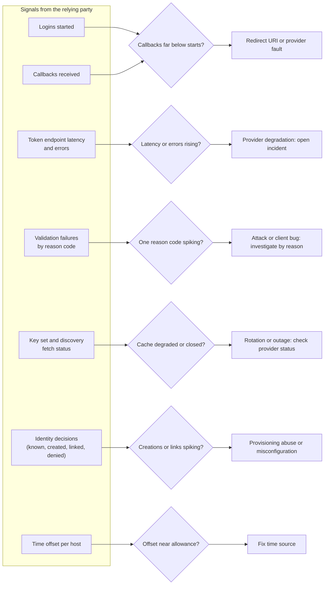

Each signal maps to one diagnosis, which is the point of recording reason codes rather than one generic "login failed" counter. The implications are practical. A gap between logins started and callbacks received is the only way a relying party sees a redirect URI problem, since the provider never calls back. A rise in the `aud` failure code means a token from another client is arriving, which is an attack or a mis-registered client. A rise in `exp` failures on a subset of hosts is a clock fault. Distinct counters turn each of those into a one-line alert.

Illustrative arithmetic for the first rule. If 1,000 logins start in a 10-minute window and the normal completion rate is 95 percent, expected callbacks are 950, so a ratio of 0.80 means 800 callbacks. A drop from 950 to 800 is 150 lost logins, about 15 percent of attempts, which is large enough to matter and larger than the normal noise from users abandoning the page. The threshold must come from the application's own baseline. The numbers here are examples only.

Log safely. Record reason codes, issuer, client identifier, and correlation identifiers. Do not log ID tokens, access tokens, authorization codes, or the PKCE verifier, since any of them is a credential while valid.

## 14. Failure and Quality-Attribute Scenarios

A scenario states a stimulus, the response the design must give, and a measure that decides whether it did. The measures below are illustrative targets for a mid-sized workforce application. Each organisation sets its own, and each should be tested, not assumed.

### 14.1 Scenario table

| # | Stimulus | Expected response | Measurable success criterion |
|---|---|---|---|
| 1 | The provider rotates its signing key and starts signing with the new `kid` at once | Unknown `kid` triggers one rate-limited refresh, then verification succeeds | At most 1 refresh per 300 seconds per issuer. Login failure caused by rotation under 0.1 percent of attempts in the first 5 minutes |
| 2 | The provider is unreachable for 45 minutes | Existing sessions continue. New logins fail with a clear message. No unverified identity is accepted | 0 tokens accepted without signature verification. Active sessions unaffected for their remaining idle limit. Alert within 5 minutes |
| 3 | A token arrives signed by a valid key of an issuer that is not on the allowlist | Rejected on the `iss` check, before any account lookup | 100 percent rejection in the test suite. Security alert raised per event |
| 4 | A token legitimately issued to another client of the same provider is replayed | Rejected on the `aud` check | 100 percent rejection. Reason code `aud` recorded |
| 5 | A host clock drifts 3 minutes ahead | Logins on that host fail with a time reason code, not a signature code. Monitoring flags it before failures | Offset alert at 30 seconds. Host removed from rotation within 15 minutes of failure |
| 6 | A deployment changes the public host name and the registered redirect URI no longer matches | Provider refuses the request. The relying party detects the funnel drop | Alert when callbacks divided by logins started falls below 0.80 for 10 minutes. Rollback decision within 15 minutes |
| 7 | An attacker registers a local account with a victim's email before the victim signs in through the provider | First provider login creates or links by `(iss, sub)` only, never by email | 0 external identities attached by email in the test suite. Audit event for every link |
| 8 | A user is disabled at the provider | Back-channel logout and SCIM deactivation end access. Without them, timeouts bound it | Access ends within 5 minutes with back-channel and SCIM, and within the absolute timeout otherwise |

### 14.2 Reading the scenarios as design checks

Scenario 2 has two criteria that can conflict. "Existing sessions continue" and "no unverified identity accepted" are compatible only because the application holds its own session store. Scenario 8 shows that the real bound is the weakest path: if the back-channel endpoint is unreachable, access lasts until the absolute timeout, 10 hours in the case study below. Test it by disabling a user and timing the result with each mechanism turned off in turn.

### 14.3 Availability arithmetic

Availability is inherited. For a login to succeed, both the provider and the relying party must be up, and for a new session the relevant part is the product of the two. Illustrative figures: a provider offering 99.9 percent monthly availability and a relying party at 99.95 percent give a combined 0.999 × 0.9995 = 0.9985, or 99.85 percent, assuming independent failures. In a 30-day month of 43,200 minutes, the combined allowed downtime for new logins is 43,200 × (1 − 0.9985) = 64.8 minutes, of which the provider contributes up to 43,200 × 0.001 = 43.2 minutes and the relying party up to 43,200 × 0.0005 = 21.6 minutes. The sum is 64.8 minutes, which checks.

Existing sessions change this. If the idle limit is 30 minutes and an outage lasts 43.2 minutes, a user who keeps working loses nothing, because the session was already established. Only users who start a session during the outage, or who go idle for more than 30 minutes and return, are affected. The application's effective availability for a signed-in user is therefore higher than the figure for new logins, and that is the number worth stating in the service level objective (SLO), with the two kinds of availability reported separately.

## 15. Worked Case Study: Meridian Field Services (Illustrative)

Meridian Field Services is a hypothetical organisation, invented for this chapter. All figures are illustrative. It has 3,200 employees and 600 contractors, so 3,800 workforce users, and four internal web applications: a job scheduling portal, a parts inventory app, a timesheet app, and a payment approval app. Each application is built by a different team, and all four currently use SAML with the corporate provider. Leadership wants one migration to OIDC, a consistent login design, and a defined behavior when the provider is down. The payment approval app is the only one that moves money, so it needs the strictest rules.

### 15.1 Decisions and rejected alternatives

| # | Decision | Alternatives rejected | Reason |
|---|---|---|---|
| 1 | Each application is a relying party of the single corporate issuer, using one shared, maintained OIDC library wrapper with centrally reviewed defaults | A product-owned broker in front of the apps | Only one issuer exists, so a broker would add a service to operate and patch without removing a trust relationship |
| 2 | Authorization code flow with PKCE, `state`, and `nonce` on all four apps | Implicit or hybrid flow | Tokens would pass through the browser. The code flow keeps the ID token on the back channel |
| 4 | Identity key is `(iss, sub)` in an `external_identity` table. Email is a refreshed attribute | Email as the key, to simplify the migration | Email is reassignable and, once an employee leaves, can be reissued |
| 5 | Local server-side sessions: idle limit 30 minutes, absolute limit 10 hours, step-up for the payment app with `max_age=900` | Stateless signed cookie with 10-hour expiry | A signed cookie cannot be revoked by a back-channel message without a deny list |
| 6 | Back-channel logout plus SCIM deactivation from the corporate directory | Front-channel logout only | Front-channel depends on the browser and misses closed tabs |
| 7 | Group claims mapped to local roles through a table owned by each application owner. Unmapped groups ignored | Taking role names directly from the `groups` claim | The directory team can create a group named `admin` without telling the application team |
| 8 | Key cache persisted to local disk, background refresh with jitter, maximum age 24 hours | Fetch on the login path, or pin one key | Login path fetches inherit provider latency. A pinned key breaks at the first rotation |
| 9 | Four break-glass administrator accounts with hardware-bound credentials, stored and alerted separately, used only to operate the apps | A local password login for everyone during outages | A local password path becomes the real login for attackers who can make the provider look down |
| 10 | Staged cutover with both SAML and OIDC live until 98 percent of active users are linked | Single-night switch | The identity key changes, so a failed migration needs a rollback path |

### 15.2 Architecture

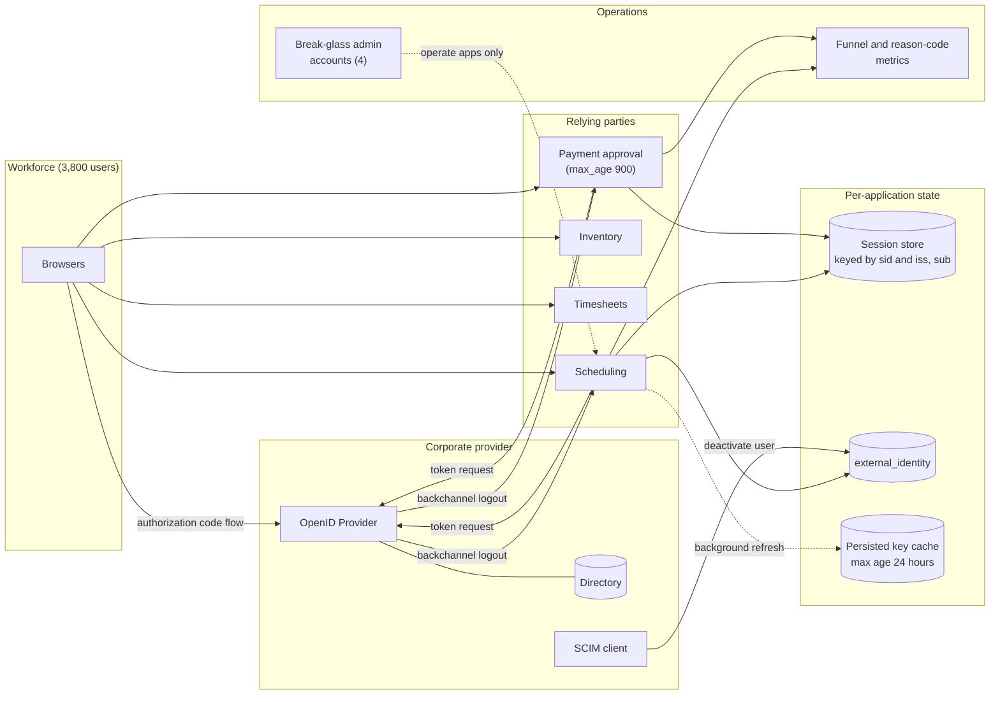


### 15.3 Sizing and arithmetic

**Peak login rate.** Shift start is 08:00. Assume 60 percent of the 3,800 users log in within a 15-minute window: 3,800 × 0.60 = 2,280 logins over 900 seconds, or 2,280 / 900 ≈ 2.53 logins per second across all apps. A token endpoint call per login means roughly 2.5 requests per second to the provider, which is small. The risk at that moment is not load but a provider fault: if the provider is down at 08:00, up to 2,280 users cannot start their day, so the outage runbook and the break-glass path need to be ready before peak and not discovered during it.

**Leaver exposure.** With a 12 percent annual leaver rate, 3,800 × 0.12 = 456 leavers per year, or 456 / 12 = 38 per month. If a disabled user's session could last until the 10-hour absolute limit, the worst-case residual access is 38 × 10 = 380 user-hours per month. With back-channel logout and SCIM working, assume access ends within 5 minutes: 38 × 5 / 60 ≈ 3.2 user-hours per month. The ratio is 380 / 3.17 ≈ 120, so the two mechanisms reduce worst-case exposure by about two orders of magnitude, and only if both are tested. The residual 10 hours remains the bound if the back-channel endpoint is down.

**Outage budget.** A provider at 99.9 percent monthly availability may be down up to 43,200 × 0.001 = 43.2 minutes. The 30-minute idle limit means a user who stays active through a 43.2-minute outage keeps working. A user who goes idle past 30 minutes during it must wait for recovery.

**Migration target.** With 3,800 users and a 98 percent linked target, 3,800 × 0.98 = 3,724 users must be linked before the SAML path is retired, leaving up to 3,800 − 3,724 = 76 users for an administrative path, which the helpdesk handles using verified identity.

### 15.4 Validation evidence

The team accepts the design only when these checks are recorded.

| Evidence | Method | Acceptance |
|---|---|---|
| Negative token tests | Test suite sends tokens with wrong `iss`, wrong `aud`, expired `exp`, wrong `nonce`, `alg: none`, `HS256` signed with the public key, and unknown `kid` | All rejected, each with the expected reason code |
| Unregistered but validly signed issuer | A test issuer with its own key set | Rejected before any account lookup |
| Email collision | Local account created with a user's email, then provider login with the same email | New `(iss, sub)` does not attach to that account |
| Outage exercise | Block egress to the provider in staging for 45 minutes with active test sessions | Sessions continue. New logins fail with the defined message. No unverified token accepted. Alert within 5 minutes |
| Restart during outage | Restart the fleet while egress is blocked | Persisted key cache loaded. Known `kid` values verify |
| Rotation exercise | Publish a second key and sign with it | One refresh, then success, within the 300-second limit |
| Leaver exercise | Disable a test user, time access removal, repeat with back-channel off and SCIM off in turn | Under 5 minutes with both. Bounded by 10 hours with neither |
| Cutover readiness | Linked-user dashboard | 98 percent linked, rollback window passed, SAML certificates still valid |

## 16. Common Mistakes and Anti-Patterns

| # | Mistake | Cause | Consequence |
|---|---|---|---|
| 1 | Treating an access token as proof of login | The team learned OAuth first and sees a token that "contains the user" | A token obtained by another application, or issued to another client, logs an attacker in. The audience of an access token is not this relying party |
| 2 | Skipping the `aud` check | The library default accepts any audience, or the developer sees valid signatures and moves on | A user of a low-trust application replays a token and becomes a user of a high-trust one |
| 3 | Reading the algorithm from the token header | Convenience, or a library configured with a general key store | `alg: none` or an RSA-to-HMAC switch yields forged tokens accepted as genuine |
| 4 | Accepting any issuer that serves a valid discovery document | "Bring your own provider" built without a trust model, or an issuer taken from user input | A malicious issuer passes every cryptographic check with its own keys and creates arbitrary identities |
| 5 | Accepting any tenant of a multi-tenant issuer | Validating the signature but not which organisations are allowed | Any organisation's users can sign in to an application meant for one customer |
| 6 | Keying accounts on email | Email is the obvious identifier and easy to display | Reassigned addresses and unverified addresses give the wrong person the account. Merging by email enables takeover and pre-hijacking |
| 7 | Using `sub` without `iss` | Only one provider at the start, so it works in testing | The second provider emits an overlapping `sub` and one user lands in another's account |
| 8 | Omitting or not checking `state` and `nonce` | They look optional because login appears to work without them | Login cross-site request forgery and token injection become possible |
| 9 | Pinning one signing key forever | Avoids a dependency on the key set endpoint | First rotation causes an outage, and the fix is often to disable signature checks |
| 10 | Equating token expiry with session length | The ID token has an `exp`, so the session seems to need one | Either users are thrown out hourly, or sessions last far longer than intended through silent renewal |
| 11 | A signed-cookie session with no server-side record | It scales without a store | No revocation after compromise or after a back-channel logout message |
| 12 | Treating logout as clearing the local cookie | The button works in testing | The provider session silently logs the user back in, and other applications stay signed in |
| 13 | Assuming logout reaches every application | The specifications read as guarantees | Sessions outlive logout wherever a message is lost. Without short timeouts, access persists |
| 14 | Granting roles directly from a `groups` or `roles` claim | It saves building a mapping table | Anyone who can create a group in the provider's directory can grant themselves access. Stale values persist for the session |
| 15 | Relying on JIT provisioning with no deprovisioning signal | The first login creates the account, and nothing removes it | Leavers keep local accounts, data, and refresh tokens |
| 16 | Falling back to a local password during an outage | An outage plan written under pressure | The weakest credential becomes the login for everyone, and attackers trigger it by degrading the provider |

## 17. Design-Review Checklist

Each question should be answerable with a configuration value, a test, or a document.

### 17.1 Trust and discovery

- Is the exact issuer string configured by an administrator, and is it an allowlist when more than one issuer or tenant is possible?
- Is the issuer in the discovery document compared with the configured URL, and is a mismatch refused?
- Are `jku`, `x5u`, and other token-supplied key locations ignored?
- Is the signing algorithm fixed per issuer in configuration?
- Who can change an issuer URL, and is the change reviewed and audited?

### 17.2 Login transaction

- Does the flow use the authorization code with PKCE, `state`, and `nonce`, and are the transaction values bound to the user's browser?
- Is the `iss` response parameter, or a distinct redirect URI per provider, used when more than one provider is supported?
- Are redirect URIs and post-logout URIs registered exactly, and built from configuration instead of the `Host` header?
- Is every callback branch defined, including no stored transaction, error, and replayed code?

### 17.3 Token validation

- Are signature, algorithm, `iss`, `aud`, `azp`, `exp`, `iat`, and `nonce` all required, and are they run in the order given in section 4.2?
- Is the skew allowance small, identical across the fleet, and monitored?
- For sensitive actions, are `max_age` or `prompt=login` requested and `auth_time` and `acr` checked in the result?
- Does the test suite include wrong issuer, wrong audience, expired token, wrong nonce, `alg: none`, and unknown `kid`?

### 17.4 Identity mapping and claims

- Is the account lookup key `(iss, sub)`, or `(tenant, iss, sub)` where multiple tenants exist?
- Is automatic linking by email prevented, and does linking happen only from an authenticated local session?
- Are default privileges for JIT-created accounts minimal, and are roles mapped through a table the application owner controls?
- Does the code handle "claim absent, lookup required" separately from "empty"?
- Is there a deprovisioning signal such as SCIM, and has it been tested?
- Are only the needed scopes and claims requested?

### 17.5 Sessions and logout

- Are idle, absolute, and reauthentication limits chosen explicitly, and is a new session identifier issued after login?
- Is the session record stored server-side, with `iss`, `sub`, `sid`, and `auth_time`, so it can be revoked by user or by provider message?
- Which logout mechanisms does the provider support, and which does the application implement and test?
- Is it documented to users that logout is best effort across applications?

### 17.6 Failure and operations

- What happens to new logins, existing sessions, silent renewal, UserInfo, and sensitive actions when the provider is down?
- Is there a narrow break-glass path, and is it separate from end-user login?
- Are logins started, callbacks received, validation failures by reason code, key cache state, identity decisions, and host clock offset monitored with alerts?
- Do logs exclude tokens, codes, and verifiers?
- Has an outage exercise, a rotation exercise, and a leaver exercise been run and the results recorded?

## 18. Exercises

Each exercise has a brief answer outline. Work the question first and compare afterwards.

1. **ID token versus access token.** A mobile app sends the access token it received at login to your server and asks the server to treat it as proof of the user's identity. Explain what is wrong and what the server should require.
   *Outline:* The access token is addressed to a resource server, not to the server in question, and may have been issued to another client. The server needs an ID token whose `aud` is its own `client_id`, validated in the order of section 4.2, or it should run its own authorization code flow. The mobile app may send the code and verifier, or the server may validate an ID token issued for it.

2. **Identity key.** Your application stores users by email. A second provider is added. Show how two users end up in one account and design the replacement.
   *Outline:* Two providers can assert the same email, or an unverified email can match a victim. Replace the key with `(iss, sub)` in a separate table, with email as an attribute. Link only from an authenticated local session with a recent login at the second provider. Audit and notify. Do not allow removal of the last credential.

3. **Key rotation under attack.** Design the key cache so that a rotation is followed within 5 minutes and a flood of random `kid` values causes no outbound storm. Compute the fetch rate.
   *Outline:* Cache by `kid`, honour cache headers with a maximum, refresh once on an unknown `kid` with a minimum interval of 300 seconds, reject after refresh. Under a flood of 200 tokens per second, fetches stay at most 1 per 300 seconds, about 0.0033 per second, against 200 per second without the limit. Rotation is picked up within 300 seconds.

4. **Provider outage.** The provider is down for 45 minutes during the morning peak. List what continues, what fails, and what you refuse to do.
   *Outline:* Existing sessions continue to their limits. New logins and silent renewals fail with a clear message. Known `kid` values verify from the cache. Unknown `kid` values are rejected. Refuse a local password fallback and refuse extending sessions. Use the break-glass path only for operators. Cover alerting and the funnel metric.

5. **Multi-tenant issuer.** A multi-tenant product lets customers enter their own issuer URL. Describe the attack and the controls.
   *Outline:* A customer enters a server they control and signs tokens with chosen `sub` values, passing every cryptographic check. Controls: bind the key to `(tenant, iss, sub)`, verify domain ownership before activation, restrict who may change the issuer, default to no access for guest identities, and test with a validly signed token from an unregistered issuer.

6. **Logout coverage.** A user signs out of Application A. Applications B and C use the same provider. Describe which of them remain signed in under each of the three mechanisms and what bounds the exposure.
   *Outline:* RP-initiated reaches A and the provider, not B or C. Front-channel reaches B and C only if the browser loads the frames. Back-channel reaches B and C server to server if their endpoints are reachable and they look up sessions by `sid`. Residual exposure is bounded by idle and absolute timeouts. State this to users.

7. **Leaver exposure.** A company has 2,500 users and a 10 percent annual leaver rate, a 12-hour absolute timeout, and no back-channel logout or SCIM. Compute the monthly worst-case residual access, then the figure with a 5-minute bound.
   *Outline:* Leavers per year: 2,500 × 0.10 = 250. Per month: 250 / 12 ≈ 20.8. Worst case: 20.8 × 12 ≈ 250 user-hours. With a 5-minute bound: 20.8 × 5 / 60 ≈ 1.7 user-hours. Ratio about 144. The comparison supports funding SCIM and back-channel logout.

## 19. Summary

The chapter's outcomes, from the Introduction, map to the content as follows.

| Outcome | Where it was taught | Key points |
|---|---|---|
| State what OIDC adds to OAuth and why an access token is not proof of login | Section 2 | The ID token, the `openid` scope, and discovery and key endpoints. An access token is addressed to a resource server. The audience check separates clients |
| Trace a login and say which parameter defeats which attack | Section 3 | `state` for login CSRF, `nonce` for token replay, PKCE for code interception, exact `redirect_uri` for delivery, `iss` for mix-up |
| Validate an ID token in order and explain each check | Section 4 | Parse, algorithm allowlist, signature by configured key, `iss`, `aud` and `azp`, time, `nonce`, then authentication context. Each skipped check is an attacker option |
| Configure issuer trust and discovery so that rotation works and attacker metadata is never accepted | Section 5, with failure handling in section 13 | Administrator-chosen issuer, issuer equality in discovery, bounded cache with refresh on unknown `kid`, ignoring token-supplied key locations |
| Reason about the multi-tenant issuer problem, mix-up, and cache behavior during outages | Sections 3.3, 5.3, 10, and 13 | Allowlist of issuers and tenants, `(tenant, iss, sub)` keys, key-cache states, fail closed, existing sessions continue |

Beyond those outcomes, the chapter taught identity mapping (section 6), sessions and logout (sections 7 and 8), claims (section 9), provider differences and migration (sections 11 and 12), and tested design through scenarios, a case study, mistakes, a checklist, and exercises (sections 14 to 18).

Three ideas carry through all of it. The relying party trusts configuration made by an administrator and never anything it learns at login. A valid signature shows that an issuer made a statement, and the relying party still decides whether that issuer, that audience, and that identity are allowed. Failure may reduce availability but must not reduce verification, so the design states in advance what continues, what stops, and what is refused. Use Part 05 for protocol mechanics. Authentication success, however well validated, does not grant application permissions; that decision belongs to local policy.
