# Zero Trust

Part: [15 — Security](PART_OVERVIEW.md) · Status: Revised (in-depth rewrite)

## 1. Introduction

Zero Trust is a security architecture approach that removes implicit trust based on network location or on earlier access. Every request to a resource is evaluated against identity, the resource's sensitivity, the requested action, and the current context, and the decision is enforced close to the resource. The older model assumed that anything inside the corporate network was friendly. Zero Trust assumes that an attacker may already be inside, that a stolen credential or a compromised laptop is a normal event, and that the architecture must limit what such an event can reach.

The term is easy to misuse. It is a set of design principles and a decision architecture, not a product, not a single network layout, and not a rule that every request must repeat a full login. Vendors sell products with the label, and some of them are useful, but buying one does not make an architecture Zero Trust. The reader's task is to decide, for each resource, what evidence is required, where it is checked, how fresh it must be, and what happens when the evidence system fails.

After this chapter you will be able to:

- Explain what implicit trust is, why a network perimeter produces it, and what an attacker gains from it after the first foothold.
- Describe the policy decision point (PDP) and policy enforcement point (PEP) model, and place each correctly in a real request path.
- List the signals that feed a decision, order the checks so that cheap and decisive ones run first, and bound how stale each signal is allowed to be.
- Calculate the revocation window of a design from its caching and reporting intervals.
- Choose how a workload proves its identity to another workload, and compare the AWS, Azure, and Google Cloud mechanisms at the level of what they guarantee.

Ownership is split across the handbook as follows:

| Topic | Owner |
|---|---|
| Proving who a user is: factors, sessions, recovery | [CH02 Authentication](CH02_Authentication.md) |
| Deciding what an identity may do: policy models and evaluation | [CH03 Authorization](CH03_Authorization.md), [CH04 RBAC](CH04_RBAC.md), [CH05 ABAC](CH05_ABAC.md) |
| Delegated access and tokens | [CH06 OAuth](CH06_OAuth.md) and [CH07 OIDC](CH07_OIDC.md) |
| Network primitives, VPN, and per-application access as VPN's successor | [Part 05 CH13 VPN](../05_Networking_and_OS/CH13_VPN.md) |
| Cloud provider identity, key, and policy products | [Part 09 CH09 IAM](../09_Cloud_Computing/CH09_IAM.md) |
| Zero Trust applied to Kubernetes | [Part 12 CH13 Security](../12_Kubernetes/CH13_Security.md) |
| Decision architecture, evidence freshness, workload trust, segmentation, continuous evaluation, and migration | This chapter |

This chapter uses the previous chapters as building blocks and does not repeat them. Where a sentence says "authenticate", it means the mechanisms of CH02. Where it says "authorize", it means the models of CH03 to CH05. The new material is how those parts are composed into a request-time decision that does not depend on where the packet came from.

## 2. The Zero Trust Model

### 2.1 What the perimeter assumed

A perimeter design places a firewall or Virtual Private Network (VPN) gateway at the edge and treats the inside as a single trust zone. A device that reaches the inside, by being in the office or by completing a VPN login, can usually open connections to most internal services. Each service then relies on that reachability as part of its own defence: an internal database accepts any connection from the application subnet, an administration page has no login because "only staff can reach it", and a service accepts a request header that says which user is calling because only internal systems could have set it.

Those assumptions fail in a predictable way. The attacker needs one foothold: a phished credential, a vulnerable internet-facing component, a malicious dependency running in a build job, or a compromised laptop. From there the flat inside lets the attacker scan, reach services that were never designed to authenticate callers, and move laterally until a high-value store is found. The cost of the first foothold is low, and the perimeter design makes the second and third steps cheap as well.

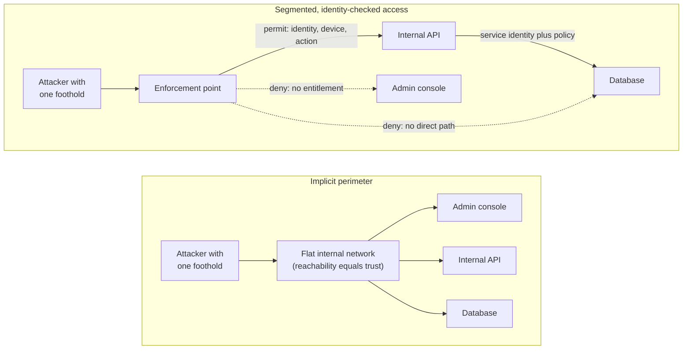

The left side shows reachability acting as the only control: the foothold touches everything. The right side does not prevent the foothold. It changes what the foothold is worth. The attacker holds one identity and one device, so the reachable set is whatever policy grants to that identity from that device, and every attempt outside it produces a denied, logged decision. Zero Trust is therefore a blast-radius and detection design. It accepts that the first compromise happens and measures success by how little the second step yields.

### 2.2 Decision and enforcement components

The National Institute of Standards and Technology (NIST) Special Publication (SP) 800-207, "Zero Trust Architecture", gives the common vocabulary. A request reaches a policy enforcement point (PEP), which holds the connection or call until a decision is made and then allows, blocks, or terminates it. The PEP asks a policy decision point (PDP), which in the NIST description combines a policy engine that evaluates the request against policy and inputs, and a policy administrator that instructs the PEP to establish or tear down access. The inputs come from supporting systems such as the identity provider (IdP), a device management or posture service, threat intelligence, and activity logs.

Two planes are useful when designing. The control plane is where decisions, policy, and signals live. The data plane is where the application traffic flows through or past the PEP. A PEP can be a reverse proxy in front of an application, a sidecar or gateway enforcing mutual Transport Layer Security (mTLS) and authorization, a library inside the service, or the cloud provider's own request path that evaluates Identity and Access Management (IAM) policy on every API call. Keeping the two planes distinct explains two design questions. Latency: the data plane cannot wait on a slow control plane for each packet, so decisions are cached. Failure: if the control plane is unreachable, the data plane needs a defined behaviour. Both are developed in later sections.

Where the PEP sits determines what a bypass costs. A PEP at the network edge protects only traffic that crosses the edge. A PEP inside or beside each resource protects traffic from anywhere, including from an attacker already inside, but needs to be deployed and kept consistent across many resources. Most real architectures use both: coarse enforcement at network boundaries and fine enforcement at the service.

### 2.3 Tenets as design rules

NIST SP 800-207 lists seven tenets. Their practical content can be restated as design rules, which are easier to review against than slogans.

1. Treat every data source and service as a resource, including personal devices and software-as-a-service (SaaS) applications that touch the organisation's data. If it can hold or process the data, it needs a policy.
2. Secure communication regardless of network location. Traffic on the internal network gets the same encryption and authentication as traffic across the internet.
3. Grant access per session or per request, so that authority obtained for one resource is not reused for another.
4. Decide access from dynamic policy that uses the state of the requesting identity, device, and application, plus behavioural and environmental attributes, and the sensitivity of the resource.
5. Monitor and measure the integrity and security posture of owned assets, and use that measurement as a decision input.
6. Make authentication and authorization dynamic and enforced before access is allowed, and repeat the evaluation when conditions change.
7. Collect data on assets, traffic, and access, and use it to improve policy.

Rules 4 to 7 are where most programmes stall. Rule 4 needs signals with defined sources and freshness. Rule 6 needs a way to push changes into live sessions. Rule 7 needs the decision logs to be complete enough to answer "why was this allowed" after an incident. The remaining sections of this part of the chapter treat the decision path and the identity inputs in detail.

## 3. The Request Decision Path

### 3.1 Inputs to a decision

A decision combines five groups of input. The subject is the identity making the request: a user, a workload, or a service account, with the authentication strength that was used to establish it (see [CH02 Authentication](CH02_Authentication.md)). The action is the operation requested, such as read, delete, or export. The resource is the thing acted on, including its owner, its data classification, and its tenant. The device or runtime is the machine or workload instance: whether it is managed, whether it meets configuration baselines, and how recently it reported. The environment is everything else: network origin, time, geography, and risk signals such as impossible travel or a known-bad address.

The first three are what authorization already uses ([CH03 Authorization](CH03_Authorization.md)). The last two are what Zero Trust adds. They are weaker evidence than a signed credential, because posture is self-reported or sampled and risk scores are probabilistic. Policy should therefore use them in proportion: a missing posture report on a read of public documents may be tolerated, while the same gap on a production database administrator session should deny.

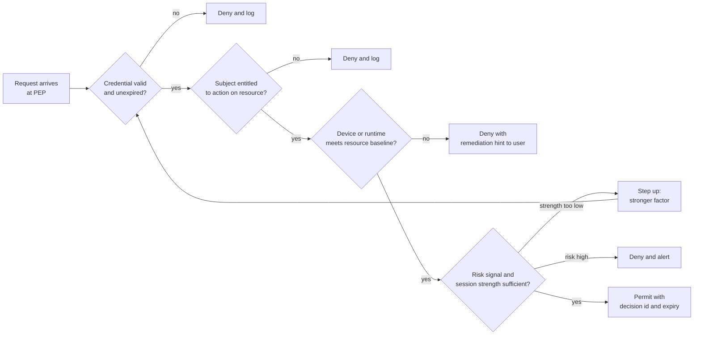

The diagram orders checks from cheapest and most decisive to most contextual. A signature check is a local computation and a failed result ends the decision. Entitlement is a policy lookup. Posture and risk usually need a call to another system or a cached value, so they run only for requests that have already passed the earlier tests. The order has a security purpose as well as a performance purpose: denying early avoids sending unauthenticated callers' data to the posture and risk systems, and prevents an attacker from using the decision path itself to learn which devices or accounts exist.

### 3.2 Step-up, deny, and what the caller learns

Three outcomes exist besides permit. Deny ends the request. Step-up asks the subject to raise assurance, for example by completing a phishing-resistant factor before an administrative action, then retries. Remediate tells the user that the device must be fixed, for example by enabling disk encryption or installing an update, and gives a path to do so.

The message returned to the caller needs care. An operator needs the exact reason, so the full reason belongs in the decision log with a decision identifier. The caller needs enough to act but not enough to map policy: "this device does not meet the requirements for this application" is useful, while "device not in group Finance-Privileged-Laptops" discloses internal structure. The identifier lets a help desk find the log entry without exposing it.

### 3.3 Evidence freshness and the revocation window

Every signal has an age. The posture agent reports at some interval, the PDP caches the last report for some time, and the session or token that the PEP trusts lives for some period before the PEP asks again. The worst-case delay between a change in reality (a laptop becomes non-compliant, an account is disabled) and the denial that should follow is the sum of the stages that must each notice it, and it is the number to design and review.

Worked example (illustrative numbers). A document service enforces policy through a gateway.

- The device agent reports posture every 15 minutes.
- The PDP caches a device's posture result for 5 minutes.
- The gateway issues a session token valid for 60 minutes and, in design A, asks the PDP again only when the token is renewed.
- In design B, the gateway asks the PDP on every request and caches the decision for 5 minutes.

For design A, a laptop that becomes non-compliant just after reporting can keep access for up to 15 minutes until the next report, plus 5 minutes of PDP cache, plus the remaining token lifetime of up to 60 minutes: 15 + 5 + 60 = 80 minutes. The PDP cache and token lifetimes stack because the gateway does not re-ask while the token is valid. For design B, the gateway's 5-minute decision cache replaces the token lifetime as the last stage: 15 + 5 + 5 = 25 minutes. Cutting the agent report interval to 5 minutes gives 5 + 5 + 5 = 15 minutes for design B, at the cost of three times as many reports.

The load side of the same trade follows from arithmetic. If the service handles 12,000 requests per second and the gateway's decision cache has a 95 percent hit rate, the PDP sees 12,000 x 0.05 = 600 requests per second. At a 99 percent hit rate it sees 120. A longer cache lowers load and widens the window, so the choice is made per resource: a low-sensitivity resource may accept a long window, while a production administration path may accept the load of near-per-request evaluation or push an explicit revocation event instead.

Events shorten the window without raising load. When an account is disabled or a device is marked lost, the IdP or posture service can send an event to the PEPs so that cached decisions and sessions are dropped immediately. Microsoft Entra describes this approach as continuous access evaluation, in which supporting resources are notified of events such as account disablement or a password change instead of waiting for token expiry, as described in [Microsoft Learn: Continuous access evaluation](https://learn.microsoft.com/en-us/entra/identity/conditional-access/concept-continuous-access-evaluation). Only resources that support the mechanism benefit, so list which of your applications do before counting on it.

### 3.4 When the decision path fails

The PDP, the posture service, and the IdP are now in the availability path of every protected resource. Each needs a defined failure mode.

- Fail closed denies when evidence cannot be obtained. It is right for destructive or high-sensitivity actions and costs availability.
- Fail open permits. It is rarely acceptable for protected resources, because an attacker who can degrade the PDP, for example by flooding it, gets access as a result.
- Bounded stale allows using a cached decision for a short, fixed period after the PDP becomes unreachable, with an alert while it does. It is a reasonable middle for read access to moderate-sensitivity data, provided the bound is enforced in the PEP and the use of stale decisions is counted.

A break-glass identity covers the case where the decision system itself is the outage. It must not depend on the failed system, be held under strong controls, and generate an alert whenever it is used. Treat it as a designed component and test it, because an untested emergency path is usually found broken during the emergency.

## 4. Identity and Device Trust for People

### 4.1 Identity as the primary control point

When the network no longer proves anything, the identity assertion carries the weight. For people that means a single authoritative IdP, federated into every application through OpenID Connect ([OIDC](CH07_OIDC.md)) or the equivalent for older protocols, so that one place enforces authentication strength, account lifecycle, and sign-in risk. The practical effects are specific. Applications must not keep separate local passwords that bypass the IdP's controls. Group and role membership must come from a governed source ([CH04 RBAC](CH04_RBAC.md)), because policy that depends on a group is only as good as the process that adds people to it. Departed staff must lose access through the IdP's lifecycle, not through a list of applications someone remembers to visit.

Authentication strength is a policy input and not a constant. A password plus a one-time code and a hardware-bound, phishing-resistant credential both count as multi-factor authentication (MFA), yet they resist different attacks, as [CH02 Authentication](CH02_Authentication.md) explains. A Zero Trust policy can state the strength needed per resource: ordinary applications accept the standard sign-in, while production consoles require a phishing-resistant method completed recently.

### 4.2 Device trust

A valid identity on an unknown machine is weaker evidence than the same identity on a managed one, because malware on the machine can use the session. Device trust attaches a second identity to the request: the device. The usual building blocks are a device identity, typically a certificate or hardware-protected key issued at enrolment, and a posture assessment of attributes such as whether disk encryption is on, whether the operating system is within a patch window, whether endpoint protection is running, and whether the device is enrolled in management.

Provider products combine these inputs. Microsoft Entra Conditional Access evaluates signals including user, group, application, device state, location, and sign-in risk to produce grant or block decisions, and can require a device marked compliant by the management service. Google Cloud's Identity-Aware Proxy (IAP) can protect web applications and cloud resources using access levels from Context-Aware Access, which describe device and network attributes. AWS Verified Access is a managed service that evaluates identity and device-posture trust data against policy before allowing connection to a private application without a VPN. The three differ in where enforcement sits and which device signals they accept, so check current documentation for supported device-management integrations and policy languages before committing.

Device signals have honest limits. Posture is a statement the device or its management agent makes about itself, so a fully compromised device can lie, and a posture check shows hygiene rather than integrity. Hardware-backed attestation raises the cost of lying, but not every fleet supports it. Personal devices pose the policy question of how much to trust unmanaged hardware. Common answers are browser-only access with downloads blocked, access to a smaller set of resources, or a requirement to enrol. None is free: stricter policy reduces exposure and increases support load, which is why the choice is made per resource tier and written down.

### 4.3 Session strength and step-up

A session is a stored decision, so its lifetime and what it was based on matter. A session created from a strong sign-in on a compliant device and then used from a new country an hour later is the case continuous evaluation exists to catch. The policy can be tied to the action as well as to the identity: reading a dashboard needs the existing session, while approving a payment, changing an access policy, or exporting a table requires step-up within a short recent window. The window must be enforced by the resource or its PEP, not remembered by the browser, otherwise a stolen session cookie inherits the step-up.

Token binding reduces the value of a stolen session. A bearer token works for whoever holds it, as [CH06 OAuth](CH06_OAuth.md) describes, while sender-constrained tokens require proof of a key held by the legitimate client. For high-value Zero Trust paths, prefer bound sessions where the platform supports them, and keep the unbound lifetime short where it does not.

### 4.4 Attacker view of the people path

An attacker against this design looks for the weakest evidence the policy accepts. They may phish an MFA code in real time, which phishing-resistant factors defeat, or register a new device through a weak enrolment process, which makes enrolment itself a high-value control that needs its own approval and verification. They may steal a session token from a compliant device, which bounded lifetimes, token binding, and short step-up windows limit. They may exploit exclusions: a policy that exempts a "trusted" office network, service accounts, or emergency accounts has recreated the perimeter in a corner. Every exemption in a policy set needs an owner, a reason, and an expiry, and a periodic query for accounts and networks that bypass each control finds the ones that outlived their reason.

## 5. Workload Identity and the Service Path

### 5.1 Why static credentials fail the model

Services call other services, databases, and provider APIs. The perimeter answer is a shared secret in a configuration file or environment variable: an API key, a database password, or a long-lived cloud access key. It has the same flaws as network trust. It identifies a deployment package rather than a running instance, it is copied into images, build logs, and laptops, it rarely rotates, and when it leaks the holder is indistinguishable from the legitimate service. [CH09 Secrets Management](CH09_Secrets_Management.md) covers storing the secrets that remain. This section covers removing the need for most of them.

The Zero Trust alternative is a workload identity: a credential the platform issues to a running workload after verifying what it is, valid for minutes to hours, scoped to an audience, and renewed automatically. The workload never holds anything an attacker can copy and use next week.

### 5.2 How a workload proves what it is

A workload cannot present a password it was given in advance, since that returns to the static secret. It needs something the platform can check. This step is attestation: the issuer verifies facts about the workload from a source the workload cannot forge, such as the hypervisor or orchestrator that launched it, the node's hardware or cloud instance identity document, or the signed token of the build system that started the job. The facts are mapped by registration policy to an identity.

The Secure Production Identity Framework for Everyone (SPIFFE) standardises this at the identity level. A SPIFFE ID is a Uniform Resource Identifier of the form `spiffe://trust-domain/path`, for example `spiffe://example.org/payments/api`. A SPIFFE Verifiable Identity Document (SVID) carries that identity as either an X.509 certificate or a JSON Web Token (JWT). SPIRE, the SPIFFE Runtime Environment, is a reference implementation in which a node agent attests the node to a server, then attests each local workload from selectors such as the process user or container metadata, and delivers short-lived SVIDs over a local Workload API. Cloud providers offer comparable mechanisms through their own interfaces, covered next.

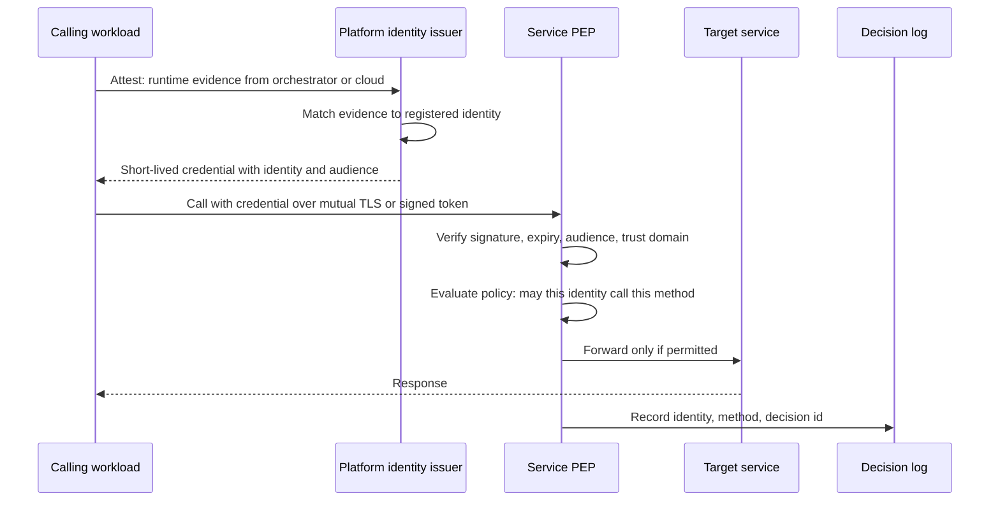

The diagram separates three checks that are easy to merge in code. First, issuance: the platform verified the workload. Second, credential validation at the PEP: signature, expiry, audience, and issuer or trust domain. Third, authorization: that this particular identity may call this particular operation. A service that verifies the first two and skips the third gives every valid workload in the trust domain the ability to call it, which is the flat internal network reproduced in identity form. The implication for design is that each service owns an explicit allow list of caller identities and methods, and a new caller is a reviewed change.

### 5.3 Provider mechanisms compared

The three providers all issue short-lived credentials to workloads but they differ in what is bound to what.

| Provider | Credential source for compute workloads | Federation from outside the provider | What the credential proves |
|---|---|---|---|
| AWS | IAM roles obtained through AWS Security Token Service (STS), delivered to EC2 instance profiles, Elastic Container Service (ECS) task roles, and Amazon Elastic Kubernetes Service (EKS) pods through IAM roles for service accounts or EKS Pod Identity | IAM OIDC identity providers with `AssumeRoleWithWebIdentity`, and IAM Roles Anywhere using X.509 certificates | The caller holds a role session; the role's trust policy decided who could assume it |
| Azure | Managed identities, system-assigned or user-assigned, exposing tokens from Microsoft Entra ID | Workload identity federation on app registrations or user-assigned managed identities | A token from the tenant for a service principal; Azure role assignments decide what it can do |
| Google Cloud | A service account attached to the resource, with tokens from the metadata server | Workload Identity Federation exchanging external tokens for short-lived Google credentials, and service account impersonation | A token for a service account; IAM bindings on resources decide access |

Two differences matter in design. First, what the trust decision hinges on. In AWS the role's trust policy states who may assume it, so a mistake there is the privilege boundary. In Azure and Google Cloud, who may use or impersonate a service identity is itself a permission, so reviewing who holds "act as this identity" rights is part of the audit. Second, how fine the binding is. An instance role is shared by everything on the instance unless the platform provides per-pod or per-task credentials, so a compromised container on a node with a broad instance role can request that role's credentials from the metadata service. Per-workload credentials, plus restricting access to the metadata endpoint, close that route. The mechanics of each provider are covered in [Part 09 CH09 IAM](../09_Cloud_Computing/CH09_IAM.md); consult each provider's current documentation for exact token lifetimes, since they vary by service and configuration.

### 5.4 External workloads and federation without keys

Build jobs and workloads outside the cloud used to receive a long-lived cloud access key stored as a pipeline secret. Federation replaces it: the job presents a short-lived token signed by its own platform, the cloud verifies the signature and claims, and exchanges it for temporary credentials. Everything depends on which claims the trust policy checks. An AWS role trust policy for a GitHub Actions job illustrates the point, with placeholder values:

```json
{
  "Version": "2012-10-17",
  "Statement": [{
    "Effect": "Allow",
    "Principal": { "Federated": "arn:aws:iam::111122223333:oidc-provider/token.actions.githubusercontent.com" },
    "Action": "sts:AssumeRoleWithWebIdentity",
    "Condition": {
      "StringEquals": {
        "token.actions.githubusercontent.com:aud": "sts.amazonaws.com",
        "token.actions.githubusercontent.com:sub": "repo:example-org/example-repo:ref:refs/heads/main"
      }
    }
  }]
}
```

The `aud` condition makes the token valid only for this relying party, and the `sub` condition restricts it to one repository and branch. Omitting `sub`, or matching it with a wildcard that covers every repository in the organisation, lets any job from any repository that the identity provider serves assume the role. The attacker's view is direct: find trust policies whose conditions are missing or too broad, then run a workflow that satisfies them. The same reasoning applies to Azure federated credentials, which match an issuer, subject, and audience, and to Google Cloud's attribute conditions on workload identity pools.

### 5.5 Failure modes and edge cases

- Issuer outage. Credentials expire in minutes, so an issuer outage longer than the credential lifetime stops new calls. Set lifetime from the longest outage you can tolerate and the load renewal creates, not from habit.
- Clock skew. Short-lived credentials and `exp` checks fail when clocks drift. Time synchronisation is a dependency of the security design.
- Trust-domain sprawl. Accepting identities from many issuers without per-issuer constraints widens who can claim a name. Pin each service to the issuers and identities it expects.
- Identity reuse. Two unrelated services running as the same service account or role make each one's compromise the other's. One identity per workload purpose is the rule, accepting the larger identity inventory as the price.
- Confused deputy. A service that forwards a caller's request using its own broader identity can be induced to act beyond the caller's authority. Pass through the caller's identity or reduce the deputy's scope for that call, as covered in [CH03 Authorization](CH03_Authorization.md).

## 6. Segmentation and Enforcement Boundaries

### 6.1 What segmentation is for

Segmentation limits which workloads can open a connection to which others. Traffic between clients and the edge is called north-south, and traffic among workloads inside is called east-west. Perimeter designs filter north-south traffic carefully and leave east-west traffic open, which is the property the attacker in section 2 exploits. Microsegmentation applies the filtering to east-west traffic, down to the level of a single workload or a group of workloads that share a role.

Segmentation answers a narrower question than identity-based authorization. It answers "may these two endpoints exchange packets at all", before any request is parsed. That makes it a coarse, cheap, early control. It cannot say which user is acting or which object is requested, so it never replaces service-level authorization ([CH03 Authorization](CH03_Authorization.md)). Its value is that when an application-level check has a bug, or a service was deployed without authentication, the attacker still has to reach the service first. Two layers fail independently, and the attacker must defeat both.

Segmentation should enforce a documented communication model, not create a maze of unowned rules. The model lists, per application, the tiers (for example edge, front end, service, data), the allowed flows between them with ports, and the management paths. Administration, observability, backup, and recovery flows belong in the model from the start. Controls that block those paths get switched off during the first incident, which leaves the environment weaker than before.

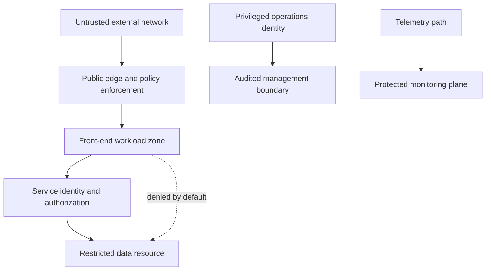

The diagram shows zones as trust boundaries with one controlled crossing each. The front-end zone cannot reach the restricted data resource directly, even though both are "inside". Operations and telemetry have their own paths with their own identities, so that diagnosing a problem does not require opening the data tier to a general administration subnet. The implication is that every arrow is a reviewed rule with an owner. An arrow nobody can explain is either a missing dependency in the inventory or an attack path.

Default-deny segmentation breaks undocumented dependencies, and that is the main adoption cost. The workable sequence is to inventory flows, observe real traffic in a log-only mode, write policy with named owners, enforce in stages, and test both the allowed and the denied paths. Broad "temporary" exceptions need an owner and an expiry date, because without one they become permanent.

### 6.2 Address-based rules versus identity-based rules

Traditional firewall rules name Internet Protocol (IP) addresses and ports. That works while addresses are stable and tied to one role. In a cloud or container platform, addresses are assigned dynamically, reused within minutes by unrelated workloads, and shared behind network address translation. A rule that allows `10.4.0.0/16` to the database allows every present and future occupant of that range, so the rule describes a location, which is the perimeter mistake again at a smaller scale.

Identity-based rules name what the workload is: a label, a service account, a security group reference, or a cryptographic identity. The platform maps the identity to current addresses and updates enforcement when the mapping changes. There are three levels, and they provide increasing assurance.

| Level | Rule names | Enforced by | What it proves | Weakness |
|---|---|---|---|---|
| Address | CIDR (Classless Inter-Domain Routing) blocks and ports | Firewall, network access control list | Packet came from an address in the block | Address reuse, spoofing within a segment, no meaning |
| Label or group | Pod labels, security group membership, network tags | Platform control plane, host or hypervisor | Packet came from a workload the platform assigned to the group | Anyone who can edit labels or group membership can change the rule's meaning |
| Cryptographic identity | A certificate or token identity such as a SPIFFE ID | The workload's own proxy or library at connection time | The peer holds a key the issuer gave only to that identity | Needs identity issuance, rotation, and a proxy or library in the path |

The middle level deserves attention because it is the most common. Its security equals the control over who can change labels or group membership. If a developer role can add the label `app=payments` to any pod, then network policy that allows `app=payments` to reach the database has delegated the decision to that role. Restrict label and group edits with admission policy and IAM, and audit them like firewall changes.

### 6.3 Kubernetes NetworkPolicy at the mechanism level

A Kubernetes `NetworkPolicy` is a namespaced object that selects pods with `podSelector` and lists allowed ingress and egress sources and destinations. The semantics are easy to misread, and each point below changes a design.

- A pod that no policy selects accepts all traffic. Isolation starts for a pod, per direction, when at least one policy selects it and lists that direction in `policyTypes`.
- Policies are additive allow lists. The base API has no deny rule, and when several policies select a pod, the allowed set is the union of what each permits.
- The API object is only a declaration. Enforcement is done by the network plugin (the Container Network Interface, CNI, implementation). A cluster whose plugin does not implement policy accepts the objects and enforces nothing, so test enforcement with a connection that must fail.
- Sources are matched by pod or namespace labels, or by IP blocks. Label matching is the identity-by-label level from the previous section.

A default-deny baseline for a namespace, followed by one explicit allow, looks like this:

```yaml
apiVersion: networking.k8s.io/v1
kind: NetworkPolicy
metadata:
  name: default-deny-all
  namespace: payments
spec:
  podSelector: {}
  policyTypes: ["Ingress", "Egress"]
---
apiVersion: networking.k8s.io/v1
kind: NetworkPolicy
metadata:
  name: api-to-db
  namespace: payments
spec:
  podSelector:
    matchLabels: { app: db }
  policyTypes: ["Ingress"]
  ingress:
    - from:
        - podSelector:
            matchLabels: { app: api }
      ports:
        - { protocol: TCP, port: 5432 }
```

The first object selects every pod in the namespace and allows nothing. The second admits only pods labelled `app=api` in the same namespace to the database port. Once default-deny covers egress, name resolution breaks, because pods can no longer reach the cluster Domain Name System (DNS) service. A third policy must allow egress to DNS on port 53, and teams usually discover this by an outage on the first day of enforcement. Staging the rollout namespace by namespace, with flow logs from the plugin, finds such dependencies before they cause one.

Layer 3 and layer 4 policy has a ceiling. It sees addresses and ports, so it cannot distinguish `GET /orders` from `DELETE /orders` on the same port, and it cannot tell which service account sent a packet if the sender is compromised and carries the right label. Some plugins add extensions that match on Hypertext Transfer Protocol (HTTP) attributes or cluster-wide policy, but those are product-specific, so check the documentation of the plugin you run. [Part 12 CH06 Networking](../12_Kubernetes/CH06_Networking.md) covers the plugin mechanics, and [Part 12 CH13 Security](../12_Kubernetes/CH13_Security.md) covers the Kubernetes side of this model.

The attacker's view of NetworkPolicy is to look for pods that no policy selects, namespaces with no default-deny, egress that allows the whole internet, and the ability to create or relabel pods that match an existing allow rule. Each is a review query over the cluster, and each should run on a schedule rather than at audit time.

### 6.4 Service mesh mutual TLS

A service mesh moves connection security out of application code and into a proxy that sits beside each workload (a sidecar) or on each node. The control plane issues each workload a short-lived certificate whose subject encodes its identity, typically derived from the Kubernetes service account. The proxies use these certificates to establish mTLS between caller and callee, so each side verifies the other, and then apply authorization rules to the verified peer identity. This is the cryptographic-identity level from the table above, and it is the SPIFFE model from section 5 applied to traffic.

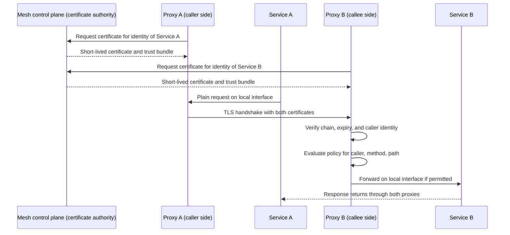

Read the diagram as two trust boundaries. Between application and local proxy, traffic is plaintext on a loopback or local path, so the proxy and the workload must share a trust boundary, and anyone who can run code in the workload's network namespace sits inside it. Between proxies, traffic is encrypted and both ends are authenticated, so a network observer or a different workload on the network gets neither content nor a way to impersonate. The authorization step in the callee proxy is the part most often skipped. Encryption without a policy only proves that the caller is some workload in the mesh.

In Istio, the two controls are separate objects. A `PeerAuthentication` in `STRICT` mode makes the sidecar accept only mTLS, and an `AuthorizationPolicy` names the permitted caller identities and operations:

```yaml
apiVersion: security.istio.io/v1
kind: AuthorizationPolicy
metadata:
  name: db-proxy-allow-api
  namespace: payments
spec:
  selector:
    matchLabels: { app: db-gateway }
  action: ALLOW
  rules:
    - from:
        - source:
            principals: ["cluster.local/ns/payments/sa/api"]
      to:
        - operation:
            methods: ["GET", "POST"]
            paths: ["/v1/orders/*"]
```

The principal is the service account identity taken from the verified certificate, not a label an editor can add to a pod, and the rule can constrain methods and paths because the proxy parses HTTP. Verify resource versions and field names against the current Istio documentation for your release, since the API has changed between versions. Other meshes implement the same ideas with different objects.

Mesh mTLS has costs and limits that belong in the decision.

- Latency and resources. Each hop adds proxy processing and, on new connections, a handshake. Connection reuse amortises the handshake. Measure added p99 latency and proxy memory on your own workload before and after, rather than trusting a general figure.
- Operational dependency. The control plane's certificate authority is now on the path for starting workloads and for rotating certificates. If it is down for longer than the certificate lifetime, workloads cannot renew.
- Partial coverage. Workloads outside the mesh, such as managed databases, legacy virtual machines, and batch jobs, either need a gateway or stay outside the identity model. A permissive migration mode that accepts both plaintext and mTLS is useful during rollout, but a service left in it accepts unauthenticated callers, so track and remove it.
- Layering. Mesh policy and NetworkPolicy complement each other. NetworkPolicy blocks packets before any proxy sees them, including from workloads with no sidecar, and mesh policy identifies the caller and the operation. Running only the mesh leaves traffic that bypasses the proxy unchecked.

## 7. Placing Decision and Enforcement Points

### 7.1 Placement options

Section 2 introduced the PDP and PEP. Where they run decides latency, failure behaviour, and what a bypass costs. Four placements recur.

| Placement | PEP location | PDP location | Strength | Cost |
|---|---|---|---|---|
| Edge gateway | Reverse proxy or API gateway at the boundary | Remote service or the gateway itself | One place to manage, covers many apps | Does not see east-west traffic, single choke point |
| Sidecar or node proxy | Proxy beside each workload | Control plane pushes policy to proxies | Per-call identity, covers internal traffic | Operating many proxies, policy distribution lag |
| In-process library | Inside the service code | Embedded engine or local agent | Lowest latency, sees business context such as object owner | Each language and team must adopt it, drift between services |
| Provider request path | The cloud API itself | The provider's IAM evaluation | Cannot be bypassed for provider APIs | Policy languages and limits belong to the provider |

The best placement is where the PEP can see the attributes the decision needs. An edge gateway cannot decide whether this user may open this invoice, because only the service knows the invoice owner. A library has that context but cannot stop a connection from a workload that should never have reached the service. This is why the layered answer from section 2 holds: coarse decisions near the network, fine decisions at the resource.

A second distinction is whether the PDP is called per request or receives policy in advance. In the call model, the PEP sends the request attributes to a remote PDP and waits. In the push model, the PDP compiles policy and data, distributes them to the PEPs, and each PEP decides locally. Open Policy Agent (OPA) supports both: it can run as a sidecar or library answering local queries, with policy bundles pulled from a server. The push model removes the network hop and survives PDP outages for as long as the loaded policy is acceptable, but a stale bundle is a stale decision, so the distribution delay joins the revocation window from section 3.

### 7.2 Latency arithmetic

Every remote decision adds latency to the user-visible request, and a design that ignores it will be bypassed by teams who measure it. The expected added time per request is the cache hit rate times the local lookup time plus the miss rate times the remote call time.

Worked example (illustrative numbers). A service handles a request that takes 40 ms without authorization. A local cache lookup takes 0.2 ms. A remote PDP call takes 8 ms at the median and 30 ms at the 99th percentile.

- Hit rate 95 percent: expected added time = 0.95 x 0.2 + 0.05 x 8 = 0.19 + 0.40 = 0.59 ms at the median. At the 99th percentile for the remote call, 0.95 x 0.2 + 0.05 x 30 = 0.19 + 1.50 = 1.69 ms on average.
- Hit rate 80 percent: 0.80 x 0.2 + 0.20 x 8 = 0.16 + 1.60 = 1.76 ms at the median.
- No cache, every request remote: 8 ms median, which is 8 / 40 = 20 percent added to the baseline, and 30 ms at the tail, 75 percent added.

An average hides the tail. With a 95 percent hit rate, 5 percent of requests pay the remote call. Those requests see up to 30 ms extra at the tail, and if a single user action triggers 10 sequential service calls that each miss independently, the probability that at least one misses is 1 - 0.95^10 = 1 - 0.599 = 0.401, so about 40 percent of such actions include at least one remote decision. Sequential call chains multiply the exposure, which is why decision data placed close to the PEP, and decisions that can be computed locally, matter more than raw PDP speed.

Capacity follows the same numbers. A fleet of 40 service instances each handling 300 requests per second sends 12,000 decisions per second before caching. With a 95 percent hit rate the PDP sees 600 per second. If the PDP replicas each handle 400 per second at acceptable latency, two replicas cover steady state and a third is needed to survive losing one with headroom. The headroom also matters during failure recovery: when cached entries expire together after a PDP restart, the miss rate temporarily rises toward 100 percent, so jitter cache expiry times to avoid a synchronised burst.

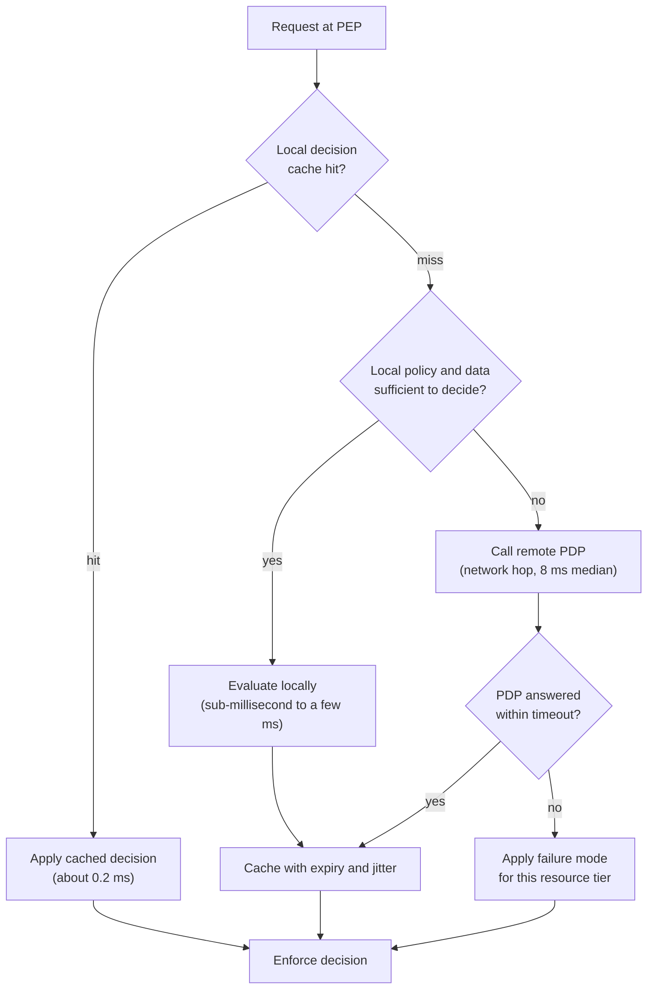

The diagram turns the placement question into an ordered fallback: cache, then local evaluation, then remote call, then a defined failure mode. The implication is that each resource tier decides how far down the chain a request may fall. A read of low-sensitivity data may stop at the cache and accept staleness. A privileged operation skips the cache or uses a short time-to-live (TTL). A timeout is a design parameter: set it to a few times the PDP's normal tail latency, since a very long timeout turns a slow PDP into an outage for every caller waiting on it.

The attacker's view of placement is the bypass question. Find the path that reaches the resource without crossing the PEP: a direct address that skips the gateway, a second listener on the service, an internal queue that accepts messages without checking the producer. Enforcement at the resource, or network policy that only allows the PEP to reach it, removes those paths.

## 8. Continuous Evaluation and Signal Sources

### 8.1 What "continuous" means

Zero Trust does not mean re-authenticating every request from scratch. It means that the decision rests on evidence that is recent enough for the resource, and that a change in that evidence reaches live sessions without waiting for them to expire. Section 3 showed that the revocation window is the sum of the intervals through which a change must travel. Continuous evaluation attacks the largest terms in that sum, usually the session or token lifetime, by adding a push path next to the pull path.

There are two mechanisms, and real systems use both. Polling shortens the lifetimes: short tokens, short decision caches, frequent posture reports. It is simple and works for every resource, but it raises load in proportion to how much it tightens. Event-driven revocation leaves lifetimes long and sends a message when something important changes. It keeps load flat, but it only works for resources that listen, and a lost message leaves the old decision in force until the lifetime ends. Treat the lifetime as the guaranteed upper bound and the event as the usual, faster case.

### 8.2 Signal sources and their reliability

A decision is only as good as its weakest input, so each signal should be listed with its source, its freshness, and what an attacker can do to it.

| Signal | Typical source | Freshness | Attacker view |
|---|---|---|---|
| Account state (disabled, password reset, factor removed) | Identity provider | Seconds if pushed, token lifetime if polled | Races the revocation window after a theft is noticed |
| Sign-in risk (unusual location, known-bad address, anomalous behaviour) | Identity provider risk engine, threat intelligence | Evaluated at sign-in and sometimes re-scored | Uses a clean address or a residential proxy near the victim |
| Device compliance | Device management service and endpoint agent | Agent report interval plus service cache | Compromised device reports healthy, or agent is stopped before it reports |
| Workload health and image provenance | Orchestrator, admission controller, attestation | At deploy and on a schedule | Runs a modified image that passed admission once |
| Resource sensitivity and ownership | Data catalogue, tags, classification labels | Changes rarely, but stale labels mislead | Relies on an unlabelled bucket being treated as public-tier |
| Session behaviour (volume, sequence, time) | Application and gateway logs, user and entity behaviour analytics | Minutes, since it needs a window of data | Stays under thresholds by exfiltrating slowly |

Three consequences follow. First, a signal with a fast attacker response needs a fast defender response, so account-state events deserve the push path and sensitivity labels do not. Second, probabilistic signals such as risk scores should drive step-up before they drive denial, because false positives on a deny have a direct cost and a step-up costs a few seconds. Third, a signal the policy depends on becomes a critical system. If the posture agent is the only evidence of device health, then stopping the agent must produce a missing-report state, and policy must treat missing as non-compliant for sensitive resources.

### 8.3 Continuous access evaluation as a pattern

Microsoft Entra's continuous access evaluation (CAE) is a concrete instance of the push path. The documentation describes a resource and the identity provider exchanging critical events, such as user disablement, password change, or a detected location change, so the resource can end a session before the access token's normal expiry. Supporting clients receive longer-lived tokens that can be cut short by these events, and the details of which clients and resources participate are in the [Microsoft Learn description of continuous access evaluation](https://learn.microsoft.com/en-us/entra/identity/conditional-access/concept-continuous-access-evaluation). Other platforms implement the same pattern with different names, and the OpenID Foundation's Shared Signals work defines event formats for exchanging such signals between providers. Verify the status and support of each before designing around it.

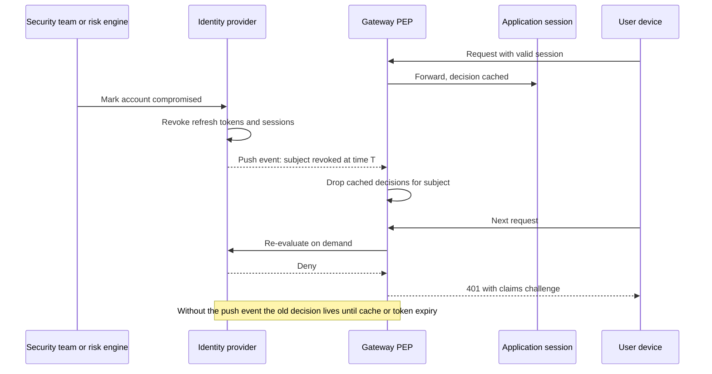

The diagram shows revocation as a message from the identity provider to the gateway, not a property of the token. The consequence is that the effective window for revoked accounts becomes the event delivery time plus one request, but only for gateways subscribed to the stream. A gateway that is partitioned from the stream falls back to the lifetime bound, so the design needs both and should alert when a subscriber has not received a heartbeat. In practice, count which applications are covered, because the uncovered ones define the real worst case.

### 8.4 Worked scenario: containing a stolen session

This scenario is illustrative, with numbers chosen to show the arithmetic. An analyst's session cookie is stolen from a compliant laptop at minute 0. The security team's detection fires at minute 12 and the account is disabled at minute 14. The application gateway issues sessions valid for 30 minutes without renewal, and the posture agent reports every 10 minutes.

- Pull-only design. The stolen session works until it expires. If it was issued at minute 0, it expires at minute 30, so the attacker keeps access for 30 - 14 = 16 minutes after the account is disabled.
- Push design with a 20-second event delivery. The window after the disable is 20 seconds plus the time to the next request, so the attacker loses access at roughly minute 14 and 20 seconds, saving up to 16 minutes - 20 seconds, about 15.7 minutes of access.
- The detection delay of 12 minutes is unchanged by either design. Continuous evaluation shortens the tail after detection, so it complements detection and does not replace it. If the application scope is large and the attacker exports 50 MB per minute, the pull design allows up to 16 x 50 = 800 MB and the push design about 0.33 x 50, roughly 17 MB, which is the reduction that justifies the integration work for sensitive stores.

Binding the session to the device with a proof-of-possession key, as discussed earlier, would have prevented the replay from another machine entirely and is the stronger control where supported. The two work together, since binding stops replay and revocation ends the sessions that did not use binding.

### 8.5 The session lifecycle

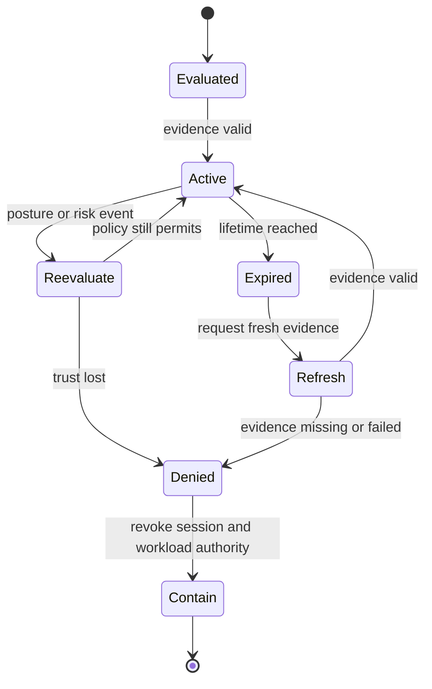

The state diagram makes three points reviewable. Every active session has two exits, an event and an expiry, and a system lacking either has an unbounded state. The Refresh state must fail to Denied when evidence is missing, otherwise the loop silently renews trust. The Contain state does more than end the session: it revokes refresh tokens, downstream delegated tokens, and any workload credentials the session minted, because a session that has ended but whose derived credentials survive still gives the attacker access.

## 9. Zero Trust Network Access and Device Posture in Practice

### 9.1 VPN and Zero Trust Network Access compared

A VPN gives a device a network presence: after login, the device gets an address inside the private network and can usually attempt connections to anything routed there. Zero Trust Network Access (ZTNA) gives a user on a device access to named applications. The user connects to a broker or proxy, which evaluates identity, device, and policy, and then relays only the permitted application traffic. The private network is not extended to the client. [Part 05 CH13 VPN](../05_Networking_and_OS/CH13_VPN.md) covers tunnel mechanics; this section covers the trust difference.

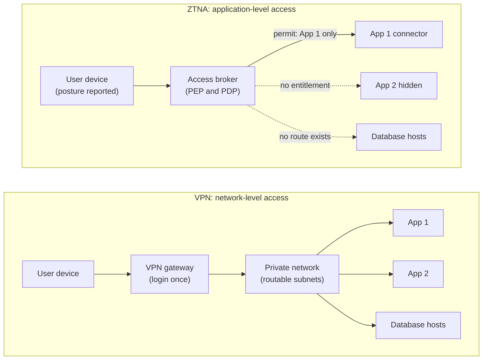

The VPN side grants reachability and relies on each application to defend itself. The ZTNA side grants a per-application session, so unentitled applications are neither reachable nor visible to a port scan from the client. The implication is on lateral movement: a compromised VPN client can scan the subnet and test every service, while a compromised ZTNA client can attack only the applications its user is entitled to. The cost is that the broker becomes a high-value component that needs high availability and tight administration.

| Dimension | Traditional VPN | ZTNA |
|---|---|---|
| Unit of access | Network or subnet | Application or service |
| Decision time | At connection, then mostly none | At session start and on change, per application |
| Device evidence | Often a certificate or none | Posture and device identity as policy input |
| Lateral reach after compromise | Broad within routed networks | Limited to entitled applications |
| Application exposure | Applications listen on internal addresses | Applications can have no inbound path, using outbound-only connectors |
| Protocol coverage | Nearly any IP traffic | Strongest for web, Secure Shell (SSH), and Remote Desktop Protocol (RDP) style access, other protocols vary by product |
| Operational cost | Gateway capacity, client management | Broker dependency, per-application onboarding |
| Failure dependency | VPN gateway | Broker and identity provider |

Neither is free of tradeoffs. Onboarding applications one at a time takes work, and legacy protocols that open back-connections or depend on broadcast discovery may not fit a proxying model. Many organisations run both during transition and move applications in order of risk, retiring broad VPN access as the application count on it falls. The check that tells you the migration is real is the VPN's reachable-subnet list getting shorter, not the ZTNA dashboard getting longer.

### 9.2 Connectors and outbound-only publishing

Most ZTNA products avoid inbound firewall rules by placing a small connector next to the application. The connector opens an outbound connection to the broker, and the broker relays authorised sessions over it. The application host then needs no inbound path from the internet, and the firewall needs no inbound hole. That removes the attack surface of a public listener, but it moves trust to the connector, which holds a standing outbound channel and can reach whatever its network position allows. Place connectors in the same segment as the application and restrict their egress to the broker and their ingress side to the specific application ports, so that a compromised connector cannot become the new flat network.

### 9.3 Device posture, practical design

Section 4 introduced device trust. Three design choices determine whether it works in operation.

1. What is checked. Keep the compliance set small and tied to threats: disk encryption, supported operating-system version within a patch window, screen lock, and an active endpoint agent. A long list trips on false failures, and the exceptions then cover the checks that matter.
2. How strict per tier. A single compliance bar is either too weak for administration or too strict for the general workforce. Define two or three tiers, for example general staff applications, sensitive business data, and production administration, and bind each resource to a tier.
3. What the user sees on failure. A device that fails a check must get a remediation path. Without one, users find workarounds such as unmanaged browsers, and the support queue sees the cost.

Rollout follows a report-only phase, since turning on enforcement without first measuring the failure rate locks out an unknown share of users. A short pilot comparing enforced decisions with logged would-be decisions gives the number. If 12 percent of 5,000 devices would fail a new patch-level check (illustrative), then 0.12 x 5,000 = 600 users face a block on day one, which is more than a help desk can handle in a day, so the rollout should be staged by group or the check relaxed until remediation catches up.

### 9.4 Cloud-provider offerings

At the time of writing, each major provider offers a product in this space. Features and names change, so verify against current documentation.

- AWS Verified Access evaluates trust data from an identity provider and a device-trust provider against policy written for each application, and fronts applications that remain private.
- Google Cloud Identity-Aware Proxy, together with Context-Aware Access levels, fronts web applications and some resource access, and the broader BeyondCorp Enterprise product extends the model with device-trust integrations. Confirm the current product boundary.
- Microsoft Entra Private Access, part of Microsoft's Global Secure Access family, provides ZTNA-style access to private applications using Entra identities and Conditional Access, and Entra application proxy publishes on-premises web applications through outbound connectors. Verify current naming and licensing.

The comparison that matters for selection is not feature count. Ask which identity provider the product trusts natively, which device-management systems feed it posture, which protocols it proxies, whether policy changes can end live sessions, and how its decision logs reach your monitoring.

## 10. Provider Comparison

The three providers apply the Zero Trust model to different layers, and similar names hide different guarantees. The table compares what each layer gives you and who is responsible, at the level of mechanism. Product names and features change, so treat it as a map for reading current documentation.

| Concern | AWS | Azure (Microsoft Entra and Azure) | Google Cloud |
|---|---|---|---|
| Workforce identity and policy | IAM Identity Center federated to an external identity provider, with IAM policy at the API | Microsoft Entra ID with Conditional Access evaluating user, device, location, and risk | Cloud Identity or federated provider, with IAM and Context-Aware Access |
| Per-application access without VPN | AWS Verified Access | Microsoft Entra Private Access and application proxy | Identity-Aware Proxy, BeyondCorp Enterprise |
| Device signals | Trust providers such as device-management integrations | Intune compliance and Entra device identity | Endpoint Verification and partner device signals |
| Workload identity | IAM roles, IAM Roles Anywhere, EKS Pod Identity | Managed identities and workload identity federation | Service accounts, Workload Identity Federation |
| Network identity rules | Security group references, VPC (Virtual Private Cloud) endpoint policies | Network security groups with application security groups, private endpoints | VPC firewall rules using service accounts or tags, VPC Service Controls |
| Data-perimeter control | Resource policies with organisation conditions, service control policies | Azure Policy, resource locks, and private link scoping | VPC Service Controls around supported services |
| Session revocation | Role session policies and revocation of sessions, bounded by credential lifetime | Continuous access evaluation for supporting resources | Short-lived tokens and session controls, verify the current options |

Three points affect decisions more than the rows do. First, the data-perimeter products answer a different question from user access. They limit which networks and identities can reach cloud-managed data services even when an identity has permission, and they guard against stolen credentials used from outside the expected network. They do not replace user-level policy. Second, push revocation is uneven across providers and across services within one provider, so the revocation window must be measured per application, and the longest credential lifetime in the chain is the number you can promise. Third, a multi-provider organisation usually ends up with one identity provider as the root of trust and provider-specific enforcement beneath it, which keeps one place for account lifecycle and one set of policies for authentication strength. [Part 09 CH09 IAM](../09_Cloud_Computing/CH09_IAM.md) gives the evaluation rules for each provider's IAM, which this chapter assumes.

## 11. A Phased Migration Roadmap

### 11.1 Phases and measurable milestones

Zero Trust is reached resource by resource, and the order is chosen by risk and by how much evidence exists. Each phase needs an exit measure that can be queried, because "we have started Zero Trust" is not an outcome. The figures below are illustrative targets to adapt, not benchmarks.

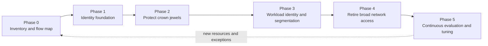

| Phase | Work | Exit measure (illustrative) |
|---|---|---|
| 0. Inventory | List applications, data stores, identities, service accounts, and observed flows | 100 percent of production data stores have a named owner and a classification |
| 1. Identity foundation | One identity provider for workforce access, MFA for all, phishing-resistant factors for administrators | 95 percent of applications by user count federated, zero local passwords on tier-one applications |
| 2. Crown jewels | Per-request policy, device tier, and step-up on the few highest-value resources | Every tier-one resource has a decision log with identity, device, and reason, reviewed monthly |
| 3. Workload and network | Short-lived workload credentials, default-deny network policy, mTLS with caller allow lists | Static cloud keys count falling toward zero, namespaces with default-deny rising to 100 percent |
| 4. Retire broad access | Move applications from VPN to application-level access, remove "trusted network" exemptions | Reachable subnet list on VPN shortened by a set percentage each quarter, zero exemptions without expiry |
| 5. Continuous | Event-driven revocation, signal tuning, regular policy review | Measured revocation window under the target for each tier, exceptions reviewed on schedule |

The diagram's loop back to Phase 0 matters. New applications arrive, acquisitions bring unmanaged estates, and exceptions accumulate, so inventory is a continuing process and not a first step. Metrics also need a denominator: "400 applications behind application-level access" means little until you know there were 520, because the 120 left include the ones that were hard.

### 11.2 Ordering and arithmetic

Order work by risk reduced per unit effort. Assume a ranking in which each application is scored by data sensitivity (1 to 5) multiplied by exposure, meaning how many identities and networks can reach it (1 to 5), divided by migration effort in weeks. An application scoring sensitivity 5 and exposure 4 with 3 weeks of effort gets 5 x 4 / 3 = 6.7. A low-risk internal wiki with sensitivity 1, exposure 3, and 2 weeks gets 1 x 3 / 2 = 1.5. The scores are crude and the ranking should be checked by judgement, but they prevent the common pattern of migrating the easy, low-risk applications first and reporting progress while the crown jewels stay behind a flat network.

Pilot selection follows two rules. Choose a resource important enough that success is visible but contained enough that a policy error does not stop the company. And choose one whose owners will take part, since the pilot's goal is to learn the real dependencies and the support load, not to prove the technology.

### 11.3 Rollout discipline

Every enforcement change uses the same sequence. Run in report-only mode and record would-be denies. Review them with the owner, separating legitimate dependencies from attack paths. Enforce for a small group, then widen. Watch the denial rate, help-desk contacts, and bypass attempts, and keep a documented rollback that can be run in minutes. Reversible steps are the reason the roadmap works in a live organisation, and an irreversible big-bang cutover is the main cause of programmes being halted after the first outage.

Preserve and test a break-glass path through each phase. It should work with the identity provider, the broker, and the policy service all unavailable, be held by few people with strong controls, and raise an alert on use. Test it on a schedule, since an unexercised emergency path is usually broken or forgotten when needed.

## 12. Fail-Open, Fail-Closed, and Bounded Staleness

### 12.1 Choosing the failure behaviour per resource

Section 3 listed the three failure modes. This section gives the rule for choosing among them and the arithmetic of what each costs. The decision is made per resource tier, ahead of time, and written into the PEP configuration, because the middle of an outage is the wrong time to debate it.

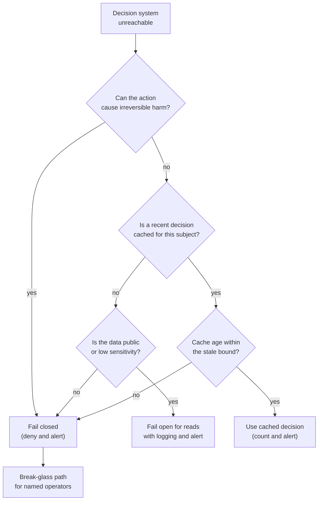

The tree puts irreversibility first, since a wrongly denied read costs a delay while a wrongly allowed deletion or export may not be recoverable. Fail-open for public data is the rare accepted case, and even there the decision is logged so that a pattern of open decisions is visible. The implication for operations is that each outcome has a metric: counts of stale-served decisions, denied-due-to-outage requests, and break-glass uses, with alerts, because the same outage that triggers the behaviour is when nobody is watching dashboards.

### 12.2 Availability arithmetic

The decision system is in series with every protected request, so it multiplies into availability. Illustrative figures: an application is 99.95 percent available alone. The PDP is 99.9 percent available, and the identity provider is 99.9 percent. If both are in the path of every request with fail-closed behaviour and no caching, the combined availability is 0.9995 x 0.999 x 0.999 = 0.9975, about 99.75 percent. The monthly downtime for a 30-day month (43,200 minutes) grows from 43,200 x 0.0005 = 21.6 minutes to 43,200 x 0.0025 = 108 minutes.

Caching changes the exposure. If the gateway serves cached decisions for up to 10 minutes and outages of the decision system last 8 minutes on average, most outages are absorbed with no user effect, and the effective downtime of the protected path falls back toward the application's own. The price is the stale window: for those 10 minutes, a revoked account may still be honoured. This is the tradeoff stated in numbers, and it argues for a stale bound that differs by tier, for example 10 minutes for general internal applications and zero for production administration, where the answer to an outage is the break-glass path.

### 12.3 Making the failure path safe

- Enforce the stale bound in the PEP using the decision's age, not an operator setting that someone can raise during an incident.
- Make a denial caused by an outage distinguishable from a policy denial in logs and in the message to users, so that support does not waste time on policy.
- Protect the decision system against flooding, since a PDP that can be pushed over by unauthenticated load turns fail-closed into a denial-of-service lever. Authenticate before expensive lookups and rate-limit by caller.
- Run the decision system in more than one failure domain, and test the failover. A PDP in one zone behind a gateway that assumes the other zone's replica exists is a common finding.
- Rehearse the path. Periodically block the PDP from a test environment and confirm that each tier behaves as written, including that the break-glass account works with the identity provider offline.

An attacker looks for the failure behaviour as eagerly as for the policy. A PEP that fails open when the PDP returns an error, rather than when it times out, can be driven to open by sending a request crafted to make the PDP error. Treat every unexpected PDP response, malformed, empty, or error, as the same case as unreachable, and apply the tier's failure mode.

## 13. Failure and Quality-Attribute Scenarios

Each scenario states a stimulus, the response the architecture must produce, and a success criterion that can be measured in a drill or from logs. All numbers are illustrative and show how to derive a criterion. Replace them with the values your tiers need.

### 13.1 Scenario set

| # | Stimulus | Expected response | Measurable success criterion |
|---|---|---|---|
| 1 | The policy decision point (PDP) is unreachable for 10 minutes | Tier 1 (production administration) denies. Tier 2 (internal business data) serves cached decisions up to a 10-minute bound. Tier 3 (public or low sensitivity reads) fails open with logging. Break-glass stays usable | 100 percent of tier-1 requests denied with an outage-specific reason. No cached decision older than 10 minutes honoured. A stale-served alert fires within 1 minute. A break-glass login succeeds with the identity provider offline |
| 2 | A session token is stolen from a compliant laptop and the account is disabled | The identity provider pushes a revocation event. Gateways drop cached decisions. The next request is re-evaluated and denied | At least 95 percent of 30 test replays are denied within 60 seconds of the disable on push-covered applications. Uncovered applications stay inside their pull bound of 3 minutes |
| 3 | A workload credential is stolen from a compromised container | The credential is short-lived and audience-scoped. Callee policy limits it to its allow-listed methods. Responders remove the identity's trust or attach a deny policy | Credential lifetime of 15 minutes caps unaided exposure at 15 minutes. Probe calls outside the allow list are denied 100 percent of the time. Containment completes within 10 minutes of detection |
| 4 | The posture agent is stopped on a laptop | The missing report is treated as non-compliant for sensitive resources | Device blocked from tier-1 and tier-2 within 2 report intervals plus the cache (2 x 15 + 5 = 35 minutes with 15-minute reports, or 2 x 5 + 5 = 15 minutes with 5-minute reports). Tier 3 unaffected |
| 5 | A front-end pod is compromised and scans the namespace | Default-deny network policy and callee identity checks stop connections to the data tier | 0 of 20 probe connections to the database port succeed. A denied-flow alert fires within 5 minutes |

### 13.2 Deriving the criteria

Scenario 1 depends on the timeout, which is set from the PDP's measured tail. With a 99th percentile of 30 ms (section 7.2), a timeout of three times that is 90 ms. A request waiting longer than that moves to the tier's failure mode, so a PDP outage adds at most 90 ms before degraded behaviour starts. The 10-minute stale bound is chosen from the longest decision-system outage the tier should absorb and the revocation delay it can accept, since the two trade directly.

Scenario 2 follows section 8.4. If detection takes 12 minutes and the attacker reads 50 MB per minute, the pull design exposes 16 x 50 = 800 MB after the disable and the push design exposes roughly 0.33 x 50 = 17 MB. The criterion expresses that gain as a time bound, because bytes depend on the attacker.

Scenario 4 shows why "missing equals non-compliant" needs a stated delay. Waiting two intervals tolerates one lost report without blocking users on a network blip.

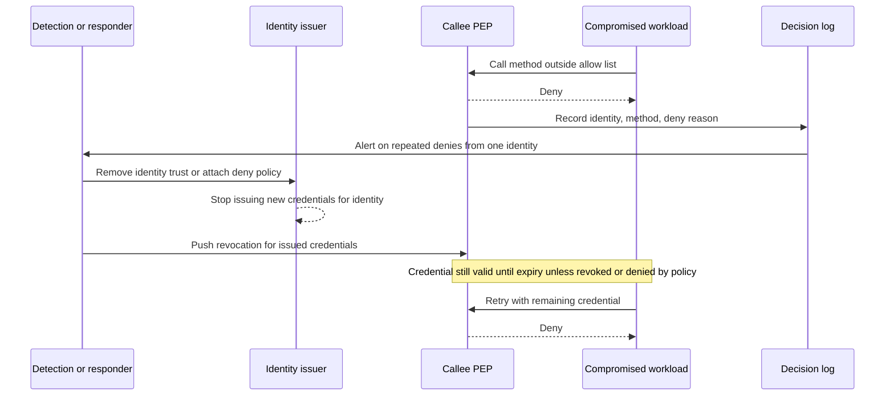

The diagram shows two layers working in sequence. The allow list contains the attacker from the first call and generates the signal that starts the response. The response has two parts that are easy to confuse: stopping new issuance and ending credentials already issued. Removing trust at the issuer does nothing for a credential that is valid for another 12 minutes, so the plan names the control that ends it, either a callee-side deny on the identity or a revocation list the PEP checks. A 15-minute lifetime bounds the worst case when neither is available.

## 14. Worked Case Study: Alder Logistics (Illustrative): Alder Logistics (Illustrative)

Alder Logistics is a hypothetical freight-booking company used to show the reasoning end to end. It is not a real organisation, and every figure is invented for the exercise.

### 14.1 Starting point and goals

Alder has 1,800 staff and 140 applications, split by data sensitivity into 12 tier-1 applications (payments, production administration, customer data exports), 38 tier-2 applications (internal business data), and 90 tier-3 applications (wikis, public content tools). 60 microservices run on one Kubernetes cluster in one cloud. Staff reach internal applications through a VPN that routes four subnets. Services call each other with shared database passwords and one long-lived cloud access key per team. The goals for the first year are: tier-1 account-disable window of 1 minute or less where push is supported and 5 minutes or less elsewhere, no static cloud keys in pipelines, and default-deny between the front end and the data tier.

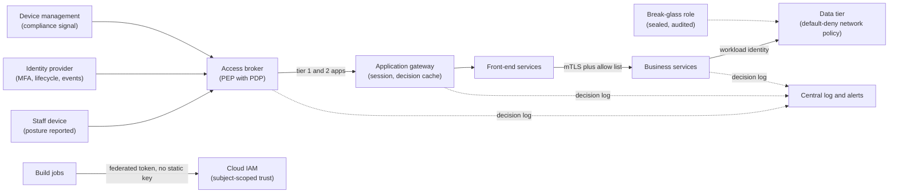

The diagram is the target state. Staff reach applications through the broker, which consumes identity and device signals. Services use workload identity and an allow list at each hop, and the data tier is reachable only from the services that own it. Build jobs obtain cloud access by federation. Every enforcement point writes decisions to one log. The break-glass path reaches the data tier without depending on the broker or the identity provider. The implication is that each box maps to a control with an owner and a drill from section 13.

### 14.2 Decisions, with alternatives rejected

| Decision | Chosen | Rejected alternative and why |
|---|---|---|
| Staff access to tier-1 apps | Application-level access through a broker, VPN kept for tier 3 during transition | Keep VPN and add MFA only: still gives each compromised client routed reach to four subnets |
| Device trust | Managed-device compliance for tier 1 and 2, browser-only for personal devices on tier 3 | Compliance required everywhere: blocks the contractors and support load outweighs the tier-3 risk |
| Workload identity | Short-lived platform credentials with a per-service allow list | Shared database password rotated quarterly: a leak is valid for up to 90 days and identifies nothing |
| Network segmentation | Default-deny network policy plus mesh identity on the data-adjacent services | Address-based firewall rules for the pod subnet: pod addresses are reused, so the rule describes a location |
| Mesh scope | Mesh mTLS on the 22 services that touch tier-1 data, rolled out in stages | Mesh on all 60 at once: the proxy fleet and operational load arrive before the team has run any of it |
| Decision caching | 1-minute PDP cache, 2-minute tier-1 tokens, push events where supported | Per-request remote decision for every call: the PDP becomes the capacity and availability limit of the company |
| Pipeline cloud access | Federated token with `sub` and `aud` conditions | Long-lived access key per team stored as a pipeline secret: copyable, rarely rotated |

### 14.3 The arithmetic behind the choices

Revocation windows. Account state travels through the PDP cache and the token. With a 1-minute cache and a 2-minute token, a tier-1 application without push honours a disabled account for up to 1 + 2 = 3 minutes, inside the 5-minute goal. With push, the window is event delivery plus the next request, targeted at 1 minute. The 10-minute tokens of the starting design would give 1 + 10 = 11 minutes, which fails the goal for the two tier-1 applications that cannot receive push events. Ten of the twelve tier-1 applications support push, so 2 of 12 (about 17 percent) fall back to the pull bound.

Device-state window. The posture agent reports every 5 minutes. For a pull-only tier-1 application the window is 5 + 1 + 2 = 8 minutes, and the agreed target is 10 minutes or less.

Renewal load. With 1,200 concurrent sessions, a 2-minute token gives 1,200 / 120 s = 10 renewals per second against 2 per second for a 10-minute token, which is small for the broker.

Segmentation. The log-only phase on the cluster recorded 412 distinct service-to-service flows. Owners reviewed them and approved 138 as intended. 274 flows were candidates for denial, which is 274 / 412 = 66.5 percent. Staging enforcement in a test namespace showed that 31 of the 274 were real undocumented dependencies, such as a reporting job reading a replica. Those were added to the model, giving 138 + 31 = 169 allowed flows. The remaining 274 - 31 = 243 flows are denied, which is 243 / 412 = 59.0 percent of the observed traffic. Roughly three flows in five that the network allowed had no owner who wanted them.

Device rollout. A report-only run on 1,800 devices showed 9 percent failing the new patch-level check. 0.09 x 1,800 = 162 users would be blocked on day one. The team enforced in three waves of 600 devices each, which exposes about 54 users per wave (0.09 x 600), a load the help desk can absorb.

Availability. For tier 1, the application is 99.95 percent available, and the PDP and identity provider are each 99.9 percent, all illustrative. Fail-closed with no cache gives 0.9995 x 0.999 x 0.999 = 0.9975 (99.75 percent). In a 30-day month of 43,200 minutes that is 43,200 x 0.0025 = 108 minutes of possible decision-path unavailability against 43,200 x 0.0005 = 21.6 minutes for the application alone. Tier 1 accepts this because the actions are administrative and the break-glass path covers true emergencies. Tier 2 uses a 10-minute stale bound and so absorbs outages of that length.

### 14.4 Validation evidence

The programme accepts a milestone only with evidence from the following checks. Results are invented to show the form.

- Revocation drill. 30 replays of a captured session after account disable on push-covered applications: 29 denied within 60 seconds, 1 denied at 74 seconds. 29 / 30 is 96.7 percent, above the 95 percent criterion, and the outlier is investigated. On the two uncovered applications the longest observed window was 2 minutes 40 seconds against a 3-minute bound.
- Segmentation probe. 20 connection attempts from a test front-end pod to the database port, 0 succeeded, and 20 denied-flow events reached the log within 4 minutes.
- Failure drill. The PDP was blocked from the staging environment for 10 minutes. Tier-1 requests were denied with the outage reason, tier-2 requests were served from cache until the stale bound, and the break-glass login worked with the identity provider also blocked.
- Federation review. A query of cloud trust policies found 0 pipeline roles without a `sub` condition and 0 wildcard subjects. The number of static access keys fell from 14 to 3, each remaining key owned by a named system that cannot use federation and reviewed on an expiry date.

### 14.5 What the case leaves open

The two tier-1 applications without push support remain the weakest point, and fronting them with the broker is the next work item. Data-level controls complete the model, since allowing a read does not say what happens to the data afterwards. Alder adds classification labels on tier-1 stores, step-up with a recent phishing-resistant factor for exports, and logging of each export with row counts. The 90 tier-3 applications stay on the VPN, with a quarterly target to shorten the routed subnet list. That sequencing is a recorded risk decision with an owner.

## 15. Common Mistakes

| Mistake | Cause | Consequence |
|---|---|---|
| Buying a product and calling the result Zero Trust | The label is treated as a deliverable, with no decision model behind it | Reachability stays broad. The product enforces policy nobody wrote, and the first incident shows the old flat network underneath |
| Authenticating the caller but never authorizing the method | Teams verify the certificate or token and stop, because the allow list is extra work | Every valid workload in the trust domain can call every operation, so one compromise reaches everything |
| Trusting a "known office network" or service-account exemption | An early rollout exception that nobody owned or expired | The perimeter returns in a corner and the attacker aims at it |
| Using labels as the network identity without controlling who edits them | Label matching is convenient and works on day one | Anyone who can relabel a pod can open a path to the database |
| Enabling default-deny without flow observation | Pressure to show progress | Name resolution, monitoring, or backup breaks, enforcement is rolled back, and the programme loses credibility |
| Setting long token or cache lifetimes without computing the window | Lifetimes are inherited from defaults | Revocation takes 80 minutes when the stated target was 5 |
| Failing open on PDP errors | An error response is handled differently from a timeout | An attacker who can make the PDP return an error gains access |
| Treating missing posture as compliant | The policy only tests for a failure value | Stopping the agent restores access to a compromised device |
| Letting the stale bound be an operator setting | Convenience during outages | The bound is raised during an incident and never lowered |
| Reusing one workload identity for unrelated services | Fewer identities to manage | The compromise of the weakest service carries the authority of all of them |
| No tested break-glass path, or one that depends on the failed system | The path was designed on paper | The outage becomes a lock-out of the operators who need to fix it |
| Counting applications onboarded without a denominator | The metric rises easily | The hard applications are left until last and the programme reports success while crown jewels stay behind the flat network |

Two causes recur across the list: evidence that is assumed instead of measured, and exceptions without owners.

## 16. Design-Review Checklist

Use these questions on a design document. A "no" or "unknown" answer becomes an action with an owner.

**Decision architecture**

- Is each protected resource assigned a tier, and does each tier state required authentication strength, device evidence, and failure mode?
- Are the policy enforcement point and policy decision point placed where the needed attributes are visible, with a bypass path analysis?
- Is there a decision log entry for every allow and deny, with identity, resource, action, reason, and decision identifier?

**Evidence freshness**

- Is the revocation window computed for account state and device state for every tier, and does it meet the target?
- Which applications support event-driven revocation, and what is the pull bound for those that do not?
- Does missing evidence count as non-compliant for sensitive resources, after a stated delay?

**People and devices**

- Is there one identity provider, with no local passwords that bypass it?
- Is device enrolment itself approved and verified, and are personal devices handled by a written rule?
- Does every policy exemption have an owner, reason, and expiry, and is there a scheduled query for bypasses?

**Workloads and network**

- Do workloads use short-lived platform credentials, and does each callee keep an allow list of callers and methods?
- Do federation trust policies check issuer, audience, and subject without wildcards?
- Is segmentation default-deny with a documented communication model, including operations, monitoring, and recovery flows?
- Is network policy enforcement tested with a connection that must fail?

**Failure and operations**

- Does each tier have a tested failure behaviour, with the stale bound enforced in the enforcement point?
- Is the decision system in more than one failure domain, protected against flooding, and rehearsed?
- Is break-glass independent of the failed systems, strongly controlled, alerted on use, and exercised on a schedule?

**Migration**

- Does each phase have a queryable exit measure with a denominator?
- Is rollout staged, report-only first, with a rollback that runs in minutes?
- Are data-level controls (classification, export step-up, export logging) in scope for tier 1?

## 17. Exercises

1. A flat internal network hosts a payroll database reachable from the whole office subnet. List the implicit trust assumptions and propose the first three changes, with the evidence that shows each worked.
   *Answer outline:* Assumptions are reachability equals authorization, no caller identity at the database, and shared credentials. Changes are a default-deny rule limiting the database to its owning service, a service identity with a per-method allow list, and a decision log. Evidence is a failing probe from another subnet and a log entry for each denial.
2. A gateway caches decisions for 5 minutes, the posture agent reports every 10 minutes, and tokens last 30 minutes with no re-check. Compute the device-state revocation window, then redesign for 10 minutes or less.
   *Answer outline:* 10 + 5 + 30 = 45 minutes. Shorten the token to 2 minutes and the report interval to 3 minutes: 3 + 5 + 2 = 10. Alternatively add a push event and keep the pull bound as the guarantee.
3. A PDP replica handles 400 decisions per second. A fleet makes 9,000 requests per second with a 96 percent cache hit rate. How many replicas are needed to survive losing one?
   *Answer outline:* Misses are 9,000 x 0.04 = 360 per second, so one replica suffices in steady state, and two survive a loss. After a restart with synchronised expiry the rate approaches 9,000, so add jitter and keep headroom or a cache-warming plan.
4. Choose a failure mode for four resources: a public product catalogue, a payment approval, an internal wiki, and a production database console. Defend each choice.
   *Answer outline:* Catalogue fails open with logging, wiki uses a bounded stale decision, payment approval and the console fail closed, with the console served by break-glass. Irreversibility decides the order.
5. A cloud role trust policy for pipeline jobs checks the audience but not the subject. Describe the attack and the fix.
   *Answer outline:* A job from any repository served by the same identity provider can assume the role. Add a subject condition pinned to one repository and branch, remove wildcards, and add a scheduled query for roles without subject conditions.
6. After enabling default-deny egress in a namespace, every pod fails to resolve names. Explain why and outline a safe rollout.
   *Answer outline:* The pods lost egress to cluster DNS on port 53. Allow it explicitly. Roll out per namespace with flow logs, a log-only phase, a test of permitted and denied paths, and a rollback.
7. A security lead reports "400 applications behind application-level access". What question do you ask, and what metric replaces it?
   *Answer outline:* Ask for the denominator and for which tier the remaining applications are in. Report the share of tier-1 resources covered and the length of the VPN's routed subnet list over time.

## 18. Summary

Zero Trust replaces location-based trust with decisions made per request on evidence about the subject, the device or workload, the resource, and the context. The outcomes from the Introduction map to the chapter as follows.

| Outcome | Where it was taught | What to retain |
|---|---|---|
| Explain implicit trust and what an attacker gains from it | Section 2 | A perimeter turns one foothold into broad reach. Zero Trust limits the value of the foothold and records the attempts |
| Describe the PDP and PEP model and place each in a request path | Sections 2, 3, 7 | Coarse decisions near the network, fine decisions at the resource, with a bypass analysis for each path |
| List signals, order checks, and bound staleness | Sections 3, 8 | Cheap and decisive checks first, probabilistic signals drive step-up before denial, missing evidence counts against the subject |
| Calculate the revocation window | Sections 3, 8, 13, 14 | The window is the sum of the stages a change must pass through, and events shorten it without raising load |
| Choose workload proof and compare providers | Sections 5, 10 | Short-lived credentials, attested identity, a per-callee allow list, and tightly conditioned federation |

Beyond the outcomes, the chapter added segmentation by identity rather than address (section 6), a phased migration (section 11), and explicit failure behaviour per tier (section 12). Sections 13 to 17 apply these in scenarios, a case, mistakes, a checklist, and exercises.

Implement incrementally and resource by resource. Start with inventory and the identity foundation, protect the highest-value resources first, and write each criterion so that a drill can verify it. Bound cache staleness and exceptions with owners and expiry dates, and keep a break-glass path that is tested and does not depend on the systems it recovers.
