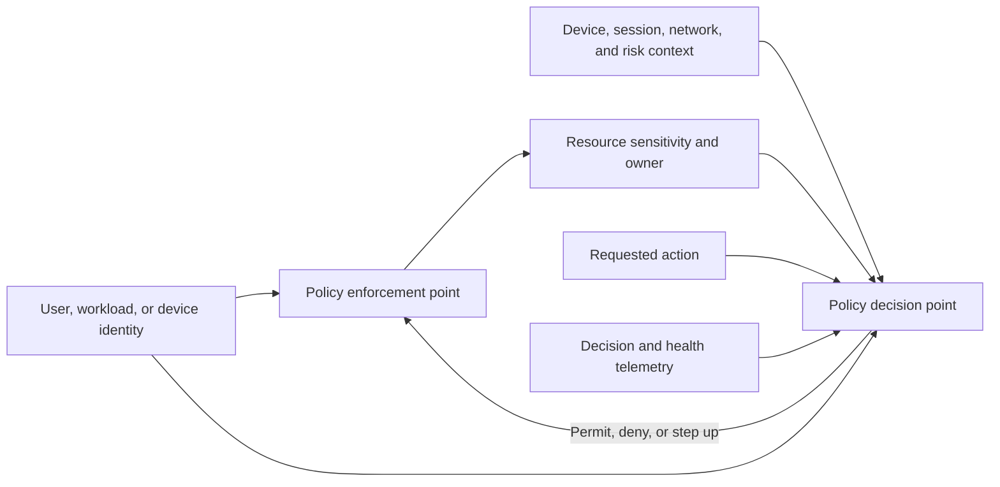
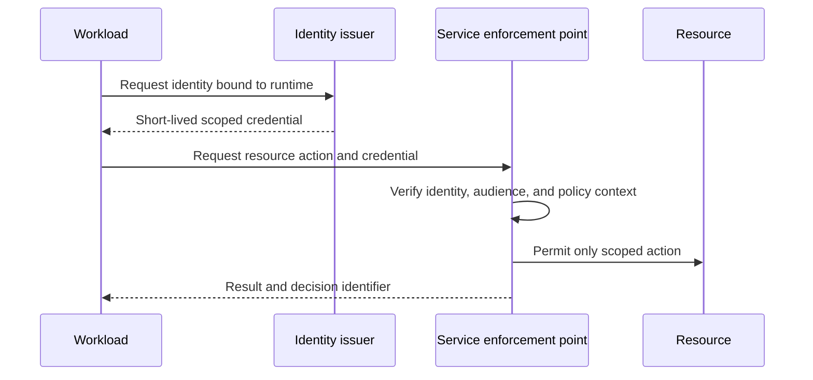
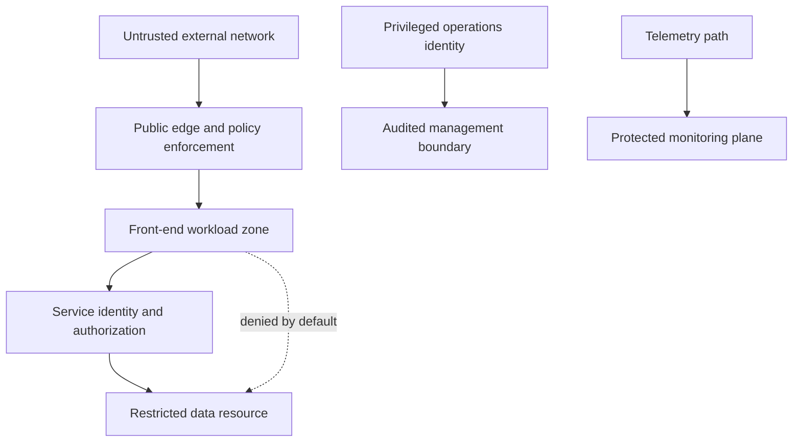
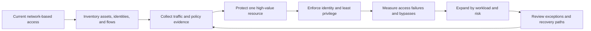
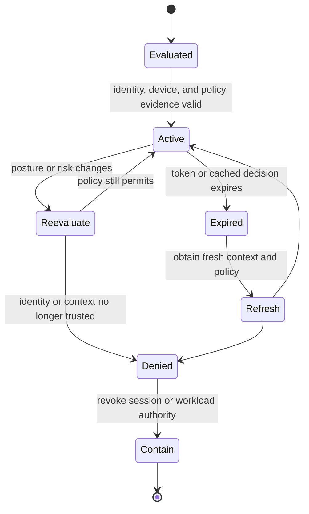

# Zero Trust

Part: [15 — Security](PART_OVERVIEW.md)

Zero Trust is a security architecture approach that removes implicit trust based solely on network location or prior access. A request is evaluated using identity, resource, context, and policy. The approach applies least privilege and ongoing verification. It is not a product, a single network design, or a mandate to challenge every request identically. Part 09 owns provider implementations; Part 12 applies the approach to Kubernetes; Part 05 owns network primitives.

## Architecture Principles and Decision Path

The system should assume compromise is possible, protect resources rather than a trusted perimeter, and make access decisions from explicit evidence. Identity can represent a user, workload, device, or service. Context may include device posture, request risk, resource sensitivity, and session strength. Enforcement belongs close enough to the resource to make a meaningful decision.

Network segmentation can reduce reachable attack surface, but internal network location does not prove identity or entitlement. Conversely, identity checks without resource boundaries or device context can leave lateral movement paths. Combine identity, policy, and segmentation based on threat and operational constraints.

## Identity-Centric Access and Workload Trust

Use distinct identities for users and workloads. Workload identities should be bound to runtime or deployment context, limited in audience and scope, and short lived where possible. Avoid shared static credentials that allow one compromised service to impersonate peers. Part 09 covers provider workload identity products; CH02 and CH03 cover authentication and authorization concepts.

Apply step-up verification for sensitive user actions and continuous evaluation when risk or device posture changes. Revocation must reach active sessions, caches, and downstream services within a defined time. A long-lived token can preserve authority after the user or device is no longer trusted.

## Segmentation and Enforcement Boundaries

Microsegmentation limits east-west reachability among workloads and data tiers. It should enforce a documented communication model, not create a maze of unowned rules. Pair network policy with service identity and application authorization. Include administration, observability, backup, and recovery paths in the design so security controls do not block safe operation.

Default-deny segmentation can break undocumented dependencies. Inventory flows, observe traffic, define policy with owners, stage enforcement, and verify both allowed and denied paths. Avoid broad “temporary” exceptions without an owner and expiry.

## Continuous Evaluation, Migration, and Failure

Zero Trust does not mean re-authenticating every request from scratch. It means that policy decisions use current enough identity and context evidence, and that access can be reevaluated when relevant state changes. Caching reduces latency but creates a revocation window. Define which attributes are cached, for how long, and which events invalidate them.

Migrate incrementally. Preserve a documented break-glass path and test it under outage conditions. A policy service outage should not silently grant broad access; choose fail behavior per resource, maintain a bounded cache where justified, and monitor stale-decision use. Explain denial reasons to operators without exposing sensitive policy data to attackers.

## Worked Case and Review Checklist

A company replaces a flat internal network assumption for access to a document store. Users authenticate through a trusted identity provider; workloads receive short-lived workload identities. The document service enforces tenant and object authorization. Network policy restricts which services can reach the store, but an internal subnet alone does not grant read access. Device posture triggers step-up for administrative actions. A break-glass role is time-bound and audited.

Review identity sources, workload binding, resource protection point, segmentation flows, device/context freshness, decision caching, revocation delay, outages, exceptions, telemetry, and migration order. Confirm that recovery and observability remain available without restoring implicit trust.

## Questions and Summary

1. Which implicit network trust assumptions remain in a sample architecture?
2. Draw an identity, context, policy, and enforcement path for a workload-to-database request.
3. What revocation delay is acceptable for a high-value access token, and how is it enforced?
4. Plan incremental segmentation without blocking required recovery or monitoring flows.
5. Compare identity-based enforcement with network-only segmentation.

Zero Trust replaces implicit location-based trust with explicit, resource-oriented decisions using identity and context. It combines least privilege, segmentation, continuous evaluation, and observable enforcement. Implement incrementally, bound cache staleness and exceptions, and preserve a tested recovery path.
