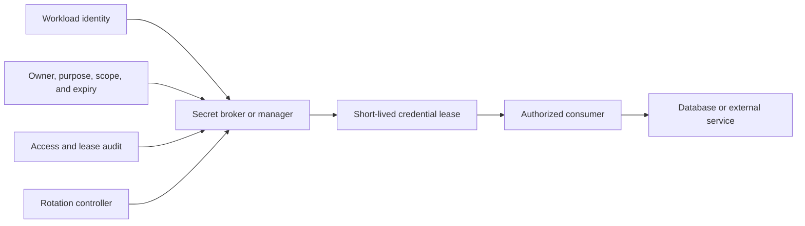
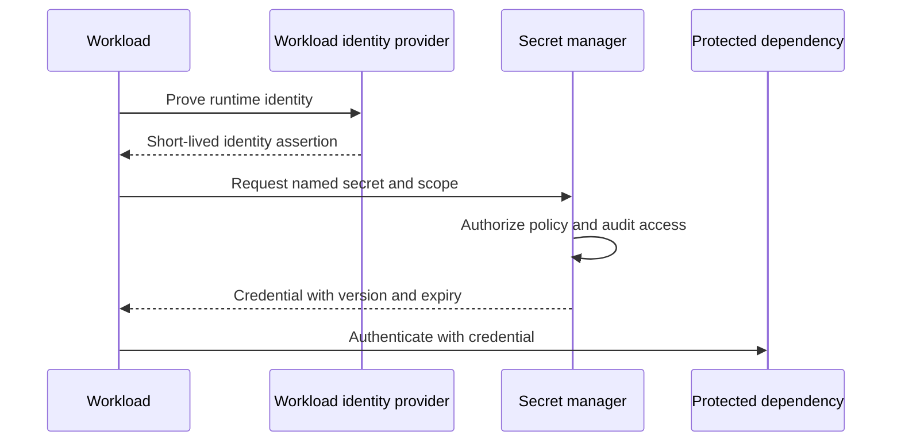
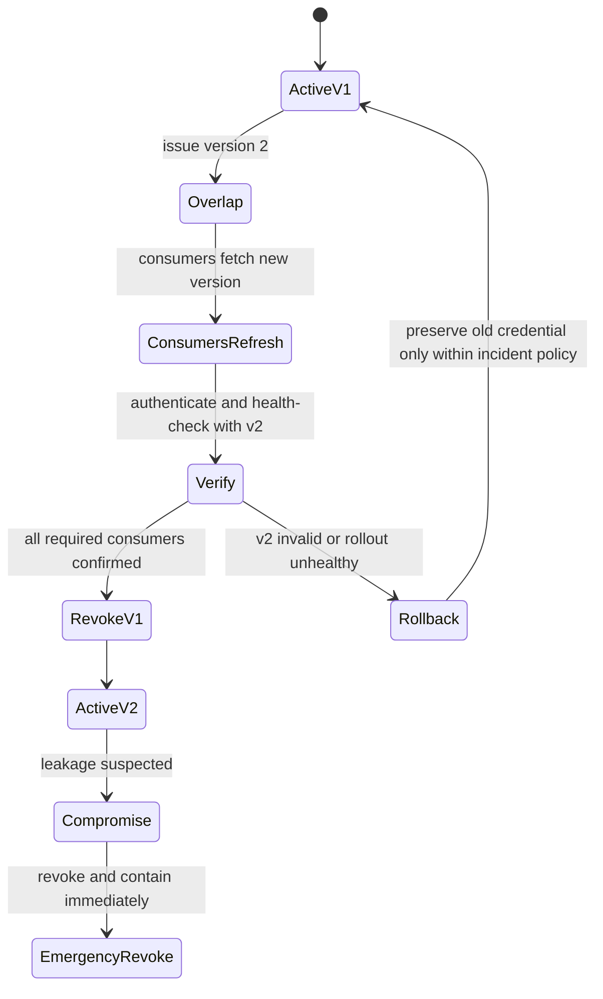
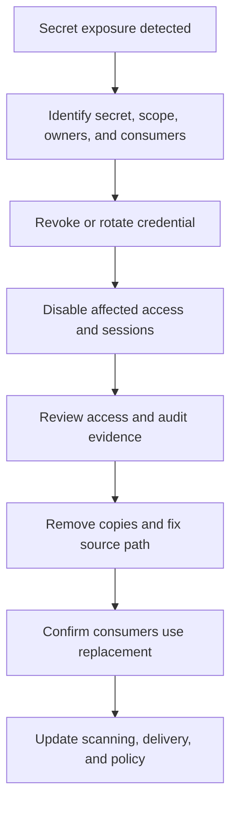
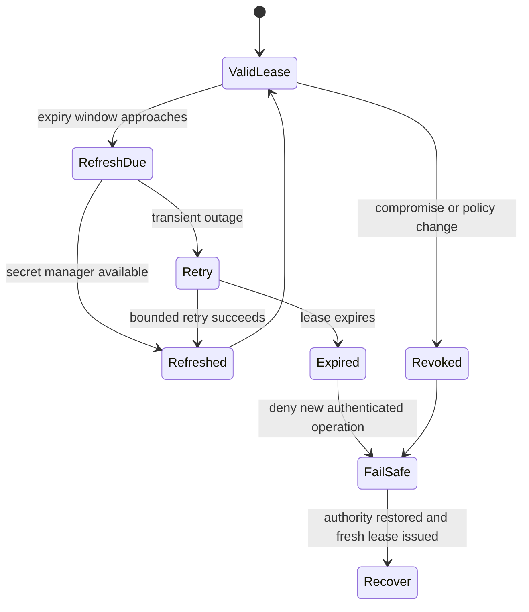

# Secrets Management

Part: [15 — Security](PART_OVERVIEW.md)

Secrets are credentials or cryptographic materials that grant authority or protect confidentiality and integrity. Secrets management governs their creation, storage, distribution, use, rotation, revocation, and retirement. The goal is not merely to put values in a vault; it is to minimize copies and authority while ensuring consumers can refresh safely. Part 09 owns provider secret-management products; Part 12 owns Kubernetes-specific secret use.

## Classify Secrets and Establish Authority

Inventory passwords, API keys, certificates, signing keys, database credentials, refresh tokens, and bootstrap credentials. Classify by authority, scope, lifetime, and impact of compromise. Prefer workload identity or dynamic credentials over static secrets when the target supports them. A secret should have an owner, purpose, consumer list, expiry or rotation policy, and revocation path.

The secret manager is a high-value authority. Restrict administrative access, protect encryption keys, audit reads and policy changes, and separate secret administrators from workload operators where feasible. A vault does not help if every service can read every secret or if the deployment pipeline injects broad credentials into every job.

## Delivery to Workloads and Caching

Secrets may be delivered through a file mount, environment variable, local agent, sidecar, or runtime API. Choose a method that limits exposure through process listings, crash dumps, logs, child processes, and filesystem snapshots. Environment variables are convenient but can be inherited and captured; mounted files can be copied or remain stale; API retrieval requires network and identity availability.

Cache only as long as the availability benefit justifies stale authority. Record version and expiry; refresh before expiry with jitter to avoid synchronized load. On refresh failure, choose explicitly whether an existing credential may continue until its expiry or the operation must fail. Never silently fall back to a default administrator credential.

## Rotation, Revocation, and Dynamic Credentials

Rotation is a producer-consumer protocol. The issuer creates a new version, consumers retrieve it, connections and pools adopt it, and the old version is revoked after overlap. Some consumers require restart to reload credentials. Include rollout and health behavior in the rotation plan. After suspected exposure, rotate immediately. Coordinate consumer impact and incident response.

Dynamic credentials reduce lifetime and simplify revocation but require availability and lease lifecycle management. A lease should be scoped, time-limited, auditable, and renewable only while the workload remains authorized. Avoid creating unbounded credential churn that overwhelms identity or target systems.

## Leaks, Incident Response, and Observability

Treat a detected secret leak as a live credential compromise. Revoke or rotate first, then remove the source and assess access history. Deleting the value from the latest commit does not remove repository history, clones, CI logs, caches, or artifacts. Use secret scanning at source and build boundaries, but do not rely on detection as a substitute for prevention.

Do not log secret values or full authorization headers. Log access decisions, secret identifiers, version, consumer identity, and outcome where policy allows. Restrict audit-log access and retention according to incident needs. Alert on unusual secret reads, policy changes, denied bursts, and unexpected lease renewal.

## Worked Case and Review Checklist

A service uses a dynamic database credential issued to its workload identity for a short lease. The client refreshes before expiry and drains old pooled connections only after new authentication succeeds. During secret-manager outage, the service may use the current credential until lease expiry but cannot mint new sessions beyond policy. A leak detector finds a static vendor key in a build log; the team revokes it, reviews access logs, removes the log artifact, and migrates the integration to short-lived credentials.

Review secret inventory and owners, identity scope, delivery channel, storage, caching, refresh and overlap, consumer adoption, revocation, incident response, audit, scanning, and failure behavior. Test rotation and revocation in a representative environment before relying on them during an incident.

## Questions and Summary

1. Compare environment-variable, mounted-file, and runtime-API delivery for a secret.
2. Draw a rotation where old and new credentials overlap and define the revocation gate.
3. What actions follow a secret leak in a repository or CI log beyond deleting the file?
4. Choose cache behavior during a secret-manager outage for a read-only service and a payment writer.
5. Define the minimum audit fields needed to investigate suspicious secret access without logging values.

Secrets management is a lifecycle and authority problem. Minimize static copies, scope each consumer, rotate with explicit adoption and verification, and revoke decisively after compromise. The secret manager, caches, workload identity, audit, and recovery paths all require security and availability design.
