# Secrets Management

Part: [15 — Security](PART_OVERVIEW.md) · Status: Revised (in-depth rewrite)

## 1. Introduction

A secret is a value whose possession grants authority or protects confidentiality: a database password, an Application Programming Interface (API) key, a signing key, a refresh token, a client credential, a Secure Shell (SSH) private key. Secrets management is the discipline of controlling the whole life of those values: how they are created, where they are stored, how they reach the code that needs them, how they are replaced, how they are withdrawn, and how anyone can later prove who read them. Most breaches that involve credentials do not defeat cryptography. They find a value that was copied somewhere it should not have been, and that value still works.

After this chapter you will be able to:

- Classify a secret by the authority it carries, its scope, its lifetime and its blast radius, and decide whether it should exist at all.
- Explain the bootstrap problem (the first secret that lets a workload fetch all the others) and name the mechanisms that remove it.
- Describe what a secret store does internally on a read: authentication, authorization, decryption, audit, and what each step depends on.
- Choose between a static secret, a rotated secret and a dynamic (leased) credential, and justify the choice with the arithmetic of exposure time.
- Compare the secret services of Amazon Web Services (AWS), Microsoft Azure and Google Cloud where their guarantees differ.

Ownership is split across the handbook as follows:

| Topic | Owner |
|---|---|
| Encryption primitives, envelope encryption, key rotation | [CH10 Encryption](CH10_Encryption.md) |
| Certificates, certificate authorities, issuance and revocation | [CH11 PKI](CH11_PKI.md) |
| Authentication factors, sessions, token lifecycle | [CH02 Authentication](CH02_Authentication.md) |
| Token delegation and refresh-token rotation | [CH06 OAuth](CH06_OAuth.md) |
| Policy evaluation and least privilege | [CH03 Authorization](CH03_Authorization.md) |
| Provider secret products and their operational limits | [Part 09 CH13 Secrets Management](../09_Cloud_Computing/CH13_Secrets_Management.md) |
| Provider identity products and workload identity federation | [Part 09 CH09 IAM](../09_Cloud_Computing/CH09_IAM.md) |
| Kubernetes volumes and Kubernetes security configuration | [Part 12 CH08 Volumes](../12_Kubernetes/CH08_Volumes.md), [Part 12 CH13 Security](../12_Kubernetes/CH13_Security.md) |
| Secret lifecycle, authority model, delivery, rotation, revocation and incident response | This chapter |

Part 09 explains how a given provider's product is configured and what its quotas are. This chapter explains the security reasoning that applies to any of them, and uses provider specifics only where the guarantees differ in a way that changes a design.

Limits, prices and defaults of managed secret services change. Where a number matters, this chapter describes the mechanism and says where to look it up.

## 2. The Secret Lifecycle Model

### 2.1 What makes a value a secret

A value is a secret when three properties hold together. It grants authority, so presenting it is enough to act. It is bearer-like, so nothing else in the request proves the presenter is the intended holder. It is replaceable, so a new value can be issued and the old one made useless. A password, an API key and a database connection string satisfy all three. A public certificate does not, because it grants nothing by itself. The matching private key does.

This definition has a practical consequence. The security of a secret is the product of how few places hold it and how quickly it can be replaced. Every copy is another place it can leak, and every day it stays valid is another day a leaked copy works. Secrets management reduces both numbers.

Three neighbouring resource classes are often confused with secrets and are handled differently:

| Class | What it is | Typical operation | Owner |
|---|---|---|---|
| Secret | An opaque value a workload presents to authenticate | Read the value, present it | This chapter |
| Cryptographic key | Material used by an algorithm to encrypt, decrypt, sign or verify | Ask a service to perform the operation, ideally never export the key | [CH10 Encryption](CH10_Encryption.md) |
| Certificate | A signed binding of an identity to a public key | Validate a chain, renew before expiry | [CH11 PKI](CH11_PKI.md) |
| Configuration | A non-sensitive setting | Read freely | Delivery tooling |

The line that matters operationally is read versus operate. A secret store hands the value to the caller, who then holds it in memory. A key management service performs cryptographic operations on behalf of the caller and keeps the key inside a hardware or software boundary. Where a design can use the second pattern, it should, because the caller never possesses the key to leak. The two systems also depend on each other: a secret store encrypts its contents under a key held by a key management service, a relationship examined in the section on storage architecture.

### 2.2 Classifying by authority, scope, lifetime and impact

A classification that only says "sensitive" cannot drive a decision. Use four attributes, each of which maps to a control.

1. Authority: what the value lets the holder do. Read one table, administer an account, sign releases, impersonate users.
2. Scope: how many systems accept it. A key valid for one service in one environment is different from a key valid across all environments.
3. Lifetime: how long it remains valid without any action. Hours, until the next rotation, or forever.
4. Impact of compromise: the worst case if an attacker holds it for the whole lifetime, including how many records, users or systems are affected and whether the damage can be undone.

```text
Illustrative inventory entries
payments-db-password   authority: read/write payments schema
                       scope: one database, production only
                       lifetime: 30 days (rotated)   impact: high, reversible by restore
release-signing-key    authority: sign production artifacts
                       scope: every consumer that trusts the signature
                       lifetime: 2 years   impact: severe, trust must be re-established
vendor-webhook-token   authority: post events to one partner endpoint
                       scope: one integration   lifetime: unlimited   impact: low, high nuisance
```

Each secret also needs an owner (a team that can answer questions and approve changes), a purpose, a list of consumers, an expiry or rotation policy, and a revocation procedure that someone has actually run. An entry without a revocation procedure is a liability, because in an incident the first question is how to make the value stop working.

### 2.3 Eliminate, derive, then store

The best secret is one that does not exist. Apply three questions in order.

1. Can the credential be removed? A workload running on a cloud platform can usually authenticate to the platform's services with its runtime identity and a short-lived token, with no stored value. The next section covers how.
2. Can the credential be derived on demand? A broker can issue a unique, short-lived credential at request time, so there is nothing long-lived to steal. The section on dynamic credentials covers this.
3. If neither is possible, store it in a managed secret store with a rotation schedule, and treat it as a liability with a named owner.

Third-party systems that only accept a static key (many software-as-a-service products, legacy databases, some hardware) fall into the third category, and for these the rest of the lifecycle matters most.

### 2.4 The lifecycle as a state machine

Every secret moves through the same states regardless of product. Making the states explicit shows where controls attach and where incidents hide.

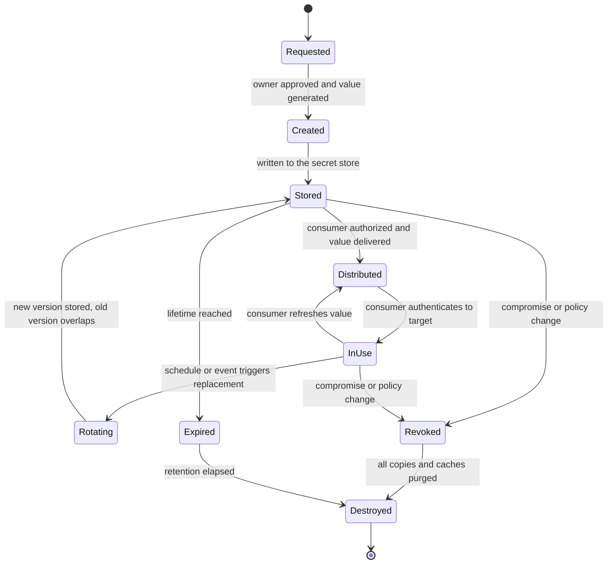

Read the diagram as a list of places a control must exist. Creation needs a generator with enough randomness and an approval record. Storage needs encryption and access policy. Distribution needs authentication of the consumer. Use needs scoping so the value only works against its target. Rotation needs an overlap rule, covered in the section on rotation. Revocation and destruction are the states most often skipped: teams build creation and storage carefully and discover during an incident that no one knows every place the value was copied. The loop between `InUse` and `Distributed` is the consumer cache, whose staleness is a security property and not only a performance detail.

The states also name the attacker's opportunities. Before `Stored` the value lives in a developer's terminal, a ticket or a chat message. During `Distributed` it lives in process memory, files, environment blocks, logs and crash dumps. After `Revoked` it lives in backups, clones and artifacts. A defender who protects only the `Stored` state has secured the middle of the lifecycle.

## 3. Workload Identity and the Bootstrap Problem

### 3.1 Secret zero

A workload that must fetch a secret from a store has to prove who it is. If it proves it with another stored secret, that second secret has to be delivered somehow, and the same question applies to it. This regress is called the bootstrap problem, and the first secret in the chain is often called secret zero. Placing the secret-store token in an environment variable or a configuration file moves the problem without solving it, and leaves one value that unlocks everything the workload can read.

The way out is to make the platform vouch for the workload. The platform that starts the workload (a virtual machine hypervisor, a container scheduler, a function runtime, a continuous integration (CI) system) already knows what it started, where, and under which declared identity. It can hand the workload a short-lived, verifiable statement of that fact. The secret store trusts the platform's statement instead of a pre-shared password. The workload holds no long-lived value, and the statement expires on its own.

### 3.2 Platform identity mechanisms

The three large providers implement the same idea with different names and different trust anchors.

| Provider | Runtime identity | How the workload obtains a token | Secret store authorizes by |
|---|---|---|---|
| AWS | Identity and Access Management (IAM) role attached to an instance, task, function or Kubernetes service account | Instance metadata service, container credentials endpoint, or web-identity exchange with AWS Security Token Service (STS) | IAM policy on the role, optionally a resource policy on the secret |
| Azure | Managed identity (system-assigned or user-assigned) in Microsoft Entra ID | Local identity endpoint exposed by the host, returning an Entra ID access token | Azure role-based access control (RBAC) assignment on the vault or secret |
| Google Cloud | Service account attached to the resource, or a federated external identity | Metadata server on the host, or workload identity federation exchange | IAM binding on the secret, such as the Secret Manager accessor role |

Each provider documents the exact endpoint and token format; see [AWS Secrets Manager](https://docs.aws.amazon.com/secretsmanager/latest/userguide/intro.html), [Azure Key Vault](https://learn.microsoft.com/azure/key-vault/general/overview) and [Google Secret Manager](https://cloud.google.com/secret-manager/docs/overview). The common structure is a local, non-routable endpoint that returns credentials scoped to the identity of the caller's host or pod. What differs is the granularity of the identity. An instance-level identity is shared by every process on the machine, so any process, including an attacker's, can obtain the same token. A pod-level or task-level identity narrows this to a single workload. Choose the narrowest identity the platform supports.

Workloads outside the provider, such as CI jobs or on-premises services, use federation. The CI platform issues a signed OpenID Connect (OIDC) token that states the repository, branch and workflow. The cloud provider is configured to trust that issuer and to map claims to a role, then exchanges the token for short-lived credentials. The constraint on the mapping is where the security lives: a role that trusts "any token from this issuer" lets any repository on that platform assume it. Bind the trust to specific claims such as repository and branch. [CH07 OIDC](CH07_OIDC.md) covers token validation and [Part 09 CH09 IAM](../09_Cloud_Computing/CH09_IAM.md) covers the provider configuration.

### 3.3 From identity to secret retrieval

The diagram shows the complete path with the two trust relationships that make it work. The store trusts the platform's identity statement, and the platform trusts nothing the workload says about itself.

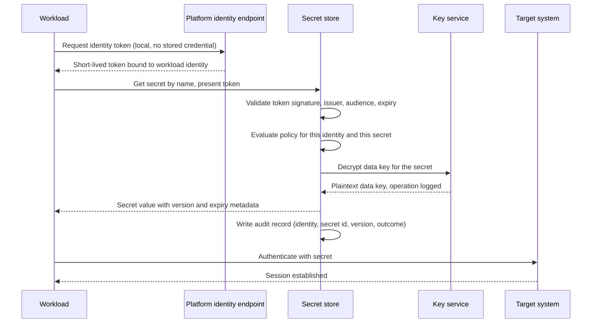

Three details are easy to miss. First, the store validates the token itself: signature, issuer, audience and expiry. A token valid for a different audience must be refused, which stops a token minted for one service from being replayed against the store. Second, authorization is evaluated per identity and per secret, so a workload that can read one secret cannot enumerate or read its neighbours. Third, the audit record is written by the store and not by the workload, so a compromised workload cannot erase evidence of its own reads.

The implication for design is that the workload's identity becomes the new master credential. The strength of the whole system is the strength of that identity and of the policy attached to it. A role that can read every secret in the account restores the original problem under a different name.

### 3.4 Attacker perspective on the identity path

An attacker who gains code execution in a workload inherits whatever the identity endpoint will give it. That includes, by design, a token that can read the workload's secrets. The attacker may not even need code execution. A server-side request forgery (SSRF) flaw, where the application can be tricked into issuing a request to an address the attacker chooses, can reach the local identity endpoint, because that endpoint is only reachable from the host. Providers have added defences such as session-token requirements, custom headers and hop limits for their metadata endpoints. These change from time to time, so check the current provider guidance and enable the stricter mode.

Mitigations that apply regardless of provider:

- Scope each identity to the secrets that workload needs, so a successful theft yields little.
- Block outbound requests from application code to link-local and internal addresses unless required.
- Alert on identity tokens used from networks or regions that the workload never runs in.
- Prefer identities that cannot be used off-platform, for example tokens bound to the host, when the provider offers them.

Compromise of the identity still leaks the secrets that identity could read, but the exposure window is bounded by the token lifetime and by how quickly the identity's role can be disabled. That bounded window is what the platform-identity pattern buys over a stored password.

## 4. Secret Store Architecture and Access Boundaries

### 4.1 What a store does on a read

A secret store is a small service with four jobs: authenticate the caller, authorize the specific read, return the value, and record the event. Behind these sits storage whose contents are encrypted. The shape is the same in managed services and in self-hosted products.

Secrets are stored using envelope encryption, which [CH10 Encryption](CH10_Encryption.md) teaches in full. In brief: each secret or group of secrets is encrypted under a data key, and the data key is itself encrypted under a key held in a key management service (KMS) or hardware security module. Reading a secret therefore needs two permissions to line up: permission to read the secret in the store, and permission for the store to use the key. This is the boundary between the secret store and the key service. A stolen copy of the storage layer alone is ciphertext, and a stolen key alone has nothing to decrypt.

Provider details that affect designs:

| Aspect | AWS Secrets Manager | Azure Key Vault | Google Secret Manager |
|---|---|---|---|
| Unit of storage | Secret with versions and staging labels | Secret object with versions | Secret with numbered versions |
| Encryption key | Default or customer-chosen KMS key | Service-managed, with options for customer-managed keys | Google-managed by default, customer-managed keys available |
| Authorization | IAM identity policies and a secret resource policy | Azure RBAC, or the older vault access policies | IAM bindings on the secret, project or folder |
| Version states | Labels such as current and previous | Enabled or disabled per version | Enabled, disabled or destroyed per version |

Verify the exact key options and states in each provider's current documentation, because they vary by product tier and change over time. The comparison that matters is the shape of the controls: all three separate who may administer a secret from who may read its value, all three version values, and all three let an organization bring its own key so that disabling the key makes the secrets unreadable.

### 4.2 Separate the control plane from the data plane

The permission to create, update, delete and change policy on a secret is different from the permission to read its value. Treat them as separate planes.

- Control plane: administer the secret, change its policy, change its rotation schedule, delete it.
- Data plane: read the current value.
- Audit plane: read the access logs, which should be separable from both.

An identity that holds both control and data permissions on a secret can read it and also edit the policy to hide that it did. A deployment pipeline commonly needs to write a secret (control) but never read it back, and a workload needs to read it but never write. Splitting these removes one common privilege-escalation path: a compromised workload cannot rewrite the policy that restricts it.

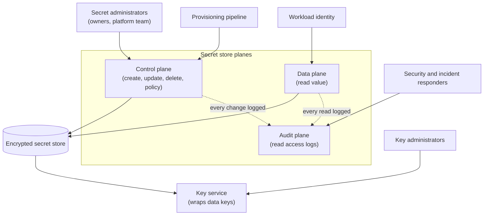

The diagram assigns each population to exactly one plane. Notice that key administrators are a separate group from secret administrators, so disabling or rotating a key is not in the hands of the people who can edit secrets, and the reverse. In a small team these roles collapse into a few people, and the point is to be able to separate them as the system grows, and to ensure that no automated workload spans two planes.

### 4.3 Policy evaluation and the effective permission

A read is allowed only if every layer allows it. At the time of writing the general pattern is:

1. The token is valid and unexpired.
2. An identity-side or role-assignment permission allows the action on this secret.
3. A resource-side policy on the secret, if present, does not deny it. In AWS, a resource policy can grant cross-account access, and an explicit deny in any applicable policy overrides an allow.
4. Network or organization-level conditions, where configured, are satisfied.
5. The store is permitted to use the key that protects the secret.

Check how each provider combines identity and resource policies in its documentation, because the combination rules differ between providers and between same-account and cross-account access. The failure mode is a policy that looks narrow in one place and is widened somewhere else. A wildcard in a resource name, such as allowing read on every secret with a given prefix, silently covers every secret created later under that prefix. Review effective permissions per identity, not individual policies, as [CH03 Authorization](CH03_Authorization.md) describes.

Example of a narrow read-only policy in AWS IAM syntax, scoped to one secret by its Amazon Resource Name (ARN) with an illustrative placeholder:

```json
{
  "Version": "2012-10-17",
  "Statement": [
    {
      "Effect": "Allow",
      "Action": "secretsmanager:GetSecretValue",
      "Resource": "arn:aws:secretsmanager:eu-west-1:111122223333:secret:payments/db-password-AbCdEf"
    }
  ]
}
```

The ARN ends with a random suffix that the service appends. Policies that need to survive secret re-creation use a wildcard on the suffix only, not on the name.

### 4.4 Replication, residency and the store as a dependency

Stores can replicate secrets to other regions for availability. Replication creates additional copies, each protected by the destination region's key, and may cross a data-residency boundary. A secret that must not leave a jurisdiction must not be replicated there, and the policy on a replica is not automatically the same as the source. Decide where each secret may live before enabling replication.

The store is also a runtime dependency. If workloads fetch on every request, a store outage becomes an application outage, and request volume can approach the service's rate limits. Provider limits on request rate and secret count exist and change, so check current quotas before sizing a design. The standard answers are caching with bounded staleness, covered in the section on delivery, and regional replicas for failover.

### 4.5 Worked scenario: blast radius of a shared role

An illustrative platform runs 40 services in one production account. Version A uses one shared role that can read all 120 secrets. Version B gives each service its own role scoped to its own secrets, averaging 3 per service.

- Version A: compromising any one service exposes 120 secrets. Expected exposure per compromise = 120.
- Version B: compromising one service exposes about 3 secrets. Expected exposure per compromise = 3.

Reduction factor = 120 / 3 = 40. A single compromise exposes 2.5% of the secret inventory (3 / 120 = 0.025). The cost is 40 roles and 120 policy statements to maintain instead of one. Generating these from a declared service-to-secret mapping keeps that cost manageable, and the 40-fold reduction justifies it for any inventory that includes payment, customer or signing credentials.

## 5. Dynamic Credentials and Leases

### 5.1 The idea

A static secret is created once and stays valid until someone replaces it. A dynamic credential is created when a workload asks for it, is unique to that request, and expires by itself. The system that issues it records it as a lease: a record of who holds the credential, what it grants, when it ends, and how to revoke it early. Because every credential is unique and short-lived, a leaked value has two weaknesses for the attacker. It stops working soon, and the audit trail identifies exactly which lease, and so which workload, it belonged to.

Cloud platforms already issue dynamic credentials for their own services. AWS STS returns temporary access keys with a session token and an expiry. Microsoft Entra ID returns access tokens with a limited lifetime. Google Cloud issues short-lived access tokens for service accounts. For databases and other systems that have no native token concept, a secret broker creates a real account on demand. HashiCorp Vault's database secrets engine is a well-known example: it holds an administrative connection, runs a creation statement to make a new database user with an expiry, returns the username and password to the caller with a lease, and runs a revocation statement when the lease ends or is revoked. Other brokers and some cloud products work similarly. Check the specific product for supported targets.

### 5.2 Issuance, renewal and revocation

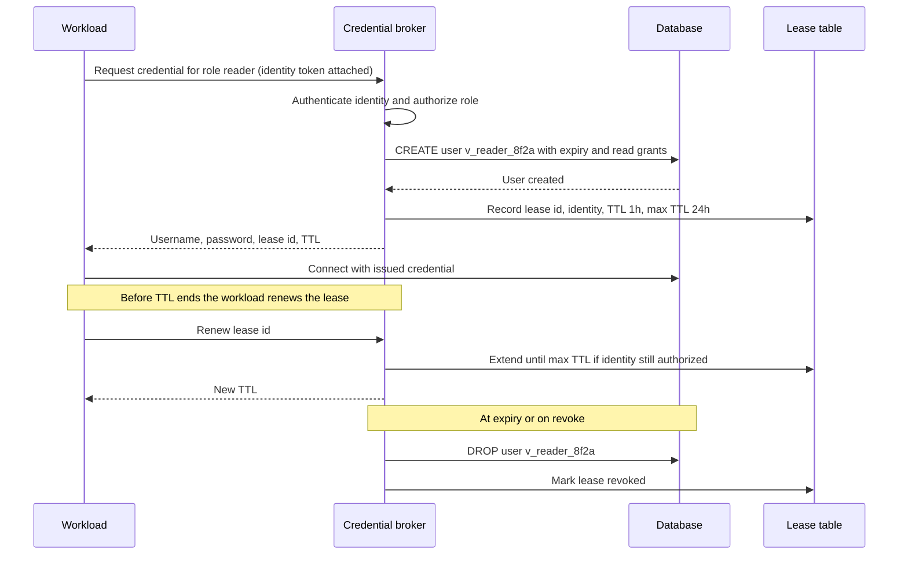

Three parameters govern the behaviour. The time to live (TTL) is how long the credential is valid before renewal. The maximum TTL caps total lifetime across renewals, so a workload cannot renew forever. The revocation action is what the broker does at the end, such as dropping the database user. Renewal re-checks that the identity is still authorized, so removing a workload's access stops its leases at the next renewal at the latest, and an operator can revoke immediately without waiting.

The implication is that revocation becomes an ordinary operation. In a static model, revoking a database password means changing it and coordinating every consumer. In a dynamic model, revoking a lease affects one workload. Revoking everything issued under a role is a single action on the broker, and the workloads that were affected simply request new credentials.

### 5.3 Exposure arithmetic

Illustrative comparison for a service that connects to a database. Assume an attacker who steals a credential at a random moment and uses it until it stops working.

| Model | Credential lifetime | Expected usable window after theft |
|---|---|---|
| Static password, rotated every 90 days | 90 days | Remaining life, uniform over lifetime: 90 / 2 = 45 days on average, up to 90 |
| Static password, rotated every 30 days | 30 days | 30 / 2 = 15 days on average, up to 30 |
| Dynamic credential, TTL 1 hour | 1 hour | 1 / 2 = 0.5 hour on average, up to 1 hour |

The average assumes the theft time is uniformly random within the credential's life. From 45 days to 0.5 hours is a reduction of (45 × 24) / 0.5 = 1,080 / 0.5 = 2,160 times in expected window. If the compromise is noticed and revoked sooner, the static model shrinks too, but only after an expensive coordinated rotation, while the dynamic model is cheap to cut off.

The theft window is only one side of the trade. Shorter lifetimes raise the load on the broker and the target. Suppose 200 application instances each renew every 30 minutes (a TTL of 1 hour with renewal at the halfway point). Renewals = 200 × 2 per hour = 400 per hour, about 0.11 per second. That is trivial. If each instance instead requested a new credential per request at 50 requests per second, the load would be 200 × 50 = 10,000 credentials per second, which would overwhelm creation of real database accounts. The usual design is a credential per instance, not per request, with a lifetime measured in minutes to hours.

### 5.4 Failure modes and limits

- Broker availability. A workload that cannot renew cannot extend its credential. If the broker is down for longer than the remaining TTL, new sessions fail. Choose a TTL long enough to ride out the outage you must survive, and no longer. The section on caching and failure behavior returns to this trade.
- Connection pools. Database connections authenticated with the old credential may stay open after the credential expires, depending on the database. Decide whether the pool drains and reconnects at lease end, and test that behaviour, because a pool that never reconnects will fail at the next new connection.
- Credential churn. Every issued credential is an account or token in the target. Targets with account-count limits or slow account creation need a cap on churn. Orphaned accounts accumulate if revocation fails, so reconcile the target's account list against the lease table.
- Broker as a high-value target. The broker holds an administrative connection to each target. Its own identity, policy and network placement are critical. Give it the least privilege its creation and revocation statements need, and keep the administrative credential rotated, preferably by the broker itself.
- Targets that cannot do it. Third-party software that only accepts one static key cannot use leases. Fall back to a stored secret with rotation, and reduce the key's scope on the vendor side.

A short example of a creation statement for PostgreSQL, run by the broker with a placeholder expiry:

```sql
CREATE ROLE "v_reader_8f2a" WITH LOGIN PASSWORD 'generated-by-broker'
  VALID UNTIL '2026-11-05 15:00:00+00';
GRANT SELECT ON ALL TABLES IN SCHEMA payments TO "v_reader_8f2a";
```

`VALID UNTIL` makes the database itself reject the password after the timestamp, so expiry does not depend on the broker running a clean-up. This is defence in depth: even if the broker fails to drop the account, the credential stops working for new logins.

## 6. Delivery to Workloads and Caching

### 6.1 Four delivery channels

Once a workload can authenticate to the store, the next decision is how the value reaches the code that uses it. Four channels cover almost every design. Each one changes where copies of the value exist and who can read them.

| Channel | How the value arrives | Where copies exist | Update behaviour |
|---|---|---|---|
| Environment variable | Injected by the launcher before the process starts | Process environment block, inherited by child processes, often visible to anyone who can read process metadata for that user, captured by crash reporters and diagnostic endpoints | Fixed until restart |
| Mounted file | A file written to a memory-backed or disk volume, read by the application | The file, plus any snapshot or backup of the volume, plus process memory after reading | Can change while running, if the application re-reads it |
| Sidecar or agent with a Container Storage Interface (CSI) driver | A local helper authenticates, fetches, and writes to a file or local socket | Helper memory, the shared file or socket, application memory | The helper refreshes on its own schedule |
| Direct Software Development Kit (SDK) fetch | The application calls the store at startup or on demand | Application memory only, unless the application writes it elsewhere | The application controls it |

Environment variables are the most common channel and the leakiest. Frameworks that print their configuration on a startup error, debug pages, and child processes spawned for a shell command all inherit or expose the environment. The value cannot change without a restart, which makes rotation a deployment event. Files are safer if the volume is memory-backed and the file permissions admit only the application user. They support rotation without restart, but only if the application watches for changes, which many do not.

A sidecar or agent moves the authentication and refresh logic out of the application. The application reads a local file or calls a local endpoint and never holds a store credential. This helps when the application cannot be modified, and it concentrates refresh behaviour in one tested component. The cost is another process to run, monitor and secure, and a shared volume that both containers can read. A CSI driver is the Kubernetes form of the same idea: the platform mounts the secret as a volume at pod start, and the driver can refresh the mounted content. Kubernetes specifics are in the section on Kubernetes and CI/CD systems.

Direct SDK fetch gives the application full control and the smallest number of copies. It also puts the store on the startup path and, without a cache, on the request path. Cloud providers publish caching client libraries for this reason; check the current options in each provider's SDK documentation.

Decision criteria, in order of weight:

1. Can the application be changed? If not, use a sidecar, agent or mounted file.
2. Does the value change while the process runs? If rotation must not need a restart, avoid environment variables.
3. How many co-resident processes could read the delivery location? Prefer a channel scoped to one process or one pod.
4. What happens when the store is unreachable at startup? A fetch at startup makes the store a hard dependency of every deployment and scale-out.

### 6.2 Caching and bounded staleness

Fetching on every use is simple and correct, and it fails at scale. Caching is therefore necessary, and each cache introduces a staleness window: the time during which the cache holds a value the store has already replaced or revoked. Staleness is a security property, because it equals the time a revoked secret keeps working in that consumer.

Illustrative numbers. A service has 200 instances, each handling 50 requests per second, and each request needs a database credential.

- No cache: 200 × 50 = 10,000 store reads per second. This exceeds what a managed store is typically sized for. Check the provider's current request-rate quotas.
- Cache with a 300-second TTL: each instance reads once per 300 seconds. Store load = 200 / 300 = 0.67 reads per second.
- Reduction = 10,000 / 0.67 = about 15,000 times.

The price is a staleness window of up to 300 seconds, with an average of 150 seconds if revocation moments are uniformly distributed. After a rotation, instances keep using the cached old value for up to 300 seconds, so the old credential must stay valid for at least that long plus a safety margin. This is the link between caching and the rotation overlap, examined in the next section.

Two techniques keep refresh behaviour safe.

- Refresh ahead with jitter. If every instance expires its cache at the same moment (for example, all started in one deployment), they all read at once. Refresh at a random point between 70% and 90% of the TTL so reads spread out.
- Refresh before expiry, not at expiry. For a lease or credential with a hard expiry, refresh early enough to retry. With a 1-hour lease refreshed at 80%, refresh begins at 48 minutes and leaves 12 minutes of validity. With a retry every 30 seconds, that is 12 × 60 / 30 = 24 attempts before the credential stops working. The design survives a store outage of up to about 12 minutes.

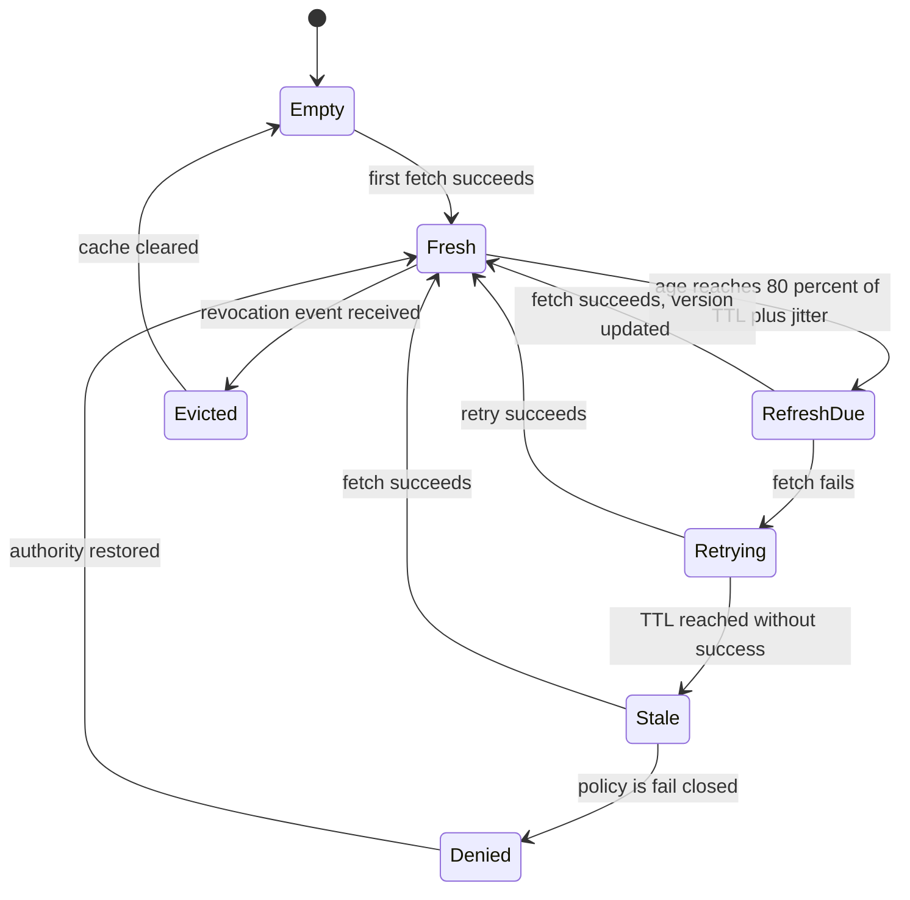

The diagram makes the failure policy explicit. `Retrying` is where an outage first shows; `Stale` is the decision point. A read-only reporting service may be allowed to keep using an expired-but-unrevoked value for a bounded extra time, because refusing service costs more than the risk. A payment writer should move to `Denied` at expiry, because a credential past its lease should not be trusted. Record that choice per consumer in the design. The same service must never fall back to a built-in default or an administrator credential when the fetch fails, because that turns an availability problem into a privilege escalation.

The `Evicted` path covers push-based invalidation. Some stores can emit an event on version change or deletion. A consumer that subscribes can clear its cache immediately and shrink the staleness window from the TTL to the event delivery time. Events can be lost, so keep the TTL as a backstop.

### 6.3 What the application must still do

Delivery stops at the application boundary, and the application can undo it. Keep the value in a variable with a narrow scope, never include it in log lines, error messages or exception text, and exclude it from health and diagnostic endpoints. Connection strings often embed the password, so a logged connection string is a logged secret. Set core dumps and memory snapshots to exclude secret regions where the platform supports it, or disable core dumps for processes that hold high-value keys. Pass secrets to child processes explicitly when they need them, and not through an inherited environment.

## 7. Rotation Strategies and Overlap Windows

### 7.1 Rotation as a producer-consumer protocol

Rotation replaces a secret before an attacker's copy can be used for long, and it makes every undiscovered copy useless after a bounded time. It is a protocol between a target system that accepts the secret, a store that holds it, and consumers that present it. A rotation that changes the target but not the consumers causes an outage. A rotation that changes the store but not the target does nothing. Getting the order and the overlap right is the whole problem.

Four strategies are in common use.

| Strategy | Mechanism | Outage risk | Overlap | Use when |
|---|---|---|---|---|
| In-place single credential | Change the password on the target and in the store at the same time | Consumers holding the old value fail until they refresh | None | The target tolerates brief failures and consumers refresh fast |
| Dual-credential (alternating users) | Two accounts with identical rights, rotate the idle one, switch consumers, then the other | None if the overlap is sized correctly | The full switch period | Databases and services with long-lived connections |
| Versioned secret with two valid values | The target accepts either of two keys at once (for example primary and secondary keys) | None | By design | Services that issue two keys per account |
| Dynamic credential | A new credential per lease | None | Per lease | Targets supported by a broker, covered earlier |

Managed services implement the first and second strategies through rotation functions. AWS Secrets Manager rotation runs a function through four steps, commonly called create, set, test and finish, and moves staging labels (current, pending and previous) between versions. AWS documents both a single-user and an alternating-users approach; see the [AWS rotation documentation](https://docs.aws.amazon.com/secretsmanager/latest/userguide/rotating-secrets.html). Google Secret Manager supports a rotation schedule that publishes a notification, and the actual change is made by your own subscriber. Azure Key Vault can emit events as a secret nears expiry, and a subscriber performs the rotation. The behaviour differs by provider and product, so confirm what is automatic and what you must build.

### 7.2 Sizing the overlap window

The old credential may be revoked only after no consumer will present it again. That moment depends on three delays that add up.

1. Propagation: how long until every consumer has fetched the new value. This is bounded by the cache TTL (the consumer's own cache staleness) and by rollout time for consumers that need a restart.
2. Adoption: how long until the consumer starts using the new value for new connections.
3. Drain: how long until connections opened with the old credential close. A connection pool with a maximum connection lifetime bounds this. Without a maximum lifetime, a connection can stay open indefinitely.

Illustrative arithmetic for an alternating-users rotation of a database password:

- Cache TTL in consumers: 300 s.
- Rolling restart of consumers that read the secret at startup only: 600 s.
- Maximum connection lifetime in pools: 1,800 s.

Propagation and adoption take the larger of the cache TTL and the rollout, plus any extra: 300 + 600 = 900 s in the worst case where a restarted instance has just cached an old copy. Drain adds the pool lifetime, so the old credential is last used about 900 + 1,800 = 2,700 s after the new one is published. Adding a 20% safety margin gives 2,700 × 1.2 = 3,240 s, or 54 minutes. A one-hour overlap is a sensible round figure.

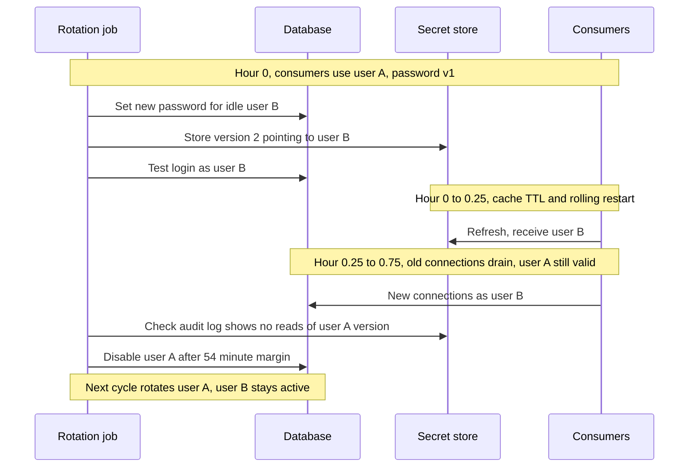

The diagram shows two things that matter in practice. The old account is disabled only after evidence of non-use, and the overlap sits in the middle, not at either end. Disabling is also safer than dropping: if something unexpected still depends on user A, re-enabling it is quick, while a dropped account must be rebuilt with its grants. Delete after a longer quiet period.

The exposure side of the calculation uses the rotation interval. Suppose the rotation interval is 30 days with alternating users. Each of the two accounts has its password changed every 60 days, because the other account is rotated in between. A credential stolen at a random moment has an expected remaining life of about 30 days against the active account and up to 60 against a stale copy of the idle one. Alternating users trade a slightly longer credential life for zero-downtime rotation. If that exposure is unacceptable, shorten the interval or move to dynamic credentials.

### 7.3 Rollback, verification and failure modes

Verification is part of rotation and should gate revocation. Test the new credential against the target before publishing it as current, as the AWS test step does. After publishing, verify consumer adoption from the audit logs, not from hope: count reads of the new version and reads of the old one, and revoke only when old reads reach zero for a full cache TTL plus the margin.

Failure modes to plan for:

- Partial rotation. The target changed and the store update failed. Consumers fetch the old value, and the old password no longer works. Make the rotation job idempotent and ordered so that the store holds the new value before the target switches it, or use the dual-credential approach where the old value stays valid.
- Consumers that never refresh. An application that reads the secret once and keeps it forever breaks at revocation. Find these in a rotation drill in a lower environment before they surprise production.
- Replicas and downstream copies. A secret copied into a replica region, a configuration file or a vendor portal is not rotated by the store. The inventory from the lifecycle model should list every copy.
- Rotation as an attack. A rotation function holds administrative rights on the target. Give it the narrowest grants that suffice, restrict who can trigger or modify it, and alert when it fails repeatedly.
- Emergency rotation. After a suspected leak the overlap is a liability, since the old value is the leaked one. Shorten the overlap to what the service can survive and accept a brief outage, as described in the incident runbook.

Rollback means restoring service when the new credential is bad. Keep the old version valid until verification passes, so rollback is to repoint consumers at the old version. After revocation, rollback means issuing a third credential, so do not revoke until the gate passes. If an incident is the reason for rotating, rollback to a known-leaked value is not an option, and the plan must say so.

## 8. Preventing and Detecting Leaks with Secret Scanning

### 8.1 Where secrets leak

Most leaks come from ordinary copying. A developer pastes a connection string into a configuration file and commits it. A test fixture contains a real key. A build script prints its environment on failure. A support engineer attaches a log to a ticket. A container image layer keeps a file that a later layer deleted. Each of these places is a different surface, and a scanner placed at one surface does not see the others.

| Surface | Typical leak | Who can read it afterwards |
|---|---|---|
| Source repository, including history | Hard-coded key, `.env` file, sample configuration with a real value | Everyone with repository access, every clone and fork, and for public repositories anyone |
| Pull request and review comments | A value pasted to reproduce a bug | Reviewers and anyone who receives notification emails |
| Continuous integration (CI) logs | Environment dump, verbose tool output, failed command echoing a token | Everyone who can view build results, and log aggregation systems |
| Build artifacts and container images | Credentials baked into a layer or a packaged configuration file | Anyone who can pull the artifact, including registries and mirrors |
| Tickets, chat and documents | Value pasted for help | Channel members, search indexes and exports |
| Application logs and error reports | Connection string or authorization header in an exception | Operations staff, third-party log and error-reporting services |

The consequence is that scanning is a set of controls at several boundaries, plus the preventive controls from earlier sections that reduce how many values exist to leak.

### 8.2 Detection techniques and their error rates

Scanners combine three techniques.

1. Pattern matching. Many providers issue keys with a recognizable prefix or structure. A regular expression finds them with few false positives. This works for formats that are known and fails for custom or unstructured values such as a random database password.
2. Entropy analysis. A string that looks random and sits next to a word such as `password` or `secret` is suspicious. This finds unstructured values and also flags hashes, identifiers and encoded data, so it produces false positives that people learn to ignore.
3. Validation. Some tools test a candidate against the issuer, or ask the issuer to confirm a match, so that a live credential is separated from an expired or invented one. Validation sends the candidate to a third party, so check what the tool does before enabling it on private material. Some code hosting platforms also notify the issuer when a provider-formatted key appears in a public repository. At the time of writing; verify which providers participate and which of your repositories are covered.

A scanner is a classifier, and the two error types cost different amounts. A missed live secret (false negative) leaves a credential exposed. A false alarm (false positive) costs reviewer time and, when frequent, trains people to bypass the check. Tune against the cost of each. Illustrative arithmetic: a scan of 400 findings per month where 360 are false positives gives a precision of 40 / 400 = 10%. At 5 minutes per triage, the cost is 400 × 5 = 2,000 minutes, about 33 hours a month, and the team will start to dismiss alerts. Adding validation and an allow-list for known test fixtures that cuts the findings to 80 with 40 true ones lifts precision to 50% and the triage cost to 80 × 5 = 400 minutes, under 7 hours.

### 8.3 Scanning at four boundaries

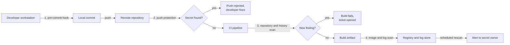

The diagram shows four checks with different strengths. The pre-commit hook on the developer machine gives the fastest feedback and keeps the value out of history entirely, but it is optional: a developer can skip it or never install it. Push protection on the server side is the first mandatory check and stops the value before others can fetch it. The CI scan covers what the first two missed, including history, and can compare against a baseline so that only new findings fail the build. The last boundary scans built images and collected logs, because secrets enter those without ever appearing in the source tree.

Implications for design. Make the server-side check mandatory and treat the local hook as a convenience. Store the scanner baseline in the repository so existing findings are tracked and cleared deliberately rather than silenced. Scan history when you first enable a scanner, since an old commit is as exposed as a new one. Rescan on a schedule, because detection rules improve and a value that passed last year may match today.

A minimal local hook configuration using a pre-commit framework looks like this. The repository URL, revision and hook name are placeholders; take the real ones from the scanner's documentation.

```yaml
repos:
  - repo: https://example.org/secret-scanner-hooks   # placeholder, replace with the scanner's repository
    rev: vX.Y.Z                                       # pin a reviewed release
    hooks:
      - id: secret-scan
```

Pinning a reviewed revision matters because a hook runs code on every developer machine; an unpinned hook is a supply-chain dependency. See [CH15 Supply Chain Security](CH15_Supply_Chain_Security.md).

## 9. Leak Response

### 9.1 The governing rule

Treat a detected secret as compromised from the moment it was exposed, not from the moment it was found. The value was readable by everyone who could see the surface for the whole time between the exposure and the detection. Deleting the value from the latest commit does not remove history, clones, forks, cached pages, CI logs or artifacts. The only action that makes the exposed copy harmless is to make the credential stop working. Everything else is clean-up and investigation.

The response is therefore ordered by what limits damage fastest: revoke, contain, investigate, remove, fix the cause.

### 9.2 Deciding the response

The first decision is how fast to revoke, and it depends on facts that can be established quickly: who could see the surface, how long it was exposed, what the credential can do, and whether any use by someone else is already visible.

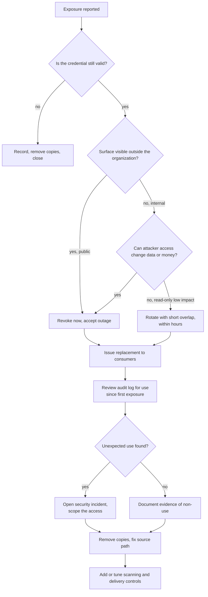

The tree makes two points. First, a public surface or a credential that can change data or money skips the careful overlap described earlier and accepts an outage, because the old value is the one an attacker holds. Second, investigation follows revocation and reads the audit log from the first exposure time, so the answer to "was it used" comes from evidence. Where the audit log does not cover the credential's use (for example a vendor API key whose provider offers no usage log), say so in the record, because the honest conclusion is "unknown", not "no".

### 9.3 Timeline arithmetic

Illustrative numbers. An API key is committed at 09:00 to a repository visible to 300 employees. A scanner flags it at 11:30, and the owner revokes it at 12:10.

- Time from exposure to detection: 2 h 30 min.
- Time from detection to revocation (the part the response process controls): 40 min.
- Total exposure window: 3 h 10 min, which is 190 minutes.

Investigation scope is the 190-minute window plus any earlier period if the key had been in an earlier commit. If the audit log shows reads of the key's target from an unfamiliar network at 10:05, the incident is real and the access it had during the 125 minutes from 10:05 to 12:10 must be assessed. The control that most reduces this number is detection latency, which push protection brings close to zero for new commits. A second control is a short credential life: with a 1-hour lease the key above would have lost value by itself within the window.

### 9.4 What each role does

A good runbook assigns actions rather than describing them. The secret owner revokes and rotates, because only the owner knows every consumer. The platform team supplies the revocation path for shared stores and removes copies from logs, artifacts and caches that the owner cannot reach. The security team reads the audit evidence and decides whether this is an incident with notification duties. Notification obligations depend on the data that the credential could reach and on applicable law and contract, so the runbook should name who decides and not guess the answer in advance.

After the incident, ask what let the value exist in a place it did not belong, and change that path. A repeat leak from the same path means the corrective action addressed the symptom.

## 10. Audit Logging and Anomaly Detection

### 10.1 What to record

An audit trail answers who read which secret, when, from where, and with what result, without containing the value. Each record needs enough fields to support the investigation described in the previous section.

| Field | Why it is needed |
|---|---|
| Timestamp with time zone | Orders events and bounds the exposure window |
| Caller identity (workload identity, user, or role session) | Names who read it |
| Secret identifier and version | Shows which value, so a read of an old version after rotation is visible |
| Operation (read, write, delete, change policy, rotate) | Separates use from administration |
| Source network address and, where available, the platform context | Separates a pod in the expected cluster from an unknown host |
| Outcome (allowed, denied, error) and the policy that decided | Denials show probing, and the policy shows why access was granted |
| Request identifier | Correlates with the caller's own log |

Never log the value, a hash that could be used for guessing short values, or full authorization headers. Send the audit stream to a store that the secret administrators cannot alter, with its own retention set from incident-investigation needs and legal requirements. Each provider has its own audit product (AWS CloudTrail, Azure Monitor diagnostic logs for Key Vault, Google Cloud Audit Logs, and the Vault audit device). Check what each records for data-plane reads and whether that logging is on by default, because several services log administrative operations by default and make read logging a setting. At the time of writing; verify for your provider and tier.

### 10.2 Baselines and detectors

The access pattern of a secret is usually narrow and regular: one or two identities, from a known network, at a predictable rate. That makes deviations measurable.

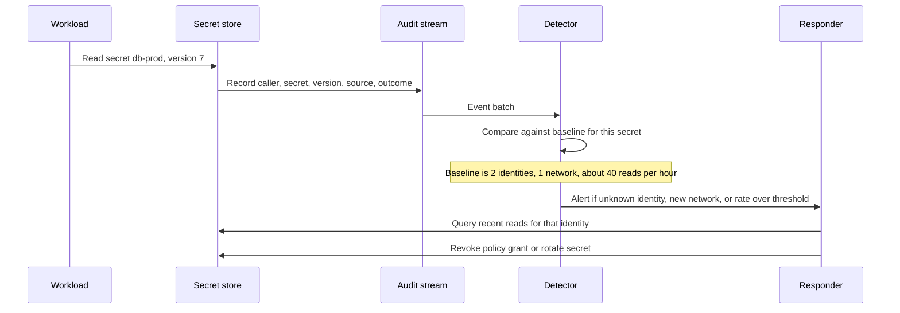

The diagram shows detection as a loop over the audit stream, not as a property of the store. The detector needs a baseline per secret, which is cheap when each workload has its own identity and policy, and meaningless when a shared role reads everything (the earlier worked scenario on shared roles shows why).

Useful detectors, in order of signal quality:

1. A read by an identity that has never read this secret before.
2. A read of a retired version after rotation completed, which indicates a stale copy in use or an attacker with an old copy.
3. A read from a network or region outside the expected set.
4. A burst of denied requests followed by a success, which indicates probing then a working grant.
5. Any change to a secret's policy, replication or rotation configuration outside a change window.
6. A rate far above the baseline. Using the cache arithmetic from the delivery section, an instance with a 300-second cache reads about 12 times per hour, so 200 reads an hour from one instance means the cache is broken or someone is enumerating.

Alert thresholds should come from the baseline, not from a number copied from another system. Review them after changes to the consumer fleet, since a scale-out from 20 to 200 instances multiplies the legitimate rate by ten.

### 10.3 Observability of the store itself

The store is a dependency, so monitor it like one: request latency, error and throttle rates, and the age of each cached or leased credential in consumers. A rising throttle rate warns that caching has been lost. A rising count of credentials near expiry without a successful refresh warns of an impending outage before it happens. Test restoration, not just collection: during a game day, confirm that an alert fires within the target time when a test identity reads a secret it should not.

## 11. Secrets in Kubernetes and CI/CD Systems

### 11.1 Kubernetes

A Kubernetes `Secret` object is an API object that holds key-value data. Its values are base64-encoded, which is an encoding and gives no confidentiality. Whether the data is encrypted when stored in the cluster's backing datastore (etcd) is a cluster setting called encryption at rest, which must be enabled and, for stronger protection, backed by an external key management service. Managed Kubernetes offerings differ in what they enable by default; verify for your provider. Anyone with permission to read `Secret` objects in a namespace through Kubernetes role-based access control (RBAC) can read the values, and anyone who can create a pod in the namespace can mount a secret into it, so permission to create pods is in effect permission to read every secret in that namespace.

Three patterns are used to get secrets into pods, and they build on the delivery channels described earlier.

| Pattern | How it works | Where the value lives in the cluster | Notes |
|---|---|---|---|
| Native `Secret` with encryption at rest | Values are applied as objects, often from a pipeline | In etcd, and in every manifest or repository that produced it | Simple. The source of truth must be protected, for example with an encrypted-in-Git format, and RBAC must be narrow |
| Secrets Store CSI driver | The driver mounts values from an external store into the pod as a volume, using the pod's workload identity | In pod memory or a volume, and optionally mirrored into a `Secret` object if configured | Value need not be in etcd unless the mirror option is used. Refresh behaviour depends on the driver and provider plug-in settings |
| Operator that syncs an external store into `Secret` objects | A controller reads from the store and writes cluster `Secret` objects | In etcd, with the store as source of truth | Works with applications that expect `Secret` objects. Staleness equals the controller's sync interval |

Workload identity is the foundation here. Bind a Kubernetes service account to a cloud or store identity, so that each pod fetches only its own secrets and no cluster-wide credential exists. This is the platform-identity mechanism from the earlier section applied to pods. See [Part 12 CH13 Security](../12_Kubernetes/CH13_Security.md) for cluster hardening and [Part 12 CH08 Volumes](../12_Kubernetes/CH08_Volumes.md) for volume behaviour. Mounted secret files in Kubernetes are updated by the kubelet after a delay, and a `Secret` consumed through an environment variable or a `subPath` mount is not updated in a running container; verify current behaviour in the Kubernetes documentation when designing rotation.

### 11.2 CI/CD systems

Continuous integration and continuous delivery (CI/CD) pipelines hold some of the highest-value secrets in an organization: deploy credentials, signing keys, registry tokens. They also run code written by many people, including contributors and third-party actions or plug-ins. The central design rule is to give each job the least authority for the shortest time.

1. Prefer federation to stored credentials. As described in the workload identity section, the pipeline presents a signed OpenID Connect token and receives a short-lived cloud credential. No long-lived deploy key sits in the CI system's settings.
2. Scope the trust condition. The cloud-side trust policy should match the repository, branch or environment, and not just the CI provider, so that a job on an unreviewed branch cannot obtain production access.
3. Separate environments. Production credentials are available only to jobs that run on protected branches or after an approval step.
4. Treat pull requests from forks and untrusted contributors as hostile. Do not expose secrets to jobs triggered by them, and be careful with trigger types that run with the base repository's secrets while checking out untrusted code.
5. Mask, but do not trust masking. CI systems redact known secret values from logs by string match. A value that is transformed (encoded, split, or printed character by character) is not matched. Masking reduces accidents and does not stop a malicious step.
6. Pin third-party steps to a reviewed revision, because a compromised step runs with the job's secrets.

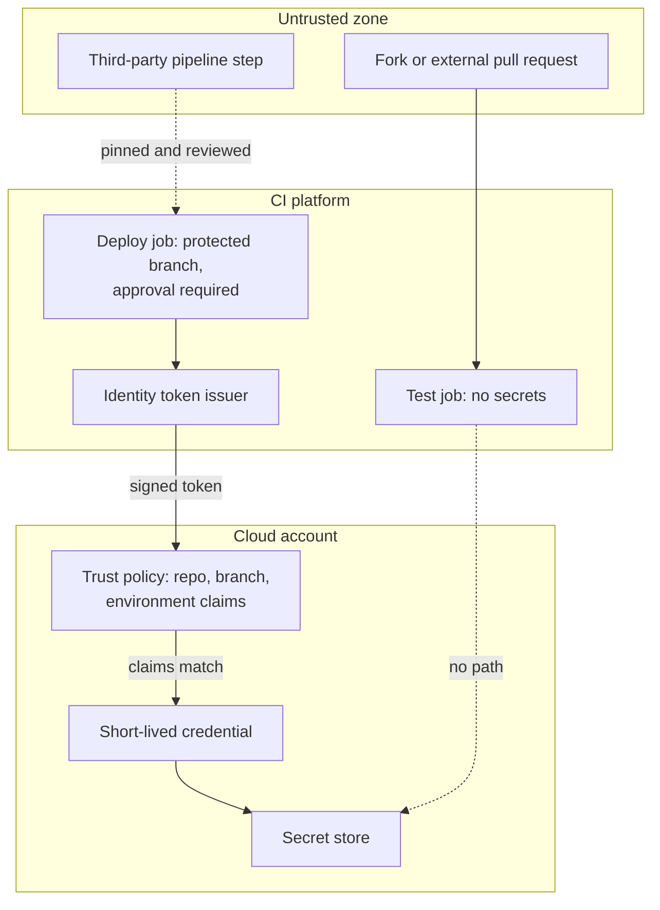

The diagram draws the trust boundary around what may reach the store. The test job that runs untrusted code has no route to credentials, while the deploy job gets a short-lived credential only when the identity token claims satisfy the trust policy. The consequence is that a compromised dependency in the test job can read source and break the build, but cannot reach production secrets. Maintain this separation by auditing the trust policy claims, since a loose wildcard on the repository or branch claim silently widens the boundary.

Illustrative exposure arithmetic: a stored deploy key that is rotated yearly gives an attacker who copies it up to 365 days of access. A federated credential with a 1-hour lifetime gives at most 1 hour, a reduction of 365 × 24 / 1 = 8,760 times in maximum exposure, at the cost of configuring and testing the trust policy.

## 12. Comparing Secret Services

The four common stores differ in who operates them, how access is expressed, and how much of rotation and auditing is built in. The table compares guarantees and responsibilities. It records what the mechanisms are, and any number, default or limit must be checked against current documentation.

| Aspect | AWS Secrets Manager | Azure Key Vault | Google Secret Manager | HashiCorp Vault |
|---|---|---|---|---|
| Operator | Managed by AWS | Managed by Microsoft | Managed by Google | You operate it, or use a managed offering from HashiCorp |
| Access control | IAM policies on the caller and optional resource policy on the secret | Azure RBAC (or legacy access policies) on the vault or object | IAM roles on project, folder or secret | Policies attached to tokens, assigned through authentication methods |
| Workload authentication | IAM role (instance, task, function, web-identity) | Managed identity or service principal in Entra ID | Service account, workload identity federation | Pluggable: Kubernetes, cloud IAM, OpenID Connect, AppRole and others |
| Encryption at rest | Envelope encryption with a KMS key you can choose | Service-managed, with customer-managed key options (verify per tier) | Service-managed, with customer-managed key option | Barrier encryption under a root key protected by a seal, which can use a cloud KMS or an HSM |
| Versioning | Versions with staging labels | Versions per secret | Numbered versions that can be disabled or destroyed | Key-value engine with versions, depending on engine |
| Built-in rotation | Rotation through a function, with templates for some databases | Events on expiry, rotation logic supplied by you, with some built-in options (verify) | Rotation schedule that notifies, your code performs it | Dynamic secrets engines and lease renewal for supported targets |
| Dynamic credentials | Not as a general feature. Rotation of stored credentials instead | Not as a general feature | Not as a general feature | Yes, for many databases and cloud providers, through secrets engines |
| Audit | CloudTrail | Diagnostic logs sent to Azure Monitor | Cloud Audit Logs (data access logs are a setting, verify) | Audit devices, which you configure and must keep available |
| Multi-region | Replication to chosen regions | Region-scoped vaults, with options to replicate by design (verify) | Replication policy per secret | Replication features depend on edition and version (verify) |
| Operational burden | Low | Low | Low | High: unsealing, upgrades, high availability, backups, audit device capacity |

Decision criteria in order of weight:

1. Dynamic credentials needed across many target types. This favours Vault, because the managed cloud stores mostly rotate stored values and do not mint per-lease credentials for arbitrary targets. If only one database engine needs it, check whether the database or cloud service offers short-lived credentials directly, such as identity-based database login.
2. Number of clouds. A single-cloud estate gains simplicity from the native store, because its identity integration needs no extra trust layer. A multi-cloud estate may accept Vault's operating cost for a single policy and audit model, or may use each native store and standardize the access pattern.
3. Operational capacity. A self-operated store becomes a tier-zero dependency: if it is down or sealed, every consumer that needs it is affected. Compute the availability needed from the consumer cache arithmetic, then compare with what the team can run at that standard.
4. Compliance and key control. Requirements such as customer-managed keys, residency or hardware-backed keys narrow the options, and the support differs by tier.
5. Cost shape. Managed stores typically charge per secret stored and per request, and these prices change. Run the cache arithmetic first: a 15,000-fold reduction in reads can decide whether per-request pricing is a concern at all.

A common and sound combination is a native store for application and platform secrets, with the Secrets Store CSI driver or an agent for delivery, and a self-operated store only where dynamic credentials or cross-cloud consistency justify it. Part 09 covers configuration details in [Part 09 CH13 Secrets Management](../09_Cloud_Computing/CH13_Secrets_Management.md).

## 13. Failure and Quality-Attribute Scenarios

A design is only as good as its behaviour under the events it was built for. Each scenario below states a stimulus, the response the design must produce, and a measurable criterion that a drill can confirm. The numbers are illustrative targets for a hypothetical payments platform. Set your own from your risk and recovery needs.

| Scenario | Stimulus | Expected response | Measurable success criterion |
|---|---|---|---|
| Leaked credential in a public repository | A cloud access key is pushed to a public repository | Push protection or a scanner flags it, the owner revokes it, audit logs are searched from first exposure | Detection within 5 minutes of the push, revocation within 15 minutes of detection, so the exposure window is at most 20 minutes. Every read in that window is explained or opened as an incident |
| Secret-store outage at deploy time | The store is unreachable while a deployment scales out 20 new instances | New instances fail their readiness check and receive no traffic. The rollout halts and reverts. Running instances keep serving from cache | Zero requests served by an instance without a valid credential. Running instances continue for at least the cache hard limit of 4 hours. Rollout reverted within 10 minutes |
| Rotation breaking a consumer | A database rotation completes and one consumer still reads the old account | The old account stays enabled because the audit gate sees reads of the old version. The consumer is fixed, then the gate passes | Zero failed requests during rotation. The old account is disabled only after 0 reads of the old version for 300 seconds plus the margin |
| Stolen workload identity token | An SSRF flaw lets an attacker fetch a token from the local identity endpoint | The token is scoped to one service's secrets. A detector sees use from an unknown network and the role is disabled | Detection within 10 minutes. Secrets reachable are at most those of one service (3 on average, see the shared-role scenario). Window at most the token lifetime, 1 hour |

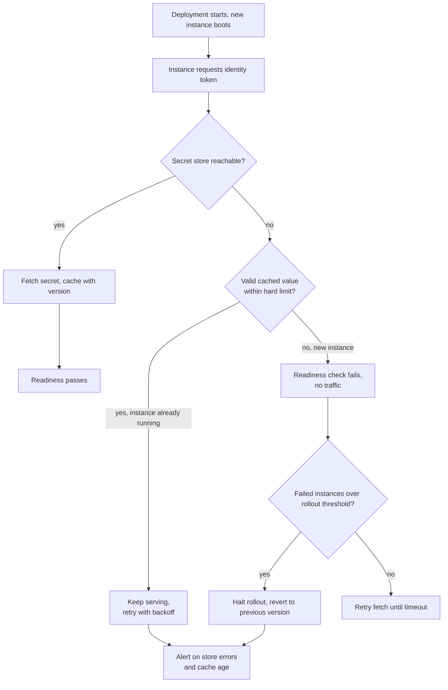

The diagram separates two populations that an outage affects differently. Running instances hold a cached value and can ride out the outage up to the hard limit. New instances hold nothing, so the only safe outcome is that they stay out of the traffic path. The design consequence is that deployment becomes the weakest moment for store dependence, and the rollout controller needs a halt rule tied to secret-fetch failures. The criterion in the table is testable by blocking the store's network path during a staging rollout. A fail-open default (starting with an empty or built-in credential) would pass the availability test and fail the security one, so the drill must also check that no instance serves traffic with a fallback credential.

Two further scenarios come from the lifecycle. For emergency rotation after a suspected leak, the criterion is that the old value stops working within the shortened overlap, for example 15 minutes, and that the outage during the window is accepted in advance by the service owner. For an expired secret nobody renewed, the criterion is an alert at least 14 days before expiry and a drill that renews it without an incident. Add both to the quarterly game day.

## 14. Worked Case Study: Moving 90 Secrets Off a Shared Role

This case is illustrative. The organization, its numbers and the drill results are invented to show the reasoning and the arithmetic, and are not a record of a real system.

### 14.1 Starting position

An online retailer runs 25 services, about 200 instances in total, in one cloud provider. A secret inventory finds 90 secrets:

| Group | Count | Current handling |
|---|---|---|
| Database passwords | 40 | Static, never rotated, delivered as environment variables |
| Third-party API keys | 30 | Static, stored in the CI system's settings and copied to services |
| Internal signing and token keys | 12 | Stored as files in an artifact bucket |
| CI deploy credentials | 8 | Long-lived keys, rotated yearly |

Total: 40 + 30 + 12 + 8 = 90. All services run under one shared role that can read every secret the platform stores, so one compromised service exposes the whole inventory. The goal set by the security team is to cut the number of stored secrets, bound the exposure of those that remain, and prove that rotation, revocation and leak response work.

### 14.2 Decisions and rejected alternatives

1. **CI credentials: federate and delete.** The 8 deploy keys are replaced by OpenID Connect federation with trust conditions on repository, branch and environment. Rejected: shorter rotation of the stored keys, because a 30-day key still gives an attacker up to 30 days, against 1 hour for a federated token (30 × 24 / 1 = 720 times longer).
2. **Signing keys: use the key service to operate.** The 12 internal keys move into the key management service, and services ask it to sign. The keys are never exported, so they leave the secret inventory. Rejected: a secret store with a read grant, which would keep a copy of every key in each caller's memory.
3. **Database passwords: managed store, alternating users, 30-day rotation.** Rejected: a self-operated broker for dynamic credentials. The estate has one database engine and one cloud, and a broker would add a tier-zero service for the team to run, patch and keep unsealed. Rejected: in-place rotation, because pooled connections would fail at each change. The stated residual risk is the longer credential life of alternating users (each account changes every 60 days).
4. **API keys: store, scope and rotate where the vendor allows.** 18 of the 30 vendors issue two keys at once, so they use the versioned two-valid-values strategy with 90-day rotation. The other 12 accept one key. For those the team narrows key scope on the vendor side, sets a yearly rotation, and records the vendor's lack of a usage log as an accepted gap.
5. **Identity: one role per service.** Each service gets a role limited to its own secrets. A generator produces the roles from a declared service-to-secret mapping.
6. **Delivery: mounted files from a Secrets Store CSI driver, with a 300-second refresh.** Rejected: environment variables, since rotation would need a restart. Rejected: direct fetch on each request, which would produce 200 × 50 = 10,000 reads per second.

Stored secrets after the change: 90 − 8 (federated) − 12 (key service) = 70, which is 40 database passwords plus 30 API keys.

### 14.3 Target architecture

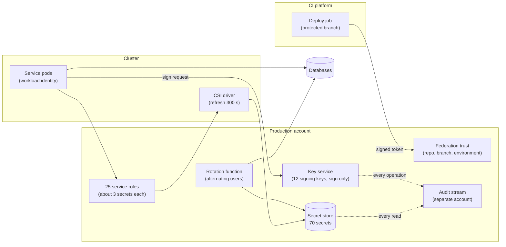

The diagram shows that every path to a secret passes through a per-service role, and that the audit stream sits in a separate account so the people who administer the store cannot change it. The key service appears as an operation target, not a source of values. Consequences: the CI system holds no production credential, a compromised pod reaches only its own role, and the detector baselines from the earlier section become meaningful because each secret has one or two expected readers.

### 14.4 Arithmetic

- **Blast radius.** Before: 90 secrets per compromise. After: 70 / 25 = 2.8 secrets per service on average. Reduction = 90 / 2.8, about 32 times. The share of inventory exposed falls from 100% to 2.8 / 90, about 3.1%.
- **Store load.** 200 instances reading every 300 seconds give 200 / 300 = 0.67 reads per second, against 10,000 per second without caching.
- **Rotation overlap.** Cache refresh 300 s, rolling restart 600 s and pool lifetime 1,800 s give 300 + 600 + 1,800 = 2,700 s. With a 20% margin, 2,700 × 1.2 = 3,240 s = 54 minutes. The team sets a 60-minute overlap.
- **Database exposure.** A stolen password's expected remaining life falls from unbounded to about 30 days for the active account, and the operations cost is 80 accounts (40 pairs) rotated on 30-day cycles.

### 14.5 Validation evidence

Evidence comes from drills in a staging environment that mirrors production. The results below are illustrative.

| Drill | Method | Result | Action |
|---|---|---|---|
| Rotation | Rotate 40 database pairs while sending 12,000 test requests | First run: 3 of 25 consumers (12%) read the secret only at startup and failed after the old account was disabled in a test. Second run after a refresh fix: 0 failed requests | Add a refresh test to each service's pipeline |
| Leak | Plant a canary key in a test repository, then in a CI log | Push protection blocked the first. The second was detected in 4 minutes and revoked at 11 minutes from planting | Meets the 20-minute exposure target |
| Store outage | Block the store's network path for 25 minutes during a 5-instance scale-out | 5 new instances were held out of traffic, the rollout reverted, 0 requests failed on running instances | 25 minutes is below the 4-hour cache hard limit. Meets the criterion |
| Identity theft | Use a test pod's token from an unexpected network | Alert in 6 minutes, role disabled in 9 | Meets the 10-minute detection target |

The first rotation run is the useful result. It found the consumers that never refresh before production did, and the 12% figure sets the size of the remediation backlog (3 services). The case ends with a quarterly repeat of these four drills and an owner for each of the 70 stored secrets.

## 15. Common Mistakes

| Mistake | Cause | Consequence |
|---|---|---|
| Secret-store token placed in an environment variable or config file | The bootstrap problem was moved, not solved | One value unlocks everything the workload can read, and it is copied wherever the configuration goes |
| One shared role for all services | Easier to set up than per-service policy | Any single compromise exposes the whole inventory, and audit baselines are meaningless |
| Deleting a leaked value from the latest commit and stopping | The leak is treated as a clean-up task | The credential still works and history, forks and logs still hold it |
| Disabling the old credential on a timer | The overlap is guessed, not measured | Consumers with stale caches or long-lived connections fail, or an unexplained consumer is cut off during an incident |
| Cache with no hard limit and a fail-open fallback | Availability is prioritized without a stated policy | A revoked value keeps working, or an outage makes a service start with a built-in credential |
| Trusting log masking | Masking works on exact string match | A transformed value appears in the log, and anyone with log access can read it |
| Federation trust bound to the CI provider only | The claim conditions are skipped to save time | Any repository on that provider can assume the production role |
| Secrets that nobody owns | No inventory or owner field | Nobody can say who consumes a value, so it cannot be rotated or revoked safely |
| Rotation never rehearsed | It is assumed to work because it is automated | The first real rotation finds the consumers that read once and never refresh, during an outage |
| Reading the secret and logging the connection string | The password is embedded in a string that is logged for debugging | The secret reaches log systems and error reporters that have wider access than the store |

Most rows share a pattern: a control exists on paper and was never exercised. The remedy is the drills in the case study, run on a schedule, with a named owner for each failure.

## 16. Design-Review Checklist

Use these questions in a design review. A "no" is a finding, and a "not applicable" needs a stated reason.

**Inventory and classification**

- Does every secret have an owner, purpose, consumer list, scope, lifetime and a revocation procedure that someone has run?
- Was each secret checked against the eliminate, derive, then store order?
- Are keys used through a key service where the caller does not need the value?

**Identity and access**

- Does each workload authenticate through platform identity, with no stored bootstrap secret?
- Is each identity limited to its own secrets, with control-plane, data-plane and audit-plane permissions held by different groups?
- Are federation trust conditions bound to repository, branch or environment claims?

**Delivery and caching**

- Is the delivery channel chosen for the rotation behaviour needed, and are environment variables avoided where values change?
- Is the cache TTL, refresh point, jitter, hard limit and fail-closed or fail-open choice recorded per consumer?
- Does a new instance stay out of traffic when the store is unreachable?

**Rotation and revocation**

- Is the overlap sized from propagation, adoption and drain, and gated on audit evidence of non-use?
- Is there an emergency path with a shorter overlap and an accepted outage?
- Are copies in replicas, configuration files and vendor portals listed?

**Detection and response**

- Is scanning active at the workstation, server push, CI and image or log boundaries, with history scanned?
- Do audit records carry caller, secret, version, source and outcome, without values, in a store that secret administrators cannot alter?
- Is there a runbook that orders revoke, contain, investigate, remove and fix the cause, with named roles?

**Evidence**

- Have rotation, leak, store-outage and identity-theft drills been run in a representative environment, with results recorded and repeated on a schedule?

## 17. Exercises

Each exercise has a brief answer outline. Work the exercise first.

1. **Delivery channels.** Compare environment-variable, mounted-file and runtime-API delivery for a database password that rotates monthly.
   *Outline:* Environment variables need a restart to rotate and leak through process metadata and crash reports. Mounted files in memory-backed storage support rotation if the application re-reads them. Runtime fetch gives the fewest copies but puts the store on the startup path and needs a cache. Choose by whether the application can change, whether rotation may restart it, and what happens when the store is down.
2. **Overlap and gate.** A consumer fleet has a 120 s cache, a 300 s rolling restart and a 900 s pool lifetime. Size the overlap with a 20% margin and name the revocation gate.
   *Outline:* 120 + 300 + 900 = 1,320 s. 1,320 × 1.2 = 1,584 s, about 26 minutes, so use 30. Gate: zero reads of the old version for one cache TTL plus margin, taken from audit logs. Disable first, delete later.
3. **Leak beyond deleting the file.** A token appears in a CI log. What follows?
   *Outline:* Treat it as compromised from first exposure. Revoke or rotate, search audit logs from the exposure time, remove log copies and artifacts, find the step that printed it, and add scanning or masking at that boundary. If the vendor has no usage log, record the answer as unknown.
4. **Outage behaviour.** Choose cache behaviour during a store outage for a read-only reporting service and a payment writer.
   *Outline:* Reporting may use a stale but unrevoked value for a bounded extra time, since refusing service costs more than the risk. The payment writer fails closed at expiry. Neither may fall back to a built-in or administrator credential.
5. **Audit fields.** List the minimum audit fields to investigate suspicious secret access without logging values.
   *Outline:* Timestamp with time zone, caller identity, secret identifier and version, operation, source network, outcome with deciding policy, and request identifier. Never the value or a guessable hash of a short value.
6. **Blast radius.** A platform has 60 services and 150 secrets under one shared role. Per-service roles would average 4 secrets each. Compute the reduction and name the cost.
   *Outline:* 150 / 4 = 37.5 times, and the exposure per compromise falls from 100% to 4 / 150, about 2.7%. The cost is 60 roles to maintain, handled by generating them from a service-to-secret mapping.
7. **Exposure window.** Compare expected theft windows for a 90-day static password and a 2-hour dynamic credential, assuming uniform theft time.
   *Outline:* 90 / 2 = 45 days, or 1,080 hours. 2 / 2 = 1 hour. Ratio 1,080 times. Then state what the dynamic option costs: a broker to run and a target that supports it.
8. **Federation trust.** A deploy role trusts any token from the CI provider's issuer. Describe the attack and the fix.
   *Outline:* Any repository on that provider can obtain a token and assume the role. Bind the trust policy to the repository and the protected branch or environment claims, and test with a token from another repository to confirm it is refused.

## 18. Summary

The table maps the outcomes promised in the Introduction to where the chapter delivered them.

| Outcome | Where covered | Core takeaway |
|---|---|---|
| Classify a secret by authority, scope, lifetime and blast radius, and decide whether it should exist | Sections 2 and 14 | Eliminate, derive, then store. Every stored secret needs an owner and a tested revocation procedure |
| Explain the bootstrap problem and the mechanisms that remove it | Section 3 | Platform identity replaces secret zero. The workload's identity and its policy become the master credential, so scope them narrowly |
| Describe what a store does on a read | Section 4 | Authenticate, authorize, decrypt through the key service, return, audit. Separate control, data and audit planes |
| Choose between static, rotated and dynamic credentials using exposure arithmetic | Sections 5, 7 and 13 | Exposure time is lifetime divided by two on average. Dynamic credentials cut it by orders of magnitude at the cost of a broker |
| Compare provider secret services where guarantees differ | Sections 4 and 12 | Compare control shape, rotation automation, dynamic support and operating burden, not product names |

Delivery, caching, scanning, leak response, audit and the Kubernetes and CI/CD patterns in sections 6 to 11 turn those decisions into running systems. Secrets management is a lifecycle and authority problem. Minimize static copies, scope each consumer, rotate with explicit adoption and verification, and revoke decisively after compromise. Prove the design with drills, because a control that has not been exercised is an assumption.

Next, [CH10 Encryption](CH10_Encryption.md) covers the key hierarchy that protects the secret store itself, and [CH11 PKI](CH11_PKI.md) covers certificates, the secret class that needs its own renewal and revocation system.
