# Encryption

Part: [15 — Security](PART_OVERVIEW.md) · Status: Revised (in-depth rewrite)

## 1. Introduction

Encryption transforms data so that a party without the right key cannot recover it. Used well, it turns a large problem (protect every disk, backup, network path, and operator) into a smaller one (protect a few keys and decide who may use them). Used badly, it produces a system that is expensive, slow, and no safer than before, because the attacker simply asks the application to decrypt. Most encryption failures in practice are not broken algorithms. They are keys stored next to the data they protect, decrypt permission granted too widely, nonces reused, or plaintext left in logs and caches.

After this chapter you will be able to:

- State what encryption guarantees and what it does not, separately for data in transit, at rest, and in use.
- Choose between symmetric encryption, asymmetric cryptography, hashes, message authentication codes (MACs), and signatures from the property you need.
- Explain why Advanced Encryption Standard in Galois/Counter Mode (AES-GCM) fails catastrophically when a nonce repeats, and design nonce handling that avoids it.
- Build an envelope-encryption design, size its key hierarchy with arithmetic, and say where plaintext and key material exist at each step.
- Compare the encryption-boundary choices offered by Amazon Web Services (AWS), Microsoft Azure, and Google Cloud, and pick one from the threat you are defending against.

Ownership is split across the handbook as follows:

| Topic | Owner |
|---|---|
| Transport Layer Security (TLS) handshake, cipher negotiation, record protection | [Part 05 CH06 TLS](../05_Networking_and_OS/CH06_TLS.md) |
| Certificates, certificate authorities, trust chains, revocation | [CH11 PKI](CH11_PKI.md) |
| Storing, delivering, and rotating secrets such as passwords and API keys | [CH09 Secrets Management](CH09_Secrets_Management.md) |
| Managed key-service products, quotas, and provider identity | [Part 09 CH13 Secrets Management](../09_Cloud_Computing/CH13_Secrets_Management.md) and [Part 09 CH09 IAM](../09_Cloud_Computing/CH09_IAM.md) |
| Security properties, primitive selection, envelope design, key lifecycle, residual exposure | This chapter |

Part 05 explains how a TLS session is established. This chapter treats transport encryption only as one of three data states and as a source of requirements for the other two. Where a topic belongs to another chapter, the text restates it in a few sentences and links to it.

## 2. The Governing Model: Properties, Data States, and Trust

### 2.1 What encryption provides

Encryption provides confidentiality: a party without the key cannot read the content. Everything else a system needs from cryptography comes from additional properties that must be requested explicitly.

| Property | Meaning | Typical primitive |
|---|---|---|
| Confidentiality | Only key holders can read | Symmetric cipher, or asymmetric key establishment |
| Integrity | Modification is detected | MAC, authenticated encryption, signature |
| Authenticity | The data came from a specific party | MAC (shared key), signature (public key) |
| Non-repudiation | The originator cannot plausibly deny authorship | Signature with controlled private key |

Unauthenticated encryption gives confidentiality only. An attacker who cannot read a ciphertext may still flip bits in it and cause predictable changes in the plaintext for some modes. This is why modern designs use authenticated encryption with associated data (AEAD), covered in the section on primitives.

Encryption never provides authorization. If the application is allowed to decrypt a record, anyone who controls the application can read the record. Every design decision below is about shrinking the set of identities that can cause a decryption, and recording when they do.

### 2.2 Three data states

Data is exposed in three states. Each has different attackers and different controls.

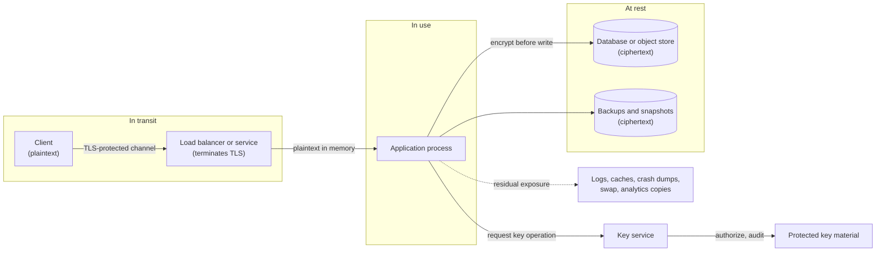

In transit means data crossing a network. The attacker is a party on the path: a compromised router, a shared network segment, a malicious access point, or an intermediary operated by someone else. TLS defends this state, provided each endpoint validates the peer and protects its private key. See [Part 05 CH06 TLS](../05_Networking_and_OS/CH06_TLS.md) for the mechanism.

At rest means data on storage media, in snapshots, and in backups. The attacker is someone who obtains the media or storage-layer access without the application: a discarded disk, a copied snapshot shared to the wrong account, a storage administrator, or a stolen backup tape. Encryption at rest defends this state well. It does not defend against a caller who reaches the data through the application, because the storage layer decrypts transparently for authorized requesters.

In use means data being processed. A CPU operates on plaintext, so the process memory holds plaintext, and the keys used to decrypt it. Specialized hardware-based confidential computing can keep memory encrypted against the host operating system and hypervisor, but it narrows the attacker set and does not replace access control inside the application.

The dotted edge in the diagram matters most in reviews. Logs, caches, search indexes, analytics exports, and crash dumps frequently hold plaintext copies that were never part of the encryption design. A system whose database is encrypted and whose application log contains the same fields has not protected those fields.

### 2.3 Where the trust boundary sits

Each encryption design implicitly answers one question: who must be unable to read the data? The answer places a trust boundary.

| Boundary | Defends against | Does not defend against |
|---|---|---|
| Full-disk or volume encryption | Lost or discarded physical media, some host-level snapshot theft | Any process that can read the mounted volume |
| Storage-service encryption with provider-managed keys | Provider staff or media loss at the storage layer | Any authorized caller in your account |
| Storage-service encryption with customer-managed keys | Same, plus lets you revoke the key and audit usage | A caller allowed to use both the storage and the key |
| Application-layer encryption | A storage administrator and any layer below the application | A compromised application with decrypt permission |
| Client-side encryption, key held by end user | The service operator | Loss of the user's key, which loses the data |

The columns show why "is it encrypted?" is an incomplete question. The useful questions are who holds the key, who can invoke it, and what they can read once they do. Moving the boundary outward (toward the application, then toward the end user) shrinks the set of parties who can read plaintext and also removes capabilities such as server-side search, malware scanning, and support recovery. That trade-off is the main decision in the later section on choosing an encryption boundary.

### 2.4 Attacker perspective

An attacker who has found a way to read ciphertext usually has one of four next steps, in descending order of how often they succeed in practice: find the key stored near the data (configuration file, environment variable, same bucket); compromise an identity that is authorized to decrypt; exploit a misuse of the primitive (nonce reuse, unauthenticated mode, predictable key); or attack the cipher itself, which is almost never feasible against properly used standard algorithms. A design review should therefore spend most of its time on key custody and decrypt authority and very little on the choice between two accepted algorithms.

## 3. Cryptographic Primitives and Selection

### 3.1 The five primitives

Symmetric encryption uses one secret key to encrypt and decrypt. It is fast and suited to bulk data. The cost is that both sides must already share the key. AES (Advanced Encryption Standard) with 128-bit or 256-bit keys is the standard block cipher; ChaCha20 is a stream cipher used where hardware AES support is missing.

Asymmetric cryptography uses a key pair. The public key is shared and the private key is held by one party. It is used for key establishment (two parties derive a shared secret), for encrypting small values such as a symmetric key, and for signatures. It is orders of magnitude slower than symmetric encryption, so real systems use it only to bootstrap a symmetric key. TLS follows this pattern, as does the envelope model later in this chapter.

A cryptographic hash maps input of any length to a fixed-size digest, such as SHA-256 (Secure Hash Algorithm, 256-bit output). It has no key and is not encryption. Anyone can compute it, so a hash by itself proves nothing about who produced the data. Password storage is a separate use that needs a deliberately slow, salted construction owned by [CH02 Authentication](CH02_Authentication.md).

A message authentication code (MAC), for example HMAC (Hash-based MAC) with SHA-256, computes a tag from a message and a shared secret key. A verifier holding the same key recomputes the tag. A valid tag shows the message is unmodified and came from a holder of the key, but because both sides hold the key, either could have produced it.

A digital signature is produced with a private key and verified with the public key. It provides integrity and authenticity to anyone who trusts the public key, and supports non-repudiation if private-key custody is controlled. How that trust is established belongs to [CH11 PKI](CH11_PKI.md).

| Need | Choose | Why |
|---|---|---|
| Hide bulk data, detect tampering | AEAD cipher (AES-GCM, ChaCha20-Poly1305) | One construction gives confidentiality and integrity |
| Detect tampering of data you do not need to hide | HMAC | Cheap, simple, shared key |
| Prove origin to many verifiers who must not be able to forge | Signature | Verifiers hold only the public key |
| Two parties with no shared secret agree on one | Key agreement (for example ECDH, Elliptic Curve Diffie-Hellman) | Produces a shared secret over an open channel |
| Fingerprint data for lookup or integrity comparison | Hash | No key needed, but not an authenticator |

### 3.2 Rules that prevent most misuse

Use vetted libraries and the highest-level interface they offer. A library function named for the whole task ("encrypt this blob with this key") is safer than assembling a cipher, a mode, padding, and a MAC by hand. Do not design algorithms. Do not combine primitives in unreviewed ways: encrypting without authenticating, or authenticating before encrypting with the wrong ordering, has caused real padding-oracle vulnerabilities in older constructions.

Prefer AEAD for all new designs. Older modes such as AES in Cipher Block Chaining (CBC) mode give confidentiality only and require a separate MAC applied in the correct order. Electronic Codebook (ECB) mode encrypts identical plaintext blocks to identical ciphertext blocks and must not be used for structured data.

Keys must come from a cryptographically secure random number generator or a key-derivation function (KDF) applied to high-entropy input. A key derived from a user-chosen password needs a password-based KDF with a cost parameter, not a plain hash. Do not use the same key for encryption and for MAC or signing, and do not use one key across unrelated purposes or environments, because a leak in one place then compromises all of them.

Key length is a security-strength decision made once and reviewed against current guidance. Use the current recommendations of a recognized standards body such as the National Institute of Standards and Technology (NIST) and check them at the time of design; the numbers evolve and this chapter does not freeze them.

## 4. Authenticated Encryption and Nonce Discipline

### 4.1 How AES-GCM works

AES-GCM is the most widely deployed AEAD. It combines two parts. Counter (CTR) mode turns AES into a stream cipher: for each 16-byte block it encrypts a counter value derived from the nonce and XORs the result into the plaintext. Galois Message Authentication Code (GMAC) arithmetic, called GHASH, then computes an authentication tag over the associated data and the ciphertext using a hash subkey derived from the encryption key. The caller supplies four inputs and receives ciphertext plus a tag:

| Input | Size in common use | Requirement |
|---|---|---|
| Key | 128 or 256 bits | Secret, random, single purpose |
| Nonce (number used once) | 96 bits | Unique for every encryption under one key |
| Plaintext | Up to a per-invocation limit set by the standard (about 64 GiB) | Any bytes |
| Associated data (AAD) | Any length | Authenticated but not encrypted, for example tenant and object identifiers |

Decryption recomputes the tag and releases plaintext only if it matches. A decrypt call that fails authentication must return an error and no partial plaintext. The tag is typically 128 bits; truncating it weakens forgery resistance and should not be done without a reviewed reason.

AAD is the mechanism that binds ciphertext to its context. If a document's tenant identifier and object identifier are passed as AAD, an attacker who copies the ciphertext of one object into another record cannot get it to decrypt there, because the tag will not verify under the different AAD. This defeats a class of confused-deputy and record-swapping attacks that plain encryption allows.

### 4.2 What happens when a nonce repeats

Suppose two messages P1 and P2 are encrypted under the same key and the same nonce. CTR mode then produces the same keystream K for both, so the ciphertexts are C1 = P1 XOR K and C2 = P2 XOR K. An attacker who sees both computes C1 XOR C2 = P1 XOR P2. The key is not needed. If either plaintext is partly known (a file header, a JSON field name, a protocol prefix), the corresponding bytes of the other are recovered directly, and statistical methods recover more.

The damage does not stop at confidentiality. In GCM the authentication hash subkey is derived from the key alone, and two tags computed with the same nonce give the attacker equations from which that hash subkey can be recovered. With it, the attacker can forge valid tags for chosen ciphertexts under that key. A single repeated nonce therefore breaks both secrecy of the affected messages and integrity of the key from then on. The practical lesson is that nonce uniqueness is a hard correctness requirement, not a best practice.

### 4.3 Choosing a nonce strategy, with arithmetic

There are two accepted strategies. A deterministic counter, with the counter state stored durably and never rolled back, guarantees uniqueness but is hard to keep correct across restarts, replicas, and restored snapshots. A random nonce is simple but has a collision probability.

For a 96-bit random nonce and n encryptions under one key, the birthday approximation for the probability that at least two nonces collide is about n² / 2⁹⁷. The standard for GCM (NIST Special Publication 800-38D) limits a key to at most 2³² invocations when nonces are random. At that limit:

- n² = 2⁶⁴
- probability ≈ 2⁶⁴ / 2⁹⁷ = 2⁻³³ ≈ 1.2 × 10⁻¹⁰

That is small per key but is exactly the reason for the limit, because the consequence of a single collision is severe.

Illustrative scale (numbers are examples, not measurements). A service writes 1,000 records per second under one data key with random nonces:

- Invocations to reach the limit: 2³² = 4,294,967,296
- Time: 4,294,967,296 / 1,000 = 4,294,967 s, about 49.7 days

So one long-lived key and random nonces would force a rotation roughly every seven weeks, and the counter of invocations must be tracked across all replicas to know when. A key used for exactly one object avoids the problem: one encryption per key means nonce reuse is impossible by construction. That observation is one of the main reasons the next section uses a fresh data key per object, and it is also the reason managed key services expose a "generate data key" operation.

### 4.4 A correct minimal example

The following Python sketch uses the widely used `cryptography` package. The key is single-use, the nonce is random and stored with the ciphertext, and the AAD binds the record identity. It illustrates the parameters, not a complete storage design.

```python
import os
from cryptography.hazmat.primitives.ciphers.aead import AESGCM

def seal(key: bytes, plaintext: bytes, tenant: str, object_id: str) -> bytes:
    nonce = os.urandom(12)  # 96-bit nonce, unique per encryption under this key
    aad = f"{tenant}/{object_id}".encode()
    return nonce + AESGCM(key).encrypt(nonce, plaintext, aad)  # tag appended

def open_(key: bytes, blob: bytes, tenant: str, object_id: str) -> bytes:
    nonce, ct = blob[:12], blob[12:]
    aad = f"{tenant}/{object_id}".encode()
    return AESGCM(key).decrypt(nonce, ct, aad)  # raises InvalidTag on any mismatch
```

If `object_id` or `tenant` differs at decrypt time, `decrypt` raises `InvalidTag`. Callers must treat that as an integrity failure to alert on, not as a retry condition.

## 5. Envelope Encryption and Key Hierarchy

### 5.1 Why a hierarchy

Encrypting every object directly with a master key in a hardware security module (HSM) or key service would mean sending all data to the key service, which is slow and puts every byte through a shared dependency. Using one local key for everything puts the whole data set behind one secret that lives in application memory and hits the nonce limit from the previous section. Envelope encryption splits the work in two levels:

- A data-encryption key (DEK) encrypts the data. It is generated per object, per file, or per small batch, used locally, and then discarded in plaintext form.
- A key-encryption key (KEK) encrypts, or wraps, the DEK. The KEK stays inside the key service or HSM and is never exported. Only the wrapped DEK is stored next to the ciphertext.

Large systems add levels above the KEK, so that no single compromise or rotation affects everything.

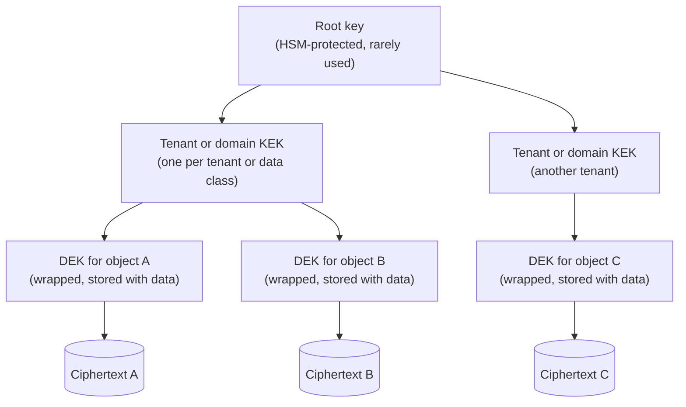

The diagram shows blast radius. Compromise of one DEK exposes one object. Compromise of a tenant KEK exposes that tenant's objects but not others. Compromise of the root key exposes everything, which is why it is held in an HSM, used only to wrap lower-level keys, and subject to the strictest access and audit rules. The depth of the hierarchy is a design decision. A single level (KEK wraps DEKs directly) suits most workloads. A tenant level is warranted when tenants require independent revocation or independent audit, and the cost is more keys to manage.

### 5.2 Write and read paths

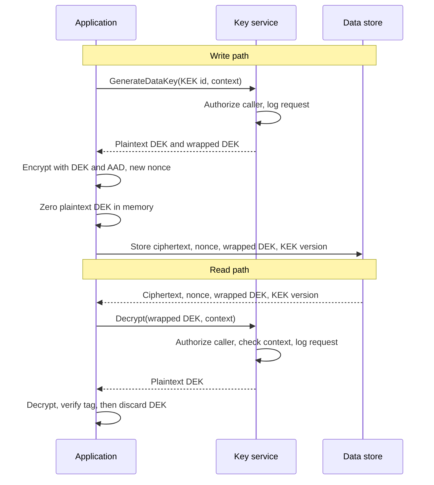

On the write path the plaintext DEK exists only in application memory and only for the duration of one encryption. The store never sees it. On the read path the key service is the gate: an unwrap succeeds only for an authorized caller, and each unwrap is a loggable event. This is where per-record audit comes from, and it is the reason envelope encryption is more than a performance trick.

Three consequences follow. First, the application process necessarily holds plaintext and a plaintext DEK, so memory handling, logs, and crash dumps are part of the boundary. Second, the permission to call the key service's decrypt operation is the real access control for the data, and it should be granted to workload identities, not to humans, and scoped to specific keys. Third, the wrapped DEK must be stored with enough metadata (KEK identifier and version, algorithm, nonce) to decrypt years later, because the data will outlive the code that wrote it.

### 5.3 Encryption context

Key services accept a context, a set of non-secret key-value pairs, that is cryptographically bound to the wrapped key. An unwrap succeeds only if the same context is supplied. Using tenant identifier and object identifier as context means a wrapped DEK copied to another record, or another tenant, will not unwrap there. The context also appears in audit logs, so every decrypt event records which tenant and object it was for, which makes anomalous patterns (one identity unwrapping thousands of different objects) detectable.

Context is authenticated but not secret, so it must not hold sensitive values.

### 5.4 Worked scenario: wrap-only rotation versus re-encryption

Illustrative numbers. A document store holds 1,000,000,000 objects averaging 1 MiB, so 1 PiB total (1,000,000,000 × 1 MiB ≈ 0.93 PiB; call it 1 PiB). Each object has its own DEK, and the wrapped DEK blob is assumed to be 100 bytes.

If the KEK is compromised or must be replaced, there are two options.

- Re-encrypt all data: read, decrypt, re-encrypt with new DEKs, and write 1 PiB. At an assumed sustained 2 GiB/s of aggregate throughput, 1 PiB = 1,048,576 GiB, so 1,048,576 / 2 = 524,288 s, about 6.1 days, plus storage write cost.
- Re-wrap the DEKs: only the 100-byte wrapped DEKs change. Total data read and written is 1,000,000,000 × 100 B = 100 GB. If the key service permits an assumed 1,000 re-wrap requests per second for this workload, 1,000,000,000 / 1,000 = 1,000,000 s, about 11.6 days. The request rate, not the data volume, is the limit.

Re-wrapping wins on bytes moved but can lose on time if the key service's request quota is low, so the quota (look up the current limit in the provider's documentation; it changes) belongs in the rotation plan. A re-wrap also does not help if the DEKs themselves were exposed, because an attacker holding a plaintext DEK can still read that object. A KEK compromise is a re-wrap event. A DEK exposure, or any suspected key-material leak from the service itself, requires re-encryption of the affected objects.

The tradeoff produces a rule of thumb: choose the hierarchy so that the most likely rotation events (scheduled KEK rotation) are cheap, and accept that rare events (DEK or root compromise) are expensive.

## 6. Choosing an Encryption Boundary on AWS, Azure, and Google Cloud

### 6.1 The options each provider offers

All three providers encrypt stored data in their managed storage and database services by default at the storage layer, using keys they manage. The differences are in who controls the key, who can use it, and what you can observe. Names and defaults change, so confirm them in the current documentation: [AWS Key Management Service (KMS)](https://docs.aws.amazon.com/kms/latest/developerguide/overview.html), [Azure Key Vault](https://learn.microsoft.com/azure/key-vault/general/overview), and [Google Cloud KMS](https://cloud.google.com/kms/docs/key-management-service).

| Choice | AWS | Azure | Google Cloud |
|---|---|---|---|
| Provider-managed key, no configuration | Service-managed keys such as Amazon Simple Storage Service (S3) managed keys (SSE-S3) | Microsoft-managed keys in Azure Storage and other services | Google-managed encryption keys, on by default |
| Customer-controlled key, provider does the encrypting | AWS KMS key used by the service (for S3, SSE-KMS) | Customer-managed key in Azure Key Vault or Managed Hardware Security Module (HSM) | Customer-managed encryption key (CMEK) in Cloud KMS |
| Key supplied by the caller per request | SSE-C for S3 | Customer-provided keys for Blob Storage | Customer-supplied encryption keys for some services |
| Key held outside the provider's boundary | External key store for KMS | Key Vault with externally held key options, verify per service | Cloud External Key Manager (EKM) |
| Application-layer envelope encryption | KMS data keys, plus an encryption SDK | Key Vault wrap and unwrap operations | Cloud KMS encrypt, or envelope with data keys |

Read the table by threat, not by feature. A provider-managed key protects against media loss and some operator access inside the provider. It gives you no ability to revoke the key independently of the account and no per-use audit of key operations. A customer-managed key adds two capabilities. You can disable or schedule deletion of the key, which makes data unreadable to the service, and every use of the key is logged. A key held outside the provider adds a third: the provider cannot decrypt without calling your system. It also makes your key system a hard availability dependency for the data service, which is the cost to weigh.

### 6.2 How a customer-managed key is authorized

With a customer-managed key, a read of an encrypted object requires two independent permissions: access to the object and permission to use the key. In AWS the key policy (and optionally Identity and Access Management (IAM) policies and grants) governs who may call `Decrypt` or `GenerateDataKey`. Azure Key Vault and Managed HSM use role assignments or access policies on the key. Google Cloud KMS uses IAM roles on the key, ring, or project. The effect is a second lock on the data, and it is the technical basis for separation of duties: the team that administers storage need not be the team that can use the key, and the team that administers keys need not be able to use them for decryption.

A short AWS example shows the data-key call with an encryption context. The `--encryption-context` is bound to the wrapped key and recorded in AWS CloudTrail, the audit log for API calls:

```bash
aws kms generate-data-key \
  --key-id alias/tenant-acme-docs \
  --key-spec AES_256 \
  --encryption-context tenant=acme,object=doc-42
```

The response contains `Plaintext` (use once, then discard) and `CiphertextBlob` (store with the data). Decrypting the blob later requires the same context:

```bash
aws kms decrypt \
  --ciphertext-blob fileb://wrapped-dek.bin \
  --encryption-context tenant=acme,object=doc-42
```

Per-request calls have latency and cost, and service-side features exist to reduce them. For example, S3 Bucket Keys let S3 reuse a bucket-level key derived from the KMS key to cut the number of KMS requests, at the price of coarser per-object audit entries. Confirm current behavior in provider documentation before relying on it for an audit requirement.

### 6.3 Decision criteria

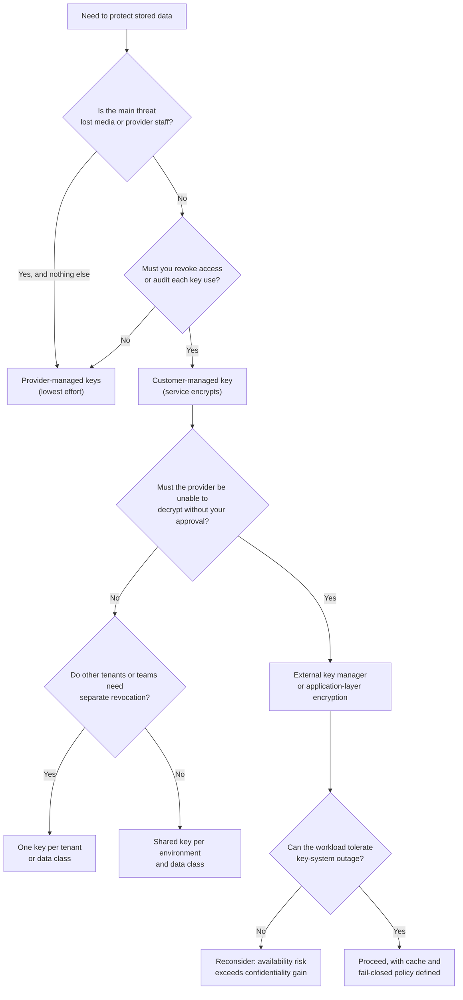

The tree makes explicit that the move from provider-managed to customer-managed keys is justified by a named need (revocation, per-use audit, separation of duties, a regulatory requirement), not by habit. Customer-managed keys add operational work: key policies to maintain, rotation to monitor, deletion protection to configure, and a new way to lose data permanently. A team that enables them without owning those tasks has lowered its availability without clear gain.

Application-layer or client-side encryption is the choice when the storage platform and its administrators are inside the attacker set. Its cost is that the platform can no longer index, search, or process the data, so features that need plaintext must move into the application or be given up.

### 6.4 Failure modes at the boundary

- Disabled or deleted key. Disabling a customer-managed key makes every object encrypted under it unreadable until it is re-enabled. Scheduled deletion has a waiting period on some services, but after it elapses the data is gone. Enable deletion protection, restrict who can schedule deletion, and test recovery.
- Permission drift. A role that could decrypt yesterday and cannot today produces failures that look like storage faults. Alert on key-service denials alongside storage errors.
- Cross-account and cross-region use. A snapshot shared to another account is unreadable unless the key policy grants that account use of the key. Keys are generally regional resources; a restore in another region needs a key there, or a multi-region key where the provider offers one. Plan this before a disaster-recovery test finds it.
- Context mismatch. Changing identifiers that were used as encryption context after the fact makes old wrapped keys unreadable. Treat context fields as part of the data schema.

## 7. Key Custody: Who Can Decrypt What

### 7.1 Three custody models

Section 6 compared product options. The underlying question is simpler: for a given ciphertext, which identities can cause a decryption, and who can stop them? Three custody models cover most services.

| Model | Who holds key material | Who can cause a decrypt | Who can stop it | Typical use |
|---|---|---|---|---|
| Provider-managed | Provider, inside its key infrastructure | Any caller the storage service authorizes | Only the provider, or you by deleting the data | Baseline protection against media loss |
| Customer-managed | Provider-operated key service, under your key policy | A caller authorized on the data and on the key | You, by disabling the key or changing its policy | Revocation, per-use audit, separation of duties |
| Customer-supplied | You, sent with each request | The service, only for the duration of that request | You, by not sending the key | Rare, where the service must not retain the key |

Customer-supplied keys look attractive because the provider does not store the key, but the key transits to the service on every request and the service sees plaintext while it processes the call. The guarantee is that the provider cannot decrypt stored data later without you. It is not a guarantee that the provider never sees the key. The burden of storing, backing up, and distributing the key falls on you, and losing it loses the data. For most teams, customer-managed keys give the revocation capability with much less operational risk.

A fourth arrangement, an externally held key, keeps the key material outside the provider and has the provider call a key manager you operate. It strengthens the statement "the provider cannot decrypt without us" and adds your key manager to the service's availability path. Section 13 returns to that cost.

### 7.2 Key hierarchy and key metadata

Managed key services present keys as named resources with a stable identifier, an alias, and versions. A key resource normally holds one or more versions of key material. The material for symmetric keys is generated inside an HSM boundary and is not exported in plaintext. Operations are exposed as API calls: encrypt, decrypt, generate a data key, wrap, unwrap, sign, verify. At the time of writing, AWS KMS, Azure Key Vault and Managed HSM, and Google Cloud KMS all follow this shape, with different names for rings, vaults, and versions. Check the product documentation for exact limits on key size, supported algorithms, and operation size, because direct encrypt calls are intended for small payloads (such as a data key) and not for bulk data.

Every ciphertext produced under a managed key should carry, or be stored next to, the metadata needed to decrypt it later:

- The key identifier and, where the provider allows, the key version that produced it.
- The algorithm and parameter set, so that a future reader can pick the right decryption routine.
- The nonce and any associated data schema version.
- The wrapped DEK, if envelope encryption was used.

Some services embed the key identifier inside the wrapped blob, so decryption needs no extra argument. Others require you to record it. Either way the decision belongs in the data format. A format with no algorithm field is a format that cannot be migrated, which becomes the main obstacle in the later section on cryptographic agility.

A key also has an owner, a purpose, permitted operations, a rotation policy, a backup or recovery position, and destruction criteria. Writing these on a one-page key record turns "who owns this key?" from an incident-time question into a lookup. Do not reuse one key for unrelated purposes or environments: a development workload that can use the production key has made development a path to production data.

### 7.3 Separation of duties and the decrypt path

A customer-managed key creates three distinct kinds of authority, and they should land with different identities.

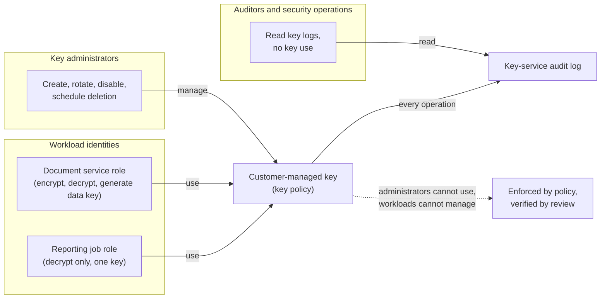

The diagram separates administering the key, using it, and watching it. Administrators who can both disable and use a key can read all data and also destroy the evidence of having done so. Workloads that can both use and manage a key can widen their own access. Auditors who cannot use the key can still detect abnormal use. The implication for design reviews is to ask for the three role lists explicitly and check them against the actual key policy, not the intended one. A short policy sketch in the AWS style shows the idea: grant workloads only the operations they need, and bind them to an encryption context.

```json
{
  "Sid": "DocumentServiceUse",
  "Effect": "Allow",
  "Principal": {"AWS": "arn:aws:iam::111122223333:role/document-service"},
  "Action": ["kms:GenerateDataKey", "kms:Decrypt"],
  "Resource": "*",
  "Condition": {"StringEquals": {"kms:EncryptionContext:tenant": "acme"}}
}
```

In a key policy `Resource` refers to the key the policy is attached to. The account number is a documentation placeholder. Azure and Google Cloud express the same split with role assignments on the key, and the principle is identical. A key policy that grants the whole account root principal broad use delegates the decision to every IAM administrator in the account, so decide deliberately whether that is intended.

Two worked questions show how to read the model. First: can a developer with read access to the storage bucket read objects encrypted under a customer-managed key? Only if the developer's identity is also permitted to use the key. If they are not, the read fails with an access error from the key service, which is correct behavior and should not be fixed by granting the developer key use. Second: can a key administrator read data? Not through the key, if the policy withholds use. They can still change the policy to grant themselves use, which is why policy changes on keys must be logged, alerted on, and restricted to a small group, and why a second approval for such changes is worth its cost for high-value keys.

## 8. Key Rotation: What Changes and What Does Not

### 8.1 Why rotate, and what rotation means

Rotation limits how much data one key protects and how long a stolen key stays useful. Two reasons dominate. The first is exposure limits: the more data and the longer the time under one key, the more an eventual leak costs, and for AES-GCM the invocation limit from section 4 caps volume per key regardless of policy. The second is compliance and hygiene, where a stated rotation interval is an auditable control. Rotation does not repair a key that is already compromised. An attacker who has copied a key keeps reading everything encrypted under it, so rotation is a scheduled control and revocation with re-encryption is an incident control.

The word "rotation" covers three different operations with different costs:

| Operation | What changes | Existing ciphertext | Cost |
|---|---|---|---|
| New key version for new writes | The version used to wrap or encrypt future data | Unchanged and still decryptable with the old version | Near zero |
| Re-wrap | The wrapped DEKs are decrypted with the old KEK version and wrapped with the new one | Data bytes unchanged, wrapped DEKs replaced | One unwrap and one wrap per object |
| Re-encrypt | New DEKs, new ciphertext | All data bytes rewritten | Read, encrypt, write every byte |

Managed services commonly implement automatic rotation as the first operation. For example, AWS KMS automatic rotation of a symmetric key creates new key material under the same key identifier and keeps the older material so that existing ciphertext still decrypts, and it does not re-encrypt data that was already encrypted. Azure Key Vault rotation policies create new key versions, and Google Cloud KMS rotation adds a new primary version while older versions stay enabled for decryption. Whether a given data service then re-wraps its own stored data keys lazily, on demand, or never differs by service, so read the documentation for each one. The practical consequence is that "we rotate every year" can mean "new writes use a new version every year and a year-old object is still protected by last year's key", which is acceptable for scheduled rotation and useless after a compromise.

### 8.2 The rotation state machine

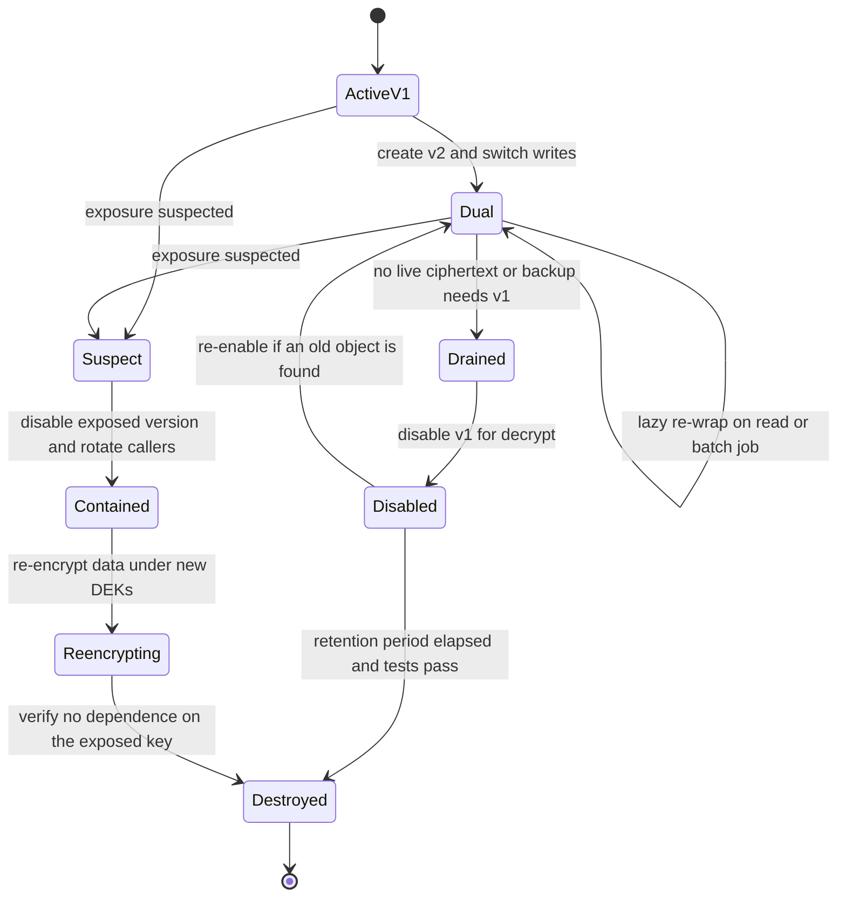

The routine path runs along the top. Version 1 is active, version 2 is created and takes writes, a period of dual operation follows while old data is migrated, and only when nothing needs version 1 is it disabled and eventually destroyed. Disabling before destroying gives a reversible step: if an old object, backup, or report fails to decrypt, re-enabling restores access, while destruction does not. The incident path along the bottom starts from suspected exposure, which is why a clear "suspect" state is useful: it triggers containment before cleanup.

Two implications are easy to miss. First, backups and snapshots hold ciphertext wrapped under old versions, so the oldest retained backup sets the earliest date on which a version can be destroyed. Second, a disabled version is a failure source. Many outages blamed on "the storage layer" are a decrypt call against a version that someone disabled or destroyed.

### 8.3 Worked scenario: how long does version 1 live?

Illustrative numbers. A service rotates its tenant KEK every 365 days. It retains daily backups for 35 days and keeps monthly archives for 7 years. 100,000,000 wrapped DEKs are stored under the current KEK. A batch job re-wraps at an assumed 500 objects per second so as not to saturate the key service quota.

- Batch re-wrap time: 100,000,000 / 500 = 200,000 s, about 2.3 days.
- Live data no longer depends on version 1 about 2.3 days after rotation, plus any objects that exist only in cold storage.
- Daily backups taken before the re-wrap still hold version 1 wrappers. The last one expires 35 days after the re-wrap finishes, so version 1 must remain decryptable for about 2.3 + 35 = 37.3 days.
- Monthly archives hold wrappers for up to 7 years (about 2,555 days). Unless the archives are re-wrapped, restored, or accepted as lower-sensitivity, version 1 must stay available for 7 years, which defeats the purpose of rotation for that data.

The archive line is the decision. There are three options: keep every old version for the full retention period and accept the exposure, re-wrap archives as part of rotation and pay the read and write cost, or retire the archive set and say so. The rotation policy is incomplete without a statement about archives. A key record should state the retention period of data it can still decrypt, not only the rotation interval.

### 8.4 Rotation of keys that are not wrapping keys

Not every key is a KEK. Signing keys, MAC keys, and TLS private keys rotate differently.

- A MAC key used to authenticate tokens rotates by publishing the new key identifier, signing new tokens with it, and continuing to accept the old one for the token lifetime. Once all issued tokens expire, the old key is removed. The identifier in the token header makes this deterministic. For public-key signatures the same pattern appears as a key set published by an issuer; the JWT chapter in Part 05 gives a worked pattern.
- A TLS private key rotates with the certificate lifecycle, owned by [CH11 PKI](CH11_PKI.md).
- A data key for a long-lived stream (a database column, a message queue topic) needs a version tag per record so that readers pick the right key.

Operationally, test rotation in a non-production environment with the same data formats and run a restore from a backup older than the rotation. A rotation procedure that has never been tested against an old backup has not been tested.

## 9. Transit, Rest, and Use: Requirements for Each State

### 9.1 In transit

Transport encryption is defined and negotiated by TLS; [Part 05 CH06 TLS](../05_Networking_and_OS/CH06_TLS.md) covers the handshake and record protection. For this chapter it matters what TLS promises and where it ends. TLS gives a client an encrypted, integrity-protected channel to an endpoint whose identity it has validated through a certificate chain, which [CH11 PKI](CH11_PKI.md) covers. It protects the bytes between two TLS endpoints and nothing beyond them.

The practical requirements are these:

- Validate the peer. Encryption with no validation protects against passive listeners and not against an active intermediary, because the attacker can terminate the connection and open a second one. Turning off certificate verification "temporarily" for an internal call removes the property that makes the channel worth having.
- Know where TLS terminates. A load balancer that terminates TLS and forwards plaintext inside a network means the internal hop depends on network trust. For sensitive data, re-encrypt to the backend or use mutual TLS (mTLS), in which the server also validates a client certificate.
- Use mTLS for service-to-service calls when identity must be proved at the connection level. This couples encryption with workload identity and makes certificate issuance and rotation a platform duty.
- Plan for the data after termination. Once the application has the request, it is in use, and any logging, tracing, or caching creates plaintext copies.

TLS does not provide end-to-end protection when a message passes through several systems that each terminate their own TLS session, such as an API gateway, a queue, and a worker. A message that must stay protected across those hops needs application-layer encryption or a signature applied by the sender and verified by the final receiver.

### 9.2 At rest

Encryption at rest comes at several layers, each with a different protection and a different set of parties that can still read.

| Layer | Who decrypts | Protects against | Typical cost |
|---|---|---|---|
| Disk or volume | The operating system or hypervisor, transparently | Lost media, some snapshot copies | Small, often hardware assisted |
| Database or storage service | The service, for authorized sessions | Media and storage-layer access | Small, set by the service |
| Column or field | The application or a database function | Database administrators, some query and export paths | Loses index and sort ability on ciphertext |
| Whole object by the client | The client only | The platform operator | Platform features that need plaintext are lost |

Deeper layers narrow the set of readers but remove functions that depend on plaintext. Encrypted columns cannot normally be searched with range queries or sorted. Deterministic encryption of a field (the same plaintext always yields the same ciphertext) permits equality lookups at the price of revealing which rows share a value, which is a leak that must be accepted explicitly, and should not be chosen as a general default. A common compromise is to encrypt the sensitive field with a random nonce and store a separate keyed MAC of the normalized value as a lookup column, which supports equality search without storing the plaintext, and reveals only equality between rows.

### 9.3 In use

Data in use is decrypted so that code can compute on it. The attacker set here is the host operating system, a hypervisor, other tenants through side channels, and anyone who can read process memory, swap, or crash dumps. The controls are mostly about minimizing the plaintext footprint:

- Keep plaintext lifetimes short and zero key buffers when the language and runtime allow it, understanding that managed runtimes may copy memory.
- Disable or restrict core dumps, and scrub sensitive fields before logging.
- Keep plaintext out of caches shared across tenants, and out of analytics copies unless the copy has its own classification and controls.
- Consider confidential computing, where a hardware-based trusted execution environment encrypts memory against the host and hypervisor and can attest the code it runs. It narrows who can read memory during processing. It does not remove the application's own access to the data, and it adds attestation and key-release flows that need their own design. Evaluate the specific cloud offering and its limits at the time of design.

For most systems the largest in-use exposure comes from ordinary application behavior (logs, exports, support tools) and not from exotic host attacks, so start with those.

## 10. Choosing Among AEAD, MACs, and Signatures

### 10.1 Select from the question being asked

Section 3 listed the primitives. This section turns them into a selection procedure based on who verifies and who must not be able to forge.

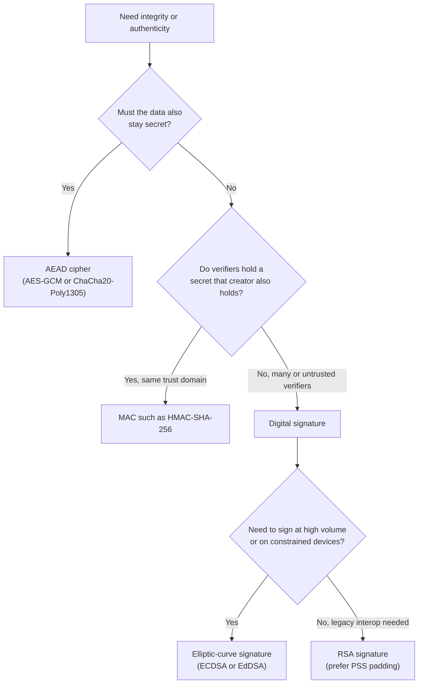

The tree moves from the strongest requirement to the cheapest sufficient primitive. A MAC is the right tool when the signer and verifier are the same system or two services in one trust domain, for example a service verifying a cookie or a webhook it can recompute. A signature is the right tool when verifiers must be unable to produce valid signatures, such as software update verification, token issuers with many relying parties, or signed audit records. The implication is a key-distribution one: a MAC key must be protected on every verifier, while a signing key is protected in one place and verifiers only need the public key.

### 10.2 Algorithm choices and their failure modes

| Need | Reasonable choice | Common misuse |
|---|---|---|
| Bulk encryption with integrity | AES-GCM or ChaCha20-Poly1305 | Reusing a nonce, truncating the tag, encrypting without AAD |
| Encrypting with possible nonce-handling risk | A nonce-misuse-resistant AEAD mode, where a vetted library offers it | Assuming it removes the need for unique nonces for other properties |
| Message authentication, shared key | HMAC with SHA-256 or stronger | Comparing tags with ordinary string equality |
| Signatures | ECDSA or EdDSA, or RSA with PSS | Signing the wrong bytes, accepting any algorithm named in the message |
| Deriving several keys from one secret | HKDF (HMAC-based key derivation function) with distinct context labels | Using one derived key for two purposes |
| Passwords | A slow, salted password hash, see [CH02 Authentication](CH02_Authentication.md) | Using a fast hash or a MAC |

Algorithm selection comes from recognized guidance and the supported set of the platform, not from preference. The set changes over time; check current NIST publications and your library's documentation.

Two failure modes recur. The first is timing leaks: comparing a received MAC tag to the computed one with an ordinary equality operator can return early at the first differing byte, which lets an attacker learn the correct tag one byte at a time through repeated requests. Use a constant-time comparison function.

```python
import hmac, hashlib

def verify_webhook(secret: bytes, body: bytes, received_hex: str) -> bool:
    expected = hmac.new(secret, body, hashlib.sha256).hexdigest()
    return hmac.compare_digest(expected, received_hex)  # constant-time compare
```

The second is algorithm confusion: a verifier that reads the algorithm from the message and then uses it lets an attacker choose a weaker one, or present a public key as a MAC key. The verifier should fix the accepted algorithm and key per issuer in its own configuration and reject anything else. Signed messages should also bind context such as a type label, audience, and expiry, so that a valid signature for one purpose cannot be replayed for another.

### 10.3 Where signing keys live

A signing key is high-value because a stolen one lets an attacker mint trusted artifacts. Managed key services can sign inside the HSM boundary without exporting the private key, which means a compromised application can ask for signatures but cannot copy the key. That ability to ask is itself a risk, so scope who can call the sign operation, log every call, and rate limit it. Keep a separate signing key per purpose (tokens, code artifacts, documents), so that revocation of one does not stop the others. Certificate-based signing, chain building, and revocation belong to [CH11 PKI](CH11_PKI.md).

## 11. Post-Quantum Considerations

A sufficiently large quantum computer running Shor's algorithm would break the mathematical problems behind RSA and elliptic-curve cryptography, which covers most key agreement and signature schemes in use today. Whether and when such a machine will exist is uncertain, and this chapter does not predict a date. The architectural question is what to do now given that uncertainty, and the answer depends on how long the data must stay confidential.

Two threats have different urgency:

- Harvest now, decrypt later applies to confidentiality. An adversary who records encrypted traffic today could decrypt it years later if the key agreement that protected it becomes breakable. Data whose sensitivity outlasts that horizon, for example records with retention periods of decades, is the concern.
- Forged signatures apply only once a capable machine exists. A signature checked today cannot be forged retroactively by a future machine, but long-lived signed artifacts and root keys that remain trusted for many years need a migration path before then.

Symmetric encryption is affected less. Grover's algorithm gives a quantum speed-up that is generally understood to roughly halve the effective key strength for exhaustive search, so AES with 256-bit keys is commonly considered to keep a comfortable margin, and larger hash outputs remain adequate. This is the consensus view at the time of writing; confirm against current guidance from NIST and national agencies.

For asymmetric schemes, NIST has published standards for post-quantum algorithms, including a key-encapsulation mechanism (ML-KEM) and signature schemes (ML-DSA and SLH-DSA). Some TLS implementations and cloud services already offer hybrid key exchange, which combines a classical and a post-quantum algorithm so that the connection stays secure if either holds. Support varies by library, provider, and service, so verify what your chosen platform offers instead of assuming it.

A hedged set of actions for an architect:

1. Inventory where asymmetric cryptography protects long-lived confidentiality or long-lived trust. Key exchange in TLS, VPN tunnels, encrypted backups using public-key wrapping, and document signing are typical entries.
2. Classify data by how long it must remain secret and compare that to your migration timeline. Short-lived data needs little action beyond staying current.
3. Prefer designs where bulk data is protected by symmetric keys with 256-bit strength and where public-key use is isolated behind a small interface, so that the algorithm can change in one place.
4. Track provider and library support for hybrid key exchange and the new signatures, and plan to adopt on the same schedule as other cryptographic updates.
5. Expect larger keys and signatures for some post-quantum schemes, which affects handshake sizes, certificate sizes, and fixed-width fields in your own formats. Check your protocol and storage formats for hard-coded size limits.

The next sections show why step 3 and step 5 are an architecture concern. A system that cannot swap an algorithm cheaply has a post-quantum problem and also an everyday problem whenever an algorithm is deprecated.

## 12. Performance: Cipher Cost, Key-Service Load, and Caching

### 12.1 Where the time goes

Bulk symmetric encryption is rarely the bottleneck. On processors with hardware AES instructions, AES-GCM runs at speeds that are typically well above network and storage throughput per core, so encrypting a stream adds modest CPU. On devices without such instructions, ChaCha20-Poly1305 is usually the faster choice. Measure on the target hardware, because published throughput figures vary widely with processor, library, and message size.

The cost that matters at scale is the remote key-service call. Each unwrap or generate-data-key is a network request to a regional service with its own latency, its own request quota, and its own price per request. The cost of encrypting a 4 KiB record locally is microseconds. The cost of asking the key service for its data key is a network round trip, usually milliseconds, and it is subject to throttling. A design that makes one key-service call per small record turns a cheap local operation into a shared, rate-limited dependency.

### 12.2 Worked scenario: request rate and caching

Illustrative numbers, all assumed. An API reads documents at 4,000 requests per second at peak. Each read needs one DEK unwrap. The key service quota for the relevant operation is, for this exercise, 5,500 requests per second per region shared by the account (check the provider's current quota; this is an example, not a documented number). Another workload in the account uses 1,500 requests per second of the same quota at peak.

- Without caching: 4,000 + 1,500 = 5,500 requests per second, which sits exactly at the example quota with no headroom. A traffic increase of 10 percent gives 4,400 + 1,500 = 5,900 requests per second, above the quota, and the key service starts throttling, which becomes read failures.
- With a per-DEK cache: suppose 20 percent of reads hit a document read within the last 60 seconds, a hit rate of 0.2. Key-service calls: 4,000 × (1 − 0.2) = 3,200 per second. Total 3,200 + 1,500 = 4,700 per second, 85 percent of the example quota.
- With a per-tenant data-key design: if documents of a tenant share a DEK for a short window and 500 tenants are active, a cache holding one DEK per active tenant with a 5-minute lifetime needs at most 500 unwraps per 300 seconds, about 1.7 requests per second, plus misses on new tenants. The key-service load becomes negligible.

The third option has a security cost. A DEK reused across many objects raises the nonce-count concern from section 4: with random 96-bit nonces, the DEK must not encrypt more than 2³² messages. At 4,000 writes per second one shared DEK reaches 4,294,967,296 / 4,000 = 1,073,741 s, about 12.4 days, so a 5-minute lifetime is safely inside the limit with a factor of more than 3,500. The design choice is therefore to cap both the lifetime and the invocation count of a cached DEK, and to prefer more DEKs over a long-lived one.

Cost follows the same arithmetic. At an assumed price of 3 cents per 10,000 requests, 3,200 calls per second over 30 days (2,592,000 s) is 8,294,400,000 calls, or 829,440 units of 10,000, about $24,883 per month. At 1.7 calls per second the same month is 4,406,400 calls, about 441 units, or about $13. The prices here are placeholders for the calculation. Use current published pricing.

### 12.3 What may be cached, and for how long

A cache of plaintext DEKs lives in application memory and widens the in-use exposure. A reasonable policy sets:

- A maximum age per entry, a maximum number of uses per entry, and a maximum bytes encrypted per entry.
- Scope the cache by encryption context, so a key cached for one tenant is never used for another.
- Eviction on process shutdown and no persistence to disk.
- A revocation window equal to the cache lifetime. If you disable a key at the provider, workloads with cached DEKs continue to decrypt for up to the cache lifetime. State that window in the security design, because revocation is not immediate under caching.

A cache is a trade between availability, cost, and revocation speed. Short lifetimes keep revocation fast and cost high. Long lifetimes protect availability and cost but delay revocation. Set the figure from a stated requirement, not from a default.

### 12.4 Measuring

Track the key-service request rate per operation, throttling errors, p50 and p99 latency of key calls, cache hit rate, and the age of the oldest cached key. Alert on throttling and on a rise in request rate not matched by traffic, which may indicate a cache failure or a misbehaving caller. Run load tests that include key-service latency, since a test with a stubbed key service hides the main cost.

## 13. Availability and Failure Behavior of the Key Service

### 13.1 What stops working when the key service is unavailable

The key service sits on the path of every operation that needs an unwrap, a generate-data-key, a sign, or a decrypt. Applying the envelope model from section 5 shows what fails and what continues.

| Operation | With key service unreachable | Reason |
|---|---|---|
| Read an object whose DEK is not cached | Fails | The wrapped DEK cannot be unwrapped |
| Read an object whose DEK is cached | Continues until the cache entry expires | Plaintext DEK is in memory |
| Write a new object, no cached data key | Fails, or must be queued | No new DEK can be generated under the KEK |
| Write using a cached data key | Continues within count and age limits | Local encryption needs no remote call |
| Storage-service reads under a customer-managed key | Fails | The storage service calls the key service on your behalf |
| Verify a signature | Continues | Verification uses the public key |
| Create a signature with a managed key | Fails | The private key operation lives in the service |
| Data already decrypted in memory | Continues | Already in use |

The pattern is that cached plaintext keys keep the existing hot set working, new keys and cold data stop, and service-side encryption fails for everything because you cannot add your own cache to the provider's internals. Applications must decide per operation whether to reject, queue, or serve limited stale results.

### 13.2 Failure domains

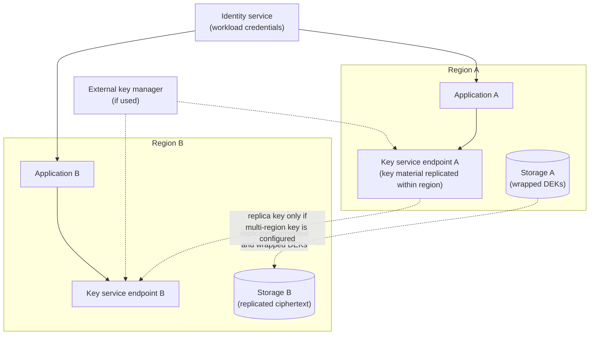

The diagram maps what can fail independently. Ciphertext can replicate to Region B, but wrapped DEKs only unwrap in Region B if Region B has the key. Some providers offer multi-region or replicated keys so that the same key material and identifier work in two regions, while other keys are strictly regional. Verify which type you have and what the replication rules are. Two other dependencies are easy to forget: the identity service that issues workload credentials, because a workload that cannot authenticate cannot call the key service, and the external key manager, if you chose one, which becomes a dependency of both regions. The implications are that regional failover for encrypted data is a joint exercise between storage replication and key availability, and that a disaster-recovery test must include actually decrypting data in the recovery region.

### 13.3 Decision under failure

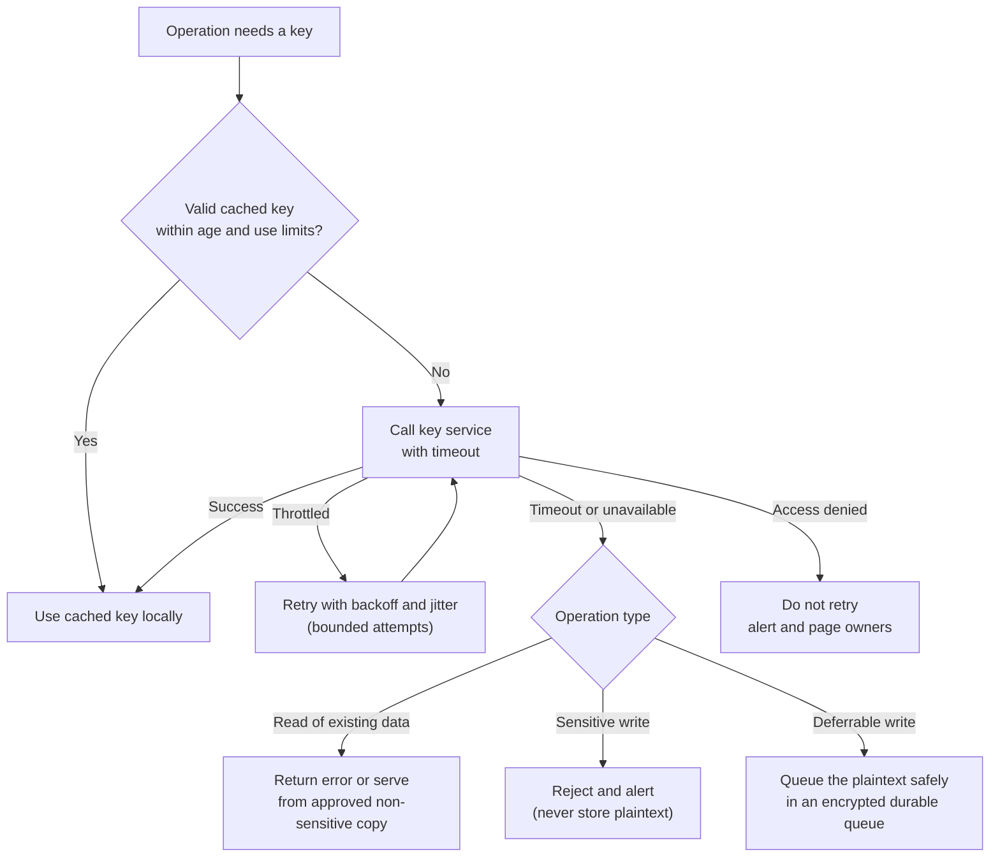

The tree treats three error classes differently. Throttling is transient and gets bounded retries with exponential backoff and random jitter, so retrying clients do not synchronize into a second wave. An access-denied response is a configuration or revocation signal and is never retried in a loop. A timeout needs an explicit decision per operation. The design rule that matters most: never fall back to storing plaintext, and never fall back to a locally generated key that was not designed as part of the hierarchy, because such fallbacks create exactly the data that later cannot be decrypted or should never have existed. Queuing a deferred write is acceptable only if the queue is itself encrypted under a key that does not depend on the failed service.

### 13.4 Quality scenario

Stimulus: the key service in the primary region returns errors for 20 minutes. Expected response: reads of cached documents continue until cache entries expire, new reads of uncached documents return a clear retryable error, sensitive writes are rejected with an alert, and no plaintext is persisted anywhere. Success criteria: zero plaintext writes, zero decryption of data for unauthorized identities, an alert within 2 minutes, and full recovery with no manual repair within 5 minutes of the key service recovering. Verify with a fault-injection test that blocks the key-service endpoint from a test environment, and repeat after each change to the caching policy.

Retry cryptographic operations only under bounded policy and with idempotent request semantics. A generate-data-key call that is retried after an unknown outcome simply creates an unused extra key, which is harmless, while a retried write that stores two different ciphertexts for one record needs the application's idempotency key to prevent duplicates.

A wrong key, a lost key version, a changed encryption context, or permission drift can make otherwise healthy storage unreadable. Test restore and rotation procedures regularly and keep the results.

## 14. Cryptographic Agility

Cryptographic agility is the ability to change algorithms, key sizes, and libraries without redesigning the system. Reasons to change arrive regularly: an algorithm is deprecated, a library vulnerability forces an upgrade, a compliance regime changes accepted parameters, or the post-quantum migration from section 11 begins. Agility is a property of formats and interfaces, and the work is done before the first migration, not during it.

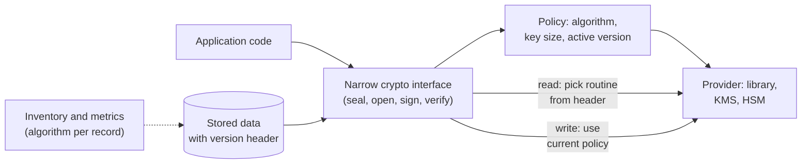

Application code calls a small interface, and a policy layer chooses algorithm and key version. Stored records carry a version header, so reads select the routine that wrote the data and writes follow the current policy. The inventory is what lets an organization see how much data still uses an old algorithm, and without it migration progress is unknown. The implication is that algorithm names must never be scattered through the code base, and that a format with no version field forces a flag day, where every record changes at once.

Practices that make agility real:

- Put an algorithm identifier and a format version in every ciphertext and signature envelope, for example a one-byte version prefix. Reject unknown versions explicitly.
- Keep read support for old formats for as long as old data exists, and write support only for current formats. Remove old write paths first.
- Avoid hard-coded sizes for keys, signatures, tags, and certificates in database columns and wire formats. Post-quantum signatures and keys can be much larger, so a fixed-width column is a latent outage.
- Pin the accepted algorithm set in configuration on the verifier side, and make downgrade impossible by refusing weaker options than policy allows, even if a peer offers them.
- Rehearse the change. Pick a low-risk dataset, migrate it end to end, and measure the time, the key-service request count, and the failure handling before it is needed under pressure.
- Track the algorithm per record or per partition so progress can be reported, and set a date after which old read paths are removed.

Agility has a cost: more code paths to test and more combinations to support. Limit it by supporting a short list of algorithms with a clear sunset for each, and not an open registry. An organization that supports every algorithm ever configured has widened its attack surface and has not become more flexible.

A short check shows the idea at the byte level. Using a one-byte version prefix lets a reader choose the routine:

```python
import os
from cryptography.hazmat.primitives.ciphers.aead import AESGCM, ChaCha20Poly1305

V1_AESGCM, V2_CHACHA = 1, 2  # registry of accepted formats

def seal_v2(key: bytes, pt: bytes, aad: bytes) -> bytes:
    nonce = os.urandom(12)
    return bytes([V2_CHACHA]) + nonce + ChaCha20Poly1305(key).encrypt(nonce, pt, aad)

def open_any(key: bytes, blob: bytes, aad: bytes) -> bytes:
    version, nonce, ct = blob[0], blob[1:13], blob[13:]
    if version == V1_AESGCM:
        return AESGCM(key).decrypt(nonce, ct, aad)
    if version == V2_CHACHA:
        return ChaCha20Poly1305(key).decrypt(nonce, ct, aad)
    raise ValueError("unsupported ciphertext version")
```

Writes use the current version and reads accept both. The version byte should also be included in the associated data in a production format, so that an attacker cannot change it without breaking the tag. Without that, an attacker who flips the version byte is limited to causing a failed decryption here, but in formats with several compatible routines the unauthenticated selector becomes a downgrade point.

## 15. Failure and Quality-Attribute Scenarios

Section 13.4 gave one scenario for a key-service outage. This section adds three more that test different parts of the design. Each states a stimulus, the expected response, and a criterion that a test or an audit can check. All durations and sizes are assumptions chosen for the arithmetic, and the waiting period for key deletion differs by provider, so confirm it in the current documentation.

| Scenario | Stimulus | Expected response | Measurable success criterion |
|---|---|---|---|
| Regional failover | The primary region is declared lost and traffic moves to the recovery region | The recovery region unwraps DEKs with a replica of the KEK and serves reads | Decrypt test of 1,000 randomly sampled objects passes in 100 percent of cases, within a recovery time objective (RTO) of 30 minutes |
| Key deletion requested | Scheduled deletion is requested for a production KEK, by mistake or by an attacker | Alert fires, the request is reviewed, and deletion is cancelled inside the waiting period | Alert within 5 minutes, cancellation within 1 hour, zero objects unreadable |
| Nonce reuse discovered | An audit finds two ciphertexts with the same nonce under one DEK | The DEK is treated as exposed, the affected objects are identified and re-encrypted | Affected set listed within 4 hours, all affected objects re-encrypted within 24 hours |

### 15.1 Regional failover with a replicated key

Stimulus: the primary region is lost. Storage replication has already copied ciphertext and wrapped DEKs to the recovery region, as in the failure-domain diagram of section 13.2. The expected response depends on a decision made months earlier: the KEK either has a replica in the recovery region or it does not. If it does, the application there unwraps DEKs under the same key identifier and reads continue. If it does not, every replicated object is unreadable until the primary returns, and no amount of storage replication helps.

The test is a drill, not a review. Sample 1,000 objects at random from the replicated store, decrypt each in the recovery region, and compare a stored plaintext hash. The criterion of 100 percent is deliberate: one failure means one key, context, or permission was missed, and the sample size makes a missed key class (a whole tenant, a whole backup set) very likely to appear. Record how long the drill takes against the 30-minute target, including the time to deploy the workload identity that is allowed to use the replica key, because a key that exists but cannot be used by the recovery workload counts as a failure.

### 15.2 Accidental or hostile key deletion

Stimulus: someone requests scheduled deletion of a production KEK. Many key services do not delete at once. They disable the key and start a waiting period, which is the only window in which the request can be undone. The design goal is to make sure a human sees the request inside that window.

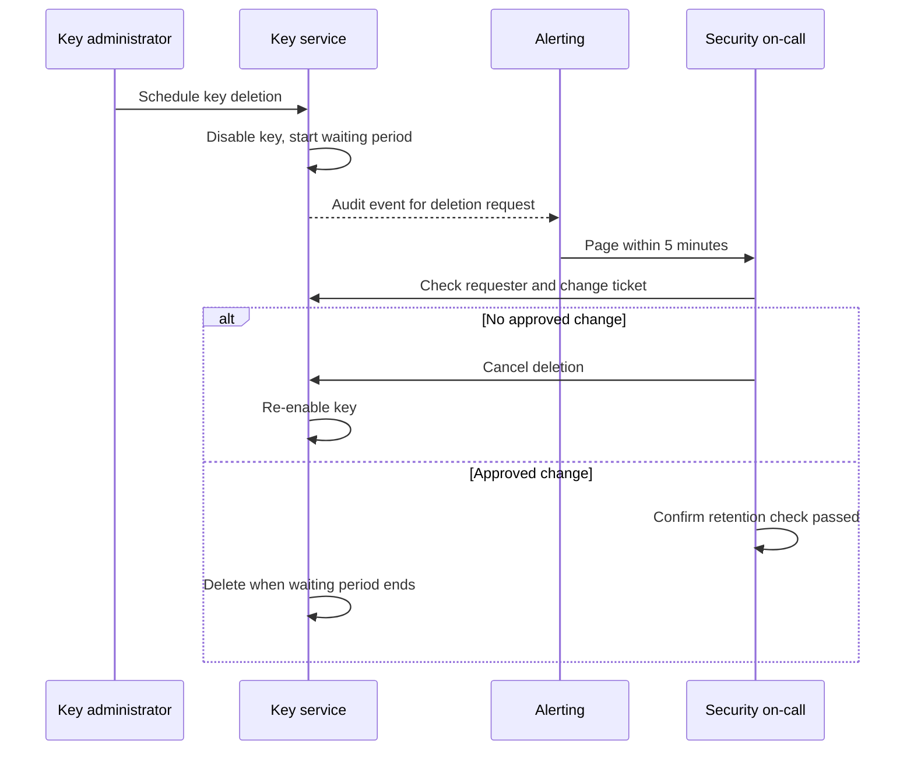

The diagram shows that cancellation is possible only while the key is waiting. The implication is that the alert path is part of the key's protection and needs testing like any other control. Note also that the key is disabled from the moment of the request, so reads fail immediately, and the storage errors can reach the on-call engineer before the audit alert does. The runbook should therefore name key deletion requests as a first cause to check when decrypt failures start suddenly. With a deletion waiting period of 30 days (an assumption), a one-hour cancellation target uses 1 / (30 × 24) = 0.14 percent of the window, which leaves ample margin for a mistake in the first response.

### 15.3 Nonce reuse discovered in stored data

Stimulus: an audit job that scans stored ciphertext headers finds repeated nonces. Illustrative case: a batch writer used one DEK for a batch of 50,000 objects and kept a counter nonce. After a restore from snapshot the counter restarted partway through the batch, so some counter values were used twice.

Expected response. First, treat the DEK as exposed, since the repeated keystream leaks plaintext relationships (section 4.2) and the authentication subkey may be recoverable. Second, list every object written under that DEK from the stored metadata. Third, re-encrypt them with fresh single-use DEKs and random nonces, then retire the old DEK. A wrap-only rotation does not help here because the defect is in the data encryption, as section 5.4 explained.

Arithmetic for the criterion. Assume the 50,000 objects average 1 MiB, so 50,000 MiB must be read and rewritten. At an assumed 200 MiB/s, 50,000 / 200 = 250 s for each direction if reads and writes run at that rate in sequence, about 500 s or 8.3 minutes of transfer. The 24-hour target is therefore met by a wide margin and the real time goes to identifying objects, notifying owners, and verifying the result. The design lesson is the one from section 4.3: a single-use DEK per object makes this scenario impossible, and a shared DEK with a counter makes it a matter of when.

## 16. Worked Case Study: An Encrypted Document Archive

This case is illustrative. The organization, its workload, and every figure are hypothetical and chosen to show the reasoning, not to describe a real system.

Harbor Records, a hypothetical document-archive provider, stores scanned contracts for 200 corporate tenants. Each tenant contract requires that the tenant can have its data made unreadable on demand and that every access to its keys is auditable. The service needs server-side text extraction and thumbnails, runs in one primary and one recovery region, and holds 40,000,000 objects averaging 2 MiB.

### 16.1 Sizing

- Data volume: 40,000,000 × 2 MiB = 80,000,000 MiB. Dividing by 1,024 gives 78,125 GiB, and by 1,024 again about 76.3 TiB.
- Wrapped DEK metadata: 40,000,000 × 100 B (assumed blob size) = 4,000,000,000 B, about 4 GB, stored next to each object.
- Peak load: 600 reads and 150 writes per second. Each write needs one generate-data-key call, so 150 calls per second. Each read needs an unwrap. With a 60-second per-object cache and an assumed 50 percent hit rate, reads cost 600 × (1 − 0.5) = 300 calls per second.
- Key-service load: 150 + 300 = 450 calls per second, against an assumed regional quota of 2,000, so 450 / 2,000 = 22.5 percent used.
- Rotation budget: a re-wrap job limited to 1,000 calls per second brings the peak to 1,450, which is 72.5 percent of the quota and leaves headroom for a traffic spike of 37 percent before throttling (2,000 / 1,450 = 1.38).

### 16.2 Architecture

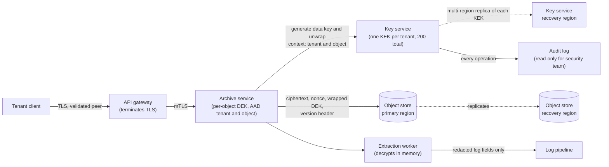

Plaintext exists in three places: the gateway after TLS termination, the archive service and extraction worker memory, and nowhere else by policy. The log pipeline receives identifiers and byte counts, never document text. This is the residual exposure the design accepts, and the review checklist in section 18 asks for it to be written down.

### 16.3 Decisions and rejected alternatives

| Decision | Chosen | Rejected | Reason |
|---|---|---|---|
| Key control | Customer-managed KEK per tenant | Provider-managed keys | Tenants require revocation and per-key audit, which provider-managed keys do not give |
| Encryption layer | Application-layer envelope encryption, per-object DEK | Client-side encryption with tenant-held keys | Extraction and thumbnails need plaintext on the server |
| Key location | Provider key service with multi-region replica | External key manager | The extra availability dependency is not justified by the contract, which asks for revocation and not for provider exclusion |
| Cipher | AES-256-GCM, random 96-bit nonce, single-use DEK | Shared DEK with counter nonce | Single use removes the nonce-reuse risk (section 4.3) |
| Rotation | Annual KEK version, batch re-wrap, archives re-wrapped | Keep old versions for full retention | Archive retention would otherwise keep version 1 alive for years (section 8.3) |
| Revocation | Per-tenant KEK disable, with 60-second DEK cache | Longer cache | 60 seconds is the stated revocation window the contract can tolerate |

### 16.4 Validation evidence

Rotation arithmetic: re-wrapping 40,000,000 objects at 1,000 per second takes 40,000 s, about 11.1 hours. Re-encrypting all data at an assumed 1 GiB/s would take 78,125 s, about 21.7 hours, so re-wrap is faster here because the quota is generous, and it moves 4 GB instead of 76.3 TiB. Daily backups are kept for 35 days, so after a rotation the old version must stay decryptable for 35 days plus about 0.5 days, or 35.5 days. The archive set is re-wrapped in the same job and does not extend that period.

The team keeps the following evidence and repeats each item after major changes:

- A failover drill: 1,000 sampled objects decrypted in the recovery region within 30 minutes.
- A fault-injection test blocking the key-service endpoint for 20 minutes: zero plaintext writes, alert within 2 minutes.
- A nonce audit: a weekly job that checks for duplicate nonces per DEK, expected result zero, which is trivially true while DEKs are single-use and still worth running.
- A key-deletion drill: a test KEK scheduled for deletion, alert received, deletion cancelled inside one hour.
- A restore of a 35-day-old backup after rotation, proving version 1 still decrypts it.
- A policy review listing administrators, workload roles, and auditors with no overlap between the three lists.

The case shows the pattern of the chapter. Choose the boundary from the threat, keep DEKs single-use, make the common rotation cheap, test the rare events, and write down who can still read plaintext.

## 17. Common Mistakes

| Mistake | Cause | Consequence |
|---|---|---|
| Key stored beside the data | Convenience, a configuration file or the same bucket | Anyone who copies the data copies the key, so encryption adds no protection |
| Reusing a nonce | Counter restored from a snapshot, or a shared DEK with a weak random source | Plaintext relationships leak and forgery becomes possible (section 4.2) |
| Encrypting without authenticating | Older modes or hand-built constructions | Ciphertext can be altered without detection, and padding-oracle attacks become possible |
| Broad decrypt permission | A wildcard grant given to speed up a launch | Any compromised workload reads all data, which removes the benefit of the key hierarchy |
| One key for every purpose or environment | Fewer keys to manage | A development leak exposes production, and revocation stops everything |
| No metadata in the ciphertext format | Algorithm assumed to be fixed | The data cannot be migrated or decrypted after a library change (section 14) |
| Treating rotation as incident response | Confusion between new key version and revocation | A copied key keeps working on all old data (section 8.1) |
| Disabling or destroying an old key version before checking backups | Rotation complete in production, forgotten elsewhere | Restores fail when they are needed most (section 8.2) |
| Plaintext in logs, caches, and exports | Encryption designed for the database only | The protected fields are readable in a less protected copy (section 2.2) |
| Disabling certificate checks for internal calls | A test setting left in place | An active intermediary can read and alter traffic |
| Falling back to plaintext during a key outage | Pressure to keep the service up | Sensitive data is stored unprotected, and the incident becomes a disclosure (section 13.3) |
| Never testing recovery | Backups assumed to work | The first test of cross-region decryption happens during a disaster (section 13.2) |

Most rows have the same shape: a convenience in design, no test that would catch it, and a consequence discovered during an incident. The cheapest defence is the set of drills listed in the case study.

## 18. Design-Review Checklist

Use these questions in a review. Each answer should name a person, a configuration, or a test result.

- Threat and boundary: which party must be unable to read the data, and does the chosen layer defend against that party (section 2.3)?
- Data states: where does plaintext exist in transit, in use, and in logs, caches, indexes, exports, and crash dumps (section 2.2)?
- Primitives: is AEAD used, from a vetted library, with a fixed accepted algorithm set (sections 3 and 4)?
- Nonces: how is uniqueness guaranteed, and what is the invocation limit per key (section 4.3)?
- Hierarchy: what are the root, KEK, and DEK levels, and what does the compromise of each expose (section 5.1)?
- Context: what encryption context and associated data bind ciphertext to tenant and object (sections 4.1 and 5.3)?
- Custody: who holds key material, who can cause a decrypt, and who can stop it (section 7.1)?
- Separation of duties: are administrators, workloads, and auditors different identities, verified against the real policy (section 7.3)?
- Rotation: what is the schedule, what happens to backups and archives, and when is each old version disabled and destroyed (section 8)?
- Revocation: what is the delay between disabling a key and the last successful decrypt, given caches (section 12.3)?
- Transit: where does TLS terminate, is the peer validated, and is mTLS needed (section 9.1)?
- Performance: what is the key-service call rate at peak, the quota headroom, and the cache policy (section 12.2)?
- Failure: what does each operation do when the key service is unreachable, and is plaintext fallback ruled out (section 13.3)?
- Recovery: has a decrypt been tested in the recovery region, and from a backup older than the last rotation (section 13.2)?
- Agility: does every record carry an algorithm and version, and is there an inventory of algorithms in use (section 14)?
- Long-lived confidentiality: which data must stay secret for decades, and which asymmetric keys protect it (section 11)?
- Evidence: where are the audit logs, who reads them, and which alerts exist for key deletion, policy change, and abnormal decrypt volume?


## 19. Exercises

1. Distinguish encryption, hashing, MACs, and digital signatures by the properties each gives, and pick one for a webhook receiver that must reject forged calls. Outline: hash gives no authenticity, encryption alone gives no integrity, a MAC with a shared secret fits one trust domain, a signature fits many untrusted verifiers. Use HMAC with a constant-time comparison.
2. A service writes 2,500 records per second under one DEK with random 96-bit nonces. How long until the 2³² invocation limit? Outline: 4,294,967,296 / 2,500 = 1,717,987 s, about 19.9 days. Recommend single-use DEKs or a cap on count and age per DEK.
3. Draw the envelope-encryption write and read paths and mark every place plaintext or key material exists. Outline: plaintext DEK in application memory during one encryption, wrapped DEK in storage, KEK only in the key service, plaintext data in application memory, logs and caches as residual exposure.
4. Design a KEK rotation that keeps old ciphertext readable while new writes use a new version. Outline: create version 2, switch writes, re-wrap lazily or in batch, keep version 1 until backups and archives are covered, disable then destroy, and rehearse a restore.
5. A key service is unreachable during a sensitive write. What should the service do? Outline: use a valid cached data key within limits, otherwise reject and alert, never store plaintext, queue only into a queue encrypted under an independent key.
6. Explain why encryption at rest does not stop an authorized but compromised application. Outline: the storage layer decrypts for any authorized caller, so the compromise inherits decrypt permission. Reduce the set of identities, scope key use by context, and alert on abnormal decrypt volume.
7. An archive of 10,000,000 objects must be re-wrapped, and the key quota allows 800 calls per second for the job. How long does it take, and how long must the old key version remain after the job if backups are kept 14 days? Outline: 10,000,000 / 800 = 12,500 s, about 3.5 hours (0.14 days). The old version must stay decryptable until the last pre-job backup expires, 14 days after the job finishes, so about 14.1 days after it starts.
8. Choose an encryption boundary for a tenant who requires that the operator cannot read documents, while search by keyword is needed. Outline: client-side or application-layer encryption with tenant-held keys. Search then needs a keyed MAC index of normalized terms, which reveals equality of terms, or the feature is given up. State the accepted leak.

## 20. Summary

The summary maps to the outcomes listed in the Introduction.

1. Guarantees by data state. Encryption gives confidentiality, and integrity and authenticity only when requested. In transit it ends at the TLS endpoint, at rest it does not stop an authorized caller, and in use the process holds plaintext (section 2). Residual copies in logs, caches, and exports are the usual gap.
2. Primitive selection. Choose from the property needed: AEAD for secret and tamper-evident data, HMAC within one trust domain, signatures for many verifiers, key agreement to establish a secret, and hashes only as fingerprints (sections 3 and 10). Nonce uniqueness is a hard requirement because one repeat leaks plaintext and enables forgery (section 4).
3. Envelope design. A single-use DEK per object, wrapped by a KEK that stays in the key service, bounds the blast radius and makes per-use audit possible. Size the hierarchy with arithmetic for nonce limits, request quotas, and rotation time (sections 5, 12, and 16).
4. Boundary choice. Pick provider-managed, customer-managed, customer-supplied, external, or application-layer keys from the threat, and accept the matching availability and feature cost (sections 6 and 7). Custody, separation of duties, rotation, and failure behavior decide whether the choice holds in operation (sections 8, 13, and 15).

Keys and decryption authority are architecture components that need owners, metadata, rotation, recovery drills, and a path to change algorithms (sections 11 and 14). Encryption is one control in a broader system, alongside identity, authorization, and monitoring from the other chapters of this part.
