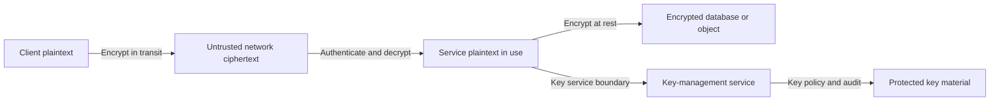
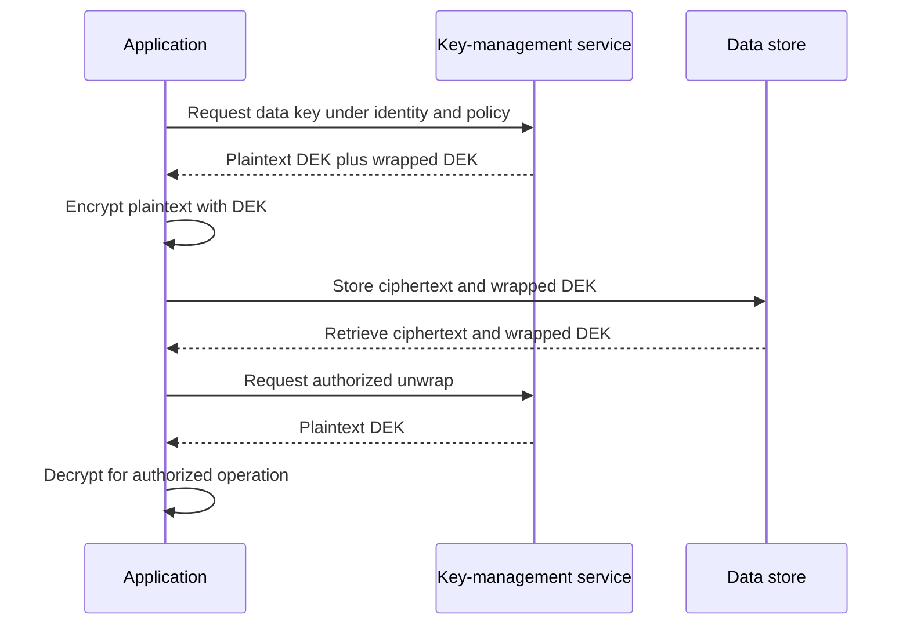
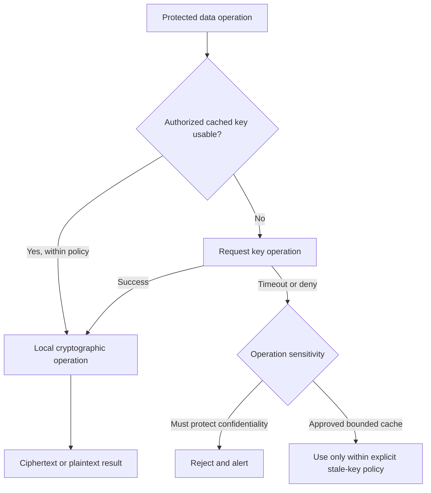
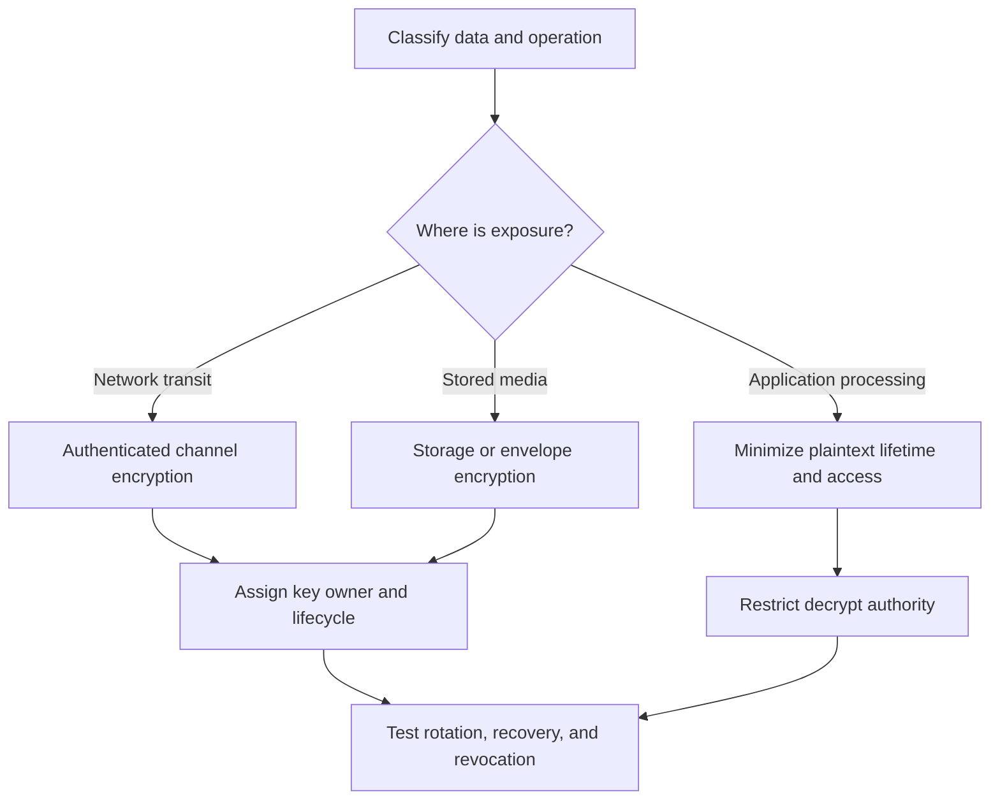

# Encryption

Part: [15 — Security](PART_OVERVIEW.md)

Encryption transforms data so parties without the required key cannot recover the protected content. It provides confidentiality; authenticated modes can also provide integrity and verify origin. Encryption does not prevent authorized misuse, protect plaintext while an application is processing it, or repair weak access controls. Part 05 owns Transport Layer Security (TLS) and protocol mechanics; Part 09 owns cloud key-management products. This chapter covers cross-system selection, key ownership, lifecycle, and limits.

## Security Properties and Data States

Classify data by sensitivity, integrity needs, lifetime, and exposure. Data in transit crosses a network; data at rest is stored on media or in backups; data in use is being processed. Encryption choices should follow the threat model for each state and the trust boundaries around the keys.

Encryption in transit protects data between endpoints only if each endpoint validates the peer and protects its private key. Encryption at rest protects lost media or storage-layer access under stated key boundaries, but does not protect data from a compromised application that can request decryption. Encryption in use can reduce exposure in specialized environments, but does not replace access control or runtime security.

## Cryptographic Building Blocks

Symmetric encryption uses the same secret key to encrypt and decrypt and is efficient for bulk data. Asymmetric cryptography uses a public/private key pair for operations such as key establishment or signatures. A cryptographic hash produces a fixed-size digest and is not encryption; a message authentication code (MAC) uses a secret key to authenticate integrity. Digital signatures provide verifiable origin and integrity when key trust is established.

Use vetted libraries and protocol implementations. Do not design custom algorithms or combine primitives without a reviewed construction. Nonces and initialization vectors must follow the algorithm's uniqueness and unpredictability requirements. Reusing a nonce with some modes can catastrophically expose plaintext or permit forgery.

## Envelope Encryption and Key Hierarchy

Envelope encryption encrypts data with a data-encryption key (DEK), then encrypts that DEK with a key-encryption key (KEK) managed in a protected key service or hardware security module. The encrypted data and wrapped DEK can be stored together; decryption requires authorized access to the KEK operation. This separates bulk data processing from master-key custody and supports rotation without re-encrypting every data object in some designs.

The application necessarily handles plaintext and often the DEK during encryption or decryption. Protect process memory, logs, crash dumps, and the identity authorized to call decrypt. Bind encryption context or associated data to object identity and tenant where supported, so ciphertext cannot be swapped between records without detection. Define recovery if the key service is unavailable and preserve protected backups of key-encryption material according to policy.

## Key Ownership, Rotation, and Revocation

Keys need an owner, purpose, algorithm, creation time, permitted operations, rotation policy, storage boundary, backup strategy, and destruction criteria. Separate duties for key administration and data access. Key versioning should allow controlled decryption of old data while new writes use the current version. Rotation does not necessarily mean immediate retirement of the old key.

```mermaid
stateDiagram-v2
    [*] --> ActiveV1
    ActiveV1 --> NewVersion: create and distribute v2
    NewVersion --> DualDecrypt: new writes use v2; old data uses v1
    DualDecrypt --> Rewrapped: migrate or rewrap eligible data
    Rewrapped --> RetireV1: verify no required ciphertext depends on v1
    ActiveV1 --> Compromised: exposure suspected
    Compromised --> EmergencyRevoke: contain and assess impact
    EmergencyRevoke --> Recovery: restore trusted keys and re-encrypt as needed
    RetireV1 --> [*]
```

Compromise response differs from routine rotation. Revoke or disable the exposed key path, assess which ciphertext and identities were affected, and plan re-encryption or data replacement. Destroying a key can make data unrecoverable; verify retention, backup, legal hold, and recovery obligations first. Do not use the same key for unrelated purposes or environments.

## Performance, Availability, and Failure

Encryption consumes CPU and may add latency, especially for small frequent operations that repeatedly call a remote key service. Use local data keys under a protected envelope model when appropriate, batch operations carefully, and measure tail latency. Do not cache decrypted keys beyond acceptable exposure and revocation windows.

Key-service availability is part of application availability. Define whether a cache, queue, retry, or fail-closed behavior is acceptable for each operation. Retry cryptographic operations only with bounded policy and idempotent request semantics. A wrong key, lost key version, changed encryption context, or permission drift can make otherwise healthy storage unreadable; test restore and rotation procedures.

## Worked Case and Review Checklist

A document service encrypts each object with a unique DEK and wraps that key with a tenant-scoped KEK in a managed key service. The encryption context binds the wrapped key to tenant and object identity. Runtime workload identity can request only the required cryptographic operation. New writes use the active key version; prior versions remain available for decrypt until data migration and backup retention are verified. A key-service outage rejects sensitive writes rather than storing plaintext.

Review data classification, state boundaries, algorithm/library selection, key separation, identity permissions, encryption context, rotation, revocation, backup, recovery, latency, outage behavior, plaintext handling, and audit. Confirm key destruction cannot silently violate recovery or retention requirements.

## Questions and Summary

1. Distinguish encryption, hashing, MACs, and digital signatures by their security properties.
2. Draw envelope encryption and identify every boundary where plaintext or key material exists.
3. Design a rotation that permits old ciphertext reads while new writes use a new key.
4. What should a service do when its key service is unavailable during a sensitive write?
5. Explain why encryption at rest does not protect data from an authorized but compromised application.

Encryption protects defined data states under explicit key and identity assumptions. Its effective security depends on sound algorithms, key custody, access policy, rotation, recovery, and failure behavior. Treat keys and decryption authority as first-class architecture components; encryption is one control in a broader system.
