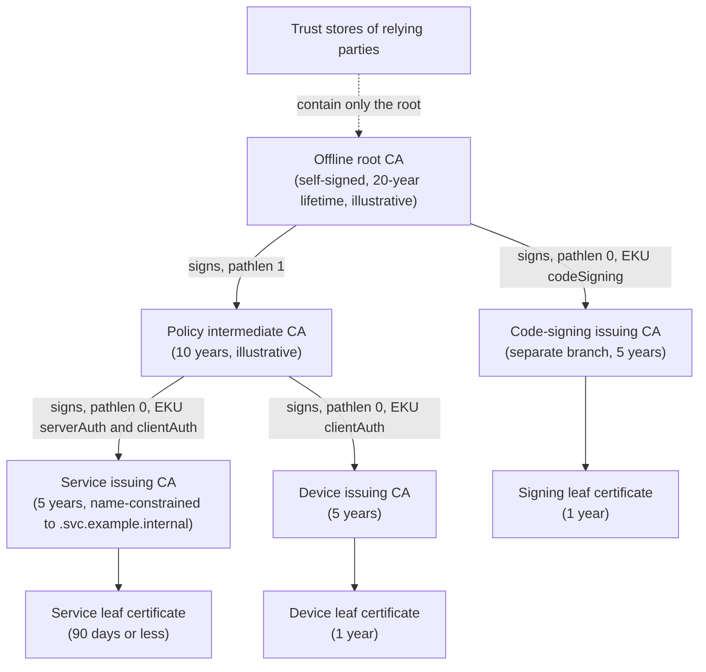
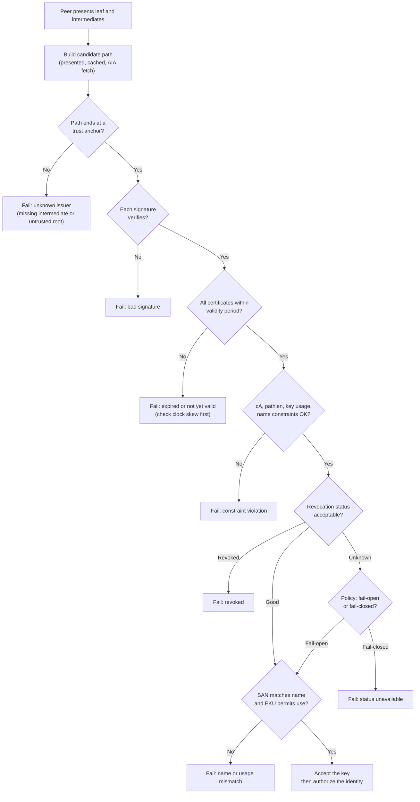
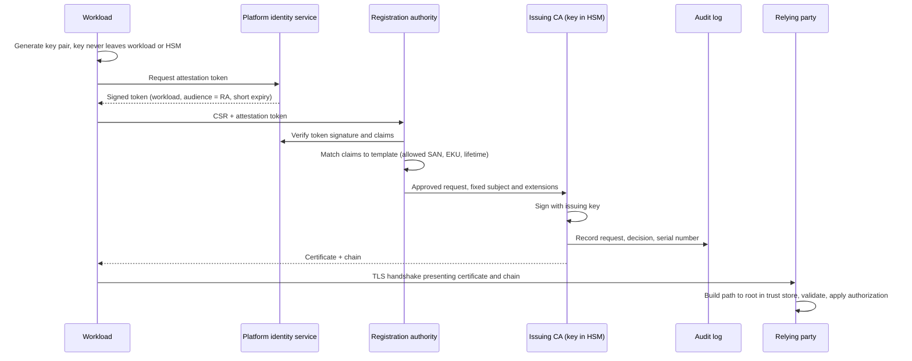
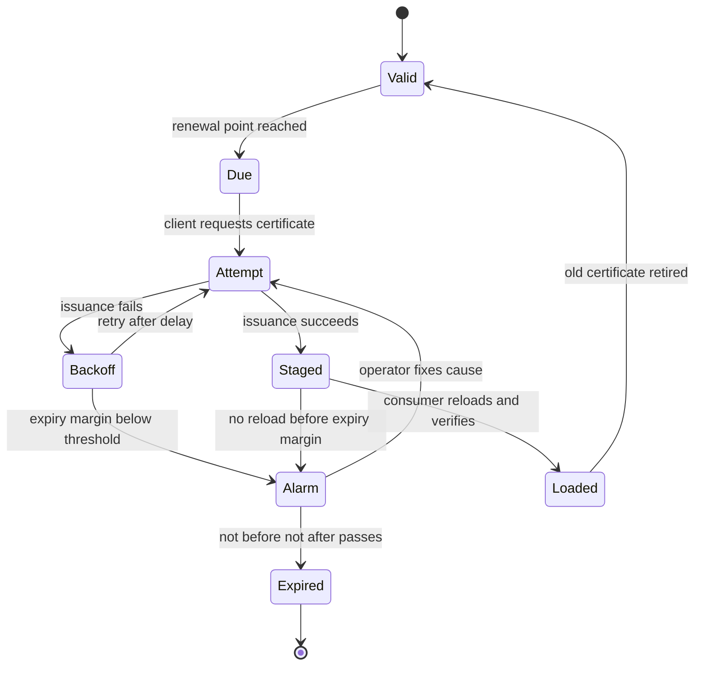
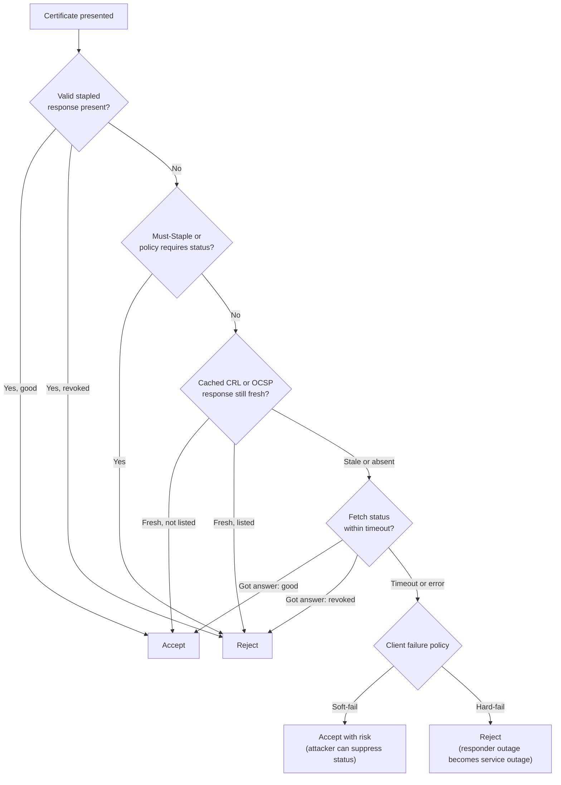
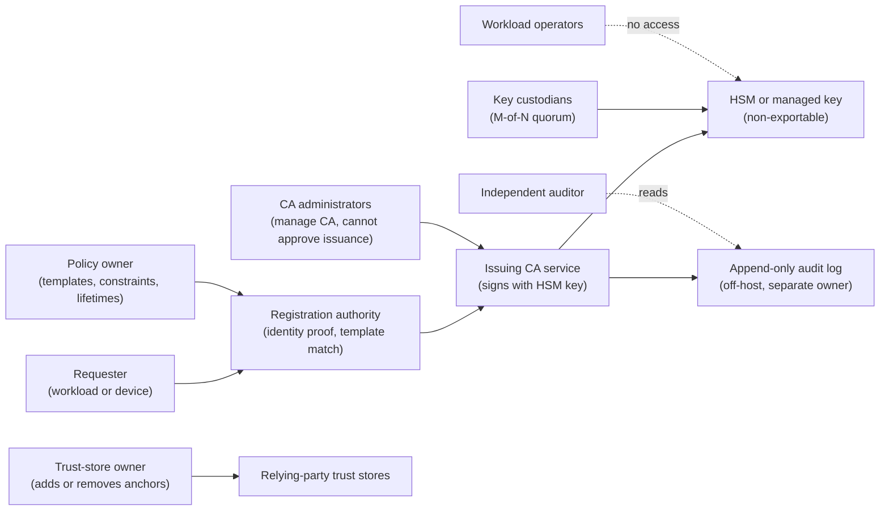
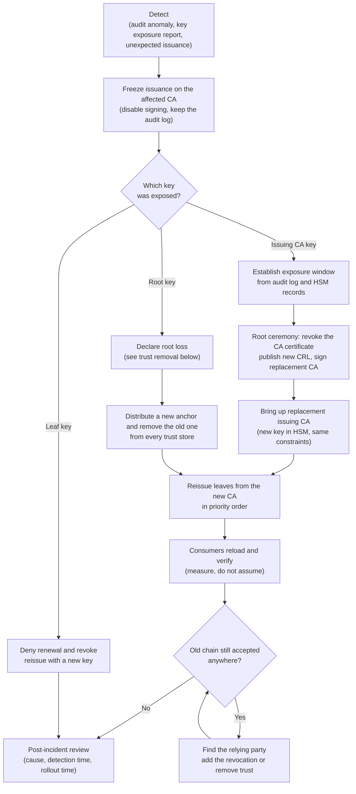
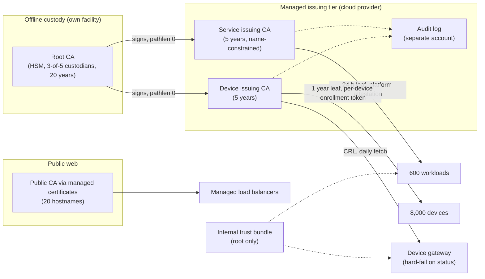

# PKI (Public Key Infrastructure)

Part: [15 — Security](PART_OVERVIEW.md) · Status: Revised (in-depth rewrite)

## 1. Introduction

Public Key Infrastructure (PKI) is the set of people, policies, software, and hardware used to create, distribute, validate, renew, and revoke digital certificates. A certificate is a signed statement that binds a public key to a name or a purpose. Every Transport Layer Security (TLS) connection to a website, every mutual TLS (mTLS) call between two services, every signed software update, and every corporate device that joins a network by presenting a certificate rests on a PKI. When a PKI works, nobody notices. When it fails, a whole fleet stops talking at the same minute, or an attacker is silently trusted by everything.

After this chapter you will be able to:

- State what a certificate asserts, who is trusted to assert it, and what a relying party has to do before believing it.
- Design a certificate authority (CA) hierarchy: how many tiers, what each tier is allowed to sign, and how long each certificate lives.
- Walk through certificate path building and validation step by step, and predict which failure a given misconfiguration produces.
- Describe the issuance flow from key generation to signed certificate, including where identity is proved and where automation fits.
- Compare AWS Private CA with AWS Certificate Manager (ACM), Azure Key Vault certificates, and Google Cloud Certificate Authority Service (CA Service) on what they actually do.

Ownership across the handbook:

| Topic | Owner |
|---|---|
| X.509 field layout, extensions, validation levels, Certificate Transparency | [Part 05 CH15 Certificates](../05_Networking_and_OS/CH15_Certificates.md) |
| TLS handshake mechanics and mTLS wire behavior | [Part 05 CH06 TLS](../05_Networking_and_OS/CH06_TLS.md) |
| Encryption primitives, key hierarchies, and key rotation | [CH10 Encryption](CH10_Encryption.md) |
| Storing and delivering private keys and other secrets | [CH09 Secrets Management](CH09_Secrets_Management.md) |
| Provider secret and key products | [Part 09 CH13 Secrets Management](../09_Cloud_Computing/CH13_Secrets_Management.md) |
| Hierarchy design, validation reasoning, issuance flows, trust distribution, renewal, revocation, key custody, and compromise recovery | This chapter |

Part 05 explains what the bytes of a certificate mean and how a browser or server uses them. This chapter explains how an organization runs the system that produces those certificates and how it stays recoverable when a key is lost. Where the two overlap, the mechanism is restated only far enough to reason about the design.

One framing carries through the chapter. PKI does not make a connection secure. It lets a relying party decide whether a public key belongs to the party it claims to be. The decision is only as good as the policy of the issuer, the care taken with the issuer's key, and the trust store the relying party consults.

## 2. The Trust Model

### 2.1 What a certificate asserts

A certificate is a small data structure, defined by the X.509 standard and profiled for the internet in Request for Comments (RFC) 5280. It carries a subject name, the subject's public key, a validity interval, a set of extensions that limit how the certificate may be used, the issuer's name, and the issuer's signature over all of it. The signature is the entire point. Anyone who holds the issuer's public key can check that the issuer vouched for exactly these contents, and that nobody altered them since.

The vouching is narrow. A certificate does not say the subject is honest, that its software is patched, or that its private key is safe. It says that, at issuance time, the issuer applied its policy and concluded that the holder of the matching private key was entitled to the name or purpose in the certificate. Everything downstream, including whether a service may call another service, belongs to authorization ([CH03 Authorization](CH03_Authorization.md)), not to PKI.

The fields that matter for design decisions in this chapter are these. Their byte-level layout is in [Part 05 CH15 Certificates](../05_Networking_and_OS/CH15_Certificates.md).

| Field or extension | Design question it answers |
|---|---|
| Subject and Subject Alternative Name (SAN) | Which identity may this key speak for? |
| Issuer and Authority Key Identifier | Which CA signed this, and which of its keys? |
| Not Before and Not After | For how long is the binding claimed to hold? |
| Basic Constraints (`cA`, `pathLenConstraint`) | May this certificate sign other certificates, and how deep may the chain go below it? |
| Key Usage and Extended Key Usage (EKU) | For what operations may the key be used: signing certificates, TLS server authentication, TLS client authentication, code signing? |
| Name Constraints | Which names may a subordinate CA issue for? |
| CRL Distribution Points and Authority Information Access | Where does a relying party fetch revocation status and the issuer's certificate? |

### 2.2 Relying parties, trust anchors, and trust stores

A relying party is any software that accepts a certificate and acts on it: a browser, a service mesh sidecar, a Java process, a device firmware updater. It starts with a set of trust anchors, which are certificates or keys it accepts without further proof. The set is called a trust store. Every other certificate is accepted only if a chain of valid signatures leads from it to an anchor.

Two consequences follow. First, trust is configured at the relying party, not conferred by the CA. A CA that nobody has put in a trust store issues certificates that nobody accepts. Second, a trust anchor is trusted for everything its constraints permit and, if it has none, for every name. Adding a root to a trust store is therefore an authorization decision, and the decision is often made once, by whoever builds an operating system image or a container base image, and then forgotten.

Public PKI and private PKI differ in who decides. In the public web PKI, operating system and browser vendors maintain trust stores under published root programs, and CAs must meet program requirements and are expected to log issuance for Certificate Transparency. In a private PKI the organization is the root program: it chooses which anchors go into which trust stores and writes the issuance policy. Use public PKI when the relying parties are outside your control, such as customers' browsers. Use private PKI when you control both ends, such as service-to-service mTLS, device identity, and internal tools. Mixing the two, for example trusting a public CA for internal service identity, means any customer of that CA who can obtain a certificate for a matching name can impersonate the service, so private identity is better rooted in a private anchor.

### 2.3 The attacker's view

An attacker has four main routes against a PKI, and a design should say which of them each control addresses.

1. Steal a CA private key. Every certificate the CA could sign, including ones that never existed, becomes forgeable. This is the highest-impact event and the reason hierarchy and key custody exist.
2. Persuade a CA to issue a certificate it should not. This is a failure of identity proofing and policy, not of cryptography. Weak validation of the requester, over-broad request approval, and permissive templates are the usual causes.
3. Steal a leaf private key. The attacker impersonates one subject until the certificate expires or is revoked. Short lifetimes and non-exportable keys limit the window.
4. Add a rogue anchor to a trust store. No cryptographic flaw is needed: the attacker simply makes the relying party trust their root. Trust-store integrity and change control therefore belong inside the PKI's scope.

These routes explain most of the design choices in the sections that follow.

## 3. Designing the CA Hierarchy

### 3.1 Roles in a hierarchy

A root CA holds a self-signed certificate that relying parties install as a trust anchor. An intermediate or subordinate CA holds a certificate signed by a CA above it. An issuing CA is the subordinate that signs leaf certificates. A leaf, or end-entity, certificate has `cA` set to false and cannot sign other certificates.

The purpose of layering is to keep the key that is hardest to replace away from the operations that happen most often. Replacing a root means updating every trust store that contains it, which can take months on a device fleet. Replacing an issuing CA means issuing a new subordinate certificate from the root and updating the chain that servers present, which relying parties pick up with no trust-store change.

### 3.2 A three-tier reference hierarchy



The diagram shows a reference shape, not a mandate. The root appears in trust stores. Everything below it is delivered inside the chain that a subject presents, so adding or replacing an issuing CA does not touch any trust store. Branches by purpose (services, devices, code signing) mean that a compromise of the device issuer does not let an attacker sign code, and that each branch can carry its own constraints and policy. The `pathLenConstraint` values cap the depth: the policy intermediate may sign one more tier of CA, and the issuing CAs may sign only leaves.

The cost is operational. Each additional CA is a key to protect, a certificate to renew, a revocation list to publish, and a place where a chain can be assembled wrongly. Add a tier only when it creates a boundary you need.

### 3.3 How many tiers

| Tiers | Shape | Use when | Main risk |
|---|---|---|---|
| One | A single self-signed CA issues leaves | Lab, short-lived test environments, a small system with one owner | The online issuing key is the trust anchor, so compromise or rotation forces a trust-store update everywhere |
| Two | Offline root and one online issuing CA | One organization, one or two identity classes, modest scale | The single issuer mixes classes of identity unless templates and constraints are strict |
| Three | Offline root, policy intermediate, issuing CAs per class or region | Several identity classes, regional or business-unit ownership, delegated administration | Operational cost and chain-handling mistakes |

Choose by the blast radius you are willing to accept and by who administers each part. If the platform team runs service identity and the endpoint team runs device identity, separate issuing CAs let each team hold its own key and policy without sharing administrative rights. If one small team runs everything, a two-tier design gives the main benefit, an offline root, at the lowest cost. A three-tier design for a team of three is a common source of expired intermediates nobody remembers owning.

### 3.4 Constraints that make the hierarchy mean something

A hierarchy only limits damage if each subordinate certificate limits what the subordinate may do. The constraints are extensions in the subordinate's certificate, set by the parent when it signs.

- `basicConstraints = critical, CA:true, pathlen:0` allows the subordinate to sign leaves but not further CAs.
- `keyUsage = critical, keyCertSign, cRLSign` restricts the CA key to signing certificates and revocation lists.
- `extendedKeyUsage` on a CA certificate limits the purposes of every certificate beneath it for validators that enforce the extension on chains.
- `nameConstraints` restricts the Domain Name System (DNS) names, email domains, or address ranges for which the subordinate may issue.

A fragment of an OpenSSL configuration section that a root would use when signing a service issuing CA looks like this:

```ini
[ v3_service_issuing_ca ]
subjectKeyIdentifier   = hash
authorityKeyIdentifier = keyid:always
basicConstraints       = critical, CA:true, pathlen:0
keyUsage               = critical, keyCertSign, cRLSign
extendedKeyUsage       = serverAuth, clientAuth
nameConstraints        = critical, permitted;DNS:.svc.example.internal
crlDistributionPoints  = URI:http://pki.example.internal/root.crl
```

Name constraints deserve emphasis because they convert a compromised subordinate from "can impersonate any host" into "can impersonate hosts under one domain". Support is not uniform. Validators generally enforce name constraints on DNS names, but older or minimal libraries may ignore the extension or mishandle the critical flag, and some devices reject certificates containing constraints they do not parse. Test with every relying party runtime you operate before relying on the control. Marking the extension critical makes a non-understanding validator reject the chain instead of silently ignoring the limit, which is the safer failure.

### 3.5 Lifetime arithmetic

Lifetimes are constrained by two rules. A certificate's validity interval should lie inside its issuer's validity interval, and a CA should stop issuing leaves early enough that its last leaf expires no later than the CA does. Worked example, illustrative:

- Root: valid 2026-01-01 to 2046-01-01 (20 years).
- Policy intermediate: 2026-01-01 to 2036-01-01 (10 years).
- Service issuing CA: 2026-01-01 to 2031-01-01 (5 years).
- Maximum leaf lifetime policy: 90 days.

The last day on which the service issuing CA may sign a 90-day leaf without outliving itself is 2031-01-01 minus 90 days. December contributes 31 days back to 2030-12-01, November 30 more to 2030-11-01, and 29 days back into October gives 2030-10-03. That is $31 + 30 + 29 = 90$ days. After 2030-10-03 the CA either issues shorter leaves or is replaced.

Replacement needs lead time too. If a new issuing CA must be created, signed by the intermediate in an offline ceremony, deployed, and used to reissue leaves, and the whole process plus the leaf renewal cycle takes about 60 days of work and a 60-day renewal horizon, start no later than 2030-10-03 minus 60 days, which is 2030-08-04 (October 3 back 3 days is September 30, so 57 more days from September 30 gives August 4). A safe working rule is to begin replacement when half of the CA's lifetime remains for a root or intermediate that sits in trust stores, and when 20 to 30 percent remains for an issuing CA, then calibrate against the measured time your own rollouts take.

The same arithmetic is why a root is expensive to rotate. If a device fleet takes 18 months to reach 99 percent adoption of a new trust anchor, the new root must be distributed at least 18 months before the first leaf chains to it. Cross-signing, where the old root signs the new root's key so that chains validate under either anchor, can bridge the gap but adds chain complexity and must itself be retired.

### 3.6 Root custody in one paragraph

The root key signs only subordinate certificates and revocation lists, a handful of operations over its life. It should therefore be generated in a hardware security module (HSM), held offline, and used only in a documented ceremony with multiple witnesses and recorded steps. The rest of key custody, including backup, dual control, and separation of CA duties, is treated in the section on key custody and operational separation.

## 4. Chain Building and Validation

### 4.1 Path building

A server normally presents its leaf certificate and the intermediates above it, but not the root. The relying party must build a path from the leaf to one of its own trust anchors. Building and validating are separate steps. Building is a search: find candidate issuers by matching the leaf's issuer name and Authority Key Identifier against the certificates available, which are those presented by the peer, those cached locally, and those fetched from the Authority Information Access (AIA) location in the certificate. Validation then checks each link in the candidate path.

Building can find more than one path. Cross-signed CAs produce two certificates with the same subject and key but different issuers, so one leaf may chain to either of two roots. A relying party with only one of the roots in its store should still succeed, and one that prefers the wrong path may fail even though a valid path exists. Libraries differ here, which is the source of the classic symptom that a site works in a browser but fails in a command-line client or an older Java runtime.

### 4.2 Validation steps

RFC 5280 section 6 defines the path validation algorithm. In practical terms a validator checks the following for each certificate in the path, starting from the trust anchor and moving to the leaf:

1. The signature verifies under the issuer's public key.
2. The current time lies within Not Before and Not After. The validator uses its own clock, so clock skew produces failures that look like cryptographic faults.
3. The subject of the issuer certificate equals the issuer name of the certificate below it (name chaining).
4. Every certificate except the leaf has `cA` true in Basic Constraints, and the number of non-self-issued intermediates below it does not exceed its `pathLenConstraint`.
5. CA certificates carry the `keyCertSign` bit when a Key Usage extension is present.
6. Name constraints from every CA above are satisfied by the names in the certificates below.
7. No unrecognized critical extension is present.
8. Revocation status is acceptable, according to the validator's revocation policy (see the section on renewal, rotation, and revocation).

Then the application-level checks that are not part of path validation proper run against the leaf:

1. The name the client intended to reach matches a SAN entry. Matching the Common Name alone is deprecated and rejected by current clients.
2. The EKU permits the intended use, for example `serverAuth` for a TLS server and `clientAuth` for an mTLS client.
3. For mTLS, the server maps the verified client certificate to an identity and then applies authorization. A valid chain proves the CA vouched, not that this client may call this API.



The tree shows that most production failures are not cryptographic. The first branch, unknown issuer, covers the most common outage: a server that sends only its leaf certificate. The expiry branch covers the second. The constraint and name branches mostly appear after a hierarchy change or a new issuing CA. A runbook that maps each error text to its branch shortens incidents considerably. The revocation branch also shows a policy decision, fail-open or fail-closed on unknown status, which must be explicit and chosen per use; the trade-off is developed in the revocation section.

### 4.3 Inspecting a chain with OpenSSL

Validation can be reproduced locally, which is the fastest way to diagnose a chain problem. With the root in `root.pem`, the intermediate in `issuing.pem`, and a leaf in `leaf.pem`:

```bash
openssl verify -CAfile root.pem -untrusted issuing.pem leaf.pem
openssl verify -CAfile root.pem -untrusted issuing.pem -purpose sslserver -verify_hostname api.svc.example.internal leaf.pem
openssl x509 -in leaf.pem -noout -subject -issuer -dates -ext subjectAltName,extendedKeyUsage,basicConstraints
openssl s_client -connect api.svc.example.internal:443 -servername api.svc.example.internal -showcerts </dev/null
```

`-CAfile` supplies trust anchors, and `-untrusted` supplies intermediates that are used for building but not trusted. The `s_client -showcerts` command lists the chain exactly as the server sends it, so a missing intermediate is visible as a chain of length one. Do not fix a missing intermediate by adding it to the client's trust store. Fix the server to send it, because every other client would otherwise fail the same way.

### 4.4 Trust stores in practice

Trust-store contents differ by runtime, and a service can contain several. The operating system has one, a language runtime may ship its own bundle, a container base image has one, and some applications pin a custom file. For a private PKI this multiplies the places where the root must be installed and where it must later be removed.

Design guidance:

- Install only the roots needed for the purpose. A service that talks only to internal peers needs the internal root and does not need the public bundle for that connection. Separate trust configuration per purpose avoids the case where a public CA certificate satisfies an internal identity check.
- Distribute the trust bundle through the same controlled channel as other configuration, with an owner, versioning, and change review. A new anchor is a security change.
- Keep a way to inventory which hosts and images trust which anchors. If you cannot list them, you cannot retire an anchor.
- Do not disable verification to make a test pass. An option that skips verification, once merged into a shared client library, tends to reach production.

A trust bundle update can be pictured as the same problem as a rolling deployment: old and new bundles must overlap for a period so that peers on either version keep working.

### 4.5 Failure modes and edge cases

- Missing intermediate. Servers send only the leaf. Browsers may mask this by fetching the issuer through AIA, while programmatic clients do not, so the outage appears only in backend calls.
- Expired intermediate or root while leaves are still valid. The leaves look fine, but the path fails. Monitoring must cover every certificate in the chain, not only leaves.
- Clock skew. A host whose clock is behind sees a freshly issued certificate as not yet valid. Short-lived certificates make this more visible, which is one reason to back off Not Before by a few minutes at issuance.
- Self-issued certificates and key rollover. A CA that changes its key but keeps its name produces two issuers with the same subject, and path building must select by key identifier.
- Wrong EKU or missing SAN after a template change. A new template drops `clientAuth`, and mTLS calls begin failing for newly issued certificates only, which makes the failure look intermittent.
- Mismatched time sources inside containers or enclaves, where the clock comes from a different source than the host.

## 5. Issuance Flows

### 5.1 From key pair to signed certificate

Issuance has the same shape in every system. The requester generates a key pair, builds a Certificate Signing Request (CSR) containing the public key and the requested subject and SAN values, and signs the CSR with the private key. The signature proves possession of the key, not entitlement to the name. A registration authority (RA), which may be a separate component or a function of the CA, then decides whether the requester is entitled to the requested identity. If it is, the CA signs a certificate whose contents it controls. A CA should copy only what policy allows from the CSR and set the rest itself: validity, extensions, and EKU come from the issuing template, never from the request.

That last rule is a common vulnerability source. A CA that copies requested extensions verbatim lets a requester ask for `CA:true`, a broader EKU, or an arbitrary SAN, and a permissive template that lets the requester supply the subject has historically allowed low-privilege users to obtain certificates for privileged identities. Review templates with the same care as access policies.

### 5.2 Identity proof

The strength of a certificate is the strength of the proof that preceded it. Common proofs, from weaker to stronger for the purpose of identity of a workload:

| Proof | What it shows | Typical use |
|---|---|---|
| Network location (request from an allowed subnet) | The requester is somewhere inside the perimeter | Legacy internal CAs, weak |
| Shared enrollment token or secret | The requester was given a token by an operator | Device bootstrap, mass enrollment |
| Control of a domain name (ACME challenges) | The requester can answer on that domain or edit its DNS | Public web certificates |
| Platform attestation (cloud instance identity document, Kubernetes service account token, hardware attestation) | The platform vouches that this workload is what it claims | Workload identity |
| Existing certificate (renewal over mTLS) | The requester already held a valid certificate | Renewal and rotation |

For internal services the strongest practical option is platform attestation, because the proof is produced by infrastructure the attacker would also have to compromise, and it requires no long-lived secret on the workload. A shared enrollment token is acceptable for bootstrap only when it is single-use, short-lived, and tied to the specific device.

### 5.3 Issuance protocols

Several protocols carry the CSR and the answer. [Part 05 CH15 Certificates](../05_Networking_and_OS/CH15_Certificates.md) covers Automatic Certificate Management Environment (ACME, RFC 8555) mechanics and its challenge types. For design, the difference is where each fits.

- ACME suits fleets where automation is the default. The client proves control over an identifier, the server issues, and renewal is the same call repeated. It is the standard for public web certificates and is increasingly used for private CAs.
- Enrollment over Secure Transport (EST, RFC 7030) suits devices that enroll against a managed CA and renew using their existing certificate.
- Simple Certificate Enrollment Protocol (SCEP) is older and still common in device-management products. It carries weaker security properties, so it is usually kept for managed device fleets where nothing better is supported.
- Provider application programming interfaces (APIs) such as AWS Private CA `IssueCertificate`, Google CA Service `CreateCertificate`, or Azure Key Vault certificate operations use cloud identity and policy for the proof step. They are the simplest option inside a single provider.

The protocol matters less than what the RA checks before the CA signs. Choose the protocol your clients support and put the effort into the proof and the template.

### 5.4 End-to-end issuance with platform attestation



The sequence marks where each guarantee comes from. The key never leaves the workload, so no other party can hold a copy. The RA binds the identity to platform claims rather than to anything the requester typed. The CA applies fixed extensions from the template, and the audit log gives an independent record of every signing. The relying party trusts the result only through its own trust store. If any step is skipped, for example the RA accepting a CSR with caller-supplied SAN values, the downstream steps still succeed cryptographically, so the weakness is invisible to the relying party.

The latency and availability of this path set the renewal design: if issuance is down for an hour, certificates still within their validity keep working, so the real exposure is the gap between renewal start and expiry, which the renewal section works through.

### 5.5 Provider specifics

The three major providers split the problem differently. Details below describe the mechanism and should be verified against current documentation, since limits, tiers, and defaults change.

| Aspect | AWS | Azure | Google Cloud |
|---|---|---|---|
| Service that is a CA | AWS Private CA creates root and subordinate CAs and issues private certificates | Key Vault is not itself a CA. It creates keys and certificates, and integrates with external CAs through issuer configuration, or issues self-signed ones | Certificate Authority Service hosts root and subordinate CAs in CA pools |
| Certificate lifecycle layer | AWS Certificate Manager (ACM) requests, stores, and renews certificates and deploys them to integrated services. For private certificates it can issue from a Private CA | Key Vault certificate policy holds issuer, key type, lifetime, and lifetime actions such as auto-renew or notify at a set point before expiry | CA pool and certificate templates define issuance policy. Renewal is driven by the requester |
| Policy control | Templates for issuance, and resource and Identity and Access Management (IAM) policies for who may call issue | Certificate policy and access policies or Azure role-based access control (RBAC) on the vault | Certificate templates, issuance policy on the pool, and IAM conditions |
| CA key custody | The CA private key is held by the service in AWS-managed hardware. The key is not exportable | Keys can be software or HSM backed in Key Vault or Managed HSM, per vault tier | CA keys held in Cloud Key Management Service (KMS) or Cloud HSM depending on configuration |
| Revocation | CRL and Online Certificate Status Protocol (OCSP) can be configured on a CA | Depends on the integrated external CA, since Key Vault does not publish revocation for a CA | Supported on the tier that provides it. A high-volume tier may omit revocation, so check the tier before choosing |
| Typical fit | Private identity for workloads and devices in AWS, with ACM integrations | Storing and rotating certificates and keys for Azure workloads, using a public or private CA behind it | Private CA at scale with pool-based sharding of issuance |

Three points follow from the table. First, "certificate service" names different things: only some of these products are CAs, some are lifecycle managers for certificates issued elsewhere, and some are both. Second, managed CAs hold the key in provider hardware, which gives strong custody at the price of tying the CA to that provider's tooling and availability. If you need the root to be provider-independent, create it yourself under your own ceremony and use the provider for subordinate issuance only. Third, revocation support and certificate lifetime options vary by mode or tier, so verify these before committing a design that depends on a revocation or very short lifetimes. At the time of writing, AWS Private CA offers a short-lived certificate mode and Google CA Service offers separate tiers for high-volume and enterprise use; verify current names, limits, and pricing in each provider's documentation before depending on them.

### 5.6 Worked scenario: choosing a design for 400 services

An organization (illustrative) runs 400 services across two accounts or subscriptions and wants mTLS with certificates that live at most 24 hours. Calculation of issuance load: each service has 3 replicas, so 1,200 workloads. With a 24-hour lifetime and renewal at two-thirds of lifetime, each workload renews every 16 hours. The steady request rate is $1200 / (16 \times 3600) \approx 0.021$ requests per second, about 75 per hour. A restart storm after an outage could request all 1,200 within minutes. At 1,200 requests over 5 minutes that is 4 requests per second, still small for any managed CA, but check the provider's documented issuance rate limit, since the limit, not the average, governs behavior during a recovery.

Renewal margin: renewing at 16 hours of a 24-hour lifetime leaves 8 hours of slack. If the CA is unavailable for a four-hour incident, workloads that started renewing at hour 16 still have 4 hours remaining, so a four-hour outage is survivable and a ten-hour outage is not. This tells the design what availability the issuing path needs, and why a 24-hour lifetime is a decision with an operational price, not only a security benefit.

The decision: a two-tier hierarchy with a self-managed offline root and one managed issuing CA per environment, a platform attestation proof, and per-environment name constraints. Rejected alternatives: a single online CA acting as root, because its replacement forces trust-store updates everywhere; and a three-tier design, because there is one administrating team and no regional delegation. Validation evidence to collect: a test that a certificate issued in the test environment is rejected by production peers, a chain-validation check in continuous integration, and a game day in which issuance is stopped for four hours and no service fails.

## 6. Certificate Lifetimes and Automated Renewal

### 6.1 Lifetime policy

Every certificate has an expiry date because a signature made today cannot be withdrawn tomorrow, and expiry is the one revocation mechanism that needs no cooperation from the relying party. The lifetime you choose is therefore the upper bound on how long a stolen key, a wrongly issued certificate, or a stale identity can be used if nothing else works. The cost of a short lifetime is that renewal must be reliable, so the policy is a trade between exposure and operational load.

A workable policy states a maximum lifetime per class of certificate, and the numbers below are illustrative starting points to calibrate, not standards.

| Certificate class | Illustrative maximum lifetime | Reasoning |
|---|---|---|
| Workload identity for mTLS | 1 to 24 hours | Issued by attestation, renewed by software, so human cost is zero and exposure shrinks |
| Public web server certificate | Set by the public CA and by industry rules, which have been shortening | Verify the current maximum with your CA and the root program requirements |
| Internal service or ingress certificate | 30 to 90 days | Long enough to survive a weekend incident, short enough to force automation |
| Device or workforce certificate | 1 year | Renewal depends on the device being online and reachable, so allow for absent devices |
| Issuing CA | 3 to 5 years | Replacement is a planned project |
| Intermediate and root CA | 10 to 20 years | Trust-store updates are slow |

Three rules keep the policy honest.

1. A lifetime you cannot renew automatically is a lifetime you will eventually miss. If a class still needs a person to paste a certificate into a console, give it a longer lifetime only as a temporary measure and record the owner.
2. Lifetime and renewal margin are one decision. Choosing a 24-hour lifetime without an issuance path that survives several hours of CA unavailability converts a security improvement into an availability risk.
3. Align lifetimes with the reload behavior of the consumer. A process that reads its certificate once at start-up will keep presenting the old one until restarted, so a 24-hour lifetime for such a process produces a daily outage unless it is restarted first.

Public certificate maximum lifetimes are set outside your organization and have been changing over time. Do not hard-code a number from this chapter. Check the current requirements of your CA and of the root programs whose stores your clients use.

### 6.2 Automation options

Automated renewal is the same issuance flow run on a timer by software that holds, or can create, the key. Three families cover most estates.

ACME clients. The client proves control of an identifier, receives a certificate, and repeats the process before expiry. Public CAs that support ACME make this the default for internet-facing names. The same protocol can front a private CA, which lets one client implementation serve both. Which challenge type to use depends on where the name is served: the Hypertext Transfer Protocol (HTTP) challenge needs port 80 reachable from the CA's validators, and the DNS challenge needs an automated way to write a DNS TXT record, which also allows wildcard names. Give the DNS credential only the right to edit the challenge record zone, because that credential is effectively the right to obtain certificates for every name in the zone.

cert-manager on Kubernetes. cert-manager is a controller that watches `Certificate` resources, requests certificates from a configured `Issuer` or `ClusterIssuer` (ACME, a private CA, Vault, or a cloud CA through an add-on), stores the result in a Secret, and renews it ahead of expiry. A minimal example:

```yaml
apiVersion: cert-manager.io/v1
kind: Certificate
metadata:
  name: orders-api
  namespace: shop
spec:
  secretName: orders-api-tls
  duration: 720h        # 30 days
  renewBefore: 240h     # begin renewal 10 days before expiry
  privateKey:
    algorithm: ECDSA
    size: 256
    rotationPolicy: Always
  dnsNames:
    - orders-api.shop.svc.cluster.local
  issuerRef:
    name: internal-issuing-ca
    kind: ClusterIssuer
```

`rotationPolicy: Always` makes each renewal generate a new private key, which limits the damage of a copied key to one lifetime. Without it the controller may keep the old key across renewals, depending on version and defaults; verify behavior in the version you run. Writing the certificate to a Secret does not make the application use it. The pod must reload the file or be restarted, and that step is the most commonly missed one.

Provider-managed certificates. Several cloud load balancers and content delivery services can request, deploy, and renew a certificate for you, so you never handle the key. AWS Certificate Manager (ACM) public certificates renew automatically while the domain validation record remains in place. Azure Key Vault certificate policies can carry a lifetime action that auto-renews or notifies at a chosen point before expiry. Google Cloud offers Google-managed certificates through its certificate management product for supported load balancers. Check each product for the services it can deploy to, because a certificate stored in a vault is not the same as a certificate attached to a listener. Managed certificates remove the renewal task but also the control: you cannot export the key, and the certificate works only with the integrated services.

Choose by who holds the key and who runs the endpoint. If the endpoint is a managed service, prefer the managed certificate. If the endpoint is your own process, prefer a client you can observe, and make failure visible through expiry monitoring instead of relying on the automation to be silent.



The state machine separates three things that are often merged into the word "renewal": getting a new certificate (Attempt to Staged), using it (Staged to Loaded), and retiring the old one. A pipeline that reports success at Staged while the process still serves the old certificate is the typical cause of an expiry outage with a healthy renewal system. Alarms attach to the transitions that precede expiry, so the monitoring question is not whether the controller is running but how many hours of margin the oldest certificate in service has left.

### 6.3 Renewal window and fleet arithmetic

The following numbers are illustrative. They show how to size a renewal policy, and the inputs should come from your own fleet.

Renewal window for one certificate. With `duration` of 30 days (720 hours) and `renewBefore` of 10 days (240 hours), renewal starts at hour $720 - 240 = 480$, which is day 20. The slack between the first renewal attempt and expiry is 240 hours. If the client retries every 2 hours with backoff capped at that interval, it makes up to $240 / 2 = 120$ attempts before the certificate expires. A CA outage shorter than 10 days is survivable for this certificate. A monitoring alert set at 7 days remaining fires after $10 - 7 = 3$ days of failed attempts, which leaves 7 days for a person to act.

Steady-state issuance load. Take 12,000 certificates, each renewed at day 20 of a 30-day lifetime. The new certificate then starts its own 20-day cycle, so each certificate is issued once every 20 days.

$$\frac{12{,}000}{20\ \text{days}} = 600\ \text{certificates per day} = 25\ \text{per hour}$$

That is under one request every two minutes, and it fits comfortably inside any managed CA's documented rate. The average is not the risk.

Synchronized fleet. Suppose all 12,000 certificates were first issued on the same day, for example after a migration. They all become due on the same day, and without jitter all clients ask at the same moment. If the CA or its approval path handles, say, 10 requests per second (an assumed figure, verify your provider's documented rate), the queue drains in $12{,}000 / 10 = 1{,}200$ seconds, or 20 minutes, assuming no retries. With clients retrying on failure, the load multiplies. A cheap mitigation is jitter: each client picks its renewal point uniformly between, for example, 60 percent and 70 percent of the lifetime. Over a 30-day lifetime that spreads the first wave across 3 days, giving $12{,}000 / 72\ \text{hours} \approx 167$ requests per hour at the start. After one cycle the population stays spread out.

Expiry cliff. If renewal silently stops on day 0 for the whole fleet, the first expiry arrives on day 30 for every certificate at once. This is why the fleet metric that matters is the minimum remaining validity, not the average. Three monitors give coverage.

1. The oldest `notAfter` among certificates in service, read from the live endpoint rather than from the certificate store. An endpoint scan catches the case where the store is fresh and the process is stale.
2. The count of certificates whose remaining validity is below the `renewBefore` value. A non-zero count for more than a few retry intervals means renewals are failing.
3. The renewal failure rate and the issuance latency at the CA.

A quick check of a live endpoint, with a threshold of 7 days:

```bash
echo | openssl s_client -connect orders-api.shop.svc.cluster.local:8443 \
  -servername orders-api.shop.svc.cluster.local 2>/dev/null \
  | openssl x509 -noout -enddate -checkend $((7*24*3600))
```

The `-checkend` option exits non-zero if the certificate expires within the given number of seconds, which makes the command usable from a scheduled check.

The arithmetic generalizes. Halving the lifetime to 15 days with the same two-thirds renewal point doubles the steady request rate to 50 per hour, halves the slack to 5 days, and halves the time an operator has to react. Shorter lifetimes reward investment in alerting and in consumer reload, and punish its absence.

## 7. Revocation

### 7.1 Certificate Revocation Lists and the Online Certificate Status Protocol

Revocation answers a question that expiry cannot: this certificate is still inside its validity period, but the CA no longer stands behind it. Reasons include key compromise, a change in the subject's identity or entitlement, a CA that issued in error, and a subject that has been decommissioned. The CA records the decision and relying parties have to find out about it. There are two classic distribution mechanisms.

A Certificate Revocation List (CRL) is a signed list of revoked serial numbers with a `thisUpdate` time and a `nextUpdate` time. The CA publishes it at the Uniform Resource Locator (URL) in the certificate's CRL Distribution Points extension. A relying party downloads the list, verifies the signature, caches it until `nextUpdate`, and looks up the serial number. Lookups are local and private, since the CA never learns which certificates the client checks. The costs are size and staleness.

Illustrative sizing. Assume each list entry takes about 40 bytes (serial number, revocation date, optional reason code, and encoding overhead; real sizes vary). With 50,000 revoked certificates the list is about $50{,}000 \times 40 = 2{,}000{,}000$ bytes, roughly 2 MB. If 10,000 clients each fetch it once per day, daily transfer is $2\ \text{MB} \times 10{,}000 = 20\ \text{GB}$. A CRL that is published every 6 hours with a 24-hour `nextUpdate` leaves a worst-case exposure after a revocation of up to 24 hours for a client that fetched just before the revocation, plus the time it took to detect the problem and publish. Partitioned CRLs, delta CRLs, and short-lived certificates (which stay off the list once expired) reduce size, and each has support constraints in client libraries.

The Online Certificate Status Protocol (OCSP) asks a CA-operated responder about one certificate and receives a signed `good`, `revoked`, or `unknown` answer with a validity interval. Responses are small and fresh. The costs are that the responder becomes an availability dependency on the connection path, and that the responder sees which certificates a client is about to use, which is a privacy leak for public sites.

```bash
openssl x509 -in leaf.pem -noout -ocsp_uri
openssl ocsp -issuer issuing.pem -cert leaf.pem -url http://ocsp.example.internal \
  -CAfile root.pem -resp_text
openssl crl -in issuing.crl -noout -nextupdate -lastupdate
openssl verify -crl_check -CAfile chain-and-crl.pem leaf.pem
```

The first command prints the responder address found in Authority Information Access. The `openssl ocsp` command sends a request and shows the response status and times. The last command, which needs the CRL concatenated with the trust chain in a single Privacy-Enhanced Mail (PEM) format file, shows how a validator treats a certificate that appears on a list.

| Property | CRL | OCSP | Short-lived certificates |
|---|---|---|---|
| Where the check happens | Locally against a cached list | Network call to a responder | At expiry, with no check |
| Freshness | Up to `nextUpdate` | Up to the response validity interval | Equal to certificate lifetime |
| Client privacy | Good | Reveals the target to the CA | Good |
| Availability dependency | CRL host during refresh | Responder during handshake | Issuance path during renewal |
| Scale concern | List size growth | Responder load | Issuance rate |
| Needs relying-party support | Yes, often disabled by default | Yes, often soft-fail | No |

The last row matters most. Revocation protects only the relying parties that actually check, and many general-purpose clients do not check at all by default or do so only for some certificate types. Treat any design that depends on revocation as depending on a property you must verify in each runtime that consumes the certificate.

### 7.2 Stapling and failure behavior

OCSP stapling moves the responder call from the client to the server. The server fetches a signed OCSP response for its own certificate on a schedule, caches it, and attaches it to the TLS handshake. The client gets fresh status without contacting the CA and without the CA learning who visited. The response is signed by the CA or its delegate, so the server cannot forge it, but it can withhold it, and a client that does not require the staple cannot tell withholding from absence. The TLS `status_request` extension carries the staple, and the Must-Staple certificate extension addresses withholding: a certificate marked Must-Staple tells the client to treat a missing staple as a failure. Support for the extension varies by client, so verify it before relying on it.

The central design question is what a relying party does when it cannot get a status answer. There are two behaviors.

- Soft-fail: if the responder or CRL host is unreachable, treat the certificate as valid and continue. Availability is preserved. An attacker who can block the status traffic, which on the path to a victim is often possible, gets the benefit of revocation being ignored.
- Hard-fail: if the status is unknown, reject the certificate. Revocation becomes enforceable. A CA or responder outage then becomes an outage for every connection that needs a fresh check.



The diagram shows that revocation strength is set by the final decision node, not by the CA's publishing diligence. A CA that publishes perfect revocation data protects nobody whose client soft-fails and whose network path an attacker controls. The stapled branch is the only one that gives both freshness and a fail-closed option without a per-connection external dependency, which is why it is preferred where the server software supports it.

A practical stance by environment:

- Public web: browsers apply their own policies for status checking, and those policies have changed over time. Do not design around a specific browser's behavior. Verify the current behavior of the clients you care about.
- Internal service-to-service: prefer short-lived certificates and let expiry do the work. Where revocation is still needed, run it inside a mesh or gateway you control and make its failure mode an explicit decision per operation. A payment authorization path and a metrics scrape do not need the same answer.
- Devices and workforce: use revocation together with device-management actions such as removing the device from the directory, because the certificate alone may be honored by an offline peer.

### 7.3 Short-lived certificates as an alternative

If a certificate lives for hours, the exposure window after a key theft is those hours, and no relying party needs to check anything. The compromised certificate simply stops working at expiry. The CA then needs only one control for the response: stop issuing to the affected identity. This replaces a distributed problem (every client must learn about the revocation) with a centralized one (the issuer must refuse to renew).

Compare exposure windows, with illustrative values.

- Certificate lifetime 90 days with CRL `nextUpdate` of 24 hours and clients that check: the worst-case window after revocation is about 24 hours plus detection and publication time. For clients that do not check, it is the remaining life, up to 90 days.
- Certificate lifetime 24 hours, no revocation checking: the worst-case window is 24 hours after issuance for the last certificate that was issued before the denial took effect, and nothing depends on client behavior.

So for clients that do not reliably check revocation, a 24-hour lifetime gives a tighter bound than a 90-day certificate with revocation, and for those that do check, it gives about the same bound with far less infrastructure. The price is issuance dependence, shown in the earlier arithmetic: the CA, the attestation source, and the renewal client must tolerate outages shorter than the margin.

Short-lived certificates do not remove the need for a revocation path in these cases:

- Long-lived device certificates that cannot be renewed daily.
- Certificates issued to external parties, where you cannot control the clients' checking behavior.
- CA key compromise. Expiry of leaf certificates does nothing if the attacker holds a signing key, because the attacker can mint new leaves. The response is trust removal, treated in the section on CA compromise.

Some providers offer a short-lived certificate mode with different cost, lifetime, and revocation behavior from standard certificates. For example, AWS Private CA documents a short-lived certificate option. Verify the lifetime ceiling, pricing, and whether revocation is supported in that mode before designing around it.

Monitoring ties the mechanisms together. Track issuance rate, failed requests, remaining validity across the fleet, renewal failures, revocation propagation delay (time from the revocation decision to the first relying party refusing the certificate, measured in a test), trust-store drift, and CA key operations. A sudden burst of issuance, or a change in which CA issues a name, can indicate compromise or a broken automation loop. Incident procedures should say who may stop issuance and how affected trust is replaced.

## 8. Key Custody and Operational Separation

### 8.1 Hardware security modules and quorum control

A hardware security module (HSM) is a tamper-resistant device that generates keys internally, performs signing inside its boundary, and does not release the private key in clear form. Applications reach it through an interface such as Public-Key Cryptography Standards (PKCS) #11 or a vendor or cloud API, and the signing call returns a signature while the key stays inside. Compared with a key file on disk, an HSM changes the attacker's goal: stealing a copy of the file ends the attack, while with an HSM the attacker must keep access to the device and its authorization to keep signing, and that access can be detected, logged, and cut.

Hardware options fall into three groups.

| Option | Who holds the device | Fit |
|---|---|---|
| On-premises HSM appliance or card | You, in your facility | Offline root ceremonies, strict ownership, regulatory demand for physical control |
| Cloud HSM service (for example AWS CloudHSM, Azure Managed HSM, Google Cloud HSM) | Provider operates hardware, you control keys and authorization | Online issuing CAs that need hardware protection without running a data center |
| Provider-managed CA with provider-held key | Provider | Lowest operational load, key custody tied to the provider |

Many HSMs are validated against a Federal Information Processing Standard (FIPS) 140 level, and some compliance regimes require a particular level. Level and validation status vary by product and tier, so read the validation certificate of the exact model and mode you use, and do not assume that "HSM-backed" implies a given level.

Split knowledge and dual control prevent any one person from using the key. Split knowledge means that no single person holds all the material needed to activate the key. Dual control means that two or more people must act together to perform a sensitive operation. HSMs implement both with an M-of-N quorum of smart cards or tokens: the activation secret is split so that any M of N shares reconstruct it, and fewer than M reveal nothing about it.

Take a 3-of-5 scheme as an illustration. Five custodians each hold one card. Any three together can activate the HSM. If two cards are lost or two custodians leave, the remaining three still suffice, so recovery tolerates up to $N - M = 2$ losses. An attacker or insider needs at least $M = 3$ cards, so collusion needs three of five people, who should come from different reporting lines and sites. The two parameters trade against each other: raising M increases protection against collusion and reduces tolerance for loss, so choose them with the real turnover and geographic spread of the custodians in mind and re-confirm the roster on a schedule.

Backups need the same care as the live key. HSMs generally provide a wrapped export that is encrypted under a key available only to another device within the same trust group. Store the wrapped backups at a second location, put the recovery quorum under the same controls as the primary, and test restoration on a spare device. A key that nobody can restore is a planned outage of the CA's replacement, and an unprotected backup is a way around the HSM.

### 8.2 The root ceremony and separation of duties

A root key ceremony is a scripted, witnessed event in which the root key is generated or used. The aim is evidence: anyone reviewing it later can see what happened, who was present, and that the key was never exposed. A sound ceremony has these elements.

1. A written script with each step and its expected output, reviewed in advance and followed in order, with deviations recorded.
2. A controlled room and a clean device: the HSM and any laptop used are initialized from known media, kept offline, and kept in tamper-evident storage between ceremonies.
3. Named roles: an administrator who runs the commands, quorum custodians who present their cards, a witness or auditor who watches and signs the record, and a security officer who controls the room.
4. Recorded output: the signed certificate or CRL, a hash of it, a log of HSM commands, and video or written attestations as policy requires.
5. Verified results: before the new certificate or CRL leaves the room, a second person checks fields such as `pathlen`, name constraints, key usage, and validity against the signing request.
6. Planned frequency: a root signs an intermediate every few years and a CRL on its schedule. If the CRL interval is, say, 6 months, the calendar must show the ceremony and the people who must be available, because a root CRL that lapses breaks validation for relying parties that check it.

Beyond the root, separate roles so that no single account can both create a certificate and hide it.



The diagram makes the separation of authority visible. The people who administer the CA service cannot approve issuance. The people who approve issuance cannot export the key. The trust-store owner can change what relying parties accept, which is the highest-impact change in the system, and so sits in its own role. The audit log has a separate owner so that an administrator cannot edit the evidence of their own actions. In a small team these roles collapse onto the same people. Preserve the separations that matter most, which are root custody, trust-store changes, and log ownership, and compensate with review and logging for the rest.

A threat that separation addresses is the insider or compromised administrator with signing access: without it, such a person can issue a certificate for any name the CA is permitted to sign and nothing alerts anyone. Constraints from the hierarchy and the audit log together turn that into a detectable event, which is the realistic goal.

## 9. Mutual TLS and Workload Certificates

### 9.1 What mTLS changes for PKI

In ordinary TLS only the server presents a certificate. In mutual TLS (mTLS) the server also requests a certificate from the client, validates it against a trust anchor, and can use the result as the caller's identity. The handshake mechanics are in [Part 05 CH06 TLS](../05_Networking_and_OS/CH06_TLS.md). For the PKI the consequence is scale and shape: instead of a few server certificates there is one per workload instance, they are short-lived, they are issued automatically, and each carries an identity that other services will map to permissions.

Design decisions specific to mTLS:

- Which names go in the certificate. A workload identity in the SAN, either a DNS name or a URI, should name the workload by its role (for example a service account), not by an address that changes between instances.
- Which EKU values. A server certificate needs `serverAuth`, a client certificate needs `clientAuth`, and a workload that plays both roles needs both. Strict validators reject a certificate lacking the purpose in use.
- Which trust anchor each side uses. The server must validate clients against a bundle that contains only the issuers that should be able to produce clients of that service. A bundle containing a public CA bundle for client validation allows anyone who can obtain a public certificate to present one, and then authorization is the only barrier.
- Where authorization lives. A valid client certificate proves the CA vouched for an identity. The server still decides what that identity may do, using policy keyed on the SAN, as discussed in [CH03 Authorization](CH03_Authorization.md).
- Rotation without dropped connections. Long-lived connections keep the certificate from the handshake. A rotation does not break them, but it means the old identity continues in use until the connection ends, so factor connection lifetime into the compromise-response estimate.

A server-side configuration that requires and validates client certificates looks like this in an Nginx-style fragment:

```nginx
ssl_certificate         /etc/tls/server.pem;
ssl_certificate_key     /etc/tls/server.key;
ssl_client_certificate  /etc/tls/internal-ca-bundle.pem;
ssl_verify_client       on;
ssl_verify_depth        2;
```

`ssl_client_certificate` lists the trust anchors used to verify clients, `ssl_verify_client on` makes the certificate mandatory, and `ssl_verify_depth` caps the chain length in line with the `pathlen` constraints in the hierarchy.

## 10. Trust Distribution and CA Rollover

### 10.1 Why trust-store updates set the schedule

Everything below the root can be replaced by changing what servers present. The root can be replaced only by changing what relying parties hold. The first change is a deployment. The second is a distribution problem across every operating system image, container base image, language runtime bundle, device firmware, and pinned configuration file that contains the anchor. The time it takes is the time for the slowest relying party you still need to support, not the average one.

Two rollover patterns exist, and they differ in who has to act.

| Pattern | What changes | Relying-party action | Typical trigger |
|---|---|---|---|
| Issuing CA rollover | A new issuing CA certificate is signed by the existing parent | None. Servers present the new chain and clients validate it against the unchanged anchor | Issuing CA approaching expiry, issuing key suspected weak, policy change |
| Root rollover | A new root key becomes a trust anchor, optionally cross-signed by the old root | Add the new anchor to every trust store before any leaf depends on it | Root approaching expiry, root key compromise, algorithm change |

The reference hierarchy in section 3 was built so that the second pattern is rare. A design that puts the online issuing key at the root forces the expensive pattern for routine events.

### 10.2 Root rollover timeline

The rule is that distribution comes first, use comes second, and removal comes last. Distributing the new anchor while still issuing from the old one means every relying party can validate either chain during the overlap. The overlap is closed only when measurement shows that the old anchor is no longer needed.

```mermaid
gantt
    title Root rollover (illustrative dates)
    dateFormat YYYY-MM-DD
    axisFormat %b %Y
    section New root
    Ceremony: create new root and cross-sign   :done, c1, 2027-01-11, 5d
    section Distribution
    Add new anchor beside old one in all stores :d1, 2027-02-01, 180d
    Adoption gate: inventory shows full coverage :milestone, g1, 2027-08-31, 0d
    section Use
    Sign new issuing CA under the new root       :u1, 2027-09-01, 14d
    Leaves renew onto the new chain (90 day max) :u2, 2027-09-15, 90d
    section Removal
    Old-chain leaves all expired                 :milestone, m1, 2027-12-13, 0d
    Remove old anchor from all stores            :r1, 2028-01-10, 1d
```

The dates carry arithmetic. If the distribution step runs 180 days from 2027-02-01, it ends on 2027-07-31, and an adoption gate on 2027-08-31 leaves a month to chase stragglers. The new issuing CA is signed in the first two weeks of September. The last leaf issued from the old chain is dated 2027-09-14, and with a 90-day maximum lifetime it expires on 2027-12-13 (16 days left in September, 31 in October, 30 in November, and 13 in December, which sums to $16 + 31 + 30 + 13 = 90$). Removal of the old anchor is therefore safe from that date onward, and the plan schedules it about four weeks later for margin.

Implications. The gate is a measurement, not a date: if inventory shows that a class of device has not received the new anchor, the whole plan waits, because issuing from the new root earlier produces certificates those devices reject. If the distribution would take longer than the old root's remaining life, the rollover is already late, which is why section 3 recommends starting when half of a root's lifetime remains. The cross-signed certificate lets a client that only has the old anchor validate the new issuing chain during the overlap, and it should be removed at the same time as the old anchor so that chains shrink back to one path.

### 10.3 Keeping the bundle honest

A trust bundle should be treated as versioned configuration with a manifest listing each anchor's subject, fingerprint, owner, purpose, and removal date. Three checks catch most drift.

1. Compare the fingerprint set in the running image or host with the manifest on a schedule, and alert on any anchor that is not listed.
2. In continuous integration, fail a build whose bundle changes without a linked approval.
3. Before removal, search verification logs for connections that still validated through the old anchor. A non-zero count names the relying parties that are not ready.

## 11. Compromise Response

### 11.1 Compromise cases and their scope

The response depends on which key was exposed, and the scope narrows quickly once you know it.

| Exposed key | What the attacker can do | Fix | Who must act |
|---|---|---|---|
| One leaf private key | Impersonate that subject until expiry or revocation | Deny renewal, revoke, replace the key | The certificate owner and the issuing CA operators |
| Issuing CA key | Mint certificates for any name the CA is allowed to sign, including ones never logged | Stop issuance, revoke the CA certificate through its parent, create a new issuing CA, reissue leaves | CA operators, then every relying party through the new chain |
| Intermediate policy CA key | Mint further issuing CAs | As above, one level up, and review every CA it signed | CA operators and the root custodians |
| Root key | Mint anything a relying party accepts | Trust removal from every store, new root, full reissue | Everyone who owns a trust store |

Name constraints and path length limits from section 3 narrow what a stolen subordinate key can do. A name-constrained service issuing CA that is stolen can impersonate hosts only under its permitted domain, which makes the cleanup smaller and gives incident responders a defined list of names to examine.

### 11.2 The response path



Implications. The first action is to stop the attacker from obtaining more signatures, which is a CA-side control that works regardless of client behavior. Revocation of a CA certificate protects only clients that check status, so the part of the path that decides the real outcome is the loop at the bottom: measuring whether any relying party still accepts the old chain. A root loss is the longest path, because trust removal needs the same distribution as a rollover but under pressure and without an overlap period. This is the strongest argument for keeping the root offline and rarely used.

### 11.3 Compromise response arithmetic

Illustrative numbers: an issuing CA has signed 12,000 live certificates, and the replacement is available after a root ceremony that takes 8 hours to schedule and perform (an assumed figure, derived from the planned ceremony script and the time to gather a 3-of-5 quorum).

- Reissue time at an assumed 10 requests per second: $12{,}000 / 10 = 1{,}200$ seconds, which is 20 minutes of CA work.
- Consumer reload is the real cost. If workloads reload on a 30-minute polling interval, the longest wait is 30 minutes after the certificate lands, so the fleet is on the new chain about $8 + 0.33 + 0.5 \approx 8.8$ hours after the decision (8 hours of ceremony, 20 minutes of reissue, and 30 minutes of reload).
- Exposure between detection and the first rejected certificate for a client that checks status is therefore about 8.8 hours plus the CRL refresh interval. For a client that does not check status, it ends only when the old CA certificate is removed or expires, so the plan must name those clients and push the new chain or a trust-store change to them.

The number to reduce first is the 8-hour ceremony, by pre-staging a quorum roster, a rehearsed script, and a spare HSM. A drill that measures it is worth more than any estimate.

## 12. Failure and Quality-Attribute Scenarios

Each scenario states a stimulus, the response the design should produce, and a measurable success criterion. The thresholds are illustrative and should be replaced with values agreed for your own services.

### 12.1 Expired intermediate certificate

- Stimulus: the service issuing CA certificate reaches its Not After time while its leaves are still valid.
- Expected response: an alert fires at least 90 days earlier, replacement is signed and deployed before expiry, and servers present the new chain. No relying party needs a trust-store change.
- Success criterion: zero failed handshakes attributable to chain expiry. The monitoring dashboard shows the minimum remaining validity across all certificates in all served chains, and that number stays above 60 days.
- Design implication: expiry checks must read the chain actually served by live endpoints, because a CA certificate in a vault can be fresh while servers still send the old one.

### 12.2 Issuing CA key compromise

- Stimulus: audit review finds issuance for names the platform did not request.
- Expected response: issuance stops within 15 minutes of confirmation, the exposure window is established from the audit log, the parent revokes the CA certificate, and a replacement CA is in service.
- Success criterion: time from confirmation to a replacement chain serving all production traffic is under 12 hours (assumed target, compare with the 8.8-hour estimate in section 11.3), and a post-incident scan finds no relying party accepting the revoked CA.
- Design implication: name constraints limit what the attacker could sign, and the audit log, held by a separate owner, supplies the list of suspect certificates.

### 12.3 Revocation endpoint outage

- Stimulus: the OCSP responder becomes unreachable for 6 hours.
- Expected response: services that use stapling continue with cached responses until they expire. Clients with soft-fail continue with reduced assurance. Clients with hard-fail on high-value operations reject new connections for those operations only.
- Success criterion: the OCSP validity interval is longer than the longest tolerated outage for operations that must not fail. With an assumed 24-hour response validity and a staple refresh every 8 hours, a 6-hour outage leaves at least $24 - 8 = 16$ hours of valid staple in the worst case, so no handshake fails. Low-value paths that cannot staple continue under soft-fail with an alert.
- Design implication: the failure policy is chosen per operation in advance, as shown in section 7.2, not discovered during the incident.

### 12.4 Issuance outage with short-lived certificates

- Stimulus: the issuing CA or the attestation service is unavailable for 4 hours.
- Expected response: certificates already issued continue to work, renewal clients retry with backoff, and an alarm fires when remaining validity falls below a threshold.
- Success criterion: with 24-hour certificates renewed at 16 hours, the slack is 8 hours, so a 4-hour outage consumes half the margin and causes no handshake failure. A 9-hour outage would exceed it, which defines the availability the issuing path must meet.
- Design implication: lifetime, renewal point, and issuance availability are set together, as in section 6.

### 12.5 Trust-bundle lag

- Stimulus: a new issuing CA starts signing leaves, but 3 percent of devices still hold an old bundle.
- Expected response: the rollout gate in section 10 blocks issuance from the new root until inventory shows complete coverage for the device class.
- Success criterion: the share of relying parties missing the new anchor is zero at the gate. For 8,000 devices, 3 percent is $0.03 \times 8{,}000 = 240$ devices that would reject every new certificate, so the gate prevents 240 simultaneous outages.
- Design implication: the inventory is a precondition for the plan, and a plan without one cannot claim a gate.

### 12.6 Clock skew on a subset of hosts

- Stimulus: 5 hosts run with clocks 10 minutes slow after a time-source outage.
- Expected response: certificates are issued with Not Before backdated by a small allowance, and the clock monitoring alerts before certificate failures start.
- Success criterion: with a backdating allowance of 15 minutes, a 10-minute skew produces no failures. A skew above 15 minutes alerts and is corrected within one hour.
- Design implication: backdating widens the validity window by the allowance and must be small and consistent, otherwise it contradicts the lifetime policy.

## 13. Worked Case Study: Example Freight (Illustrative)

Example Freight is a hypothetical logistics company. Every figure below is invented to show the reasoning, and none describes a real organization.

### 13.1 Context and requirements

- 150 internal services averaging 4 replicas each, which gives $150 \times 4 = 600$ workloads, running in one cloud provider.
- 8,000 handheld devices used by drivers, enrolled once and online daily.
- 20 public hostnames served through managed load balancers.
- Requirements: service-to-service mTLS with no long-lived secrets, a device certificate that can be cut off within 1 hour of a loss report, survival of a 4-hour CA outage, and a recoverable story for CA key compromise.
- Team: one platform team of six runs identity for both services and devices.

### 13.2 Decisions



Hierarchy. A two-tier design with a self-managed offline root and two managed issuing CAs, one per identity class. The team is small, so a policy tier between them would add a certificate to track without creating an administrative boundary. The root is generated and held in the company's own HSM so that the provider can be replaced without changing the trust anchor.

Service identity. Workloads receive 24-hour certificates from the service issuing CA using platform attestation as proof. The CA is name-constrained to the internal service domain. The renewal point is 16 hours into the lifetime, leaving 8 hours of slack. Steady issuance is $600 / 16 = 37.5$ certificates per hour, or about 0.0104 per second ($600 / 57{,}600$). A full restart storm of 600 workloads inside 5 minutes is 2 per second, and the team confirms the provider's documented issuance rate limit comfortably exceeds that before launch.

Device identity. Devices enroll with a per-device, single-use token and receive 1-year certificates. Renewal begins at two-thirds of lifetime, which is $365 \times 2/3 \approx 243$ days. Steady renewals are $8{,}000 / 243 \approx 33$ per day. A device that is offline during the renewal window has $365 - 243 = 122$ days of slack to come back online.

Revocation. Devices can be lost, so the gateway checks a CRL and hard-fails on stale status for device calls. Assume 2 percent of devices are lost or retired each year: $0.02 \times 8{,}000 = 160$ entries. At the 40-byte entry estimate used in section 7.1 the list is $160 \times 40 = 6{,}400$ bytes, and 8,000 daily fetches would transfer $8{,}000 \times 6{,}400 = 51{,}200{,}000$ bytes, about 51 MB a day, which is trivial. The CRL is published every 6 hours with a 12-hour `nextUpdate`, which does not meet the 1-hour cut-off requirement. The fix is for the gateway to receive a pushed deny list from the device management system within minutes while the CRL remains the durable record. Worst-case cut-off is then bounded by the push interval, 15 minutes (assumed), rather than by the CRL.

Key custody. The root HSM is held offline with a 3-of-5 quorum drawn from three reporting lines and two sites. The root signs two CA certificates and a CRL every 6 months, so the calendar holds two ceremonies a year. Wrapped backups are stored at the second site, and restoration is tested annually.

Public names. The 20 public hostnames use provider-managed certificates on the load balancers. The team does not handle those keys, and expiry monitoring reads the certificate presented by each live endpoint.

### 13.3 Rejected alternatives

- A public CA for internal service identity. Any customer of that CA who could obtain a certificate for a matching name could present it, and the issuance policy would belong to someone else.
- A single online CA as the root. Replacing it would require a trust-store update on 8,000 devices, and its key would be exposed to every routine signing.
- 90-day service certificates with revocation as the main control. They would leave a worst-case exposure of 90 days for any client that does not check status, against 24 hours for the short-lived design.
- A shared enrollment secret for devices. One leaked secret would let an attacker enroll arbitrary devices. A per-device single-use token bounds the damage to one device.
- A three-tier hierarchy. No second administrative team exists to own a policy tier.

### 13.4 Validation evidence

1. A negative test confirms that a certificate issued to a test environment is rejected by production peers.
2. Chain validation runs in continuous integration for each runtime used by services, including name-constraint enforcement.
3. A game day stops issuance for 4 hours with the expectation of zero handshake failures. The pass condition is that the oldest remaining validity never falls below 4 hours.
4. A revocation drill marks a test device as lost and measures the time until the gateway rejects it, with a pass threshold of 1 hour.
5. A restore test rebuilds the root on a spare HSM using three custodians, and a trust-bundle diff confirms that the fingerprint matches.
6. A tabletop exercise walks the issuing CA compromise path with the target of 12 hours from confirmation to replacement chain, using the 8.8-hour arithmetic as the baseline.

Residual risks. Provider-managed issuing keys tie the issuing tier to one provider's availability. A root loss would take months because of the device trust-store rollout. Both are accepted and written into the risk register, with the root rollover plan rehearsed against the schedule in section 10.

## 14. Common Mistakes

| Mistake | Cause | Consequence |
|---|---|---|
| Online root CA | Convenience: one machine signs everything | Root key exposed to routine operations. Compromise forces a trust-store update everywhere |
| Template copies extensions from the CSR | Default template accepted without review | A requester obtains `CA:true`, a broader EKU, or an arbitrary SAN, and the CA signs it |
| Monitoring only leaf expiry | Chain certificates treated as set-and-forget | An expired intermediate takes down every leaf beneath it at once |
| Server sends only the leaf | Browser testing hides the gap through AIA fetching | Programmatic clients fail with unknown issuer, and the outage appears only in backend calls |
| Fixing a chain error by disabling verification | Time pressure during an incident | The flag survives into a shared library, and every connection using it accepts any certificate |
| Public bundle used to validate internal clients | One default trust store for all purposes | Anyone who can obtain a public certificate can present it, leaving authorization as the only barrier |
| Short lifetimes without consumer reload | Renewal tested at the certificate store, not at the process | The process keeps presenting the old certificate and fails when it expires despite a healthy renewal system |
| Same renewal moment for the whole fleet | Bulk issuance during migration, no jitter | All certificates become due together, and the CA is overwhelmed or the fleet expires together |
| Assuming revocation works | CRL and OCSP published, client behavior never tested | Clients that do not check status keep trusting a revoked certificate |
| Hard-fail revocation on every path | Policy applied uniformly for safety | A responder outage becomes a full service outage |
| No ceremony script or quorum roster | Root used rarely, so preparation is skipped | A root CRL lapses or a custodian cannot be found, and recovery waits on logistics |
| No trust-bundle inventory | Anchors were added by image builders and forgotten | A compromised or retired anchor cannot be removed because nobody knows where it is installed |

Two patterns underlie most rows. A control is configured but its effect at the relying party is never measured, and an irregular event such as a root ceremony or a rollover has no rehearsal. Both are fixed by tests that observe the outcome at the consumer.

## 15. Design-Review Checklist

Hierarchy and constraints

- [ ] The root is offline, in an HSM, with a documented ceremony script and a named quorum.
- [ ] Each issuing CA has a purpose, `pathlen:0`, key usage, EKU, and name constraints where the validators in use enforce them.
- [ ] Lifetimes nest correctly, and a replacement date is set from measured rollout time.

Issuance

- [ ] The proof of identity is stated for each class, and platform attestation is used for workloads where available.
- [ ] Templates fix validity and extensions, and the CSR supplies only the public key and approved names.
- [ ] Every issuance is logged off the CA host with an owner separate from CA administrators.

Trust

- [ ] Each relying party trusts only the anchors it needs for the purpose.
- [ ] A trust-bundle manifest and an inventory of where each anchor is installed exist.
- [ ] Rollover and removal have a measurable adoption gate.

Renewal

- [ ] Lifetime, renewal point, and issuance availability are set together, and the slack is computed.
- [ ] Renewal uses jitter, and consumers reload the new certificate without a manual step.
- [ ] Expiry monitoring reads live endpoints and covers every certificate in the chain.

Revocation and recovery

- [ ] The failure policy for unknown status is chosen per operation and tested.
- [ ] Propagation delay for revocation is measured in a drill, with a target.
- [ ] Compromise paths for leaf, issuing CA, and root are written, with who may stop issuance.
- [ ] Backups of CA keys are encrypted, stored at a second site, and restoration was tested.

Providers

- [ ] The product in use is a CA, a lifecycle manager, or both, and its limits, revocation support, and lifetime options were verified against current documentation.

## 16. Exercises

1. A service issuing CA is valid until 2031-01-01 and leaves live 90 days. When must it stop signing full-length leaves, and when should replacement start if the process takes 57 days of work plus a 60-day renewal horizon? Outline: subtract 90 days to get 2030-10-03. Subtract the roughly 117 days of lead time from that date to find the start (about early June 2030). Name the assumptions.
2. 5,000 workloads have 12-hour certificates renewed at 8 hours. Compute the steady request rate and the outage the design survives. Outline: $5{,}000 / 8 = 625$ per hour, about 0.17 per second. Slack is $12 - 8 = 4$ hours, so an outage shorter than 4 hours is survivable.
3. A server works in a browser but fails in a command-line client with unknown issuer. Diagnose and fix it. Outline: run `openssl s_client -showcerts`, observe a chain of length one, configure the server to send the intermediate, and do not add the intermediate to client trust stores.
4. Design a 3-of-5 custody scheme for a root key. State the losses tolerated and the collusion needed. Outline: $5 - 3 = 2$ losses tolerated, three people needed to collude, custodians drawn from different reporting lines and sites, with a roster review schedule.
5. Choose between OCSP stapling with hard-fail and short-lived certificates for an internal payment API. Outline: compare exposure window, dependency on client behavior, and the issuance outage margin. Short-lived certificates bound exposure without client cooperation, and stapling adds fresh status where hard-fail is acceptable.
6. List the first six actions after an online issuing CA key compromise, in order. Outline: freeze issuance, preserve logs, establish the window, revoke the CA certificate through the parent, bring up a replacement, reissue and measure consumers.
7. Write a rollover plan for a root with a 14-month device distribution time and a 90-day maximum leaf lifetime. Outline: distribute first, gate on inventory, sign the new issuing CA, let leaves renew over 90 days, then remove the old anchor. State the date arithmetic.
8. A team proposes using a public CA to issue certificates for internal mTLS between services. Argue for or against. Outline: any customer of the CA could obtain a matching name, issuance policy is external, and revocation and lifetimes are set elsewhere. A private anchor with name constraints is preferred.

## 17. Summary

The chapter's outcomes map to its content as follows.

- Certificates and trust. A certificate is a signed binding of a key to a name or purpose, and acceptance depends on a trust anchor the relying party chose (section 2).
- Hierarchy. An offline root, constrained subordinate CAs, and lifetimes that nest reduce routine key exposure and set the schedule for replacement (sections 3 and 10).
- Path building and validation. Failures follow a small set of branches: unknown issuer, expiry, constraints, revocation, and name or usage mismatch (section 4).
- Issuance. Identity proof and the template, not the protocol, determine the strength of a certificate, and platform attestation is the strongest practical proof for workloads (section 5).
- Provider services. AWS Private CA, ACM, Azure Key Vault, and Google CA Service differ in whether they issue, manage lifecycle, or both, and in revocation and key custody (section 5.5).
- Renewal and revocation. Lifetime, renewal slack, and issuance availability are one decision, and revocation works only where the client checks (sections 6 and 7).
- Custody and recovery. HSMs, quorum control, ceremonies, separated roles, and rehearsed compromise paths make the PKI recoverable (sections 8, 11, and 12).

Part 05 owns certificate and TLS mechanics and Part 09 owns cloud certificate services. This chapter treats PKI as an operated, governed, recoverable trust system.
