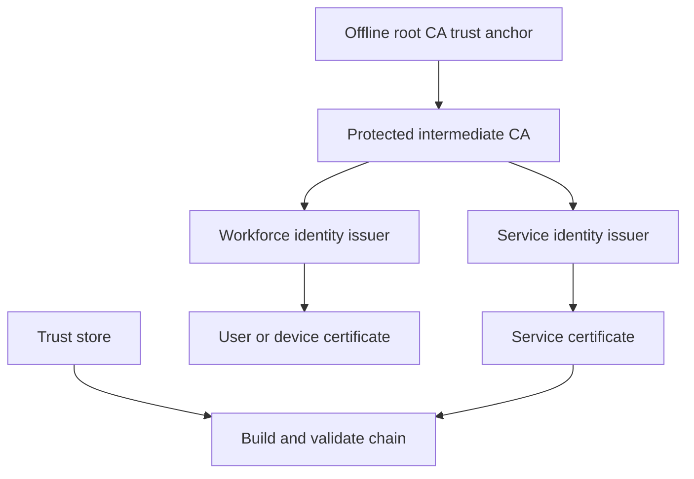
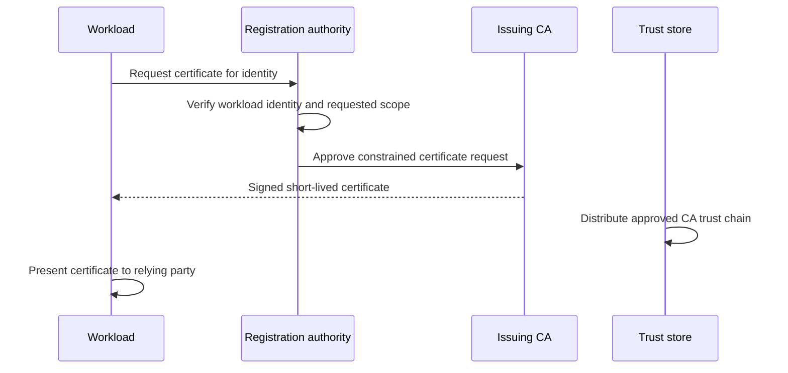
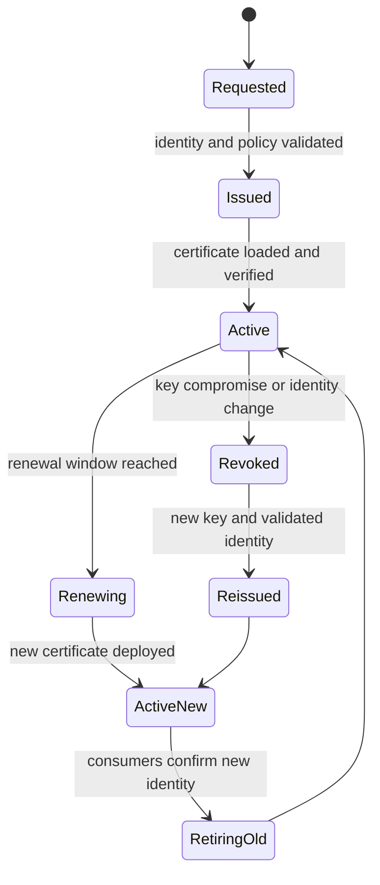
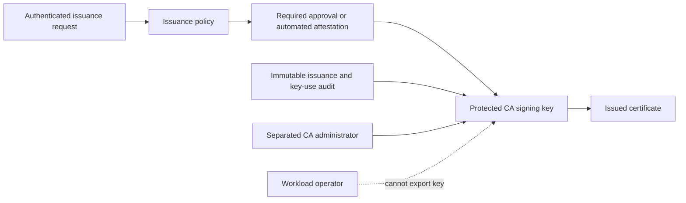
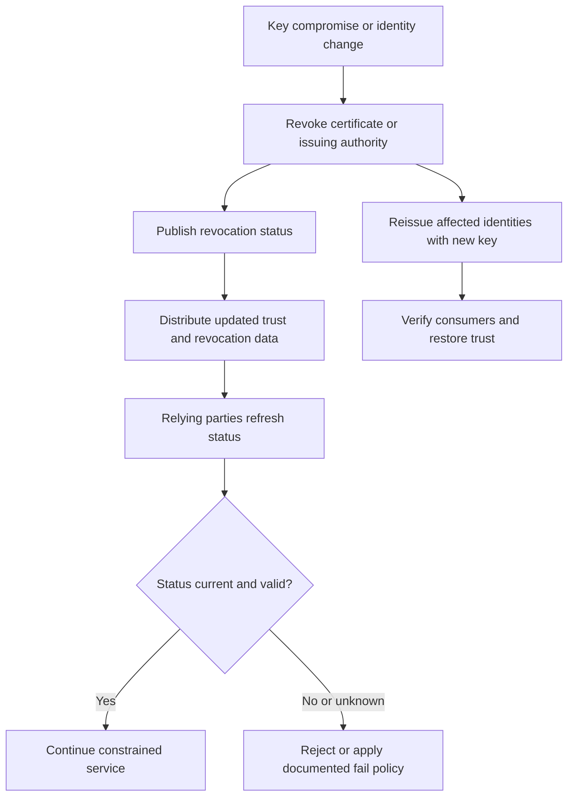

# PKI (Public Key Infrastructure)

Part: [15 — Security](PART_OVERVIEW.md)

Public Key Infrastructure (PKI) is the people, process, policy, and technology used to issue, distribute, validate, renew, and revoke certificates that bind public keys to identities or purposes. It is an operational trust system rather than a certificate file or cryptographic algorithm. [Part 05 CH15 Certificates](../05_Networking_and_OS/CH15_Certificates.md) owns certificate formats, TLS use, and certificate operations; Part 09 owns managed certificate services. This chapter focuses on PKI architecture, trust governance, and lifecycle boundaries.

## Trust Hierarchy and Authorities

A certification authority (CA) signs certificates and subordinate CA certificates according to defined policy. A root CA is a trust anchor distributed to relying parties; it should be protected more strongly than online issuing authorities. Intermediate CAs limit blast radius and isolate issuance for workforce, service, and device identities. Add hierarchy only when it establishes a necessary trust or operational boundary.

The root private key should be used rarely and under strong ceremony. Online intermediates handle routine issuance with constrained policy and access. A CA compromise can invalidate trust for many identities; document containment, trust-store update, reissuance, and affected consumer recovery before an incident.

## Issuance, Identity Binding, and Trust Stores

Issuance begins with an identity claim and proof that the requester controls or represents that identity. The CA or registration authority validates the request, applies policy, records the decision, and signs the certificate. Subject Alternative Names, key usage, extended key usage, validity, and issuer all constrain where a certificate should be accepted.

Trust stores are part of the architecture. Define how roots and intermediates reach operating systems, runtimes, containers, devices, and managed services. A correct chain is useless if consumers lack the trust anchor; an overly broad trust store accepts identities from authorities that should not be trusted for that purpose.

## Renewal, Rotation, and Revocation

Certificates expire, keys rotate, identities change, and issuers are compromised. Automation can reduce expiry outages, but issuance should remain bound to authenticated workload identity and policy. Renewal requires consumer reload behavior, overlap, observability, and rollback constraints. Avoid extremely long lifetimes that make compromise difficult to contain.

Revocation can use certificate revocation lists (CRLs), online status protocols, short lifetimes, or application-specific deny lists. Each choice has freshness, availability, scale, and privacy implications. Define how relying parties behave when status information is unavailable; fail-open and fail-closed choices depend on the protected operation. Revocation is only effective if consumers check it or the certificate expires within the acceptable exposure window.

## Key Custody and Operational Separation

Protect CA keys with hardware-backed storage or equivalent controls, dual control, audited access, backups, and tested recovery. Separate CA administration, issuance approval, trust-store management, and workload operations where threat warrants. Keep private keys non-exportable when possible; a certificate is public, but its private key is the authority-bearing asset.

Monitor issuance rate, failed requests, expiry horizon, renewal failures, revocation propagation, trust-store drift, and CA key operations. A sudden certificate burst or change in issuer can signal compromise or automation failure. Incident procedures should identify who can stop issuance and how affected trust is replaced.

## Worked Case and Review Checklist

A company uses an offline root, an online intermediate for internal service identity, and a separate issuer for workforce devices. Workloads authenticate to the issuer using platform identity and receive short-lived certificates. Consumers trust only the required intermediate chain. Renewal uses an overlap period and health verification. A suspected intermediate key compromise triggers issuance suspension, revocation or trust removal, reissuance, and a measured consumer rollout.

Review hierarchy, root custody, issuer scope, identity proof, certificate constraints, trust distribution, renewal, consumer reload, revocation freshness, outage behavior, audit, backup, and compromise recovery. Confirm each relying party trusts only the authorities and usages it needs.

## Questions and Summary

1. Draw a root/intermediate/leaf hierarchy and explain how it limits routine key exposure.
2. Design certificate issuance for a workload with identity proof and narrow subject scope.
3. Compare short-lived certificates and online revocation checks for compromise response.
4. What operational failures can occur when trust-store distribution lags behind issuance?
5. Define the first actions after an online intermediate key compromise.

PKI creates and governs trust bindings between identities and public keys. Its security depends on authority separation, key custody, identity proof, trust-store distribution, certificate lifecycle, and relying-party behavior. Use Part 05 for certificate and TLS mechanics; this chapter frames PKI as a governed, recoverable trust system.
