# Threat Modeling

Part: [15 — Security](PART_OVERVIEW.md) · Status: Revised (in-depth rewrite)

## 1. Introduction

Threat modelling is a structured way of asking what a system protects, who might attack it, where trust changes, how abuse could happen, and which changes to the design would reduce the damage. Its value comes from timing. A weakness found in a design review costs a conversation and perhaps a redrawn box. The same weakness found in production costs an incident, a patch, and often a data migration. The method exists to move that discovery as far left as possible, while the architecture can still change cheaply.

After this chapter you will be able to:

- State a threat model as a small set of explicit claims: assets, actors, boundaries, assumptions, scenarios, decisions, and evidence.
- Decompose a system into a Data-Flow Diagram (DFD) whose trust boundaries are drawn where authority or control actually changes, not where the network diagram happens to have lines.
- Describe attackers by capability, access, and goal, so that the analysis can say which attacks are plausible and which are not.
- Apply STRIDE (Spoofing, Tampering, Repudiation, Information disclosure, Denial of service, Elevation of privilege) as a discovery method, understand what it does not cover, and choose between it and alternatives.
- Build an attack tree, annotate its leaves with probability and attacker cost, and use the arithmetic to decide which control to buy first.

Later sections of this chapter carry the method forward into abuse cases, privacy threat analysis, risk rating and prioritisation, mitigation selection, and validation. The sections here cover the foundations those later sections rely on.

Ownership is split across the handbook as follows:

| Topic | Owner |
|---|---|
| Threat-analysis methods: decomposition, STRIDE, attack trees, abuse cases, risk rating, mitigation choice, validation | This chapter |
| The documentation artifact: threat register, template, review, keeping the document current | [Architecture Documentation CH09 Threat Models](../21_Architecture_Documentation/CH09_Threat_Models.md) |
| Awareness categories of common web weaknesses | [CH01 OWASP Top 10](CH01_OWASP_Top_10.md) |
| Authentication and authorization control mechanics | [CH02 Authentication](CH02_Authentication.md) and [CH03 Authorization](CH03_Authorization.md) |
| Key custody, secret handling, and cryptographic limits | [CH09 Secrets Management](CH09_Secrets_Management.md) and [CH10 Encryption](CH10_Encryption.md) |
| Zero-trust placement of controls | [CH08 Zero Trust](CH08_Zero_Trust.md) |

The documentation chapter explains how to write a threat down so that someone can own, test, and close it. This chapter explains how to find the threat in the first place and how to reason about it. Where the two touch, this chapter recaps the artifact in a few sentences and links to it instead of repeating its register layout or its per-element table.

## 2. The Foundational Model

### 2.1 Claims, not diagrams

A threat model is a set of claims about a system that someone can check. The claims fall into seven groups.

- Assets: things whose compromise matters, such as customer records, signing keys, the ability to move money, or the availability of an order flow.
- Actors: parties that can interact with the system, described by capability and access.
- Boundaries: places where the level of trust, the identity, or the controlling team changes.
- Assumptions: statements the analysis depends on but does not verify, such as "the identity provider authenticates users correctly".
- Scenarios: causal descriptions of how an actor could harm an asset.
- Decisions: what the team will do about each scenario.
- Evidence: what shows that the decision was carried out and works.

The diagram is only the way the first three are communicated. A team can have a beautiful diagram and no model, if nobody wrote down which assets matter or which assumptions hold the design up. A team can also have a useful model with a rough sketch, if the scenarios, decisions, and evidence are explicit. The practical test of a model is whether a reviewer who was not in the room can disagree with a specific claim.

### 2.2 The four questions as a loop

The most widely used organizing frame asks four questions: what are we working on, what can go wrong, what are we going to do about it, and did we do a good job. The framing is commonly attributed to Adam Shostack and appears in community guidance such as the Threat Modeling Manifesto; treat the attribution as general. The documentation chapter shows how each question maps to a part of the written artifact in [Architecture Documentation CH09](../21_Architecture_Documentation/CH09_Threat_Models.md). This chapter uses the same four questions as a work process and attaches a method to each.

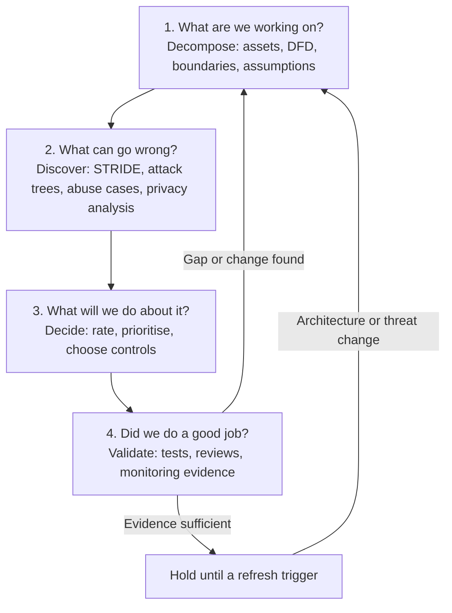

The diagram shows the method attached to each question and two return paths. The first return path is a failed validation: a test that cannot be written for a mitigation usually means the scenario was vague or the control was never specified. The second is a trigger from outside, such as a new integration. A model that has only the forward arrows has become a document that ages, and Part 15's later sections on refresh triggers return to this.

### 2.3 What a threat model can and cannot establish

A threat model is a systematic way to avoid forgetting, and a way to make reasoning inspectable. It does not prove that a system is secure. It cannot find threats that nobody on the team can imagine, and it cannot find implementation bugs that the design permits but does not mention, such as a missing check in one handler out of two hundred. Those are the job of code review, testing, and the controls described in the Secure Software Development Lifecycle (SDLC) chapter ([CH13 Secure SDLC](CH13_Secure_SDLC.md)). The OWASP Top 10 (Open Worldwide Application Security Project) is a list of common weakness categories and is useful as a prompt, but it is generic by design. [CH01 OWASP Top 10](CH01_OWASP_Top_10.md) covers its role. A system-specific model finds things a generic list never will, for example that the support console can read every tenant's data and is protected by one shared password.

The model also has a cost. Time spent on it is time not spent building. The method therefore asks for proportion. A change that adds a read-only page behind existing authorization needs a few minutes of questioning. A change that adds a new trust boundary, such as exposing an internal service to partners, deserves a structured session with the people who build and operate it.

### 2.4 Who takes part

The people who know how the system really works are developers, operators, and support staff. A model produced only by a security reviewer from the architecture diagram describes the system as designed, and attackers use the system as built. A working session usually needs one person who can draw the data flows from memory, one who operates the system in production, and one who can speak to the security controls. A product owner helps when asset value and business impact are the question. Keep the group small enough to talk, and record disagreements as open questions instead of resolving them by volume.

## 3. Decomposition: Assets, Data-Flow Diagrams, and Trust Boundaries

### 3.1 Start from assets and entry points

Decomposition begins with two lists. The first lists assets and why each matters: confidentiality of customer data, integrity of payment instructions, availability of the checkout path, secrecy of a signing key. The second lists entry points, meaning every way input reaches the system: public endpoints, message queues, file uploads, administrative consoles, scheduled imports, build pipelines, and support tooling. Hidden entry points matter more than visible ones. A user-facing form is usually well examined. A back-office import job that reads a spreadsheet from a shared drive is often unexamined and often runs with high authority.

Assets include things that are not data. The ability to deploy code is an asset, because whoever holds it controls everything the pipeline can reach. A workload credential is an asset because of what it can do, not what it contains. Writing assets as "capabilities and data" avoids a model that protects the database while ignoring the account that can replace its schema.

### 3.2 The Data-Flow Diagram

A DFD uses four element types. External entities are actors outside the team's control, such as a browser or a partner system. Processes are code that transforms or routes data. Data stores hold data at rest. Data flows connect them. A fifth notation, the trust boundary, is a line drawn around elements that share a level of trust. The notation is deliberately small, so that the diagram can be drawn on a whiteboard in a session and so that each element type has a short list of things that can go wrong.

The documentation chapter recaps the notation and explains how to keep the diagram in the repository. Here the concern is how to choose the level of detail. A DFD that shows only "frontend", "backend", and "database" is too coarse: it hides the queue, the worker, the identity provider, and the build system, which are where many attacks happen. A DFD with every class and function is too fine and nobody finishes it. A workable rule is to draw one process per independently deployed unit or per distinct privilege level, and to add detail only where a flow crosses a boundary or touches a high-value asset. Start with a level-0 context view (one process for the whole system), then decompose the parts that carry the most risk into a level-1 view.

### 3.3 Where to draw trust boundaries

A trust boundary belongs wherever the answer to one of these questions changes: who controls the code on either side, which identity the component runs as, what authentication proves what, what network reaches what, or what level of data sensitivity applies. Boundaries are not the same as network zones. A service in the same virtual network as its database still has a trust boundary between them, because compromise of the service should not give the attacker everything the database holds. The question to ask is what an attacker gains by controlling the element on one side. If the answer is "nothing new on the other side", no boundary is needed. If the answer is "new authority", a boundary exists and every flow crossing it is a place where checks must happen.

Common boundaries that are drawn too late or not at all:

- Between a tenant's data and another tenant's data inside one shared service.
- Between a workload and the cloud account role it assumes.
- Between a build system and the production runtime, because the artifact that crosses is code that will execute with production authority.
- Between the application and its third-party libraries, since a dependency runs with the host's privileges.
- Between a human operator and the control plane, particularly for break-glass access.

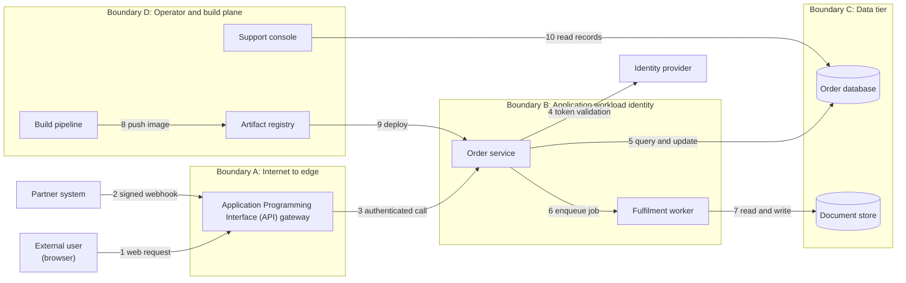

The numbered flows are the units of analysis. Flow 10 shows why drawing the operator plane matters: the support console reaches the order database without passing the gateway or the service's authorization checks, so every control built into the service is bypassed by that path. Flow 9 crosses from boundary D into B, and what moves across is code. A common finding from this view is that the highest-authority paths are the ones with the fewest checks, because they were built for convenience by trusted staff.

Several implications follow from the diagram. Each crossing deserves a question about authentication (who is calling), authorization (what may they do), integrity (was the content altered), and logging (can the action be attributed). A flow that passes through no boundary still deserves a glance, but the effort should concentrate on crossings. Boundaries also name the assumptions the design relies on. If boundary B is defined as "the order service runs as its own workload identity", then the assumption that this identity has only the permissions the service needs is a claim to be verified, not a fact.

### 3.4 Assumptions and out-of-scope items

Every model excludes something, and the exclusion must be visible. Typical exclusions are the internals of a managed identity provider, the cloud provider's physical security, and end-user devices. Writing "assumed out of scope because owned by another party, and relied on for authentication of users" lets a later reader see what would invalidate the model. Assumptions are also where a model fails quietly. If the design assumes that internal callers are trusted, that is a threat to examine, not a premise to accept; the zero-trust discussion in [CH08 Zero Trust](CH08_Zero_Trust.md) explains why.

### 3.5 Worked decomposition

The following is illustrative. A small team builds an invoicing service for several companies. They list assets: invoice data (confidentiality and integrity), the ability to issue credit notes (integrity, because it moves money), tenant isolation, and the signing key for downloadable invoice Portable Document Format (PDF) files. They list entry points: the public API, a Comma-Separated Values (CSV) import endpoint, an email-to-invoice webhook, the support console, and the deployment pipeline. In the level-0 view they find five entry points and four candidate boundaries. In the level-1 view of the CSV import they discover that a background worker parses uploaded files using a library and writes directly to the invoice store with a credential that allows writes to all tenants. That finding, produced by drawing the worker and its credential, is already a design change: the worker should write on behalf of one tenant at a time with a scoped credential. No scanning tool would have reported it, because nothing is misconfigured in the usual sense. The design simply grants more authority than the task needs.

## 4. Attackers, Goals, and Capabilities

### 4.1 Describe attackers by what they can do

"Hacker" is not a useful actor. The analysis needs to know what the actor can reach and what they already hold. A useful description has four parts: starting access, resources, motivation, and constraints. Starting access answers whether the actor is anonymous, has a free account, holds a paid tenant account, is an employee, or already controls a workload. Resources cover time, money, and skill. Motivation covers what they want: data, money, disruption, or a foothold for later. Constraints include fear of detection and legal exposure, which matter for some actors and not others.

| Actor profile | Starting access | Typical goals | Typical limits |
|---|---|---|---|
| Anonymous internet user | Public endpoints only | Account takeover, scraping, disruption, fraud | No credentials, must find weaknesses blind |
| Authenticated low-privilege user | Valid account in one tenant | Read or change other tenants' data, escalate role | Bound by what the API exposes |
| Compromised workload | Code execution in one service with its credential | Move to data and credentials the service can reach | Limited by the workload identity's permissions |
| Malicious or coerced insider | Legitimate access and knowledge of procedures | Data theft, sabotage, fraud | Audit trail, separation of duties |
| Compromised dependency or build step | Runs inside the build or the process | Insert code, steal secrets | Needs a way to be selected and shipped |
| Careless operator | Production access | Not a goal; accidents with high impact | Guardrails, review, and reversibility |

The last row is included deliberately. Accidents cause many outages and exposures, and a model that considers only adversaries misses misconfigurations by authorised people. The mitigations for accidents (confirmation steps, dry runs, scoped permissions, rollback) overlap heavily with mitigations against compromised accounts.

### 4.2 Goals, not techniques

Techniques change faster than goals. Listing "exploit vulnerability X" ages quickly. Listing "read another tenant's records", "issue fraudulent credit notes", or "stop invoice generation for a day" ages slowly and survives technology changes. Starting from goals also forces the team to connect threats to assets, so that effort goes where harm is. Attack trees, covered below, are built on exactly this move: the goal is the root and techniques are the leaves.

A useful exercise is to ask each actor profile, for each asset, what they would do with unlimited time and the access listed, and then what they would do with one hour and a budget of nothing. The first reveals the worst case. The second reveals what a casual attacker, which describes most real ones, will actually try, and it points at the weaknesses that are cheap to exploit.

### 4.3 Attack surface and exposure

Attack surface is the set of places where an actor can send input or observe output. It is not a count. A system with one public endpoint that accepts a complex file format may have a larger practical surface than a system with fifty simple read-only endpoints. Reduce surface before adding controls: removing an endpoint, narrowing a network path, or disabling an unused administrative feature eliminates a class of threats. Avoidance is also the strongest answer to a threat, because a control can fail and a removed feature cannot.

Exposure also includes time. A short-lived credential has a smaller window than a long-lived one, and a share link that expires after a day exposes less than one that never expires. The model should capture lifetime when it describes access.

## 5. STRIDE as a Discovery Method

### 5.1 What STRIDE is and where it comes from

STRIDE is a mnemonic for six threat categories, each the violation of a security property. It is commonly attributed to Microsoft security engineers in the late 1990s; verify the original publication if the history matters. The categories and their violated properties are shown below.

| Category | Violated property | Question to ask of an element |
|---|---|---|
| Spoofing | Authenticity | Can something pretend to be the expected caller or callee? |
| Tampering | Integrity | Can data, code, or configuration be changed without authorisation? |
| Repudiation | Accountability | Can an actor deny an action because the system cannot prove it? |
| Information disclosure | Confidentiality | Can data reach someone not entitled to it? |
| Denial of service | Availability | Can a function be made unavailable or too slow to use? |
| Elevation of privilege | Authorisation | Can an actor gain capabilities beyond those granted? |

The documentation chapter already provides the per-element-type table that says which categories usually apply to which DFD element type, and shows how to record results. This section does not repeat it. The focus here is on how to run STRIDE well, what each category looks like in practice, and where it stops being useful.

### 5.2 Running STRIDE per interaction

Per element analysis walks each box. Per interaction analysis walks each flow with its source and destination and asks the categories for that pairing. The second is generally more productive for distributed systems, because most security properties are properties of an interaction. "Can the order service tell that this message came from the fulfilment worker" is a spoofing question about a flow, not about either component alone.

A practical session proceeds in a fixed order. First pick the flows that cross trust boundaries, then the stores holding high-value assets, then the rest. For each, state the category question aloud and write down any plausible answer in one sentence that names an actor and an effect. Do not stop to design the fix; capture the threat, then move on. Fix discussion during discovery stalls the session and biases the list toward threats whose fix is already known.

### 5.3 What each category looks like in practice

Spoofing is not only impersonating a user. It includes a service presenting a stolen workload credential, a webhook sender that is not the partner, a forged forwarding header that makes the service believe a request came from the internal network, and a malicious host that answers a name the application trusts. The relevant mitigations are authentication mechanisms from [CH02 Authentication](CH02_Authentication.md) and, between services, mutual authentication or signed requests.

Tampering applies to data in motion, data at rest, and code. A webhook payload without a signature can be altered by anyone who can reach the endpoint. A message in a queue can be altered by anyone with write access to the queue. A container image can be replaced between build and deploy. Mitigations include integrity checks such as Message Authentication Codes (MACs) and digital signatures (see [CH10 Encryption](CH10_Encryption.md)), restricted write permissions, and verification at the point of use rather than at the point of creation.

Repudiation is about evidence. If a support agent changes a customer's payout account and the log records only the service identity, nobody can say who did it. The control is an audit record with a stable actor identity, the action, the target, and a time, written where the actor cannot edit it. Repudiation is often dismissed as minor and then turns out to decide whether an investigation can reach a conclusion.

Information disclosure covers the obvious (a database exposed to the internet) and the indirect: verbose error messages, identifiers that reveal counts, logs containing tokens, backups with weaker access control than the live store, and timing differences that confirm whether an account exists. Mitigations are access control, data minimisation, encryption with separated key custody, and scrubbing of logs.

Denial of service includes volumetric floods, but in application systems the more common form is a cheap request that triggers expensive work: a query with an unbounded filter, a file that expands enormously when parsed, or a retry storm after a partial failure. The mitigations are quotas, bounded resource use per request, timeouts, queue limits, and rate limits.

Elevation of privilege is a missing or wrong authorisation check, a role assignment too broad for its purpose, a confused deputy where a service uses its own authority on behalf of a caller who lacks it, or a path from code execution in a low-privilege component to a higher-privilege one. Mitigations are least privilege, checks on every request at the point of use, and separation of duties. [CH03 Authorization](CH03_Authorization.md) covers the mechanisms.

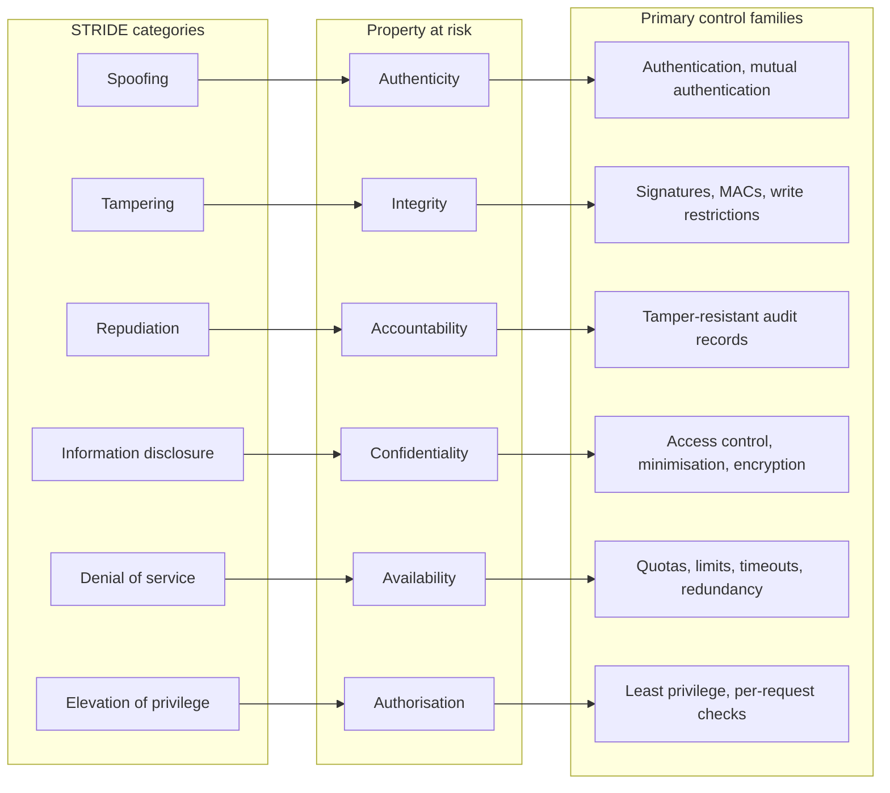

The diagram links each category to the property it threatens and to the family of controls that answers it. The value is as a checking device: when a threat has been recorded, the team can ask whether the chosen control belongs to the matching family. A spoofing threat mitigated by encryption has probably been mismatched, since encryption protects confidentiality and integrity in transit but does not establish who is on the other end. Mismatches like this are common and are visible once the mapping is written down. The diagram is also incomplete in a useful way: real controls often cover several categories, and real threats often chain across categories, as in the next paragraph.

### 5.4 Threat chains

Threats rarely stand alone. An information disclosure of a signing key enables spoofing of any identity the key vouches for, which enables elevation of privilege, which enables tampering with data. When the model lists threats as separate rows, the chain is invisible and each row looks lower in severity than the combination. Record chains as scenarios in their own right, and expect the highest-priority work to come from breaking the earliest link that is cheap to break. This is also the bridge to attack trees, which represent chains and alternatives explicitly.

### 5.5 Limits of STRIDE and alternatives

STRIDE is element-centric. It guarantees that every element receives attention, it needs little security background to start, and its categories map onto familiar controls. Those are real strengths and the reason it is used so widely as a starting method. Its limits are equally real.

- It generates many findings and does not rank them. Ranking belongs to a separate step covered later in this chapter.
- It prompts technical flaws. Business-logic abuse, such as applying a refund twice by racing two requests, does not fall naturally into one of the six categories. Abuse cases are a better fit.
- It does not treat privacy as a separate topic. Linkability and identifiability of people are not STRIDE categories; a dedicated privacy method fits better.
- It depends on the quality of the DFD. A missing flow produces a missing threat.

| Approach | Starting point | Strength | Weakness | Choose when |
|---|---|---|---|---|
| STRIDE | DFD elements and flows | Systematic coverage, easy to teach | Many unranked findings, weak on business logic | First pass over a new or changed design |
| Attack trees | An attacker goal | Shows alternatives, cost, and the cheapest path | Needs a chosen goal, can miss unconsidered goals | Few critical goals, or when comparing mitigations |
| Abuse cases | Legitimate use cases | Finds business-logic misuse | Depends on knowing the use cases well | Workflows involving money, entitlements, or state |
| Asset-centric review | Valuable assets | Focuses on what matters most | May miss threats to pass-through components | Prioritising where to spend effort |
| Privacy analysis | Personal data flows | Finds linkability and identification risk | Not a security-property method | Systems handling personal data |

No single method is right for all cases. A reasonable default is STRIDE on the boundary-crossing flows for breadth, attack trees on the top two or three goals for depth, and abuse cases for each workflow that moves value. The reason to combine them is that they fail in different places, so the overlap catches what each misses alone.

## 6. Attack Trees

### 6.1 Structure and semantics

An attack tree is a tree whose root is an attacker's goal and whose children are ways of achieving it. Bruce Schneier popularised the form in the late 1990s; verify the original publication if the citation matters. Each node is either an OR node, meaning any one child suffices, or an AND node, meaning all children are needed. Leaves are atomic actions that the analysis does not break down further. Because the tree is built from the attacker's side, it shows alternatives that a defender-oriented list hides, and it makes clear that closing one path while another stays open leaves the goal reachable.

Construct a tree in four steps. Choose a goal that is specific enough to have measurable success ("read invoices belonging to another tenant"). List the top-level ways to achieve it. For each, ask what the attacker needs first, and use AND nodes for conjunctive requirements. Stop expanding when a leaf is something you can assign a probability and cost to, or one where a control either exists or does not. Depth beyond that point adds drawing effort without adding decisions.

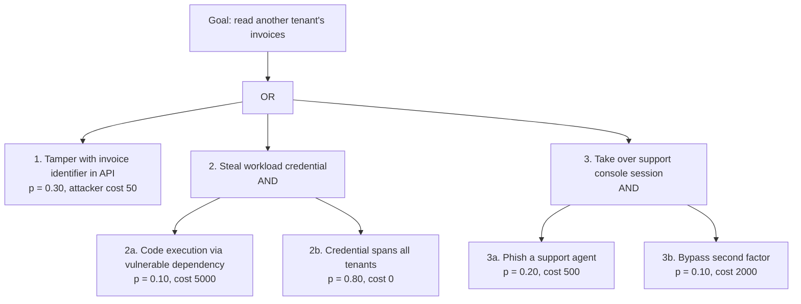

The tree has three branches. Branch 1 is a single leaf. Branches 2 and 3 are AND nodes whose children must all succeed. The labels carry two numbers per leaf: an illustrative probability that the attack succeeds against the current design in a stated period, and an illustrative attacker cost in currency units. Both are assumptions to be argued over, and the argument is part of the value.

### 6.2 Probability arithmetic

For an AND node with independent children, the probability of success is the product of the children's probabilities. For an OR node with independent children, success occurs unless all children fail, so the probability is one minus the product of the failure probabilities. Independence is a strong assumption and is often false; it is used here for clarity and its limits are discussed below.

All figures below are illustrative.

- Branch 2: P(2) = 0.10 × 0.80 = 0.08.
- Branch 3: P(3) = 0.20 × 0.10 = 0.02.
- Branch 1: P(1) = 0.30.
- Root: P(goal) = 1 − (1 − 0.30)(1 − 0.08)(1 − 0.02) = 1 − (0.70 × 0.92 × 0.98).

Compute step by step: 0.70 × 0.92 = 0.644, and 0.644 × 0.98 = 0.63112. So P(goal) = 1 − 0.63112 = 0.36888, about 0.37.

Branch 1 contributes most of this. Suppose the team adds object-level authorization checks and cross-tenant tests and re-estimates leaf 1 at 0.02. The new root is 1 − (0.98 × 0.92 × 0.98). Compute: 0.98 × 0.92 = 0.9016, and 0.9016 × 0.98 = 0.883568. So P(goal) = 0.116432, about 0.12, down from 0.37.

The next most useful change shows where the remaining mass is. Branch 2 is 0.08, and its second leaf (the credential spans all tenants) is 0.80. Scoping the credential per tenant or per task, so that the same leaf drops to 0.10, gives P(2) = 0.10 × 0.10 = 0.01. The root becomes 1 − (0.98 × 0.99 × 0.98). Compute: 0.98 × 0.99 = 0.9702, and 0.9702 × 0.98 = 0.950796. So P(goal) = 0.049204, about 0.05.

The sequence shows how the arithmetic guides ordering: each step goes after the largest remaining contribution, and the effect of each control is expressed as a change in the leaf it affects. It also shows a structural point. Because the AND node multiplies, a control on any single child of an AND node reduces the branch, so the cheapest child to harden is the right target. Hardening the dependency vulnerability leaf (hard to eliminate completely) matters less than fixing an overbroad credential that is easy to scope.

### 6.3 Cost arithmetic and the cheapest path

Probability tells you what is likely. Cost tells you what a rational attacker would try first. For cost, an OR node takes the minimum over its children, and an AND node takes the sum, because the attacker must pay for every step.

Using the illustrative costs in the diagram:

- Branch 1 costs 50.
- Branch 2 costs 5,000 + 0 = 5,000.
- Branch 3 costs 500 + 2,000 = 2,500.
- The root costs min(50, 5,000, 2,500) = 50.

The cheapest path is the tampering path, and it should be fixed first for that reason as well as for its probability. Suppose the fix raises the cost of that route to 20,000 because the attacker now needs a separate vulnerability. The root cost becomes min(20,000, 5,000, 2,500) = 2,500, and the cheapest path is now the support console. The next control should therefore target branch 3: a hardware-bound second factor, restricting the console to a managed network, and per-tenant scoping of what a support session may read. This is the main reason to compute cost: it shows which branch becomes the target after each fix, and it prevents the common error of investing heavily in a branch that was never the cheapest.

### 6.4 Limits of the arithmetic

The numbers are estimates and should be presented as such. Three limits matter.

First, independence. If one flaw (for example, a shared administrative credential) lowers the cost of several leaves at once, then multiplying and combining as if they were independent understates the true risk. Where leaves share a root cause, model the shared cause as its own node that appears under multiple branches.

Second, false precision. A probability of 0.30 is a judgment, not a measurement. Use bands (for example 0.05, 0.1, 0.3, 0.6) and show how the conclusion changes if the estimate moves one band. If the ranking of controls is stable under that change, the decision is safe. If the ranking flips, the decision depends on the estimate and the team should gather evidence before spending.

Third, completeness. The tree contains the branches someone thought of. An unlisted branch has implicit probability zero. Review a tree with someone who thinks differently from its author and ask directly what is missing.

Attackers also adapt. A tree is a snapshot of the current design against a stated attacker profile, and after controls change the cheapest path changes, which is why the tree is revisited rather than filed.

### 6.5 Using trees well

Keep trees small. Three to five top-level branches and two levels of depth are usually enough to drive decisions. Label each leaf with the control that currently bears on it, if any, and the evidence for that control. Link leaves to threat register rows, using the structure described in [Architecture Documentation CH09](../21_Architecture_Documentation/CH09_Threat_Models.md), so that a change to the tree updates the register. Use a tree for the few goals whose impact justifies it, such as theft of the signing key or fraudulent money movement, and rely on STRIDE and abuse cases for breadth.

## 7. Abuse Cases, Misuse Cases, and Attack Scenarios

### 7.1 From use cases to abuse cases

STRIDE starts from the diagram. Abuse-case analysis starts from what the system is meant to do. For every use case that moves value, changes state, or grants access, the team writes a matching abuse case: the same workflow performed by someone who wants a different outcome. "A customer requests a refund" becomes "a customer obtains the same refund twice", "a customer refunds an invoice that belongs to someone else", and "a support agent refunds to an account they control". The technique is also called misuse-case analysis; the two names are used loosely and the difference rarely matters in practice.

The method finds threats that component-level methods miss, because the flaw lives in the workflow and every component behaves as coded. Typical abuse patterns are:

- Repeating a step that was meant to run once (redeeming a voucher, applying a refund).
- Skipping a step in a multi-step flow (calling the "confirm" endpoint without the "pay" step).
- Reordering steps, or running two steps concurrently so that a check and its update are separated by a gap.
- Supplying values the interface does not offer but the service accepts (a negative quantity, a price in the request body, a role in a profile update).
- Using a legitimate feature at a scale or rate the designers did not expect (enumerating identifiers, bulk export).
- Chaining two individually acceptable features into a harmful result (a free trial plus an invitation feature plus a referral credit).

### 7.2 Writing the scenario

A scenario is a short causal statement. A usable template has six parts: the actor and their starting access, the precondition, the action sequence, the asset or state affected, the impact, and the control that should interrupt it. Writing the interrupting control as part of the scenario keeps the analysis tied to a design decision. Example, illustrative: "An authenticated customer of tenant A (access: valid session) who knows that invoice identifiers are sequential (precondition) requests refunds for invoices numbered near their own (action). The refund service checks that the caller is logged in but not that the invoice belongs to the caller's tenant (weakness). Another tenant's payment instruments are credited to the attacker (impact). Object-level authorization in the refund service, plus a cross-tenant negative test, interrupts the path."

Scenarios should be specific enough that a test can be written from them. If the sentence cannot be turned into a request that should be rejected, it is a concern, not yet a scenario.

### 7.3 A worked abuse case: concurrent refunds

Consider the invoicing service from the earlier decomposition. The refund flow reads the invoice, checks that the refunded amount plus the request does not exceed the invoice total, issues the refund, and then updates the stored refunded amount. Each step is correct alone. The abuse case is two requests sent at the same moment.

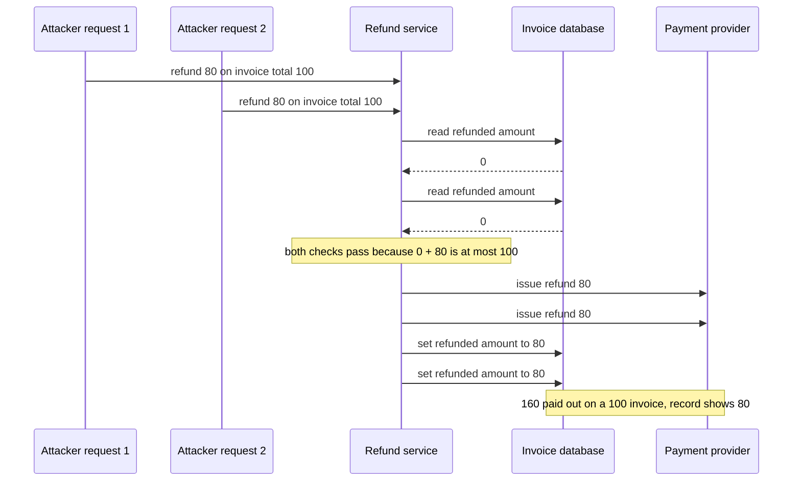

The diagram shows a check-then-act gap: the decision and the state change are separate operations, so two requests can both observe the old state. Implications follow in three directions. The impact is bounded by how many requests the attacker can run in parallel and by rate limits, not by the invoice total. The flaw leaves no error in logs, since every request succeeded. And a scanner or a code reviewer reading either handler alone sees nothing wrong, which is why the scenario must come from the workflow.

The mitigation is to make the check and the update one atomic operation, so that the database rejects the second request:

```sql
-- Structured Query Language (SQL): conditional update, check and write are one statement
UPDATE invoices
   SET refunded_cents = refunded_cents + :amount
 WHERE id = :invoice_id
   AND tenant_id = :caller_tenant
   AND refunded_cents + :amount <= total_cents;
-- Proceed to the payment provider only if exactly one row was updated.
```

The same statement carries the tenant condition, which addresses the cross-tenant scenario from the previous subsection. Sending an idempotency key to the payment provider is a second layer that protects the case where a retry follows a timeout. The validation is a test that fires many concurrent requests at one invoice and asserts that the total refunded never exceeds the total. Later in this chapter, scenarios are turned into tests of this kind.

## 8. Risk Rating and Prioritisation

### 8.1 Why rate at all

A discovery session produces more threats than the team can fix before the next release. Rating exists to order work and to record why an item was deferred. It does not measure truth. Two competent reviewers can rate the same threat differently, and the useful output is the discussion of why: a disagreement about likelihood usually exposes a different mental picture of the attacker or the control.

### 8.2 Likelihood times impact

The most common method assigns each threat a likelihood and an impact on a small ordinal scale, typically three to five levels, and combines them in a matrix. Its strength is speed and a shared vocabulary. Its weaknesses are well known.

- Ordinal labels are not numbers. Multiplying a 3 by a 4 treats the scale as if gaps were equal, which is rarely so.
- Matrix cells hide very different threats. A frequent low-harm event and a rare catastrophic one can land in the same cell.
- Scores cluster in the middle because raters avoid extremes, which weakens ordering.
- Likelihood is commonly guessed without an attacker model. Tie it to the actor profiles from the earlier section: access required, skill, and whether the weakness is reachable.

To reduce arbitrariness, define each level in words with anchors. For impact, anchors can name affected people, money range, regulatory reporting, and recovery time. For likelihood, anchors can name preconditions: "needs a valid account" is more likely than "needs code execution inside the cluster". Record the one-sentence rationale next to each score.

### 8.3 DREAD and other checklist scores

DREAD (Damage, Reproducibility, Exploitability, Affected users, Discoverability) averages five sub-ratings. It was used in early Microsoft practice and is, as far as the author knows, no longer recommended by that vendor; verify current guidance if you intend to adopt it. Common criticisms are that Discoverability invites security through obscurity (an attacker who is motivated finds it), that the sub-scores overlap, and that the average hides a catastrophic damage rating behind low reproducibility. If a team already uses a DREAD-like scheme, treat the number as a conversation aid, show the sub-scores, and never let the average alone decide a release.

### 8.4 CVSS is a vulnerability score

The Common Vulnerability Scoring System (CVSS) rates a specific vulnerability in a specific product by its technical characteristics: attack vector, complexity, privileges required, and effect on confidentiality, integrity, and availability. It is useful for triaging scanner findings and advisories. It is not a threat-model risk score, because it does not know your assets, your compensating controls, or whether the vulnerable component is reachable in your design. A high-scoring flaw in a library that never receives untrusted input can matter less than a medium-scoring flaw in a public parser. Use CVSS as one input to likelihood and impact, and re-rate in context. Where a supplementary exploitation signal is available, such as whether the issue is being exploited in the wild, check the current publications of the relevant agencies and the Forum of Incident Response and Security Teams (FIRST), which maintains CVSS; verify the details before relying on them.

### 8.5 Qualitative versus quantitative

Qualitative rating (low, medium, high) is quick and coarse. Quantitative rating estimates a frequency and a loss in currency, and multiplies. One common formulation is annualised loss expectancy: the expected number of events per year times the loss per event. It gives numbers that can be compared with the cost of a control, which the qualitative method cannot. It also invites false precision, because the inputs are guesses. Use ranges, not point values, and prefer it for the few threats where a spending decision depends on the comparison.

Worked example, all figures illustrative. A fraudulent-refund scenario is estimated at 4 events per year if left unfixed, with a loss of 2,000 per event. Expected annual loss = 4 × 2,000 = 8,000. The atomic-update fix and its concurrency test cost an estimated 3 engineering days, valued at 2,400 in total, and reduce the estimated frequency to 0.2 events per year. Residual expected loss = 0.2 × 2,000 = 400. Annual risk reduction = 8,000 − 400 = 7,600, against a one-off cost of 2,400, so the control pays back within the first year on these assumptions. Now test the sensitivity: if the real frequency is a quarter of the estimate (1 event per year), the reduction is (1 − 0.2) × 2,000 = 1,600, and the fix still roughly breaks even within two years. The decision is stable across the plausible range, so the estimate does not need to be precise. When a decision flips inside the plausible range, spend effort on evidence, not on the control.

A caution on reading expected values: they average events of very different size. A threat with a small chance of a company-ending loss may have a low expected value and still need action. Rank such threats on worst-case impact separately, and treat anything above the organisation's stated tolerance as requiring a decision regardless of its average.

### 8.6 From rating to an ordered list

A practical ordering uses three keys. First, threats whose worst-case impact exceeds a stated tolerance are escalated no matter their likelihood. Second, within the rest, order by rated risk. Third, break ties by cost to fix, favouring cheap fixes that remove a whole class of threats. Always record uncertainty: a threat rated "high, low confidence" is a candidate for investigation before commitment.

## 9. Choosing Mitigations

### 9.1 The four responses

Every rated threat receives one of four decisions. The accountable owner of the affected asset decides, with security advice.

- Eliminate: remove the feature, the data, or the path, so the threat no longer exists. Deleting data nobody needs, closing an unused port, or removing an administrative endpoint are examples. Elimination is the strongest response because there is no control to fail.
- Reduce: add or strengthen controls so likelihood or impact falls. This is the usual choice.
- Transfer: shift the financial consequence to another party, through insurance or a contract. Transfer does not remove the harm to customers or the duty to protect their data. Check which obligations stay with you.
- Accept: record that the residual risk is tolerated, who accepted it, the reason, and an expiry date or review point. Acceptance without an owner and an expiry is neglect with paperwork.

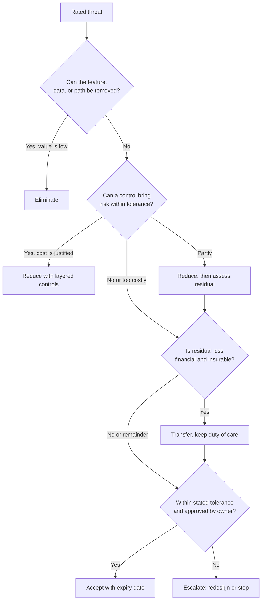

The decision tree orders the responses by strength, and the order matters. Teams that go straight to "reduce" skip the question of whether the thing can be removed, and end up maintaining controls around data they never needed. The escalation exit is deliberate: if a threat cannot be eliminated, reduced, transferred, or accepted within tolerance, the design cannot ship as drawn.

### 9.2 Layering controls

A single control is a single point of failure. Pair controls of different kinds: preventive controls stop the event, detective controls notice it, and recovery controls limit damage and restore service. For the cross-tenant read scenario, prevention is the object-level check, detection is an alert on one account touching many tenants' identifiers or a spike in authorization denials, and recovery is the ability to revoke sessions, identify the exposed records from audit logs, and notify affected customers. The layers should fail independently. Two checks that both read the same cached claim are one layer.

Each control entry should state where it is enforced, who owns it, how it can fail, what evidence shows it operating, and the residual risk. "Encrypt the data" fails this test until it names the key boundary and who can use the key; [CH10 Encryption](CH10_Encryption.md) and [CH09 Secrets Management](CH09_Secrets_Management.md) cover those details.

### 9.3 Cost-effectiveness arithmetic

When several controls address the same threat, compare reduction per unit of cost. All numbers are illustrative. A threat has expected annual loss of 12,000. Three options:

| Option | One-off cost | Annual running cost | Expected loss after |
|---|---|---|---|
| A: per-tenant credential scoping | 3,000 | 0 | 3,600 |
| B: anomaly alerting only | 1,500 | 1,000 | 8,400 |
| C: separate database per tenant | 20,000 | 4,000 | 600 |

Over a three-year horizon, total cost is one-off plus three years of running cost, and benefit is annual loss reduction times three.

- A: cost = 3,000 + 0 = 3,000. Benefit = (12,000 − 3,600) × 3 = 25,200. Net = 22,200.
- B: cost = 1,500 + 3 × 1,000 = 4,500. Benefit = (12,000 − 8,400) × 3 = 10,800. Net = 6,300.
- C: cost = 20,000 + 3 × 4,000 = 32,000. Benefit = (12,000 − 600) × 3 = 34,200. Net = 2,200.

A has the best net result and the best ratio, so it is the first purchase. C leaves the least residual loss but its net benefit is the smallest here. It could still be the right choice if a contract or regulation requires physical separation, which is a constraint, not a cost-benefit finding. B alone leaves most of the loss, but combined with A it adds a detective layer for a modest price. The combination is the usual outcome: take the best ratio first, then add a different kind of layer for the residual.

These calculations ignore discounting, correlated failures, and the cost of failed controls. Their purpose is to make the argument for a choice visible and challengeable, not to prove it.

## 10. Privacy Threat Modelling

### 10.1 Why a separate method

STRIDE addresses security properties. Privacy harm can occur with every security property intact. A system that authenticates, authorises, and encrypts correctly can still let a data analyst link purchase history to a named person, or retain data longer than a person expects. Privacy threat modelling looks for these harms to people, not only breaches of the organisation's assets.

### 10.2 LINDDUN at a hedged level

LINDDUN is a privacy threat-modelling methodology from KU Leuven, designed as a counterpart to STRIDE and applied to the same kind of DFD. Its categories are commonly given as Linking, Identifying, Non-repudiation, Detecting, Data disclosure, Unawareness and unintervenability, and Non-compliance. Some published descriptions differ slightly in naming and in how categories are grouped across versions, so verify the current catalogue on the project's site before adopting it formally. The categories in brief:

- Linking: connecting two items of data to the same person or session, such as joining an analytics identifier to an account.
- Identifying: learning who a data subject is from data that was supposed to be anonymous or pseudonymous.
- Non-repudiation: in privacy terms, a person cannot deny an action when they have a reason to want to, for example a whistleblowing report that can be traced.
- Detecting: learning that a person is involved, such as that someone is a user of a sensitive service, even without reading their data.
- Data disclosure: exposure of personal data, the closest category to information disclosure.
- Unawareness and unintervenability: people do not know what is collected or cannot correct, delete, or object.
- Non-compliance: processing that does not follow the policy, contract, or law that applies.

Note that non-repudiation is a goal in a security audit and a threat in this method. The same property is a benefit or a harm depending on whose interest is considered.

### 10.3 Applying it

Run it on the personal-data flows of the DFD only. For each flow and store, ask the category questions and write scenarios as before. Typical findings include unique identifiers shared across services without need, logs that record full email addresses, analytics exports that retain person-level rows, backups that outlive deletion requests, and an administrative search that reveals whether a given person is a customer. Typical mitigations are data minimisation, pseudonymisation with separated key custody, retention limits that are enforced by code, scoped and logged access, and a tested deletion path that also covers backups and derived stores. The legal duties vary by jurisdiction and are outside this chapter; involve privacy and legal staff, and link requirements to the data governance material in [CH30 AI Data Governance, Privacy, and Provenance](../16_AI_and_GenAI/CH30_AI_Data_Governance_Privacy_and_Provenance.md) where AI-derived artifacts hold personal data.

## 11. Threat Modelling for Specific System Types

The method is the same across system types. What changes is the set of elements that usually appear on the DFD and the boundaries that are easy to forget. This section lists them at the mechanism level and points to the owning chapters.

### 11.1 Cloud systems

The distinctive element is the control plane. Cloud resources are created, modified, and deleted through management APIs authorised by identity, so a credential that can call those APIs is an asset at least as valuable as the data. Draw the cloud account or subscription as a boundary, and draw each workload identity and the role it assumes as a separate element. Typical scenarios are a workload credential stolen through a server-side request forgery flaw that can reach the instance metadata service, an over-permissive role that lets a compromised function modify storage policies, a storage bucket or container made public by a template change, and a deployment role able to alter its own guardrails. The mitigation mechanisms are least-privilege roles, short-lived credentials, organisational policy guardrails, and separation of the account that holds logs from the account that runs workloads. Detail belongs to the cloud and zero-trust chapters; see [CH08 Zero Trust](CH08_Zero_Trust.md).

### 11.2 APIs

An API lets callers choose object identifiers, fields, and sequences. The DFD should show every consumer type (browser, mobile app, partner, internal service) as a separate actor, because they hold different credentials and different trust. The recurring scenarios are accessing objects by identifier without an ownership check, changing fields that the caller should not control (mass assignment), calling functions reserved for other roles, abusing expensive queries or unbounded pagination, and replaying or reordering requests. The mitigations are per-object authorization at the service, schema validation of input and output, quotas, and idempotency controls. [API Security](../08_API_Architecture/CH09_API_Security.md) owns the API-boundary threat model; use it as the checklist and use this chapter's method to apply it to a specific design.

### 11.3 CI/CD pipelines

A Continuous Integration and Continuous Delivery (CI/CD) build pipeline is a system that holds secrets, runs code from many contributors, and produces what production runs. Draw it as its own boundary, with source repository, build runners, secret store, artifact registry, and deployment credential as separate elements. The attacker goal "run my code in production" has many routes, shown below.

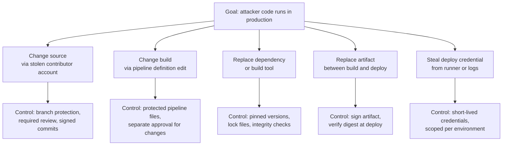

Each route ends in a control family, and the pairing is only as good as its evidence. The implications are that a pull request from an untrusted fork must never run with deployment secrets, that a pipeline definition is code with production authority and needs review like code, and that a credential available to every job is a credential available to the weakest job. The full treatment is in [CH15 Supply Chain Security](CH15_Supply_Chain_Security.md) and [CH13 Secure SDLC](CH13_Secure_SDLC.md); the delivery tooling is in [CI/CD](../13_DevOps/CH02_CI_CD.md).

### 11.4 AI and Large Language Model systems

Systems that call a Large Language Model (LLM) add elements to the DFD: the model endpoint, the prompt assembly step, retrieval stores, tools the model can invoke, and the data used to train or tune. The distinguishing mechanism is that instructions and data share one input channel. Text retrieved from a document, a web page, or a user message can contain instructions, and the model cannot reliably separate them from the developer's own. The practical consequence for the model is to treat all model input as untrusted and all model output as untrusted input to the next component. Draw a boundary between the model and every tool it can call, and ask what the tool does with the authority of the caller if the model is manipulated. Typical scenarios are an injected instruction in a retrieved document causing a tool call with the user's privileges, disclosure of data from one user's context to another through shared caches or indexes, and poisoned training or retrieval data. The control mechanisms are least-privilege tools, human confirmation for consequential actions, per-user retrieval authorization, and output handling that does not execute or render raw model text. This chapter does not re-teach them; the full treatment is in [Part 17 AI Safety, Security, Privacy, and Governance Architecture](../17_AI_Architecture/CH12_AI_Safety_Security_Privacy_and_Governance_Architecture.md), and the agent tool boundary is in [Agentic System Architecture and Tool Boundaries](../17_AI_Architecture/CH06_Agentic_System_Architecture_and_Tool_Boundaries.md).

## 12. Turning Threats into Requirements and Tests

### 12.1 From scenario to requirement

A mitigation that is not written as a requirement tends to disappear. Convert each accepted scenario into a security requirement that is specific, testable, and traceable. The form "the system shall X, verified by Y" works. For the cross-tenant scenario: "A request for an invoice whose tenant differs from the caller's tenant shall return the same response as a non-existent invoice, verified by an automated negative test run on every change to the invoice service." Using the same response as for a missing object also prevents the attacker from learning which identifiers exist, which closes a small information disclosure at no extra cost.

Requirements that cannot be tested are usually vague. "Data shall be protected" becomes "the document store shall reject unauthenticated reads and reads by tenants other than the owner" and "backups shall be readable only by the recovery role".

### 12.2 From scenario to test

Each scenario yields at least one negative test: an action that should be refused or contained. Choose the cheapest level that exercises the control:

- Unit or component tests for logic such as ownership checks and state transitions.
- Integration tests for flows across a boundary, such as a request carrying a token from the wrong tenant.
- Concurrency tests for race scenarios, with many parallel requests against one object.
- Configuration tests or policy-as-code checks for infrastructure controls, such as asserting that no storage resource is public.
- Detection tests that perform the attack in a controlled environment and verify that an alert fires within the stated time.
- Manual or adversarial testing for scenarios that depend on human behaviour or complex chains.

A short example of a negative test, written in Python with a generic test client; adapt names to the project:

```python
def test_cross_tenant_invoice_is_indistinguishable_from_missing(client, tenant_a_token, tenant_b_invoice_id):
    other = client.get(f"/invoices/{tenant_b_invoice_id}", headers=auth(tenant_a_token))
    missing = client.get("/invoices/does-not-exist", headers=auth(tenant_a_token))
    assert other.status_code == missing.status_code == 404
    assert other.json() == missing.json()
```

Traceability keeps the chain visible. A record in the register, as laid out in [Architecture Documentation CH09](../21_Architecture_Documentation/CH09_Threat_Models.md), links the scenario, the requirement, and the test identifier, so that a failing test points back to the threat it protects, and a removed test prompts the question of which threat is now uncovered.

### 12.3 Evidence of control operation

Tests show a control worked at one moment. Operating evidence shows it keeps working: authorization-denial counts, alert firing in drills, key rotation records, and the age of exceptions. Define for each control what evidence will be collected and who reads it. A control with no evidence is an assumption, and the model should list it as one.

## 13. Refresh Triggers and Delivery Integration

### 13.1 When to revisit the model

A threat model describes a system at a moment, and systems change. Define triggers in advance so that the decision to revisit is not left to memory. Common triggers:

- A new trust boundary or entry point: a new integration, a partner API, a new region, a public endpoint.
- A change to authentication, authorization, or the identity provider.
- A change in data: a new category of sensitive data, new retention, a new store or export.
- A change in deployment or build: a new pipeline, runner type, registry, or production environment.
- A new dependency that runs with high privilege or handles untrusted input.
- An incident, near miss, or published attack technique relevant to the design.
- An organisational change: an acquisition, a new regulatory duty, or a new class of user.
- Expiry of an accepted risk or of a documented assumption.

Not every change needs a full session. Triage by size: a trigger that adds a boundary or a high-value asset deserves a structured session. A smaller change deserves an update to the affected part of the model and a note.

### 13.2 A lifecycle for the model

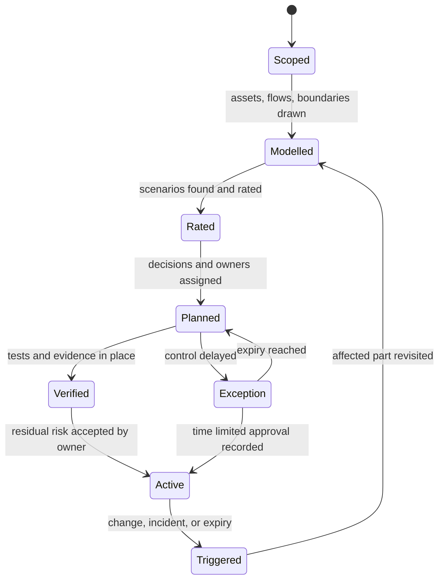

The diagram shows the model as a state that is entered repeatedly, not a document that is finished. Two return paths matter. A trigger sends the model back to the modelling state for only the affected area, which keeps refresh cost proportional to change. An exception expiring sends the work back to planning, which prevents a deferral from becoming permanent. The artifact side of this, including ownership of the register and review cadence, belongs to [Architecture Documentation CH09](../21_Architecture_Documentation/CH09_Threat_Models.md).

### 13.3 Integration into delivery

Threat modelling succeeds when it is part of how work flows, not a separate ceremony. Three touchpoints carry most of the value.

At design review, ask for a short threat summary alongside the design: new boundaries, new assets, and the top scenarios with decisions. A design review that cannot answer "what changed in the attack surface" is not finished. At planning, security requirements and mitigation items enter the same backlog as feature work, with owners and acceptance criteria, so that they compete for capacity visibly. At pull-request time, a short checklist catches changes that should trigger a refresh. A suggested checklist, to adapt:

- Does this change add or change an entry point, a trust boundary, or an external integration?
- Does it touch authentication, authorization, or identity configuration?
- Does it add or move sensitive data, or change retention or export?
- Does it add a dependency, a build step, or a pipeline permission?
- Does it add a tool or data source that an AI component can reach?
- If yes to any: is the threat model updated, or is a linked issue open for the update?

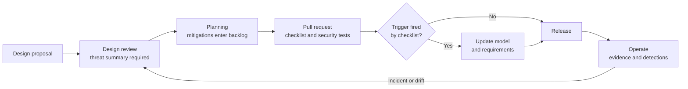

The flow places the model at three points and feeds operational findings back to design review. The checklist gate is deliberately light: it asks a few yes-or-no questions and creates work only when a trigger is found, so that it does not become an obstacle that engineers learn to click through. Measure it by outcomes, such as the share of boundary-changing pull requests that updated the model, and not by the number of sessions held.

### 13.4 Ownership and backlog

Every mitigation item needs an owner who can change the system, an acceptance test, and a date. The model needs an owner who is accountable for its currency, usually the lead engineer of the system and not an external security reviewer. Risk acceptance is signed by the person who owns the affected asset or business outcome, not by the person who found the threat. A backlog item that has no owner or no testable outcome is not a reduction of risk, and the model should count it as an open threat.

## 14. Failure and Quality-Attribute Scenarios

The method itself can fail, and its outputs are quality attributes of the engineering process: how quickly a boundary error is caught, how soon a stale model is noticed, how well a mitigation holds under attack. Each scenario below states a stimulus, the expected response, and a measurable success criterion. All thresholds are illustrative targets to adapt, not benchmarks.

| Scenario | Stimulus | Expected response | Measurable success criterion |
|---|---|---|---|
| A. Missed trust boundary found in review | A design review of a new partner export finds that the export worker reads every tenant's rows with one credential, and the model shows no boundary there | The reviewer adds the boundary and the worker flow, the team re-runs STRIDE on the new crossings, and the credential is scoped per tenant before release | Boundary added and re-analysed within one working day of the finding. Zero releases with an unmodelled crossing. A negative test proves the worker cannot read a second tenant |
| B. Model stale after an architecture change | A team replaces a monolith's internal call with a message queue and a new worker | The pull-request checklist flags a new entry point and a new store, the model owner updates the DFD and re-analyses only the changed flows, and new tests are linked | Model updated before merge for 100% of boundary-changing pull requests. Affected-area review completed in under half a day |
| C. Race-condition abuse attempt | 200 parallel refund requests are sent against one invoice | The atomic conditional update rejects every request beyond the invoice total, and a detection rule raises an alert | Total refunded never exceeds the invoice total in 100 repeated test runs. Alert fires within 5 minutes of the burst |
| D. Emergency change with no time for a session | A fix must ship in hours and touches authorization | A 30-minute focused review covers only the changed flows, the full session is booked, and the gap is recorded as a time-limited exception | Exception has an owner and an expiry no later than 14 days. Full review completed before the expiry |
| E. Assumption expires | The model assumes "only the support team can reach the console", and a network change opens the console to a wider range | The assumption owner reviews it at the scheduled date or at the change, finds it false, and re-rates the affected threats | No assumption older than its review date. Re-rating completed within one sprint of the finding |

Scenario B deserves a closer look, because it is the quiet failure that most affects long-lived systems.

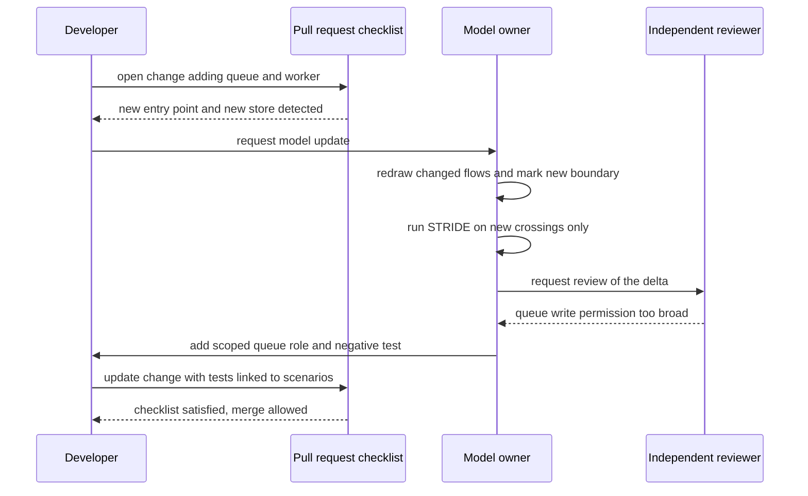

The sequence shows three properties. The checklist, not memory, starts the update. The analysis is limited to the delta, so its cost follows the size of the change. And an independent reviewer sits in the loop, which is where overbroad queue permissions get noticed, since the author of a flow tends to assume the permission they were granted is the one they need. The implication is that staleness is prevented by cheap, frequent, automatic prompts, and that a yearly review of the whole model adds little if those prompts are missing.

For scenario A, the measurable criterion that matters most is the second one, zero releases with an unmodelled crossing. It cannot be measured directly, so teams approximate it by sampling: choose five recent boundary-changing changes at random each quarter, and check whether the model showed the boundary before merge. A rate below 100% is a finding about the process, and it is cheaper to fix by adjusting the checklist wording than by adding more reviews.

## 15. Worked Case Study: An Equipment-Rental Marketplace

This case applies the methods of this chapter end to end. The system is hypothetical and every number is illustrative. The documentation chapter already walks through a small notes service in [Architecture Documentation CH09, section 8](../21_Architecture_Documentation/CH09_Threat_Models.md), centred on the register; this case instead shows how the decisions in this chapter (decomposition, attack trees, rating, mitigation choice, validation) connect, and it uses a different system, so the two do not overlap.

### 15.1 The system and its decomposition

"RentLoop" is an imagined marketplace where owners list equipment and renters pay to borrow it. Owners receive payouts to a bank account they register. The product includes a web and mobile client, an API gateway, a listing service, a payments service that talks to an external payment provider, a photo store, a support console, a build pipeline, and an assistant that drafts listing descriptions using a Large Language Model.

The team lists assets: payout destination integrity (money moves to wherever the account says), personal data of owners and renters, tenant-style separation between owners' records, the payment provider credential, and the deployment capability. Entry points are the public API, the photo upload endpoint, the payment provider's webhook, the support console, the pipeline, and the assistant's input. Actors from the earlier table apply: an anonymous user, an authenticated renter, a compromised owner account, a support agent who can be phished, a compromised dependency, and a careless operator.

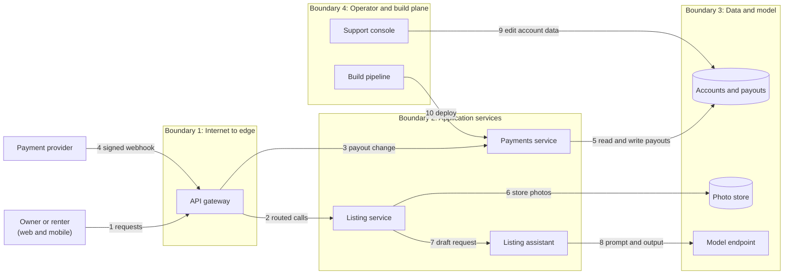

Three flows attract the analysis because they cross boundaries and touch the payout asset. Flow 3 carries the payout change. Flow 9 lets support staff edit account data without passing the gateway or the payments service. Flow 8 sends text to a model, so anything in the listing text can influence the assistant, and the model output returns to the listing service. The first finding comes from the diagram alone: flow 9 bypasses every control the payments service enforces, so the payout destination can be changed by anyone who controls a support session.

### 15.2 Discovery: STRIDE, abuse cases, and the attack tree

STRIDE on flows 3, 4, 8, and 9 gives, among others, these scenarios. Spoofing on flow 4: anyone who can reach the webhook can claim a payment succeeded, unless the signature is verified. Tampering on flow 3: a payout-change request can carry extra fields, such as a different owner identifier. Repudiation on flow 9: the console logs "support" and not the agent. Elevation of privilege on flow 8: a listing description that contains instructions could cause the assistant to call functions it was given for other purposes.

The abuse-case pass on the payout workflow adds "change the payout account, collect the next payout, and change it back", and "register many accounts to find one without a second factor". The team then picks one attacker goal for an attack tree, since this is where money moves: redirect an owner's payout to an attacker-controlled account. Three branches are listed, with illustrative probabilities over a year against the current design and illustrative attacker costs.

| Branch | Leaves | Probability | Cost |
|---|---|---|---|
| 1. Take over the owner account, then change payout | Credential stuffing against owner logins | 0.25 | 100 |
| 2. Use the support console | AND: phish a support agent (0.20, cost 500); console permits payout edits without a second approver (0.90, cost 0) | 0.20 × 0.90 = 0.18 | 500 + 0 = 500 |
| 3. Tamper with the payout-change request | Change a field the service accepts without checking (mass assignment) | 0.15 | 300 |

The root is an OR node. Arithmetic: failure probability is 0.75 × 0.82 × 0.85. Compute 0.75 × 0.82 = 0.615, then 0.615 × 0.85 = 0.52275. So P(goal) = 1 − 0.52275 = 0.47725, about 0.48. The cheapest path costs min(100, 500, 300) = 100, which is branch 1.

### 15.3 Decisions and rejected alternatives

The team considers the following responses, in the order of the decision tree from the mitigation section.

- Eliminate: remove the ability to change payout accounts after creation. Rejected, because owners legitimately change banks and a support-only change path would move the same risk into the console.
- Eliminate: remove the assistant's access to any payout or account function. Accepted, at almost no cost. The assistant can only return draft text, so injected instructions in a listing description cannot trigger an account action.
- Reduce: require step-up authentication for any payout change, a 24-hour hold before the new destination receives money, and a notification to the old contact method. Accepted for branches 1 and 3.
- Reduce: require a second approver for support-initiated payout edits, and write the agent identity into the audit record. Accepted for branch 2 and for the repudiation finding.
- Reduce: rely only on fraud detection of unusual payout changes. Rejected as the sole control, because it is detective only and its false-negative rate is unknown. Kept as a second layer.
- Transfer: insure against fraudulent payouts. Kept as a supplement, not a substitute, because insurance does not restore an owner's trust or cover regulatory duties.
- Reduce for branch 3: reject unknown fields in payout requests and take the owner identifier from the session, never from the body. Accepted.

Re-estimating after these controls, using illustrative figures: branch 1 drops to 0.03 because credentials alone no longer change a payout; branch 3 drops to 0.05; branch 2 leaf (console permits edit alone) drops to 0.10, so branch 2 is 0.20 × 0.10 = 0.02. Failure probability is 0.97 × 0.98 × 0.95. Compute 0.97 × 0.98 = 0.9506, then 0.9506 × 0.95 = 0.90307. So P(goal) = 1 − 0.90307 = 0.09693, about 0.10, down from 0.48.

Costs change too. Branch 1 now needs the step-up bypass as well: 100 + 2,000 = 2,100. Branch 2 adds a second approver compromise: 500 + 1,500 = 2,000. Branch 3 is raised to 4,000 by input validation that needs a separate flaw. The new cheapest path is min(2,100, 2,000, 4,000) = 2,000, the support console. That is where the next increment of effort should go, for example binding the console to managed devices.

### 15.4 Is the main change worth its cost

The step-up, hold, and approval work is estimated at 8 engineering days valued at 800 each, so 6,400 one-off, plus 500 per year running cost. The baseline estimate is 6 fraudulent payout events per year at a loss of 1,500 each, so expected loss is 6 × 1,500 = 9,000 per year. The frequency scales with the root probability: 6 × (0.09693 ÷ 0.47725) = 6 × 0.2031 = 1.22, rounded to 1.2 events. Residual loss = 1.2 × 1,500 = 1,800. Annual reduction = 9,000 − 1,800 = 7,200. Over three years the benefit is 7,200 × 3 = 21,600, and the cost is 6,400 + 3 × 500 = 7,900, so the net is 13,700.

Sensitivity matters here. The break-even baseline frequency f solves f × (1 − 0.2031) × 1,500 × 3 = 7,900. Since 0.7969 × 4,500 = 3,586, f = 7,900 ÷ 3,586 = 2.2 events per year. If the real baseline is below about 2 per year, the three-year payback fails on expected value alone. The team therefore does two things. It checks the estimate against any available fraud and support data, because the decision flips inside the plausible range. And it records that the owner's stated tolerance for money loss and for customer trust applies regardless of the average, which is why the worst-case rule from the rating section justifies the work even when the average does not.

### 15.5 Ordering the backlog and validating

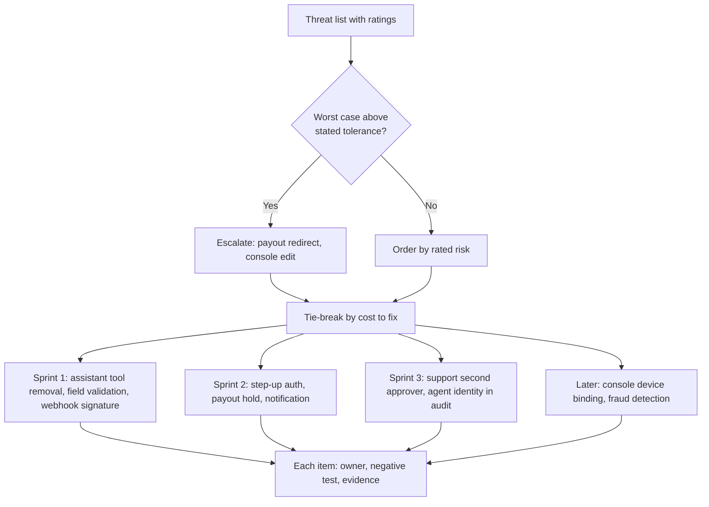

The diagram turns the ordering rule into a backlog. Cheap, class-removing changes go first, even though they are not the highest-rated threat, because they close doors for nearly no cost. The escalated items follow, and the detective layer is last because it protects the residual and not the main path. The ordering is not fixed: a new trigger (for example, a new payout country) sends the list back through the same gate.

Validation evidence the team collects, by scenario:

- Branch 3: a test that sends a payout change with an extra owner identifier and asserts rejection, run on every change to the payments service.
- Branch 1: a test that a valid session without recent step-up cannot change the payout, and a check that the hold delays the first payment to the new destination by 24 hours.
- Branch 2: a test that one support session cannot apply a payout edit, plus an audit-record test asserting the agent identity and target appear.
- Webhook spoofing: a test that an unsigned or wrongly signed event is dropped and counted.
- Detection: a drill where a test account changes its payout, and the alert fires within the 15-minute target.
- Assumptions: the model lists "the payment provider authenticates its webhooks correctly" and "support agents use managed devices" as assumptions with owners and review dates.
- Independent check: someone outside the team reviews the tree and the re-estimates, and asks what is missing. Their added branch (an owner coerced into changing the destination) is recorded as an open question rather than ignored.

The case shows the chain: decomposition found the console bypass, STRIDE and abuse cases supplied scenarios, the tree and arithmetic ordered the work and showed the next cheapest path, the cost comparison tested a spending decision with its sensitivity, and validation tied each control to a test.

## 16. Common Mistakes

Each mistake below is paired with its usual cause and its consequence.

| Mistake | Usual cause | Consequence |
|---|---|---|
| Treating a Top 10 list or scanner output as the threat model | A list is quick and produces an artifact that looks complete | System-specific flaws, such as a support console that reads every tenant, are never examined |
| Drawing components with no flows, identities, or boundaries | The diagram is copied from a deployment sketch | STRIDE has nothing to attach to, and bypass paths stay invisible |
| Listing threats without actor, precondition, impact, or owner | Discovery notes are not turned into scenarios | Nobody can test or close the item, and it lingers in the register |
| Giving severity scores without assumptions or evidence | Scoring is treated as measurement | Rankings cannot be challenged, and cheap fixes lose to loud arguments |
| Naming generic controls without an enforcement point | "Encrypt it" feels like an answer | The control exists on paper while the key holder or the unguarded path stays open |
| Omitting build, support, backup, telemetry, and administrative paths | These belong to other teams, or are not in the product diagram | The highest-authority paths receive the fewest checks |
| Discussing fixes during discovery | Engineers want to solve what they see | The threat list is biased toward problems with known fixes |
| Fixing the most visible branch of an attack tree | Probability is read without cost | Effort goes to a path that was never the cheapest, while the cheapest stays open |
| Accepting risk without an owner or expiry | Acceptance is used to close the item | The exposure becomes permanent and nobody remembers the reason |
| Running one large session and never again | The model is seen as a deliverable | It describes a system that no longer exists and gives false assurance |
| Excluding developers and operators | Security staff model from the diagram alone | The model describes the design, and attackers use the system as built |
| Treating CVSS as the risk score | It is a numeric output that is easy to sort | Reachable medium flaws are ranked below unreachable high ones |

## 17. Design-Review Checklist

Use this list at a design review. Each item should be answerable with a pointer to a diagram, a register row, a test, or a named owner. An answer of "we assume so" is recorded as an assumption with an owner and a review date.

Scope and assets

- Are the assets listed, including capabilities such as deploy rights and workload credentials, with the reason each matters?
- Is the scope stated, with out-of-scope items and the reason they are excluded?
- Did developers, operators, and support staff take part, and are disagreements recorded as open questions?

Decomposition

- Does the DFD show every entry point, including imports, webhooks, build, support, and administrative paths?
- Is each trust boundary drawn where authority, identity, or control changes, and not only where network zones change?
- Is each boundary crossing numbered and analysed for authentication, authorization, integrity, and logging?

Actors and discovery

- Are actors described by access, resources, motivation, and constraints, including a careless operator?
- Has STRIDE been run per interaction on the boundary-crossing flows?
- Has each workflow that moves value or state received abuse cases, including repetition, skipping, reordering, and concurrency?
- Have personal-data flows been examined for linkability, identifiability, retention, and deletion?
- Have attack trees been built for the top goals, with costs as well as probabilities?

Rating and decisions

- Does each rating carry a one-sentence rationale and a note of confidence?
- Do threats above stated tolerance escalate regardless of their average?
- Is each threat decided as eliminate, reduce, transfer, or accept, with the stronger options considered first?
- Does every accepted risk name an owner, a reason, and an expiry?
- Do high-value threats have at least a preventive and a detective layer that fail independently?

Evidence and currency

- Does each mitigation have an enforcement location, an owner, a negative test, and operating evidence?
- Are threats, requirements, and tests linked in the register so a failing test points back to a threat?
- Are the refresh triggers defined, and does the pull-request checklist prompt them?
- Are assumptions listed with owners and review dates?
- Has someone outside the author group reviewed the model and asked what is missing?

## 18. Exercises

Each exercise has a brief answer outline. Numbers are illustrative.

1. Draw a DFD for a photo-sharing service with a mobile app, an API gateway, an image-processing worker, an object store, and a support console. Mark at least four trust boundaries and name the protected assets.
   Outline: boundaries at internet to edge, workload identity, data tier, and operator plane. The worker's credential and the console's read path are the likely findings. Assets include user photos, the ability to delete content, and the deploy capability.
2. Run STRIDE on the flow from the gateway to the image-processing worker, then write one scenario in the six-part template.
   Outline: spoofing (a forged internal call that skips the gateway), tampering (a crafted image that exploits the decoder), denial of service (a huge image). The scenario names an actor, a precondition, an action, an affected asset, an impact, and the interrupting control, such as size limits and an isolated decoder.
3. A refund workflow reads a balance, checks it, and then writes the new balance. Describe an abuse case and the fix.
   Outline: two concurrent requests both pass the check. The fix is a conditional atomic update plus an idempotency key. The test fires many parallel requests and asserts the total never exceeds the limit.
4. An attack tree has branch A with one leaf (probability 0.20, cost 200) and branch B as an AND node with leaves 0.50 (cost 300) and 0.40 (cost 400). Compute the root probability and the cheapest path, then re-compute after a control reduces A to 0.05.
   Outline: P(B) = 0.50 × 0.40 = 0.20. Root = 1 − (0.80 × 0.80) = 1 − 0.64 = 0.36. Cost of B = 300 + 400 = 700, so the root cost is min(200, 700) = 200 and A is the cheapest. After the control, root = 1 − (0.95 × 0.80) = 1 − 0.76 = 0.24. Note that B now dominates, and its cheapest-to-harden leaf is the next target.
5. A threat has 3 expected events per year at a loss of 5,000 each. A control costs 10,000 once and cuts the frequency to 1. Is it worth it, and what would change the answer?
   Outline: current loss = 3 × 5,000 = 15,000. Residual = 1 × 5,000 = 5,000. Reduction = 10,000 per year, so the cost is recovered in one year. Check the decision if the real frequency is 1: reduction is (1 − 0.33) × 5,000 which is about 3,300 per year, so payback is about 3 years. Also state that a tolerance for worst-case loss may justify it anyway.
6. Choose between eliminate, reduce, transfer, and accept for each: an unused administrative endpoint; a customer-data export; a low-value public status page with a small denial-of-service exposure; a ransomware loss.
   Outline: eliminate the endpoint; reduce the export with scoped access, logging, and limits; accept the status-page risk with an owner and an expiry; transfer part of the ransomware financial loss by insurance while still reducing probability with backups and access control.
7. Identify the privacy threats in an analytics pipeline that joins a pseudonymous device identifier to a customer account for "better recommendations".
   Outline: linking and identifying (the join defeats pseudonymity), unawareness (customers may not know), non-compliance (processing beyond the stated purpose), and data disclosure (a wider analyst audience). Mitigations are minimisation, separate key custody for the join, retention limits, and a tested deletion path.
8. List five changes in a sprint and decide which should trigger a refresh and how large.
   Outline: a new partner webhook (structured session, new boundary), a copy change (none), a new dependency that parses uploads (targeted update of the affected flow), a retention change on a store of personal data (update data and privacy analysis), and a new role in the identity provider (update authorization threats and assumptions).

## 19. Summary

This chapter taught threat modelling as a method that produces checkable claims and ties each claim to a decision and a test. The table maps the outcomes promised in the Introduction to where each is taught.

| Introduction outcome | Where it is covered |
|---|---|
| State a threat model as explicit claims | Section 2 (claims, the four-question loop), sections 12 and 13 (requirements, evidence, refresh) |
| Decompose into a DFD with trust boundaries at real authority changes | Section 3, applied in section 15.1 |
| Describe attackers by capability, access, and goal | Section 4, and the actor choices in section 15 |
| Apply STRIDE, know its limits, and choose alternatives | Section 5 (discovery, limits, comparison), section 7 (abuse cases), section 10 (privacy) |
| Build an attack tree and use the arithmetic to order controls | Section 6, applied with arithmetic in sections 15.2 to 15.4 |

The later parts of the chapter add the topics beyond those outcomes. Risk rating and prioritisation are in section 8 and applied in section 15.4 and 15.5. Mitigation choice and layering are in section 9. System types (cloud, APIs, pipelines, AI) are in section 11. Failure scenarios with measurable criteria are in section 14, common mistakes in section 16, and the design-review checklist in section 17.

Four points carry forward. Boundaries belong where authority changes, and the highest-authority paths are the ones with the fewest checks. Probability and cost together show what a rational attacker tries first, and after each fix the cheapest path moves. Eliminating a threat is stronger than controlling it, and every accepted risk needs an owner and an expiry. A model that is not linked to tests and refreshed by triggers is a document that ages, and the output is a defensible account of what can go wrong, how the system responds, and who owns residual risk.
