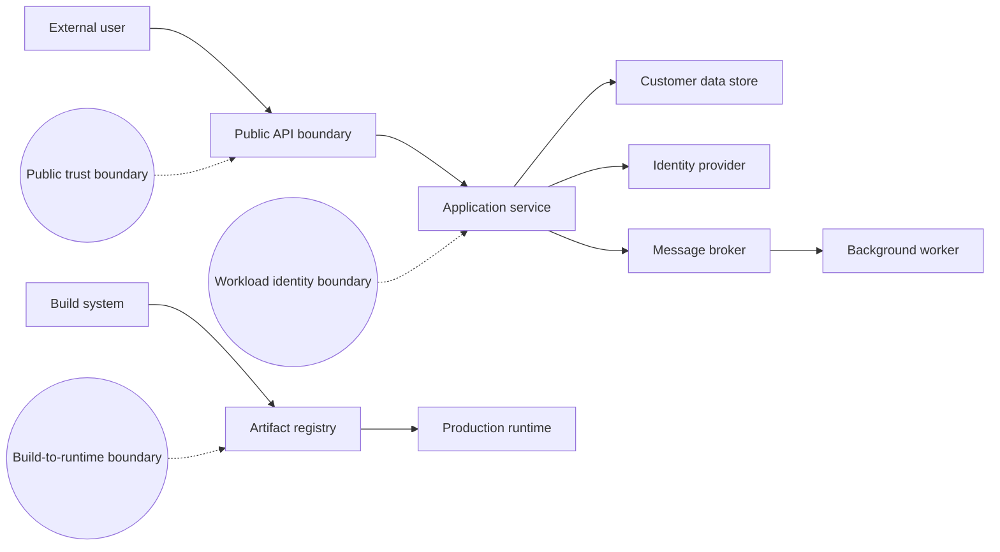
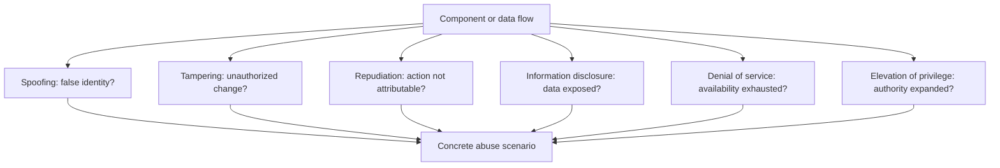
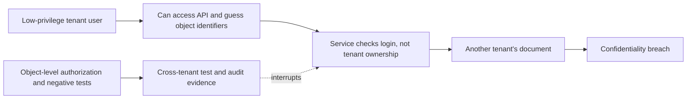
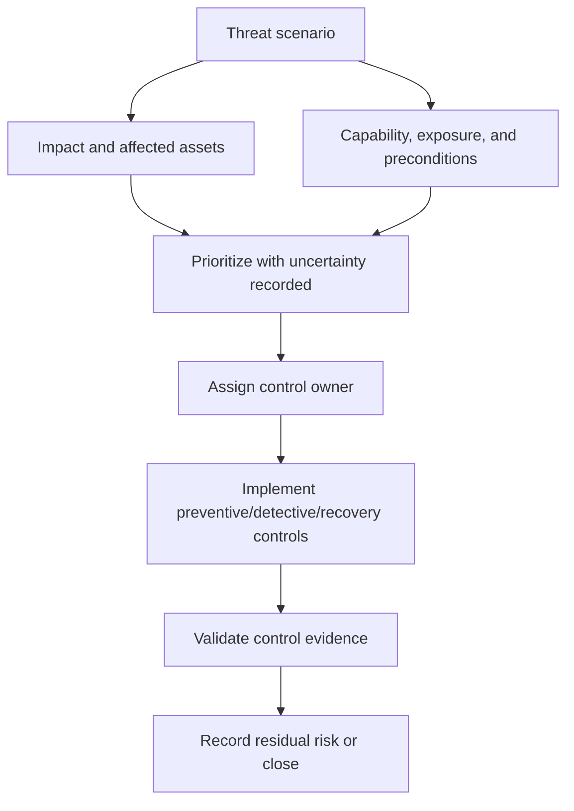
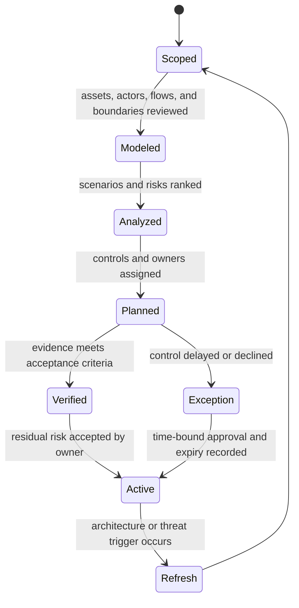

# Threat Modeling

Part: [15 — Security](PART_OVERVIEW.md)

Threat modeling is a structured method for identifying what a system protects, who may attack it, where trust changes, how abuse could occur, and which mitigations reduce risk. It should happen early enough to affect architecture and recur when system boundaries or threats change. It is not a one-time checklist or an exercise in listing vulnerabilities without owners.

This chapter owns reusable threat-analysis workflow. [CH01 OWASP Top 10](CH01_OWASP_Top_10.md) provides awareness categories; CH02-11 own control mechanisms; Part 01 owns general architecture decision practice. A threat model should connect assets, actors, boundaries, scenarios, controls, evidence, residual risk, and accountable owners.

## Scope, Assets, and Trust Boundaries

Define the system boundary and review purpose first: a new design, major change, incident, or recurring reassessment. Identify assets such as data, identities, capabilities, availability, and business processes. Draw components, data flows, stores, external dependencies, and trust boundaries. Label which identities can perform which actions and where data is transformed or persisted.

A diagram is a model, not proof of completeness. Validate it with developers, operators, data owners, and security stakeholders. Include administrative paths, support tooling, telemetry, backups, build systems, and recovery workflows. Hidden control planes often hold more authority than the user-facing data path.

## Actors, Goals, and Threat Discovery

Describe actors by capability and access rather than relying only on labels such as “hacker.” Consider unauthenticated users, low-privilege accounts, compromised workloads, malicious insiders, compromised dependencies, and accidental operator error. Identify goals such as data theft, unauthorized modification, service disruption, privilege escalation, fraud, or repudiation.

STRIDE—spoofing, tampering, repudiation, information disclosure, denial of service, and elevation of privilege—is one threat-discovery lens. It prompts questions by component and flow, but does not rank risk or guarantee completeness. Abuse cases and attack trees can complement it. OWASP categories can help identify broad risk families but should not replace system-specific scenarios.

## Scenario, Risk, and Mitigation

Write each threat as a causal scenario: actor capability, precondition, action, target, impact, and relevant control. Estimate likelihood and impact with stated assumptions. A numeric score can help compare work but is not objective truth; show uncertainty, affected population, exploitability, and recovery difficulty.

Choose preventive, detective, and recovery controls. Identify where each control is enforced, who owns it, how it can fail, what evidence proves operation, and any residual risk. Do not treat “use encryption,” “add logging,” or “follow OWASP” as complete mitigations without a key boundary, event contract, or verification method.

## Prioritization and Backlog Ownership

Prioritize using asset criticality, threat capability, exposure, exploit path, impact, likelihood evidence, control strength, and recovery. Record assumptions and uncertainty. Convert material threats into owned actions with deadlines, acceptance criteria, verification, and an explicit risk-acceptance authority. Security backlog items without owners or testable outcomes are not closed risks.

## Refresh Triggers and Governance

Revisit the model when architecture, data classification, identity boundaries, external dependencies, deployment pipeline, or threat intelligence changes materially. Incident findings, new abuse patterns, new regions, acquisitions, and changes to authentication or authorization are common triggers. Maintain a model owner and revision history.

## Worked Case: Multi-Tenant Document Service

A document service accepts uploads through an API, stores encrypted objects, indexes metadata, and lets users share links. The model identifies tenant identity as a trust boundary, the document store and signing keys as assets, and a low-privilege user as a relevant actor. Attack paths include changing document identifiers, abusing long-lived share links, uploading parser payloads, and stealing a workload credential. Each path receives a control owner and verification test: tenant ownership checks, share expiry and revocation, isolated content parsing, and scoped workload identity. Logging records access decisions without document content.

## Common Mistakes and Review Checklist

- Treating a Top 10 list or scanner output as a complete threat model.
- Drawing components without data flows, identities, or trust boundaries.
- Listing threats without actor capability, preconditions, impact, or owner.
- Assigning severity numbers without assumptions or evidence.
- Naming generic controls without enforcement location or verification.
- Omitting build, support, backup, telemetry, or administrative paths.
- Failing to revisit the model after architecture and threat changes.

Review scope, assets, actors, flows, trust boundaries, abuse scenarios, assumptions, likelihood/impact rationale, mitigations, owners, verification evidence, residual risk, exceptions, and refresh triggers. Confirm that stakeholders who operate and support the system participated.

## Questions and Summary

1. Draw a data-flow diagram with at least three trust boundaries and identify the protected assets.
2. Use STRIDE on one component, then convert a category into a causal attack scenario.
3. Rank two threats while recording the uncertainty and assumptions behind the ranking.
4. Define preventive, detective, and recovery controls for a stolen workload credential.
5. Identify changes that should trigger a threat-model refresh.

Threat modeling converts architecture and attacker assumptions into explicit scenarios, prioritizes them, and identifies controls that can be verified. It is most useful when performed with system owners early, kept current through change, and tied to a real risk backlog. The output is not a checklist completion; it is a defensible account of what can go wrong, how the system responds, and who owns residual risk.
