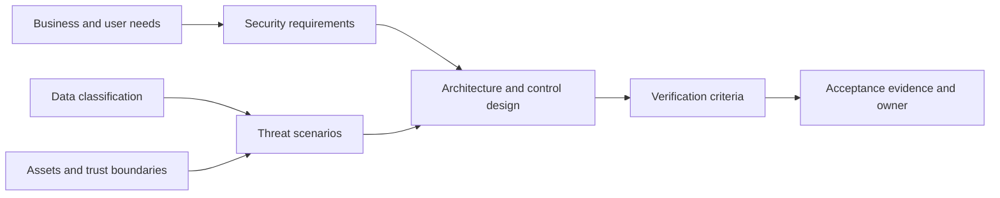
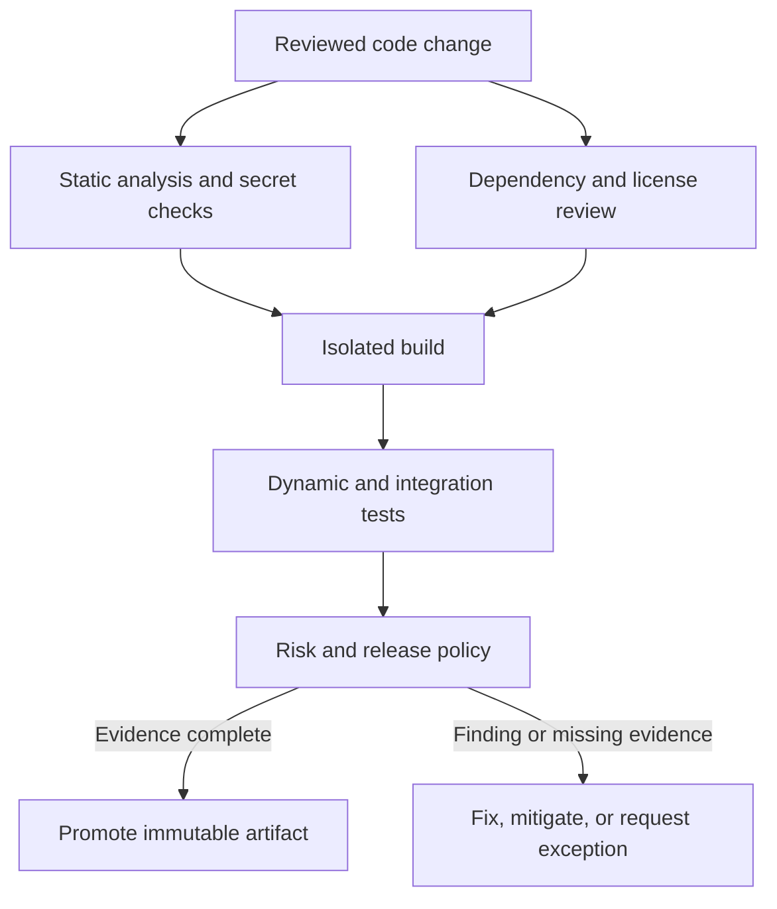
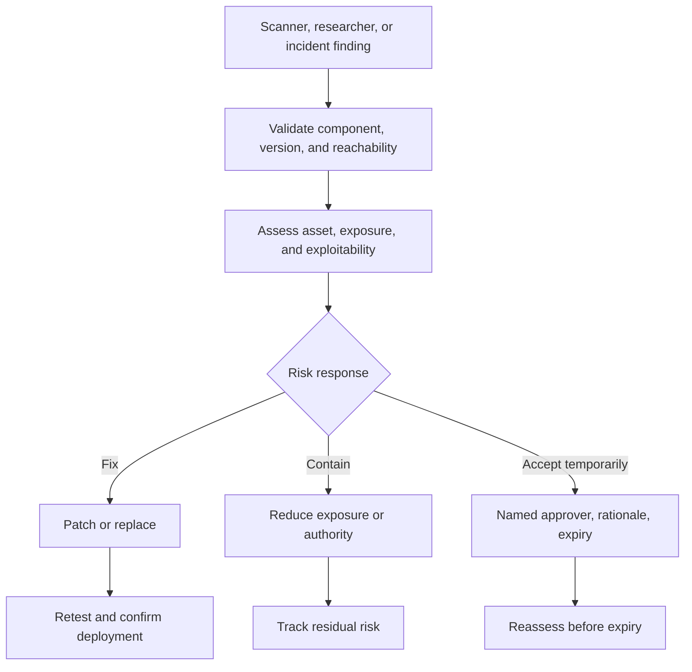
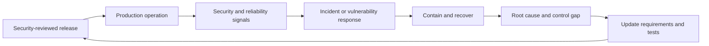
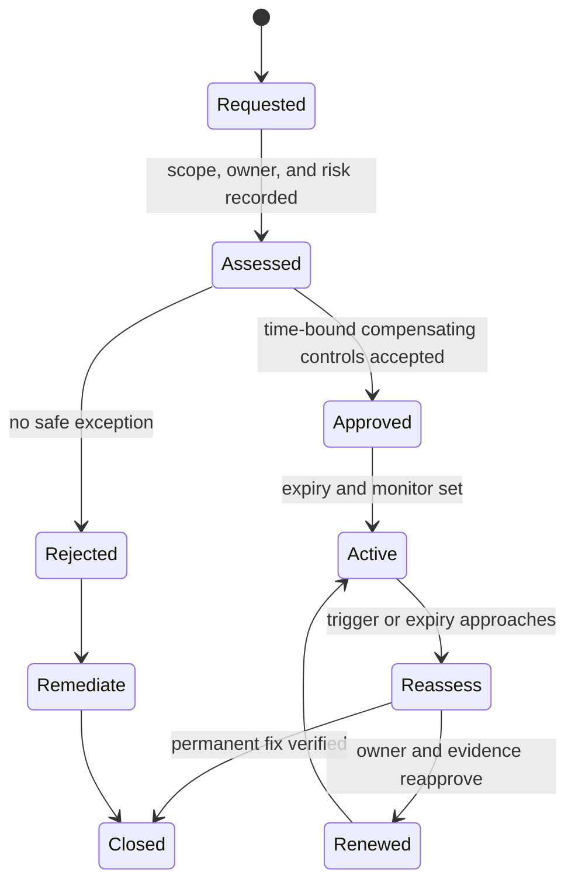

# Secure SDLC (Software Development Lifecycle)

Part: [15 — Security](PART_OVERVIEW.md)

A Secure Software Development Lifecycle (Secure SDLC) integrates security decisions, verification, and response throughout software development and operation. It makes security expectations explicit at planning, design, implementation, build, release, and maintenance stages. It is not a one-time security gate or a collection of scanning tools. Part 13 owns CI/CD implementation; this chapter owns security practices and evidence within those workflows.

## Requirements and Design

Translate business and regulatory obligations into testable security requirements: authentication strength, authorization boundaries, data classification, retention, availability, audit, and recovery. Identify assets, actors, trust boundaries, abuse cases, and assumptions before architecture is fixed. [CH12 Threat Modeling](CH12_Threat_Modeling.md) owns the threat-analysis method; this chapter places that method in the lifecycle.

Requirements should name a control outcome and verification method. “Use encryption” is incomplete without data scope, key ownership, rotation, and tests. “Prevent unauthorized access” needs a subject/action/resource boundary and negative cases. Assign an owner for residual risk and exceptions before implementation.

## Engineering Practices and Verification

Use secure coding standards, code review, dependency governance, and security testing proportional to risk. Static analysis can find some source patterns; dynamic testing observes a running application; software composition analysis identifies dependencies; secret scanning detects likely credential exposure. Each tool has blind spots and false positives. Combine automated checks with design review, manual testing, and operational evidence.

Test controls at the layer where they are enforced. A unit test can verify input validation; an integration test can verify authorization across tenants; a deployment test can verify image policy; an incident exercise can verify credential revocation. Test negative cases, bypass paths, and missing telemetry, not only the intended success path.

## Vulnerability Intake and Exception Governance

Vulnerability response starts with a reliable inventory and a way to determine affected versions, deployments, and reachable attack paths. Triage considers severity, exploitability, exposure, asset impact, and compensating controls. Assign remediation ownership and deadlines based on risk rather than applying a single severity cutoff to every workload.

Exceptions need a named risk owner, business rationale, affected assets, compensating controls, expiration, and review trigger. An exception is not a permanent alternative to a fix. Security teams should be able to identify overdue exceptions and verify that compensating controls remain effective.

## Release, Operation, and Learning

Release decisions should be tied to evidence: reviewed source, tested build, dependency inventory, artifact identity, security findings, and deployment target. [Part 13 CI/CD](../13_DevOps/CH02_CI_CD.md) owns pipeline mechanics. Part 14 owns operational telemetry; this chapter defines which security events, control failures, and incidents must be observable without leaking secrets.

Measure whether controls reduce risk and whether teams can meet them. Useful evidence includes time to remediate by risk, secrets detected before merge, control-test coverage, exception age, and incident recurrence. Avoid optimizing a single metric such as vulnerability count; closing a finding without reducing exploitability is not success.

## Worked Case and Review Checklist

A file-upload service handles customer documents. Requirements specify tenant isolation, file-size limits, malware handling, encryption, retention, and audit. Threat modeling identifies parser compromise and cross-tenant retrieval. The pipeline checks dependencies and secrets, tests object authorization, builds an immutable image, and records evidence. A high-severity parser issue is contained by disabling a format while a patched dependency is tested. The incident updates the upload threat model and regression suite.

Review requirements, threat model, design controls, code review, test coverage, dependency and secret checks, build isolation, release evidence, vulnerability response owner, exception expiry, runtime signals, and post-incident learning. Confirm the process can produce evidence without becoming a checkbox gate disconnected from risk.

## Questions and Summary

1. Convert a broad security goal into a testable requirement and negative test.
2. Match static, dynamic, dependency, secret, and manual testing to their blind spots.
3. Design a vulnerability exception with an expiry and reassessment trigger.
4. Draw how an incident changes a future requirement or test.
5. What evidence should bind a production artifact to its security review?

A Secure SDLC makes security requirements, controls, evidence, and ownership continuous across development and operation. Automate repeatable checks, reserve human judgment for contextual risk, manage exceptions explicitly, and feed incident learning back into design and verification. Tools support the process; they do not replace clear requirements and accountable owners.
