# Chapter: Secure SDLC (Software Development Lifecycle)

Part: [15 — Security](PART_OVERVIEW.md) · Status: Revised (in-depth rewrite)

## 1. Introduction

A Secure Software Development Lifecycle (Secure SDLC) is the set of security activities, decisions, and evidence that surround the ordinary work of building and running software. Planning, design, coding, building, releasing, and operating each get a small number of security activities with named owners and a recorded outcome. The aim is that, for any artifact running in production, someone can answer three questions without a meeting: what security requirements applied, what was done to check them, and who accepted the remaining risk.

After this chapter you will be able to:

- Describe the lifecycle as a chain of evidence rather than a list of tools, and say which activity produces which evidence.
- Turn a business or regulatory obligation into a testable security requirement with an owner, a verification method, and negative cases.
- Decide how deep a design review needs to be for a given change, and what a reviewer should look for in a code review that tools cannot see.
- Classify the main automated test classes (static analysis, dependency analysis, secret scanning, dynamic testing, interactive testing, fuzzing) by what they observe, where they run, and what they miss.
- Estimate the human cost of a finding stream, and set thresholds and blocking rules so the signal stays believable.

Ownership across the handbook is as follows.

| Topic | Owner |
|---|---|
| Method for analyzing threats to a specific system | [CH12 Threat Modeling](CH12_Threat_Modeling.md) |
| Catalog of common web application weakness classes | [CH01 OWASP Top 10](CH01_OWASP_Top_10.md) |
| End-to-end integrity of builds, dependencies, and provenance | [CH15 Supply Chain Security](CH15_Supply_Chain_Security.md) |
| Software Bill of Materials (SBOM) inventory practice | [CH16 SBOM](CH16_SBOM.md) |
| Pipeline tooling and mechanics (build, test, deploy automation) | [Part 13 CI/CD](../13_DevOps/CH02_CI_CD.md) |
| Security requirements, review, testing practice, vulnerability handling, exceptions, release evidence, and feedback loops | This chapter |

This chapter owns the practice and the evidence. Part 13 owns how a pipeline is wired. Where a pipeline snippet appears below, it shows where a security check sits and what it decides, not how to build a general pipeline.

One framing sentence carries through everything that follows. A Secure SDLC does not try to make every change safe by inspection. It tries to make unsafe changes visible early, when they are cheap to fix, and to leave a record that survives staff turnover.

## 2. The Governing Model: Activities, Evidence, and Owners

### 2.1 Why a lifecycle model at all

Security defects arrive from three places: requirements that never mentioned the risk, designs that made the risk unavoidable, and code or configuration that failed to implement a sound design. A defect found at the stage that produced it is usually cheap to fix. A defect found two stages later has been built upon, so the fix touches more code, more tests, and sometimes a data migration. This is the economic argument for putting activities early. It is a tendency, not a fixed multiplier, and the size of the effect varies by system. Do not quote a universal cost ratio in a design document; measure your own rework in the tracker if you need a number.

The second argument is accountability. Auditors, customers, and your own incident responders ask the same question after something goes wrong: was this checked, by whom, and against what? A lifecycle gives each answer a place to live.

Published frameworks describe the same shape. The National Institute of Standards and Technology (NIST) Secure Software Development Framework (SSDF, Special Publication 800-218) groups practices into preparing the organization, protecting the software, producing well-secured software, and responding to vulnerabilities. The Open Worldwide Application Security Project (OWASP) Software Assurance Maturity Model (SAMM) and the Building Security In Maturity Model (BSIMM) describe practice maturity. At the time of writing these are the usual references; verify the current revision of each before citing a practice identifier in an audit response. This chapter uses the shape, not the numbering.

### 2.2 The activity and evidence chain

Each lifecycle stage has a small number of activities, and each activity should leave an artifact that a later stage or a later person can read.

```mermaid
flowchart LR
    subgraph PLAN["Plan"]
        P1["Security requirements<br/>and data classification"]
    end
    subgraph DESIGN["Design"]
        D1["Threat model and<br/>design review"]
    end
    subgraph BUILD["Code and build"]
        B1["Peer code review"]
        B2["Static analysis,<br/>secret scan, dependency scan"]
    end
    subgraph TEST["Test"]
        T1["Dynamic and<br/>interactive testing"]
        T2["Abuse-case and<br/>authorization tests"]
    end
    subgraph REL["Release"]
        R1["Release gate and<br/>evidence bundle"]
    end
    subgraph OPS["Operate"]
        O1["Monitoring and<br/>vulnerability intake"]
        O2["Incident response<br/>and learning"]
    end
    P1 -->|"requirement IDs"| D1
    D1 -->|"mitigations to implement"| B1
    B1 --> B2
    B2 --> T1
    T1 --> T2
    T2 -->|"test results"| R1
    R1 -->|"artifact plus evidence"| O1
    O1 --> O2
    O2 -.->|"new requirements and tests"| P1
```

The diagram makes three points. First, requirement identifiers flow forward: a requirement created in the planning stage should be traceable to a design decision, a test, and a release record. Without that thread, "we meet requirement X" cannot be shown. Second, the build and test stages are not one block. Static checks run on source and need no running system, so they give feedback in minutes. Dynamic checks need a deployed instance and run later. Putting each check at the earliest stage where it has the inputs it needs keeps feedback fast. Third, the dotted line from incident response back to planning is the feedback loop, and it is the part most often missing. A lifecycle without it repeats its own mistakes.

### 2.3 Evidence, owners, and what counts

An activity that leaves no evidence cannot be audited and, in practice, tends to stop happening under schedule pressure. Evidence does not need to be heavy. A design review can be a pull request comment thread linked from the ticket. A static analysis run can be a report attached to the build. What matters is that the record states four things: what was examined (artifact identity such as a commit hash or image digest), what was checked against (requirement identifiers or a rule set version), what the outcome was, and who is accountable for any residual risk.

| Activity | Typical evidence | Accountable owner |
|---|---|---|
| Requirements | Requirement list with identifiers and verification method | Product owner with security architect |
| Design review | Review record, accepted mitigations, open risks | Tech lead and reviewer |
| Code review | Approved change with reviewer identity | Code owner |
| Automated checks | Tool report tied to commit and rule set version | Engineering team |
| Release | Evidence bundle tied to artifact digest | Release owner |
| Exceptions | Named approver, rationale, expiry | Risk owner |

The owner column matters more than it looks. A finding with no named owner is a finding nobody fixes. Where a team owns a service, that team owns its security evidence; the security function sets the standards, provides tools, and reviews high-risk cases. Centralising all security work in one team creates a queue that grows faster than the team does.

### 2.4 Proportionality

Not every change needs every activity. A copy change on a marketing page and a change to token validation in an authentication service differ by orders of magnitude in risk. A workable scheme assigns each change or service a risk tier from a short set of questions: does it handle regulated or sensitive data, is it reachable from the internet, does it make authorization decisions, does it hold credentials or keys, and does it run with broad cloud permissions. The tier then selects the minimum activity set. A low tier might require peer review, automated scans, and the standard release gate. A high tier adds a design review, a threat model update, focused manual testing, and a named security sign-off. Tiering is a decision about where scarce human attention goes, and it should be written down so teams can predict what will be required.

## 3. Security Requirements

### 3.1 Where requirements come from

Security requirements have four common sources. Business and contractual obligations, such as a customer agreement that demands audit logs for administrative actions. Regulation and standards, such as data-protection law, payment-card rules, or sector rules; the requirement text should cite the clause you were told applies, and your compliance function owns the interpretation. Data classification, which sets handling rules for each class of data (storage, encryption, retention, who may read it). And threat analysis, where [CH12 Threat Modeling](CH12_Threat_Modeling.md) turns assets, actors, and trust boundaries into mitigations that must be built. Reusable catalogs help with completeness. The OWASP Application Security Verification Standard (ASVS) lists verifiable requirements grouped by area and by assurance level; at the time of writing it is a common starting list, and teams select the level that matches the application's risk. The catalogue is a source to tailor, not a document to copy wholesale into a backlog.

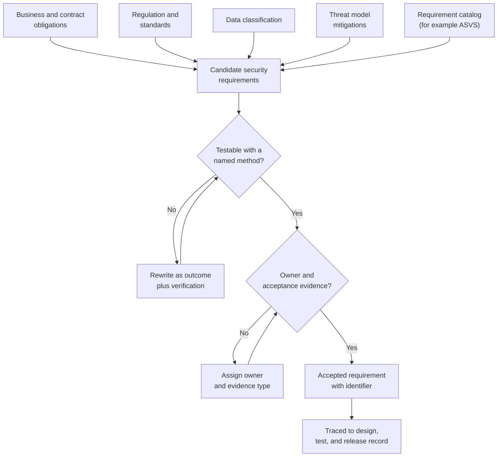

The diagram shows requirements passing through two acceptance questions before they count. The loops back from each question are the working part. Most draft requirements fail the first question, because they are written as aspirations. Sending them back for rewriting is cheaper than discovering at release time that nobody can say how to check them.

### 3.2 What a testable requirement looks like

A testable requirement states a control outcome, the scope it applies to, and the method that verifies it. Compare two versions of the same intent.

| Weak form | Why it fails | Testable form |
|---|---|---|
| Use encryption. | No data scope, key owner, algorithm policy, or test. | Documents of class Confidential are encrypted at rest with keys held in the managed key service, rotated at least every 365 days, and the service account that reads the bucket cannot export the key. Verified by infrastructure policy check and a key-access audit test. |
| Prevent unauthorized access. | No subject, action, or resource boundary. | A user in tenant A receives HTTP 404 or 403 for any read, list, or write on a resource owned by tenant B, across every endpoint under `/api/v2/`. Verified by an automated cross-tenant test generated from the route table. |
| Log security events. | No event list, content rule, or retention. | Authentication failures, privilege changes, and data export actions emit a structured event containing actor, resource, outcome, and source address, retained 400 days, with no secret or full token value in any field. Verified by log-schema test and a seeded-event query. |

The numbers in the table (365 days, 400 days) are illustrative. Real values come from your policy or contract. The pattern to copy is the shape: subject, action, resource, scope, measurable condition, and verification method.

Each requirement should also name negative cases. A positive test shows the intended user succeeds. A negative test shows the forbidden user fails, and the missing-token, expired-token, replayed-request, and wrong-tenant cases are the ones that find real defects. A requirement without a negative case has only been half specified.

A small machine-readable form helps traceability. The following is one possible record; the field names are a convention, not a standard.

```yaml
id: SR-AUTHZ-007
statement: >
  A caller in tenant A must receive 403 or 404 for any operation on a
  resource owned by tenant B on all /api/v2/ routes.
source: [threat-model:T-14, contract:CUST-9 clause 4.2]
data_class: confidential
verification:
  - type: automated-integration-test
    suite: authz/cross_tenant
  - type: design-review
    checklist: tenant-isolation
negative_cases: [wrong-tenant, missing-token, expired-token, id-guessing]
owner: payments-team
residual_risk_owner: head-of-engineering
```

Keeping this file next to the code means a pull request that changes the route table can be checked against it, and the release evidence can list which identifiers were verified.

### 3.3 Abuse cases and misuse stories

User stories describe what a legitimate user wants. Abuse cases describe what an attacker, or a legitimate user acting badly, wants from the same feature. For a password reset flow the story is "a user who forgot their password regains access". The abuse cases are "an attacker enumerates which email addresses have accounts by observing different responses", "an attacker guesses or reuses a reset token", "an attacker triggers thousands of reset emails to one victim", and "an attacker who reads a victim's mailbox for a few minutes takes over the account permanently". Each abuse case becomes one or more requirements: identical responses for known and unknown addresses, single-use short-lived tokens stored hashed, rate limits per account and per source, and re-authentication or notification on credential change.

Writing abuse cases in the planning stage costs little and makes the later threat model faster, because the attacker goals are already listed. It also gives testers concrete cases to automate. The attacker perspective is the point: product thinking asks what the feature should allow, and abuse-case thinking asks what the feature allows that nobody intended.

### 3.4 Failure modes in requirements work

Three failures recur. Requirements are written once and never updated, so the design drifts and the evidence refers to a document nobody uses. Requirements are copied from a catalog in bulk, producing hundreds of items that nobody can verify and everyone ignores. And requirements are written for the primary path only, leaving error paths, administrative paths, and bulk or batch interfaces without any. A useful review question is to list every way data enters and leaves the system, including imports, exports, webhooks, background jobs, and admin tools, and confirm each has a requirement.

## 4. Security Design Review

### 4.1 Purpose and relationship to threat modeling

A design review asks whether the proposed architecture can satisfy the security requirements, given what is known about attackers. [CH12 Threat Modeling](CH12_Threat_Modeling.md) provides the analysis method: data-flow diagrams, trust boundaries, and structured threat enumeration. The design review is the lifecycle checkpoint at which that analysis is read, challenged, and tied to decisions. A threat model with no review is a document. A review with no threat model degrades into opinion.

### 4.2 Choosing review depth

Reviewing everything deeply does not scale, and reviewing nothing deeply misses the changes that matter. A decision rule keeps the choice predictable.

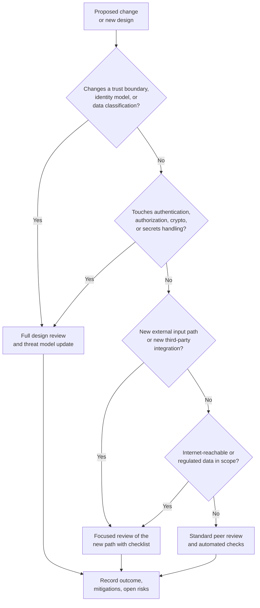

The order of the questions matters. The first two catch changes whose failure is hardest to detect later, because defects in identity, boundaries, and cryptography tend to look like working software until they are attacked. The later questions catch widened exposure. The tree is deliberately cheap to evaluate: an engineer can answer it in a minute, so it can run on every design document or large pull request. Its output is a review depth, and teams can attach a service-level objective to each depth, for example a response time commitment from the security function for full reviews. Pick the commitments from what your staffing can actually meet; an unmet commitment teaches teams to bypass the process.

### 4.3 What a reviewer examines

A reviewer reads the data-flow diagram and checks the following, in roughly this order.

1. Trust boundaries and where validation happens. Every place data crosses from a less trusted to a more trusted zone needs validation, authentication, and authorization at the receiving side. Validation done only in a browser or in a calling service is advice, not a control.
2. Identity and authorization model. Who or what are the principals, how are they authenticated, and where is each authorization decision made? A frequent finding is that the decision is made once at the edge and internal services then trust any caller on the network. See [CH02 Authentication](CH02_Authentication.md) and [CH03 Authorization](CH03_Authorization.md).
3. Data handling. Where sensitive data is stored, copied, logged, cached, backed up, and sent to third parties. Copies in logs, analytics, and test environments are where classification rules usually break.
4. Secrets and keys. How each credential is issued, stored, rotated, and revoked, and who can read it at runtime.
5. Failure behavior. What happens when the authorization service, key service, or a dependency is unavailable. Fail-open behavior on an authorization check is a design defect even when it is convenient.
6. Abuse resistance. Rate limits, quotas, and size limits on every unauthenticated or low-privilege path, and the cost an attacker can impose on the system by using it as designed.
7. Detectability and recovery. Which events would reveal misuse, and how access is revoked and data restored if a component is compromised.

Findings should be recorded with a severity, a recommended mitigation, and a disposition: accepted into the design, deferred with a named risk owner and date, or rejected with reasoning. Reviews that end with a comment thread and no recorded dispositions cannot later prove what was decided.

### 4.4 Failure modes and edge cases

Review happens too late, after the architecture is committed and the team has contract dates to meet, so findings are negotiated down. Review is done by someone who did not help build the threat model and does not know the domain, so it produces generic advice. Review covers the first release and never the incremental changes that add integrations, which is how a well-reviewed system acquires an unreviewed webhook endpoint. The mitigation for the third is the depth tree above applied to changes, plus a rule that any new external input path triggers at least a focused review.

A subtler edge case is the paved road. When the organization provides a standard component, such as a reviewed authentication library or a standard service template, a design that uses it unchanged can skip most of the review. The reviewer checks that the component is used as documented and that the deployment matches the reviewed configuration. This is how review scales: invest heavily in a few shared components and review the deviations.

## 5. Secure Code Review

### 5.1 What review adds beyond tools

Peer code review is the one lifecycle activity that every team already performs, so it is the cheapest place to add a security lens. Automated tools see patterns. A human reviewer sees intent: that this endpoint should have checked ownership of the record, that this error message reveals which accounts exist, that this retry loop will amplify a downstream outage, or that a new field is being logged with a customer's personal data. The reviewer cannot see everything, and security review by a generalist who is also checking naming and style has limited attention for subtle flaws. The practice should therefore direct attention where it pays.

### 5.2 Directing reviewer attention

A short checklist tied to risk categories works better than a long general one. For each change, the author states in the pull request description whether it touches any of: authentication or session handling, authorization checks, input parsing or deserialization, cryptographic calls, secrets or configuration, outbound network calls, file or process handling, or logging of user data. A change that touches none can go through standard review. A change that touches one or more is routed to a reviewer with the relevant knowledge, using the code owners mechanism of the source host so that the routing is enforced, not remembered.

For the touched categories, reviewers ask targeted questions.

- Authorization. Is the check performed on the server for this specific resource and action, using the identity from the verified credential and not from a request field? Does every code path to the data pass through it, including bulk, export, and background-job paths?
- Input handling. Is untrusted input parsed with a strict schema before use, and is it ever concatenated into a query, command, path, template, or URL? See [CH01 OWASP Top 10](CH01_OWASP_Top_10.md) for the weakness classes.
- Cryptography. Does the code use a vetted library at its high-level interface, with no hand-written primitives, no fixed or reused nonces, and no comparison of secrets using ordinary equality?
- Errors and logging. Do error responses avoid internal detail, and do logs avoid credentials, tokens, and sensitive personal data?
- Dependencies. Does the change add a new dependency, and has someone looked at who maintains it and whether it is needed? Supply chain checks themselves are owned by [CH15 Supply Chain Security](CH15_Supply_Chain_Security.md).

### 5.3 Enforcement and its limits

Review is only a control if it cannot be skipped by the author. On the source host this means branch protection: direct pushes to the release branch are blocked, at least one approving review from someone other than the author is required, approvals are dismissed when new commits are pushed, and designated code owners must approve changes to sensitive paths. The exact setting names differ by host, so check your host's documentation. Two further edge cases deserve explicit handling. Administrators who can bypass branch protection should be few, and every bypass should create an auditable record. Automation accounts that merge on behalf of a person, such as dependency update bots, should have a defined review rule, because an unreviewed automated merge is an unreviewed change to production.

The attacker perspective is sharp here. An attacker who compromises one developer account, or who persuades a maintainer to accept a small contribution, gains a path into production only if review can be bypassed or is perfunctory. Multi-party review raises the cost from one stolen credential to two. It does not help when reviewers approve large diffs in seconds, so keep changes small enough to read. Teams commonly find that review quality falls as diff size rises; set a soft size guideline and measure whether it is followed rather than assuming it.

## 6. Automated Security Testing: Tool Classes and What They See

### 6.1 The governing idea: each tool class has a viewpoint

Every automated security tool observes the system from one viewpoint, and that viewpoint decides what it can find and what it cannot. Choosing tools is the task of covering the important viewpoints, not of buying many scanners that look at the same thing. The classes below are described by mechanism. Products within a class differ in language support, rule quality, and speed, and those differences should be measured on your own code before purchase.

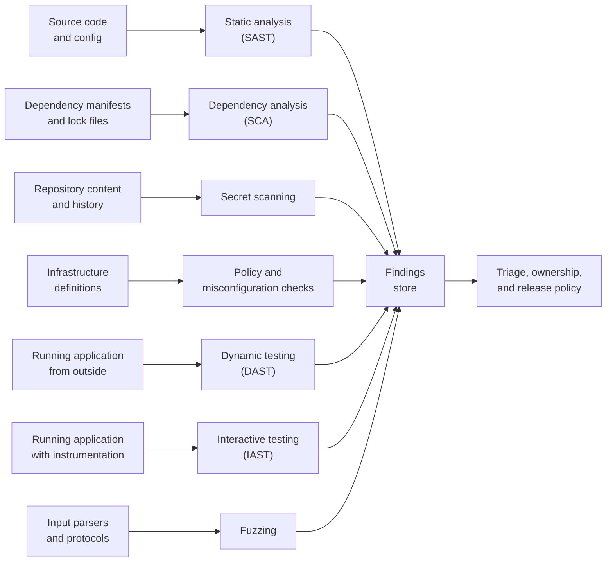

The diagram groups tools by input. The left half needs no running system and can run on every commit. The lower half needs a deployed or instrumented instance and runs later and less often. All results converge on one findings store and one triage process. If each tool reports to its own console, nobody can see the total workload or deduplicate findings, and the process fails for organizational rather than technical reasons.

### 6.2 Static application security testing (SAST)

Static Application Security Testing (SAST) analyzes source code or compiled code without running it. Simple tools match syntactic patterns, such as a call to a weak hash function or string concatenation inside a query call. More capable tools build a model of the program and perform data-flow analysis, tracking whether a value from an untrusted source (an HTTP parameter) can reach a dangerous sink (a query, a command, an HTML output) without passing a sanitizer. This source-to-sink reasoning is called taint analysis.

SAST strengths: it runs early, it points to an exact line, and it finds whole classes of injection and misuse across the entire code base including paths tests never exercise. Its weaknesses follow from the mechanism. It does not know the runtime configuration, so it can miss flaws that exist only because of how the service is deployed. It does not understand your custom sanitizers unless told, so it produces false positives where you validated input in a way it cannot recognize. It struggles with reflection, dynamic dispatch, and framework magic that hides the real call path, which produces false negatives. And it cannot find missing logic: an endpoint that forgets an authorization check has no bad pattern to match.

Tuning is part of the cost. Start with a narrow, high-confidence rule set that you will block on, and a wider set that reports without blocking. Add custom rules for your own dangerous wrappers and your own sanitizers. Run incrementally on the changed files for fast pull request feedback and run a full scan on a schedule, since some data-flow results depend on code that did not change.

### 6.3 Software composition analysis (SCA)

Software Composition Analysis (SCA) reads dependency manifests and lock files, resolves the full tree including transitive dependencies, and matches each package version against vulnerability databases. The matching is by package identifier and version range, so the quality of the result depends on the quality of the database and on whether the tool understands your ecosystem's version semantics.

Know what it can and cannot tell you. A match says a vulnerable version is present. It does not say the vulnerable function is called. Reachability analysis tries to answer that, with varying accuracy, and a "not reachable" result should lower urgency, not close the item, because reachability depends on call graphs that tools approximate. SCA also lags disclosure, since a database entry appears only after a vulnerability is published and processed. Lock files matter: scanning a manifest with version ranges reports what could be installed, while scanning the lock file reports what is installed. How the inventory is produced and exchanged is covered in [CH16 SBOM](CH16_SBOM.md), and tampering and provenance risks in [CH15 Supply Chain Security](CH15_Supply_Chain_Security.md).

### 6.4 Secret scanning

Secret scanning looks for credentials committed to repositories: cloud access keys, API tokens, private keys, and database connection strings. Detection uses two mechanisms. Pattern detectors recognize tokens with a known format, such as a fixed prefix and length, and these have low false-positive rates. Entropy detectors flag long random-looking strings, which catch unknown formats but also flag hashes, identifiers, and test fixtures.

Two placements matter. A pre-commit hook on the developer machine stops a secret before it enters history, but developers can skip hooks, so it is a convenience. A server-side check on push, available on some source hosts as push protection, can reject the push, so it is the control. Scanning history and not only the latest commit matters because deleting a file does not remove the secret from past commits.

The key operational rule is that a detected secret is a compromised secret. Removing it from the repository does not undo exposure, because it may have been cloned, cached, or read by a mirror. The response is to revoke and rotate first, then clean up history if needed. Preventing the problem is better still: workloads that obtain short-lived credentials from their platform identity have no long-lived secret to commit. Runtime secret storage is owned by the cloud secrets chapter in [Part 09 CH13 Secrets Management](../09_Cloud_Computing/CH13_Secrets_Management.md).

### 6.5 Dynamic, interactive, and fuzz testing

Dynamic Application Security Testing (DAST) sends crafted requests to a running application and observes responses, like a black-box attacker. It finds problems that depend on deployment and runtime behavior: missing security headers, exposed administrative paths, reflected injection, weak session cookie attributes, and server misconfiguration. It needs a deployed instance, it is slow, and it can only test what it can reach, so an unauthenticated crawl will never see pages behind a login unless you configure credentials and session handling. It reports a symptom and a request, not a source line, so fixes require tracing back to the code.

Interactive Application Security Testing (IAST) places an agent inside the running application, often attached during functional or integration tests. The agent watches real data flow through real code during those tests and reports when untrusted data reaches a sink. Because it observes actual execution it usually has fewer false positives than SAST and gives a source location, but it only finds what the existing tests exercise, adds runtime overhead, and depends on agent support for your language and framework.

Fuzzing feeds malformed, random, or mutated inputs to a parser or protocol handler and watches for crashes, hangs, and sanitizer violations. Coverage-guided fuzzers use code coverage to steer mutation toward new paths. It is most valuable for code in memory-unsafe languages and for parsers of complex formats, and least valuable for business-logic flaws.

### 6.6 What none of them find

No automated class reliably finds broken authorization logic, missing business rules, insecure workflows, or flaws in the design itself. These are the defects that cause tenant data leaks and privilege escalation. They are found by design review, targeted manual testing by a skilled tester, and your own abuse-case tests, such as the cross-tenant test in the requirements section above. Present automated results as evidence for specific requirements, and do not report "scans clean" as "secure". A clean scan means the tool found nothing within its viewpoint.

## 7. Finding Volume, Triage Cost, and Blocking Rules

### 7.1 Why thresholds are an economic decision

Every finding costs human time to read, judge, and either fix or dismiss. A tool that produces more findings than the team can triage trains the team to ignore it. The design question is therefore how to set rules so that the findings reaching a human are mostly real and the findings that block a release are almost always real. Two quantities govern this: precision (the share of reported findings that are true) and the time cost per finding.

### 7.2 Worked scenario: sizing the triage load

The numbers below are illustrative and were chosen to show the arithmetic, not to describe any tool. A team merges 60 pull requests per day. A SAST tool in its default configuration reports 0.5 new findings per pull request, and the team's measurement shows that 30 percent of them are true issues. Triage takes 10 minutes per finding on average.

- New findings per day: $60 \times 0.5 = 30$.
- True issues per day: $30 \times 0.30 = 9$.
- False positives per day: $30 - 9 = 21$.
- Triage time per day: $30 \times 10 = 300$ minutes, which is 5 hours, of which $21 \times 10 = 210$ minutes (3.5 hours) is spent on false positives.

If the team blocks merges on every finding, each false positive also delays a pull request. Assume each blocked false positive costs the author 45 minutes of waiting, context switching, and arguing for a dismissal. The daily blocking cost is $21 \times 45 = 945$ minutes, about 15.75 hours of delay, to catch 9 true issues. That ratio is why teams switch such a gate off within weeks.

Now tune. The team disables noisy rules, adds two custom sanitizer definitions, and splits the rule set. A high-confidence set blocks merges; a broader set reports without blocking. Measurements after tuning: the blocking set reports 0.05 findings per pull request with 85 percent precision, and the reporting set reports 0.15 findings per pull request with 40 percent precision.

- Blocking findings per day: $60 \times 0.05 = 3$, of which $3 \times 0.85 = 2.55$ are true and $0.45$ are false. Blocking delay from false positives: $0.45 \times 45 \approx 20$ minutes per day.
- Reporting findings per day: $60 \times 0.15 = 9$, of which $9 \times 0.40 = 3.6$ are true. These go to a weekly triage queue rather than blocking.
- Triage time per day: $(3 + 9) \times 10 = 120$ minutes, 2 hours, down from 5.

True issues found per day fall from 9 to $2.55 + 3.6 = 6.15$, a loss of about 2.85 per day in exchange for roughly 15 hours less daily delay and 3 hours less triage. Whether to accept that loss is the decision. For a high-risk tier, you may add manual review or a second tool to recover coverage. For a low tier, the trade is reasonable. The point is that you can calculate it with your own measurements instead of arguing from tool defaults.

### 7.3 Baselines: do not triage the past under deadline

A first scan of an existing code base typically reports a large backlog. Suppose it reports 1,200 findings. At 10 minutes each, triaging them all costs $1200 \times 10 = 12{,}000$ minutes, which is 200 hours. Do not block releases on that backlog. Record it as a baseline, block only on findings introduced after the baseline, and schedule backlog work by risk: findings in internet-facing and authorization code first. Review the baseline on a fixed cadence so it shrinks rather than becoming a permanent excuse.

### 7.4 Gate evaluation order

A security gate evaluates findings in a fixed order so results are predictable and explainable to developers.

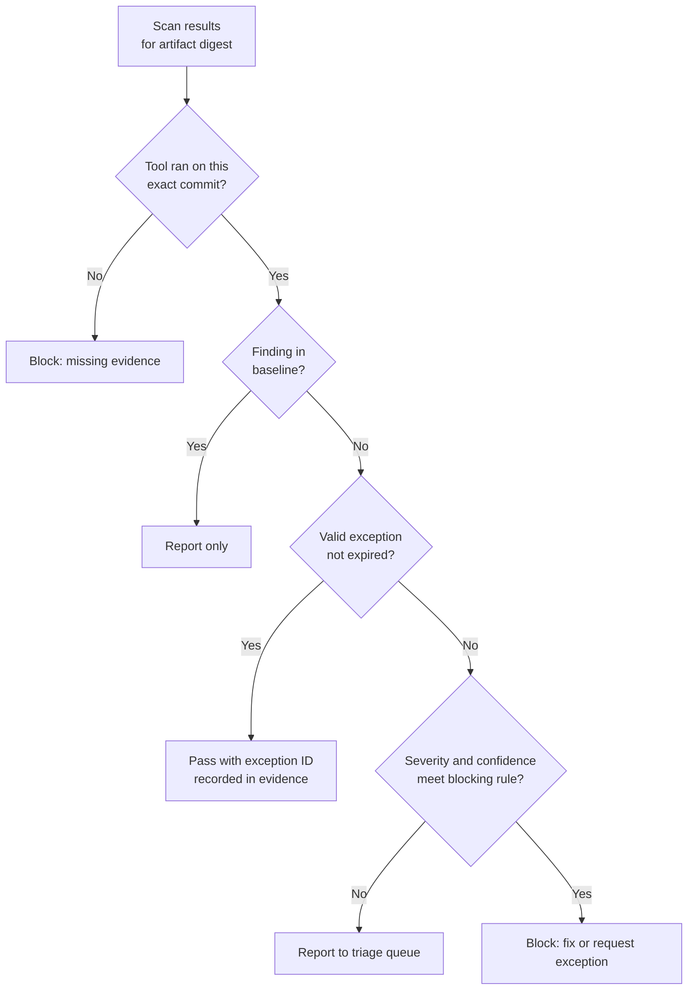

The first test is the most important and the most often omitted. A gate that only checks "no blocking findings" passes when the scanner silently failed or was skipped. Treating missing evidence as a block makes a broken scanner visible. The baseline and exception tests come before severity so that known and approved items do not repeatedly block, while still being recorded. Order also affects trust: when a developer asks why a build was blocked, the answer should be a single branch of this tree.

A tool-neutral sketch of the gate in a pipeline definition follows. Stage names and commands are placeholders; Part 13 owns the pipeline syntax for your platform.

```yaml
security-checks:
  stage: verify
  steps:
    - run: scan-secrets --mode diff --fail-on any
    - run: sast --ruleset blocking-v3 --baseline baseline.json --fail-on new-high-confidence
    - run: sast --ruleset reporting-v3 --baseline baseline.json --report findings-report.json
    - run: sca --lockfile --fail-on known-exploited,new-critical --report sca-report.json
    - run: verify-evidence --require sast,sca,secrets --digest "$ARTIFACT_DIGEST"
  artifacts:
    - findings-report.json
    - sca-report.json
```

The final step is the missing-evidence check from the diagram. The rule names such as `blocking-v3` carry a version so the evidence records which rules ran. Changing the rule set is itself a reviewed change, because loosening a rule silently is a way for pressure to defeat the gate.

### 7.5 Failure modes

Alert fatigue arises when blocking rules include low-precision findings. Gate bypass arises when blocked teams discover an override with no record; every override must produce an exception entry. Metric gaming arises when teams are measured on finding count, so they suppress findings with inline comments instead of fixing them; require suppressions to carry a reason and an owner, and sample them in review. And tool drift arises when rule updates change results overnight; pin rule versions and update them on a schedule so that a new blocked build can be traced to a deliberate change.

## 8. Vulnerability Intake and Triage

### 8.1 Where vulnerabilities enter

The earlier sections described findings produced by the pipeline. In operation, a larger and more varied stream arrives from other directions. Scanners of deployed images and hosts report newly published weaknesses in components that were clean at build time. Vendors and open-source maintainers publish advisories. External researchers report through a disclosure channel, which should be a documented address or form with an acknowledgement commitment. Customers and penetration testers send reports. Internal staff notice problems in code review or incident handling. Each source has different reliability and different urgency, and all of them should land in one record system so that the same issue reported four ways becomes one item with four references.

Each item needs a minimum set of fields before triage can start: the source, the affected component and version range, the deployments where that component runs, the owning team, and the date the organization first knew. The last field matters because every deadline in the next sections is measured from it. The deployment mapping is the hard part. A package inventory per build, as described in [CH16 SBOM](CH16_SBOM.md), lets you answer "which running workloads contain this library version" with a query instead of a search of repositories. Without it, the first hours of a major advisory go to discovering what you run.

### 8.2 The triage questions

Triage turns an advisory into a decision. It asks, in order, whether the report is valid, whether it applies here, how likely it is to be exploited here, and how bad the outcome would be here.

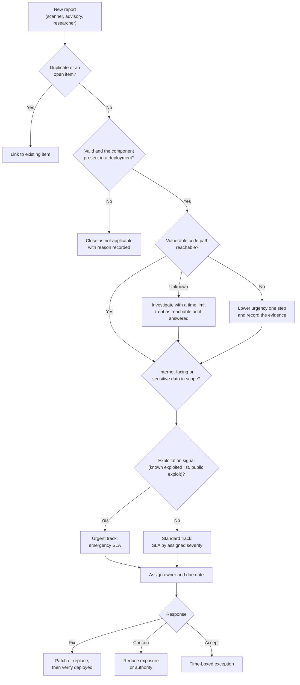

Two branches deserve explanation. The "unknown" reachability branch defaults to treating the code as reachable, and adds a time limit on the investigation. Without the default, "we are checking" becomes a way to leave an item unowned indefinitely. Without the limit, an investigation can consume more engineering time than the patch would. The "not reachable" branch lowers urgency by one step and records the evidence; it does not close the item, because a refactor next quarter can make the path reachable and the record is what lets someone notice. Triage output is always one of three responses: fix, contain, or accept with an expiry. Everything else is a delay with no owner.

### 8.3 Verification of the fix

Closing an item when the pull request merges is a common error. The item closes when the fixed version is running in every affected deployment and a rescan or targeted test confirms it. Between merge and deployment there are builds that did not pick up the change, long-lived workloads that were never restarted, and images pinned to an old base. A weekly query that compares the inventory of running components against open items catches these. It is also the only way to find the deployment that nobody remembered.

## 9. Scoring and Prioritization Signals

### 9.1 What a severity score is

The Common Vulnerability Scoring System (CVSS) is a published method for describing the characteristics of a vulnerability and converting them to a number from 0 to 10, with named bands from low to critical. The base score describes properties of the weakness itself: how it is reached (network or local), how complex the attack is, what privileges and user interaction are needed, and the effect on confidentiality, integrity, and availability. The score is the same for every organization. That is its value as a common language and its limit as a prioritization tool: it does not know whether the component is on the internet, whether your data is sensitive, or whether anyone is exploiting it. CVSS has several versions with different metrics and scoring, and an advisory may carry scores from different versions or different scorers. At the time of writing, check which version your tooling reports before comparing numbers across sources.

The framework also defines optional threat and environmental metric groups intended to adjust the base score for exploit maturity and for local context. Many scanners report only the base score, so teams that want context-adjusted values must supply the inputs themselves or apply their own rules on top.

### 9.2 Exploitation signals

Because the base score ignores real-world activity, triage adds signals about exploitation. Two are widely used. The Known Exploited Vulnerabilities (KEV) catalog is a list maintained by the United States Cybersecurity and Infrastructure Security Agency (CISA) of vulnerabilities for which there is evidence of exploitation in the wild. Presence on it is a strong reason to move an item to an urgent track, and absence does not show that the issue is safe, only that it is not listed. The Exploit Prediction Scoring System (EPSS) publishes a probability estimate that a vulnerability will be exploited in a short future window, produced by a statistical model. It is an estimate based on historical data, so treat it as one input. Its strength is ranking a large backlog; its weakness is that a newly disclosed issue may have little data behind its score and a targeted attack on your own application will never appear in it. Verify the current definition and update cadence of each source before encoding thresholds in policy.

Other signals are local and often more useful than either list. A public proof-of-concept exploit raises urgency. Evidence in your own logs of probing for the vulnerable path raises it further. The exposure of the component (internet-facing, partner-facing, internal only) and the sensitivity of the data behind it are facts you hold and the scores do not.

### 9.3 Combining the signals

A defensible approach is a small decision table, written down and applied consistently, that maps signals to a severity assignment used for the deadline.

| Condition (evaluate top to bottom) | Assigned severity |
|---|---|
| On a known-exploited list, or exploitation observed in your own telemetry | Emergency |
| High or critical base score, reachable, internet-facing or sensitive data | High |
| High or critical base score, reachable, internal and low-sensitivity | Medium |
| High or critical base score, not reachable (evidence recorded) | Medium |
| Medium base score with a high estimated exploitation probability and exposure | Medium |
| All other cases | Low |

The thresholds for "high probability" are a local policy choice, and the table is a template to adapt, not a standard. The aim is that two engineers triaging the same item reach the same severity. When they disagree, the disagreement is recorded as an override with a reason, which later shows whether the table needs a new row.

### 9.4 Reachability and its limits

Reachability analysis asks whether application code can actually call the vulnerable function. Tools approximate it through call graphs, which are incomplete in the presence of reflection, dynamic loading, and plugins. A positive result is useful evidence. A negative result is a hint, and the safe use of it is to reduce urgency by a bounded amount while still fixing the item within a longer deadline. Another useful check is the configuration: a vulnerability in a feature that is disabled in your deployment, or in a protocol you do not expose, is more strongly mitigated than one in a function your code merely does not appear to call.

## 10. Remediation Deadlines and Backlog Arithmetic

### 10.1 SLA by severity

A remediation Service Level Agreement (SLA) in this context is an internal commitment: a maximum time from the date of awareness to a verified fix or an approved exception. It needs a clock start, a clock stop, and an owner, and the values are a policy decision. The following table is an illustration of the structure.

| Severity | Clock stop | Illustrative deadline |
|---|---|---|
| Emergency | Fix deployed or containment verified | 48 hours |
| High | Fix deployed to all affected deployments | 14 days |
| Medium | Fix deployed | 60 days |
| Low | Fix deployed or batched into scheduled upgrade | 180 days |

The numbers are examples. Choose values you can meet, because an SLA that is routinely missed measures nothing. A policy often applies a shorter deadline to the same severity on an internet-facing, high-risk-tier service than on an internal batch job. Contractual or regulatory obligations may fix some of these numbers for you; your compliance function owns that interpretation.

A small machine-readable policy keeps the deadlines out of people's memories and lets the tracker compute due dates.

```yaml
remediation_policy:
  clock_start: date_first_known
  clock_stop: verified_deployed_or_exception_approved
  deadlines_days:
    emergency: 2
    high: 14
    medium: 60
    low: 180
  tier_multiplier:
    high_risk_tier: 0.5
    standard_tier: 1.0
  escalation:
    at_percent_elapsed: 75
    notify: [service-owner, engineering-manager]
    on_breach: [security-lead, head-of-engineering]
```

### 10.2 Worked scenario: will the backlog ever clear

The numbers here are illustrative. A product group has an open backlog of 240 vulnerability items at the start of the quarter. Its intake averages 30 new items per week, and its team closes 25 per week on average.

- Net change per week: $30 - 25 = +5$ items.
- After 13 weeks: $240 + 13 \times 5 = 305$ items.

The backlog grows even though the team works steadily. Closing more per week requires a different approach than more exhortation. Suppose the team makes two changes. First, it uses the reachability and exposure rules from the triage section to close 60 of the 240 as not applicable or lower-priority with evidence, leaving 180. Second, it moves two shared base images and one framework to automated update pull requests, which removes an estimated 10 items per week from manual intake and increases closure by 5 per week (an assumption to be measured, not a promise). New intake is now 30 − 10 = 20 per week and closure is 25 + 5 = 30 per week.

- Net change per week: $20 - 30 = -10$.
- Time to clear 180 items: $180 \div 10 = 18$ weeks.

The arithmetic shows which lever matters. Raising closure capacity from 25 to 30 alone gives a net of 0 against the original intake of 30, so the backlog stops growing but never clears. Cutting intake at the source (shared base images, automated updates, fewer direct dependencies) and removing items that do not apply produced the burn-down. Also check the deadline: if the 180 items include 20 High items with a 14-day SLA, then clearing 10 per week net does not guarantee those 20 are handled first. The queue must be ordered by severity and due date, not first-in first-out, and the High items need their own capacity that is not shared with the Low ones.

A related calculation tells you whether the SLA is achievable. If High items arrive at 3 per week and each takes 4 engineer-days to fix and deploy, High work consumes $3 \times 4 = 12$ engineer-days per week, which is 2.4 engineers on a five-day week. If the team has 1 engineer's worth of capacity reserved for security work, the 14-day SLA cannot be met in steady state, and the choices are to add capacity, reduce the per-item cost through automation, or change the policy openly. Quietly missing deadlines is the worst of these.

### 10.3 Escalation

SLA values do work only when approaching a deadline triggers a defined action. A usual pattern is a notification to the owner when most of the time has elapsed, an escalation to the manager at the deadline, and a mandatory exception decision at breach: the item must be fixed or must have an approved, time-boxed exception, and it may not remain overdue without a record. This links the deadline model to the exception process in the next section.

## 11. Exception and Risk Acceptance Governance

### 11.1 What an exception is

An exception is a recorded decision to run with a known gap for a limited time. It exists because some fixes cannot meet the deadline: a vendor patch is not available, a migration is scheduled, or the fix would break a contractual interface. Without a formal path, the gap is still accepted, but silently, by whoever is tired of the ticket. The formal path makes the acceptance visible and puts a name next to it.

A usable exception record contains the following.

- The finding or requirement it relates to, and the affected assets.
- The business reason the fix cannot be delivered by the deadline.
- The risk owner, who is the person with authority over the affected business outcome. The engineer who owns the code is not automatically that person, and the security team should not approve risk on behalf of a business it does not run.
- Compensating controls, each stated as a control with a verification method, for example "the vulnerable endpoint is blocked at the gateway by rule X, verified by a weekly test request".
- An expiry date, usually no longer than the severity's own deadline, and a renewal rule.
- A review trigger other than the date, such as a vendor patch release or a change in exposure.

The approver level should scale with the risk. A Low item on an internal service might be approved by the team lead. A High item on an internet-facing system should need a director or equivalent, because the person who signs should be someone who could also explain the decision to a customer or regulator.

### 11.2 The exception lifecycle

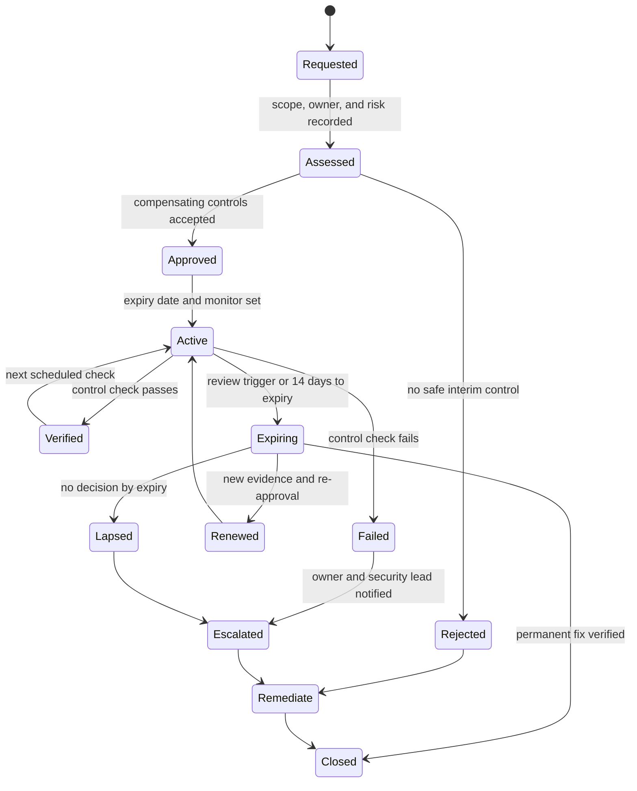

The diagram has three features that distinguish a working process from a form. The Verified and Failed states mean the compensating controls are tested during the exception, not assumed. A control that was true at approval but silently removed is how an accepted risk becomes an unaccepted one. The Lapsed state means expiry has an effect: with no decision, the item returns to the escalation path and the gate no longer treats it as covered. And renewal requires fresh evidence and a fresh signature, not an automatic extension. Teams that allow silent renewal end up with exceptions that outlive the people who approved them.

### 11.3 Governance and limits on renewals

Three controls keep the process honest. A cap on renewals (for example, a second renewal requires a more senior approver) makes chronic exceptions visible. A regular report of active exceptions by age, owner, and severity goes to the same leadership forum that sets the SLA policy. And each exception is linked to the gate, so that a build can pass on an exception only if the record is active and unexpired, as shown in the gate evaluation order earlier. If exceptions can be granted faster than fixes can be shipped, the exception count itself is a signal that the policy or capacity is wrong.

### 11.4 Compensating controls need the same rigor as the original control

A compensating control reduces likelihood or impact when the primary fix is missing. Examples are a web application firewall rule that blocks the exploit pattern, network isolation of the affected service, removal of the feature from the deployment, tighter permissions on the workload identity so the exploit yields less, and extra monitoring with an alert on the vulnerable path. Each of these has weaknesses, and the record should say what residual risk remains. A firewall rule written for one exploit variant may not stop another, so describe it as reducing the likelihood, not as eliminating the issue. The control must also have an owner who is not the person asking for the exception, so that its removal is noticed.

## 12. Release Gates and Security Sign-Off

### 12.1 A gate decides on evidence

A release gate is a decision point where a specific artifact either proceeds or does not. The decision should rest on evidence tied to the artifact digest, not on a person's recollection that "security looked at it". Typical evidence is the set of checks from earlier sections: required scans ran on this exact commit, no unexcepted blocking findings, the requirement identifiers marked as needing verification for this change have passing tests, the dependency inventory was produced, and for higher tiers a design review record exists. [Part 13 CI/CD](../13_DevOps/CH02_CI_CD.md) owns how the pipeline stages are wired; this section defines what the security decision consumes.

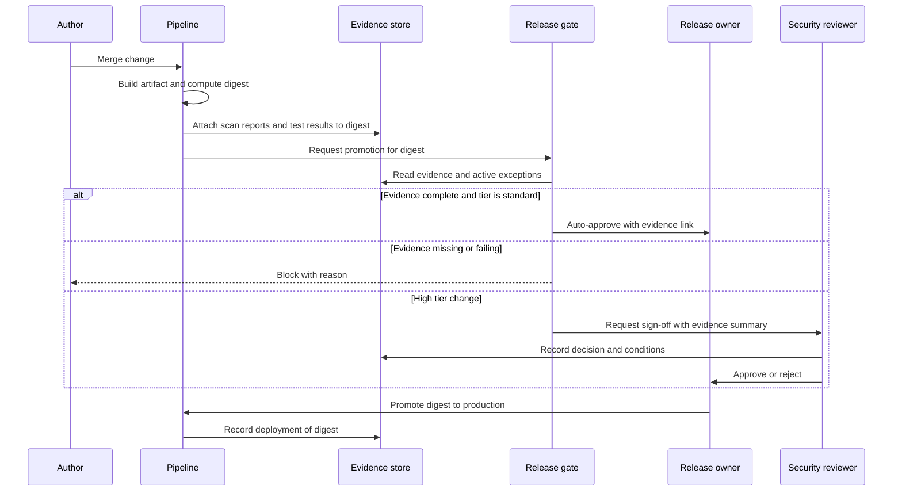

The sequence shows that standard-tier changes pass without a human in the path, and only the high tier waits for a person. That is the point of tiering: security reviewers spend time on the small number of changes that need judgment. It also shows that evidence is attached to the digest and read by the gate, so a later audit can retrieve what the gate saw. The final step records that this digest reached production, which closes the evidence chain and lets the vulnerability process ask which deployments contain a given build.

### 12.2 Sign-off that means something

A security sign-off is meaningful only when it states what was reviewed, what it was reviewed against, what conditions apply, and which residual risks the signer accepts. A signature with no scope is a rubber stamp, and over time it teaches people to treat the reviewer as the owner of the risk. Keep the roles clear: the reviewer assesses and advises, and the release owner (or the risk owner for the exception) accepts. Conditions such as "ship, and fix the verbose error message within 30 days" become tracked items with owners, not comments.

### 12.3 Emergency changes

Urgent fixes must be able to bypass the full process without bypassing the record. Define a break-glass path: a named approver, a reduced set of mandatory checks (secret scan and build integrity remain, longer test suites may run after), and a required retrospective within a fixed number of days. Measure how often the path is used. If it is used weekly, the standard path is too slow, and the response is to speed it up.

## 13. Security Champions and Developer Enablement

### 13.1 The problem that champions address

Security specialists are few and developers are many. Requirements, design checks, and code review cannot all route through the central team. A security champion program places a trained person in each product team who acts as the first point of contact, spots changes that need escalation, and helps the team use the tools and standards. The champion does not own the team's security. The team does, and the champion makes that ownership easier to carry out.

For the program to work, it needs the following. Time: a stated share of the champion's working time that their manager has agreed to, since voluntary work on top of a full backlog fades. Training: a basic path covering the weakness classes in [CH01 OWASP Top 10](CH01_OWASP_Top_10.md), the lifecycle checks in this chapter, and how to run a lightweight threat model using [CH12 Threat Modeling](CH12_Threat_Modeling.md). A channel: a regular forum for champions to bring problems and receive updates from the security function. And recognition in performance conversations, because unrecognized work disappears under pressure.

### 13.2 Enablement beats enforcement

A secure option that is easier than the insecure one gets used. The security function therefore builds paved roads: a service template with authentication, logging, and a pinned base image already configured; a shared library for authorization checks; pre-configured pipeline steps from the earlier sections; and a vetted set of approved dependencies. Teams that use the paved road inherit evidence, and reviewers can concentrate on deviations. Teaching also needs to be specific. A three-hour general course is less effective than a ten-minute explanation of the defect that your own team shipped last quarter, delivered with the failing test that would have caught it. Short, concrete guidance placed where developers work (in the pull request comment from the scanner, with the fix pattern) reaches more people than a wiki page.

### 13.3 Failure modes

Champion programs fail in predictable ways. The champion becomes the team's security scapegoat, so every finding is routed to them. The role is assigned to the most junior person. Meetings continue after the topics have gone stale. The security function treats champions as an unpaid extension of its own backlog instead of a channel in both directions. A useful check is whether feedback from champions has changed a standard, a tool setting, or a template in the last quarter. If not, information is flowing one way.

## 14. Incident Feedback Into the Lifecycle

### 14.1 Closing the loop

An incident or a serious vulnerability report is evidence about which lifecycle activity failed to catch a defect. The usual response fixes the specific bug and moves on. A lifecycle response also asks which stage should have caught it and changes that stage. Part 14 owns operational telemetry and incident handling mechanics; this section covers how the findings change requirements, design reviews, tests, and gates.

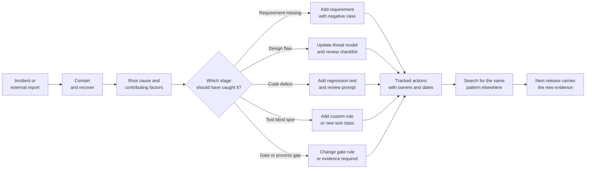

The branch on "which stage should have caught it" is the useful part. Each answer maps to a concrete change in an artifact earlier sections defined, so the learning lives in the requirements list, the threat model, the test suite, or the gate rules and not in a document nobody reopens. The sweep step matters as much as the fix. A defect from one pattern often exists in sibling services, and a code search or a custom static rule for the pattern finds them before an attacker does.

### 14.2 Blameless but accountable

Reviews that look for a person to blame teach people to conceal problems. Reviews that look only at the system can let the same action items languish. A working compromise: the review is blameless about individual decisions made with the information available, and every action item has an owner and a due date, tracked in the same system as other work and reported on. Closure of the actions is the measurable output of the review, not the document.

## 15. Metrics That Change Behavior

### 15.1 Choose metrics for decisions

A metric is useful if someone would act differently depending on its value. Counts such as "number of vulnerabilities found" or "number of scans run" mostly measure tool activity and can rise with better coverage, which is good, or with worse code, which is bad. They are vanity metrics because they cannot distinguish the two. Prefer measures tied to outcomes and to the speed of response.

| Metric | Definition | What it drives | Watch for |
|---|---|---|---|
| Time to remediate by severity | Days from first known to verified fix, median and 90th percentile | Prioritization and capacity | Closing items by reclassifying severity |
| SLA attainment | Share of items closed within deadline, by tier | Whether policy is achievable | Hiding overdue items in exceptions |
| Escape rate | Share of defects found in production that earlier stages could have caught, by stage | Which lifecycle stage to strengthen | Weak root-cause classification |
| Exception age and renewals | Count active by age, share renewed more than once | Pressure to fix chronic items | Splitting one exception into many |
| Gate block precision | Share of blocking findings confirmed true | Tuning of blocking rules | Measuring only blocks and not bypasses |
| Control-test coverage | Share of requirements with an automated verification | Evidence quality | Counting trivial tests |

Report the median alongside a high percentile. A median of 9 days hides a tail of items open for 200 days, and the tail is where the risk lives.

### 15.2 How metrics get gamed

Any metric used to rank teams is changed by the teams. If finding count is measured, findings are suppressed. If time to remediate is measured, severity is lowered at triage or the clock is restarted by reopening as a new item. Defenses are structural: measure from the first-known date, which an owner cannot edit; sample suppressions and severity downgrades for review; and use metrics to ask where support is needed rather than to punish. Present trends with context, since a rising count after adding a new scanner is a coverage improvement and should be explained as such.

## 16. Maturity Models

### 16.1 What they offer

Maturity models describe a set of security practices and levels at which an organization performs them, so you can assess where you are, choose priorities, and track change. Two are common references. The NIST SSDF, already named earlier, is a set of high-level practices an organization can map its activities to, and it is used by some customers and regulators as a basis for attestation requests. OWASP SAMM organizes practices into business functions and security practices, each with maturity levels and assessment questions. BSIMM is a descriptive study of what participating organizations do. At the time of writing these exist in published versions; verify the current version and the wording of any practice before quoting it in a contract or audit.

### 16.2 Using them without distorting them

Use a model to find gaps, not to produce a score for display. A reasonable sequence is to run a lightweight assessment with the people who do the work, pick the two or three practices where the gap creates the most risk for your system types, set a target level for each with a date, and reassess at a fixed interval. Reaching a high level in every practice is not the goal, and the right level differs for a payment service and an internal tool. A model score also says little about whether the practice is effective, so pair it with the outcome metrics above. A common failure is assessing an organization by reading documents and not by sampling actual pull requests, release records, and exceptions to see whether the described practice happens.

## 17. Security in Agile and Continuous Delivery

### 17.1 Cadence problem

Teams that release several times a day cannot wait for a quarterly review. The lifecycle therefore splits into activities with different rhythms. Per change: peer review with security prompts, fast static and secret checks, dependency checks, and the automated gate. Per iteration or sprint: the planning step in which stories are checked for security impact and abuse cases, and a short review of open findings against SLA. Per release train or quarter: threat model refreshes for the high-tier services, review of the exception report, metrics review, and reassessment of the paved road. Continuous in the background: scheduled rescans of deployed artifacts, because new advisories arrive against code that did not change.

### 17.2 Practical consequences

Security acceptance criteria belong in the definition of done, written as testable requirements as in the requirements section. A story that adds an endpoint is not done until its authorization and negative tests exist. Large design questions should be raised early, in refinement, because they cannot be settled inside a single sprint. Small, frequent releases help security as well: a patch for a vulnerable library is a routine deployment instead of a risky one, and the time from fix to production shrinks. The cost is that gates must be fast. A gate that takes an hour will be circumvented, so split slow checks (full dynamic scans, fuzzing) into scheduled jobs that report to the same findings store, and let the per-change gate run only what completes in minutes.

## 18. Failure and Quality-Attribute Scenarios

A lifecycle is tested the way any other system is: by injecting a stimulus and checking the response against a measurable criterion. The three scenarios below exercise the gate, the exception process, and the vulnerability process. The numbers are illustrative targets to adapt, not benchmarks.

### 18.1 Scenario: a rule update makes the gate block every release

- Stimulus: at 09:00 a scheduled rule update raises the blocking set from 0.04 to 0.9 new findings per pull request, almost all false positives. By 09:30 nine of ten open pull requests are blocked.
- Expected response: the gate keeps failing closed, because missing or failing evidence never passes silently. The on-call security engineer sees the spike in the gate block-precision metric, reverts the pinned rule version (for example from `blocking-v4` to `blocking-v3`), and the pipeline re-runs affected pull requests. Teams do not use an unrecorded override.
- Success criterion: the rule set is reverted within 60 minutes of the first alert. Zero artifacts reach production without scan evidence. Every break-glass use appears in the exception register. A retrospective names why the update was not trialled in reporting mode first.

Arithmetic for the cost of getting it wrong: with 50 merges in an 8-hour working day (the rate used in the case study below), a four-hour outage delays about $50 \times 4 \div 8 = 25$ merges, and each blocked author loses part of the day. That is the price of a gate with no rollback, and it is why rule changes are reviewed, versioned, and trialled in reporting mode.

### 18.2 Scenario: an exception that never expires

- Stimulus: an engineer closes a High finding with an exception whose expiry field is blank, or renews it every quarter without new evidence. Two years later the compensating control (a gateway rule) was removed during a migration and nobody noticed.
- Expected response: the exception schema rejects a blank expiry. The gate honours only active, unexpired records. A lapsed record returns the finding to blocking within 24 hours. The weekly exception report lists age and renewal count, and a second renewal needs a more senior approver. The control check in the Verified and Failed states of the exception lifecycle catches the removed gateway rule.
- Success criterion: zero active exceptions with no expiry. Zero exceptions older than twice their severity deadline without director approval. Every compensating control has a recorded test result younger than 7 days.

### 18.3 Scenario: a critical finding is discovered in production

- Stimulus: an external researcher reports through the disclosure channel that an internet-facing export endpoint returns records across tenants when a record identifier is guessed. The service passed every scan, because the flaw is missing authorization logic (see the section on what no tool finds).
- Expected response: intake acknowledges and deduplicates, triage assigns Emergency severity, the owning team contains the exposure first and fixes second, and the pipeline carries the fix through the gate with a break-glass path that keeps the secret scan and build-integrity checks.

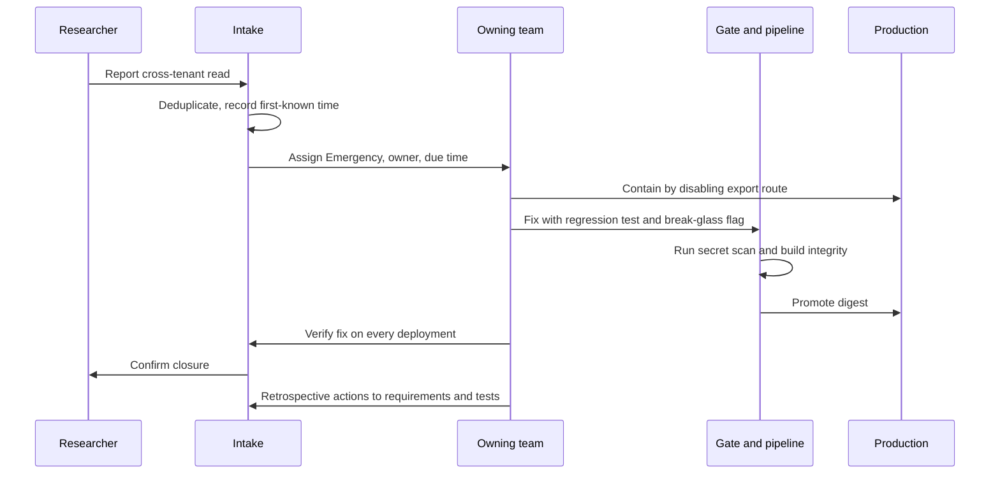

The diagram shows containment before the fix, which keeps the exposure window short while the fix goes through review. It also shows that closure is a verification on every deployment, and that the last step writes learning back into requirements and tests, as in the incident feedback section.

- Success criterion (illustrative): acknowledgement within 1 business day, containment within 8 hours of first-known time, verified fix within the 48-hour Emergency deadline, a regression test in the cross-tenant suite, and a sweep of the other 3 services that share the same route pattern within 5 business days.

## 19. Worked Case: One Organization End to End

The organization below is hypothetical and all figures are illustrative. It is a lending platform with 120 engineers, 40 services, and about 50 merged pull requests a day. Six services are high tier: they are internet-facing and handle regulated financial data. Thirty-four are standard tier.

### 19.1 Starting position

The team had a scanner configured to block on every finding. Measurement over four weeks showed 0.4 findings per pull request with 25 percent precision. Daily: $50 \times 0.4 = 20$ findings, 5 true and 15 false. Delay from the 15 false positives at 45 minutes each was $15 \times 45 = 675$ minutes, 11.25 hours. Teams had learned to use an unrecorded override. Fourteen exceptions were active and 6 had no expiry. Of 20 High vulnerability items closed in the previous quarter, 8 met a 14-day deadline, which is 40 percent.

### 19.2 Decisions, with rejected alternatives

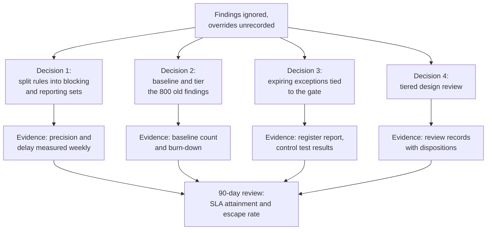

The diagram pairs each decision with the evidence that will show whether it worked, so the 90-day review compares measurements and not opinions.

Decision 1: split the rules. The blocking set (0.04 findings per pull request, 80 percent precision) blocks merges. The reporting set (0.12 findings per pull request, 35 percent precision) goes to a weekly queue. Daily blocking findings are $50 \times 0.04 = 2$, of which $2 \times 0.80 = 1.6$ are true and 0.4 false, so false-positive delay is $0.4 \times 45 = 18$ minutes. Reporting findings are $50 \times 0.12 = 6$, of which $6 \times 0.35 = 2.1$ are true. Triage time is $(2 + 6) \times 10 = 80$ minutes. True issues found fall from 5 to $1.6 + 2.1 = 3.7$ per day. The team accepts losing 1.3 per day on standard-tier services and adds a manual review step for high-tier changes to recover coverage. Rejected: keep blocking on everything and hire triagers, since 20 findings at 10 minutes is 200 minutes of triage a day and does not remove the 11.25 hours of delay.

Decision 2: baseline. The first full scan reported 800 existing findings. Triage of all of them is $800 \times 10 = 8{,}000$ minutes, about 133 hours. The team baselines all 800, blocks only on new findings, and triages the 150 in internet-facing and authorization code first: $150 \times 10 = 1{,}500$ minutes, 25 hours, spread over 5 weeks at 5 hours per week. Rejected: a release freeze until the backlog clears, because it stops the fixes that reduce risk.

Decision 3: exceptions. The register rejects a blank expiry, caps expiry at the severity deadline, requires fresh evidence for renewal, and the gate honours only active records. The 6 undated exceptions are re-approved with dates or fixed.

Decision 4: tiered review. Suppose the 40 services produce 60 design reviews a month at 6 hours each. Reviewing all of them centrally costs $60 \times 6 = 360$ hours a month, which at 160 working hours per person-month is $360 \div 160 = 2.25$ full-time equivalents (FTE). Restricting full review to the high-tier and trust-boundary changes (say 12 a month) costs $12 \times 6 = 72$ hours, 0.45 FTE, and the paved-road service template covers most standard-tier designs. Rejected: central review of everything, which creates the queue described in the ownership section.

### 19.3 Validation evidence after 90 days

After 90 days the measurements are: 17 of 20 High items closed inside 14 days, which is $17 \div 20 = 85$ percent attainment, up from 40 percent; blocking precision above 75 percent in each of the last 6 weeks; no active exception without an expiry; the baseline reduced from 150 prioritized items to 70. Burn-down arithmetic: $150 - 70 = 80$ closed in 13 weeks, about 6 per week. The honest reading includes the shortfalls. Coverage on standard-tier services fell as planned, and one authorization flaw was found by a tester and not by any scanner, which confirmed the decision to keep manual testing for high-tier changes.

## 20. Common Mistakes

| Mistake | Cause | Consequence |
|---|---|---|
| Blocking on every finding from day one | Wanting visible enforcement before measuring precision | False positives dominate, teams add unrecorded overrides, and the gate is switched off |
| Treating "scans clean" as "secure" | Reporting tool output as the control | Authorization and business-logic flaws ship with a green build |
| Gate passes when a scanner did not run | Checking only for blocking findings | A broken or skipped scanner looks like a clean result |
| Exceptions with no expiry or silent renewal | Tracker fields left optional, no owner for the register | Accepted risk outlives its approver and its compensating control |
| Closing a vulnerability on merge | Ticket workflow ends at the pull request | Old images and long-lived workloads keep running the vulnerable build |
| Copying a requirement catalog into the backlog | Completeness mistaken for coverage | Hundreds of unverifiable items that everyone ignores |
| Security owned only by a central team | Centralised sign-off feels safer | A queue that grows faster than the team, and bypass by product teams |
| Rule or tool changes with no review | Treating scanner configuration as admin work | Overnight result changes and loosened rules that cannot be traced |
| Metrics on finding count | Easy to collect | Suppression comments and downgraded severity instead of fixes |
| No feedback from incidents | Fixing the bug and closing the review | The same defect class returns in a sibling service |

## 21. Design-Review Checklist

Use this list when reviewing a team's lifecycle or a change to it. Each item should be answerable with a link to evidence.

- Requirements: each has an identifier, owner, verification method, and at least one negative case. Every data entry and exit path (imports, exports, webhooks, jobs, admin tools) has coverage.
- Tiering: the risk tier is recorded and selects the minimum activity set. The rule is written down.
- Design review: depth follows the decision tree, the threat model was read and not only filed, and every finding has a disposition.
- Code review: branch protection blocks direct pushes, code owners cover sensitive paths, and bot merges have a review rule.
- Tooling: each important viewpoint is covered. Blocking rules have measured precision, rule versions are pinned, and results reach one findings store.
- Baseline: existing findings are baselined and prioritized by exposure, with a review date.
- Gate: missing evidence blocks, evidence is tied to the artifact digest, and break-glass use is recorded and measured.
- Vulnerability handling: one intake record per issue, a deployment mapping, a documented severity table, and closure on verified deployment.
- Deadlines: the SLA is achievable by the capacity calculation, with escalation at defined points.
- Exceptions: named risk owner, tested compensating controls, expiry, renewal cap, and a gate that honours only active records.
- Enablement: champions have agreed time, a paved road exists, and feedback from teams has changed a standard.
- Feedback: the last incident produced a change to a requirement, test, rule, or gate, plus a sweep for the same pattern.
- Metrics: percentiles and escape rate are reported, and suppression and downgrade samples are reviewed.

## 22. Exercises

1. Rewrite "Protect customer data" as a testable requirement with a verification method and three negative cases.
   - Outline: name the data class and scope, state encryption, access, and logging outcomes with measurable conditions, and list missing-token, wrong-tenant, and expired-credential cases.
2. A scanner reports 0.6 findings per pull request at 20 percent precision across 80 merges a day. Compute daily triage time at 10 minutes per finding and false-positive delay at 45 minutes each.
   - Outline: $80 \times 0.6 = 48$ findings, 480 minutes of triage, $48 \times 0.8 = 38.4$ false, $38.4 \times 45 = 1{,}728$ minutes, 28.8 hours. Propose a split rule set.
3. A team has 300 open items, intake of 40 a week, and closure of 35 a week. When does it clear, and what changes it?
   - Outline: net $+5$ a week, so it never clears. Reduce intake (base images, update automation) or close non-applicable items, then recompute.
4. Design the exception record for a High finding where the vendor patch is six weeks away.
   - Outline: risk owner, gateway control with weekly verification, expiry at most 14 days, a review trigger on patch release, renewal needing senior approval.
5. Draw the gate decision order and explain why the missing-evidence test comes first.
   - Outline: evidence, baseline, exception, severity. A silent scanner failure would otherwise pass.
6. A High item arrives 3 times a week and takes 5 engineer-days. The team reserves 1.5 engineers on a five-day week. Is a 14-day SLA achievable?
   - Outline: $3 \times 5 = 15$ engineer-days against 7.5 available, so no. Options: capacity, automation, or an openly changed policy.
7. After a production incident, identify which stage should have caught it and what changes.
   - Outline: classify as requirement, design, code, tool, or gate gap; add the matching artifact change; sweep siblings.
8. Explain what a design reviewer checks when a service uses the paved-road authentication library.
   - Outline: use as documented, deployment matches the reviewed configuration, deviations get full review.

## 23. Summary

This chapter's introduction set five outcomes. Each maps to the sections that deliver it.

- Lifecycle as a chain of evidence: the activity and evidence chain, owners, and proportionality (sections 2, 12, 14). Each activity leaves a record tied to an artifact digest, and incidents write learning back into earlier stages.
- Requirements to testable form: requirements, abuse cases, and negative cases (section 3), exercised in exercises 1 and 8.
- Review depth and what reviewers see: the depth tree, reviewer checks, and secure code review (sections 4 and 5), plus the paved-road edge case.
- Test classes and their blind spots: the tool viewpoints and what no tool finds (section 6), including why "scans clean" is a statement about a viewpoint only.
- Cost of findings and blocking rules: triage arithmetic, baselines, gate order, scoring, deadlines, and exceptions (sections 7 to 11), validated in the worked case (section 19).

Automate repeatable checks, reserve human judgment for contextual risk, manage exceptions with owners and expiries, and measure outcomes with percentiles and escape rates. Tools support the process. They do not replace clear requirements and accountable owners.
