# Container Security

Part: [15 — Security](PART_OVERVIEW.md) · Status: Revised (in-depth rewrite)

## 1. Introduction

A container is an ordinary Linux process that the kernel has been told to show a restricted view of the system, and to restrict in what it may consume and which kernel services it may call. There is no hardware boundary around it. Every container on a host runs against the same kernel, and that single fact decides most of what follows: image hardening reduces what an attacker finds inside the container, while isolation settings reduce what the attacker can reach from inside it, and neither removes the possibility that a kernel flaw lets a process step out of its restrictions.

After this chapter you will be able to:

- Explain which kernel mechanisms make up a container and which attacker capability each one removes.
- Read a container's runtime configuration (user, capabilities, seccomp profile, mandatory access control, mounts, namespaces) and judge how far it is from "root on the host".
- Choose between shared-kernel containers, user-space-kernel sandboxes, microVMs, and full virtual machines for a given tenant trust level, and state what the choice costs.
- Enumerate the usual container escape paths and the configuration that opens each one.
- Estimate the resource-exhaustion and blast-radius consequences of a configuration with simple arithmetic.

Ownership is split across the handbook as follows:

| Topic | Owner |
|---|---|
| Namespaces, cgroups, union filesystems, Open Container Initiative (OCI) runtime mechanics | [Part 05 CH28 Virtualization and Container Fundamentals](../05_Networking_and_OS/CH28_Virtualization_and_Container_Fundamentals.md) |
| Image construction, Dockerfile practice, build caching | [Part 13 Docker](../13_DevOps/CH03_Docker.md) |
| Registry products, replication, digest promotion in the cloud | [Part 09 CH07 Containers](../09_Cloud_Computing/CH07_Containers.md) |
| Kubernetes admission, Pod Security Standards, RBAC, namespaces and tenant boundaries | [Part 12 CH13 Kubernetes Security](../12_Kubernetes/CH13_Security.md) |
| Secret lifecycle | [CH09 Secrets Management](CH09_Secrets_Management.md) |
| Signing, provenance, build integrity | [CH15 Supply Chain Security](CH15_Supply_Chain_Security.md) |
| Component inventory | [CH16 SBOM](CH16_SBOM.md) |
| Isolation choice, privilege reduction, escape paths, image and runtime trust, node blast radius | This chapter |

Part 05 explains how the primitives work. Part 12 explains how Kubernetes applies policy to them. This chapter explains which settings matter for an attacker who already runs code inside a container, and why. Where a mechanism is owned elsewhere, it is restated only far enough to reason about the attack.

## 2. The Foundational Model: Containers Are Restricted Processes

### 2.1 What the kernel is asked to do

Starting a container does not create a new operating system. A container runtime asks the host kernel to start a process with five kinds of restriction attached:

1. A restricted view of kernel objects, using namespaces. The process sees its own process identifier (PID) numbering, its own network interfaces, its own mount table, its own hostname, its own inter-process communication (IPC) objects, and optionally its own user identifier mapping.
2. A restricted resource budget, using control groups (cgroups). The kernel accounts for the CPU time, memory, process count, and block input/output (I/O) the process tree uses and refuses or throttles beyond a limit.
3. A restricted set of privileged operations, using Linux capabilities. Root's authority is split into separately grantable units.
4. A restricted set of kernel entry points, using seccomp (secure computing mode) filters that allow or deny individual system calls.
5. A restricted set of object accesses, using a Linux Security Module (LSM) such as AppArmor or SELinux (Security-Enhanced Linux), which applies a mandatory policy that the process cannot edit.

The root filesystem is the sixth ingredient, assembled from image layers, but it is a packaging concern rather than an isolation primitive. The process runs on the host CPU and calls the host kernel directly. A system call from the container costs the same as one from any other process, which is why containers start in milliseconds and add almost no overhead, and also why a bug in any kernel code reachable from the permitted system calls is a bug the container can trigger.

The governing security model follows from this. Container isolation is a stack of filters in front of one shared kernel. Each filter removes a class of attack. The remaining risk is the sum of what the filters leave open plus any flaw in the kernel or runtime that lets a process ignore them. Hardening is the act of closing filters that default configurations leave open, and sandboxing is the act of replacing the shared kernel boundary with a smaller or harder one.

### 2.2 The runtime flow

Container startup crosses several components, and each one is a place where authority is granted or lost. The sequence below shows a typical flow for a Kubernetes-style node with a high-level runtime and a low-level OCI runtime. Docker follows the same shape with different component names.

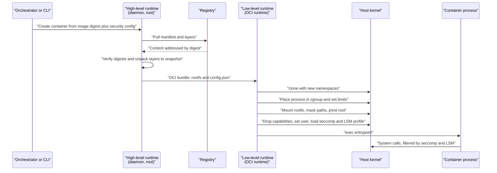

Three implications follow from the flow. First, the high-level runtime usually runs as root on the node, so anything that can talk to its socket can start a container with any configuration, including one that mounts the host root filesystem. The socket is an administrative interface, not a convenience. Second, the security configuration is applied by the low-level runtime in a fixed order, and between the point where namespaces exist and the point where the filters are loaded, the runtime itself holds more privilege than the workload will. Bugs in that window have historically been a source of escapes, which is why runtime patching belongs in the same cadence as kernel patching. Third, the image supplies only the filesystem and defaults. The caller supplies the isolation configuration, so a perfectly minimal image can still be started in a configuration that gives it the whole host.

### 2.3 Where the trust boundary actually sits

The boundary between a container and the host is the kernel's system call interface, narrowed by whatever filters are loaded. The kernel contains many subsystems (filesystems, networking, device drivers, namespaces handling, Berkeley Packet Filter (BPF) loading, and more), and the permitted system calls reach into most of them. A virtual machine places the boundary at the hypervisor's interface, which is much smaller. This is the reason the same workload can be acceptable in one multi-tenant design and unacceptable in another: the question is who is on the other side of the kernel boundary, not how well the image is built.

| Boundary | What it separates | Size of attack surface from the workload |
|---|---|---|
| Process and user permissions | Unprivileged users from root on one OS | Large: the full system call interface |
| Container with default filters | Workload from host and neighbours | Large, reduced by seccomp and capability defaults |
| Container with hardened profile | Same | Smaller, depends on profile quality |
| User-space kernel sandbox | Workload from host kernel | Small host interface, large sandbox kernel |
| MicroVM | Workload from host | Hypervisor and virtual device model |
| Full virtual machine | Workload from host | Hypervisor and a larger device model |

The table orders boundaries by how much code the workload can exercise on the other side. It does not rank them by performance or cost, which move in the opposite direction and are covered under choosing isolation strength.


## 3. Kernel Isolation Primitives as Security Controls

### 3.1 Namespaces: what the process can see

A namespace wraps a global kernel resource so that processes inside see a private instance of it. The kinds that matter for security are these:

- Mount: a private mount table. The container sees its image root and whatever was mounted in, not the host's filesystems.
- PID: a private process tree. The first process is PID 1 inside, and host processes are invisible. Sharing the host PID namespace lets the container list, signal, and read the memory maps of host processes, subject to other checks.
- Network: private interfaces, routing tables, and firewall rules. Sharing the host network namespace puts the container on the node's interfaces, including loopback services bound to `127.0.0.1` that were assumed unreachable.
- IPC: private System V and POSIX message queues and shared memory.
- UTS (Unix Time-sharing System): private hostname.
- User: a private mapping between user identifiers (UIDs) inside and outside. Covered in the rootless section below.
- Cgroup and time: a private view of the cgroup tree and clocks.

Namespaces limit visibility, not authority. A process in a private PID namespace that still holds a powerful capability can do harm to resources it can reach by other paths, such as a mounted host directory. Several kernel facilities are also not namespaced at all: the kernel's own memory, loaded modules, much of `/proc/sys`, and the kernel log ring buffer are host-wide, so each requires a separate filter (masked paths, read-only mounts, capability checks) to stay out of reach. Runtimes mask or make read-only a list of sensitive `/proc` and `/sys` paths for this reason.

### 3.2 Control groups: what the process can consume

Control groups arrange processes in a hierarchy and attach controllers that account for and cap resources. In the unified cgroup v2 hierarchy, the interface files include `memory.max`, `cpu.max`, and `pids.max`. Resource exhaustion is a security concern because one container that starves the node is a denial of service against every neighbour and against the node's own agents.

Three behaviours need to be understood. Memory is a hard limit: when the group's usage cannot be reclaimed below the limit, the kernel's out-of-memory (OOM) killer terminates a process inside that group, so a limit that is too low turns into restarts rather than throttling. CPU is a throttling limit: the group is paused for the rest of its accounting period once its quota is used, which shows up as latency. The process count limit is the one most often forgotten. Without `pids.max`, a runaway fork loop is bounded only by the host-wide PID limit, and when that is exhausted, new processes fail across the whole node, including the runtime and monitoring agents. Part 05 CH25 [Memory Management](../05_Networking_and_OS/CH25_Memory_Management.md) covers the memory mechanics.

Limits are a containment control, not a confidentiality control. They do not stop an attacker from reading anything. They bound how much of the node an attacker can consume, which is worth having and worth setting from measured workload behaviour rather than guesses, because an over-tight limit is a self-inflicted outage.

### 3.3 Capabilities: how much of root the process holds

Traditional Unix root bypasses every permission check. Linux capabilities divide that authority into units such as the ability to bind low-numbered ports, to create raw sockets, to change file ownership, to load kernel modules, or to trace other processes. A process in a container that runs as UID 0 inside it does not hold all capabilities: the runtime installs a bounding set and drops the rest before the entrypoint runs.

The units differ greatly in danger, and the names do not reveal it:

| Capability | What it permits | Why it matters to an attacker |
|---|---|---|
| `CAP_NET_BIND_SERVICE` | Bind ports below 1024 | Low risk, often the only one a web process needs |
| `CAP_NET_RAW` | Craft raw packets | Enables spoofing and sniffing on a shared network segment |
| `CAP_DAC_OVERRIDE` | Bypass file permission checks | Reads or writes any file the mount namespace exposes |
| `CAP_SETUID` and `CAP_SETGID` | Change identity | Impersonate other users inside the container |
| `CAP_SYS_PTRACE` | Trace and inspect processes | Reads memory and credentials of processes it can see |
| `CAP_SYS_MODULE` | Load kernel modules | Direct code execution in the kernel |
| `CAP_SYS_ADMIN` | A very large collection of administrative operations including mount | Close to root: a common step in escapes |

The practical rule is to drop all capabilities and add back only those the process has been shown to need. The default set granted by runtimes is a compatibility compromise, and what is in it at the time of writing should be checked in the runtime's documentation for the version in use. A second control is the `no_new_privs` flag. Once set, a process and its children cannot gain privilege through set-user-ID binaries or file capabilities, which closes a common route from a foothold to elevated rights. In Kubernetes it is exposed as `allowPrivilegeEscalation: false`.


### 3.4 Seccomp: which kernel entry points the process can call

Seccomp in filter mode attaches a program to a process that is evaluated on every system call. The program inspects the call number and, in some cases, the arguments, and returns an action: allow, return an error, kill the process, or log. Filters are inherited by children and cannot be removed once installed, which is what makes them suitable for containment.

The security value is attack surface reduction. Most kernel vulnerabilities that container escapes use are reached through a specific system call or argument pattern, and most applications use a small fraction of the roughly three hundred available. A profile that denies the rest removes the vulnerable code from reach without patching it. Runtimes ship a default profile that blocks a set of dangerous or rarely needed calls while keeping common applications working. Kubernetes selects it with `seccompProfile.type: RuntimeDefault`, and older clusters or unconfigured workloads may run with no filter at all (`Unconfined`), so verify the effective setting rather than assuming it.

A seccomp profile fragment in the OCI/Docker JSON format looks like this:

```json
{
  "defaultAction": "SCMP_ACT_ERRNO",
  "architectures": ["SCMP_ARCH_X86_64"],
  "syscalls": [
    {
      "names": ["read", "write", "openat", "close", "mmap", "futex", "epoll_wait", "exit_group"],
      "action": "SCMP_ACT_ALLOW"
    }
  ]
}
```

This allow-list shape denies everything not named. A real profile for a typical service lists a few dozen to a hundred or so calls, and it is generated rather than hand-written: run the workload under realistic tests with tracing or a profile-recording tool, review the resulting list, and test the failure mode. A denied call returns an error code to the application, which may surface as an obscure crash far from the cause, so a profile needs the same test coverage as code. Applications that need an unusual call should get a profile that adds only that call, not `Unconfined`.

### 3.5 Mandatory access control: AppArmor and SELinux

Seccomp governs which calls a process may make. A Linux Security Module governs which objects a call may touch. Both AppArmor and SELinux enforce a policy that the process cannot change, even as root inside its namespace.

AppArmor attaches path-based profiles to programs. A profile can say that a process may read `/app/**` and write `/tmp/**` but may not write to `/proc/sysrq-trigger` or mount filesystems. It is simple to read and is the default on distributions in the Debian family. SELinux labels every process and object with a type and evaluates rules over those labels, which is more expressive and harder to author. It is the default on the Red Hat family, and container runtimes assign each container a type plus a per-container multi-category security (MCS) label, so that two containers of the same type still cannot touch each other's files. The two do not coexist as the primary module on one host, so the node operating system decides which you get.

For architects the useful distinction is what each adds beyond capabilities and seccomp. A mandatory policy catches an attack that uses only permitted calls and held capabilities to reach the wrong object, for example a process with a legitimately mounted volume trying to follow a symlink into host paths. It is a second, independent layer, and independence is the point: an attacker must defeat each in turn. The cost is operational: policies must be maintained, and a custom profile that is too tight fails in production in ways that are difficult to diagnose, so most organisations use the runtime defaults and add custom policy only for high-risk workloads.

### 3.6 Rootless containers and user namespaces

By default, container root is host root with a smaller capability set. If an attacker escapes, they are UID 0 on the host. The user namespace changes this by mapping UIDs: UID 0 inside the container corresponds to an unprivileged UID such as 100000 on the host, and capabilities granted inside the namespace apply only to resources the namespace owns. An escape lands as an unprivileged host user, and file access to host-owned files is denied by ordinary permissions.

Two distinct things go by the name rootless, and the difference matters:

- Rootless runtime: the runtime daemon and the containers all run as a normal user. A compromise of the runtime or container yields that user's rights, never host root. The price is restrictions on privileged networking, some storage drivers, and cgroup delegation.
- Container user namespaces with a root-owned runtime: the daemon remains privileged, but each container's UIDs are remapped. The runtime itself is still a high-value target.

Running as a non-root user inside the container image is a separate and cheaper control, which should be used regardless. It leaves the container UID 1000 inside and on the host (without a user namespace), so it stops writes to root-owned files within the image and blocks many privilege-escalation tricks, but it does not isolate the host UID space. Kubernetes support for user namespaces for pods has been progressing across recent versions, so check the current status and the node's kernel and runtime support before relying on it.

The filters compose as a pipeline, and the next diagram shows what a single system call from the workload passes through.

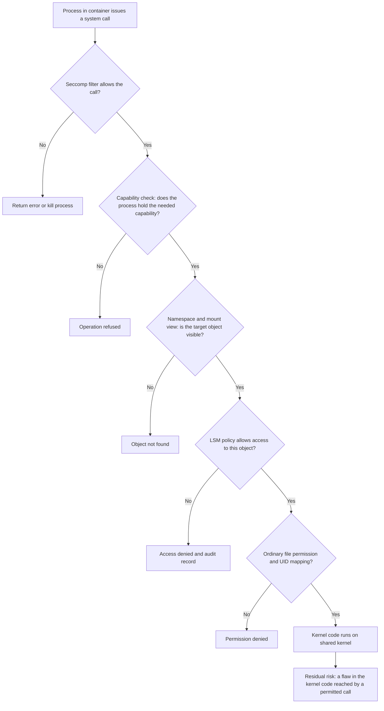

The diagram makes two points. Each layer is independent, so a missed configuration in one does not disable the others, and a hardened container is one where every layer has been tightened rather than one where a single setting is strict. Second, every path that gets through ends at "kernel code runs", so the final box is the part no configuration removes. That residual risk is what motivates sandboxed runtimes in the next section.

## 4. Choosing Isolation Strength

### 4.1 The options and what each really changes

Shared-kernel containers with hardened filters are the default and the cheapest. They add negligible overhead and start fast. Their weakness is the shared kernel described above.

User-space kernel sandboxes, of which gVisor is the best-known example, intercept the workload's system calls in a separate user-space process that implements a large part of the Linux interface itself. That process in turn makes a much smaller set of calls to the host kernel. A kernel flaw in a feature the sandbox reimplements is not reachable from the workload. The costs are compatibility (some calls, filesystems, or `/proc` details behave differently or are missing) and slower system-call-heavy and file-heavy workloads, and the sandbox itself is code that can have flaws.

MicroVMs run each container or pod inside a minimal virtual machine with its own guest kernel, started by a stripped-down virtual machine monitor. Kata Containers packages this behind the container runtime interface, and Firecracker is a minimal virtual machine monitor designed for it. The guest kernel absorbs a kernel exploit, so the attacker must also escape the hypervisor and device model. The costs are memory per instance for the guest kernel, slower start than a process (usually still well under a typical orchestrator scheduling time, but measure), and the need for hardware virtualization on the node, which on public cloud often means bare-metal instances or nested virtualization support on specific instance types.

Full virtual machines are the strongest widely deployed boundary and cost the most in density and operations. They are the right answer when the tenants are mutually hostile, when regulation requires it, or when the workload needs its own kernel version or modules.

### 4.2 What the managed services do

The providers made different choices, and the differences affect what you must configure yourself. The following points were accurate at the time of writing; verify each against current provider documentation before depending on it.

- AWS Fargate runs each task or pod in its own isolated environment and AWS documents the use of Firecracker microVMs for it, so tasks from different customers do not share a kernel. On Amazon Elastic Container Service (ECS) and Amazon Elastic Kubernetes Service (EKS) with Amazon Elastic Compute Cloud (EC2) nodes, containers on a node share that node's kernel, and node isolation is your design decision.
- Google Cloud documents gVisor as the sandbox for Google Kubernetes Engine (GKE) Sandbox node pools and for the first-generation Cloud Run execution environment. Cloud Run offers a second-generation environment with fuller Linux compatibility. Which isolation technology backs which generation has changed over time, so check the current documentation.
- Microsoft offers Pod Sandboxing on Azure Kubernetes Service (AKS) based on Kata Containers, and Azure Container Instances documents hypervisor-level isolation for container groups. Azure Container Apps' isolation model for its plans should be confirmed in current documentation.

The lesson is that "serverless containers" and "managed Kubernetes" differ in who owns the kernel boundary. On a managed task service the provider decides the isolation technology and you inherit it. On a node-based cluster you decide it, usually by dedicating node pools to trust levels and optionally enabling a sandbox runtime class for untrusted workloads. Do not treat similar product names as equivalent guarantees.

### 4.3 Decision criteria

Four questions decide the isolation level:

1. Who can influence the code that runs? Your own reviewed services are low risk. Code that customers upload, plug-ins, build jobs for external repositories, and notebooks are high risk, because the attacker has code execution by design and the only remaining defence is the boundary.
2. What would a successful escape expose? Node credentials, other tenants' data, and cloud metadata access determine the value of the prize.
3. What compatibility and performance can the workload tolerate? Check system call usage, filesystem behaviour, device and GPU needs, and the latency budget.
4. What does the operating model support? MicroVMs need compatible nodes and a runtime class in the scheduler. VMs need image and patch pipelines.

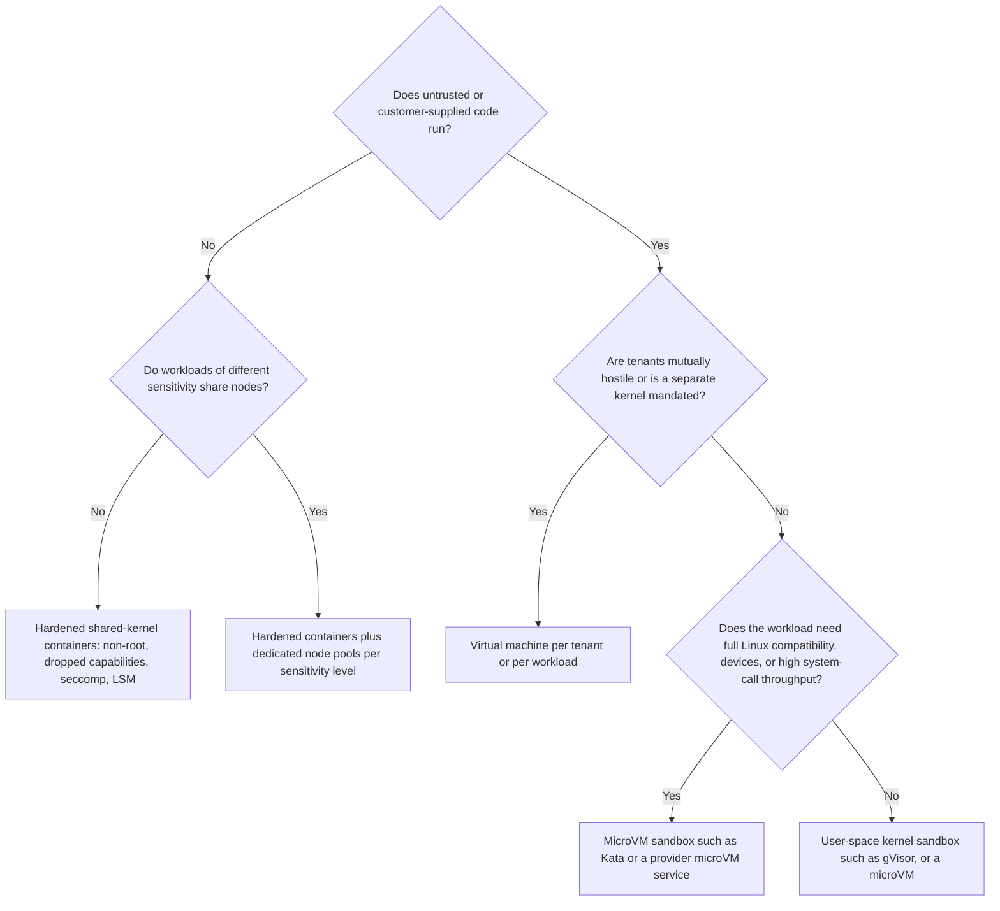

The tree encodes a cost ordering. It starts at the cheapest boundary and only moves to stronger and costlier ones when an answer demands it. Two things follow. Dedicated node pools are the middle step that organisations often skip: the same hardened container is used but a compromised low-sensitivity workload can no longer sit next to a high-sensitivity one, so a kernel escape reaches less. And the sandbox choice at the bottom is driven by compatibility, not by a general belief that one is more secure; a sandbox the workload cannot run on is not a control.

The choice is also reversible per workload. Kubernetes exposes it as a runtime class, so a platform team can offer one extra class and route only risky workloads to it, which avoids paying the overhead everywhere.


## 5. The Attacker's View: Escape Paths

### 5.1 Starting position

Assume the attacker already runs code inside one container, through a vulnerable dependency, a stolen deploy credential, or a malicious image. They want one or more of: the host, the node's cloud credentials, other containers' data, or the orchestrator. Their first questions are mechanical and answerable from inside: which user am I, which capabilities do I hold (`/proc/self/status` shows the capability masks), is a seccomp filter active, which mounts exist, is the container socket present, can I reach the metadata endpoint, and what is the kernel version.

### 5.2 Configuration-based escapes

These need no kernel flaw. They exist because an administrator removed a filter.

- Privileged mode. A privileged container keeps all capabilities, gets access to host devices, and has the default filters relaxed. From inside, mounting the host's block device or loading a module gives host control. It is equivalent to root on the node and should be treated that way in review.
- Container runtime socket mounted in. Access to the high-level runtime's socket lets the workload ask it to start a new container with the host root mounted and privileged mode on. The attacker never touches the kernel boundary. Build systems that "need Docker" are the usual source of this.
- Host path mounts. Writable mounts of the host root, the runtime's directories, `/etc`, or `/var/log` allow modification of host files, planting of cron entries or service units, or reading of other containers' layers and secrets. Mounting a directory to read logs should be read-only and narrow.
- Excessive capabilities. `CAP_SYS_ADMIN` allows mounting and, in some configurations, manipulation of cgroup control files that can cause the host to execute attacker-chosen commands. `CAP_SYS_PTRACE` with a shared PID namespace allows injection into host processes. `CAP_SYS_MODULE` loads code into the kernel.
- Shared host namespaces. `hostPID`, `hostNetwork`, and `hostIPC` remove the view restrictions. With host PID and a capability to enter namespaces, a process can run commands in the host's mount namespace.
- Writable sensitive kernel interfaces. If `/proc/sys` or `/sys` are writable, settings such as the core dump handler can name a program the host kernel will run.
- Reachable cloud metadata and node credentials. This is lateral movement rather than escape, but it often yields more than escape does. If the workload can reach the instance metadata service, it can request the node's role credentials and act as the node in the cloud account. Mitigations are in CH09 Secrets Management and Part 09 IAM; here the relevant control is blocking or limiting that endpoint from containers and giving pods their own narrow identity.

### 5.3 Vulnerability-based escapes

These exploit defects, and a hardened configuration shrinks the set but never to zero.

- Kernel vulnerabilities in subsystems reachable by permitted calls: filesystems, networking, the namespace handling code, BPF, and io_uring-style interfaces. User namespaces, while a defence, also let unprivileged processes reach kernel code that is otherwise root-only, which is why some distributions restrict unprivileged user namespace creation. This is a real tension between two hardening goals, and the resolution depends on the workload: sandboxed and rootless runtimes accept it, while hosts running only fixed trusted images may disable it.
- Runtime defects. The low-level runtime handles file descriptors and paths from the host while setting up the container. Defects in that handling have historically allowed a container process to reach host files or to overwrite the runtime binary. Mitigation is prompt runtime patching and, where possible, rootless operation.
- Image-based attacks on the build or pull path, such as an image that exploits an unpack bug in the runtime. This is a reason to pull only from controlled registries and verified digests, covered under the image trust chain.

Specific vulnerability identifiers and affected versions change quickly, and the handbook does not enumerate them. Track the advisories of your kernel, runtime, and orchestrator vendors, and measure patch latency as a service-level indicator.

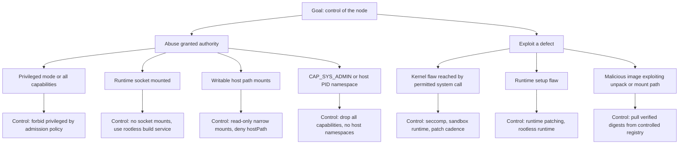

The tree separates paths an administrator can close completely from paths they can only narrow. The left branch is under organisational control, and a policy that refuses privileged pods, socket mounts, host paths, and host namespaces closes every leaf under it. Those controls are cheap and should be enforced by admission policy rather than by review, using the mechanisms in [Part 12 CH13 Kubernetes Security](../12_Kubernetes/CH13_Security.md). The right branch cannot be closed by configuration alone. There, the defence is making each exploit harder (seccomp, sandbox, rootless) and shorter lived (patching), and accepting that high-risk tenants need a stronger boundary rather than a better profile.

## 6. Worked Scenario: Hardening a Document Conversion Service

The numbers below are illustrative, chosen to show the arithmetic rather than to describe a real system.

### 6.1 The workload and the threat

A platform runs a service that converts customer-uploaded documents to Portable Document Format (PDF). The converter links native parsing libraries and processes attacker-controlled files, so a memory-corruption bug in a parser is a realistic initial foothold. The cluster has 20 nodes, each with 16 virtual CPUs and 64 GiB of memory, and also hosts a payment service. The conversion service runs 200 replicas.

### 6.2 Container-level configuration

The image is built from a minimal base, runs as a fixed non-root user, and has no shell or package manager at runtime. The Dockerfile fragment shows the user and filesystem decisions. The base image reference is a placeholder, and in practice it is pinned by digest.

```dockerfile
FROM registry.example.com/base/runtime-minimal@sha256:<digest> AS runtime
COPY --from=build /out/converter /usr/local/bin/converter
USER 10001:10001
ENTRYPOINT ["/usr/local/bin/converter"]
```

The pod specification then removes the authority the image cannot remove. This is the Kubernetes expression of the primitives in the kernel section, and Part 12 owns how admission enforces it.

```yaml
apiVersion: v1
kind: Pod
metadata:
  name: converter
spec:
  automountServiceAccountToken: false
  runtimeClassName: sandboxed
  securityContext:
    runAsNonRoot: true
    runAsUser: 10001
    seccompProfile:
      type: RuntimeDefault
  containers:
    - name: converter
      image: registry.example.com/docs/converter@sha256:<digest>
      securityContext:
        allowPrivilegeEscalation: false
        readOnlyRootFilesystem: true
        capabilities:
          drop: ["ALL"]
      resources:
        requests: { cpu: "500m", memory: "512Mi" }
        limits: { cpu: "1", memory: "1Gi" }
      volumeMounts:
        - { name: scratch, mountPath: /tmp }
  volumes:
    - name: scratch
      emptyDir: { sizeLimit: 256Mi }
```

`runtimeClassName: sandboxed` names a class the cluster administrator defined, mapped to a sandbox runtime such as gVisor or Kata. The name is local to the cluster. The root filesystem is read-only with a bounded scratch directory, so a parser exploit cannot persist a tool in the image filesystem and cannot fill the node's disk. To confirm the settings from inside a running container, read the capability and filter state:

```bash
grep -E 'CapEff|NoNewPrivs|Seccomp' /proc/self/status
```

`CapEff` should be all zeros, `NoNewPrivs` should be 1, and `Seccomp` should be 2 for filter mode. Treat this as a smoke test in the deployment pipeline, because a mis-set field fails silently.

### 6.3 Resource arithmetic

Allocatable memory per node, after the node agent and operating system reserve some, is assumed to be 60 GiB. The scheduler places by requests, so with 512 MiB requested per pod it can place $60 \text{ GiB} / 0.5 \text{ GiB} = 120$ pods per node. The limit is 1 GiB per pod, so if all 120 pods grew to their limit they would need 120 GiB against 60 GiB present, an overcommit of 2:1. If the parser is attacked with files that inflate memory, enough pods reaching their limits simultaneously triggers node-level memory pressure, and the kernel or kubelet evicts pods that may not be the offenders. To keep this bounded, the team caps density at 80 pods per node: $80 \times 1 \text{ GiB} = 80 \text{ GiB}$ is still 1.33 times the 60 GiB allocatable, but the expected simultaneous-peak fraction is measured at under 0.6, so $80 \times 0.6 = 48$ GiB stays below 60 GiB. The 0.6 figure must come from load tests, and the condition should be monitored as memory pressure events, not assumed.

Process counts follow the same logic. Assume the node's host-wide PID limit (`kernel.pid_max`) is 32,768. With no per-container limit, one forking exploit can consume all 32,768 and break the node agents. With the kubelet's per-pod PID limit set to 256 and 80 pods, the worst case is $80 \times 256 = 20{,}480$ processes, which leaves $32{,}768 - 20{,}480 = 12{,}288$ for the host. The per-pod PID limit is a kubelet setting (`podPidsLimit`), not a pod field, so it belongs in node configuration reviewed by the platform team.

### 6.4 Blast radius arithmetic and node pools

Suppose the payment service and the converter share the 20 nodes, with 2,000 pods in total, 100 per node. Assume the 200 converter pods are placed randomly. The expected number per node is $200 / 20 = 10$. The probability that a given node hosts no converter pod is about $e^{-10} \approx 4.5 \times 10^{-5}$, so effectively every node has one, and any payment pod co-resides with attacker-reachable code. A kernel escape from one converter pod therefore lands on a node with payment pods and the node's credentials.

If instead the converters run in a dedicated pool of 4 nodes with taints and matching tolerations, they hold 50 pods per node. A successful escape exposes the 4 conversion nodes and no payment pod, and node credentials in that pool are scoped to the conversion service's needs. The cost is lower bin-packing efficiency: the 4-node pool cannot borrow headroom from the other 16 nodes, so it needs its own spare capacity, perhaps one extra node (25 percent of that pool). That is a visible, budgetable price for removing a whole class of cross-service compromise, and it is usually cheaper than moving the payment service to virtual machines.

### 6.5 Decision and residual risk

The team chose a sandbox runtime class plus a dedicated node pool plus hardened pod settings, and rejected plain hardened containers on shared nodes (a single kernel flaw crosses to payments) and per-customer virtual machines (cost and startup latency out of proportion for a stateless converter). Residual risk is a flaw in the sandbox or hypervisor boundary, which is why the converter's pod still has no service account token, no secrets beyond a short-lived upload credential, and egress limited to the storage endpoint. The latter controls are covered under network and runtime identity in the sections that follow.

## 7. Image Build Hygiene and the Image-to-Runtime Trust Chain

The earlier sections assumed an attacker already inside a container. This section works on the other side of the same problem: what the image contains when it arrives, how much that content helps the attacker, and how the cluster decides to trust it. The goal of image hygiene is that a foothold in the container finds little to use, and the goal of the trust chain is that only artifacts the organisation built and checked can start.

### 7.1 Build hygiene

An image is a filesystem plus defaults, and everything in the filesystem is available to an attacker who gets code execution. Each file the workload does not need is a possible tool or a possible vulnerable component. Six practices cover most of the value.

1. Minimal base. A general-purpose distribution image carries a shell, a package manager, network utilities, and hundreds of libraries. Minimal bases remove most of them. Distroless-style images contain the language runtime and its libraries but no shell or package manager, and "scratch" images contain only the application binary. The gain is twofold: fewer components to be vulnerable, and fewer living-off-the-land tools (`curl`, `sh`, `apt`) for an intruder. The cost is debuggability, which is addressed by ephemeral debug containers attached at incident time rather than by shipping tools in every image.
2. Multi-stage builds. Compilers, headers, test frameworks, and source trees are needed to build, not to run. A multi-stage build compiles in one stage and copies only the artifact into a clean runtime stage, so build tooling never reaches production.
3. Pinned digests. A tag such as `1.4` is a movable pointer, and the content behind it can change between two pulls. A digest names content: the same digest always resolves to the same bytes, because the runtime verifies the hash on pull. Pin both the base image in the build file and the application image in the deployment manifest, and let an automated update process propose new digests as reviewable changes.
4. Non-root user. Create a numeric user in the image and switch to it before the entrypoint. A numeric identifier lets admission policy verify non-root without resolving names inside the image.
5. No secrets in layers. A layer is a stored, extractable archive. A credential written to a file in any layer, passed as a build argument, or copied and later deleted remains recoverable from the earlier layer by anyone who can pull the image. Use build-time secret mounts that are not persisted into layers, and deliver runtime secrets through the mechanisms in the identity section below.
6. Reproducible inputs. Lock dependency versions and record the build inputs, so that a rebuild next month produces a comparable image and a vulnerable dependency can be found. Provenance mechanics are owned by [CH15 Supply Chain Security](CH15_Supply_Chain_Security.md).

The build file below shows the shape of 1, 2, 3, and 4 together. The digests are placeholders.

```dockerfile
FROM registry.example.com/base/toolchain@sha256:<digest> AS build
WORKDIR /src
COPY . .
RUN --mount=type=secret,id=pkg_token \
    PKG_TOKEN="$(cat /run/secrets/pkg_token)" ./build.sh

FROM registry.example.com/base/runtime-minimal@sha256:<digest>
COPY --from=build /src/out/service /usr/local/bin/service
USER 10001:10001
ENTRYPOINT ["/usr/local/bin/service"]
```

The secret mount exists only during that `RUN` instruction and is not written into a layer. Check this property rather than trust it: inspect the built image's history and layers for the token value in a pipeline test. Image construction mechanics, caching, and the build-file syntax are covered in [Part 13 Docker](../13_DevOps/CH03_Docker.md).

### 7.2 Image scanning and its limits

A scanner unpacks the image, identifies installed operating-system packages and application dependencies from package databases and manifest files, and matches their names and versions against a vulnerability database. Used well it is the cheapest way to find known-vulnerable components. The limits are specific, and an architect who knows them designs the policy around them.

- It finds only known issues in components it can identify. A statically linked binary, a vendored library copied without a manifest, or a component installed by a download script may be invisible to it. Absence of findings is not absence of vulnerabilities.
- Results change without the image changing. The image is static, but the database grows daily. An image scanned clean at build time can have findings a week later, so scanning at build time is necessary but not sufficient. Re-scan stored images and, ideally, running workloads on a schedule, and map new findings to deployed digests. Component inventories ([CH16 SBOM](CH16_SBOM.md)) make that mapping a query instead of a re-scan.
- Severity scores do not measure exploitability in your context. A critical finding in a library function the service never calls, on a service with no network exposure, ranks below a medium finding on an internet-facing parser. Triage needs reachability, exposure, and whether a fix exists.
- Different scanners disagree. They differ in database sources, package matching, and handling of distribution backports, where a distribution patches a flaw without changing the upstream version number. Pick a primary scanner, understand how it treats backports, and do not average results from several.
- Scanning checks content, not behaviour. A malicious image with no known-vulnerable packages passes. Scanning complements signing and provenance; it does not replace them.

A workable policy has three parts. A build gate fails on findings above an agreed severity that have a fix available. An exception record names the owner, the reason, and an expiry date, so accepted findings return for review. A re-scan job opens work items when new findings land on digests that are currently deployed. The thresholds are an organisational choice, and the arithmetic behind them is capacity: if a team can fix about 20 findings a week, a gate that produces 200 on day one will be bypassed, so start by blocking only the findings that are both severe and fixable and tighten as the backlog drains.

### 7.3 Registry controls and verification at admission

The registry is where artifacts rest between build and run, so it is where tampering would be most convenient for an attacker. Product features differ by provider and are covered in [Part 09 CH07 Containers](../09_Cloud_Computing/CH07_Containers.md); the controls to require are these.

- Separate push and pull identities. Only the build system's identity may push to production repositories, and nodes get pull-only credentials scoped to the repositories they need. A developer laptop that can push to a production repository defeats every later check.
- Immutable tags or digest-only references for production, so that a push cannot silently replace what a name points to.
- Private repositories with access logging, and a single approved registry (or small set) per environment. A policy that allows pulls from arbitrary public registries makes the cluster's trust equal to the least careful publisher.
- Promotion by digest. The artifact tested in staging is copied to the production repository by digest, rather than being rebuilt, so what was tested and scanned is exactly what runs.
- Retention and quarantine rules, so that images with revoked signatures or withdrawn status can be blocked without deleting the evidence.

Signing adds the claim "this digest was produced by this identity through this pipeline". Verification must happen where the decision is made, which is admission to the cluster, because a signature nobody checks protects nothing. The signer identity, key or keyless trust roots, attestation formats, and revocation are owned by [CH15 Supply Chain Security](CH15_Supply_Chain_Security.md). This chapter takes the result as an input: the admission policy asks whether the image reference is a digest, whether it comes from an approved registry, and whether a signature from an approved signer identity exists for that digest.

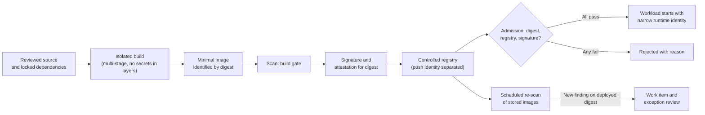

Two implications follow from the diagram. First, the chain has two kinds of check, and they answer different questions. The build gate and re-scan assess the content of the image, while signature verification assesses where it came from. A defect in either leaves the other unable to compensate, so both are needed. Second, only the admission step stops a workload, and everything before it only produces evidence. A team that scans and signs but lets admission accept anything has the evidence and no control. Designing the chain therefore starts from the enforcement point and works backwards to what evidence it needs.

## 8. Node Hardening and Blast Radius

Sections 3 to 5 reduce what a container can do. This section assumes one container is lost anyway and asks what the node it ran on gives away. The answer depends on node configuration that the workload owner rarely sees, which is why it needs an explicit owner in the platform team.

### 8.1 What a node holds

A worker node concentrates authority. It holds the agent that talks to the control plane, usually with credentials allowed to read the secrets of pods scheduled to it. It holds the container runtime socket and the image layer cache. It has a cloud identity used to pull images and join the cluster. It holds the secret volumes, service account tokens, and writable layers of every pod it runs. A successful escape from one container therefore yields, at minimum, everything co-resident on that node.

Controls that shrink the node's value, in the order they usually pay back:

- Purpose-built node operating system. Container-focused host images omit package managers, compilers, and general-purpose services, have a read-only root filesystem, and are updated by replacing the node rather than patching it in place. Fewer installed components means fewer local privilege-escalation tools for an attacker who escapes.
- No interactive access by default. Remove standing Secure Shell (SSH) access. Use a logged, time-limited session mechanism for break-glass debugging, and treat any use as an incident-grade audit event.
- Narrow node cloud identity. The node's role needs to pull images and register. It should not include broad storage, database, or administrative permissions that pods happen to need. Give pods their own identity (see the identity section) so that the node role stays small.
- Metadata endpoint control. The instance metadata service answers requests from any process on the node, including containers, unless restricted. Require the session-token form of the service where the provider offers one and limit how many network hops a response may travel so that container traffic is not answered, or block the address with a node-level firewall rule for pods that do not need it. The exact setting names differ by provider and change, so verify them in current documentation.
- Kubelet hardening. The node agent's application programming interface (API) should require authentication and authorization and should not accept anonymous requests. The authorization mode that limits a node to the objects for pods bound to it (the Node authorizer in Kubernetes) turns a stolen node credential from "read every secret in the cluster" into "read secrets for pods on this node". Part 12 owns the configuration.
- Dedicated pools by trust level, as in the worked scenario: workloads that process untrusted input, workloads holding regulated data, and platform agents do not share nodes.
- Patch by replacement. A node image rebuilt weekly and rolled through the pool narrows the window in which a published kernel or runtime flaw is exploitable, and gives a known-good state to return to after incidents.

### 8.2 Reading the blast radius

The blast radius of a node compromise is the set of identities, data, and neighbours reachable from it. It can be estimated before an incident by listing what the node holds. The diagram shows the typical layers and which control cuts which path.

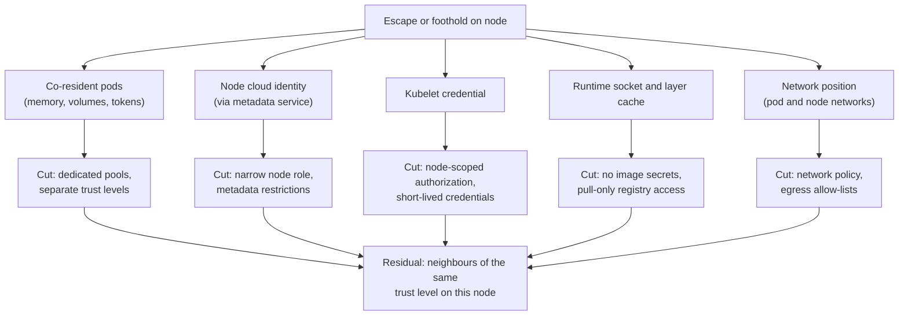

Each leaf maps to a control that exists before the incident, which is the useful property: blast radius is mostly decided at design time. The residual box shows what remains after all cuts. Same-trust neighbours stay exposed, which is acceptable only if their combined data and permissions are what the organisation has decided that trust level may lose together. That is a statement about grouping, and it is checked by asking what the worst co-resident set on any one node would be.

The arithmetic can be made concrete with a small illustrative example. Suppose a node pool runs 50 pods per node, and each pod has a token or credential for one downstream data store holding on average 2 GB of customer records. Without separate identities the node role has access to all 10 stores that the pool's services use, so one node compromise exposes up to $10 \times 2 = 20$ GB. With per-pod identities and node-scoped secret authorization, the attacker holds the credentials of the 50 co-resident pods. If those pods use 4 distinct stores, the exposure is $4 \times 2 = 8$ GB. If pools are further split by data class so that the pods on one node use only 1 store, the exposure is 2 GB. The figures are invented, but the shape holds: exposure is the sum over distinct stores reachable from the node, so cutting the distinct-store count is the lever.

## 9. Network Control and Workload Identity

A container that is compromised will try to reach something: other services, the metadata endpoint, the internet for tooling and exfiltration. Two controls limit that. Network policy limits where it can send packets. Workload identity limits what it can do with the answers. Neither is sufficient alone, because an attacker blocked from the network may still hold a credential usable later, and a narrow credential is still useful to an attacker with open egress to a data store.

### 9.1 Network policy and egress control

By default, Kubernetes networking is flat: any pod can reach any other pod and most external addresses. A NetworkPolicy object selects pods and declares allowed ingress and egress. Policy is enforced by the cluster's Container Network Interface (CNI) plugin, and some plugins do not enforce it, so confirm enforcement with a test rather than by reading the object. Semantics worth knowing: policies are additive allow-lists, so a pod selected by no policy is unrestricted, and a pod selected by any policy for a direction has that direction denied except for what is allowed. The standard pattern is therefore a default-deny policy per namespace followed by narrow allows.

```yaml
apiVersion: networking.k8s.io/v1
kind: NetworkPolicy
metadata:
  name: converter-egress
  namespace: docs
spec:
  podSelector:
    matchLabels: { app: converter }
  policyTypes: ["Ingress", "Egress"]
  ingress:
    - from:
        - podSelector:
            matchLabels: { app: upload-api }
      ports: [{ protocol: TCP, port: 8080 }]
  egress:
    - to:
        - ipBlock: { cidr: 10.20.30.0/24 }
      ports: [{ protocol: TCP, port: 443 }]
    - to:
        - namespaceSelector:
            matchLabels: { kubernetes.io/metadata.name: kube-system }
      ports: [{ protocol: UDP, port: 53 }]
```

The example allows the upload service in, the storage endpoint's address range out on Transport Layer Security (TLS) port 443, and Domain Name System (DNS) lookups to the cluster resolver. Everything else is dropped, including the metadata address and the public internet. The range `10.20.30.0/24` is a placeholder for the storage endpoint.

Egress control has three recurring difficulties.

- Names versus addresses. Standard policy matches IP ranges, but cloud services sit behind changing addresses. Options are private endpoints inside your address space (so the range is stable and also leaves the public internet), a CNI that supports matching on DNS names (a plugin-specific extension, so check support), or an egress proxy that applies an allow-list by hostname and logs every request. The proxy is the most auditable and adds one hop and one component to operate.
- Layer. Network policy works at layers 3 and 4, so it cannot distinguish two paths on the same address and port. Identity-aware controls such as mutual TLS with authorization in a service mesh add service-level rules. Part 12 covers mesh mechanics, and this chapter takes only the conclusion: use the network rule to bound reachability and the application or mesh rule to bound who may call what.
- Observability. A deny that nobody sees is an outage waiting. Log dropped connections from the policy engine where supported, and watch for new denied egress as a possible detection signal for compromise.

Egress is the control that most directly limits damage after a successful exploit. A parser exploit that gets a shell but cannot fetch a second-stage tool, cannot reach the metadata endpoint, and cannot contact an external server is much less useful than one on an open network. Ingress rules between internal services also limit lateral movement, but the default-deny egress rule is the cheaper starting point.

### 9.2 Workload identity and secrets delivery

A workload needs credentials to call cloud services and databases. The failure patterns are well known: a long-lived key in an environment variable, a credential baked into an image, a node-level role shared by every pod, and a service account token mounted into pods that never call the Kubernetes API. The secret lifecycle is owned by [CH09 Secrets Management](CH09_Secrets_Management.md), which covers rotation, dynamic secrets, and revocation. The container-specific parts follow.

Prefer identity over stored secrets. In the workload-identity pattern, the orchestrator issues each pod a short-lived signed token that asserts "this is service account X in namespace Y of cluster Z". The cloud provider's identity service is configured to trust that cluster's token issuer, and exchanges the token for short-lived cloud credentials scoped to a role bound to that service account. No long-lived secret exists to be stolen, and the credential expires within a bounded time. The provider mechanisms, in outline and at the time of writing, are AWS Identity and Access Management (IAM) roles for service accounts and EKS Pod Identity on AWS, Microsoft Entra Workload ID on AKS, and Workload Identity Federation for GKE on Google Cloud. Names and setup change, so check current documentation. All rely on the same OpenID Connect (OIDC) trust idea.

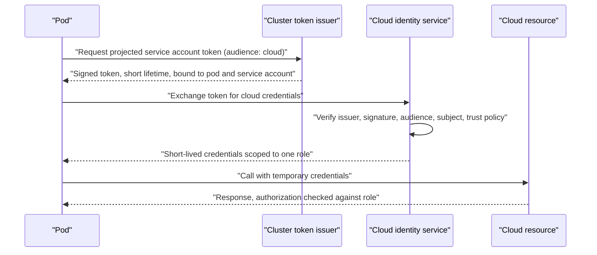

The diagram shows where each trust decision is made. The identity service checks the subject claim against a trust policy, so the policy must name the exact namespace and service account rather than a wildcard, or any pod in the cluster can assume the role. The token is bound to a pod, so extraction from a compromised pod yields a credential that expires soon, which limits the attacker to the pod's own permissions for a short, bounded time. That limit is worth having but does not make a compromised pod harmless: while the pod is controlled, the attacker can request fresh credentials. Containment therefore relies on the role being narrow, which is the same least-privilege rule as everywhere else.

Where a stored secret is unavoidable (a third-party API key, for instance), deliver it at runtime and keep it out of layers and manifests. The options differ in exposure.

| Delivery method | Exposure if the pod is compromised | Notes |
|---|---|---|
| Environment variable | Readable from the process environment and often from crash dumps, logs, and child processes | Easy but leaks widely |
| Mounted file from a Kubernetes Secret | Readable by the container, held in memory-backed storage on the node | Kubernetes Secrets are only base64-encoded by default, so enable encryption at rest in the control plane datastore |
| Secret store mounted by a driver or sidecar | Same in-pod exposure, but the value is fetched with workload identity and rotated at source | Better rotation and audit, adds a component |
| Application fetches directly with workload identity | Held in process memory, not on disk | Needs library support, fewer copies |

In every row, the pod that uses a secret can read it, so the control that matters is that each pod can read only its own secrets, audited at the source. Set `automountServiceAccountToken: false` on pods that do not call the Kubernetes API, because the default mounted token gives the attacker a credential for the cluster's control plane whose power depends on role bindings. Consumers also need to reload rotated values, so test rotation in staging, because a secret that rotates and a service that does not reload is an outage at the next rotation.

## 10. Admission Control

Admission control is the enforcement point named at the end of the image trust chain. It is the last place where the cluster can refuse a workload before it consumes resources, and it is the only place where the rule can apply uniformly to every team. Mechanics of the Kubernetes admission pipeline, role bindings, and namespaces are owned by [Part 12 CH13 Kubernetes Security](../12_Kubernetes/CH13_Security.md). This section covers what to enforce and how to roll it out.

### 10.1 Where admission sits

A create or update request to the Kubernetes API server is authenticated, authorized, passed through mutating admission (which may modify the object, for example to inject defaults), validated against the object schema, passed through validating admission (which can only accept or reject), and then persisted. Policy therefore has two roles. Mutation sets safe defaults so that teams do not each need to remember them, and validation rejects what remains unsafe. Rejection happens at request time, so a bad manifest fails at deployment with a message, not at three in the morning when a pod restarts.

Admission sees the pod specification, not the container's behaviour or the image's contents. It can check that the image is a digest from an approved registry and that a signature exists, but cannot inspect layers. Rules about what the container does at runtime belong to the detection section.

### 10.2 Pod Security Standards

Pod Security Standards (PSS) are three named profiles that Kubernetes defines for pod specifications:

- Privileged: unrestricted, for system components that genuinely need host access.
- Baseline: blocks known privilege escalations such as privileged containers, host namespaces, host path volumes, and added dangerous capabilities, while allowing most workloads to run unchanged.
- Restricted: adds current hardening practice, such as requiring non-root execution, dropping all capabilities, forbidding privilege escalation, and requiring a runtime-default or localhost seccomp profile.

Kubernetes ships a built-in Pod Security admission controller that applies a profile per namespace using labels, in three modes: enforce (reject), audit (allow and record), and warn (allow and tell the user). The exact checks in each profile evolve between versions, so read the specification for your cluster version. These profiles map directly onto the escape paths of section 5. Baseline closes the configuration-based paths that need no kernel flaw, and Restricted brings the settings of the worked scenario into policy.

The built-in controller has deliberate limits. It applies fixed profiles with a per-namespace choice, so it cannot express "this registry only", "this label required", or "exempt this one workload". It does not check images at all. Those needs lead to policy engines.

### 10.3 Policy engines

Policy engines extend admission with organisation-specific rules. Two commonly used open-source projects at the time of writing are Kyverno, which expresses policies as Kubernetes resources in YAML (YAML Ain't Markup Language), and OPA Gatekeeper, built on the Open Policy Agent (OPA), which expresses constraints in the Rego language through templates. Kubernetes also has a built-in validating admission policy mechanism using the Common Expression Language (CEL), whose availability depends on version. The choice is mostly about authoring skill and ecosystem: YAML patterns are easier for platform teams without a policy-language background, while a general-purpose policy language handles complex cross-object logic and is reusable outside Kubernetes. Evaluate current features, including image signature verification support, in each project's documentation.

Whichever engine is used, the rules worth enforcing first are the ones that close section 5 paths and section 7 gaps: no privileged containers, no host namespaces, no host path mounts, no runtime socket mounts, non-root with dropped capabilities, approved registries, digest references, signature verification, and required resource limits.

### 10.4 A worked policy

The sketch below is written in Kyverno style. Field names, especially the failure-action setting, differ between versions, so verify against the installed version before use.

```yaml
apiVersion: kyverno.io/v1
kind: ClusterPolicy
metadata:
  name: baseline-image-and-hardening
spec:
  validationFailureAction: Audit
  background: true
  rules:
    - name: approved-registry-and-digest
      match:
        any:
          - resources:
              kinds: ["Pod"]
      validate:
        message: "Images must be pulled from registry.example.com and pinned by digest."
        pattern:
          spec:
            containers:
              - image: "registry.example.com/*@sha256:*"
    - name: no-privilege-escalation-drop-all
      match:
        any:
          - resources:
              kinds: ["Pod"]
      validate:
        message: "Set allowPrivilegeEscalation to false and drop ALL capabilities."
        pattern:
          spec:
            containers:
              - securityContext:
                  allowPrivilegeEscalation: false
                  capabilities:
                    drop: ["ALL"]
```

The pattern matches every entry in the `containers` list, but init containers and ephemeral containers are separate lists, so a complete policy repeats the rule for them. This is a frequent gap: a workload that passes the check carries an unchecked init container. A pod created by a deployment is also validated only when the pod is created, so policies written against Pod kinds should be paired with controllers' rules or the autogeneration feature of the engine, as supported.

### 10.5 Rolling out without outages

Starting in enforce mode on a live cluster breaks deployments that nobody knew were non-compliant. A safer sequence has four stages.

1. Audit. Set the policy to record violations only, with background scans of existing workloads. Count violations per namespace and owner.
2. Fix the common cases. Most violations come from a few shared charts or base manifests, so fix those and the count drops quickly.
3. Enforce in new or low-risk namespaces first, then widen, keeping a time-boxed exemption mechanism with an owner and expiry date.
4. Decide failure behaviour. If the policy engine's webhook is unreachable, the API server either admits requests (fail open) or rejects them (fail closed). Fail open means an outage of the engine silently disables the control, which an attacker can try to induce. Fail closed means the engine becomes part of the cluster's availability and must be run with several replicas and excluded from its own policies. Many teams use fail closed for security-critical rules with a high-availability deployment, and exclude system namespaces so that cluster recovery is not blocked by the policy that is broken. Make the choice deliberately and record it.

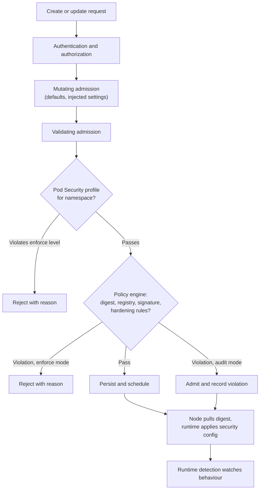

The diagram shows policy as a series of gates that rejects early and cheaply, and it shows the audit branch that admits a workload while recording a violation. That branch is the migration path and also the leak: every audit-mode rule that is never promoted to enforce is a control that only reports. Track the age of audit-only rules as a metric. Note that the flow ends in runtime detection. Admission cannot see what the workload does after it starts, and image signatures say nothing about a bug the application contains, so the controls in the next section cover the remainder.
## 11. Runtime Detection

Prevention controls assume the attacker's techniques are known in advance. Detection watches what actually happens on the node and flags behaviour that does not fit. It exists because some attacks use only permitted calls, and because the earliest sign of a kernel exploit or stolen credential is usually something odd that a process does.

### 11.1 Classes of detector

Tools differ in product names and change quickly, so it is more useful to classify them by where they observe.

- System-call and kernel-event detectors. A small kernel component, implemented as a loadable module or, more commonly now, as programs loaded through extended Berkeley Packet Filter (eBPF) into the kernel's tracing hooks, records system calls and selected kernel events with the container and pod identity attached. A rule engine matches them: a shell started in a container that normally has none, a write to a binary directory, a read of the service account token by an unexpected process, a connection to an unusual address. Open-source projects of this kind exist, and managed cloud offerings wrap similar sensors. Coverage and overhead depend on the sensor, so measure both on your workload before broad rollout.
- Network flow detectors. These observe connections between pods and to external addresses, either from the CNI's own flow records or from eBPF at the socket layer. They answer "which workload talked to which destination" and find new destinations, port scans, and unusually large transfers.
- File integrity and drift detection. These compare the container's writable layer or mounted paths with the image content. With a read-only root filesystem, any write attempt is itself a signal. Drift detection also finds the case where an operator changed a running container by hand.
- Control-plane audit analysis. The Kubernetes audit log records who created, execed into, or modified which objects. Alerts on `exec` into production pods, creation of privileged pods, and access to secrets cover the part of an attack that goes through the API instead of the kernel.
- Cloud-side signals. Cloud audit logs show use of the node role or workload credentials from unexpected addresses or for unexpected API calls, which can reveal credential theft that the node sensors do not see.

### 11.2 Tuning, limits, and cost

Detection is only useful if someone can act on its output. Three design points decide that.

First, base rules on a baseline. A service that normally executes one binary and connects to two destinations has a sharp profile, so rules such as "any new process" or "any connection outside the allow-list" are high-signal. A service that spawns helper processes by design needs a looser rule. Distroless images and read-only root filesystems from earlier sections help detection, because they make normal narrow and deviations conspicuous.

Second, sensors can be evaded or disabled. An attacker with enough privilege on the node can unload a sensor, and an attacker who is faster than the sensor's reporting path can finish before an alert is read. A detection control is therefore a way to shorten dwell time, and it should be backed by automated response only for high-confidence rules, such as killing a pod that spawns an interactive shell in a hardened, shell-less service. Automatic response on noisy rules creates outages.

Third, there is a cost. Each sensor consumes CPU and memory on every node and produces data. Estimate it: if a sensor adds roughly 2 percent CPU to a node with 16 vCPUs, that is $16 \times 0.02 = 0.32$ vCPU per node, or about 6.4 vCPUs across 20 nodes. If events average 200 bytes and a node emits 500 events per second, the stream is $500 \times 200 = 100$ KB per second per node, which is about $100 \times 86{,}400 \approx 8.6$ GB per day per node, or 173 GB per day across 20 nodes before filtering. Both figures are illustrative, but the lesson is that filtering at the source (forward only rule matches and a sample of normal activity) is a requirement, not an option. Verify actual overhead in your environment.

Detection also needs a response path: an on-call owner, a runbook per rule, and a feedback loop that retires rules that never fire usefully. Observability products are owned by Part 14; the container-specific response steps follow.

## 12. Forensics and Recovery for a Compromised Container

Containers are short-lived by design, which helps recovery and hurts investigation: the usual response to a faulty pod is to delete it, and that deletes the evidence. The response plan therefore has to decide, before an incident, what is preserved and in what order.

### 12.1 Order of operations

The aims are to stop the damage, keep evidence, find the scope, and return to a trusted state. The sequence below is the typical order, adapted to whether the suspected compromise is a single container or a whole node.

1. Contain without destroying. Do not delete the pod first. Apply a network-policy label that cuts the pod off from everything except the investigation tooling, and, if a node is suspected, cordon it so that nothing new is scheduled there. Keep the pod alive but isolated, so memory and the writable layer survive.
2. Capture volatile evidence. Record the pod specification and its image digest, the node name, the list of processes and open connections, and the container's writable layer. Memory capture is possible with checkpointing support where the runtime and node provide it, but it is not universally available, so verify it ahead of time. On a node-level suspicion, take a disk snapshot of the node's volume through the cloud provider before touching it.
3. Revoke what the container could use. Revoke or rotate the workload's credentials and any secret mounted in it. Short-lived workload tokens expire on their own, but credentials issued to an attacker before containment may still be valid for their lifetime, so check the cloud audit log for use from the pod's identity.
4. Scope. Identify co-resident pods, the node's role activity, and cluster audit events for the time window. Look for the same image digest elsewhere, since the flaw may be in the image or its dependency, and consult the component inventory ([CH16 SBOM](CH16_SBOM.md)) to find other deployments of the vulnerable component.
5. Eradicate by rebuilding. Do not clean a container in place. Fix the cause in source or base image, build a new image, verify it through the normal trust chain, and redeploy. If node compromise is possible, replace the node from the trusted node image instead of repairing it, and rotate any credential that node held.
6. Learn. Update the detection rule that did or did not fire, the policy that should have prevented the path, and the runbook.

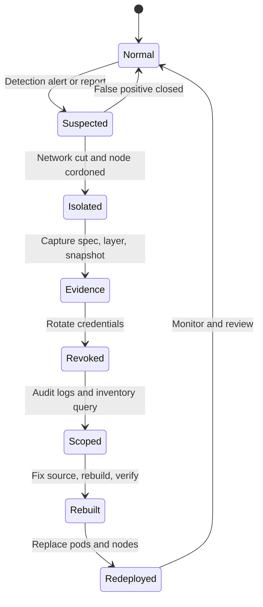

The diagram shows a one-way path with a single exit at the start for false positives. The order matters in two places. Isolation comes before evidence capture because the attacker may be active, and evidence comes before revocation because revoking can change the observable behaviour of a running attacker, which sometimes helps (it stops damage) and sometimes hides techniques. The team should decide the tradeoff by data sensitivity: when credentials reach customer data, revoke first and accept some evidence loss.

### 12.2 What to prepare in advance

Evidence collection that is designed during an incident is slow and incomplete. Four preparations make the difference:

- Ship logs and audit events off the node continuously, since a compromised node's local logs cannot be trusted.
- Keep image digests, build provenance, and the deployed manifest history so that "what exactly was running" is a lookup, not an inference.
- Give responders a debug path that does not require shipping tools in images: ephemeral debug containers or node-level tooling that attach to a target container's namespaces, gated by access control and logged.
- Rehearse. A drill that isolates a test pod, captures its layer, rotates its credential, and rebuilds the node produces a measured recovery time. If that exercise takes 3 hours with one person who knows the steps, the plan is a person, not a process.

A rebuild from a trusted image is fast only if node and image pipelines already exist and are exercised. If nodes are replaced weekly as routine patching, recovery from a node compromise is the same operation as a normal Tuesday, which is the strongest argument for patch by replacement.

## 13. Provider Comparison: Isolation Guarantees and Responsibilities

Section 4 covered the isolation technologies and the idea that managed services differ in who owns the kernel boundary. The table below turns that into a responsibility map for the three providers' typical container offerings. Statements reflect public documentation at the time of writing and change between releases, so treat each cell as a prompt to verify, not as a contract.

| Question | AWS: EKS on EC2 nodes | AWS: EKS or ECS on Fargate | Azure: AKS | Azure: Container Apps | Google Cloud: GKE | Google Cloud: Cloud Run |
|---|---|---|---|---|---|---|
| Who owns the kernel and node image? | You choose and patch the node image, or use a managed node option | Provider | You, with provider-supplied node images and upgrade tooling | Provider | You on Standard mode, more provider-managed on Autopilot | Provider |
| Is the kernel shared with other tenants? | Shared among your pods on a node | Documented as a separate isolation boundary per task or pod | Shared among your pods unless a sandbox option is used | Verify current plan documentation | Shared among your pods unless a sandbox node pool is used | Documented as sandboxed per instance |
| Optional stronger sandbox | Dedicated pools, or a microVM-based runtime you operate | Built in | Pod sandboxing option using microVM technology, where available | Not selectable by you | Sandbox option using a user-space kernel, where available | Choice of execution environment by compatibility needs |
| Privileged containers, host mounts | Possible, governed by your policy | Not available | Possible, governed by your policy | Not available | Possible on Standard, restricted on Autopilot | Not available |
| Workload identity mechanism | IAM roles for service accounts or Pod Identity | Task role | Microsoft Entra Workload ID | Managed identity | Workload Identity Federation for GKE | Service account attached to the service |
| Network control | Virtual private cloud (VPC) and security groups plus NetworkPolicy where the CNI supports it | Security groups per task or pod | Virtual network plus network policy options | Environment-level network settings | VPC firewall plus network policy | Ingress settings and VPC egress connectors |
| Patching responsibility for the node | You, or provider on managed options | Provider | You trigger upgrades, provider supplies images | Provider | You on Standard, provider on Autopilot | Provider |
| What you always own | Image, pod configuration, policy, identity scope, network rules, detection | Same, minus node concerns | Same as EKS on EC2 | Image, identity scope, app-level controls | Same as EKS on EC2 (Standard) | Image, identity scope, app-level controls |

Reading the table gives four conclusions.

First, moving from a node-based cluster to a task-based service transfers the kernel boundary, node patching, and node hardening to the provider, and removes options: no privileged mode, no host mounts, no custom runtime, no node-level detection agent. For many teams that is a net gain, because the section 8 work disappears, but a workload that needs a sensor, a special device, or a custom kernel setting cannot move.

Second, the services are not interchangeable guarantees. A sandbox based on a user-space kernel and one based on a microVM have different compatibility and different attack surfaces. A "serverless" label tells you who patches, not which boundary protects you. Read the provider's isolation documentation and, for sensitive tenants, its compliance statements.

Third, the shared-responsibility line sits in the same place on every provider: the provider secures the infrastructure up to the boundary it documents, and you own the image, its contents, the identity it runs as, the network rules around it, and the configuration passed to the runtime. The admission, scanning, signing, and identity sections of this chapter apply identically in all six columns. Registry specifics are covered in [Part 09 CH07 Containers](../09_Cloud_Computing/CH07_Containers.md), and Kubernetes-specific controls in Part 12.

Fourth, multi-cloud or portable designs should standardise on the controls that exist everywhere (digests, signing, non-root, dropped capabilities, workload identity, default-deny egress) and treat the sandbox and node choices as per-provider decisions recorded with their evidence.

## 14. Failure and Quality-Attribute Scenarios

Each scenario states a stimulus, the expected response, and a success criterion that a test can measure. The counts and times are illustrative targets for the document conversion service of section 6, not benchmarks.

| Scenario | Stimulus | Expected response | Measurable success criterion |
|---|---|---|---|
| Escape attempt contained | A parser exploit in a converter pod runs a probe set: mount a filesystem, load a module, write to `/proc/sys`, and call a system call outside the profile | Seccomp or the capability check refuses each probe, the user namespace or non-root user leaves any gained code with no host authority, and a detection rule fires | All 12 scripted probes are denied. No process in the pod reads as UID 0 on the host. An alert reaches the on-call owner within 60 seconds |
| Malicious image pulled | A manifest references a public registry image by mutable tag | Admission rejects the request at creation time, naming the rule | Zero pods created. The audit log records the request and the rule. The test runs on every platform release |
| Policy engine outage | All replicas of the admission webhook are unreachable | Behaviour follows the recorded failure policy (see the diagram below) | Security-critical rules fail closed, system namespaces are excluded, and the engine is restored within the agreed recovery target |
| Node compromise | A detection rule reports a shell on a conversion node | Pod isolated, node cordoned, credentials revoked, node replaced | Node cordoned within 15 minutes and replaced from the trusted image within 60 minutes of the alert, measured in a drill |

The malicious-image row has a corollary for the escape row: the test is only meaningful if it runs the probes inside the production configuration, so run it from the deployment pipeline against a real pod, not against a laptop container with different defaults.

The outage scenario involves a real tradeoff, so the decision is worth drawing.

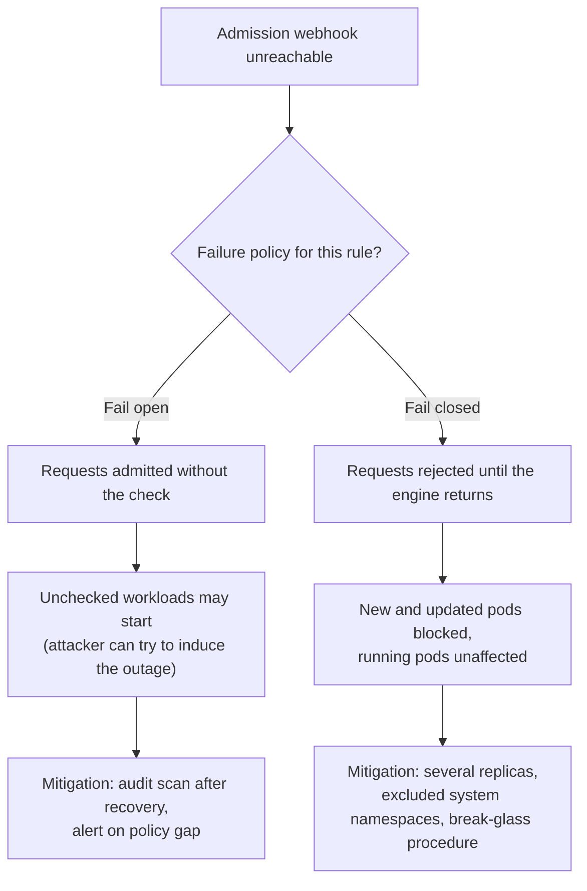

Fail open trades control for availability, and fail closed trades availability for control. Fail closed has a bounded cost: with an illustrative 30 pod creations per hour, a 10-minute outage blocks $30 \times 10 / 60 = 5$ creations, which retries recover. Fail open for the same outage admits 5 workloads with no check, and the after-the-fact scan must find them. Running pods are unaffected either way, so the choice matters most for scale-out and rollout during the outage. Record the choice per rule, and review it when the deployment rate changes.

## 15. Worked Case Study: Securing the Document Platform End to End

This case is illustrative. It follows the organisation of section 6: a platform with 20 nodes (16 vCPUs and 60 GiB allocatable memory each), a payment service, and a document conversion service with 200 replicas that parses customer-uploaded files. The number of probes and the thresholds are invented for the example.

### 15.1 Decisions and rejected alternatives

| Decision | Rejected alternative | Reason |
|---|---|---|
| Converters run in a sandbox runtime class on a dedicated, tainted node pool | Plain hardened containers on shared nodes | A single kernel flaw would reach payment pods and node credentials (section 6.4) |
| Sandbox runtime rather than per-customer virtual machines | A virtual machine per upload job | The converter is stateless, and per-job machine start and density costs are out of proportion to the threat |
| Image pinned by digest, built in multi-stage form, signed in the pipeline | Mutable tags with a scan only | A scan does not show provenance, and a tag can move |
| Admission policy in audit mode first, then enforce, fail closed for the registry and signature rules | Enforce on day one, or fail open | Day-one enforcement breaks unknown deployments. Fail open lets an outage disable the control |
| Workload identity scoped to one storage path, token mount disabled | Node role carrying storage access | The node role would expose every store the pool reaches |
| Default-deny egress with the storage endpoint and DNS allowed | Open egress with detection only | Detection shortens dwell time but does not stop a second-stage download |
| Node replacement weekly from a rebuilt image | In-place patching | Replacement doubles as the recovery procedure after a node compromise |

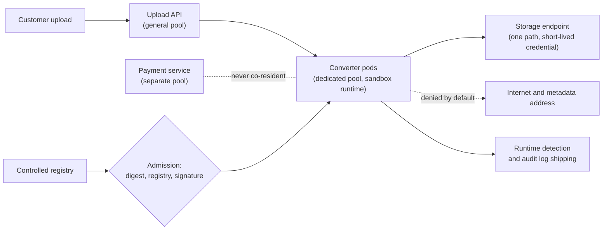

The diagram places the trust boundaries at three points: the pool boundary that keeps payment pods off conversion nodes, the egress boundary around the converter, and the admission gate in front of the pool. A reviewer can check each with a test, which is the point of drawing it this way.

### 15.2 Capacity arithmetic for the new pool

The pool holds 200 converter pods on 4 nodes, so $200 / 4 = 50$ pods per node. Memory at limits is $50 \times 1\ \text{GiB} = 50$ GiB against 60 GiB allocatable, so the pool is no longer overcommitted. Memory requests total $50 \times 0.5 = 25$ GiB. The process cap is $50 \times 256 = 12{,}800$ against a host limit of 32,768, leaving $32{,}768 - 12{,}800 = 19{,}968$ for the host. One spare node keeps the pool serving when a node is replaced, so the pool is 5 nodes and the fleet 21 nodes, a $1/20 = 5$ percent increase over the original 20. The sandbox runtime's own memory and CPU overhead is not included and must be measured in the load test before the density is final.

### 15.3 Validation evidence

Evidence is gathered before the rollout and kept with the release record.

- Configuration smoke test: the check from section 6.2 reports zero effective capabilities, `NoNewPrivs` 1, and filter mode on every converter pod.
- Probe suite: the 12 escape probes from section 14 are all denied, and the egress probes (metadata address, public internet, a second namespace) all time out.
- Admission tests: a tag reference, an unapproved registry, an unsigned digest, and a privileged pod are each rejected, and a conforming pod is admitted.
- Identity test: the pod's credential can write its storage path and is refused on a sibling path.
- Drill: a test pod is isolated, its layer captured, its credential revoked, and its node replaced, with the elapsed time recorded against the targets in section 14.

Residual risk is stated in the release record: a flaw in the sandbox or hypervisor boundary, mitigated by the empty credential surface, the egress rules, and the patch cadence.

## 16. Common Mistakes and Anti-Patterns

| Mistake | Cause | Consequence |
|---|---|---|
| Treating the image scan as the security control | A green report is easy to display | Unknown components, behaviour, and provenance go unchecked. A malicious image with no known flaws passes |
| Mounting the container runtime socket for builds | The build needs to start containers and the socket is the shortest path | Any code in the build can start a privileged container with the host root mounted |
| Running privileged to fix a permission error | The needed capability was never identified | The pod has node-level authority, and an exploit needs no kernel flaw |
| Pulling by mutable tag | Tags are readable and digests are not | A moved tag changes production without a review, and a rollback cannot name what ran |
| One shared node pool for every trust level | Bin-packing efficiency is measured and blast radius is not | A kernel escape from the least trusted pod reaches the most sensitive neighbour |
| Long-lived keys in environment variables or layers | Rotation is deferred | Anyone who can pull the image or read the environment holds a durable credential |
| Admission rules left in audit mode indefinitely | Enforcement caused an outage once | The control only reports, and violations accumulate |
| Deleting a suspect pod first | The reflex is to remove the problem | The writable layer and memory are lost, and scope cannot be established |
| Assuming network policy is enforced | The object applied without error | The CNI plugin ignored it, and egress stayed open |

## 17. Design-Review Checklist

Ask these questions of any containerised workload before it runs in production.

- Does the threat model name who can influence the code that runs, and does the isolation level match (section 4)?
- Is the image minimal, built in stages, referenced by digest, and free of secrets in any layer?
- Does the base image have a patch cadence with an owner, and is there a re-scan of deployed digests?
- Does the pod run as a numeric non-root user, with all capabilities dropped, privilege escalation disabled, a runtime-default or tighter seccomp profile, and a read-only root filesystem?
- Are privileged mode, host namespaces, host path mounts, and the runtime socket forbidden by admission policy?
- Are CPU, memory, and process count limits set from measured behaviour?
- Does the workload use an identity scoped to what it needs, with the service account token mounted only if the Kubernetes API is called?
- Is default-deny egress in place, the metadata address blocked or restricted, and enforcement tested?
- Does admission verify digest, registry, and signature, and is the failure policy recorded per rule?
- Are node pools separated by trust level, with a narrow node role and a patch-by-replacement cadence?
- Are detection rules, log shipping, and a runbook in place, with a drill result on record?
- Is the evidence retained to rebuild and verify: digest, provenance, manifest history, and inventory?
- Is the residual shared-kernel risk stated, together with the controls that contain it?

## 18. Exercises

1. Draw the image-to-runtime trust chain and mark where a signature is verified. Outline: source, build, scan, sign, registry, admission, node. Verification belongs at admission, where a workload can be refused (section 7.3).
2. A build job needs to create images. Name two designs that avoid mounting the runtime socket. Outline: a rootless or daemonless build service in a dedicated pool, or a managed build product, with push credentials held by the build identity only.
3. List the settings that raise a container's host authority. Outline: privileged mode, host namespaces, host paths, runtime socket, `CAP_SYS_ADMIN`, writable `/proc/sys` (section 5.2).
4. Compare non-root execution, capability dropping, seccomp, and a sandbox runtime by the attack each removes. Outline: file ownership tricks, privileged operations, kernel entry points, and the shared kernel itself (section 3 and 4).
5. A pool runs 40 pods per node with a 1 GiB limit, 60 GiB allocatable, and a 256 process cap. Check memory and process headroom. Outline: $40 \times 1 = 40$ GiB fits, and $40 \times 256 = 10{,}240$ against 32,768 leaves 22,528 for the host.
6. Choose fail open or fail closed for a signature rule and justify it. Outline: fail closed for security-critical rules with several replicas and excluded system namespaces, plus a recorded break-glass path (section 14).
7. How should a workload credential be delivered, and what happens after a node compromise? Outline: workload identity with short-lived tokens, a narrow role, revocation of issued sessions, and a cloud audit log review for use from the pod's identity.
8. What evidence is kept to rebuild and verify a compromised workload? Outline: digest, provenance, deployed manifest history, component inventory, shipped logs, and a captured writable layer (section 12).

## 19. Summary

The chapter's outcomes map to the sections that deliver them.

- Kernel mechanisms and what each removes: namespaces limit visibility, cgroups limit consumption, capabilities and `no_new_privs` limit authority, seccomp limits kernel entry points, and a mandatory access policy limits object access (sections 2 and 3).
- Reading a configuration against "root on the host": privileged mode, mounts, shared namespaces, and the runtime socket turn a restricted process into a node-level actor (sections 5 and 15).
- Choosing isolation: shared-kernel containers, user-space sandboxes, microVMs, and virtual machines differ in the kernel code the workload can reach, and the tenant trust level decides (sections 4 and 13).
- Escape paths: configuration paths are closed by admission policy, and defect paths are narrowed by profiles, sandboxes, and patching (sections 5, 10, and 11).
- Estimating consequences: limits, density, and blast radius are checked with arithmetic, and the residual shared-kernel risk is stated rather than ignored (sections 6, 8, and 15).

Container security is an end-to-end trust and isolation problem. Minimise images and runtime authority, verify immutable artifacts, protect workload credentials, constrain host and network access, and plan node-level recovery.

