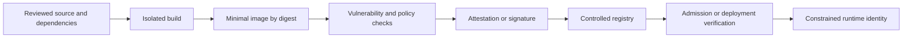
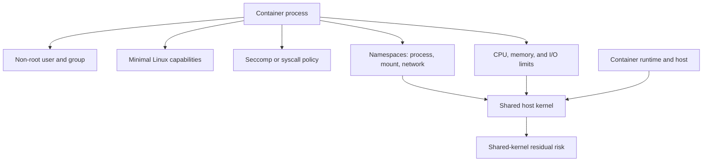
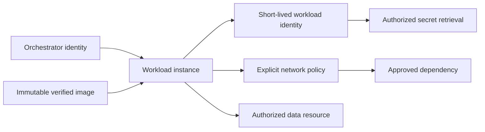
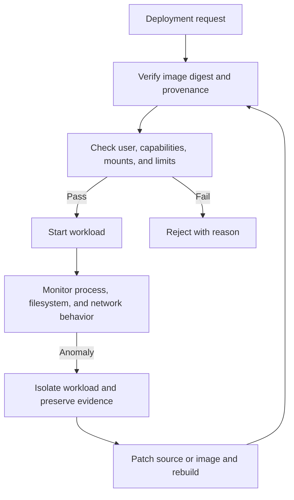
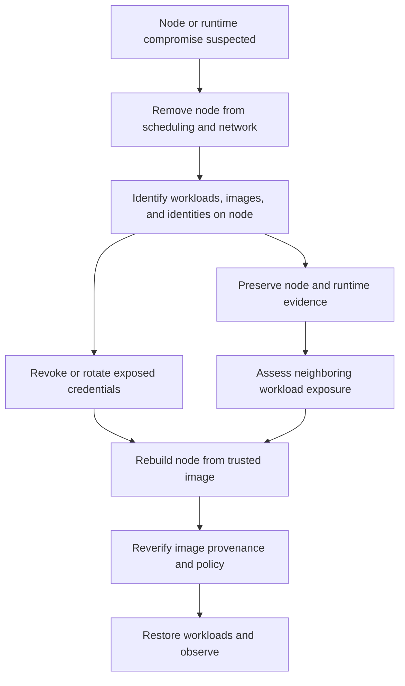

# Container Security

Part: [15 — Security](PART_OVERVIEW.md)

Container security spans image construction, artifact distribution, runtime identity, host isolation, orchestration policy, and patch response. A container is not a virtual machine boundary: containers share a host kernel, so image hardening does not remove host or runtime risk. Part 05 CH28 owns container primitives; Part 12 CH13 applies Kubernetes security; Part 09 owns registry products; [Part 13 Docker](../13_DevOps/CH03_Docker.md) owns image construction.

## Image-to-Runtime Trust Chain

Security begins with the source and build environment, continues through an image artifact and registry, and ends with the runtime workload. Scan results and signatures are useful only when tied to an immutable digest and enforced at deployment. Promote the same verified artifact rather than rebuilding under a mutable tag.

Use minimal maintained base images, pin dependencies, remove build tools from runtime images, and run as a non-root user where possible. Image scanners identify known components and vulnerabilities but cannot prove absence of exploitable flaws. Assess reachability and exposure, then record exceptions and patch deadlines.

## Isolation and Least Privilege

Containers typically use namespaces for isolation and control groups for resource accounting and limits. Capabilities divide traditional root authority into smaller privileges. Seccomp or equivalent syscall filtering can restrict kernel surface. These mechanisms reduce risk but share the host kernel, so a kernel flaw or privileged runtime configuration can cross container boundaries. Stronger isolation may require a sandboxed runtime or virtual machine boundary.

Drop unnecessary capabilities, avoid privileged mode and host namespace sharing, mount filesystems read-only when possible, and limit writable paths. Resource limits help contain denial-of-service impact but can also cause instability if set without workload evidence. Treat container sockets and host mounts as powerful administrative interfaces.

## Secrets, Network, and Runtime Identity

Do not bake credentials into image layers, build arguments, environment defaults, or logs. Deliver secrets at runtime through a controlled mechanism and grant each workload only the identities and permissions it needs. Part 09 owns secret products; CH09 owns provider-neutral secret lifecycle. Restrict egress and ingress, and use service identity plus application authorization rather than trusting network location alone.

A compromised container should not inherit broad node credentials or access to neighboring workloads. Separate runtime identities by service and environment. Rotate credentials and verify consumer reload behavior. Ensure policy enforcement is observable and exceptions have an owner and expiry.

## Admission, Runtime Detection, and Recovery

Admission controls can reject untrusted images, privileged workloads, host mounts, missing resource limits, or unsigned artifacts before they run. Runtime monitoring can detect unexpected processes, file writes, network behavior, and privilege changes. Neither admission nor runtime detection replaces patching and incident response.

Patch base images and runtimes on a defined cadence with an emergency path for actively exploited issues. Preserve the image digest, provenance, runtime configuration, node identity, and incident evidence. For node compromise, assume workloads and credentials on that node may be affected; rotate identities and rebuild from trusted sources rather than trusting in-place cleanup alone.

## Worked Case and Review Checklist

A document-processing service runs a minimal, non-root image with a read-only root filesystem, narrow capabilities, bounded CPU/memory, and no host mounts. Admission verifies the image digest and provenance. The pod receives a workload identity limited to one storage path and obtains a short-lived credential. Egress allows only required storage and telemetry endpoints. A runtime anomaly triggers isolation, credential revocation, and a rebuild from a patched base image.

Review source/build trust, image digest, base-image patching, user, capabilities, syscalls, namespaces, cgroups, mounts, secrets, workload identity, network policy, admission, runtime signals, node recovery, and artifact evidence. State residual shared-kernel risk and the controls that contain it.

## Questions and Summary

1. Draw the image-to-runtime trust chain and identify where a signature is verified.
2. Which container settings increase host authority and blast radius?
3. How should a workload credential be delivered and revoked after node compromise?
4. Compare non-root execution, capabilities, seccomp, and a sandboxed runtime.
5. What evidence must be retained to rebuild and verify a compromised workload?

Container security is an end-to-end trust and isolation problem. Minimize images and runtime authority, verify immutable artifacts, protect workload credentials, constrain host and network access, and plan node-level recovery. Containers share kernel risk, so model that residual boundary explicitly.
