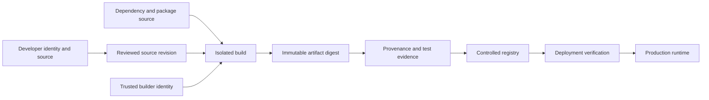
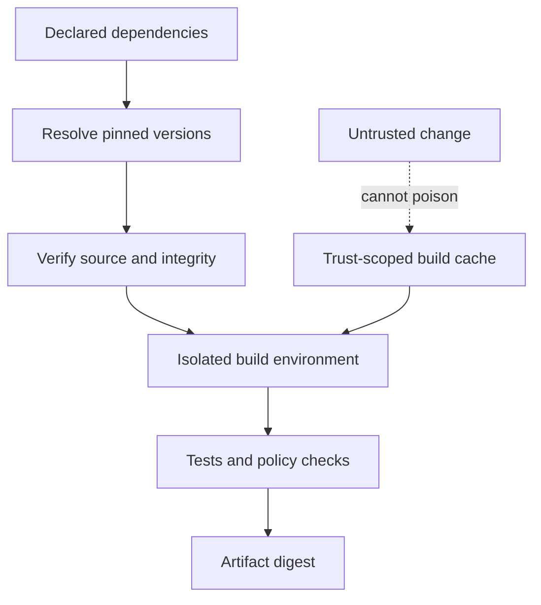
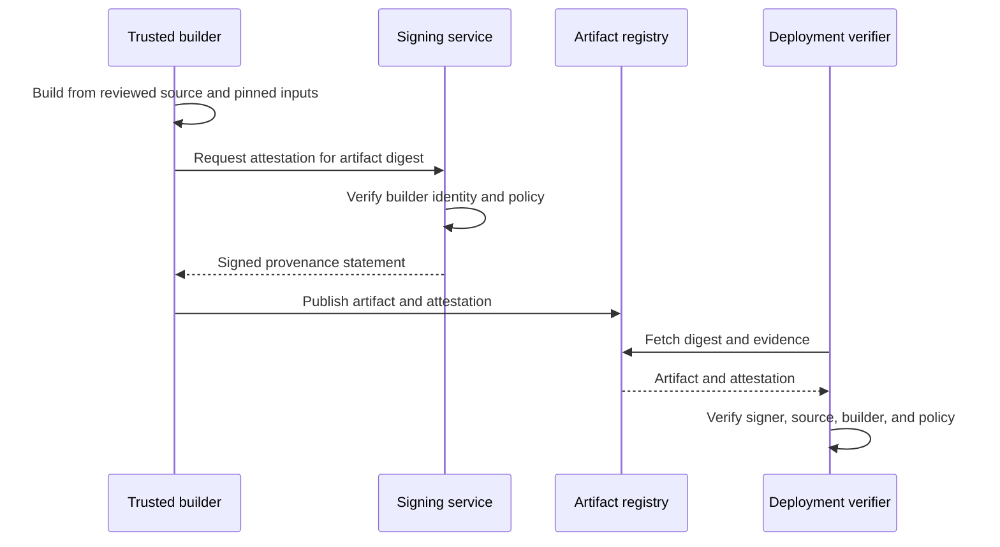
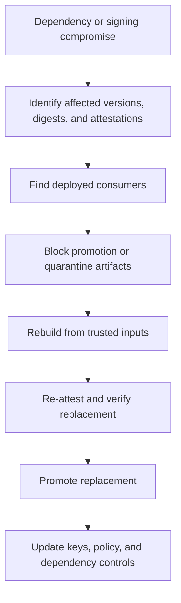
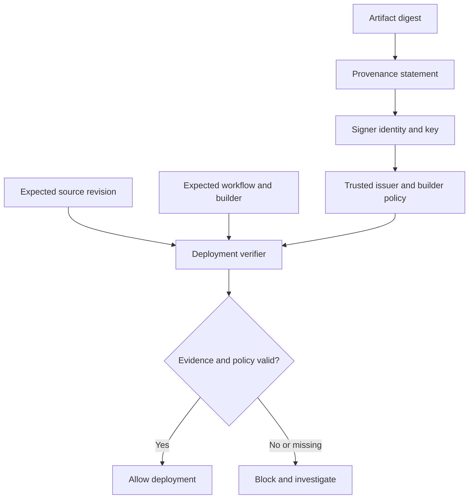

# Supply Chain Security

Part: [15 — Security](PART_OVERVIEW.md)

Software supply chain security protects source, dependencies, build systems, artifacts, registries, and deployment decisions from tampering and compromise. It asks not only “what is in this release?” but “who produced it, from which inputs, through which process, and how was it verified?” Part 13 owns pipeline implementation; [CH16 SBOM](CH16_SBOM.md) owns component inventory; Part 09 owns provider registry products.

## Threat Model and Trust Chain

Threats include malicious or compromised dependencies, maintainer account takeover, poisoned build caches, compromised runners, mutable artifacts, signing-key theft, and verification bypass. A control at one stage does not establish trust for later stages unless evidence is linked across the chain.

Identify trust roots and control owners for repository access, dependency resolution, build identity, signing, artifact storage, and deployment. A green build or signature alone does not guarantee safety; it only provides evidence under the identity and policy that produced it.

## Dependency and Build Integrity

Pin dependencies and verify integrity using lockfiles, checksums, trusted registries, and review. Monitor abandoned or compromised packages, typosquatting, maintainer changes, and transitive dependency drift. Pin build tools and base images as well as application libraries. Treat package installation scripts and build plugins as code execution.

Build isolation should separate untrusted pull-request execution from privileged release jobs. Use ephemeral runners when possible, restrict network egress, scope credentials, and prevent one trust domain from poisoning caches used by another. Record the builder identity and environment so an artifact can be traced to its process.

## Provenance, Signing, and Verification

Provenance links artifact digest to source revision, build definition, builder identity, dependencies, and relevant test evidence. An attestation can communicate that claim. A signature proves that a key signed specific content; it does not prove that the signer was authorized, the build was safe, or the artifact passed policy. Trust requires key custody, identity binding, revocation, and enforcement at the consumer.

Verify the artifact by immutable digest at deployment, not only by a mutable tag. Enforce expected repository, workflow, builder, source revision, and policy version. Fail closed for high-risk artifacts when verification evidence is absent or invalid, with a narrow audited exception process.

## Registry, Deployment, and Incident Response

Registries need access control, immutable release identities, retention, replication, audit, and incident procedures. Promotion should preserve artifact identity across environments. A compromised tag or image should be traceable to deployments and downstream consumers quickly.

Recovery needs a trusted path that is independent from the compromised component. If the builder or signing key may be compromised, do not reuse it without investigation. Preserve evidence, rotate trust roots, rebuild affected artifacts, and verify the replacement end to end.

## Worked Case and Review Checklist

A dependency maintainer account is compromised and a malicious patch reaches a package release. The team uses lockfiles and package monitoring to identify affected versions, then traces the component through SBOMs to artifact digests and deployments. Registry policy blocks the version; a clean isolated builder rebuilds from a trusted dependency release, produces new provenance, and deployment verification rejects the old digest. The team rotates exposed build credentials and reviews cache and maintainer trust.

Review source permissions, dependency pinning, build isolation, cache trust, runner credentials, artifact identity, signing-key custody, provenance claims, verification enforcement, registry retention, deployment traceability, and compromise recovery. Confirm that evidence remains queryable without relying on the system under investigation.

## Questions and Summary

1. Draw the software supply chain from source and dependencies through runtime verification.
2. Distinguish what a signature proves from what provenance and policy verification establish.
3. Design an isolated build path for untrusted pull requests and privileged release jobs.
4. Trace a compromised dependency from package version to deployed artifact and response action.
5. How can a compromised signing key be replaced without trusting the old key to attest its successor?

Supply chain security is the verification of trust across people, inputs, build processes, artifacts, and deployment. Pin inputs, isolate builders, bind provenance to immutable artifact identity, verify at consumption, and rehearse compromise response. Part 13 supplies delivery mechanisms; this chapter defines the security claims those mechanisms must preserve.
