# Chapter: Supply Chain Security

Part: [15 — Security](PART_OVERVIEW.md) · Status: Revised (in-depth rewrite)

## 1. Introduction

A software supply chain is every input, person, system, and decision that sits between a line of source code and a running workload. It includes the source repository, the third-party libraries pulled in at build time, the build tools and base images, the machine that runs the build, the registry that stores the result, and the deployment system that decides to run it. An attacker who cannot break the application directly can often change one of these upstream steps and have the organization's own pipeline deliver the change to production, signed, tested, and approved.

Supply chain security therefore asks a different question from application security. Application security asks whether the code that was written is safe. Supply chain security asks whether the code that is running is the code that was reviewed, built from the inputs that were intended, by the process that was intended, and whether the deployment system can prove it before it agrees to run it.

After this chapter you will be able to:

- Draw the build trust chain and name, for each link, who or what is trusted and what evidence that trust rests on.
- Classify supply chain attacks by the stage they compromise: dependency confusion, typosquatting, compromised maintainers, build-system compromise, and artifact tampering.
- Explain how lockfiles, integrity hashes, and vendoring constrain dependency resolution, and decide between them using exposure arithmetic.
- Explain what a hermetic build and a reproducible build each guarantee, how they differ, and what each costs.
- Describe the structure of provenance, attestations, and signatures, and how verification at deployment closes the chain. Later sections of this chapter cover these mechanisms in full: provenance and attestation structure, Sigstore signing and verification, artifact repository controls, and admission policy.

Ownership is split across the handbook as follows:

| Topic | Owner |
|---|---|
| Component inventory formats, generation, and consumption of Software Bill of Materials (SBOM) | [CH16 SBOM](CH16_SBOM.md) |
| Container runtime isolation, image hardening, and node blast radius | [CH14 Container Security](CH14_Container_Security.md) |
| Pipeline security gates inside the Secure Software Development Lifecycle (Secure SDLC) | [CH13 Secure SDLC](CH13_Secure_SDLC.md) |
| Continuous Integration and Continuous Delivery (CI/CD) mechanics and runner configuration | [Part 13 CH02 CI/CD](../13_DevOps/CH02_CI_CD.md) |
| Digest-based promotion and cloud registry products | [Part 09 CH07 Containers](../09_Cloud_Computing/CH07_Containers.md) |
| Supply chain threat model, dependency constraint, hermetic and reproducible builds, provenance, signing, registry controls, admission policy | This chapter |

The chapter keeps one rule in view throughout. A control at one stage does not establish trust for later stages unless evidence is carried forward and checked by the party that finally decides to run the artifact. A signed artifact, a clean scan, and a green build are all evidence. None of them is a conclusion until a verifier compares it with a policy.

## 2. The Trust Chain Model

### 2.1 Stages, artifacts, and the evidence between them

Think of a release as a series of transformations. Each stage takes inputs, applies a process, and produces an output that the next stage treats as given. Trust in the final artifact is the product of trust in every stage, so the weakest stage sets the ceiling.

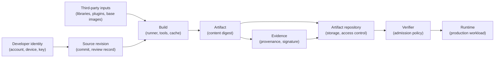

Read the diagram from left to right as a chain of custody. The source revision is trusted because of repository access control and review. Third-party inputs are trusted because of the registry they came from and the checks applied when they were resolved. The build is trusted because of the runner it executed on and the isolation of its caches and credentials. The artifact is identified by a content digest, which is a cryptographic hash of its bytes. The evidence binds that digest to claims about how it was made. The repository stores both. The verifier decides, at the moment of deployment, whether the evidence satisfies policy.

Two properties of this chain drive the rest of the chapter. First, every arrow is a place where content can be replaced, so every arrow needs a check that does not depend on the previous stage telling the truth. Second, the verifier is the only stage whose decision matters for production. Controls upstream reduce the probability of a bad artifact. The verifier determines whether a bad artifact can run.

### 2.2 Identity by digest, not by name

A name such as `payments-api:1.4.2` is a label that a person or a process can move to different content. A digest such as `sha256:` followed by 64 hexadecimal characters is derived from the content itself. If any bit of the artifact changes, the digest changes. Every control in this chapter depends on attaching claims to digests, because a claim attached to a mutable name can be silently reassigned to different content.

The same principle applies to inputs. A dependency requested as "any version at or above 2.1" resolves to different content on different days. A dependency requested as a specific version with an expected hash resolves to one content or fails. Pinning is the act of converting names into digests as early in the chain as practical.

### 2.3 Trust roots and control owners

For each stage, identify the trust root (the thing that is believed without further proof) and the owner who can change it.

| Stage | Trust root | Typical control owner | Evidence produced |
|---|---|---|---|
| Source | Repository access control and review rules | Engineering and platform teams | Commit identity, review record |
| Dependencies | Public or private package registry, plus the lockfile | Application team | Resolved versions and hashes |
| Build | Builder identity and runner isolation | Platform team | Provenance statement |
| Artifact | Content digest | Build system | Digest, signature |
| Repository | Access policy and immutability settings | Platform or registry team | Audit log, retention record |
| Deployment | Verification policy and the keys or identities it trusts | Security and platform teams | Admission decision log |

The table also shows a separation-of-duties goal. If the same team and the same credential can edit source, change the build, sign the result, and edit the verification policy, then the chain has one trust root in practice, and compromising that one root defeats every check. The design goal is that no single credential can both produce an artifact and make a verifier accept it.

### 2.4 What evidence can and cannot establish

A signature shows that the holder of a key, or the holder of an identity that a signing service verified, endorsed specific bytes. It does not show that the signer was authorized to release them, that the build was clean, or that the dependencies were safe. Provenance describes how an artifact was made, but a compromised builder can describe a clean process while running a dirty one. Evidence is only as trustworthy as the system that generated it, which is why the identity and isolation of the builder are themselves part of the model. The later sections on provenance and signing return to these limits with mechanism-level detail.

## 3. Threat Model

### 3.1 Attack points along the chain

A threat model for the supply chain starts from the same chain as the previous section and asks, for each stage, what an attacker who controls only that stage can accomplish and how cheaply.

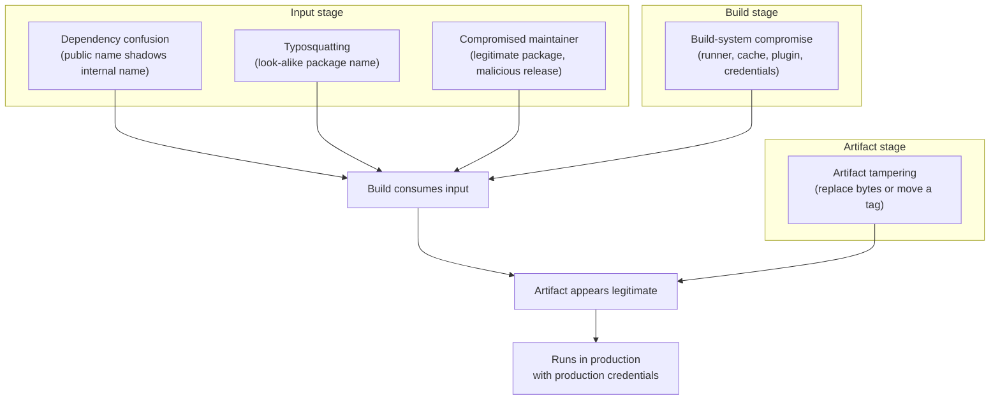

The diagram groups five attack classes by the stage they compromise. The first three corrupt inputs, so the build faithfully produces a malicious artifact from malicious material. The fourth corrupts the process, so even clean inputs yield a bad artifact. The fifth corrupts the output after the build, so a good artifact is replaced by a bad one. Two implications follow. Controls must exist at all three stages, because a perfect input control does nothing against tampering after the build. And every path ends at a workload that runs with the privileges the organization gave it, which is why the attacker's goal is usually to execute code inside the trusted pipeline or the trusted runtime, not to defeat the application's own logic.

### 3.2 Dependency confusion

Many organizations publish internal libraries to a private registry under names such as `acme-billing-utils`. A build that is configured to search both a private registry and a public one may choose between two packages that share a name. If the resolver prefers the highest version number, an attacker who registers `acme-billing-utils` on the public registry with version 99.0.0 wins the comparison against the internal version 1.8.0.

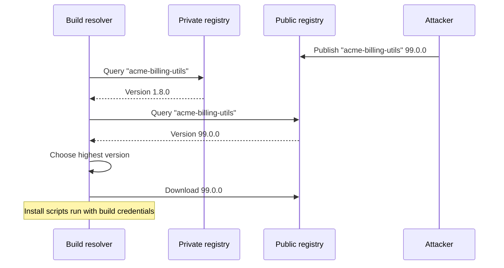

The attacker learned the internal name from a leaked manifest, an error message, a public repository, or a bundled front-end source map. The attacker did not need any credential. The vulnerability is in the resolver's merge rule. The defenses are structural: route internal names only to the private registry (scoped or namespaced packages, explicit per-package source mapping, or a single virtual repository that never forwards internal names to the public upstream), reserve the internal names on the public registry where the ecosystem allows, and install from a lockfile whose entries record the source and a content hash. Preferring the highest version across sources is the specific behavior to look for when reviewing tool configuration. How each package manager handles multiple sources differs by ecosystem and version, so verify the current behavior in the tool's documentation rather than assuming it.

### 3.3 Typosquatting and look-alike packages

Typosquatting registers a name close to a popular one, such as a transposed letter, a changed separator, or a plausible suffix, and relies on a human or a generated command typing the wrong name. A related variant targets names that an automated assistant or a copied snippet suggests but that do not exist, leaving the name free for an attacker to claim.

The attacker's cost is the price of registering a name, which is close to zero on most public registries. The defender's cost is review attention. The structural defenses are an allow-list or curated mirror so that only reviewed packages can be installed, a review step when a new direct dependency is added to a manifest, and an automated check that flags new dependencies with low age, low usage, or a name distance below a threshold from a well-known package. These checks reduce risk but do not eliminate it, because a package with a plausible name and a harmless first release can turn malicious in a later release.

Because the malicious code in many such packages runs at install time through lifecycle scripts, a build that disables or sandboxes install scripts reduces the damage of any one successful squat. Treat package installation scripts and build plugins as arbitrary code execution with whatever credentials are present in the environment.

### 3.4 Compromised maintainers and malicious releases

A legitimate package can become malicious without any change in its name or history. A maintainer's account is taken over through phishing, credential reuse, or a stolen publishing token. A maintainer hands the project to a new owner who is not what they seem. A maintainer is pressured or coerced. A contributor earns trust over months and then ships a harmful change. In each case the package is the right package, the registry shows the right name, and a signature check against the registry's own key passes.

The defender cannot detect this by checking who published the package, because the publisher is who the registry says it is. Available signals are indirect: a release without a matching tag or source change in the public repository, a sudden new install script or network call, a new maintainer on a stable package, a new version published outside the project's usual rhythm, and behavioral diffs between the previous and next version. The structural defense is limiting how quickly the organization ingests new versions (Section 4 shows the arithmetic), reviewing diffs of high-privilege dependencies, and limiting what a dependency can do even if malicious, through least-privilege build and runtime environments.

### 3.5 Build-system compromise

The build system holds an unusual combination of power. It can read source, fetch third-party code, write to the artifact repository, and often holds credentials for signing and deployment. An attacker who runs code on the builder can insert content into the output without touching source or dependencies.

Common paths include a pull request from an untrusted contributor that triggers a privileged workflow, a third-party build step or action that has been altered after it was approved, a cache populated by an untrusted job and reused by a privileged one, a long-lived runner that keeps files and credentials between jobs, and secrets exposed to steps that do not need them. The deeper problem is that a compromised builder can produce output and evidence that look correct. If the builder also signs, the signature adds no independent assurance, which is why the builder's identity, isolation, and lifetime are first-class controls in the sections that follow.

### 3.6 Artifact tampering

After the build, the artifact is stored, copied, promoted between environments, and pulled by a deployer. Tampering here means changing the bytes or changing which bytes a name refers to. An attacker with write access to the repository can overwrite a mutable tag so that `1.4.2` now points to different content, replace a file in a generic binary store, or inject a different image during promotion between environments. A mirror or proxy cache that stores artifacts without verifying them can serve stale or altered content.

The defense is that the deployer never trusts a name. It resolves the digest, checks that the digest has evidence tied to it, and refuses anything else. Immutable tags and repository write restrictions make tampering harder but do not replace verification, because an attacker who gains registry administrator rights can disable them.

### 3.7 The attacker's economics

An attacker chooses the cheapest stage that reaches the target. Registering a look-alike name costs almost nothing but reaches only those who mistype. Taking over one popular package costs more but reaches thousands of builds. Compromising a shared builder or a widely used build step reaches every artifact it produces. Defense effort should follow the same logic: the highest-impact controls protect the components that many artifacts share, which are the builder, the signing identity, and the verification policy, and the cheapest wide-reach controls limit what unreviewed inputs can enter at all.

## 4. Constraining Dependencies

### 4.1 What a manifest does not tell you

A manifest declares intent: "I need library X at a compatible version." A lockfile records the outcome of resolving that intent: the exact version of every direct and transitive package, where it came from, and a hash of the downloaded content. The same manifest produces different resolutions on different days when ranges are used, because new versions appear. A build without a lockfile is therefore not a repeatable function of the repository.

A lockfile entry for the Node.js ecosystem has this shape, with the digest shown as a placeholder:

```json
{
  "node_modules/example-lib": {
    "version": "2.1.4",
    "resolved": "https://registry.example.org/example-lib/-/example-lib-2.1.4.tgz",
    "integrity": "sha512-<base64 digest of the package archive>"
  }
}
```

Three fields matter. The version fixes which release is used. The `resolved` location records which registry served it, which defeats a silent switch between sources. The `integrity` value is a Subresource Integrity (SRI) style hash that the installer compares with the downloaded bytes, so a registry that serves different content under the same version number produces a failure. Other ecosystems have equivalent mechanisms with different file names and syntax. In Python, a requirements file can carry per-package hashes and the installer can be told to require them. Go records module hashes in a checksum file and consults a checksum database by default. Verify the current flags and behavior for your toolchain.

### 4.2 Install from the lockfile, and fail on drift

A lockfile has no effect if the build ignores it. Use the installer's strict mode, which installs exactly what the lockfile specifies and fails if the lockfile and manifest disagree, rather than the mode that resolves and rewrites. In a pipeline this looks like the following fragment, which is illustrative and should be checked against the current action and tool documentation:

```yaml
jobs:
  build:
    runs-on: ubuntu-latest
    permissions:
      contents: read
    steps:
      - uses: actions/checkout@<40-character commit SHA>
      - uses: actions/setup-node@<40-character commit SHA>
        with:
          node-version-file: .nvmrc
      - run: npm ci --ignore-scripts
      - run: npm run build
```

Three details carry the security value. `permissions: contents: read` limits the token the job receives. Referencing third-party steps by full commit hash instead of a movable tag means the step's code cannot change under the pipeline without a reviewed edit. `npm ci` installs from the lockfile and fails on a mismatch, and `--ignore-scripts` stops dependency lifecycle scripts from running during install. The last flag can break packages that legitimately need a build step, so it is a decision with a cost, not a default to apply blindly.

### 4.3 Worked scenario: how many accounts can change your release

This worked example uses assumed numbers, labelled illustrative, to show how to reason about exposure.

A service declares 12 direct dependencies. Resolving them yields 240 distinct packages once transitive dependencies are included. That is an average of 240 / 12 = 20 resolved packages per direct dependency, counting shared ones once. Suppose each package is published and controlled by one maintainer account on average, so about 240 accounts, plus the registry itself, can influence what the build ingests.

Now consider update behavior. Suppose, as an assumption, each package releases a new version with probability 0.05 in a given week. Then the expected number of new versions in a week is 240 × 0.05 = 12. A build that resolves ranges at build time and runs weekly ingests about 12 unreviewed new versions per week, or 12 × 52 = 624 per year.

Suppose also that the probability a given new version is malicious is 0.0001. This is an invented figure chosen only for the arithmetic, not a measurement. The expected number of malicious versions ingested per year is 624 × 0.0001 = 0.0624, about a 6% chance per year in this model.

Now pin with a lockfile and accept updates through reviewed batches. Suppose the team accepts only security fixes and needed features, 25% of releases. Then 624 × 0.25 = 156 versions are ingested per year, and the expected malicious count is 156 × 0.0001 = 0.0156, about 1.6%. Review also gives the team a chance to catch a malicious version, so the real exposure is lower than this ingestion arithmetic shows.

The model is crude, but its structure is useful. Exposure is proportional to the number of unreviewed versions entering builds, so the levers are the number of packages (reduce dependencies), the acceptance rate (batch and review updates), and the speed of ingestion (a cooling-off period before adopting a new release gives the community time to find problems). Note the cost side: a lockfile also delays security fixes for known vulnerabilities, so the policy needs a fast path for fixes with an owner and a service-level target.

### 4.4 Vendoring and private mirrors

Vendoring copies dependency source into the repository, so the build needs no external fetch. A private mirror or proxy does the same at the registry level. They differ in what they give.

| Option | What it gives | What it costs | Choose it when |
|---|---|---|---|
| Lockfile with hashes | Repeatable resolution, detects content change under same version | Still depends on the registry being available at build time | Default for most services |
| Vendoring | Source is reviewable in code review, build works offline, upstream deletion cannot break it | Large diffs, manual or tooled update work, license and patch bookkeeping | Critical components, air-gapped builds, or when upstream removal is a business risk |
| Private mirror with allow-list | Central policy and caching, one place to block a bad version | Another service to operate and to secure | Many teams share dependencies |
| Unpinned ranges | None beyond convenience | Unreviewed ingestion, non-repeatable builds | Prototypes only |

The reason to prefer a lockfile as the default is cost against benefit. It captures most of the integrity benefit at near-zero operational cost. Vendoring is chosen when the added review benefit justifies the update burden, because reviewing a diff of vendored source catches a malicious change that a hash check cannot. A hash proves the content is what the lockfile says, but the lockfile was generated from whatever the registry served on the day of the update.

### 4.5 Failure modes and edge cases

Lockfile hashes protect only what was hashed. A first resolution that already included a malicious version records that version's hash faithfully. Lockfile updates are therefore a review point, not a mechanical step: reviewers should see the list of changed packages and source locations in the diff. Lockfiles generated on one platform may omit platform-specific packages that appear on another, so check how the tool handles that. Optional or development dependencies may be excluded from verification in production builds but still run in the build. Git or URL dependencies that point to a branch name, not a commit, bypass the pinning that registry versions provide. A mirror that is configured to fall back to the public registry on a miss reintroduces dependency confusion. Each of these is worth checking in a review.

## 5. Build Integrity: Hermetic and Reproducible Builds

### 5.1 Two different guarantees

A hermetic build is one whose inputs are fully declared and made available before the build starts, and which has no access to anything else while it runs. In particular it cannot reach the network to fetch undeclared material. A reproducible build is one where building the same source with the same declared inputs produces bit-for-bit identical output, regardless of who builds it or when.

These are different properties. A build can be hermetic and not reproducible, for example when it embeds a timestamp or sorts files in filesystem order. A build can be reproducible in practice and not hermetic, when it happens to fetch the same bytes from a stable server. Hermeticity controls what can influence the build. Reproducibility lets a second party check the result.

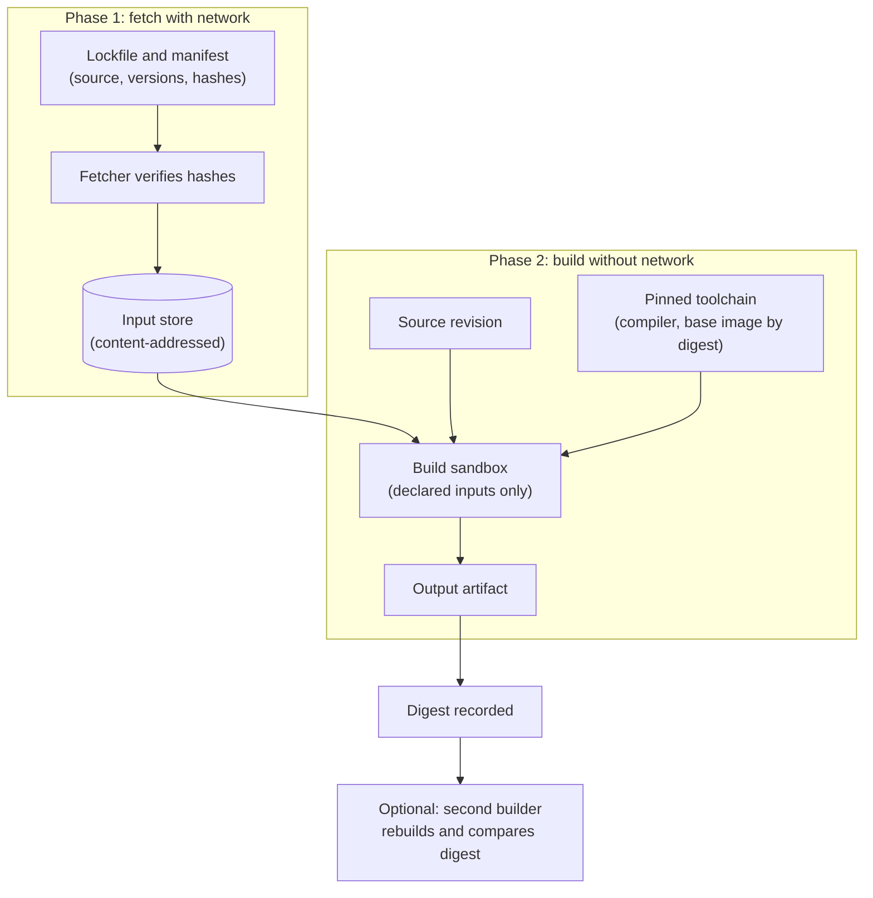

The diagram splits the build into a fetch phase and a build phase. In the fetch phase, a component with network access resolves every input listed in the lockfile and verifies each hash. In the build phase, the sandbox has no network and sees only the verified input store, the source revision, and the pinned toolchain. If the build tries to read anything else, it fails. The implication is that an attacker who controls a remote server cannot influence the build after the fetch phase, and a build step that quietly downloads a script at compile time is caught instead of trusted. The optional second builder gives a second opinion on the output digest.

### 5.2 What breaks reproducibility

Common sources of difference are timestamps embedded in archives and binaries, file ordering that depends on the filesystem, absolute paths of the build directory embedded in debug data, random identifiers, locale and timezone, parallelism that changes output order, and tool versions that differ between builders. The usual fixes are to normalize timestamps to a value derived from the source revision, sort inputs explicitly, build in a fixed path, pin the toolchain by digest, and strip nondeterministic metadata. Some ecosystems have tool support and conventions for this. The Reproducible Builds project documents common techniques and a standard environment variable for the timestamp; check its current documentation before relying on specifics.

Container image builds add their own issues. Base image tags move, package manager commands inside a build fetch current versions, and layer metadata includes creation times. Pinning the base image by digest and installing packages from a pinned snapshot or lockfile addresses the first two. Tooling for reproducible layer metadata exists, but support varies, so verify what your build tool offers. Container runtime isolation is out of scope here and belongs to [CH14 Container Security](CH14_Container_Security.md).

### 5.3 Why reproducibility helps against a compromised builder

If one builder is compromised, its output and its claims about its output cannot be trusted. If a second, independent builder with a different operator and credentials rebuilds the same source and gets the same digest, the attacker would have to compromise both. When digests differ, the difference is a signal to investigate: either the build is not yet reproducible, or one builder produced something unexpected. The cost is that reproducibility takes engineering effort to achieve and maintain, and independent rebuilding doubles build compute for the artifacts that are checked. Many organizations therefore apply it to a few high-value artifacts, such as shared base images and release binaries, not to every service.

### 5.4 Build isolation: separating trust domains

Hermeticity limits inputs. Isolation limits who and what shares the build environment. The key rule is that untrusted code and privileged credentials must not meet. A pull request from outside the trust boundary can run tests in an environment with no secrets, no write access to the repository, and no access to caches that privileged jobs read. A release job runs only on protected branches or tags, on an ephemeral runner created for that job and destroyed after it, with credentials scoped to what it must do and issued short-lived through the platform's workload identity feature where available, not stored as long-lived secrets.

Build caches deserve specific attention, because they are an input that is not in the lockfile. A cache key that an untrusted job can write and a privileged job can read lets the untrusted job place content into the release build. The fix is separate cache namespaces per trust level, with the privileged namespace written only by privileged jobs. Network egress controls on the build, such as allowing only the internal mirror, make a hermetic design enforceable and also limit data exfiltration if a step is compromised. Pipeline mechanics and runner configuration belong to [Part 13 CH02 CI/CD](../13_DevOps/CH02_CI_CD.md), and the security gates that wrap them belong to [CH13 Secure SDLC](CH13_Secure_SDLC.md).

### 5.5 Edge cases

Hermetic builds are hard for ecosystems whose tools fetch dependencies during compilation, so the fetch phase must be taught to run those tools in a download-only mode, or the dependencies must be vendored. A reproducible build that depends on a compiler update will change digest when the compiler changes, which is correct behavior but surprising to teams who treat a digest change as a signal of compromise. Record the toolchain digest next to the output digest so a difference can be explained. Finally, a hermetic builder is still a trusted component. It prevents undeclared inputs but does not detect a malicious declared input, which is why the dependency controls of the previous section and the provenance mechanisms in the next sections complement it.

## 6. Provenance and Attestations

### 6.1 What provenance claims

Provenance is a record of how an artifact was produced: which source revision, which build definition, which builder, which external parameters, and which resolved inputs. It answers the question a verifier cannot answer from the bytes alone. Given a digest, who made it, from what, and by what process?

An attestation is a signed statement about an artifact. Provenance is one kind of attestation. Others state that a vulnerability scan ran, that tests passed, or that a review took place. The common format used for these statements is the in-toto attestation framework. In-toto is the name of a project that defines the statement layout, not an acronym used here. A statement has three parts: a subject (the artifact, identified by name and digest), a predicate type (a URI that says what kind of claim follows), and the predicate itself (the claim).

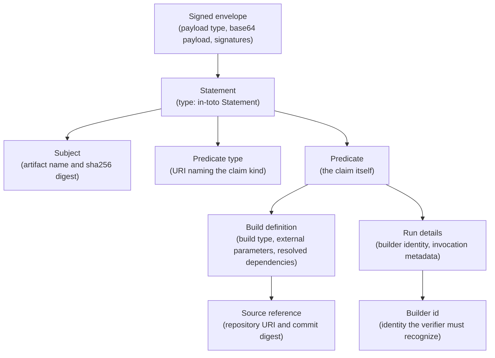

The diagram shows why a verifier needs several checks, not one. The signature covers the envelope, so it proves who vouched for the statement. The subject digest ties the statement to specific bytes, so a statement cannot be reused for a different artifact. The predicate carries the claims a policy can test: the source repository and commit, and the builder identity. The implication is that verification has to compare each of these with expectations the verifier holds independently. A statement whose signature is valid but whose source repository is not the expected one must be rejected.

A trimmed provenance statement has this shape. Field names follow the published in-toto and Supply-chain Levels for Software Artifacts (SLSA) provenance formats as the author understands them at the time of writing, and values are placeholders. Verify against the current specifications before relying on exact names.

```json
{
  "_type": "https://in-toto.io/Statement/v1",
  "subject": [
    { "name": "registry.example.org/payments-api",
      "digest": { "sha256": "<64 hex characters>" } }
  ],
  "predicateType": "https://slsa.dev/provenance/v1",
  "predicate": {
    "buildDefinition": {
      "buildType": "<URI describing the build process type>",
      "externalParameters": { "repository": "https://git.example.org/acme/payments-api",
                              "ref": "refs/tags/v1.4.2" },
      "resolvedDependencies": [
        { "uri": "git+https://git.example.org/acme/payments-api",
          "digest": { "gitCommit": "<40 hex characters>" } }
      ]
    },
    "runDetails": {
      "builder": { "id": "<URI identifying the builder>" },
      "metadata": { "invocationId": "<build run identifier>" }
    }
  }
}
```

The envelope that wraps the statement is commonly the Dead Simple Signing Envelope (DSSE). It signs the payload together with a declared payload type, so a signature made over one kind of content cannot be replayed as another. The statement is stored next to the artifact in the repository, or attached to its digest, and found by digest.

### 6.2 Where the claims come from

A provenance claim is only as strong as its author. If the build steps themselves write the statement, then a compromised step can write any claim. The stronger design has the build platform generate the statement from facts the platform observed, such as the workflow definition it loaded and the commit it checked out, and sign it with an identity the build steps cannot reach. The user-controlled build script supplies the artifact digest and little else. This is the central reason the build platform, not the application team's script, is the party whose identity a verifier should trust for provenance.

Claims fall into two groups. Observed claims are facts the platform saw directly, such as the builder identity and the source commit. Declared claims come from a configuration the author wrote, such as a free-text build parameter or a list of dependencies reported by the build script. A policy should rely on observed claims for decisions and treat declared claims as information.

### 6.3 SLSA build levels, described carefully

SLSA is a framework published as a specification, with a build track that grades how much a consumer can trust a build's provenance. The version 1.0 build track, as the author understands it at the time of writing, has levels numbered from 1 to 3, and the specification describes levels in terms of the producer and the build platform. Verify current level definitions at the source before using them in a contract or a policy.

| Level | What it requires, in summary | What it helps defend against | What it does not defend against |
|---|---|---|---|
| Build L1 | Provenance exists and describes how the artifact was built | Accidental mistakes, and lack of any record to investigate | A producer who writes false provenance, since nothing prevents forging it |
| Build L2 | A hosted build platform generates and signs the provenance | Tampering with provenance after the build, and forgery by a developer outside the platform | A build step that compromises the platform's output, since the platform runs user-defined steps |
| Build L3 | A hardened platform isolates builds from each other and keeps signing material away from build steps | Cross-build influence such as cache poisoning by one build into another, and a build step extracting the signing key | Malicious source that was reviewed and merged, malicious dependencies, and compromise of the platform operator |

Three cautions apply. First, a level describes the build platform's properties and the provenance it emits. It says nothing about whether the source or dependencies are safe. A Build L3 artifact built from a malicious dependency has accurate provenance for a malicious artifact. Second, a level claim is only meaningful if a verifier checks the provenance against a policy. An artifact labelled with a level and never verified provides nothing at deployment. Third, the framework has other tracks and parts, such as source and dependency tracks in later or draft versions. Check what is published and stable before depending on them.

The practical reading for an architect is a ladder of questions. At L1, can I find out how this was built? At L2, can I be sure the record was produced by the platform and not by the author? At L3, can I be sure one build could not have influenced another or the platform's signing identity? Choose the level by the threat you must defend. A team whose main risk is a developer pushing an unreviewed binary needs L2 and a verifier. A team with shared multi-tenant runners and release signing needs the L3 properties.

## 7. Signing and Verification

### 7.1 Key-based signing

In key-based signing, a team generates an asymmetric key pair. The private key signs the artifact digest or an attestation, and the public key is distributed to every verifier. The mechanism is simple and works offline. The difficulty is key custody. Whoever can use the private key can sign anything, and a verifier that trusts the public key cannot tell a legitimate use from a stolen one. The private key therefore belongs in a managed Key Management Service (KMS) or Hardware Security Module (HSM) so it is never exported, with access limited to the release identity. Verifiers need a way to learn which public keys are current, which means a distribution channel and a rotation procedure. If a key is compromised, every artifact it signed becomes suspect and every verifier must stop trusting it, which requires that verifiers can update their trusted set quickly.

### 7.2 Keyless signing and certificate identity binding

Keyless signing, as implemented by the Sigstore project and its `cosign` tool, removes the long-lived private key. Instead the signer proves who it is at signing time and receives a short-lived certificate that binds a fresh public key to that identity.

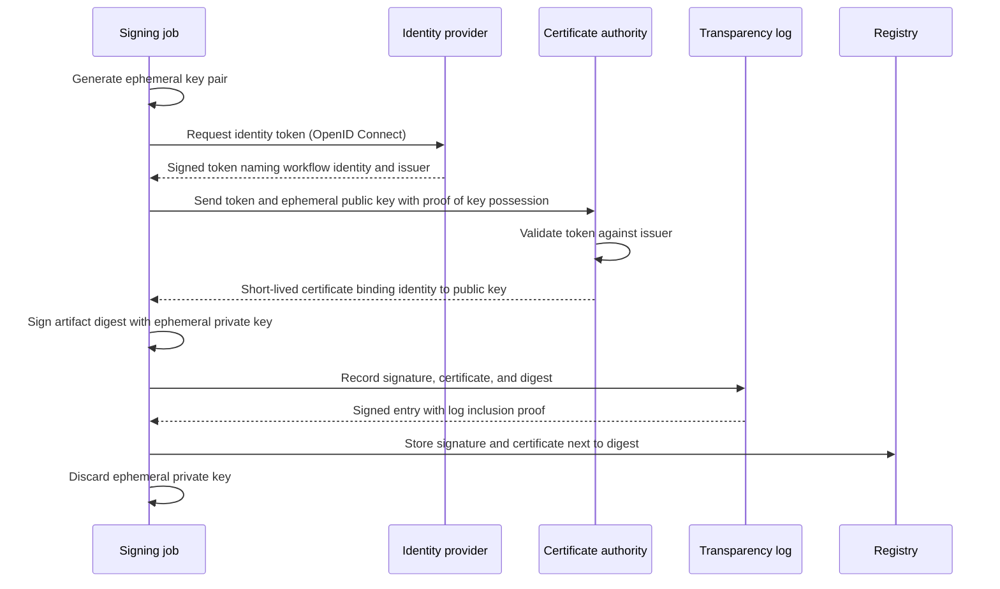

The identity provider here is an OpenID Connect (OIDC) issuer, often the CI platform itself, which issues a token stating which repository, workflow, and reference is running. The certificate authority (in Sigstore, a component called Fulcio) checks the token with the issuer and issues a certificate that lasts minutes. The certificate carries the identity as a subject alternative name and the issuer as an extension. The ephemeral private key is discarded after one signature. There is nothing to steal later.

The implication is a change in what a verifier trusts. A key-based verifier trusts a key. A keyless verifier trusts a statement of the form "an identity matching this pattern, issued by this issuer, signed this digest." The signature is valid only if the certificate chain leads to the trusted authority and the identity in the certificate matches the policy. This identity binding is the control. A verifier that accepts any valid Sigstore signature, without checking the identity, accepts signatures from anyone who can obtain a certificate, including attackers with their own accounts.

### 7.3 The transparency log

Certificates last minutes, so by the time anyone verifies, the certificate has expired. The verifier needs proof that the signature was made while the certificate was valid. The transparency log provides it. It is an append-only, publicly auditable log (in Sigstore, a service called Rekor) that records each signing event. The log returns a signed timestamped entry with an inclusion proof. A verifier checks the proof, learns the signature existed within the certificate validity window, and accepts the expired certificate for that moment.

The log has a second role as detection. Because every signing event for an identity appears in an append-only record, the owner of an identity can monitor the log for signatures they did not make. A signature produced by a stolen CI token cannot be hidden from log monitoring if the verifier requires log inclusion. The trade-offs are three. Public logs expose metadata such as repository names and identities, which some organizations cannot publish, so a private deployment of the infrastructure or key-based signing may fit. The log is a dependency, so verifiers need an availability plan, such as bundled inclusion proofs that allow offline checks. And monitoring only detects, so someone must own the alert and the response.

### 7.4 Verification policy

A signature check yields a yes or no about cryptography. A policy turns it into a decision about the organization. At minimum a verification policy states:

- The digest being evaluated, never a tag.
- The accepted signer: for keyless, the identity pattern and the issuer; for key-based, the specific public key or KMS key reference.
- Whether log inclusion is required.
- The accepted attestation types and, for provenance, the expected source repository, reference pattern, and builder identity.
- What happens on failure: deny, warn, or audit-only, and who can grant an exception.

A command-line check with `cosign` for a keyless signature looks like this. The flags reflect the tool as the author knows it at the time of writing, so check the current documentation.

```bash
cosign verify \
  --certificate-identity "https://git.example.org/acme/payments-api/.github/workflows/release.yml@refs/tags/v1.4.2" \
  --certificate-oidc-issuer "https://token.actions.example.org" \
  registry.example.org/payments-api@sha256:<64 hex characters>
```

The identity here is an exact string naming one workflow at one tag. A looser regular-expression variant is available for tools that support one, and looseness is a decision with a security cost: a pattern that matches every workflow in the organization trusts every workflow author in it, including a contributor who adds a new workflow file. Prefer the narrowest identity that matches your release process, and protect the workflow file itself with review rules, because the workflow path is now part of the trust root.

Key-based and keyless signing also differ in how they handle revocation. A key-based deployment revokes by removing the key from verifiers. A keyless deployment has no long-lived key to revoke, so containment relies on changing the identity policy, on rejecting artifacts whose log entries fall in a suspect time window, and on fixing the compromised identity source. State which of these applies before an incident, not during one.

## 8. Verifying at Deployment and Admission

### 8.1 Where the decision happens

Signing and provenance have no effect until something refuses to run an artifact that fails them. The refusal point is the deployer, which in a cluster is the admission controller. The mechanics of admission control, including webhook ordering, failure policy, and what a controller can and cannot see, are covered in [CH14 Container Security](CH14_Container_Security.md). This section covers what the policy must decide.

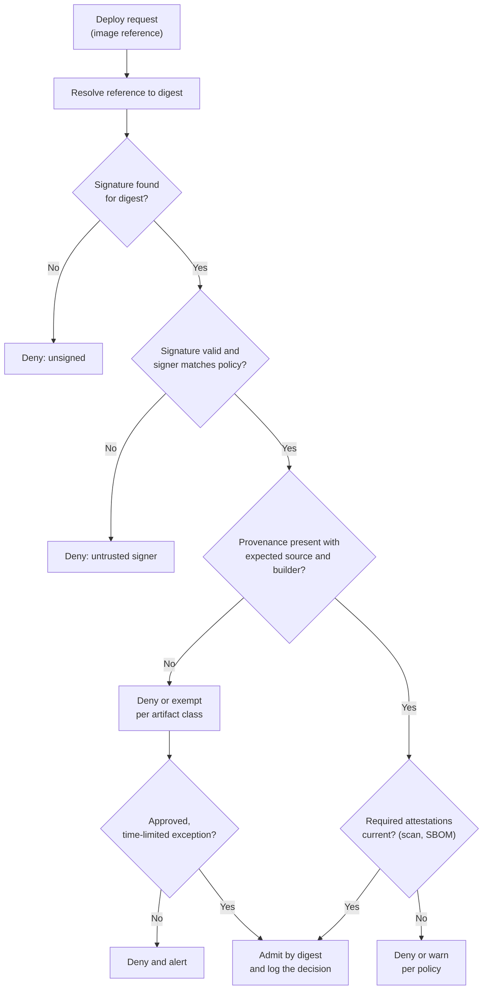

The diagram orders checks from cheapest and most fundamental to most policy-specific. Resolution to a digest comes first, because every later claim is about a digest. Signature validity and signer identity come next, because they decide whose statements count. Provenance and other attestations then test claims about the artifact. The implication is that a missing item and an invalid item are different failures and need different responses. A missing signature on a third-party base image the organization never builds may be an exception class, while a missing signature on an internally built service is a deny. Exceptions need an owner, a reason, and an expiry, and they are logged as decisions so that auditors and incident responders can see what was admitted without evidence.

### 8.2 Resolve by digest, and admit by digest

A pod specification that names `payments-api:1.4.2` can resolve to different content between the policy check and the image pull. The safe pattern is that the admission step resolves the tag to a digest, verifies that digest, and rewrites the workload to reference the digest, so that the runtime pulls exactly what was verified. A deployment manifest that already pins the digest removes the window. The policy should deny tag-only references in production namespaces, and the delivery pipeline should write digests into manifests at promotion time.

### 8.3 Failure policy and availability

A verifier is a dependency of every deployment. If it is unreachable and set to fail open, an attacker who can disrupt it can deploy unverified content. If it fails closed, an outage of the verifier or of the signature log blocks every deploy, including the one that fixes the outage. Reasonable designs fail closed for production namespaces, cache verification results by digest so a repeat deployment of verified content does not need the network, use bundled signature material so that checks do not need a live log call, and keep a break-glass path that is audited and alerts a human. Decide the policy while calm and test it with a deliberately failing verifier.

### 8.4 Admission is not the only check

Admission verifies at the moment of creation. A workload verified last month keeps running after a signing identity is found to be compromised, so the platform also needs a periodic re-evaluation that lists running digests and re-checks them against the current policy and against known-bad lists. Pre-deployment checks in the pipeline give fast feedback to developers. They do not replace the runtime decision, because a pipeline can be bypassed by an actor who deploys directly. Detail on image policy in the cluster belongs to CH14, and the pipeline gate placement belongs to [CH13 Secure SDLC](CH13_Secure_SDLC.md).

## 9. Registries and Artifact Repositories

Registry storage products belong to [Part 09 CH07 Containers](../09_Cloud_Computing/CH07_Containers.md). This section covers the security properties an architect requires from any repository, container or package.

### 9.1 Immutability

A repository can let a name be re-pointed or let content be overwritten. Immutability settings forbid that. Where the product offers tag immutability, a tag such as `1.4.2` can be written once, so a later push of different content under the same tag fails. Package repositories commonly have a similar rule that a published version cannot be replaced, and some allow a version to be deleted or marked unavailable, which is different from replacement. Check three things for each repository: whether overwrite is forbidden, whether deletion is allowed and by whom, and whether the deleted name can be reused with new content. Reuse after deletion defeats immutability.

Immutability protects against accidents and low-privilege tampering. It does not protect against an administrator who can change the setting, so the setting should be governed by the same separation-of-duties rule as signing: the identity that pushes artifacts cannot change the repository policy.

### 9.2 Separate repositories by trust level and promote

A single repository that receives untrusted pull request builds, release builds, and third-party mirrors cannot express different trust in each. Use separate repositories, or separate namespaces with separate permissions, for each level, and move artifacts between them by promotion.

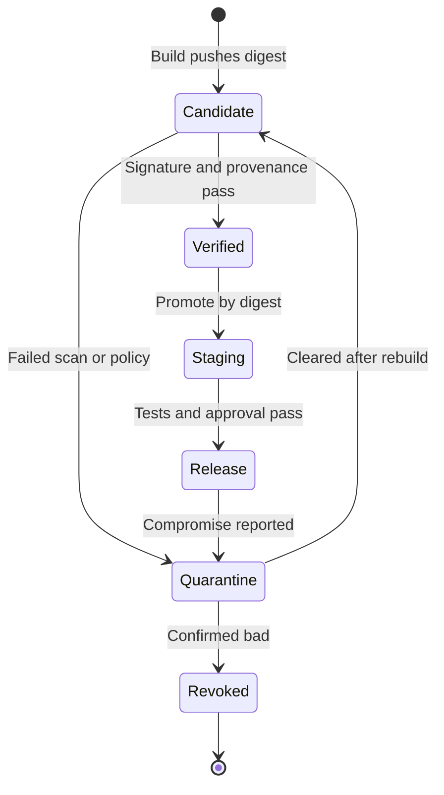

The diagram treats an artifact as moving through states, and each transition is a decision with evidence. Candidate artifacts have no standing. Verification gates entry to the promoted path, and the production deployer reads only from the release repository. Quarantine is reachable from two states, including from release, which is the important edge: an artifact already published must be pullable for investigation but blocked for deployment, without being deleted, because deletion destroys the evidence and can break rollback to a different good version.

Promotion must preserve identity. Copying by digest keeps the same digest in the destination, so signatures and attestations that reference that digest remain valid, though tools differ in whether they copy attached signatures automatically. Rebuilding for each environment produces a different digest and breaks the chain, so build once and promote. Verify that the signature and attestation arrive with the artifact in the destination, then verify again there.

### 9.3 Quarantine

Quarantine is an explicit holding state with these properties: deployers cannot pull from it, a small group can read it for analysis, it records why and when an artifact entered it, and leaving it requires a recorded decision. Implement it as a repository or a metadata state, depending on the product. Quarantine also applies on the way in. New third-party versions can land in a holding repository, be scanned and checked for age and provenance, and then be promoted into the repository builds consume. This is the mechanism that implements the cooling-off period described in the next section.

### 9.4 Mirrors and proxy caches

A proxy cache, also called a remote or upstream repository, fetches from a public registry on demand and stores a copy. A mirror pre-populates selected content. Both give central control: one place to block a bad version, to keep a copy if upstream deletes it, and to cut build traffic. They also add risks that must be configured away.

- Fallthrough: a virtual repository that merges private and public sources may serve a public package for an internal name, which is dependency confusion at the repository layer. Configure internal namespaces to resolve only from private sources.
- Stale or unverified content: a cache may keep serving a version after upstream removes it for security reasons. Check how the product handles removal, and subscribe to advisory feeds so that the cache is purged deliberately.
- Credential reach: the cache holds credentials to the upstream and write access to its own store. Treat it as a high-value system with its own access control and audit logs.
- Verification: a cache that stores what it received without checking hashes or signatures against upstream metadata passes on whatever it was served. Where the ecosystem offers upstream signatures or checksum databases, verify at ingest.

### 9.5 Retention and audit

Retention affects incident response in two ways. Deleting old artifacts too eagerly removes the digests an investigation needs to match against SBOMs and logs. Keeping everything indefinitely accumulates vulnerable images that someone may redeploy. A workable rule retains release artifacts, their attestations, and their SBOMs for at least the period for which a deployment can still be rolled back to them, and for the audit period the organization owes, while pruning candidate builds quickly. Repository audit logs should record pushes, deletes, policy changes, and permission changes, and should be sent to a log store the repository administrators cannot edit.

## 10. Dependency Update Strategy

### 10.1 Classes of update tooling

Update tools keep dependencies current by opening change requests when new versions appear. Dependabot and Renovate are two well-known examples, and the useful way to compare tools is by class of capability, since products change.

| Class | What it does | Security consequence |
|---|---|---|
| Version-bump bots | Detect new versions in manifests and lockfiles, open one change per update or per group | Make every ingestion a reviewable diff, and make the lockfile change visible |
| Advisory-driven alerting | Match resolved versions against vulnerability advisories and open fix changes | Shortens exposure to known vulnerabilities, with no help against unknown malicious releases |
| Grouping and scheduling | Batch patch and minor updates, run on a schedule, limit open changes | Cuts review load and sets cadence |
| Release-age gating | Delay adoption until a version is a set number of days old | Implements the cooling-off period |
| Automerge with checks | Merge low-risk updates when tests pass | Fast, but removes human review, so restrict to classes where the risk is understood |
| Pin-to-digest helpers | Update commit hashes of build steps and image digests | Keeps pinned references from going stale |

Feature names and configuration differ by tool and version, so verify in the current documentation which of these a given tool supports.

### 10.2 Cadence arithmetic

The tension is between two risks. Updating slowly leaves known vulnerabilities in production. Updating instantly ingests whatever was just published. This worked example reuses the assumptions of the earlier exposure scenario, all illustrative.

The service resolves 240 packages. Each releases a new version with probability 0.05 per week, so 12 new versions arrive weekly. Assume a review cost of 15 minutes per individually reviewed update.

- Per-update changes, reviewed individually: 12 × 15 = 180 minutes per week, 3 hours.
- Grouped weekly changes of patch and minor versions only, assuming 9 of the 12 are patch or minor and form one grouped change at 30 minutes, with the remaining 3 major updates at 15 minutes each: 30 + 3 × 15 = 75 minutes per week.
- Release-age gating of 7 days on top of grouping: the same 75 minutes, but every version is at least a week old when it enters a build.

Now the benefit of the gate. Assume, as an illustrative figure and not a measurement, that 70% of malicious versions are detected and withdrawn within 3 days of publication, and 90% within 7 days. A build that ingests immediately sees close to all malicious versions that exist when it runs. A 7-day gate leaves 10% still live at ingestion, so exposure falls to 0.10 of its former value, a 90% reduction under these assumptions. Combined with the earlier acceptance-rate arithmetic, the expected malicious ingestions per year become 0.0156 × 0.10 = 0.00156 under the stated model.

The cost of the gate is the delay for security fixes. Handle that with a documented fast path: an advisory-driven change for a known vulnerability bypasses the age gate once a person confirms the fix version, while ordinary feature updates wait. Set the service-level target for the fast path by severity, for example days for critical advisories in internet-facing components, and measure it.

### 10.3 What to review in an update

Review is most valuable when it is targeted. Look at the lockfile diff for new packages and for changed source locations. Check whether the new version adds install scripts, network calls, or new maintainers. Compare the published package contents to the tagged source when the project allows it, because a release with no matching source change deserves a question. For high-privilege dependencies, such as build plugins, authentication libraries, and anything running with deployment credentials, read the diff. For leaf utilities with narrow privileges, rely on tests and the cooling-off period.

### 10.4 Keep what you cannot update visible

Some dependencies cannot be updated quickly: abandoned projects, vendored forks, and libraries tied to a certification. Record them, with an owner and a compensating control such as isolation or a wrapper that narrows its privileges, so that the list is a decision and not an accident. The inventory data for this belongs to [CH16 SBOM](CH16_SBOM.md).

## 11. Incident Response for a Compromised Dependency

### 11.1 The response path

When a dependency is reported compromised, the response is a sequence that rests on evidence collected earlier. If the evidence does not exist, the response becomes guesswork.

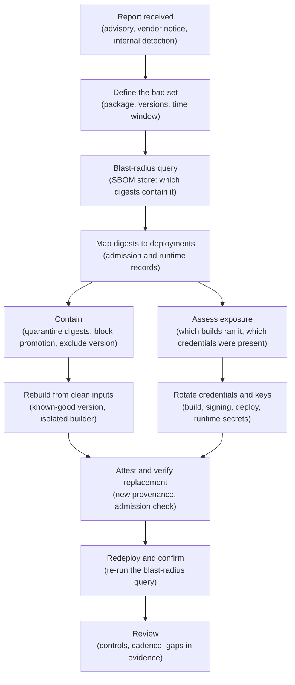

The diagram shows two parallel branches after the deployment map. One branch handles artifacts, which are contained, rebuilt, and verified. The other handles secrets, which are assessed and rotated. They are separate because a malicious dependency that ran during a build may have stolen credentials even if the resulting artifact is clean, and a rebuilt artifact does nothing about a stolen token. The implication is that closure requires both branches and a final repeat of the query to show that the bad component is gone from everything deployed.

### 11.2 Blast-radius query

The query starts from component identity. Component identification formats, generation, and search belong to [CH16 SBOM](CH16_SBOM.md). Here the architect needs the property that the query runs in minutes against stored data and does not depend on rebuilding or rescanning. Two joins are needed: component to artifact digest, using the SBOM stored per digest at build time, and digest to deployment, using admission and runtime records of what ran where and when. In pseudocode:

```sql
SELECT d.environment, d.workload, d.digest, d.first_seen, d.last_seen
FROM sbom_component c
JOIN deployment d ON d.digest = c.artifact_digest
WHERE c.package = 'example-lib'
  AND c.version IN ('2.1.4');
```

Two cautions apply. The query finds only what the SBOM recorded, so components embedded outside package manager metadata, such as copied source files, are missed unless the generator captured them. And dependency paths matter: a transitive dependency appears in the SBOM only if the tool resolved the full graph. Record the confidence of the answer in the incident log.

### 11.3 Worked scenario

This scenario is illustrative. A malicious version 2.1.4 of `example-lib` was published at 09:00 on day 0 and withdrawn by the registry at 15:00 on day 1, so the live window is 30 hours.

- The organization has 400 distinct deployed digests. The SBOM query returns 37 digests containing `example-lib` at 2.1.4.
- Of those, 9 are in production and 28 are in staging or test environments. The production share is 9 / 37 = 24%.
- Builds ran at an average of 14 per day across the affected pipelines. Builds that could have resolved the bad version during the 30-hour window: 14 × 30 / 24 = 17.5, so assume 18.
- Those 18 build executions ran with the build environment's credentials, so all 18 are in scope for credential rotation, plus any runner with persistent state used in them.

Rollback is the first containment step. If each of the 9 production workloads has a previous verified digest, redeploy it by digest. Where the previous digest also contains a bad version, which the query would show, roll back to the last digest outside the bad set. At an assumed rollout rate of 3 workloads per minute, 9 workloads take 3 minutes, so decision and approval steps, not the rollout, set the time to contain. Quarantining the 37 digests prevents anyone from redeploying them in the meantime. Then rebuild all 37 from a lockfile pinned to the last clean version, producing new digests with fresh provenance.

### 11.4 Key and credential rotation

Rotate by what the compromised code could reach. Build-time secrets present in the 18 builds are the first set. Include registry push tokens, package publishing tokens, cloud deployment roles, and any signing credential accessible to the build. Prefer short-lived workload identity credentials, which expire on their own, and revoke or rotate any long-lived ones. If a signing key could have been read by the malicious code, treat every signature made with it since exposure as suspect, rotate the key, and publish the new trust anchor to verifiers through a channel that does not depend on the old key. For keyless signing, rotation maps to tightening the identity policy and examining log entries during the window for signatures the owner did not expect. Runtime secrets matter too if the malicious code ran in production: rotate the secrets that those 9 workloads could read, and review their outbound network logs for the window.

### 11.5 Preserve evidence and communicate

Preserve the quarantined artifacts, build logs, SBOMs, and admission records before pruning or cleanup. Run the investigation from a trusted path that does not rely on the compromised system, such as a separate analysis account. Notify affected downstream consumers if the organization publishes software, and notify the registry and package owner with technical details. Customer notification duties depend on law and contracts, so involve the responsible teams early.

## 12. Third-Party and Vendor Risk

### 12.1 What counts as a third party

The chain includes organizations that are not library authors: a hosted CI service, a package registry, an identity provider, a vendor that supplies compiled binaries or an agent, a managed build tool, and a contractor with repository access. Each holds one of the trust roots from Section 2.3. Vendor risk at the architecture level is therefore the question of what each vendor can change in your chain and what evidence you can obtain without trusting them.

### 12.2 Tiering by privilege and substitutability

Tier third parties by two attributes: the privilege they have in your chain, and how replaceable they are. A vendor whose software runs in your production network with high privilege, or whose service signs or builds your artifacts, is in the highest tier. A library with narrow privileges that you could replace in a week is in a lower one.

| Tier | Example position | Architecture-level controls |
|---|---|---|
| High privilege, hard to replace | Build service, signing provider, agent with host access | Contractual security terms, independent evidence of their controls, isolation and least privilege for their components, an exit plan, monitoring of what they do |
| High privilege, replaceable | Hosted CI runners with scoped tokens | Short-lived credentials, network egress limits, a secondary provider ready |
| Low privilege, hard to replace | Specialist proprietary library | Sandbox its execution, vendor the binary with hash pinning, track its release notes |
| Low privilege, replaceable | Utility packages | Lockfile, cooling-off period, routine review |

### 12.3 Evidence you can ask for and verify

A questionnaire is evidence of what a vendor says. Better evidence is something you can check: signed artifacts with attestations, a published SBOM for the product, provenance claims you can verify against a policy like the one in Section 8, an independent audit report whose scope covers the relevant system, and a published vulnerability disclosure process with a record of past responses. No single report is a guarantee, since its scope and period limit what it covers.

### 12.4 Contain what you cannot verify

For binaries you cannot rebuild, assume possible compromise and limit the damage. Run them with minimal privileges, in an isolated network segment, with outbound traffic restricted to the destinations they need, and with no access to signing keys or deployment credentials. Make the update path explicit: who delivers updates, how you verify them, and how you roll back. Agree incident notification windows in the contract and test that the contact path works.

### 12.5 Exit and concentration

If one vendor builds, signs, and hosts everything, the chain has a concentration risk, since their compromise or outage stops all releases. Keep the ability to rebuild artifacts elsewhere from your own source and pinned inputs, hold your own copy of critical dependencies, and rehearse a rebuild with a second provider for the highest-value services. The rehearsal reveals undocumented dependencies on the vendor's environment.

## 13. Provider Specifics

Product names and capabilities below are given at the level the author is confident of at the time of writing. Verify each item against current provider documentation before design decisions rest on it. Registry storage products belong to Part 09, so this section covers only supply chain features.

| Area | Amazon Web Services (AWS) | Microsoft Azure | Google Cloud |
|---|---|---|---|
| Package repositories | AWS CodeArtifact organizes repositories under a domain and supports upstream repositories and external connections to public registries, with package origin controls intended to restrict where a package may come from | Azure Artifacts feeds with upstream sources | Artifact Registry with standard, remote, and virtual repositories |
| Container registry | Amazon Elastic Container Registry (ECR), with tag immutability and pull-through cache options | Azure Container Registry | Artifact Registry for container images |
| Signing | AWS Signer provides managed code signing with signing profiles, used for certain artifact types such as functions and, with supporting tooling, container images | Azure Artifact Signing, the Microsoft service for signing binaries and packages with managed certificates | Cloud Key Management Service keys can back signatures, and Binary Authorization uses attestations |
| Deployment verification | Admission policy through the cluster tooling you run, with signature checks by a policy engine | Admission policy through Azure Policy for Kubernetes or a policy engine | Binary Authorization policies requiring attestations from named attestors before deploy |
| Build provenance | Depends on the CI platform and tooling in use | Depends on the CI platform and tooling in use | Cloud Build can generate build provenance, with scope to be verified |

Points to check in each provider: whether package origin controls and upstream rules block dependency confusion by default or need configuration, which signing mechanisms interoperate with Sigstore-style verification and which are tied to the provider's own verifier, where audit logs go and who can edit them, whether tag immutability can be enforced at the account or organization level, and whether signature and attestation objects are copied during replication and promotion. Similar names do not imply identical guarantees. A provider's signing service may certify who held a signing certificate and say nothing about which build produced the artifact, so you still need provenance and a verification policy of your own.

## 14. Public Ecosystem Controls Compared

Section 13 compared cloud providers. The package ecosystems that feed those repositories differ more in their guarantees than the clouds do, and a design that assumes one ecosystem's behavior in another produces gaps. The table compares mechanisms, stated at the level the author is confident of at the time of writing. Verify each row against current documentation before it enters a policy.

| Ecosystem | Naming and ownership model | Integrity mechanism on the consumer side | Publisher identity evidence | What the consumer must still do |
|---|---|---|---|---|
| npm (the Node.js package manager and its public registry) | Flat names, plus scopes (`@org/name`) owned by an account or organization | Lockfile records version, source, and an integrity hash that the installer checks | Registry signatures on packages, and optional provenance statements generated by a supported CI platform and signed through Sigstore | Install with the strict lockfile command, use scopes for internal names, decide whether to require provenance, restrict install scripts |
| Python Package Index (PyPI) and `pip` | Flat names with no namespace ownership | Requirements files can carry per-package hashes, and the installer can be told to refuse anything without one | Trusted Publishing lets a CI identity publish through OpenID Connect without a stored token, and publish attestations are defined in a Python Enhancement Proposal (PEP) | Avoid adding a second index that is merged with the primary one by version number, require hashes, treat unhashed installs as drift |
| Maven Central and Gradle or Maven builds | Namespaces (`groupId`) that a publisher must prove control of | Checksum files are published with each artifact, and Gradle can verify checksums and signatures from a verification metadata file | Published artifacts carry Pretty Good Privacy (PGP) signatures, which prove a key signed them, not who holds the key | Order and filter repositories so internal groups resolve only from the private repository, commit the verification metadata, review key changes |
| Go modules and the module proxy | Module paths are repository URLs, so names are tied to hosting identity | `go.sum` records module hashes, and a public checksum database, itself a transparency log, lets the tool detect different content served for the same version | The checksum database attests that everyone sees the same content for a version, not that the author is honest | Set the private-module variable so internal paths skip the public proxy and database, commit `go.sum`, review `go.mod` changes |

Three points of comparison matter to an architect.

- **Who owns a name.** npm scopes and Maven namespaces tie a name to an owner, which narrows dependency confusion and typosquatting. A flat namespace such as PyPI relies on configuration discipline in the consumer, which is why multi-index merging is the pattern to ban there.
- **What a hash proves.** In every ecosystem a hash proves that content is unchanged since the lockfile was written. None proves the content was benign when first resolved. The Go checksum database adds a useful property, that a registry cannot show one consumer different bytes than another for the same version without the log revealing it.
- **What identity evidence means.** A PGP signature on a Maven artifact and a Sigstore-signed npm provenance statement both bind something to an artifact, but they bind different things, a key in one case and a workflow identity in the other. A policy that says "signed" without saying "by whom, checked how" treats them as equal.

## 15. Failure and Quality-Attribute Scenarios

A control is only as good as the response it produces under a stated stimulus. Each scenario below gives the stimulus, the expected response, and a measurable success criterion. All thresholds are illustrative targets for a hypothetical organization with 400 deployed digests and about 14 builds per day, not benchmarks. Teams should set their own and then test them.

### 15.1 Scenario A: a poisoned dependency version is published

- **Stimulus.** A new version of a transitive package is published by a taken-over maintainer account. It adds an install script that reads environment variables.
- **Expected response.** The lockfile keeps existing builds on the old version. The update bot opens a change for the new version, but the 7-day release-age gate holds it. If the version was already ingested before the report, the blast-radius query lists every digest containing it, and containment follows the path in Section 11.
- **Success criteria.** Zero builds resolve the new version during the 7-day gate window. If a build did ingest it, the affected digest list is produced within 15 minutes of the advisory, and production digests are quarantined within 60 minutes.

Arithmetic for the gate: at 14 builds per day, a 7-day window contains 14 × 7 = 98 builds. Each of those 98 builds resolves from the lockfile, so each ingests 0 new versions without an approved lockfile change. Without a lockfile, any of the 98 could ingest it.

### 15.2 Scenario B: a signing identity is stolen

- **Stimulus.** An attacker obtains a CI token that can request a signing certificate for the release workflow identity, and signs a malicious image digest.
- **Expected response.** The identity owner monitors the transparency log for entries under the identity, and an entry with no matching build record raises an alert. The verification policy is updated to reject signatures from the suspect time window and the compromised token is revoked at the identity source.
- **Success criteria.** Alert within 60 minutes of the log entry, policy change active on every cluster within 30 minutes of the alert, and zero admissions of the unexpected digest after the policy change.

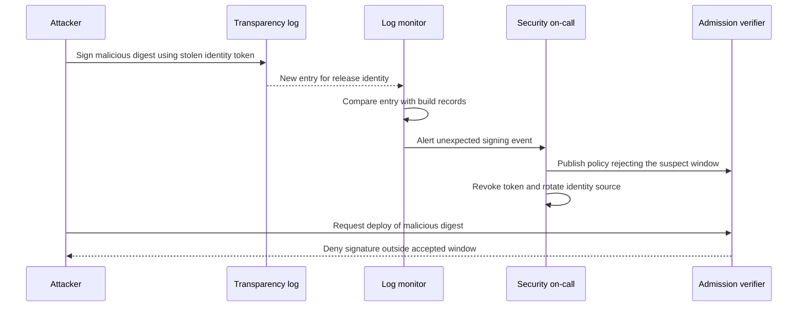

The sequence shows that detection and enforcement are separate steps owned by different parts of the system. The log monitor only detects, and the verifier only enforces what its policy says. The implication is that the time between the two, 60 + 30 = 90 minutes in this target, is the exposure window, and it is controlled by on-call response and policy distribution speed, not by cryptography. With only a weekly manual review of signing activity, the window is up to 7 × 24 = 168 hours, which is 168 / 1.5 = 112 times longer than the 90-minute target.

### 15.3 Scenario C: a build runner is compromised

- **Stimulus.** A malicious pull request exploits a workflow step and runs code on a runner.
- **Expected response.** The runner is ephemeral, so the code exists for one job. The job had no secrets, because pull request jobs run in the unprivileged trust domain of Section 5.4. A privileged release build of the same revision, if it happens, is rebuilt by a second independent builder and compared by digest before promotion.
- **Success criteria.** No credential with write access to the release repository is present in the compromised job. A digest mismatch between the two builders blocks promotion for 100% of tier-1 artifacts.

Arithmetic for runner lifetime: a persistent runner serving 14 builds per day for 30 days handles 14 × 30 = 420 jobs, and any file the attacker left behind can influence all of them. An ephemeral runner exposes 1 job. That is a 420-fold reduction in the number of builds a single runner compromise can touch, before counting the benefit of the second builder.

### 15.4 Scenario D: the verifier or signature log is unavailable

- **Stimulus.** The log service has an outage during an urgent security fix deployment.
- **Expected response.** Verification uses bundled inclusion proofs stored with the signature, and cached results by digest, so the deployment proceeds without a live log call. If the verifier itself is down, the production policy fails closed and the audited break-glass path is used.
- **Success criteria.** Deployments of already-verified digests complete during the outage. Any break-glass use is logged, alerts a human, and is reviewed within one business day.

## 16. Worked Case Study: A Mid-Sized Retailer

This case study is illustrative. The organization, its numbers, and its test results are invented to show the reasoning, and they are not measurements of any real company.

### 16.1 Context and constraints

An online retailer runs 40 services on Kubernetes in one cloud provider. Services are written in Node.js and Go with a few Python jobs. Teams build in a hosted CI platform with long-lived shared runners. Builds resolve dependency ranges at build time and push mutable tags to one container repository that every team can write to. Production pulls tags. The platform team of 6 people has to fix this without halting delivery. The business constraint is that median lead time from merge to production must not grow by more than 10 minutes. The threat priorities, ranked by the earlier attacker economics, are a compromised popular dependency, a compromised shared runner, and a stolen publishing credential.

Assumptions used in the arithmetic: 14 builds per day across all services, of which 5 are for 5 designated tier-1 services (payments, checkout, identity, the API gateway, and the shared base image). Each service resolves about 240 packages and sees 12 new package versions per week, as in Section 4.3.

### 16.2 Target design

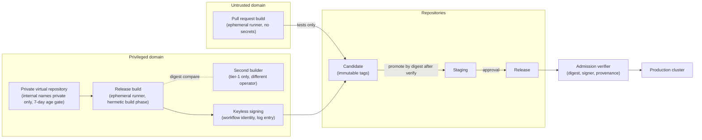

The diagram separates three trust domains. Pull request builds touch nothing that production reads. The privileged domain receives dependencies only through the private virtual repository, builds on single-use runners, and signs through a workflow identity. Repositories are separated by trust level, and the cluster reads only the release repository through the verifier. The implication is that an attacker needs a position in the privileged domain to produce anything the verifier accepts, and for tier-1 services needs positions in two builders as well.

### 16.3 Decisions and rejected alternatives

| Decision | Alternatives rejected | Reason for the choice |
|---|---|---|
| Lockfiles with strict install, private virtual repository, internal names resolved privately only, 7-day release-age gate | Unpinned ranges. Vendoring every dependency. | Unpinned ranges ingest 12 × 40 = 480 unreviewed versions per week. Vendoring would turn those 480 versions into 480 source diffs at 15 minutes each, 7,200 minutes or 120 hours per week. Grouped lockfile changes at 75 minutes per service cost 40 × 75 = 3,000 minutes or 50 hours per week, a saving of 70 hours. |
| Ephemeral runners in separate trust domains | Keep shared runners and rotate credentials monthly | A persistent runner exposes 14 × 30 = 420 jobs per month to one foothold, and ephemeral runners expose 1. Rotation shortens credential lifetime but leaves the runner as a foothold. |
| Second independent builder for the 5 tier-1 builds only | Reproduce every build. No second builder. | Rebuilding all 14 builds per day doubles compute, a 100% increase. Rebuilding 5 adds 5 / 14 = 35.7%, about 36%, and covers the artifacts with the largest blast radius. No second builder leaves a compromised builder undetectable. |
| Keyless signing bound to an exact workflow identity | Long-lived signing key in a Key Management Service. Unsigned with scanning only. | No long-lived key to rotate or steal, and the log gives detection. The cost is dependence on the identity issuer and the log, handled with bundled proofs. Scanning alone gives no evidence of origin. |
| Platform-generated provenance, verified at admission against repository, reference pattern, and builder identity | Provenance written by the build script | Script-written claims can be forged by any compromised step, as Section 6.2 explains. |
| Three repositories, immutable tags, promotion by digest | One repository with mutable tags | A moved tag changes what production pulls. Rebuilding per environment breaks the digest chain. |
| Admission in audit mode for 30 days in staging, then deny in production, with 30-day expiring exceptions for third-party base images | Deny everywhere on day one | Audit mode finds the unsigned artifacts that deny would have blocked, so the first deny does not stop an urgent fix. |

### 16.4 Lead-time check

The constraint was at most 10 additional minutes of median lead time. The added steps are signing and provenance generation (assumed 1 minute), the admission check (assumed 0.5 minutes with cached results), and promotion by digest between repositories (assumed 1 minute). That is 1 + 0.5 + 1 = 2.5 minutes. The second builder runs in parallel with the release build for tier-1, so it adds time only when it is slower than the primary, assumed 3 minutes in the worst case. Worst case total is 2.5 + 3 = 5.5 minutes, inside the 10-minute budget with 4.5 minutes of margin.

### 16.5 Validation evidence

The team defines tests that prove the controls work, not that they exist. The results below are invented for illustration.

| Test | Method | Expected | Illustrative result |
|---|---|---|---|
| Dependency confusion | Publish a package with an internal name and version 99.0.0 to a sandbox public registry and build | Build uses the private package or fails | Build used the private package in 40 of 40 services |
| Unsigned deploy | Push an unsigned digest to the release repository and deploy | Admission denies and logs | Denied, decision log entry present |
| Tag move | Attempt to push different content under an existing tag | Push rejected by immutability | Rejected |
| Wrong identity | Sign a digest from a workflow outside the allowed identity | Admission denies | Denied |
| Blast-radius drill | Pick a package and time the query from component to production workload | Under 15 minutes | 12 minutes |
| Builder comparison | Rebuild the 5 tier-1 artifacts on the second builder | Digests equal | 4 of 5 equal. One differed because of an embedded timestamp, fixed by normalizing the timestamp, then 5 of 5 |
| Verifier outage | Disable the verifier and the log in staging, then deploy a verified digest | Deploy succeeds from cached or bundled evidence | Succeeded |

The mismatch in the builder comparison is the useful result. It shows that reproducibility is a property that must be tested, and that the first run exposed a hidden input. The drill result of 12 minutes against a 15-minute target leaves a margin of 3 minutes, or 3 / 15 = 20%, which is thin enough that the team schedules the drill quarterly and re-measures as the number of digests grows.

### 16.6 Residual risk

The design does not stop a malicious change that a reviewer approves and merges, a malicious dependency that passes the 7-day gate undetected, or a compromise of the identity issuer or the CI platform operator. The team records these residual risks with owners and revisits them at each review.

## 17. Common Mistakes

| Mistake | Typical cause | Consequence |
|---|---|---|
| Signing without verifying | Signing was added to the pipeline to satisfy a checklist, and no admission policy was written | The signature has no effect, and a tampered artifact deploys exactly as before |
| Verifying that a signature exists, not who made it | The verifier is configured to accept any valid Sigstore certificate | Anyone with an account at the identity provider can sign an accepted artifact |
| Trusting tags | Manifests reference `latest` or a version tag for convenience | A moved tag changes production content with no new review or evidence |
| Builder signs its own provenance from inside the build script | The simplest implementation lets the script call the signing tool | A compromised step forges any claim, so provenance adds no independent assurance |
| Treating a lockfile as a review | The lockfile exists and the diff is merged without reading | The first malicious resolution is recorded with a valid hash and protected from then on |
| Shared mutable caches across trust levels | One cache key naming scheme is used for convenience and speed | An untrusted job writes content that a privileged release build later reads |
| Long-lived runners and static credentials | Ephemeral runners seemed expensive to set up | One foothold touches every later job, and a leaked token works until someone notices |
| Public and private registries merged by highest version | The virtual repository default or an extra index setting was never reviewed | Dependency confusion succeeds without the attacker needing any credential |
| A level or badge used as a conclusion | A claim of a build level or a clean scan is read as proof of safety | Accurate provenance for a malicious dependency passes every check |
| Deleting evidence during cleanup | Retention rules prune old digests, attestations, and SBOMs aggressively | An incident cannot be scoped, because there is nothing to match against |
| Fail-open verification with no alert | The verifier was tuned during rollout and the setting was never tightened | Disrupting the verifier lets unverified content deploy silently |
| No tested response | Controls were designed but the blast-radius query and rotation were never drilled | The first real incident is also the first run of the procedure |

## 18. Design-Review Checklist

Use these questions in an architecture review. A "no" or "unknown" is a finding with an owner.

**Source and identity**

- Do branch protection and review rules apply to every repository and to the workflow files that define builds?
- Can any single credential both produce an artifact and change the verification policy?

**Dependencies**

- Does every build install from a lockfile in strict mode, and does it fail on drift?
- Do internal names resolve only from private sources, with no fallback to a public registry?
- Are lockfile changes reviewed for new packages and changed sources, and is there a release-age gate plus a fast path for security fixes?
- Are Git or URL dependencies pinned to commits, and are install scripts restricted or sandboxed?

**Build**

- Are runners ephemeral, with separate trust domains for untrusted and privileged jobs and separate cache namespaces?
- Are build credentials short-lived and scoped to the job, and is network egress limited?
- Is there a hermetic fetch phase for the highest-value artifacts, and an independent rebuild where the blast radius justifies it?

**Evidence**

- Is provenance generated by the platform and not by the build script, and do policies rely on observed claims?
- Is the signing identity or key held so the build steps cannot read it, with a documented rotation or containment plan?
- Does the log, if used, have an owner who watches it and a response target?

**Repositories and promotion**

- Are tags immutable, deletion controlled, and deleted names not reusable?
- Are repositories separated by trust level, with promotion by digest and evidence verified again at the destination?
- Is there a quarantine state, and are retention rules aligned with rollback and audit periods?

**Verification and response**

- Does admission resolve to a digest, check signer identity and provenance, and deny by default in production?
- Is the failure policy chosen deliberately, with an audited break-glass path and a tested outage behavior?
- Are running digests re-evaluated periodically against current policy?
- Can the organization answer "which workloads contain this component" within a stated time, from data that does not depend on the system under investigation?
- Are vendors tiered by privilege and substitutability, with a tested exit or second-builder path for the highest tier?

## 19. Exercises

Each exercise has a brief answer outline. Work the exercise before reading the outline.

1. **Trace the trust chain.** Draw the path from a developer commit to a running pod for a service you know, and mark the evidence at each arrow and the party that checks it.
   *Outline:* Stages from Section 2.1. Each arrow needs evidence (review record, lockfile hash, provenance, signature) and a checker. Any arrow with no checker is a gap. The verifier at admission is the only one whose refusal stops production.

2. **Exposure arithmetic.** A service resolves 150 packages, each releasing a new version with probability 0.04 per week. Compute weekly and yearly unreviewed ingestions with ranges, then with 20% acceptance through reviewed batches.
   *Outline:* Weekly 150 × 0.04 = 6. Yearly 6 × 52 = 312. With 20% acceptance, 312 × 0.2 = 62.4, about 62. The levers are package count, acceptance rate, and ingestion speed.

3. **Dependency confusion review.** A team has a private registry and a public one in the same resolver configuration, and the internal package `acme-pay-core` has version 1.3.0. Describe the attack, two structural defenses, and a test that proves the defense.
   *Outline:* Attacker publishes `acme-pay-core` 99.0.0 publicly, and the resolver picks the highest version. Defenses are private-only resolution for internal names and lockfile with source and hash, with reserved public names as a third. Test by publishing a higher version to a sandbox public registry and confirming the build ignores it.

4. **Identity pattern design.** A verification policy accepts signatures from identity pattern "any workflow in the organization". Explain the risk and propose a narrower policy and the controls that protect it.
   *Outline:* Any contributor who can add a workflow file can obtain a certificate and sign. Narrow to the exact release workflow path and reference pattern, require the issuer, require log inclusion, and put the workflow file under review rules, since its path is part of the trust root.

5. **Compromise scoping.** A malicious version was live for 20 hours. Builds run 14 times per day. How many builds could have resolved it, and which credentials are in scope?
   *Outline:* 14 × 20 / 24 = 11.67, so assume 12. All credentials present in those 12 builds, including registry tokens, publishing tokens, deployment roles, and any reachable signing credential, plus runtime secrets if the code reached production. Rotate by reach, then rebuild from clean inputs.

6. **Builder trust.** Explain why a second builder reduces the risk of a compromised builder, and what a digest mismatch can mean.
   *Outline:* The attacker must compromise two independently operated builders. A mismatch means either the build is not yet reproducible (timestamps, paths, tool versions) or one builder produced something unexpected, so investigate the toolchain digest record before assuming compromise.

7. **Key replacement.** A signing key was exposed. How can verifiers replace it without trusting the old key to attest its successor?
   *Outline:* Distribute the new trust anchor through an independent channel such as a configuration repository with separate approval, or a root of trust signed by threshold keys held offline. Verifiers reject signatures from the old key after a cutover time, and artifacts signed during the exposure are re-signed after rebuild.

## 20. Summary

Supply chain security is the verification of trust across people, inputs, build processes, artifacts, and deployment. The summary maps to the outcomes stated in Section 1.

| Outcome from the Introduction | Where it was taught | Key takeaway |
|---|---|---|
| Draw the build trust chain and name the trust and evidence at each link | Sections 2, 8, 12 | Every arrow needs a check that does not rely on the previous stage, and the verifier at deployment is the decision that matters |
| Classify attacks by the stage they compromise | Sections 3, 15 | Inputs, the build process, and the output are separate targets, and controls must exist at all three |
| Constrain dependency resolution and decide using exposure arithmetic | Sections 4, 10, 14 | Exposure is proportional to unreviewed versions ingested, so reduce package count, batch and review updates, and delay adoption |
| Explain hermetic and reproducible builds, what each guarantees, and cost | Sections 5, 15, 16 | Hermeticity limits inputs and reproducibility lets a second party check the output, and both are applied where the blast radius justifies the cost |
| Describe provenance, attestations, and signatures, and how verification closes the chain | Sections 6, 7, 8, 9, 13, 16 | Bind claims to digests, let the platform author provenance, verify signer identity and claims against an independent policy, and promote by digest |

Pin inputs, isolate builders, bind provenance to immutable artifact identity, verify at consumption, and rehearse compromise response with measurable targets. Part 13 supplies delivery mechanisms, and this chapter defines the security claims those mechanisms must preserve.
